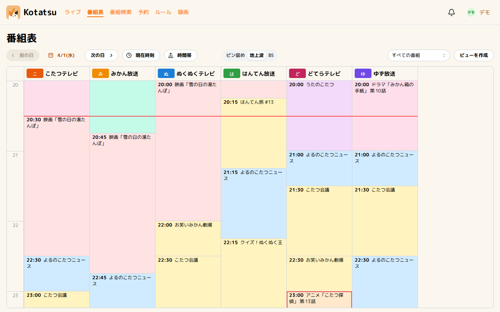
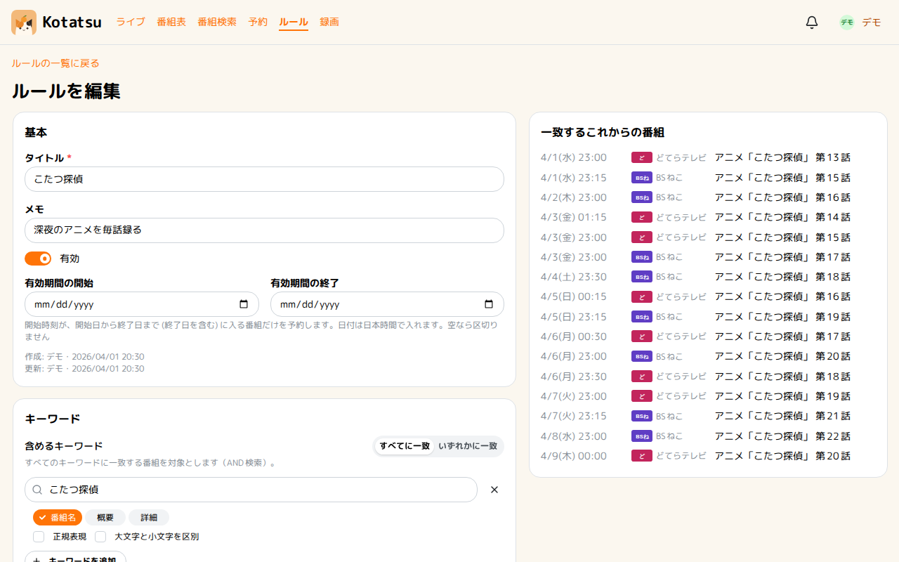
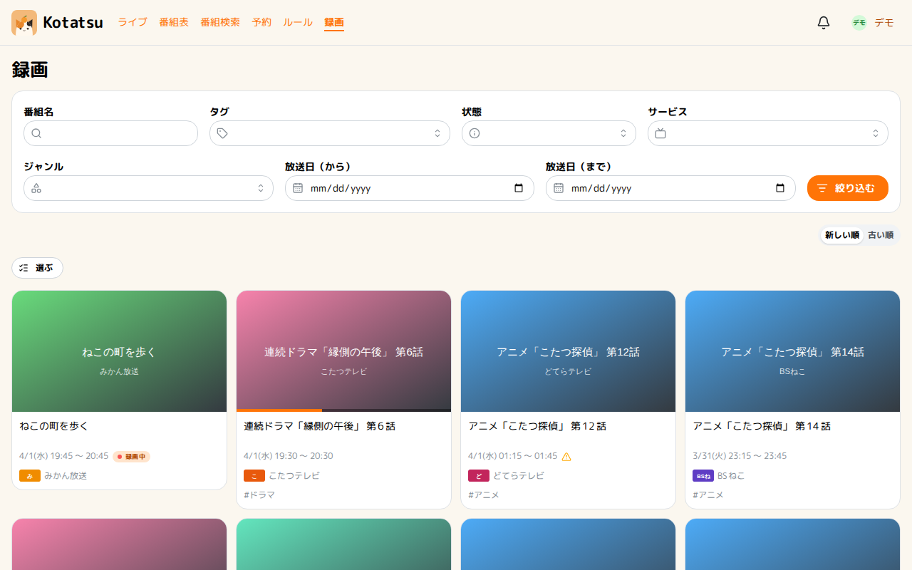
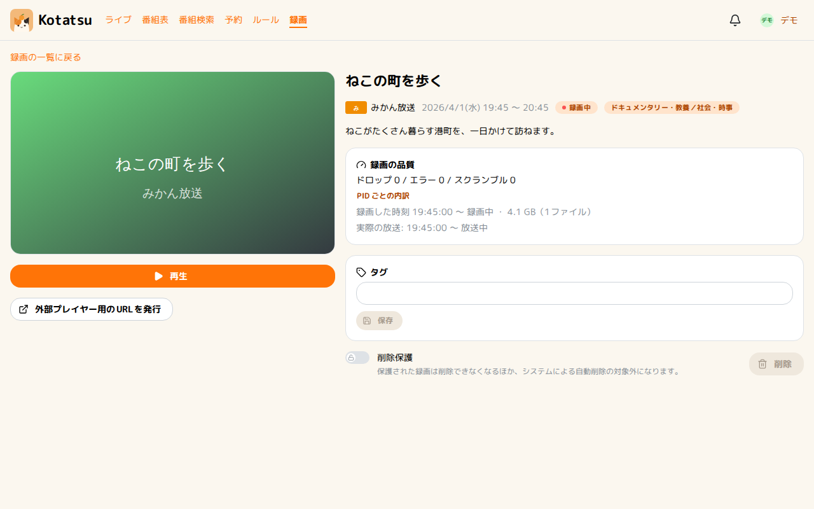

  

# Kotatsu

Kotatsu はテレビ番組を予約、録画、視聴できる Web アプリケーションです。
チューナーサーバーとして [Mirakurun](https://github.com/Chinachu/Mirakurun)、[mirakc](https://github.com/mirakc/mirakc)、[Mahiron](https://github.com/rokoucha/Mahiron) をサポートしています。

[デモアプリ](https://kotatsu-demo.pages.dev/)で操作感をおためしできます。

<table>
  <tr>
    <td width="50%">
      <picture>
        <source media="(prefers-color-scheme: dark)" srcset="docs/screenshots/guide-dark.png">
        
      </picture>
    </td>
    <td width="50%">
      <picture>
        <source media="(prefers-color-scheme: dark)" srcset="docs/screenshots/rule-dark.png">
        
      </picture>
    </td>
  </tr>
  <tr>
    <td width="50%">
      <picture>
        <source media="(prefers-color-scheme: dark)" srcset="docs/screenshots/recordings-dark.png">
        
      </picture>
    </td>
    <td width="50%">
      <picture>
        <source media="(prefers-color-scheme: dark)" srcset="docs/screenshots/recording-dark.png">
        
      </picture>
    </td>
  </tr>
</table>

## コンセプト

- テレビ番組の予約、録画、視聴などがシングルバイナリで動作します。
- 1台のマシンから、Kubernetes のマルチレプリカ構成までサポートしています。HA 構成も可能で、録画の信頼性を高める実装があります。
- 録画ファイルをサーバーサイドでトランスコードすることなく、ブラウザ内で低遅延で再生できます (mpeg2toh264)。もちろん、サーバーサイドでのトランスコードもサポートしています。
- PWA をインストールすることで、モバイル端末でも快適に使用できます。また、Web Push で通知を受け取ることもできます。
- ARIB 字幕 やデータ放送、NX-Jikkyo のコメントをオーバーレイ表示できます。
- セキュアなログイン方式として、パスキーや OpenID Connect、TOTP が利用できます。

その他、アプリの仕様は設計書 [spec.v1.md](docs/spec.v1.md) にまとめられています。

## 導入

次の前提要件が必要です。

- OS: Linux、macOS、Windows のいずれか
- データベース: PostgreSQL
- チューナーサーバー: [Mirakurun](https://github.com/Chinachu/Mirakurun)、[mirakc](https://github.com/mirakc/mirakc)、[Mahiron](https://github.com/rokoucha/Mahiron) のいずれか

> [!WARNING]
> ガイドを準備中です。もうしばらくお待ちください。

- [セットアップ](docs/setup.md)：Docker ComposeとHelmでの起動、EPGStationからの移行
- [設定](docs/configuration.md)：設定項目の一覧
- [運用](docs/operations.md)：バックアップ、更新、監視

## 開発

バックエンドに Go (PostgreSQL, GraphQL) を、フロントエンドに TypeScript (Vite+, React) を採用しています。

ローカル開発の手順は、[development.md](docs/development.md) を確認してください。

Issue や PR による Contribution については、[CONTRIBUTING.md](.github/CONTRIBUTING.md) も確認してください。

## ライセンス

Kotatsu は [Apache License 2.0](LICENSE) で公開しています。

同梱するソフトウェアとデータのライセンスは、[付録 B. ライセンスの境界](docs/spec.v1.md#付録-b-ライセンスの境界)にまとめられています。
