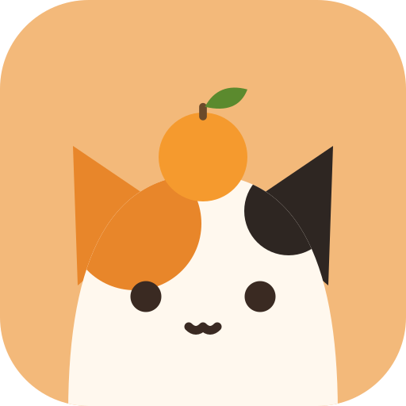

<p align="center">
  
</p>

# Kotatsu

Kotatsuは、日本のテレビ放送を予約、録画、視聴するためのWebアプリケーションです。
チューナーサーバーには[Mirakurun](https://github.com/Chinachu/Mirakurun)、[mirakc](https://github.com/mirakc/mirakc)、Mahironを使います。
[EPGStation](https://github.com/l3tnun/EPGStation)の後継として、録画予約から再生までを1つのアプリケーションで扱う設計です。

名前は、こたつに入ってテレビや録画をゆったり楽しむ情景から取りました。

[デモ](https://slashnephy.github.io/kotatsu/demo/)では、チューナーサーバーなしに、架空の局と番組で画面を触れます。
変更はブラウザの中だけに残り、読み直すと元に戻ります。

> [!WARNING]
> Kotatsuは開発中で、v1はまだリリースしていません。
> 番組表の同期、ルール予約、録画、録画の再生、ライブ視聴、通知は、ひととおり動きます。
> 残っている作業は[v1のマイルストーン](https://github.com/SlashNephy/kotatsu/milestone/1)で確認できます。

## 特徴

番組表、ルール予約、録画、録画の再生、ライブ視聴を、Mirakurun系のチューナーサーバーの上で1つのアプリケーションにまとめます。

1台のマシンからKubernetesのマルチレプリカ構成まで、同じバイナリで動かせます。
役割ごとのロールは、1つのプロセスにまとめても、別々のレプリカに分けても構いません。
録画の割り振りや後処理の状態はPostgreSQLに保存するので、どのレプリカからも同じ状態を参照できます。

何も設定しない状態でも、安全に動くようにしています。
ログインは必須です。パスワードでログインするときは、認証アプリ（TOTP）の確認も求めます。
パスキーとOIDCでもログインできます。
接続を受け付けるのは、既定ではプライベートネットワークからだけです。

録画は.m2tsのまま保存します。
録画の再生とライブ視聴では、ブラウザの中で映像をH.264に変換して再生します。
変換できない端末向けには、kyusuがサーバー側でトランスコードしたHLSを用意できます。kyusuを動かすかどうかは任意です。
再生中は、ニコニコ実況（NX-Jikkyo）のコメント、ARIB字幕、ライブ視聴のデータ放送を映像に重ねて表示できます。
ほかに、キャプチャ、別ウィンドウでの視聴、音声の切り替え、続きからの再生にも対応しています。
VLCやmpvで開くためには、期限付きの署名を付けたURLを発行します。

録画の開始、完了、失敗、競合などは、画面内の通知一覧、Web Push、Webhookで知らせます。
Webhookは、汎用のJSON、Discord、Slackの形式で送れます。

EPGStationからは`kotatsu import epgstation`で移行できます。
ルール、手動予約、録画済みの番組とファイル、録画履歴を取り込みます。
取り込む前にKotatsuを起動し、チューナーサーバーからチャンネルを同期しておいてください。
EPGStationの録画の保存先ディレクトリは、`--pool 名前=プールID`でKotatsuのプールに対応付けます。
取り込んだルールと予約の作成者には、`--user ユーザー名`で指定したユーザーを記録します。
`--dry-run`を付けると、取り込む件数だけを表示します。
取り込んだ録画は、nekonoteがTSを読み直して索引とドロップの集計を作り、続けてサムネイルを作ります。

## 構成

単一のバイナリ`kotatsu`のサブコマンドでロールを選びます。
`all`を指定すると、全ロールが1つのプロセスで動きます。

| ロール | 役割名 | 担当 |
| --- | --- | --- |
| tenban（天板） | server | GraphQL API、画面の配信、ライブ視聴と録画の配信 |
| neko（猫） | scheduler | 番組表の同期、ルールの照合、チューナーの割り当て。アクティブなインスタンスは1つ |
| mikan（みかん） | recorder | チューナーサーバーから受け取ったTSのファイルへの書き込み |
| nekonote（猫の手） | worker | サムネイル、容量の管理、通知などの後処理 |
| kyusu（急須） | transcoder | サーバー側でのその場のトランスコード。使うかどうかは任意 |

詳しい設計は[設計書](docs/spec.v1.md)にまとめました。

## 動かす

KotatsuにはPostgreSQLと、Mirakurun、mirakc、Mahironのいずれかのチューナーサーバーが必要です。
コンテナイメージは`ghcr.io/slashnephy/kotatsu`で配布しています。

Docker Composeで1台のマシンに立てる手順と、HelmでKubernetesに立てる手順は、次のドキュメントにまとめました。

- [セットアップ](docs/setup.md)：Docker ComposeとHelmでの起動、最初の管理者の作り方、HTTPSの注意点
- [設定](docs/configuration.md)：すべての設定項目と、YAMLと環境変数での書き方
- [運用](docs/operations.md)：バックアップの対象、録画を止めない更新、監視
- [開発](docs/development.md)：手元でKotatsuを動かす手順と、テストの流し方

## 開発

手元でKotatsuを動かす手順は、[開発](docs/development.md)にまとめました。
`mise run dev`で、PostgreSQLと偽のチューナーサーバーと一緒に起動できます。ソースを保存すると、その場で反映されます。

開発に使うツールは、[mise](https://mise.jdx.dev/)でインストールしてください。
変更を送るときの約束は、[貢献のしかた](.github/CONTRIBUTING.md)にまとめました。

```bash
mise install
```

| コマンド | 内容 |
| --- | --- |
| `mise run dev` | 開発用のComposeを動かす。ソースを保存すると、その場で反映される |
| `mise run generate` | sqlc、gqlgen、GraphQLのスキーマなどの生成物を作り直し、マイグレーションを検証する |
| `mise run test` | Goのテストを`-race`付きで実行する |
| `mise run lint` | golangci-lintを実行する |
| `mise run web:check` | 画面のlintと型を確認する |
| `mise run web:test` | 画面のテストを実行する |
| `mise run db:diff -- <名前>` | `db/schema.sql`の変更からマイグレーションを作る |

DBを使うテストは、`KOTATSU_TEST_DATABASE_URL`にPostgreSQLの接続先を渡したときだけ実行されます（[開発](docs/development.md#テストを流す)）。

## ライセンス

Kotatsuは[Apache License 2.0](LICENSE)で公開しています。
同梱するソフトウェアとデータのライセンスは、[設計書の付録B](docs/spec.v1.md#付録-b-ライセンスの境界)にまとめました。
