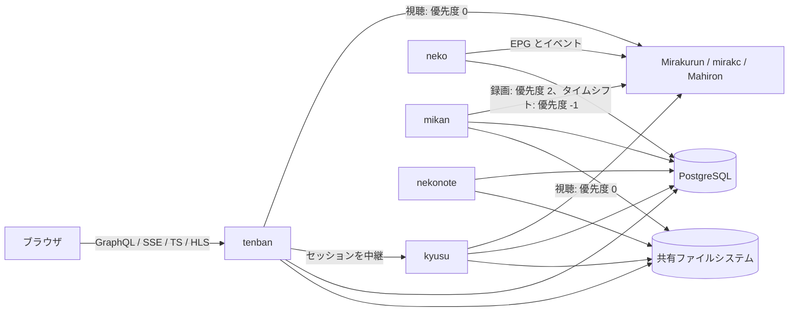
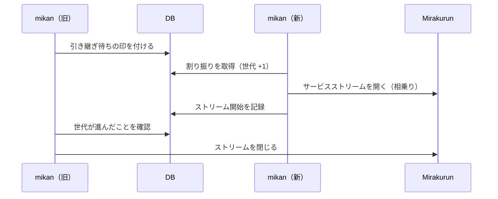
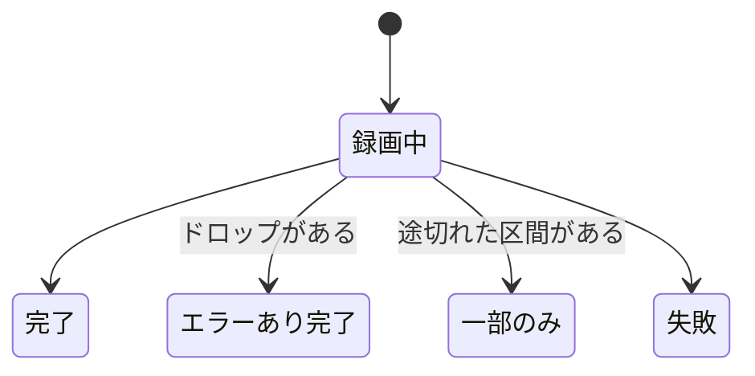

# Kotatsu 設計書 v1

| 項目 | 内容 |
|---|---|
| 状態 | 承認済み |
| 作成日 | 2026-10-09 |
| 対象 | Kotatsu v1 |
| ライセンス | Apache License 2.0 |

この文書は、Kotatsu v1の設計をまとめたものです。
各章の決定事項は、関連プロジェクトの調査と議論を経て合意したものです。
実装しながら確かめる必要がある事項は、[12章](#12-要検証事項)にまとめています。

## 目次

- [0. 概要](#0-概要)
- [1. 全体アーキテクチャ](#1-全体アーキテクチャ)
- [2. 技術選定](#2-技術選定)
- [3. チューナーサーバーと EPG の連携](#3-チューナーサーバーと-epg-の連携)
- [4. 予約エンジン](#4-予約エンジン)
- [5. 録画の実行とストレージ](#5-録画の実行とストレージ)
- [6. 後処理、通知、移行](#6-後処理通知移行)
- [7. ライブ視聴と録画の再生](#7-ライブ視聴と録画の再生)
- [8. データモデル](#8-データモデル)
- [9. API と認証](#9-api-と認証)
- [10. フロントエンドと UI/UX](#10-フロントエンドと-uiux)
- [11. 運用と開発](#11-運用と開発)
- [12. 要検証事項](#12-要検証事項)
- [付録 A. 既定値の一覧](#付録-a-既定値の一覧)
- [付録 B. ライセンスの境界](#付録-b-ライセンスの境界)
- [付録 C. 参考にしたプロジェクト](#付録-c-参考にしたプロジェクト)

## 0. 概要

### 0.1 Kotatsu とは

Kotatsuは、日本のテレビ放送を予約、録画、視聴するためのWebアプリケーションです。
チューナーサーバーにはMirakurun、mirakc、Mahironを使います。
l3tnun/EPGStationの後継として、録画予約から再生までを一つのアプリケーションで扱います。

名前は、こたつに入ってテレビや録画をゆったり楽しむ情景から取りました。
やわらかい角丸と暖色のアクセントを基調にした、居心地のよいホームサーバーを目指します。

### 0.2 背景

EPGStationは長く使われてきましたが、次の課題を抱えています。

- 技術スタックが古くなっています。v2系はNode.js 18とVue 2を前提にしており、新しいNode.jsでは録画が始まらない不具合の報告もあります。
- コンテナやKubernetesと相性がよくありません。録画のタイマー、プロセス内のロック、エンコードのキューをメモリ上にだけ持つので、複数のプロセスで処理を分け合えません。Kubernetesで動かす場合も、レプリカを1つに固定するしかありません。
- 開発が長く止まっていました。v2.10.0（2024-06）の後は更新がなく、2026-10にv3ブランチで大規模な更新が始まりました。ただしv3も、上に挙げたプロセス構成を引き継いでいます。
- 低スペックのマシンには重い構成です。エンコードや配信の子プロセスを含めると、コンテナのメモリ使用量が1 GiB近くに達した運用例があります。エンコードや配信のためのFFmpegのコマンドも、利用者が設定ファイルに書く必要があります。

関連するプロジェクトにも、Kotatsuが埋められる隙間があります。
tsukumijima/KonomiTVは先進的なプレイヤーを持ちますが、録画予約はEDCBをバックエンドにしたときだけ使えます。
Mirakurunやmirakcの上では、番組表を見られても予約はできません。
EDCBは予約エンジンの完成度が高い一方で、状態を単一のプロセスとテキストファイルで管理しており、HTTPのAPIも持ちません。

### 0.3 ゴール

- Mirakurun、mirakc、Mahironの上で、番組表、予約（ルール予約を含む）、録画、録画の再生、ライブ視聴を一つのアプリケーションで扱えるようにします。
- KonomiTVと同じ水準の視聴体験を提供します。対象は、ニコニコ実況のコメント、ARIB字幕、データ放送、mpeg2toh264によるブラウザ内での変換です。BS4K（ISDB-S3）の番組も、ブラウザで見られるようにします（#806）。
- 低スペック機1台からKubernetesのマルチレプリカ構成まで、同じバイナリで動かせるようにします。
- 何も設定しなくても安全な状態で動くようにします。認証は必須で、第二要素も必須です。既定ではプライベートネットワークからしか接続できません。
- EPGStationから移行できるようにします。
- 暖色と角丸を基調にした、やさしいUIにします。

### 0.4 v1 の非ゴール

- 録画後の自動トランスコード（録画ファイルは .m2tsのまま保存し、再生時に変換します）
- EPGStationのAPIとの全面的な互換性（一部のクライアント向けに、EPGStation互換の読み取り専用APIだけを用意します。[9.8](#98-api-トークン)）
- EDCBをバックエンドとして使うこと
- オブジェクトストレージへの保存（録画は大容量なので、クラウドのオブジェクトストレージでは費用が見合いません）
- SQLiteなどのファイル型DBへの対応（v1はPostgreSQLだけに対応し、将来の対応に備えた構造にします）
- 信頼済みプロキシが付けるヘッダーによる認証
- 誰でもできるユーザー登録
- iCalendarの配信、IPTV向けのM3UとXMLTV（MahironはIPTV向けのAPIを自前で持っています）
- iPhoneでのmpeg2toh264による再生（iPhoneではサーバー側のトランスコードを使います）
- 日本語表記のパスワードフレーズ辞書
- TwitterやXとの連携、ニコニコ本家へのコメント投稿
- ネイティブのスマートフォンアプリ
- 同じ番組を2台のrecorderで同時に録る冗長録画
- EDCBにある、編集距離を使ったあいまい検索と、録画設定のプリセット
- MCPのクライアントの、DCRによる登録と、管理者がクライアントIDとシークレットを発行する登録（CIMDだけで受け付けます。[9.9](#99-mcp-のクライアントの認可)）

### 0.5 コンポーネント名

コンポーネントには、こたつにちなんだ名前を付けます。
名前はCLIのサブコマンド、KubernetesのDeployment名、Goのパッケージ名まで統一して使います。
サブコマンドは役割名でも受け付けます（`kotatsu neko`と`kotatsu scheduler`は同じ意味です）。
`--help`とログには、`neko (scheduler)`のように役割名を必ず併記します。

| 名前 | 役割名 | 由来と役割 |
|---|---|---|
| kotatsu | アプリ全体 | アプリケーションと単一バイナリの名前です。 |
| tenban（天板） | server | みんなで囲み、物を置く場所です。API、画面、配信の窓口になります。 |
| neko（猫） | scheduler | 猫はこたつで丸くなります。こたつの中の猫は1匹だけで、アクティブなインスタンスが1つであることに対応します。普段は番組表を眺め、時間が来たら録画を割り振ります。 |
| mikan（みかん） | recorder | みかん狩りのように、放送から番組を摘み取ってかごに入れます。 |
| nekonote（猫の手） | worker | 「猫の手も借りたい」から取りました。録画後の雑用を手分けしてこなします。 |
| kyusu（急須） | transcoder | 1つの急須から複数の湯呑みにお茶を注ぎます。1つのエンコーダーの出力を複数の視聴者で共有することに対応します。 |
| kago（かご） | 保存先プール | みかんを入れておくかごです。 |
| yunomi（湯呑み） | プレイヤー | 注がれたものを受け取って味わいます。 |
| futon（布団） | UIのデザインシステム | やわらかく全体を包みます。 |

## 1. 全体アーキテクチャ

### 1.1 ロール

単一のバイナリ`kotatsu`のサブコマンドでロールを選びます。
`all`を指定した場合は、全ロールが1プロセスで動く構成です。
1台構成とDocker Composeでは`all`を既定にします。

| ロール | 台数 | 担当 | 共有ファイルシステム |
|---|---|---|---|
| tenban | N | GraphQL API、SPAの配信、ライブTSの中継、録画ファイルの配信、kyusuへの中継 | 読む |
| neko | アクティブは1 | EPGの同期、ルールの照合、チューナーの割り当て、録画の割り振り、番組のアーカイブ | 使わない |
| mikan | N | Mirakurunから受け取ったTSのファイルへの書き込みと、書き込み中の解析 | 書く |
| nekonote | N | Riverのジョブ（サムネイル、容量の管理、取り込んだ録画の解析、通知の配信、アニメの番組と作品の結びつき） | 読み書き |
| kyusu | 0〜N | サーバー側でのその場トランスコード（任意。GPUノード向け） | 読む |

管理用のサブコマンドとして、`kotatsu migrate`、`kotatsu import epgstation`、`kotatsu admin setup-token`、`kotatsu admin reanalyze`を持ちます。

ビルドのときに、版とコミットを`2026.10.0+<コミット>`の形でバイナリに埋め込みます（リリースはタグの版、mainのイメージは`edge`）。`-ffmpeg`のイメージにも、イメージのタグの接尾辞を付けない同じ版を埋め込みます。
埋め込まないビルドは`dev`とし、コミットはGoが埋め込むVCSの情報から取ります。
版は`kotatsu --version`、起動時のログ、GraphQLの`version`（ログインしたユーザーだけ）で確かめられ、画面ではユーザーのメニューに出します。

### 1.2 構成図

### 1.3 ロールの境界

処理が何を必要とするかで、置くロールを決めます。

- **neko**：全体を見て結果を一つに決める処理を担います。2か所で同時に動くと結果が食い違うので、アクティブにするのは1台だけです。
- **nekonote**：独立していて、再試行でき、数秒から数分遅れても困らない処理を担います。これらの処理はRiverに載せます。
- **mikan**：開始時刻に厳密で、何時間も続き、落ちたら数秒で引き継ぐ必要がある処理を担います。

| 処理 | ロール |
|---|---|
| Mirakurunのイベント購読、EPGの差分反映、定期的な全量の突き合わせ | neko |
| 放送が終わった番組のアーカイブと、保持期間を過ぎた番組の削除 | neko |
| 放送が終わった予約の削除 | neko |
| ルールの照合（自動予約） | neko |
| チューナー割り当ての再計算 | neko |
| 録画の割り振り | neko |
| タイムシフトの割り振り | neko |
| 録画の実行と引き継ぎ、ドロップの集計、シーク用の索引の作成 | mikan |
| タイムシフトのチャンクの書き込みと索引の作成 | mikan |
| 遅れて始めた録画の冒頭を、タイムシフトのバッファから写して補う | mikan |
| サムネイルとシークバー用プレビュー画像の生成 | nekonote |
| 録画のCMの区間の見分け | nekonote |
| 容量の管理と自動削除 | nekonote |
| 保持時間を過ぎたタイムシフトのチャンクの破棄 | nekonote |
| EPGStationから取り込んだ録画の解析 | nekonote |
| 通知の配信 | nekonote |
| 視聴予約の通知 | nekonote |
| アニメの番組と作品の結びつきに使う、連携先の情報の取り込み（[3.8](#38-アニメの番組と作品の結びつき)） | nekonote |
| アニメの番組と、しょぼいカレンダーの作品と話の照合（[3.8](#38-アニメの番組と作品の結びつき)） | nekonote |
| 見たアニメの、AnnictとAniListへの記録（[3.8](#38-アニメの番組と作品の結びつき)）。連携とプレイヤーの報告の受け付けはtenbanが行います | nekonote |
| EPGStationからの移行 | `kotatsu import epgstation`（管理用のサブコマンド） |

EPGの同期をnekoに置く理由は2つあります。
Mirakurunのイベント購読は1本で足り、複数の場所で購読すると同じ更新を重複して処理することになります。
また、EPGの更新はルール照合とチューナー割り当ての起点なので、同じプロセスに置けば一貫した状態のデータで処理を進められます。

EPGStationからの移行をサブコマンドにするのは、移行元のDBへの接続や録画ファイルのパスの対応付けを、対話的に確かめながら1回だけ実行する処理だからです。
取り込んだ録画の解析のような重い後続の処理は、Riverのジョブとしてnekonoteに回します。

### 1.4 協調の仕組み

ロール間で共有する状態は、DBと共有ファイルシステムだけです。
Redisなどの追加の依存は持ちません。

- **nekoのリーダー選出**：DBのリーステーブルで行います。KubernetesのLeaseと違って、Docker Composeや1台構成でも同じ仕組みで動きます。リースには世代番号を持たせ、古いリーダーの書き込みを世代番号で拒否します。リーダーの書き込みのトランザクションはリースの行をロック（`FOR KEY SHARE`）し、ほかのインスタンスはリースを取る前に行を`FOR UPDATE`でロックするので、書き込みの途中でリーダーは入れ替わりません。延長の`UPDATE`はこのロックとぶつからないので、長い書き込みの間もリースを延ばせます（#729）。リースを取る、延ばす、手放すときは、ロックを待つ時間に上限（付録Aの既定値は2秒）を設けます。固まったトランザクションが残っても、待ち続けずにあきらめ、後でやり直します。リーダーの処理が失敗したとき（DBの瞬断など）は、プロセスを終えずにリースを手放し、次の延長の間隔で取り直します。全ロールを1つのプロセスで動かす構成で、一時的な失敗で録画中のmikanごと止まらないようにするためです。
- **DBの接続**：トランザクションの中で何もしない時間と、1つの問い合わせの時間に上限を設けます（付録A）。固まったトランザクションや問い合わせが、リースを取れないまま残らないようにするためです。マイグレーションは長くかかることがあるので、問い合わせの時間の上限は付けません。PgBouncerなどのトランザクションプーリングを経由するときは、接続の開始のパラメーターを渡せないので、プーラーの側で設定します。
- **ジョブ**：Riverを使います。
- **変更の通知**：PostgreSQLのLISTEN/NOTIFYを使います。PgBouncerなどのトランザクションプーリングを経由するとLISTENが使えないので、ポーリングも併用します。見張り始めるときの最初の問い合わせが失敗しても、間を空けてやり直します。tenbanは、何が変わったかをGraphQLのsubscriptionでブラウザに送ります。
- **インスタンスの登録簿**：各ロールのインスタンスは、自分のアドレスとハートビートをDBに書きます。tenbanは、この登録簿を引いてkyusuのセッションへリクエストを中継します。

ライブ視聴の中継（mpeg2toh264の経路）には協調が要りません。
同じチャンネルを見る視聴者が何人いても、Mirakurunが1本のチューナーで相乗りさせるので、どのtenbanが中継しても余分なチューナーを消費しないからです。
エンコーダーを視聴者間で共有する必要があるのは、kyusuの経路だけです。

### 1.5 録画の受け渡し

録画の開始には、Riverの予約ジョブを使いません。
Riverの予約ジョブは、リーダーが5秒ごとに実行可能な状態へ移すので、開始が最大5秒ほど遅れます。
この遅れは、開始の少し前にジョブを投入してジョブの中で待てば避けられます。
問題は録画中の障害の扱いです。
Riverは実行中のジョブのハートビートを持たず、ワーカーが落ちて止まったジョブを救出するのは`RescueStuckJobsAfter`（既定1時間で、ジョブのタイムアウトより長くする必要があります）を過ぎてからです。
数時間かかる録画では、引き継ぎが数時間後になってしまいます。

そこで、録画の受け渡しには専用の割り振りテーブル（`recording_assignments`）を使います。

1. nekoが、録画開始の数分前（既定は2分前）に割り振りの行を書きます。
2. mikanは`SELECT ... FOR UPDATE SKIP LOCKED`で行を取り、数秒ごとにリースを延長しながら録画します。
3. リースが切れたら、別のmikanが行を取り直し、続きを新しいファイルに書きます。
4. 行には世代番号を持たせます。古いmikanは、延長で世代番号が進んでいたと分かった時点（ほかのmikanが取った時点）で書き込みをやめます。リースの期限は、mikanの時計ではなくDBの時刻で決めます。mikanを複数のマシンで動かすと時計がずれ、時計の進んだmikanが、ほかのmikanの録画中の行をリースが切れたとみなして取ってしまうためです。
5. 録画を終えたら、行を終わったことにします。録画を始めずに終えたとき（始める前に予約を無効にしたときなど）は、行を消します。残すと、予約を有効に戻しても、nekoが行を書き直せないためです。
6. 録画できない理由がそのmikanにあり、ほかにmikanが動いていれば、行をまだ取っていない状態に戻して手放し、しばらく（付録Aの既定値は1分）行を取りません。ほかのmikanが取って録画します。理由は、プールがマウントされていないとき（最初のセグメントを作るとき）と、まだ何も録っていないのにチューナーサーバーにつながらないまま30秒（付録A）が過ぎたときです。チューナーサーバーの再起動はすべてのmikanに同時に起きるので、一度つながらないだけでは手放しません。手放すときは、録画できなかった理由を録画の行に残し、ほかのmikanも録れなければ、nekoがその理由で録画を失敗にします（[5.5](#55-録画の状態)）。ほかにmikanがいなければ、手放さずに、これまでどおり自分で扱います。

DBに届かず、リースを延長できない間は、リースの期限が過ぎても書き込みをやめません（#1073）。DBに届いた後のエラー（権限など）は、DBが止まったのではないので、今までどおりリースの期限で書き込みをやめます。
ほかのmikanが行を取るにもDBが要り、取れば世代番号が上がるので、DBに届くようになってからの延長で、取られたかどうかが分かります。
期限が切れていても、世代番号が進んでいなければ誰も取っていないので、延長の`UPDATE`は期限を条件にしません。
こうしておくと、DBの更新や再起動で数十秒から数分止まっても、録画は欠けません。
延長の問い合わせは、DBへの接続が応答のないまま詰まっても延長を続けられるよう、延長の間隔で打ち切ります。
mikanは、自分が録っている行を、期限が切れていても取り直しません。DBが戻った直後に、行を取る処理が延長より先に動くと、自分で世代番号を進めて録画を止めてしまうためです。

DBに届かない間に予定の終わりが来ても、最後に読めた予約で終わりを決め、録画を止めます。セグメントを閉じた記録と、録画の完了は、DBに届くまでやり直し、録画を止めた時刻で記録します。DBが戻った時刻で記録すると、録画の終わりと途切れた区間がずれるためです。
DBに届かない間は、予約の変更（無効にする、時刻を動かす）は分からないので、最後に読めた予約に従います。
予定の終わりに止めるかは、DBを待つ前の時刻で決め、録画を止めた時刻もそれにそろえます。DBへの接続が応答のないまま詰まっても、DBを待つのは1回に5秒までにし、予定の終わりに気づけるようにします。延長中なら、最後に読めた番組の終わりで延長を続けます。予約した番組が遅れているときは、前の番組のセグメントを消せないので、DBに届くようになってから待ち始めます。
DBが予定の終わりをまたいで止まり、戻った直後にほかのmikanが割り振りを取ると、録り終えたmikanは世代番号が進んでいるので録画を完了にできません。そのため、予定の終わりの後に割り振りを取ったmikanは、録画中のまま残った録画を、前のmikanが覚えていた記録を書く間（再試行の間隔の3倍）待ってから、予定の終わりで完了にします。落ちたmikanの代わりなら、録れなかった終わりの部分は途切れた区間になります。
録画を始めるときやストリームが切れて開き直すときにDBに届かなくても、最後に読めた予約と録画設定で、ファイルに書き始めます。録画とセグメントの記録は、DBに届くようになったら、録画が終わるのを待たずに、書き始めた時刻で記録します。割り振りを取ったmikanは、開始の前に予約を読むので、割り振りを取った後にDBが止まっても録画は始まります。割り振りを取る前から止まっていれば、DBが戻るまで始まりません。

DBが戻った直後に、ほかのmikanが、期限の切れた行を延長より先に取ることがあります。
そのときは、古いmikanは次の延長で取られたと分かっても、引き継ぎ（[5.4](#54-引き継ぎと再起動)）と同じく、新しいmikanがストリームを開くまで書き続けてから止まります。それまで2つのmikanが同じ番組を書きます。
DBには届くのに、あるmikanだけが届かないとき（ネットワークの分断）も、ほかのmikanが期限の後に取り、分断が直るまで2つのmikanが書きます。
どちらも録画が重なるだけで、欠けません。重なった区間は、引き継ぎと同じく、セグメントをつなぐときに捌きます（[5.4](#54-引き継ぎと再起動)）。

割り振りを取ったmikanは、その時点ではまだチューナーを確保しません。
自分のタイマーで待ち、開始時刻からマージンとチューニングにかかる時間を引いた時刻にストリームを開き、開始時刻からマージンを引いた時刻から書き込みます（[5.1](#51-録画に使うストリーム)）。

### 1.6 チューナーの優先度

Mirakurunは、チューナーの利用者を「IP:ポート」で区別します。
そのため、Mirakurunから見ると、Kotatsuの各インスタンスはそれぞれ別の利用者です。
優先度の高い視聴のリクエストは、どのインスタンスから来ても、録画中のチューナーを奪えてしまいます。

これを防ぐため、全ロールが共通の優先度表に従います。

| 用途 | Mirakurunに渡すpriority |
|---|---|
| 録画 | 2 |
| 競合すると判定された録画（チューナーが空いていれば録る） | 1 |
| 視聴（ライブ視聴、kyusu） | 0 |
| タイムシフト（[5.7](#57-タイムシフト)） | -1 |

EPGの収集は、Mirakurunの内部でpriority -1として動きます。
タイムシフトは、録画にも視聴にも譲ります。
Mirakurunが使用中のチューナーを奪わせるのは、priorityが0以上のリクエストだけです。そのため、EPGの収集は、タイムシフトのチューナーを奪えません。タイムシフトは、ある種別のEPGの収集に要る最後のチューナーを使いません（[5.7](#57-タイムシフト)）。
v1では、これらの値を設定で変えられないようにします。mirakcで無条件にチューナーを奪う値128を、誤って使わないようにするためです。

## 2. 技術選定

### 2.1 バックエンド

| 項目 | 選定 | 理由 |
|---|---|---|
| 言語 | Go | メンテナーが習熟しており、コントリビューターも参入しやすいためです。Kotatsuの負荷はI/Oと外部プロセス（FFmpeg）とブラウザに集まるので、Rustとの性能差はほぼ出ません。`CGO_ENABLED=0`でarm64の静的バイナリも作れます。 |
| API | GraphQL（gqlgen） | スキーマ（SDL）をAPIの原本にします。subscriptionをSSEで配信できます。 |
| HTTP | 標準のnet/http | 映像の配信と認証の手続きは、GraphQLの外の素のHTTPで扱います。 |
| ジョブ | River（riverpgxv5） | PostgreSQLのトランザクションの中でジョブを投入できます。 |
| DB | PostgreSQL、pgx v5、sqlc | v1はPostgreSQLだけに対応します。DBへのアクセスはinterfaceの裏に置き、将来はsqlcのSQLiteエンジンで2系統目のクエリを足せるようにします。 |
| マイグレーション | `schema.sql`に宣言的に書き、Atlasで差分を生成します | 実行時は、Goに埋め込んだマイグレーションを`kotatsu migrate`が適用します。 |
| ログ | log/slog（JSON形式） | |
| 可観測性 | OpenTelemetryとPrometheus形式の`/metrics` | OTLPの送信先を設定したときだけ、トレースとメトリクスを送ります。メトリクスは`/metrics`と同じものです。 |
| 設定 | YAMLと環境変数 | 置き場所の基準は[11.2](#112-設定の置き場所)で定めます。 |
| 認証 | go-webauthn、pquerna/otp、coreos/go-oidc、x/crypto/argon2、webpush-go | |
| ARIBの処理 | tsreadexを子プロセスとして使います | GoにはARIBの文字符号を扱える成熟したライブラリがありません。番組情報はMirakurunがJSONで返し、字幕とデータ放送はブラウザで描画するので、Kotatsuの中でARIBの文字符号を解く必要はありません。 |

Kotatsuの中でTSを解析するのは、パケット単位の処理（ドロップの集計、PATとPMT、Iフレームの位置）だけです。
これらはARIBの知識を必要としないので、Goで直接書きます。

PostgreSQL以外のDBを使いたい利用者には、SupabaseなどのマネージドなPostgreSQLを勧めます。
マネージドDBがトランザクションプーリングの接続口を提供している場合、そこを経由するとLISTENが使えません。
直接接続を推奨としたうえで、プーラー経由でもポーリングだけで動くモードを用意します（Riverの`PollOnly`もこのためのものです）。

### 2.2 パスワード強度の判定

パスワードの強度はzxcvbn-ts（日本語辞書`@zxcvbn-ts/language-ja`を含む）で判定し、弱いパスワードを拒否します。
クライアントでの判定は入力中のフィードバックに使い、拒否するかどうかはサーバーで判定します。
APIを直接呼べばクライアントの判定は素通りできるからです。

Goに移植されたzxcvbnは、どれも更新が止まっています（trustelem/zxcvbnの最終更新は2024-04、nbutton23/zxcvbn-goはアーカイブ済みです）。
そこで、zxcvbn-tsそのものを、Pure GoのJavaScriptエンジンであるgojaの上で動かします。
クライアントとサーバーが同じバージョンの同じ辞書で判定するので、両者の結果は食い違いません。
バージョンはnpmのパッケージとしてRenovateで追跡します。

この方式は、使い捨ての実験コードで確かめました。

| 項目 | 結果 |
|---|---|
| 互換性 | 用意した27件のパスワードすべてで、Node.jsと結果が一致しました（スコア、推定試行回数、警告文、提案文）。ES2015、ES2017、ES2020のどのバンドルもgojaで動きました。 |
| 速度 | VMの生成と辞書の読み込みに約0.2秒、初回の判定に約0.13秒かかり、2回目以降は1件あたり約40 msでした。 |
| メモリ | VMを保持している間、ヒープが約37 MiB増えました。 |
| バイナリサイズ | gojaで約9 MB、gzipで圧縮した辞書バンドルで約0.9 MB増える見込みです（後述の対処で約1.8 MBになりました）。 |

この結果から、VMはパスワードの設定時と変更時にだけ作って捨てます。
入力の長さに上限を設け、`vm.Interrupt`でタイムアウトさせ、判定APIの呼び出し回数を制限します。

ただし、上の速度は短いパスワードでの値です。
数字や記号の多い長いパスワードでは、zxcvbn-tsのl33tの照合が遅くなります。
l33tの照合は、`4→a`のような読み替えの候補を最大100通り作り、候補ごとに辞書全体を引き直すからです。
64文字のパスワードの判定は、手元のgojaで約3.5秒、負荷の高い機材では12秒を超えました。

そこで、zxcvbn-tsに次のパッチを当て、判定の結果を変えずに速くします（`frontend/patches`）。

- l33tの候補では、読み替えた文字を含む部分だけを辞書で引き、引いた結果を候補の間で使い回します。読み替えた文字を含まない部分の一致は、もともと捨てられます。
- 順位を付け終えた辞書を受け取れるようにします。サーバーのバンドルには、ビルドのときに順位を付けた辞書をJSONの文字列で埋め込みます。gojaの`JSON.parse`はGoで動くので、辞書を展開して順位を付け直すより速いからです。
- 辞書の照合で、部分文字列を1文字ずつ伸ばしながら引くとき、辞書のどの語にも現れない2文字の組が出たら、その位置から伸ばすのをやめます。その組を含む部分は、どの語にも一致しないからです。語に現れる組は、ビルドのときに辞書から求めてバンドルに埋め込み、ユーザーの入力の語の組は判定のたびに加えます。

パッチを当てた後の判定は、元のzxcvbn-tsをNode.jsで動かした結果と、無作為な長いパスワードやl33tを含む626件すべてで一致しました。
VMの生成と辞書の読み込みは約0.4秒から約0.1秒に、128文字の記号入りの判定は手元のgojaで約1秒から約0.6秒になりました。
代わりに、埋め込む辞書のバンドルは、gzipで約0.9 MBから約1.8 MBに増えます。

日本語辞書の収録語はローマ字だけです。
かなや漢字のフレーズは総当たりの組み合わせ数で評価されるので、実際より強めに判定されます（実験コードでは「こたつでみかん」がスコア2、「猫はこたつで丸くなる」が3でした）。
そのため、NIST SP 800-63B-4に沿った長さの規定とブロックリストの照合を併用します（[9.3](#93-ローカルアカウント)）。

### 2.3 フロントエンド

ReactのSPAをVite+ でビルドし、Goのバイナリに埋め込みます。
本番環境でNode.jsを動かさないことが、低スペック機への配慮として最も効くからです。
Next.jsの利点はSSRとRSCですが、そのためには本番でNode.jsのプロセスを1つ増やす必要があります。
詳細は[10章](#10-フロントエンドと-uiux)で定めます。

### 2.4 コンテナイメージ

同じバイナリを載せたイメージを2種類用意します。

| イメージ | ベース | 用途 |
|---|---|---|
| `ghcr.io/slashnephy/kotatsu:<バージョン>` | `gcr.io/distroless/static-debian13:nonroot` | tenban、neko、mikan |
| `ghcr.io/slashnephy/kotatsu:<バージョン>-ffmpeg` | Debian 13のslimにDebianの`ffmpeg`パッケージとVAAPI・QSVのドライバを入れ、tsreadexをソースからビルドして同梱します | kyusu、nekonote、`all` |

FFmpeg（VAAPIやQSVのドライバを含む）とtsreadexは共有ライブラリを必要とするので、staticのイメージには入りません。
サムネイルの生成にFFmpegが要るので、全ロールを1プロセスで動かす`all`も`-ffmpeg`イメージを使います。
`-ffmpeg`イメージの実行ユーザーは、distrolessの`nonroot`と同じUID 65532にそろえます。
VAAPIとQSVのドライバには、Debianのパッケージ（`mesa-va-drivers`、amd64では加えて`intel-media-va-driver-non-free`、`libvpl2`、`libmfx-gen1.2`）を使います。IntelのVAAPIのドライバだけは、non-freeコンポーネントの`intel-media-va-driver-non-free`を入れます。mainの`intel-media-va-driver`は、Gen11以前のGPUで、縮小（VPP）とHEVCのエンコードができないからです（#509）。ライセンスの扱いは[付録B](#付録-b-ライセンスの境界)で定めます。NVENCのライブラリは、NVIDIA Container Toolkitがホストから渡します。
どちらもamd64とarm64に対応します。

## 3. チューナーサーバーと EPG の連携

### 3.1 接続先

接続するチューナーサーバーは1台だけです。
設定するのはURLと、必要に応じてBASIC認証の資格情報です。
複数のチューナーサーバーを束ねる処理は、MirakurunのリモートチューナーやMahironのremotesといった、チューナーサーバー側の機能に任せます。

Mirakurun互換のAPIを基本にし、サーバーごとの追加機能は接続時と定期的に判定します。
起動時に一度だけ判定して使い続けることはしません。
EPGStationはMirakurunのAPI定義を起動時に取得してキャッシュし続けたため、古い定義のまま固まり、再起動しないと復帰しないことがありました。

| サーバー | 判別の方法 | 追加で使う機能 |
|---|---|---|
| Mirakurun | 既定 | `/api/events/stream` |
| mirakc | `/events`の有無 | `/events`（SSE）、`/api/onair` |
| Mahiron | `/api/version`の`server`が`mahiron` | `/api/events/stream` |

mirakcの録画予約のAPI（`/api/recording/*`）は使いません。
mirakcは予約を自身のノード上のファイルに保存するので、Kotatsuのスケジューラと予約を二重に管理することになるからです。

チャンネル種別は列挙型にせず、チューナーサーバーが返す文字列をそのまま保持します。
Mahironは`BS4K`や`EXT1`のような任意の種別を返すことがあるからです。
GR、BS、CS、SKYには表示名と並び順の既定値を持たせ、それ以外の種別は文字列のまま表示します。
管理者は、種別ごとの表示名と並び順を画面から変えられます。

### 3.2 識別子

- 番組が同じかどうかは、(networkId, serviceId, eventId)と開始時刻の組で判定します。EIDは再利用されることがあるからです。Mirakurunの番組IDは属性として保持します。
  - 放送中とこれからの番組（`programs`）では、上流と同じく(サービス, eventId)で一意にし、放送時間が変わっても同じ番組として更新します。番組予約は、これで時間の変更に追従します（[4.6](#46-番組の変更への追従)）。開始時刻は、放送が終わった番組を`program_archives`に移すときに、再利用されたEIDと見分けるのに使います。
- サービスは、MirakurunのサービスID（networkId × 100000 + serviceId）で識別します。
- 予約、ルール、録画といったKotatsu自身のデータには、独自のIDを振ります（[8.1](#81-共通の約束)）。

### 3.3 EPG の同期

nekoは、次の手順でEPGを同期します。

1. 接続したときと定期的に、チャンネル、サービス、番組の全量を取得し、DBと差分で突き合わせます。上流にあってDBにない番組は追加し、内容が変わった番組は更新し、上流から消えた未来の番組は削除します。ただし、上流がサービスの番組を1つも返さなかったときは、そのサービスの番組を消しません。チューナーサーバーが一時的に空の一覧を返すと、未来の番組と、そこから作ったルール予約が全部消えてしまうためです。全件を削除して入れ直す方式は取りません。EPGStationでは、全件の削除と挿入を1つのトランザクションで行う処理が多重に起動してロックを奪い合い、そのまま回復しなくなることがありました。全件を入れ替えると、テーブルの統計情報も崩れます。
2. 全量の取得と次の取得の間は、イベントストリームを購読して差分を反映します。購読先は、MirakurunとMahironでは`/api/events/stream`、mirakcでは`/events`です。
3. Mirakurunのイベントストリームにはハートビートがなく、60分で切れます。変化がなければ何分でも黙るので、放送のストリームと違い、データが届かないことでは切れたとみなしません（#954）。番組の削除イベントも、時間の重なる番組に置き換えられたときにしか届きません。そのため、イベントは「変化があった」という合図として扱い、データの正しさは全量の突き合わせで保証します。
4. 全量の突き合わせは、既定では30分ごとと、再接続したときに行います。実行の間隔には下限を設け、再接続が続くときはバックオフします。
5. イベントは1〜2秒分をまとめ、1つのトランザクションで反映します。反映したら、変更のあったサービスと時間帯を添えて「EPGが変わった」と通知し、ルールの照合とチューナーの割り当てを走らせます。アニメの番組と作品の照合（[3.8](#38-アニメの番組と作品の結びつき)）も、この通知の記録を読みます。立て続けに来る変更は間引きます。

番組の映像の解像度（`video.resolution`。2160p、4320pなど）も取り込みます（#806）。BS4Kと8Kの番組を見分け、再生の経路を選ぶのに使います（[7.1](#71-再生経路)）。Mahironは、BS4Kの番組の映像の種類（`video.type`）を`mpeg2`と返すので、映像の種類は解像度で見分けます。録画には、録画を始めたときの番組の解像度を写します。
映像も音声も流さないサービス（データ放送、エンジニアリングサービスなど）は、視聴も録画もしないので取り込みません。種別はEPGStationの`isMediaService`と揃えます。取り込みをやめる前に入ったそのようなサービスと番組は消さずに残し、番組の検索とルールの照合では対象にしません。
アーカイブへ移す猶予を過ぎた番組は、上流が返しても突き合わせません。上流は放送の終わった番組をしばらく返し続けるので、足すと、移したそばから`programs`に戻ってしまいます。

サブチャンネルがメインチャンネルと同じ番組を流していても、放送のEITにイベント共有の記述子（event_group_descriptor）がなく、event_idも違うことがあります（2026年10月に、NHK総合1と2で確かめました）。上流はこの番組に`relatedItems`の`shared`を付けないので、同期のときに補います。
地上波の同じTS（ネットワーク、チャンネルの種別とチャンネル）で種別が同じサービスの番組のうち、開始、長さ、番組名が同じで、どれも`shared`を持たない番組には、互いを指す`shared`を足します。
BSとCSでは補いません。1つのTSに別の放送局のサービスが入り、「インフォメーション」のような番組名が同じ時間に重なるからです。
足した`shared`は、上流が付けたものと同じに扱います（[3.5](#35-検索と照合)、[4.2](#42-ルール)、[4.4](#44-重複の回避)）。
番組名で比べるので、「この時間はメインチャンネルをご覧ください」のような、サブチャンネルだけの番組はまとめません。
地上波では、イベントで一部のサービスの番組を突き合わせるときも、同じTSで種別が同じサービスの番組をまとめて突き合わせます。片方のサービスの番組だけでは、同じ番組かを比べられないからです（#1024）。

MirakurunのイベントストリームはSSEでもNDJSONでもありません。
最初に`[`を送り、その後はイベントのJSONと`,`を改行で区切って送り続け、配列を閉じません。
このストリームを逐次に読む専用のパーサーを用意します。

### 3.4 過去の番組の保持

番組は2つのテーブルに分けて持ちます。

- **`programs`**：放送中の番組と、これから放送される番組です。
- **`program_archives`**：放送が終わった番組です。

nekoは、放送が終わってから一定の猶予（既定24時間）が過ぎた番組を、`programs`から`program_archives`へ移します。
猶予を置くのは、Mirakurunが放送の終わった番組をしばらく持ち続け、その間に更新が届くことがあるからです。
放送前に予定から消えた番組は、アーカイブせずに削除します。

アーカイブの保持期間は設定で指定します（既定は90日、0で無期限）。
GR、BS、CSをすべて受信する環境では、1日に数千件の番組が増える見込みです。
1年分だと百万件規模になり、低スペック機のディスクには重くなるので、既定値は短めにしています。
保持期間を過ぎたアーカイブは、nekoが少しずつ削除します。

過去の番組が検索の性能を落とさないように、次のように扱います。

- ルールの照合、今日から先の番組表、通常の番組検索は`programs`だけを読みます。対象は、過去の番組をどれだけ残しても数万件のままです。
- 番組表では、過去の番組の保持期間の中の、最も古い過去の番組の日まで遡れます（#1121）。今より前の時間帯を出すときだけ、`programs`に加えて`program_archives`も読みます。放送が終わってから猶予の間は同じ番組が両方にあるので、`programs`の番組（サービス、イベントID、開始時刻）は二重に出しません。読む範囲は、番組表と同じく開始時刻と終了時刻で絞るので、過去の番組が増えても読む量は変わりません。過去の番組の詳細では、録画と視聴の予約のボタンを出さず、その番組の録画（番組の放送時間に重なる、同じイベントIDの録画）と、タイムシフトのバッファに残っていれば追っかけ再生を開くボタンと、同じ番組名を条件に過去の放送も含めて番組検索を開くボタンを出します。
- 過去の番組の検索は、UIで「過去の放送も含める」を選んだときだけ行います。期間の指定は必須で、既定は直近30日です。期間で絞るインデックスを効かせたうえで、番組名を照合します。
- pg_trgmやPGroongaのような全文検索の拡張は前提にしません。日本語への対応がまちまちで、マネージドDBで使えるとも限らないからです。

### 3.5 検索と照合

番組名と説明には、NFKCで全角と半角をそろえた検索用の列を持たせます。
Mirakurunはサービス名を全角で返すので（例：`ＴＯＫＹＯ　ＭＸ１`）、正規化しないと半角で入力した語が一致しません。
ARIBの囲み文字（🈟、🈑、🅊、🆞など）は、EPGStationと同じく`[新]`、`[字]`、`[HV]`、`[4K]`のような括弧の書き方にしてから正規化します。EPGStationから移したルールの`[再]`のようなキーワードが、そのまま一致するようにするためです。`新`のように括弧のないキーワードも一致します。括弧にするのは、囲み文字の表（[4.2](#42-ルール)）にあるものだけです。表にない囲み文字（🄰、🈲など）は、NFKCで中の文字にするだけにします。🈀は番組名の一部（「〜ほか」）なので、括弧にせず「ほか」にします。㊙も「㊙情報」のように言葉の一部として使われるので、括弧にせず「秘」にします。EPGStationは、この2つも`[ほか]`、`[秘]`にしていました。書き方を変える前に書いた番組の列は、作り直しません（#840）。
詳細も、見出しの順に見出しと本文をつないで正規化した列を、EPGの同期のときに持たせます。
ルールの照合は番組の変わるたびに全番組を読み、番組の検索も候補を1件ずつ照合するので、そのたびに正規化し直すと重いからです（2万番組を最後まで照合する検索で、時間の8割近くが正規化でした。#852）。
アーカイブへ移すときも、この列を写します。
この列を足す前に書いた番組と、列を写すようにする前に移したアーカイブは、照合のときに正規化します。
録画にも、番組名と概要を正規化した列を持たせます。録画を記録するときと、予約の追従で番組情報を写し直すときに作ります。録画の検索のキーワードは、正規化してから、番組名と概要の部分一致で探します（大文字と小文字は区別しません）。録画は詳細を持たないので、詳細では探しません。列を足す前の録画は、`kotatsu migrate`が埋めます。列を知らない古いバイナリがローリング更新の間に書いた録画は、次の`kotatsu migrate`で埋まるまで、正規化していない番組名と概要で探します（#1044）。

番組の検索では、期間、チャンネル、ジャンル、無料かどうかによる候補の絞り込みはSQLで行います。
正規表現でなく番組名と概要だけを見るキーワードも、正規化した列の部分一致でSQLで粗く絞り、照合する候補を減らします。
候補は、開始時刻のインデックスの順に、一定の件数ずつ読みます。放送前の番組とアーカイブを1つの問い合わせで読むときも、インデックスの順に読めるように書きます。そうしないと、読むたびにカーソルより後ろの候補をすべて並べ替えるので、候補の数の2乗に比例して遅くなります（#852）。
ルールの照合は、放送前の全番組を一度に読んでGoで照合し、SQLでは絞りません。ルールごとに部分一致で絞ると、ルールの数だけ全番組を走査するので、かえって遅くなるためです（2万番組と50ルールで、照合全体の約90msに対し、SQLの部分一致は1ルールで約75ms。#530）。
正規表現でないキーワードは、正規化した文字列の部分一致で探します。大文字と小文字を区別しないときは、正規表現の`(?i)`と同じく、大文字と小文字の組を同じ文字とみなします。かなや漢字のように大文字と小文字のないキーワードは、番組の文字列を畳まずに探します。
正規表現の照合は、Goのregexp（RE2）で行います。
RE2は入力の長さに対して線形の時間で動くので、ユーザーが書いた正規表現で処理が止まる（ReDoS）ことはありません。
ただし、Goのregexpは1文字あたりが遅く、長い詳細を多くのルールで照合すると重くなります（2万番組と50ルールで、詳細まで探す正規表現の照合は1回に約12秒。#852）。
そこで、正規表現に一致する文字列が必ず含む文字列（`(?i)abc|def`なら、大文字と小文字を区別しない`abc`か`def`）を構文から取り出し、どれも含まない番組は正規表現にかけずに落とします。
`[0-9]+`のように、必ず含む文字列を決められない正規表現は、そのまま照合します。結果は、正規表現だけで照合したときと変わりません。
このような正規表現で詳細まで探すルールが多いと、それでも照合が重くなるので、ルールの照合では、番組をCPUの数（GOMAXPROCS。コンテナのCPUの制限に従います）のまとまりに分け、並べて照合します（2万番組と50ルールで、約7.8秒が20コアで約0.84秒、4コアで約2.0秒。#878）。1つの番組に一致したルールの順は、並べないときと変わりません。
ルールの作成と編集の画面では、必ず含む文字列を決められない正規表現で詳細まで探すキーワードがあれば、一致する番組のプレビューの上で、照合が重くなることを警告します。照合の前段がそのキーワードから文字列を取り出せるかどうかで判定します。書ける正規表現を狭めないよう、警告にとどめ、保存は止めません（#904）。
含めるキーワードは、すべてに一致する番組か、いずれかに一致する番組かを選べます（既定はすべてに一致）。除外するキーワードは、いずれか1つに一致すれば除外します。
ルールの照合（neko）と番組の検索（tenban）は同じ照合関数を使うので、両者の結果は一致します。
サブチャンネルがメインチャンネルと同じ番組を流している（イベント共有）ときは、ルールの照合と同じく、番組の検索でもサービスIDの最も小さい番組だけを返します。放送のEITに共有の記述子がない番組も、同期のときに補った`shared`（[3.3](#33-epg-の同期)）で同じように扱います。

### 3.6 チューナーの把握

チューナーの一覧と、各チューナーが受信できる種別は、イベントと定期的な取得で更新し続けます。
EPGStationのように起動時に固定することはしません。

1本のチューナーで複数の種別を受信できる機器（PX-MLTなど）も扱えるようにします。
同じチャンネルの予約どうしは、1本のチューナーを共有します。

Kotatsuを通さずにチューナーを使う利用者（TVTestなど）もいるので、Kotatsuの割り当てはあくまで予測です。
実際にチューナーを確保できなければ、mikanが予定の終わりまで再試行します。
それでも確保できなければ、失敗の理由を`tuner_unavailable`として記録します。nekoは、1分ごとの割り当ての計算し直しで、チューナーの状態を反映します。

### 3.7 時刻と縮退

時刻の基準はOSの時計（NTPで同期済みのもの）とします。
チューナーサーバーが返すHTTPのDateヘッダーと比べて10秒より大きくずれていたら、警告します。nekoはログに残し、画面では、システムの状態でずれを強調し、ホームで全員に知らせます。録画の開始と終了がずれうるので、管理者でなくても気付けるようにします。通知は送りません。

チューナーサーバーに接続できない間は、UIに縮退中であることを表示し、バックオフしながら再接続を続けます。
再接続できたら、全量の突き合わせからやり直します。
チューナーサーバーの状態は、Kotatsuの起動やlivenessの判定には影響させません。

### 3.8 アニメの番組と作品の結びつき

アニメと特撮の番組を、しょぼいカレンダーの作品（TID）と話数に結びつけ、Annict、AniList、MyAnimeListの作品IDを引けるようにします（#926）。
以前、同じ照合をTVTestのプラグイン（TVTestAnnictRecorder）として作り、視聴している最中に行っていました。Kotatsuでは、照合を視聴するときではなく、EPGを同期した後に行い、結果をDBに持ちます。
過去の番組を保持しているので（[3.4](#34-過去の番組の保持)）、何か月後に録画を再生しても、元の放送時刻で照合した結果を使えます。
結びつきは、AnnictとAniListへの記録（#927）や、見たいリストからの予約（#928）にも使います。

- **既定では使いません。** 管理者が連携の画面（`/admin/integrations`）で有効にしたときだけ動きます。外部（しょぼいカレンダーと、GitHubのraw。Annictのトークンを設定すれば、AnnictとAniListも）へ問い合わせるので、何も設定しなくても安全に動くという方針（[0.3](#03-ゴール)）に合わせます。外部へ出られない環境もあります。有効にするかどうかの変更は、外部へ問い合わせ始めるかどうかを決める操作なので、再認証を求めます（[9.5](#95-セッションと防御)）。無効にすると問い合わせをやめますが、取り込んだ情報と結びつきは消さずに残します。
- **作品と話の結びつきのために外部へ問い合わせるのは、nekonoteのジョブだけです。** nekoのEPGの同期には入れません。nekoはアクティブが1つだけで、同期はチューナーの割り当てにつながっているので、しょぼいカレンダーが遅いときや落ちているときに、同期まで遅らせないためです。見たアニメの記録（後述）では、記録と見たいリストの取り込みはnekonoteのジョブで行いますが、利用者が連携するときと連携を外すときだけ、tenbanが記録先に問い合わせます（トークンの引き換え、アカウントの名前、トークンの取り消し）。
- 外部への問い合わせには、`Kotatsu/<版> (+https://github.com/SlashNephy/kotatsu)`のUser-Agentを付け、問い合わせ元がKotatsuだと分かるようにします。

#### 取り込む情報

| データ | 取り込み元 | 中身 |
|---|---|---|
| チャンネルの対応 | [saya-definitions](https://github.com/SlashNephy/saya-definitions)の`definitions.json` | サービスと、しょぼいカレンダーのチャンネル（ChID）、Annictのチャンネルの対応 |
| 作品IDの対応 | [arm](https://github.com/kawaiioverflow/arm)の`arm.json`（設定で、同じ形のJSONに向け直せます） | しょぼいカレンダーのTIDと、Annict、AniList、MyAnimeListの作品IDの対応 |
| 作品IDの対応（自前） | AnnictとAniListのGraphQL API（管理者がAnnictのトークンを設定したときだけ） | AnnictのしょぼいカレンダーのTIDとMyAnimeListのIDから作った、TIDと、Annict、AniList、MyAnimeListの作品IDの対応（#1223） |

- nekonoteは、1時間ごとに取り込み直す時期が来たかを確かめ、前に問い合わせてから1日たった取り込み元を取り込みます。管理者が連携を有効にしたときは、1時間を待たずに取り込みます。前に取り込んだときのETagを送り、変わっていなければ読み直しません。
- 取り込めなかったら、前に取り込んだ内容を残し、理由を記録して、1時間後に問い合わせ直します。1つの取り込み元が取り込めなくても、ほかの取り込み元は取り込みます。連携の画面には、取り込み元ごとに、取り込んだ日時と件数、取り込めなかった理由を出します。
- saya-definitionsは、地上波のネットワークIDを持ちません（地域ごとに違うので、`15`が入っています）。そこで、地上波は種別とサービスIDで、BSとCSはネットワークIDとサービスIDで、サービスと照らし合わせます。同じサービスが2度出てきたら、先に出てきたものを使います（TVTestAnnictRecorderと同じです）。
- 管理者は、サービスの画面（`/admin/services`）で、サービスごとにChIDとAnnictのチャンネルを上書きできます。項目ごとに上書きし、空にすると取り込んだ対応に戻ります。取り込み直しても、上書きは残ります。家族の中で完結する操作なので、再認証は求めません。変えたことは監査ログに残します。
- 1つのTIDに複数の作品が対応することがあります（分割して登録された作品など）。
- 作品IDの対応は、設定（`anime_linking.arm_url`、`KOTATSU_ANIME_LINKING_ARM_URL`）で、armの`arm.json`と同じ形のJSONに向け直せます。自分で作った対応を、公開しない場所に置いて取り込むときに使います。URLには資格情報を含められるので、秘密情報として扱い、`_FILE`で終わる環境変数でファイルから渡せます。取り込めなかった理由にはURLを書かず、取り込み元の名前（`arm`）だけを書きます。取り込んだ対応は、向け直しても`arm`の取り込み元として持ちます。
- armだけでは、arm-supplementaryが直していた誤りや抜けが直りません。また、Annictの[API利用規約](https://annict.com/terms/api)（2026年11月25日に施行）は、APIで取得したデータを、まとまったデータとして第三者が取り出せる形で提供することを禁じているので、armが更新され続けるかは分かりません。そこで、管理者がAnnictのアクセストークンを設定すれば、作品IDの対応を自前で作ります（#1223）。規約は、アプリケーションの提供に要る範囲での保存を認めているので、取得したデータはインスタンスのDBにだけ持ち、外には出しません。
  - Annictの`searchWorks`で、作品のしょぼいカレンダーのTIDとMyAnimeListのIDを引き、`annict_works`に持ちます。TIDのない作品は、対応を作れないので持ちません。
  - Annictは、全件を一度に引かず、間を空けて1つずつ問い合わせるよう求めています。そこで、今期と来期の作品は1日に1回引き直し、すべての作品は、1回の取り込みで20ページ（1,000作品）ずつ、数日に分けて引きます。引いたところまでを覚えるので、途中で失敗しても、次は続きから引きます。すべて引き終えたら、30日後に初めから引き直します。問い合わせの間は1秒以上空けます。
  - AniListのIDは、MyAnimeListのIDから、AniListの公開のAPI（`Page.media(idMal_in:)`）で50件ずつ引きます。1回の取り込みで20回まで、2秒以上空けて問い合わせ、引いてから30日たったら引き直します。MyAnimeListのIDが変われば、すぐに引き直します。1つのMyAnimeListの作品に複数のAniListの作品が対応したら、小さいIDを使います。
  - 引いた作品から、`anime_works`に`annict`の取り込み元の行を作り直します。1つのTIDに複数の作品が対応すれば、AnnictのIDの順に並べます。作品IDを引くときは、TIDごとに、`annict`の行があればそれを、なければ`arm`の行を使います。armは、予備として取り込み続けます。
  - トークンは、管理者が連携の画面で入れ、アプリの秘密キーで暗号化して保存します（[8.4](#84-秘密情報)）。画面にも、ログにも、監査ログにも出しません。サーバーが外部へ問い合わせるときの秘密情報なので、変えるときは再認証を求め、変えたことだけを監査ログに残します。空にすると消え、自前の対応は作り直さなくなります（作った対応は残します）。読み込みの権限だけの個人用アクセストークンで足ります。
  - 取り込めた日時と件数、取り込めなかった理由は、ほかの取り込み元と同じく、`annict_works`の取り込み元として連携の画面に出します。1時間ごとに、引く時期の来たものだけを引くので、ほかの取り込み元の「1日ごと」の間隔には従いません。
- 番組との結びつきには、TIDまでを持ち、作品IDは、使うときに作品IDの対応から引きます。armが後から更新されたときに、しょぼいカレンダーを引き直さなくても、過去の番組の結びつきまで直るからです。

#### 照合

照合するのは、ジャンルがアニメ・特撮（大分類が0x7）で、しょぼいカレンダーのChIDに対応するサービスの番組だけです。外部への問い合わせと、持つ行の数を減らします。
nekonoteは、次の3つの機会に照合します。どれも、しょぼいカレンダーの`ProgLookup`の放送時間データで、番組を作品と話に結びつけます。

| 機会 | 対象 | 間隔 |
|---|---|---|
| EPGが変わったとき | EPGの同期が「EPGが変わった」と通知したサービスと時間帯（[3.3](#33-epg-の同期)）の番組。前に読んだ変更の記録（`epg_changes`）の版数を覚え、その後の記録を読みます | 1分ごとに記録を読みます |
| 照合し直し | 放送中と、これから1週間に放送される番組 | 6時間ごと |
| 放送が終わった後の確定 | 放送が終わり、まだアーカイブへ移していない番組（[3.4](#34-過去の番組の保持)の24時間の猶予の間） | 1時間ごと |

- **しょぼいカレンダーへの問い合わせは控えめにします。** 番組ごとではなく、ChIDと日（日本時間）ごとに放送時間データを引いてDBにキャッシュし、6時間は引き直しません。引き直すときは、ChIDごとに続いた日を1つの期間にまとめ、同じ期間を引くChIDを10個までまとめて、1回の`ProgLookup`にします。問い合わせの間は2秒以上空けます。
- しょぼいカレンダーの登録は、放送の直前まで変わります（延期、話数の訂正）。照合し直すたびに、6時間より古い放送時間データを引き直し、引き直した期間になかった放送時間データは、しょぼいカレンダーから消えたものとしてキャッシュからも消します。
- 放送が終わった番組は、放送が終わった後に引いた放送時間データで照合し直し、結びつきを確定させます。確定させた番組は、それからは照合し直しません。しょぼいカレンダーに問い合わせられなかった番組は確定させず、1時間後にやり直します。
- 放送時間データの放送時間（`StTime`と`EdTime`を`StOffset`だけずらしたもの）と番組の放送時間が、短いほうの半分以上重なれば結びつけます。2話連続の放送のように、1つの番組に複数の放送時間データが重なれば、すべてに結びつけます。削除された放送時間データは使いません。
- 話数は`Count`から読みます。複数の話をまとめた放送時間データは、サブタイトルが`#1～#2`の形になるので、そこから話数の範囲を読みます。サブタイトルは、タイトルのサブタイトルの表から引いたもの（`JOIN=SubTitles`の`STSubTitle`）を使い、なければ放送時間データのサブタイトル（特番の名前など）を使います。`Flag`の`[新]`と`[終]`の印と、再放送の印（8）も持ちます（#1233）。再放送の印は、照合し直しで付くので、この印を持つ前に確定させた過去の番組には付きません。
- 照合した記録は、どの話にも結びつかなかった番組も残します。番組と結びつきは、`programs`とは別のテーブルに、サービスと開始時刻で持ちます。`programs`の主キーのEIDは使い回されるからです。アーカイブへ移す処理には手を入れずに、過去の番組の結びつきも残ります。放送時間が変わった番組（[4.6](#46-番組の変更への追従)）は、前の放送時間の結びつきを消します。番組表からも過去の番組からもなくなった番組の結びつきは、照合し直しのときに消します。
- しょぼいカレンダーの放送時間データのキャッシュは、放送が終わってから2日で消します。
- 管理者がチャンネルの対応を上書きしたときと、取り込み直したチャンネルの対応が変わったときと、連携を有効にしたときは、6時間を待たずに照合し直します。
- 照合が長く止まり、EPGの変更の記録（24時間残します）を読みそこねても、照合し直しが6時間ごとに、これから1週間の番組をすべて照合します。
- 1回の`ProgLookup`の期間は7日までにします。`db.php`は1回に5,000件までしか返さないので、5,000件が返ってきたら、取りこぼしがあるかもしれないものとして、キャッシュせずに失敗として扱います。

#### 番組名の解析

しょぼいカレンダーで引けない番組（ChIDに対応しないサービスの番組や、アニメ専門チャンネルのリピート放送など）は、番組名を解析して話に結びつけます。TVTestAnnictRecorderと同じく、作品名の後に`#1`や`#1-#2`（`#1・2`）と書いた話数を読み、`第1話`の書き方も読みます。話数の後に`「」`で書いたサブタイトルも読みます。番組名の前後の`[新]`や`[字]`のような印は除きます。番組名に`[再]`の印（囲み文字の🈞を含みます）があれば、再放送とします（#1233）。

- 作品名からTIDを引くため、しょぼいカレンダーのタイトルの一覧（`TitleLookup`の`TID=*`で、TID、タイトル名、更新日時だけ）を、ほかの取り込み元と同じく1日ごとに取り込みます。初めは1回の問い合わせですべてのタイトルを引き、それからは前に取り込んだときより後に更新されたタイトルだけを引きます。
- 作品名とタイトル名は、NFKCで正規化し、空白を除き、小文字にして比べます。1つのタイトルだけに一致すればTIDを付けます。同じ名前のタイトルが複数あれば、どれか決められないので、TIDは付けず、話数とサブタイトルだけを持ちます。
- 話数が書かれていない番組は、結びつけません。

#### 録画への写し

録画には、解像度と同じく（[3.3](#33-epg-の同期)）、録画を始めたときの番組の結びつきを写します。番組とはサービスと開始時刻で照らし合わせるので、写すのは番組予約とルール予約の録画と、タイムシフトのバッファから昇格した録画です。時刻予約の録画には写しません。
録画を始めた後に、放送が終わるまでの照合し直しや、放送が終わった後の確定で結びつきが変わったら、その番組の録画の写しも写し直します。予約が番組の変更に追従する間は録画にも番組情報を写すのと同じです（[4.6](#46-番組の変更への追従)）。アーカイブへ移した後は、写し直しません。

EPGStationから取り込んだ録画（[6.3](#63-epgstation-からの移行)）は、nekonoteのジョブが、10分ごとに、まだ照合していない録画を古い順に照合します。同じ番組を照合していれば、その結びつきを写し、なければ録画のサービスと開始時刻で照合します（確定と同じく、放送が終わった後に引いた放送時間データを使います）。取り込んだ録画は何年分もあり、日がばらばらなので、1回に問い合わせるChIDと日の組を14までに抑えます。取り込んだ録画はジャンルを持たないことが多いので、ジャンルのない録画も照合し、アニメと特撮でないジャンルを持つ録画だけを外します。ChIDに対応しないサービスの録画は、番組と同じく、番組名を解析して話に結びつけます。しょぼいカレンダーに問い合わせられなかった録画は、照合したことにせず、次の機会に回します。

#### 画面

番組の詳細と録画の詳細に、結びついた話の話数とサブタイトル、`[新]`と`[終]`と再放送の印（#1233）と、Annict、AniList、MyAnimeList、しょぼいカレンダーの作品のページへのリンクを出します。2話連続の放送は、1話ずつ並べます。作品のページは、TIDから作品IDの対応を引いて決めるので、armが直れば、過去の番組と録画のリンクも直ります。

#### 見たアニメの記録

結びつきを使って、Kotatsuで見たアニメを、ユーザーが連携したAnnictとAniListに記録します（#927）。TVTestAnnictRecorderをKotatsuに移すものです。

- **連携はユーザーごとです。** 管理者は、AnnictとAniListに、Kotatsuのリダイレクト URI（`/auth/anime-records/<記録先>/callback`。連携の画面に出します）を登録したアプリを作り、クライアント IDとシークレットを連携の画面（`/admin/integrations`）で登録します。利用者を記録先へ送り出すアプリを決める操作なので、変えるときは再認証を求めます（[9.5](#95-セッションと防御)）。利用者は、アカウントの連携の画面（`/settings/account`）から記録先へ移って認可し、Kotatsuに戻ってきます。管理者が連携を無効にしているときは、設定を出さず、記録もしません。
- **認可は、認可コードフローにPKCE（S256）とstateを組み合わせます。** stateはSHA-256だけを、認可を始めたセッション、ユーザー、記録先と一緒にDBに持ち、10分で期限切れにします。戻ってきたら、引くと同時に消し、始めたセッションと記録先のまま戻ってきたことを確かめます。ほかの端末やアカウントで始めた認可を、別のユーザーに繋がせないためです（CSRFとアカウントの取り違えを防ぎます）。API トークンやMCPのクライアントのトークンでは始められません。結果は、`/settings/account`に`connected=<記録先>`か`error=<理由>`を付けて伝え、理由にはトークンなどの中身を入れません。
- アクセストークンは、アプリの秘密キーで暗号化して保存し（[8.4](#84-秘密情報)）、画面にも、ログにも、監査ログにも、ジョブの引数にも出しません。連携を外すと、Kotatsuからトークンを消し、Annictではトークンを取り消します。AniListはトークンを取り消すAPIを持たないので、AniListの設定の画面からもアプリを外すよう、画面で案内します。
- 記録先への問い合わせは、決まったホスト（`annict.com`、`api.annict.com`、`anilist.co`、`graphql.anilist.co`）だけにし、リダイレクトはたどりません。設定（`anime_records.annict_url`、`anime_records.anilist_url`）で向け直せますが、本物の記録先の代わりに検証用のサーバーへ向けるときだけ使います。
- **見たかどうかは、プレイヤーが実際に再生した区間で決めます。** ライブ視聴と録画の再生のプレイヤーは、映像の時刻が進み、放送の時刻が壁の時計と同じくらい進んだ区間だけを、放送の時刻の区間として、30秒ごとと、画面を閉じるときにサーバーへ送ります（[7.5](#75-その他のプレイヤー機能)）。一時停止の間は進まず、シークで飛んだ分は区間を切るので、最後までシークしただけでは記録しません。サーバーは、区間の端を秒にそろえ（1秒に満たない区間は数えません）、ユーザーと番組（サービスと開始時刻）ごとに、区間を重ねずにまとめて持ちます。細かくばらけた区間をたくさん送られても行が大きくなりすぎないよう、1つの番組に持つ区間は1,000までにし、超えたら間の最も短い隣どうしをまとめます。端末の時計が進んでいて、今より5分以上先の区間が届いたら、断らずに、その分を切り捨てます（断ると、端末が送り直し続けるためです）。同じ区間を送り直しても、順番が入れ替わっても、複数のタブで同時に見ても、多く数えません。ライブ視聴と録画の再生で見た区間も、同じ番組なら合わせて数えます。ライブ視聴では、サービスの番組のうち区間に重なるものに、録画の再生では、録画した番組に数え、番組の外の区間は数えません。終了時刻が未定の番組は、長さが分からないので数えません。
- 番組の長さのうち、ユーザーが決めた割合（既定は20%、TVTestAnnictRecorderと同じ）を見たら、TIDに結びついた話を、連携した記録先ごとに、1話ずつの記録として作ります。2話連続の放送は、すべての話を記録します。記録は`(ユーザー, 番組, 話, 記録先)`で1回だけ作るので、見続けても、見直しても、送り直しません。
- **記録は、nekonoteのRiverのジョブで送ります。** 話を1話ずつ送り、送れた話はすぐに記録したことにします。ジョブの期限（15分）が来ていても、記録先に送れた話は、送れたことを残します。残せないと、送り直しで記録が二重になるからです。同じ番組と記録先のジョブは終わるまで1つにするので、動いている間に増えた話（照合し直しで結びついた話など）は、ジョブが、送る話がなくなるまで引き直して送ります。記録先が5xxや429を返したり、届かなかったりしたら、Riverの再試行で、送れなかった話だけを送り直します（8回まで）。トークンが使えない、エピソードが見つからないなど、送り直しても変わらないものと、最後の試行でも送れなかったものは、記録できなかったことにします。結果は、送れた話と送れなかった話に分けて、見たユーザーだけに通知します（[6.2](#62-通知)）。
- **Annict**には、エピソードごとに記録します。エピソードは、記録するときにユーザーのトークンで引き、話数、話数の文字列（`第1話`、`#1`）、サブタイトルの順に照らし合わせます。エピソードのない作品（劇場版など）は、作品の状態を「見た」にします。1つのTIDに複数の作品が対応するときは、エピソードが見つかった最初の作品に記録します。
- **AniList**は、エピソードごとではなく、何話まで見たか（`SaveMediaListEntry`の`progress`）を持つので、今の値より大きいときだけ進めます。見直しで巻き戻さないためです。話数のない放送は、1話だけの作品なら1話を見たことにし、ほかは記録できないものとします。
- **作品の状態**は、ユーザーごとに選べます（既定では、Kotatsuからは状態を送りません。ただし、AniListは、`progress`を送った項目の状態を自分で決めることがあります。新しく作った項目を`CURRENT`にするなど。AniListの振る舞いは、本物で確かめていません）。Annictでは、状態の変更を、記録を付けたことを残してから別に送り、失敗してもログに残すだけにして、記録は付け直しません。AniListでは、話数と状態を1回の`SaveMediaListEntry`で送ります。第1話（`[新]`）を見たら「見てる」にする、最終話（`[終]`）以外を見たら「見てる」にする、最終話を見たら「見た」にする、の3つです。すでに「見た」の作品は「見てる」に戻しませんが、`[新]`なら戻します（分割2クールなど）。AniListでは、「見てる」を`CURRENT`、「見た」を`COMPLETED`にします。
- 記録先は、Goのinterfaceの裏に置き、MyAnimeListなども後から足せるようにします。TwitterやFacebookへの同時投稿は、v1の非ゴール（[0.4](#04-v1-の非ゴール)）に合わせて扱いません。通知から記録を取り消す操作は、まだ設けません。
- **手で記録する**（#1232）：配信サービスやほかの端末で見た話、見た割合が足りなかった話、結びつきが後から直った話のために、番組の詳細と録画の詳細から「見たことを記録する」で、結びついた話を記録できます。視聴管理の画面のカードからは、次に見る話を「第N話を見たことを記録する」で記録できます（TIDに引ける作品で、次の話の話数が分かるときだけ）。視聴者も使えます。送るのは、見た割合から記録するときと同じジョブで、結果も同じく、記録したユーザーだけに通知します。tenbanは記録の行を作ってジョブを入れるだけで、記録先には問い合わせません。
  - 番組の詳細と録画の詳細からの記録は、見た割合から作るときと同じく`(ユーザー, 番組, 話, 記録先)`で1回だけ作るので、手で記録した番組を後からプレイヤーで見ても、二重に記録しません。
  - カードからの記録は、番組によらないので、サービスを0に、開始時刻を記録を頼んだ日時にした行にします。同じ話の記録（記録できなかったものを除きます）がどの番組にもあれば作らず、カードから記録した話は、後からその話の番組を見ても記録しません。どの記録先にも記録済みなら、記録済みと示します。
  - 記録できたら、見たいリストの進み具合も進めます（前述）。作品の状態は、見た割合から記録するときと同じ設定に従います。
  - 手で記録した話の取り消しは、通知からの取り消しと同じく、まだ設けません。間違えたときは、記録先で消します。
- 見た区間は、最後に足してから90日で、nekonoteが1日ごとに消します。

#### 見たいリストの放送

ユーザーがAnnictとAniListで「見たい」「見てる」にした作品の、これからの放送を、録画の候補として出します（#928）。見たい作品を登録すれば、番組表を探さずに予約できます。

- **候補を出すだけにし、ルールは自動では作りません。** ルールと予約は家族の共有物なので（[9.7](#97-ロールと権限)）、1人の見たいリストで勝手に予約を増やさないためです。予約できるユーザーが、候補から1回の操作でルールを作るか、放送ごとに予約します。視聴者は、自分の候補を見られますが、ルールも予約も作れません。
- **トークンは、見たアニメの記録（前述）の連携のものを使います。** 別の認可は求めません。Annictの`read write`のスコープで、ライブラリーを読めます。AniListはスコープを持たず、トークンでリストを読めます。管理者が連携を無効にしているときと、ユーザーが連携していないときは、取り込まず、候補も出しません。
- **取り込むもの**：Annictは、`viewer.libraryEntries(states: [WANNA_WATCH, WATCHING])`をページ（100件）ごとに、AniListは、`Viewer { id }`でユーザーを引いてから、`MediaListCollection(userId, type: ANIME, status_in: [PLANNING, CURRENT])`をチャンク（500件）ごとに引きます。記録先ごとに2,000件までにします。作品は、記録先の作品ID、状態（見たいか見てるか）、記録先の作品名を、ユーザーと記録先ごとに持ち（`anime_wishlist_entries`）、取り込み直すたびにすべて入れ替えます。視聴管理の画面と手動の記録（#1229）のため、次に見る話、見終えた話数、全話数、放送の時期（年とシーズン）、作品の画像のURLも取り込みます（#1230）。Annictは、`nextEpisode`（グローバルID、話数、話数の文字列、サブタイトル）と、作品の`seasonYear`、`seasonName`、`episodesCount`、`image.recommendedImageUrl`を引き、見終えた話数は持たないので、次に見る話の話数の1つ前とします。AniListは、`progress`と、作品の`episodes`、`season`、`seasonYear`、`coverImage.large`を引き、次に見る話は持ちません。シーズンは、AnnictのAUTUMNとAniListのFALLをどちらも秋とし、冬、春、夏、秋の4つで持ちます。全話数と年は、0なら分からないものとします。進み具合は、記録先ごとに持ちます（AnnictとAniListの両方と連携していても、まとめません）。中断（Annictの`ON_HOLD`、AniListの`PAUSED`）は取り込みません。予約の画面の「見たいリスト」タブの候補を変えないためです。
- **進み具合を新しく保つ**：取り込みは6時間ごとなので、kotatsuが記録先に話を記録できたら（`anime_records`が`recorded`になったら）、その記録先の作品の見終えた話数を、記録した話数まで進めます。見終えた話数は戻しません。記録した話数以下の次に見る話は、もう次ではないので消し、次に取り込むときに引き直します。話数のない話と、整数でない話数（12.5話など）では進めません。進められなくても、記録は付け直さず、ログに残すだけにします。作品が見たいリストから外れたら、候補からも消えます。連携を外すと、取り込んだ作品も消えます。
- **取り込む間隔**：記録先への問い合わせを控えめにするため、nekonoteが10分ごとに時期を確かめ、取り込めてから6時間たった連携を取り込みます。連携したときと、利用者が取り込み直しを押したときは、待たずに取り込みます。問い合わせは、このプロセスの中では1つずつ、1秒以上空けて送ります。取り込めなかったら、前に取り込んだ作品を残し、理由と問い合わせ直す日時を連携に残して、1時間後に問い合わせ直します。記録先が429を返したら、`Retry-After`（秒かHTTPの日時）が示す長さだけ待ちます（1時間までにし、示さなければ1時間）。時期は10分ごとに確かめるので、実際には、示された長さの後の最初の確かめで問い合わせ直します。429を返した記録先は、ほかのユーザーの連携も、次の機会に回します。
- **作品と番組の結びつけ**：作品は、使うときに作品IDの対応（`anime_works`）でTIDに引き、TIDに結びついた番組（`program_anime_episodes`）のうち、これから1週間に始まる、終了時刻の決まった番組を候補にします。
- **候補から外すもの**：予約のある番組（ルール予約と、無効にした予約を含みます）と、それと同じイベントを共有する番組は、候補から外し、外した数を作品に示します。ルールに一致した番組は、照合でルール予約になるので、これで外れます。重複の回避で見送った番組（[4.4](#44-重複の回避)）は、予約がないので候補に残ります。予約していない放送が残らない作品は、候補にしません。放送のどれかに予約がある作品と、放送のどれかから作るルールと同じキーワードとサービスのルール（無効にしたルールも含みます）がもうある作品は、予約済みとし（次の2つ）、残りの放送も出します。ルールを作ってから照合が予約を作るまでの間や、重複の回避で予約しなかった放送でも、ルールがあれば予約済みとするためです。無効にしたルールは、家族が録らないと決めたものなので、見たいリストから作り直させません。キーワードは、照合と同じくNFKCで正規化し、大文字と小文字をそろえて比べます。
- **局の選び方**：同じイベントを共有する放送（メインチャンネルとサブチャンネルなど）は、重複の回避（[4.4](#44-重複の回避)）と同じく、サービスIDの最も小さい1つにまとめます。同じ作品を複数の局で放送するときは、すべての放送を出し、最初に放送する局（同じ時刻ならサービスIDの小さい局）を、録るのに選ぶ局として示します。重複の回避を付けたルールで録ると、最初に録った放送のほかは、同じ番組名を録画済みとして見送るからです。予約済みの作品では、録る放送はルールか手動の予約でもう決まっているので、残りの放送の局を、録る局に選び直しません。
- **ルールの作り方**：候補から作るルールは、最初の放送から条件を決めます。ルールは作品（TID）では照合できない（[4.2](#42-ルール)）ので、最初の放送の番組名から、番組名の解析（前述）と同じく話数の前を作品名として読み、番組名のキーワードにします。話数が書かれていなければ、印を除いた番組名を使います。話数まで入れると、その話にしか一致しないからです。サービスは、最初の放送のサービスに限ります。時間帯は、放送の延期や特番で外れると録り逃すので、条件に入れません。名前は作品名にし、重複の回避とその期間、イベントリレーへの追従は、ルールを作るときの既定値に従います。予約済みの作品からは、ルールを作れません（サーバーも断ります）。サーバーは、作品のTIDごとのアドバイザリーロックを取ったトランザクションの中で候補を求め直し、予約済みでなければ同じトランザクションでルールを作ります。家族が同時に押しても、二度押したり、古い画面から押したりしても、後から来た方は先に作ったルールで予約済みになるので、同じ作品のルールを重ねて作りません。作ったルールは、作品が見たいリストから外れても、見終えても消しません。家族で共有するものとして、ユーザーがはっきり作ったものだからです。
- 候補は、ユーザーごとのものです。ほかのユーザーの候補は、管理者にも見せません。ほかのユーザーの見たいリストの作品からは、ルールを作れません。

#### 視聴管理の画面

見たいリストの作品を、作品ごとに、次に見る話、次の放送、まだ見ていない録画と並べます（`/anime`、#1231）。予約の画面の「見たいリスト」のタブは、予約していないこれから1週間の放送しか出さないので、「次に何を見るか」を決めるのには、こちらを使います。

- **作品のまとめ方**：作品IDの対応でTIDに引ける作品は、TIDごとに1つにまとめます。AnnictとAniListの両方に入れた作品も1つにします。1つの記録先の作品が複数のTIDに対応すれば（分割して登録された作品など）、TIDごとのどの作品にも出します。TIDに引けない作品は、記録先の作品ごとに1つにし、放送も録画も引けないことをそのまま示します。作品名、時期は、Annictの値を先に選びます。
- **見終えた話数と次の話**：見終えた話数は、記録先ごとの見終えた話数のうち、大きいほうを使います。次に見る話は、Annictが示した次の話を使い、なければ見終えた話数の次の話数だけを示します。Annictが示した次の話が、AniListで見終えた話なら使いません。どの記録先も見終えた話数を示さなければ、次の話は分からないものとします。
- **次の放送**：これから1週間に始まる、作品の番組（放送中を含みます）のうち、見終えた話数より後の話の放送で最も早いものを、次の放送とします。なければ、最も早い放送とします。再放送や見終えた話の放送が先にあっても、次に見る話の放送を示すためです。番組は、AnnictやしょぼいカレンダーのnextProgramではなく、Kotatsuの番組の結びつきから引きます。局、日時、始まるまでの時間（放送中なら放送中）と予約の状態を出し、予約のない放送では、予約できるユーザーに「予約する」を置きます。無効にした予約がある放送は「予約は無効」と示し、「予約する」を置きません。番組の予約は、無効にした予約を有効に戻さないからです。
- **まだ見ていない録画**：録画に写した結びつきで、作品の話の録画を引きます。録れなかった録画と、話数のない録画は出しません。見終えた話数より後の話の録画を、話数の順に並べ、押すとその録画の再生を開きます。同じ話の録画が複数あれば（2局で録ったときなど）、新しく録ったものを開き、数を添えます。見終えた話数が分からない作品では、見たかどうかを決めずに、録画のある話をすべて並べます。Kotatsuの再生の位置（続きから見る）は、未視聴の判断には使いません。記録先の見終えた話数は、Kotatsuで見て記録した話でも進むからです（前述）。
- **並び順**：次の放送の早い順に並べ、放送の予定のない作品は、作品名の順に後ろに回します。
- **絞り込み**：作品の状態（見てる、見たい、すべて）、放送の時期（今期か、年とシーズン）、放送（終了、昨日、今日、明日、それより後、未定）、曜日で絞り込め、再放送を除けます（#1233）。状態の既定は「見てる」です。どれかの記録先で「見てる」にしていれば、見てる作品とします。今期は、表示のタイムゾーンの日付で、1〜3月を冬、4〜6月を春、7〜9月を夏、10〜12月を秋とします。絞り込みは、URLのクエリに持ちます（[10.3](#103-画面)）。
- **放送の時期のバッジ**：カードに、放送の時期（今日、昨日、明日、終了）のバッジと、次の放送が再放送なら再放送のバッジを出します（#1233）。日の区切りは、番組表と同じ放送日（4時から翌4時）にします。今日に始まる（始まった）放送があれば「今日」、なければ、昨日に始まった放送があれば「昨日」、明日に始まる放送があれば「明日」、この1週間で最も新しい放送が最終話（[終]）で、これからの放送がなければ「終了」とします。それより後の放送しかない作品と、放送が分からない作品には、バッジを出しません。始まった放送は、番組がアーカイブに移っていても分かるよう、番組の結びつきの開始時刻と印から読みます。
- **再放送を除く**：再放送を除くと、次の放送と放送の時期を、本放送だけで決めます。再放送しかない作品（アニメ専門チャンネルの再放送だけを見ている作品）も一覧から消さず、これからの放送がないものとして出します。
- **ルールを作る**：「見たいリスト」のタブの候補（これから1週間に予約していない放送がある作品）にある作品だけ、作品ごとに「ルールを作る」を置き、同じ処理でルールを作ります。予約済みの作品には「予約あり」の印を付けます。
- 視聴者も、自分の作品を見られますが、ルールも予約も作れません。作品はユーザーごとのものなので、ほかのユーザーの作品は、管理者にも見せません。
- **作品の画像**（#1235）：見たいリストの取り込みで持った画像のURL（[3.8](#38-アニメの番組と作品の結びつき)、#1230）の画像を、カードに出します。AniListの画像を先に選び、なければAnnictの画像を使います。AniListの画像はAniListの配信のホストにあり、Annictの画像は作品の公式サイトなどにあって、消えたり差し替わったりしやすいためです。画像がないか読めなければ、その作品の最も新しい録画の代表画像を出します。
  - 画像は、tenbanが`/media/anime-works/<記録先>/<作品ID>/image`で中継します。ブラウザに外部の画像を直に読ませると、CSPの`img-src`を画像のホストごとに緩める必要があり（[10.4](#104-content-security-policy)）、外部へ通信しない環境もあるからです。見たアニメの記録の外部への問い合わせはnekonoteのジョブが行いますが（前述）、画像は画面を開いたときに要るので、ユーザーのアイコン（[10.2](#102-見た目の方針)）と同じくtenbanが取ります。
  - Annictの画像は、どのホストにもありうるので、ログイン中のユーザーの見たいリストにある作品の画像だけを、グローバルなアドレスにだけ接続して取ります。リダイレクトは3回までたどり、向け直した先への接続もグローバルなアドレスに限ります。古い公式サイトはhttpのことがあるので、httpの画像も取ります（ブラウザはtenbanから読むので、混在コンテンツにはなりません）。LANの中のサーバーへリクエストを送らせないためです。4 MiBを超える画像と、中身が画像でないもの（SVGを含みます）は断ります。
  - 取ってきた画像は、tenbanのメモリに64 MiBまで覚え、超えたら古く覚えたものから忘れます。ブラウザには1日覚えさせ、画像のURLが変わったら、中継のURLに添えた版も変えます。
- **配信サービスで探す**（#1235）：カードの「配信で探す」のメニューに、作品名で検索するリンクを並べます（dアニメストア、dアニメストア ニコニコ支店、ABEMA、Netflix、Prime Video、ニコニコチャンネル、バンダイチャンネル、YouTube。URLの形はannict-trackerと同じにします）。録画がない話を配信で見るためです。どのサービスを出すかは、画面の「配信サービス」から端末ごとに選びます。Kotatsuは、検索のリンクを作るだけで、配信サービスに問い合わせません。
- 管理者がアニメの連携を有効にしているときだけ、ヘッダーに視聴管理の画面へのリンクを出します。連携の設定を読めなかったときは、ほかのリンクだけを出します。

## 4. 予約エンジン

### 4.1 予約の種類

| 種類 | 指定する内容 | 番組の変更への追従 |
|---|---|---|
| 番組予約 | 番組（networkId, serviceId, eventId） | 放送時間の変更とイベントリレーに追従します |
| 時刻予約 | サービスと、開始と終了の時刻 | 追従しません |
| ルール予約 | ルールが自動で作ります | 番組予約と同じです |

録画しない視聴予約（[4.8](#48-視聴予約)）は、ここでいう予約とは別に持ちます。

どの予約も、番組情報のコピーを持ちます。
番組がEPGから消えても、予約の内容を表示できるようにするためです。
終了時刻が未定の番組から予約を作るとき（手動の番組予約とイベントリレーの引き継ぎ先）は、予約の終わりを始まりから1時間後にしておき、終了時刻が決まったら追従で直します。未定の長さを、Mahironは0、Mirakurunは1ミリ秒で返すので、そのまま写すと予約になりません。

1つの番組に対する予約は、常に1件だけです。
複数のルールに一致した場合も予約は1件にまとめ、一致したルールを関連として残します。
録画の設定には、一致したルールのうち最も古く作ったルールの上書きを使います。
番組の詳細では、ルール予約のもとになったルールを並べ、そのルールの画面へ移れるようにします。
手動で予約した番組では、手動の設定をルールの設定より優先します。

### 4.2 ルール

ルールには次の条件を指定できます。

- キーワードと除外キーワード。それぞれに「正規表現として扱う」「大文字と小文字を区別する」「照合の対象（番組名、概要、詳細）」を指定できます。キーワードを複数書いた場合は、すべてに一致する番組か、いずれかに一致する番組かを選べます（既定はすべてに一致）。除外キーワードは、いずれか1つに一致したら除外します。
- チャンネル種別の集合と、サービスの集合。どちらかに含まれる番組を対象にします。
- 除外するサービスの集合。チャンネル種別やサービスで対象になっても、ここに含まれるサービスの番組は除きます。サブチャンネルがメインチャンネルと同じ番組を流している（イベント共有。同期のときに補ったものを含みます。[3.3](#33-epg-の同期)）ときは、共有の元（サービスIDの最も小さいサービス）を除外すれば、サブチャンネルの番組も除きます。メインチャンネルを除外しても、同じ番組をサブチャンネルで録ってしまわないようにするためです。サブチャンネルだけを除外しても、元の番組は除きません（#899）。
- ジャンル（含めるものと除くもの）
- 曜日と時間帯の組（複数指定できます）
- 番組の長さの最短と最長
- 無料放送に限るかどうか
- 番組名の囲み文字（含めるものと除くもの）。ARIBの囲み文字の中身（🈟なら`新`、🅊なら`HV`）で指定します。局によっては囲み文字の代わりに`[新]`、`【再】`、`(字)`のように括弧で書くので、同じ囲み文字とみなします。括弧で書いたものは、ARIBの記号に使われる語（`4K`や`5.1`などを含みます）に限ります。`[前]`と`[後]`（前編と後編）や`[劇場版]`は番組名の一部とみなし、`[字幕]`、`[吹替]`、`[無料]`は`字`、`吹`、`無`とみなします。含める囲み文字は、いずれか1つを持つ番組を対象にし、除く囲み文字は、いずれか1つを持てば除外します。書き方を変える前に書いた番組の検索用の列では、囲み文字が`新`のように括弧のない文字になっていて番組名の文字と見分けられないので、囲み文字は正規化する前の番組名から取り出します。画面では、囲み文字の表（下記）からチップで選びます（#840）。
- ルール自体の有効期間
- 重複の回避（[4.4](#44-重複の回避)）

ルールは、名前、メモ、有効かどうか、録画設定の上書き、作成者を持ちます。
新しいルールの入力は、録画の既定値の画面の「ルールを作るときの既定値」（重複の回避とその期間、イベントリレーへの追従）から始めます。ルールは家族で共有するので、既定値も全体で1つにし、管理者が変えます。既定値を変えても、作ったルールは変わりません。番組の条件は既定値に含めません（#470）。
ルールの条件は、Goの型で定義して検証し、スキーマのバージョンを付けてJSONBに保存します（[8.3](#83-ルールの条件を-jsonb-に保存する理由)）。
ルールの条件は番組の項目だけを見るので、アニメの作品（しょぼいカレンダーのTID。[3.8](#38-アニメの番組と作品の結びつき)）では照合できません。見たいリストの候補から作るルールも、番組名のキーワードとサービスで作ります（[3.8](#38-アニメの番組と作品の結びつき)、#928）。ルールを作品に紐付けて照合することは、#926の展望として残します。

番組の詳細の「ルールを作る」は、番組名から読んだ作品名をキーワードに、番組のサービスをチャンネルにして、ルールの作成画面を開きます（#1240）。話数やサブタイトルまでキーワードに入れると、その話にしか一致しないからです。作品名は、tenbanが正規化した番組名から読み（`Program.ruleKeyword`）、頭の飾り（【50周年記念】、＜日本初＞、[新]のような印、「華◆」のような枠の名前、「TVアニメ」のような前置き）を除き、話数（`#1`、`第1話`、`第六話`、`第1回`、`（15）`、`CHAPTER:5`、`Episode: 5`など）、サブタイトルのかぎ括弧、印（【一挙】のような編成の印を含みます）、注記の山括弧、`▽`のようなサブタイトルの区切り、「出演：」の手前までとします。「TVアニメ『作品名』」のように前置きの後の作品名を括弧で囲んでいれば、括弧の中を、話数の前のかぎ括弧（「ドラマ「作品名」 第3話」）は作品名に含めます。照合はキーワードを正規化した番組名の部分文字列として探すので、読んだ作品名は正規化した番組名のひと続きの部分にし、元の番組にも一致するようにします。作品名が読めなければ、印を除いた番組名を使います。見たいリストの候補から作るルール（[3.8](#38-アニメの番組と作品の結びつき)）は、作ったルールとの突き合わせを変えないよう、これまでの読み方のままにします。番組の詳細の「同じ番組名で探す」は、過去の同じ番組を探すものなので、印を除いた番組名のままにします。

囲み文字の表は次のとおりです。この表だけが、正規化で括弧にするもの（[3.5](#35-検索と照合)）、番組名から取り出して照合するもの、条件で選べるもの、画面で番組名から外して描くもの（[10.2](#102-見た目の方針)）を決めます。表はGoで持ち（`backend/internal/domain/enclosed.go`）、画面が使うTypeScriptの表は`mise run //backend:generate`でそこから作ります。条件に表にない囲み文字を指定すると、条件の検証で拒みます。出典は、Unicodeの符号表（Unicode 18.0のU+1F100、U+1F200、U+2600の各ブロック）が、その文字の出どころとして示すARIBの規格です。ARIBの規格書は有料で、公開されている見本には追加記号の表がないため、Unicodeの注記によります（#840）。

| 囲み文字 | 出典 |
| --- | --- |
| 新 終 再 初 生 前 後 字 二 多 解 双 デ 手 吹 声 演 無 料 映 天 交 販 | ARIB STD-B24（Squared ideographs and kana from ARIB STD B24） |
| 鍵（⚿） | ARIB STD-B24（Miscellaneous symbol from ARIB STD B24） |
| B N P S W | ARIB STD-B24（各文字の注記） |
| HV MV SD SS PPV | 放送の用語（hdtv、multi-view television、sdtv、surround stereo、pay-per-view）の注記はあるが、ARIBの名はない |
| 3D 2ndScr 2K 4K 8K 5.1 7.1 22.2 60P 120P d HC HDR Hi-Res Lossless SHV UHD VOD | ARIB STD-B62（Squared Latin letter sequences from ARIB STD B62） |

表は、囲み文字ごとに、画面で並べるカテゴリと、ツールチップや読み上げに使う説明（新なら新番組）を持ちます。説明は、Unicodeの符号表の注記を日本語にしたものです。画面では、カテゴリごとにすべての囲み文字をチップで並べ、押すたびに「含める」「除外する」「選ばない」を切り替えます。

| カテゴリ | 囲み文字 |
| --- | --- |
| 基本 | 新 終 再 初 字 解 手 吹 二 多 |
| 番組の種類 | 生 前 後 映 演 声 天 交 販 N |
| 映像 | HV SD W P MV 2K 4K 8K 3D HDR SHV UHD 60P 120P |
| 音声 | S SS B 5.1 7.1 22.2 Hi-Res Lossless |
| データ・連携 | デ 双 HC d 2ndScr VOD |
| 料金・視聴制限 | 無 料 PPV 鍵 |

ARIB由来でも、次のものは表に入れていません。番組名の一部として残します。

- 野球の囲み文字（投、捕、一、三、遊、左、中、右、指、走、打）と、亀甲括弧の〔本〕〔三〕〔二〕〔安〕〔点〕〔打〕〔盗〕〔勝〕〔敗〕。番組の種類を表すものではないからです。
- 🈀（ほか）。番組名の一部として扱います（[3.5](#35-検索と照合)）。
- ㊙（秘）。Unicodeの符号表ではARIB由来とされていませんが、EPGStationは囲み文字として扱っていました。「㊙情報」のように言葉の一部として使われるので、表に入れません（[3.5](#35-検索と照合)）。

### 4.3 ルールの照合

ルールの照合は、何度実行しても同じ結果になるように作ります。
EPGやルールが変わるたびに、nekoは全ルールについて「予約すべき番組の集合」を計算し、既存のルール予約と突き合わせます。
同じ照合で、ユーザーごとの視聴ルール（[4.8](#48-視聴予約)）も同じ番組に照合します。番組を照合する形にするのが重いので、録画のルールと視聴ルールを、番組の1回の走査でまとめて照合します。

- 集合にあって予約がない番組には、予約を作ります。
- 予約はあるのに、どのルールにも一致しなくなった番組は、録画が始まっていなければ予約を削除します。ただし、次の予約は残します。
  - 番組がEPGから消えたか、終了時刻が未定になった予約。どちらも一時的なことがあり、消すと録り逃すからです。
  - ユーザーが無効にした予約。ルールがある間は残し、ルールを消したときに消します。
- ユーザーがルール予約を削除する操作をしたときは、予約を消さずに「無効」にします。消してしまうと、次の照合でまた作られてしまうからです。
- 終了時刻が未定の番組は、ルールの対象にしません。手動での予約はできます。
- 条件を読めないルール（ローリング更新の途中で、新しい版が足した条件を古い版が読むときなど）は、照合から外してログに残し、ほかのルールの照合を続けます。外したルールに結び付いた予約は、一致しなくなったとはみなさず、残します。

### 4.4 重複の回避

ルールには「同じ番組名を指定の日数以内に録画済みであれば、予約しない」という条件を付けられます。

- 録画履歴（`recording_history`）には、正常に終了し、ドロップが閾値未満だった録画だけを記録します。録画を削除しても、履歴は残します。
- 照合に使うキーは、番組名を正規化したものです。正規化では、NFKCで表記をそろえ、`[新]`、`[再]`、`[字]`のような記号を取り除きます。話数は残します。話数まで取り除くと、2話目以降がすべて「録画済み」と判定されてしまうからです。
- 同じイベントを複数のサービスで放送している場合（relatedItemsの`shared`。同期のときに補ったものを含みます。[3.3](#33-epg-の同期)）は、どれか1つだけを予約します。
- 重複の回避で予約しなかった番組は、予約として残しません。予約の画面の「重複で見送り」のタブで、照合と同じ計算でその場で求めた一覧（番組、外したルール、前に録った日時）を見られ、そこから手動で予約できます。手動の予約は重複の回避の対象にならないので、次の照合でも消えません。予約のある番組は一覧に出しません（#469）。
- 録画履歴を（正規化した番組名, サービス）で引くインデックスを、最初からマイグレーションに含めます。EPGStationでは、このインデックスがないために重複回避の照合が番組表の全件を走査し、利用者が手でインデックスを足していました。

### 4.5 チューナーの割り当て

nekoは、予約の集合、チューナーの構成、現在時刻から、割り当てを毎回すべて計算し直します。

1. 各予約を、マージンを含めた時間区間に展開します。同じチャンネルで重なる区間は、1本のチューナーを共有する1つの需要にまとめます。
2. 需要を「優先度、開始時刻、予約ID」の順に並べます。並べ替えのキーが一意なので、同じ入力からは常に同じ結果が出ます。
3. 先頭から順に、その種別を受信できるチューナーへ割り当てます。候補が複数あるときは、削られる録画時間が最も少ないチューナーを選びます。
4. 同じチューナーで別のチャンネルの予約が隣り合い、マージンどうしが重なるときは、前の録画の終了マージンを先に削り、次に後の録画の開始マージンを削ります。番組の本編は削りません。
5. 録画がすでに始まっている予約は、チューナーを動かさず、録画の始まりから本編の終わりまでを削りません。終了マージンは、録画の前と同じく手順4で後の録画に譲ります。録画が始まったときに戻すと、後の録画の冒頭が欠けるためです。

各予約の割り当て結果は、次の3つの状態として保存し、UIに表示します。

| 状態 | 意味 |
|---|---|
| 正常 | 全編を録画できる見込みです |
| 一部のみ | 本編の一部が欠ける見込みです |
| 競合 | チューナーが足りません。録画は優先度1で試み、チューナーが空いていれば録ります |

競合した予約を優先度1で試みる方式は、EPGStationの`conflictPriority`にならったものです。
後から別の録画が優先度2で来ればチューナーを譲り、優先度0の視聴には奪われません。

割り当てを計算し直すきっかけは、予約の変更、予約中の番組に関わるEPGの変更、チューナー構成の変更です。
録画状態の変化は、1分ごとの計算し直しで反映します。
立て続けに起きた変更は間引きます。
新たに競合が生じたときは通知します（[6.2](#62-通知)）。同じ予約の競合は、通知してから24時間が過ぎるか、予約を変えるまで、もう一度は通知しません。チューナーの一覧が一時的に変わると、チューナーがちょうど足りるかどうかの境目にある予約が、競合と競合でない状態を行き来し、そのたびに通知してしまうからです。

### 4.6 番組の変更への追従

- EPGで放送時間が変わったら、予約の番組情報と時間を更新し、割り当てを計算し直します。
- 予約の終わりが過ぎた後は、同じ放送の終わりが延びたときだけ追従します。番組が予約の終わりより後に始まるなら、eventIdが別の番組に再利用されたものとみなし、古い予約を書き換えません。終わりが過ぎてから届いた放送時間の変更も、同じく扱います。ルール予約は、照合で変更後の番組に作り直されます。
- 録画の予定の終わりと番組の終わりの遅いほうから猶予（付録Aの既定値は1時間）が過ぎ、録画も終わった予約は消します。番組の予約は（サービス, eventId）で1件なので、残すとeventIdが再利用されたときに新しい番組を予約できないためです。録画と録画履歴は残ります。消したことは監査ログに残します。録画の設定は予約から引けなくなるので、後からファイル名を付け直すときは全体の既定値を使います。
- イベントリレーで別のサービスに引き継がれる番組では、引き継ぎ先の予約を自動で作ります。この動作は予約ごとに設定でき、既定で有効です。引き継ぎ先の予約を作れなくても、ほかの予約の追従は続けます。
  - スポーツ中継の延長などで、番組が臨時のサブチャンネル（NHK総合2など）へ移るときも、放送局はイベントリレーで知らせます（2026年10月に、実機のEPGで総合1から総合2へのイベントリレーを確かめました）。移る先の番組は、移った時点で初めてEPGに出ることがあるので、予約の終わりが過ぎても1時間（付録A）は、引き継ぎ先の番組が出るのを待ちます。引き継ぎ先の予約は、もう始まっていても作り、割り当てられた時点から録ります。元の予約の録画は、元のサービスで番組が終わったところで止まるので、続きは引き継ぎ先の録画になります（#639）。
  - 引き継いだ予約をユーザーが削除する操作をしたときは、ルール予約と同じく、予約を消さずに「無効」にします。消してしまうと、引き継ぎ元がある限り、次の追従でまた作られてしまうからです。
- 録画は、録画を始めたときの予約の番組情報（番組名、説明、開始と終了の時刻）を写します。その後に予約が番組の変更に追従したら、録画の番組情報も同じく直します。録り始めた後に繰り下げや延長が届いても、録画に古い時刻を残さないためです（#1045）。予約が消えた後は、録画の番組情報を直しません。
- 録画中の延長への追従は、[5.1](#51-録画に使うストリーム)で定めます。

### 4.7 録画設定

録画設定は、全体の既定値の上に、ルールごとや予約ごとの上書きを重ねる2層で持ちます。
設定項目は、保存先プール、ファイル名のテンプレート、マージン、優先度、分かれた録画のファイルを1つにつなぐかどうか（[5.4](#54-引き継ぎと再起動)）、録画が終わったらCMの区間を見分けるかどうか（[6.1](#61-後処理のジョブ)）です。CMの区間を見分けるかどうかの全体の既定値は、使わないです（付録A）。
ファイル名のテンプレートは、Goのtext/templateで書きます。使える項目は`.StartAt`、`.EndAt`、`.ServiceName`、`.ChannelType`、`.Channel`、`.Name`、`.EventID`です。
関数として、曜日を漢字1文字にする`weekdayJa`と、全角の英数字と空白を半角にする`half`（画面の表示の半角化と同じ範囲）を使えます。
当てはめる時間と確保するメモリを際限なく延ばせないよう、使える書き方は、項目（メソッドの呼び出しを含む）、`if`と`with`、関数`half`と`weekdayJa`に限ります（`printf`などの組み込みの関数、繰り返し、変数、テンプレートの定義と呼び出しは使えません）。テンプレートは1024バイトまで、当てはめた結果は4096バイトまでにします。
Goを書かない利用者のために、テンプレートの入力欄（録画の既定値とルールの画面）では、使える書き方を、見本の番組を当てはめた例とともに表にして示し、押すとカーソルの位置に差し込みます。
よく使うテンプレート（既定値と、EPGStationと同じ名前になるもの）も選べます。表の中身はサーバーが持ち、関数や項目を足したときに食い違わないようにします。
テンプレートに書いた`/`は、ディレクトリの区切りにします（例：`{{.ChannelType}}/{{.StartAt.Format "2006-01"}}/{{.Name}}`）。番組名などの値に入っている`/`と`\`は取り除くので、番組名でディレクトリを掘ることはありません。
ディレクトリの名前の1つずつも、ファイル名と同じく整え、整えて空になった要素（空の要素、`.`、`..`）は捨てます。深さは8段までで、それより深い分は捨てます。ディレクトリは、プールの中に限って作ります。
録画を消して空になったディレクトリは、プールの直下まで遡って消します。
ファイル名のテンプレートを変えても、既存の録画のファイルは元の名前のままです。管理者は、保存先の画面で、今の録画設定のテンプレートで付け直すと名前が変わる録画と、元の名前と新しい名前の一覧を確かめてから、付け直せます。整え方を変えたとき（Windowsで使えない記号を取り除くなど）も、元の名前のままの録画は、付け直すと新しい整え方の名前になります。
付け直す先にほかのファイルがあれば、連番を付けます。大文字と小文字やUnicodeの正規化だけを変えるときは、付け直す先が自分自身として見つかりますが、ほかのファイルとはみなしません（#1095）。ほかの録画が名前をふさいでいて連番が付いた録画は、付け直しても名前が変わらないので、一覧に出しません。
録画設定は、録画のときと同じく、全体の既定値にルールと予約の上書きを重ねて求め、分かれた録画の2つ目以降のセグメントには連番を付けます。
付け直しは同じプールの中だけで行い、記録のパスを書き換えます。索引や画像は、セグメントのファイルのIDで置くので移しません（[5.6](#56-保存先プール)）。移す先に同じ名前があれば連番を付けます。
録画中と、セグメントをつないでいる途中の録画は付け直しません。記録を書き換えられなければ、移したファイルを元に戻します。元の名前が今の整え方で使えない文字を含んでいても、整え直さずに元の名前に戻します。戻せなかったファイルは、記録を移した先のパスに合わせ、ファイルと記録がずれないようにします（#917）。付け直したことは監査ログに残します。
画面からは100件ずつ送り、進み具合を示します。
入力が止まると、テンプレートに番組（見本の番組か、ルールの画面ならプレビューに出ている番組）を当てはめ、録画と同じ整え方をしたファイル名を示します。テンプレートの誤りもその場で示します。
保存先プール、前後のマージン、ファイル名のテンプレート、優先度、分かれた録画のファイルをつなぐかどうか、CMの区間を見分けるかどうかは、ルールの画面と、予約ごとの録画の設定（番組の詳細と予約の一覧から開きます）で上書きできます。保存先プールの一覧は管理者だけが見られる状態に含まれるので、プールのIDだけを、ログインした誰でも読めるように返します（#463）。番組予約では、予約ごとの録画の設定で、イベントリレーへの追従（[4.6](#46-番組の変更への追従)）も切り替えられます。番組の詳細では、ワンクリックの予約の横のメニューの「設定して予約」から、同じ設定を入れてから予約を作れます。
入力欄を空にすると上書きをやめ、従う値（ルール予約ならルールの設定、なければ全体の既定値）を入力欄の説明に示します。
分かれた録画のファイルをつなぐかどうかと、CMの区間を見分けるかどうかは、従う値（全体の既定値に従う）と、する、しないの3つから選びます。手で作る予約とルールの初期値は、従う値です。どちらも録画を終えるときに求めるので、予約を作った後で全体の既定値やルールの設定を変えても、従う値を選んだ予約に効きます（#1209）。

### 4.8 視聴予約

録画はしなくても、見たい番組に視聴予約を付けると、放送の少し前に通知を受け取れます（#428）。

- 録画の予約とは別に、ユーザーごとに持ちます。録画の予約は家族で共有し、チューナーの割り当てと競合の計算に入りますが、視聴予約はチューナーを使わない個人のものなので、混ぜません。閲覧だけのユーザーも使えます。
- 番組は、番組予約と同じく（サービス, eventId）で持ちます。番組情報のコピーは持たず、放送時間が変わっても、通知の時刻が付いていきます。番組がEPGから消えたら、視聴予約も黙って消します。
- 放送が始まった番組には付けられません。
- 何分前に通知するかは、ユーザーごとの設定です（付録Aの既定値は5分前、0〜60分）。視聴予約ごとには選びません。
- nekonoteの定期ジョブ（付録Aの既定値は30秒ごと）が、通知の時刻を過ぎ、放送が終わっていない視聴予約を消して、予約したユーザーだけに届く通知を記録します。消すのと記録するのを1つのトランザクションで行うので、nekonoteが何台あっても二度は通知しません。通知の時刻を過ぎてから付けたときは、次のジョブですぐに通知します。放送が終わった番組の視聴予約は、通知せずに消します。
- 通知先は、画面内の通知一覧とWeb Pushです。Webhookは管理者が設定する全体向けの通知先なので、送りません。通知を押すと、そのサービスのライブ視聴を開きます。
- 視聴予約を付け外ししたときと、何分前に通知するかを変えたときは、ユーザーの設定の変更（[9.1](#91-graphql)）として、同じユーザーのほかの端末に知らせます。

#### 視聴ルール

条件に一致する番組に、自動で視聴予約を付ける視聴ルールを、ユーザーごとに持てます（#1093）。

- 録画のルール（[4.2](#42-ルール)）は家族で共有しますが、視聴ルールは視聴予約と同じく個人のものなので、別のテーブルに、ユーザーごとに持ちます。閲覧だけのユーザーも作れます。ほかのユーザーの視聴ルールは見えません。録画のルールに「録画せず通知だけ」の種類を足すと、1人の通知のために共有のルールが増えるので、分けます。
- 視聴ルールは、名前、有効かどうか、条件を持ちます。条件は録画のルールと同じもので、同じ検証をし、同じ照合関数で照合します。有効期間、重複の回避、録画設定の上書きは持ちません。
- 1ユーザーが持てる視聴ルールは50個までです（付録A）。照合は、ルールの数に比例して重くなるからです。
- nekoのルールの照合（[4.3](#43-ルールの照合)）が、有効な視聴ルールを、録画のルールと同じ番組（放送が始まっていない、終了時刻の決まった番組）に照合し、一致した番組に、そのユーザーの視聴予約を作ります。すでに視聴予約があれば何もしません。同じイベントを複数のサービスで放送している番組は、録画のルールと同じく1つだけに付け、二度通知しないようにします。
- 通知の時刻を過ぎた番組には作りません。通知のジョブは、通知した視聴予約を消すので、作り直すと二度通知してしまうからです。そのため、通知の時刻を過ぎてから作った視聴ルールは、その番組には通知しません。通知の時刻を過ぎたかは、照合を始めた時刻ではなく、作る直前の時刻で確かめます。
- 通知を送った番組も、手で外した番組と同じく覚え、付け直しません。放送が遅れたり、何分前に通知するかを縮めたりして、通知の時刻がまた先になっても、二度は通知しません。
- 照合の間に消した視聴ルールの分は作りません。照合の全体（録画のルールの予約も）を巻き戻さないためです。
- ユーザーが手で外した視聴予約は、付け直しません。外した番組をユーザーごとに覚え、番組が`programs`からなくなったら（アーカイブに移ったか、EPGから消えたら）、照合のときに消します。外した番組に手で付け直すと、覚えた記録を消します。
- 視聴予約は、どの視聴ルールが作ったかを持ちます（複数の視聴ルールに一致したら、最も古く作ったもの）。視聴ルールが作った視聴予約のうち、そのユーザーのどの有効な視聴ルールにも一致しなくなったもの（条件を変えた、視聴ルールを無効にしたなど）は、放送の前なら照合で消します。録画のルールと同じ扱いです。ただし、録画のルールと同じく、終了時刻が未定になった番組と、条件を読めない視聴ルールを持つユーザーの視聴予約は消しません。手で付けた視聴予約は消しません。
- 視聴ルールを消しても、作った視聴予約は残し、手で付けたものとして扱います。視聴ルールが作った視聴予約に手で付け直したときも、手で付けたものにします。
- 通知の時刻と送り先は、手で付けた視聴予約と同じです。
- 照合で視聴予約を付け外ししたときと、視聴ルールを作り、変え、消したときは、ユーザーの設定の変更（[9.1](#91-graphql)）として、そのユーザーのほかの端末に知らせます。視聴ルールの変更は、録画のルールと同じく、照合を走らせるきっかけにします。
- 視聴ルールは個人のものなので、視聴予約と同じく、監査ログには残しません。

#### 見たいリストの作品の放送の通知

アカウントの連携の画面の設定で、見たいリスト（[3.8](#38-アニメの番組と作品の結びつき)）の作品の放送を、視聴予約で通知できます（#1234）。視聴ルールは番組名のキーワードで照合するので、作品ごとに作るのは手間がかかり、作品名の揺れで取りこぼすこともあります。見たいリストの作品は、作品IDの対応でTIDに引けるので、作品名の揺れによらず放送を見つけられます。

- 既定では通知しません。ユーザーごとの設定です（`anime_record_settings.notify_wishlist`）。管理者がアニメの連携を無効にしているときは、通知しません。
- nekoのルールの照合が、視聴ルールと一緒に、通知するユーザーの見たいリストの作品の、これからの本放送に視聴予約を付けます。付けるのは、見終えた話数（記録先の進み具合）より後の話ごとに、最も早い放送だけです。同じ話を複数の局で放送するときに、二度通知しないためです。再放送（[3.8](#38-アニメの番組と作品の結びつき)の再放送の印）と、話数のない放送（特番など）には付けません。「見たい」と「見てる」のどちらの作品にも付けます。
- 視聴ルールと同じく、手で外した番組と、通知を送る時刻を過ぎた番組には付けず、通知した番組には付け直しません。見たいリストの通知が付けた視聴予約は、そのことを持ち（`watch_reservations.from_wishlist`）、手で付け直すと、手で付けたものにします。
- 作品が見たいリストから外れた、見終えた、通知をやめた、管理者が連携を無効にしたときは、見たいリストの通知が付けた、放送の前の視聴予約を、照合で消します。手で付けたものと、視聴ルールが付けたものは消しません。
- 設定を変えたら、照合を走らせます。見たいリストを取り込み直した分は、次の照合で反映します。
- 通知の時刻と送り先は、ほかの視聴予約と同じです。

## 5. 録画の実行とストレージ

### 5.1 録画に使うストリーム

MirakurunからTSを受け取る方法は2通りあります。

| 方法 | 長所 | 短所 |
|---|---|---|
| 番組ストリーム（`/api/programs/{id}/stream`） | MirakurunがEIT[p/f]を見て、放送の開始から終了までを正確に出力します。延長にも自動で追従します。 | 開始前のマージンを取れません。eventIdが差し替わると、何も出力しないまま終わります。 |
| サービスストリーム（`/api/services/{id}/stream`） | マージンを自由に取れます。時刻予約と同じ仕組みで録れます。 | 終了時刻をKotatsu側で判断する必要があります。 |

Kotatsuはサービスストリーム（`decode=1`）で録画し、終了時刻を自分で判断します。

- mikanは、開始時刻からマージンとチューニングにかかる時間（既定5秒）を引いた時刻にストリームを開きます。開始時刻からマージンを引いた時刻（予定の開始）までに届いたデータはmikanの時計で読み捨て、その後に届いたデータをすべて書き込みます。録画の先頭は、チューニングにかかる時間に関わらず、設定したマージンの分だけ番組の前になります（#847）。読み捨てる長さはストリームを開いたときに決め、経過時間で測ります。読み捨てている間にサーバーの時計が戻っても（NTPの補正など）、読み捨て続けて冒頭を失わないようにするためです。読み捨てた後は、TSパケットの区切りから書き始めます。予定の開始より後にストリームを開いたとき（つなぎ直しや引き継ぎ）は、読み捨てずに書き込みます。
- 終了時刻は、最新のEPGから計算します。録画中のチャンネルのEIT[p/f]はMirakurunが解析し、番組の更新としてイベントで届くので、延長や繰り下げはこれで分かります。
- mirakcの`/api/programs`はEIT[schedule]から作られ、延長や繰り上げは番組表を取り直すまで反映されません。mirakcでは、`/api/onair`が返す放送中と次の番組（EIT[p/f]）を番組表に重ねて反映し、`onair.program-changed`のイベントでも同期し直します。
- 延長中で終了時刻が未定になったときは、5分ずつ録画を延ばします。延長には上限（既定3時間）を設けます。
  - 延ばした後に終了時刻が決まったら、決まった終わりに後ろのマージンを足した時刻まで録ります。予定の終わりは、過ぎると割り当てで計算し直さないので、番組の終わりから求めます。
- 番組がEPGから消えたときは（eventIdの差し替えなど）、予定の終了時刻とマージンまで録り続け、録画に「番組情報を見失った」と記録します。

延長や繰り下げがイベントとして届くまでの時間を、チューナーサーバーごとに測りました（[12章](#12-要検証事項)、#23）。
MirakurunとMahironでは、EIT[p/f]が変わってから2秒以内に届くので、サービスストリームだけで追従できます。
mirakcは、放送中の番組を1分ごとにしか調べないので、最大で1分ほど遅れます。
延長が番組の終わりの1分前より後に決まると、Kotatsuは延長を知る前に録画を止めることがあります。
mirakcを使うときは、終了後のマージンを1分以上にしてください。
番組ストリームを併用する方式には切り替えません。

EPGだけでは、予約した番組が実際に放送されているかは分かりません。
放送局の番組表（EIT[schedule]）に時間の重なった番組が入り、実際には放送されなかった番組を予約すると、その時間に流れていた別の番組を録画として残してしまいます（#331）。
そこで、mikanは、録画中のサービスストリームに流れる自局のEIT[p/f]（table_id 0x4E）を、録画しながら読みます。
EIT[p/f]の放送中の番組は1つだけなので、番組表に重なりがあっても、実際に放送されている番組が分かります。
番組予約とルール予約では、eventIdで次のように判断します（eventIdが同じなら、番組名が変わっても同じ番組として追います）。

- 放送中の番組が予約した番組になったら、実際の放送の開始の時刻を記録します。
- 前の番組（スポーツ中継など）が延びて、予約した番組が遅れて始まるときは、前の番組の分を残さず、放送中になってから書き始めます（#1046）。EPGが繰り下げを知らせないまま遅れることがあるので、EIT[p/f]で判断します。
  - 予定の開始からは、今までどおり書きます。時間どおりの番組でも、予定の開始の時点では前の番組が放送中で、予約した番組は次の番組にいるからです。
  - 実際に録画を始めた時刻と予定の開始の早いほうに、開始マージンを足した時刻（番組が始まるはずの時刻）から30秒（付録A）が過ぎても、予約した番組が一度も放送中にならず、次の番組にいれば、遅れたとみなします。録り始めた後にEPGで予約の開始が後ろに動いても（[4.6](#46-番組の変更への追従)）、この時刻は動かしません。チューナーの空きを待つなどで録画を始めるのが遅れても、予定の開始で決めます。
  - 遅れたとみなしたら、それまでに書いたセグメントを消します。予約した番組はまだ始まっていないので、セグメントには前の番組しか入っていません。消したことは、録画に「放送を待った」と記録します。
  - ストリームは開いたまま、書かずに読み、直近の分（開始マージンと30秒（付録A）の短いほう）をメモリに溜めます。開始マージンは1時間まで設定できるので、マージンの全部は溜めません。
  - 予約した番組が放送中になったら、新しいセグメントを作り、溜めた分を先に書いてから続けます。実際に録画を始めた日時は、溜めた分の最初を読んだ時刻にします。放送中にも次の番組にも出なくなったとき（eventIdの差し替えなど）と、EIT[p/f]を10秒読めないときも、取りこぼさないよう、その時点から書きます。
  - まだ何も書いていない録画で、番組が始まるはずの時刻から30秒が過ぎてからストリームを開いたとき（待っている間につなぎ直したときや、ほかのmikanに引き継いだとき）も、先にEIT[p/f]を読んでから、待つかを決めます。読んでいる間の分は溜めておくので、時間どおりに放送中の番組を録り始めるのが遅れても、その間を取りこぼしません。
  - 放送を待った録画は、冒頭が欠けたかを、予定の開始でなく、実際の放送の開始から先に書く分の長さを引いた時刻と比べて確かめます（[5.2](#52-ファイルへの書き込み)）。遅れた分は、途切れた区間にしません。
- 放送中の番組が別の番組に切り替わったら、実際の放送の終了の時刻を記録し、終了後のマージンを録って止めます。ただし、予定の終わりまでは録ります。臨時ニュースなどに割り込まれたのか、早く終わったのかは見分けられないので、戻ってきたときに続きを取りこぼさないようにするためです（#636）。
  - EPGで終了時刻が未定のままでも、切り替わった後は延長しません（#643）。
  - 切り替わった後も、次の番組が予約した番組なら、臨時ニュースなどに割り込まれただけとみなし、終わったとはしません。予約した番組に戻るまで録り続けます（#636）。
  - 録画を止める前に予約した番組に戻ったら、記録した放送の終了を取り消して、録り続けます。
  - 割り込みの間、予約した番組が次の番組にも出なくても、予定の終わりまでに戻れば録り続けます。戻らなければ、予定の終わりで止めます。
  - 放送中のセクションが、番組を含まない空のセクションで届いたときは、1分の間は前の状態のまま判断を保留します。番組の切り替わりなどで一瞬だけ空のセクションを送る局があっても、延長中の録画を止めないためです。空のまま1分を超えたら（放送の休止など）、空になった時刻に放送が終わったとみなします（#637）。
- 予定の終わりを過ぎても、予約した番組が放送中か、次の番組（繰り下げ）なら、5分ずつ延ばします。延ばすのは、延長と同じ上限までです。
  - 次の番組のまま上限に来たら、放送されなかったとして、上限で止めます（#640）。遅れたとみなした時点で前の番組の分は消しているので、録画は`program_not_found`で失敗にし、放送されなかったことと、その時間に放送されていた番組を記録します（#1046）。
- 予定の終わりまでに、放送中にも次の番組にも出てこなければ、放送されなかったとして、予定の終わりで止めます。録ったTSは残し、録画に「放送されなかった」ことと、その時間に放送されていた番組を記録して、完了の通知でも知らせます。
- ストリームが切れてつなぎ直しても、それまでに読んだ放送の状態を引き継ぎます。つながらない間と、つなぎ直した後のEIT[p/f]を読むまでは、最後に読んだ状態で判断します。切れている間に番組が切り替わったら、つなぎ直した後のEIT[p/f]で気づいた時刻を放送の終了として、終了後のマージンを録って止めます（#638）。
- 同じチャンネルで続く番組を予約したときは、前の録画はEIT[p/f]で切り替わってから終了後のマージンまで（予定の終わりより前に切り替わったときは、予定の終わりまで）、後の録画は予定の開始から録ります。延長や繰り下げで切り替わりが遅れても、境界を取りこぼしません。切り替わりが30秒（付録A）より遅れたときは、後の録画は前の番組の分を消して、放送中になるまで待ちます（#1046）。繰り上がったときは、それがEPGに届いて後の録画の予定の開始が早まってから録り始めるので、届くまでの間（MirakurunとMahironで2秒以内）は、前の録画にだけ入ります（#641）。前の録画は、予定の終わりまで録るので、この間も録れます（#636）。
- EIT[p/f]を読めないTS（時刻予約、データの流れないサービスなど）では、今までどおりEPGだけで判断します。

録画の画面には、実際の放送の時刻と、放送されなかったことを出します。

### 5.2 ファイルへの書き込み

mikanが書き込む先は、最終的な保存場所です。
EPGStationは一時領域に書いてから移していましたが、直接書けば、どのtenbanからでも録画中のファイルを読めるので、追っかけ再生ができます。

1つの録画は、複数のファイル（セグメント）を持てます。
新しいセグメントを始めるのは、次のいずれかが起きたときです。

- ストリームが途中で切れて、再接続したとき。チューナーサーバーが、接続を保ったままデータを送らなくなったときも、10秒（付録A）届かなければ切れたとみなして閉じ、開き直します。ライブ視聴の中継とkyusuのライブも、同じく閉じます
- 書き込みに失敗したとき（ディスクが一杯、I/Oエラー）。録画全体を失敗にせず、保存先を選び直して新しいセグメントに書きます。保存先を選べなければ、選べるようになるまで、予定の終わりまでやり直します
- 別のmikanが録画を引き継いだとき
- 再起動したプロセスが録画を再開したとき

チューナーサーバーは、チューナーの空きを待つ間、ストリームの要求に応答しないことがあります。ストリームを開くときは、応答の頭を30秒（付録A）まで待ち、届かなければ要求をやめて、チューナーを確保できなかったときと同じく開き直します。開き直すのは予定の終わりまでなので、応答を待ったまま予定の終わりを過ぎて録画中に残ることはありません。ライブ視聴の中継とkyusuのライブは、つながらなかったことを返します。

途切れた区間は、録画の記録に残します。
録画を始めるのが予定の開始より30秒（付録A）を超えて遅れたときは、予定の開始から最初のセグメントまでの冒頭の欠けも、途切れた区間にします。
完了にすると録画履歴に載り、重複の回避で再放送も録らなくなるためです。
サービスをタイムシフトで録っていれば、欠けた冒頭をバッファから写して補い、写せなかった分だけを途切れた区間にします（[5.7](#57-タイムシフト)）。
書き込みは数MiB単位でバッファし、セグメントを閉じるときにfsyncします。ビットレートが低くても1秒ごとにバッファを書き出し、録画ファイルの更新時刻を遅らせません。遅れると、落ちたmikanのものとみなして早すぎる時刻で閉じ、実際にはない途切れを記録してしまうためです。

### 5.3 書き込みながら行う解析

mikanは、書き込むTSを188バイトのパケット単位で流し読みし、次の処理をその場で行います。

- PIDごとに、ドロップ（continuity counterの不連続）、エラー（transport_error_indicator）、スクランブル（transport_scrambling_control）の数を数えます。
  - 録画には全PIDの合計を記録し、セグメントごとに、PIDごとの内訳も、PMTと決まったPIDから分かる種類（映像、音声、字幕・データ、番組情報、不明）と一緒に記録します。映像のドロップか、データ放送のような見なくてよいPIDのドロップかを見分けるためです。PMTに載っているPIDには、stream_typeと、ストリーム識別記述子のcomponent_tagも記録します（#827）。component_tagは、EPGの映像と音声のコンポーネントと対応づけるのに使います。録画中は、書いているセグメントのバイト数、ドロップ、エラー、スクランブルの数と、直前の間隔のビットレートを、10秒ごとにDBの`recording_live_stats`に書きます（#829）。セグメントを閉じたら、閉じたセグメントの数は録画とファイルに足し、この表は0に戻します。システムの状態の画面と`/metrics`は、閉じたセグメントの数とこの表を足して読みます。30秒より前に書いた様子は、mikanが落ちた後の古い値なので、ビットレートとして出しません。DBに届かずに仮の録画で始めた間は（#1073）、録画の行がないので書きません。見るためだけなので、書けなくても録画は止めません。引き継ぎで2つのmikanが同じ録画を書く間は、後から書いた方が残ります。録画の詳細の品質の欄から、セグメントを足し合わせた表を開けます。表には、stream_typeから決めたコーデックの名前（MPEG-2、H.264、HEVC、AACなど。名前のないものは0x06のように書きます）と、component_tag、パケットの数を録画の長さ（途切れた区間を除きます。終えた日時を記録できずに止まった録画では分からないので、出しません）で割った平均のビットレート、全PIDの合計の行を出します。記録する前に録ったセグメントでは、コーデックとcomponent_tagは出しません。録画しながら数えた内訳は、引き継ぎで重なった区間を二重に数えます。解析し直す（6.1）と、重なった区間を除いた内訳に置き換えます（#473）。
  - 引き継ぎで古いmikanと新しいmikanが同じ時間を重ねて録ったときは、新しいmikanのセグメントが始まった後の分を、古いmikanの集計から差し引きます。重なった区間は新しいmikanでも数えるので、差し引かないと二重に数えます。録画の後に解析し直すとき（6.1）も、つながずに残したセグメントでは、後のセグメントの最初のIフレームのPTSに届いた時点までを、前のセグメントの集計とします（#525）。映像のないサービス（ラジオ）ではPTSで位置を合わせられないので、差し引きません。
- EIT[p/f]の、放送中の番組の音声コンポーネント記述子から、音声の構成を記録します。EPGから音声の構成を写せなかった録画（時刻予約など）で、音声のメニューに使います（[7.5](#75-その他のプレイヤー機能)）。
- シーク用の索引を作ります。Iフレームの位置（バイト単位のオフセット）と時刻の対応を、データディレクトリの索引のファイル（[5.6](#56-保存先プール)）に追記していきます。2時間の録画でも数百KB程度の大きさなので、DBには入れません。
  - Iフレームとみなすのは、MPEG-2ではIピクチャ、H.264ではIDRかIスライスのピクチャ、HEVC（BS4K）ではIRAPのピクチャ（BLA、IDR、CRA）です。BS4Kの録画でも、索引があればサムネイルとシークバー用のプレビュー画像を作れます（#691）。

録画が終わってからファイル全体を読み直す必要はありません。
索引が録画と同時に伸びていくので、追っかけ再生中のシークもできます。

### 5.4 引き継ぎと再起動

終了のシグナル（SIGTERM）を受けたmikanは、担当している録画に「引き継ぎ待ち」の印を付けます。
自分のストリームを閉じるのは、別のmikanが録画を引き継いでストリームを開いたことを確かめてからです。
新旧が重なっている間も、Mirakurunが同じチャンネルを相乗りさせるので、チューナーは増えません。

重なった数秒分は、2つのセグメントに重複して入ります。
再生するときに、索引の時刻を使って重複を切り詰めます。

mikanが1台だけの構成（`all`を含む）では、引き継ぎ先がありません。
再起動の間だけ録画が途切れ、プロセスが起動したら新しいセグメントで録画を再開します。
途切れずに更新するにはmikanを2台以上にする必要があることを、ドキュメントに明記します。

#### 分かれたセグメントをつなぐ

引き継ぎや再起動で分かれたセグメントは、録画が終わったら1つのファイルにつなぎます。
つなぐかどうかは録画設定（[4.7](#47-録画設定)）で選べ、既定ではつなぎます。

新旧のmikanが重なって受け取ったパケットは、PATのcontinuity_counterのほかは、同じものが同じ順に並びます。
チューナーサーバーが同じチャンネルを相乗りさせ、PATだけをクライアントごとに作り直すからです。
地上波、BS、CSのそれぞれで、Mahironから時間をずらして2本受け取って確かめました。
重なった約25秒のパケットは、PATのcontinuity_counterを除いてすべて一致しました。

そこで、次のようにつなぎます。

1. 前のセグメントの末尾のパケットの並びを、次のセグメントの先頭から探します。PATのcontinuity_counterは比べません。
2. 重なり全体が一致することを確かめ、次のセグメントは重なりの後からつなぎます。
3. 次のセグメントのPATのcontinuity_counterを、前のセグメントの続きになるようにずらします。

こうしてつないだファイルは、1本のストリームを録り続けたものとバイト単位で同じになり、フレームの欠けや乱れは生じません。
重なりに違うパケットが1つでもあれば、つなぐと録画が壊れるので、分けたまま残してログに理由を残します。
再起動で間が空いたセグメントは、欠けた分を戻せないので、そのまま後ろにつなぎます。

つなぐ処理は、nekonoteが2つのジョブに分けて行います。

1. つないだものを一時ファイルに書き、DBのファイルの記録を置き換えます。後片付けのジョブも、同じトランザクションで投入します。
2. 後片付けのジョブは、一時ファイルを最初のセグメントの名前に置き換え、つないだ元のファイルを消します。そのあと、索引と集計、画像を作り直させます。

どちらで止まっても、ジョブをやり直せば同じ結果になります。

- 1のDBの記録を置き換えた時点で、つないだ結果は確定します。後片付けのジョブは、NFSなどが止まっていても諦めず、2週間ほどにわたってやり直します。プールがマウントされていなければ、取りやめずに、マウントされるのを待ちます。
- 1のコミットでエラーが返っても、DBを読み直して、確定していれば一時ファイルを残します。消すと、後片付けのジョブが元のファイルを消して、録画の後半を失うためです。
- つないでいる間に録画が消されたら、一時ファイルを消して取りやめます。つないだ後に消されたら、後片付けのジョブは置き換えずに、一時ファイルとつないだ元のファイルを消します。
- 同じ録画を二重につながないよう、つなぐ間は録画ごとのロック（PostgreSQLのadvisory lock）を持ちます。ロックが取れなければ、後でやり直します。実行中のジョブをほかのnekonoteに渡すまでの時間（Riverの救出）は、つなぐジョブの時間の上限（2時間）より長い3時間にします。
- つないでいる間は、全長分をもう1本使います。最初のセグメントのプールに、全長を書いても閾値を下回らない空きがなければ、つながずに分けたまま残します。

### 5.5 録画の状態

失敗の理由は、次の列挙型で記録します。

| 理由 | 意味 |
|---|---|
| `tuner_unavailable` | チューナーを確保できませんでした |
| `tuner_server_unreachable` | チューナーサーバーに接続できませんでした |
| `stream_interrupted` | ストリームが中断し、再接続もできませんでした |
| `storage_unavailable` | 保存先に書き込めませんでした |
| `storage_full` | 保存先の容量が足りませんでした。空き容量を調べられたプールが1つもないときは、`storage_unavailable`にします |
| `program_not_found` | 番組が見つかりませんでした。遅れて始まるのを待った番組が、延長の上限まで放送中にならなかったときに記録します（[5.1](#51-録画に使うストリーム)、#1046）。タイムシフトのバッファから昇格した番組で、書き出す範囲のチャンクがもう残っていなかったときにも記録します（[5.7](#57-タイムシフト)）。番組がEPGから消えたときは、失敗にせず、予定の終わりまで録り続けて、番組情報を見失ったと記録します |
| `cancelled` | ユーザーが録画を取り消しました |
| `recorder_unavailable` | 録画を始める時刻に、割り振りを取るmikanがいませんでした。nekoが、取られないまま予定の終わりが過ぎた割り振りを消す前に、失敗として記録します |

録画を終えるのは、録画しているmikanです。
mikanがいなくなったか、予約を消して割り振りが消えると、録画を終える人がいなくなり、録画が「録画中」のまま残ります。
そこでnekoは、割り振りを見直すたびに、番組の終わりから10分が過ぎても「録画中」のままで、録画している割り振り（終わっていないもの）もない録画を、`stream_interrupted`で失敗にし、録画の失敗を通知します。タイムシフトのバッファから昇格している録画は、nekonoteのジョブが終えるので、失敗にしません（[5.7](#57-タイムシフト)）。録画できずに割り振りを手放したmikanが理由を残していれば、その理由で失敗にします。
録画した時間の終わりは、書いたセグメントの終わりにします。

録画が失敗に変わるたびに、理由ごとの失敗の累計に1を足し、最後に失敗した日時を残します。
累計は、録画を失敗にするのと同じ文で足すので、mikanが終えたときも、nekoが失敗にしたときも、漏れずに数えます。
すでに失敗の録画をもう一度失敗で終えても、足しません。
録画を消しても累計は減らないので、「新しく失敗した」を監視に使えます（[11.3](#113-監視)）。
累計は、この仕組みを入れた版からの回数で、それより前の失敗は含みません。
検証で失敗させた分や、直した障害の分を消せるよう、管理者は、システムの状態の画面で、理由ごとに累計を0に戻し、最後に失敗した日時を消せます。戻したことは、戻す前の値とともに監査ログに残します。第三者に影響しない管理の操作なので、再認証は求めません。戻した日時は、その理由の累計の作成の時刻にし、PrometheusやOTLPの受け手がカウンターのリセットとして扱えるようにします（#1035）。

mikanは、録画を始めるのを待つ間に予約を読めなくても、諦めずに読み直します。
諦めると割り振りが終わったことになり、録画されないためです。

### 5.6 保存先プール

**保存先プール**（kago）は、ディレクトリと、その設定の組です。
設定項目は、容量の閾値と、選ばれる優先順位です。

- ルールや予約で、使うプールを指定できます。
- 指定がないときは、推定サイズ（ビットレート × 時間）を書いても空き容量が閾値を下回らないプールのうち、優先順位が最も高いものを選びます。
  - どのプールも閾値を下回るときは、推定サイズが入るプールのうち、優先順位が最も高いものを選びます。閾値は録画を始めるかどうかの条件ではなく、容量の管理（[6.1](#61-後処理のジョブ)）が古い録画を消して保つ空き容量です。録画の間に、容量の管理が閾値まで空けます。
  - 推定サイズが入るプールもなければ、録画は`storage_full`で失敗します。録画の途中で新しいセグメントを作るときは、失敗にせず、選べるようになるまでやり直します（[5.2](#52-ファイルへの書き込み)）。
  - 推定サイズは、これから録る残りの時間から求めます。録画の途中で開き直すときに、番組の全長で選ぶと、終盤ほど選べるプールがなくなるためです。
  - 優先順位が同じプールは、設定（`KOTATSU_STORAGE_POOLS`か設定ファイルの`storage.pools`）に書いた順で、先のものを選びます。優先順位を設定していないプールは、どれも0なので、最初に書いたプールが既定の書き込み先になります。
- ファイルのパスは「プールID＋ プール内の相対パス」としてDBに保存します。ロールごとにマウント先のパスが違っていても動くようにするためです。プール内の相対パスは、Windowsでも`/`区切りにします。プールIDとマウント先の対応は、各ロールの設定で指定します。
- プールには、ディスクやNASのマウントポイントそのものではなく、その中のディレクトリを指定します（例：`/mnt/nas`をマウントするなら`/mnt/nas/kotatsu`）。マウントポイントそのものだと、マウントされていないときに空のディレクトリが残り、親のファイルシステムの容量と空き容量を測って、そこに録画を書いてしまうためです（#1038）。中のディレクトリなら、マウントされていないときはパスがないので、容量を測れず、書き込み先にも選びません。Kotatsuは、プールのディレクトリそのものを作りません。
  - Kotatsuは、マウントされているかを自分では確かめません。目印のファイルを置かずに見分ける手がかりは、パスがマウントポイントかどうかしかなく、コンテナではbind mountで常にマウントポイントに見え、ホストでマウントの中のディレクトリを使うと常にマウントポイントでないためです。
  - コンテナに渡すときも、ないパスを作らないようにします。Docker Composeの短い書き方（`./recordings:/recordings`）は、ホストにないディレクトリを作るので、`bind.create_host_path: false`の長い書き方にします。KubernetesのhostPathは、`type: Directory`にします（`DirectoryOrCreate`は作ります）。
- ファイル名はGoのtext/templateで組み立てます。パス区切りや制御文字を取り除き、Windowsで使えない半角の記号（`:`、`*`、`?`、`"`、`<`、`>`、`|`）も取り除いて、名前1つあたりの長さを255バイト以内に収めます。Windowsが装置の名前として予約している名前（`CON`、`PRN`、`AUX`、`NUL`、`COM0`〜`COM9`、`LPT0`〜`LPT9`、`CONIN$`、`CONOUT$`。大文字と小文字は区別しません）は、拡張子を付けても使えないので、最初の`.`の前に`_`を付けます（例：`NUL.m2ts`は`NUL_.m2ts`）。ディレクトリの名前も同じです。プールのファイルはSMBなどでほかのツールからも見るので、そこで扱えない名前を作らないためです（#881）。`half`で半角にした`：`や`＊`も取り除きます。全角のまま残したい記号は、`half`を通さずに書きます。同じ名前のファイルがあれば、連番を付けます。
- 索引、サムネイル、シークバー用のプレビュー画像などの生成物は、プールとは別のデータディレクトリ（`storage.data_dir`、`KOTATSU_STORAGE_DATA_DIR`）に、セグメントのファイルのID（`recording_files.id`）の名前のディレクトリを作って置きます（例：`<データディレクトリ>/<ID>/index`）。プールを設定するロールでは、データディレクトリの設定は必須です。タイムシフト用のディレクトリ（[5.7](#57-タイムシフト)）を設定するロールでも必須です。プールをマウントするロール（mikan、nekonote、tenban、kyusu）で、同じディレクトリをマウントします。
  - 生成物は、DBに記録しません。置き場所はセグメントのファイルのIDと名前で決まり、あるかどうかと作った日時は、ファイルの有無と更新日時で分かるからです。
  - 録画のパスで置かないので、録画のプールに生成物が混ざらず、ファイル名の付け直しでも動かしません。ファイル名に使えない文字や長さの制限も受けません。
  - 索引は、録画中はmikanが書き、録画の後の解析ではnekonoteが一時ファイルに書いてから置き換えます。途中で止まっても、書きかけの索引を読ませません。セグメントをつないだときは、置き換えた最初のセグメントの索引を消し、解析し直して作ります。
  - 録画を消すときは、セグメントのファイルと一緒に、そのIDのディレクトリも消します。
- データディレクトリには、視聴画面で撮ったキャプチャ（[7.5](#75-その他のプレイヤー機能)）も、`captures/ユーザーのID/キャプチャのID.png`に置きます（#908）。キャプチャは、生成物と違って作り直せないユーザーのデータです。データディレクトリを設定していないtenbanは、キャプチャを受け取らず、一覧に残せないことを出します。
- 録画のファイルをKotatsuを通さずに消すと、録画の一覧に残り続けます。管理者は、保存先の画面で、セグメントのファイルが見つからない録画を探し、確かめてからDBから消せます。調べるのは、そのインスタンスにマウントしたプールだけで、マウントしていないプールのファイルは見つからないとはみなしません。セグメントが1つも見つからなければ録画ごと消し、一部だけなら、見つからないセグメントの記録だけを消します。記録を消したセグメントの生成物も、データディレクトリから消します。保護した録画と録画中の録画は消さず、消したことは監査ログに残します。
- 逆に、録画を消すのに失敗したときや、取り込みをやり直したときには、プールにDBに記録のないファイルが残ります。管理者は、保存先の画面で、DBにないファイルと、持ち主のセグメントのファイルのIDがDBにない、データディレクトリの生成物のディレクトリを探し、選んでから消せます。データディレクトリにある、IDの名前のディレクトリでないファイルも出します。タイムシフトのチャンクの索引のディレクトリ（[5.7](#57-タイムシフト)）は、DBにチャンクの行があるうちは出しません。キャプチャの画像も、DBに行があるうちは出しません。行のない画像（記録する前に止まったものや、行を消した後に画像を消せなかったもの）は、DBにないファイルとして出します。調べるのは、そのインスタンスにマウントしたプールと、データディレクトリだけです。タイムシフト用のディレクトリは調べません。チャンクはDBの記録と突き合わせて破棄するので、DBにないファイルを探す対象に入れません。調べる対象でない場所のファイルは、消すよう頼まれても消しません。録画中のファイルは出しません。録画はファイルを作ってからDBに記録し、ファイル名の付け直しはファイルを移してから記録を書き換えるので、書くか名前を変えて1時間以内のファイルも出しません。セグメントをつないでいる途中のファイルと、つないだ後に消すのを待っている元のファイルも出しません。隠しファイル（`.`で始まる名前）と`lost+found`は調べません。走査で見つけた名前がDBのパスと一致しなくても、大文字と小文字やUnicodeの正規化だけが違い、ファイルシステムが同じファイルとみなすなら、DBにあるものとします。大文字と小文字を区別しないファイルシステム（NTFS、APFSの既定）や、名前をNFDで保存するHFS+では、見つかる名前がDBと違うことがあるためです（#1095）。消す前に確かめ直します。取り込み直す選択肢は出しません。消したことは監査ログに残します（#475）。
  - サムネイルは`thumbnail.jpg`、プレビュー画像は`preview.jpg`です。どちらも、書いたもののある最初のセグメント（始まりの順）のディレクトリに置きます。書いている最中のセグメントは、大きさを閉じるときに書くので、大きさが0でも書いたもののあるセグメントとみなします（録画中の代表画像。#1236）。録画の一覧では、このファイルがあればURLを返し、URLにはファイルの更新日時を添えて、作り直したらブラウザに読み直させます。
  - プレビュー画像のコマの大きさと並びは、`preview.json`に書きます。項目は、コマの幅と高さ（`width`、`height`）、1行のコマの数（`columns`）、各コマの録画の始まりからの秒数（`times`。途切れた区間を含めない再生の時間、[7.2](#72-ブラウザ内での変換)）です。
  - 録画のカードは、前回見た位置より前でいちばん近いコマを、代表画像の代わりに出します。コマの位置は、`preview.json`からtenbanが求めてGraphQLで返します（`Recording.watchFrame`）。
- 保存先の画面では、プールごとに、空き容量と、ファイルシステムの容量に対する使用率のバーを出し、容量の閾値の位置をバーに示します。使用量は、容量から使える空き容量を引いたもので、rootのために取っておく分も含みます。どれも、その画面を返したインスタンスから見た値です。

### 5.7 タイムシフト

**タイムシフト**は、管理者が選んだサービスを常に録り、サービスごとに決めた保持時間だけ残す機能です。
ライブ視聴でチャンネルを替えていて見つけた番組を、頭から見たり、録画として残したりできるようにするためです。
この版では、録ってバッファに残し、バッファから再生し、遅れて始めた録画の冒頭をバッファから補い、バッファにある番組を録画に昇格するところまでを作ります。

#### 設定

- タイムシフトで録るサービスと保持時間は、管理者が`/admin/timeshift`の画面で決め、DB（`timeshift_channels`）に持ちます。行のあるサービスを録ります。バッファは家族で1つを共有します。
- 保持時間は、GraphQLでは秒で渡し、10分から24時間までを受け付けます（付録Aの既定値は2時間）。画面では1時間から24時間までを時間単位で選びます。時間単位でない値は、画面では近い時間に丸めて出します。
- 画面で足せるのは、ほかの画面でサービスを選ぶときと同じく、映像か音声を流す、非表示でないサービスです。
- サービスを足す、保持時間を変える、外したことは、監査ログに残します（[8.5](#85-監査ログ)）。第三者に影響しない操作なので、再認証は求めません（[9.5](#95-セッションと防御)）。
- チャンクは保存先プールとは別の、タイムシフト用のディレクトリ（`storage.timeshift_dir`、`KOTATSU_STORAGE_TIMESHIFT_DIR`）に書きます。絶対パスで書き、設定するならデータディレクトリ（[5.6](#56-保存先プール)）も要ります。設定がなければ、タイムシフトのどの処理も動きません。エラーにはしません。
- タイムシフト用のディレクトリが、保存先プールのマウント先かデータディレクトリと同じか、その中にあるか、それらを中に含むなら、設定を読むときに拒否します。パスは整えてから比べます。名前の上で重ならなくても、すでにあるディレクトリは、ファイルシステムが同じディレクトリとみなすかでも比べます。大文字と小文字を区別しないファイルシステム（NTFS、APFSの既定）や、シンボリックリンク、ジャンクションでは、名前の違うパスが同じディレクトリを指すためです（#1097）。重なると、容量の管理やDBにないファイルを探す機能が、チャンクを録画のファイルや生成物と取り違えて触るおそれがあるためです。
- タイムシフト用のディレクトリはプールではありません。録画の書き込み先、容量の管理（[6.1](#61-後処理のジョブ)）、DBにないファイルを探す機能（[5.6](#56-保存先プール)）の対象に入りません。録画のプールと同じファイルシステムに置くときは、バッファの大きさ（保持時間とビットレートでほぼ決まり、地上波は1時間で約7.5GB）を見込んで、プールの容量の閾値を決めます。
- tenbanは、タイムシフト用のディレクトリを設定していなければ、サービスを足すのを断ります（`CONFLICT`）。nekoはこの設定を見ずに割り振るので、録れない構成でサービスを足させないためです。前に足したサービスを外すのは、設定がなくてもできます。録るmikanと、チャンクを捨てるnekonoteにも、同じディレクトリを設定してマウントします。バッファから再生する（[再生](#再生)）tenbanにも、同じディレクトリとデータディレクトリをマウントします。設定していないtenbanは、バッファを流さず、番組の一覧も空にします。

#### 割り振り（neko）

- nekoは、タイムシフトで録るサービスごとに、終わりのない割り振り（`timeshift_assignments`、サービスごとに1行）を書きます。録画の割り振り（[1.5](#15-録画の受け渡し)）と同じく、リース、世代番号、引き継ぎ待ちの状態を持ちます。予約には結び付かないので、録画の割り振りとはテーブルを分けます。
- nekoは、予約か割り当てが変わったときと、10秒（付録A）ごとに、割り振りを見直します。割り振りを書いたか消したら、mikanに変更を通知します（`timeshift_assignments`）。
- 終わったことになった（`finished`の）割り振りは、どのmikanも取らないので、nekoはないものとして扱い、消します。録るサービスなら、新しい割り振りを書き直します。mikanはタイムシフトを終えるときに割り振りを消すので、ふつうは残りませんが、残ってもそのサービスを録れなくならないようにするためです。
- 予約の割り当て（[4.5](#45-チューナーの割り当て)）は、タイムシフトを見込みません。タイムシフトの見直しでは、予約が使うチューナーを先に除きます。除くのは、有効でチューナーを割り当てた予約のうち、予定の時間が今から先回りの時間までと重なるものが使うチューナーです。録画中の予約も含みます。
- 先回りの時間は、録画の割り振りを書く時刻（既定は録画開始の2分前）に、見直しの間隔（10秒）を足したものです。録画の割り振りを書く時刻を設定で変えたときは、それに合わせます。二つの見直しは別々に動くので、同じ時間にすると、タイムシフトを外すのが最大で見直しの間隔の分だけ遅れ、録画のストリームと重なることがあるためです。
- チューナーを割り当てた予約がチューナーを使うことになったら、nekoはタイムシフトの割り振りを消し、mikanにストリームを閉じさせます。予約の録画が始まる前に、チューナーを空けておくためです。
- nekoが数えるのはチューナーの本数で、どの物理的なチューナーを使うかはチューナーサーバーが選びます。そのため、次の場合は、nekoはタイムシフトを外さず、チューナーサーバーでの優先度（[1.6](#16-チューナーの優先度)）に頼ります。タイムシフトの優先度は-1なので、録画、競合した録画、視聴は、タイムシフトのチューナーを奪えます。EPGの収集（優先度-1）は奪えないので、nekoがEPGの収集に要るチューナーを残します（下記）。
  - 競合した予約の録画（優先度1）。チューナーを割り当てていないので、nekoが空けるチューナーがありません。
  - いくつもの種別を受信できるチューナーが混じる構成で、チューナーサーバーが、nekoの見込みと違うチューナーを選んだとき。
  - ライブ視聴（優先度0）。nekoはライブ視聴のチューナーを知りません。
- 予約と同じチャンネルのサービスは、予約の録画と同じストリームを相乗りするので、チューナーを使わずに録ります。ただし、相乗りできるのは、今から先回りの時間まで、予約が1つのチャンネルだけに使うチューナーです。同じチューナーで別のチャンネルの予約が続くなら、チャンネルが替わるので、どちらのチャンネルのサービスも相乗りせず、空きチューナーを使います。タイムシフトで録るサービスどうしも、同じチャンネルなら1本のチューナーを共有します。
- ほかのチャンネルには空いたチューナーのうち受信できるものを1本ずつ割り当てます。受信できる種別の少ないチューナーから使い、いろいろな種別を受信できるチューナーを残します。チューナーが足りなければ、チャンネル種別の並び順、サービスIDの順で先のチャンネルを録り、残りは録りません。
- チューナーサーバーのEPGの収集（優先度-1）は、タイムシフトのチューナーを奪えません（[1.6](#16-チューナーの優先度)）。そこで、予約にもタイムシフトにも録られないチャンネル（サービスのあるチャンネル種別とチャンネルの組）が残る種別では、その種別を受信できる最後の空きチューナーをタイムシフトに使わず、EPGの収集に残します。予約やタイムシフトで録っているチャンネルのEPGは、チューナーサーバーが同じチャンネルのチューナーに相乗りして取れるので、そのためには残しません。種別ごとに受信できる空きチューナーが1本残ればよく、いくつもの種別を受信できるチューナーは、どの種別にも数えます。受信できるチューナーがない種別のためには残しません。
- 予約に譲った時間と、チューナーが足りずに録らなかった時間は、バッファの穴になります。チューナーが空いたら、nekoが割り振りを書き直します。
- nekoはライブ視聴のチューナーを知らないので、視聴に奪われることは割り振りでは見込みません。
- nekoはタイムシフト用のディレクトリの設定を見ません。nekoは共有ファイルシステムを使わないロールだからです。設定のあるmikanがいなくても、取られない割り振りはチューナーを使いません。

#### 書き込み（mikan）

- タイムシフト用のディレクトリを設定したmikanは、録画の割り振りを取るWorkerとは別に、タイムシフトの割り振りを取るWorkerを動かします。どちらも同じインスタンスのIDを使い、リースの延長、引き継ぎ（[5.4](#54-引き継ぎと再起動)）、手放した後に割り振りを取らずに待つ時間を、同じ仕組みで扱います。
- タイムシフトのWorkerがエラーで止まっても、ログに残すだけで、録画のWorkerは止めません。タイムシフトのせいで、予約の録画を止めないためです。
- タイムシフトの処理がpanicしても、mikanのプロセスは落としません。サービスを録る処理の中でpanicしたら、拾ってスタックをログに残し、書いていたチャンクを閉じて、エラーで終えたものとして扱います。割り振りは消え、nekoが次の見直しで書き直します。タイムシフトのWorker自体がpanicしたら、ログに残してタイムシフトのWorkerだけを止め、録画のWorkerは動かし続けます。
- mikanは、サービスストリーム（`decode=1`）を優先度-1で開き、5分（付録A）ごとにチャンクのファイルを閉じて次を始めます。チャンクはTSパケットの区切りで替え、GOPの先頭には合わせません。続けて再生するときはバイトをそのままつなぐので、合わせなくても続きます。チャンクを1つだけ再生するときは、索引で最初のIフレームの位置を引く想定です。
- チャンクのファイルは`<タイムシフト用のディレクトリ>/<サービスID>/<チャンクの開始のUTC>.m2ts`（例：`<タイムシフト用のディレクトリ>/3273601024/20261026T120000Z.m2ts`）です。データが届いてから作るので、開いてすぐ切れ続けても、空のチャンクは作りません。
- チャンクごとに、録画と同じシーク用の索引（[5.3](#53-書き込みながら行う解析)）を、データディレクトリの、チャンクのID（`timeshift_chunks.id`）の名前のディレクトリに書きます。索引を作れなくても、索引なしで録り続けます。ドロップの集計と音声の構成は記録しません。
- チャンクは作るときにDB（`timeshift_chunks`）に記録し、閉じるときに大きさと終わりの時刻を書きます。終わりの時刻のないチャンクは、書いている途中のものです。DBに記録できなければ、作ったファイルを消します。
- DBに届かないときは、ストリームを閉じずにチャンクを替えて書き続けます（#1073）。チャンクの作成と終わり、放送中の番組の切り替わりの記録は、順番を保って覚えておき、DBに届くようになったら書きます。書くのは、ストリームを読む処理ではなく、割り振りを見張る処理です。書く前に、割り振りの世代番号が進んでいないかを確かめ、DBが戻った直後にほかのmikanが取っていたら、その記録を上書きしないよう、覚えた記録は書かずに捨てます。ストリームを読む処理をDBで待たせると、読み込みが遅れるためです。同じ理由で、ストリームを読む処理からDBに書くときと、見張る処理が割り振りを確かめるときは、2秒で打ち切ります。DBへの接続が応答のないまま詰まっても、読み込みと見張りを止めないためです。
- ストリームが切れたら、チャンクを閉じ、5、10、20、40、60秒と間隔を延ばしながら開き直します。60秒の後は60秒ごとに開き直します。開いてからチャンクの長さ以上録れていれば、間隔を最初に戻します。視聴に奪われて切れたときも同じく開き直し、チューナーが空いたら録り直します。切れている間は、バッファの穴になります。
- 割り振りが消えたかは、1秒ごとに確かめます。nekoが割り振りを消したら、チャンクと放送中の番組を閉じて、録るのをやめます。
- 引き継ぎ（[5.4](#54-引き継ぎと再起動)）では、古いmikanが自分のチャンクを閉じ、新しいmikanは新しいチャンクを始めます。
- 落ちたmikanの割り振りを取ったときは、そのmikanが残した書きかけのチャンクを、ファイルの大きさと、最後に書き込んだ時刻（ファイルの更新時刻）で閉じます。ファイルを読めなければ、大きさ0、始まりの時刻で閉じます。放送中のまま残った番組は、そのサービスのチャンクの最後の終わりで閉じます。落ちてから録り直すまでは、バッファの穴になります。
- チャンクのファイルを作れない理由がそのmikanにあり、ほかにmikanが動いていれば、録画と同じく割り振りを手放して、ほかのmikanに回します（[1.5](#15-録画の受け渡し)）。手放すのは、まだ1つもチャンクを作れていないときか、タイムシフト用のディレクトリがマウントされていないときです。途中で作れなくなったときや、ほかにmikanがいないときは、開き直してやり直します。
- 録画の行は作りません。録画の状態（[5.5](#55-録画の状態)）と通知（[6.2](#62-通知)）の対象にもなりません。

#### 番組の記録

mikanは、録画と同じく、録っているサービスストリームのEIT[p/f]を読みます（[5.1](#51-録画に使うストリーム)）。
放送中の番組が替わったら、前の番組を閉じ、新しい番組の始まりを`timeshift_programs`に記録します。時刻は、mikanが替わったことに気づいた時刻です。
番組名はそのときの番組表から引き、なければ空にします。
引き継いだmikanは放送中として記録している番組の続きから追い、同じ番組を2つの行に分けません。
EIT[p/f]を読めないサービスでは、番組を記録しません。

#### 破棄（nekonote）

nekonoteは、1分（付録A）ごとと起動したときに、保持時間を過ぎたチャンクを捨てます（[6.1](#61-後処理のジョブ)）。

- 終わりに保持時間を足した時刻が今より前のチャンクを、ファイル、索引のディレクトリ、DBの行の順に消します。書いている途中のチャンクは消しません（下記の、外したサービスに残った書きかけを除きます）。
- タイムシフトから外したサービスのチャンクは、保持時間によらず、書き終えたものをすべて消します。
- タイムシフトから外したサービスに、割り振りがないのに、書きかけのチャンクか放送中のままの番組が残っていれば、先に閉じてから消します。mikanを強制終了した直後にサービスを外すと、閉じるmikanがいなくなって残り続けるためです。閉じ方は、落ちたmikanの割り振りを取ったときと同じです（ファイルの大きさと最後に書き込んだ時刻。ファイルを読めなければ大きさ0、始まりの時刻）。割り振りが残っているサービスは、mikanが書いているかもしれないので触りません。nekoが割り振りを消せば、mikanが自分で閉じます。
- ファイルを消せなければ、行を残して次の回にやり直します。ファイルがもうなければ、行を消します。
- 番組の記録は、サービスの残っているチャンクの最も早い始まりより前に終わったものを消します。チャンクが1つも残っていなければ、終わった番組の記録をすべて消します。タイムシフトから外し、チャンクのなくなったサービスも含め、番組の記録のあるすべてのサービスで、毎回まとめて整理します。最後のチャンクを捨てたときに番組がまだ放送中だったときや、整理に一度失敗したときも、記録を残し続けないためです。
- 録画に昇格している番組（[録画に昇格する](#録画に昇格する)）の、書き出す範囲と重なるチャンクは、書き出し終えるまで、保持時間を過ぎても、タイムシフトから外しても消しません。
- 空き容量を見て、保持時間より前に消すことはしません。バッファの大きさは、保持時間で決まるからです。
- タイムシフト用のディレクトリを設定していないnekonoteでは、何もしません。

`/admin/timeshift`の画面では、サービスごとに、バッファにある範囲と、mikanが録っているかを出します。バッファの長さは`/metrics`にも出します（[11.3](#113-監視)）。

#### 録画の冒頭を補う

ライブ視聴で見つけた放送中の番組を予約したときのように、録画を始めるのが予定の開始より30秒（付録A）を超えて遅れたら、mikanは、予定の開始からの分を、バッファから録画のセグメントに写します（#826）。
放送中の番組を予約すると、録画はすぐに始まりますが、番組の頭は過ぎているためです。

- 写すのは、そのmikanが録り始めた録画で、最初のセグメントを書き始めたときです。落ちたmikanの続きや引き継ぎ（[5.4](#54-引き継ぎと再起動)）では、前のmikanが冒頭を書いているので写しません。DBに届かずに録画を記録できていないとき（#1073）も写しません。
- 写し始めるのは予定の開始（開始マージンを含みます）です。遅れた番組を待った録画（[5.1](#51-録画に使うストリーム)、#1046）では、途切れた区間と同じく、放送の開始から先に書く分の長さを引いた時刻にします。予定の開始の手前のIフレームから写し、その手前のPATとPMTを先に置きます。
- バッファが予定の開始より後から始まるなら、バッファの始まりから写します。その間は、冒頭の欠けとして途切れた区間になります。
- バッファは、続いたチャンク（前のチャンクの終わりと同じ時刻に始まったもの）の並びごとに、別のセグメントに写します。並びの間は、チューナーを予約に渡したり、mikanが録り直したりしてバッファが途切れた区間なので、セグメントの間のすき間として、録画の途切れた区間になります。並びの中のチャンクは、バイトをそのままつなぎます。
- 写すのは、ライブのストリームで書き始める前に始まった並びです。書き終えた並びは終わりまで、書いている途中のチャンクは、ライブのストリームで書き始めてから5秒（付録A）待って測った大きさまでを写し、伸びるのを待ちません。写した分とライブのセグメントは、引き継ぎと同じく数秒重なり、再生とセグメントをつなぐ処理（[5.4](#54-引き継ぎと再起動)）で切り詰めます。重なりが、つなぐときに重なりを探す範囲より長いとつなげないので、待つのは短くします。
- 写したセグメントは、ライブのセグメントと同じく、保存先を選び、ファイル名を付け、索引とドロップの集計を作ります。録画を記録した日時（`recorded_from`）は、写した分の始まりに早めます。
- ライブのストリームで書くのを遅らせないよう、写すのは録画と並行して行います。録画を終える前に写し終えるのを待ち、写したセグメントも、途切れた区間とセグメントをつなぐ処理に入れます。
- セグメントは、写し終えてから、作成と終わりを1つのトランザクションで記録します。写している途中でmikanが落ちても、書きかけの記録が残って、写せなかった区間を録れたものと数えないためです。残ったファイルは、DBにないファイルとして保存先の画面から消せます（[5.6](#56-保存先プール)）。
- 写し終える前にリースを失ったり、写せなかったりしたら、書きかけのファイルを消し、冒頭の欠けを途切れた区間に残します。写せなくても、録画は失敗にしません。遅れた番組を待つために前の番組のセグメントを消すとき（#1046）は、写すのもやめさせます。
- タイムシフト用のディレクトリを設定していないmikanと、タイムシフトで録っていないサービスでは、写しません。

#### 録画に昇格する

ザッピング中に見つけた番組を、あとから録画として残せるよう、バッファにある番組を通常の録画に昇格できます（#1057）。
バッファにある番組の一覧（`/timeshift/<サービス>`）から、番組ごとに昇格します。GraphQLでは`promoteTimeshiftProgram`です。

- 昇格できるのは、予約を作れるユーザーです（視聴者は昇格できません。[9.7](#97-ロールと権限)）。昇格したことは、監査ログに残します（操作の種類は`timeshift.promote`。[8.5](#85-監査ログ)）。
- 放送中の番組は、その番組の番組予約を作り、続きを通常の録画として録ります。録画を始めるのが番組の開始より遅れるので、録画の冒頭は、[録画の冒頭を補う](#録画の冒頭を補う)と同じく、mikanがバッファから写し、重なった区間を切り詰めます。予約は、ほかの番組予約と同じく扱います。監査ログには、予約の作成とともに、昇格したことも残します。
- 放送の終わった番組は、予約のない録画（`reservation_id`と`rule_id`はNULL）を「録画中」として作り、nekonoteのジョブ（[6.1](#61-後処理のジョブ)）に、バッファから録画のプールへ書き出させます。昇格している間は、DB（`timeshift_promotions`）に、録画と書き出す範囲を記録します。同じ番組を書き出している途中なら、重ねて昇格させません（`CONFLICT`）。番組の一覧には、書き出している途中であることを出します。
- 録画の番組情報（番組名、説明、開始と終了、ジャンル、音声の構成）は、昇格したときの番組表から写します。終わった番組は過去の番組（[3.4](#34-過去の番組の保持)）に移っていることがあるので、両方から、同じイベントIDで、mikanが番組の始まりに気づいた時刻に最も近いものを引きます。番組表になければ、mikanが記録した番組名と時間を使います。
- 書き出す範囲は、番組表の時間と、mikanが番組の替わりに気づいた時間を合わせた範囲に、録画設定の全体の既定値（[4.7](#47-録画設定)）の前後のマージンを足したものです。mikanは番組の替わりに少し遅れて気づき、番組表は延長を反映しないことがあるので、合わせた範囲で欠けないようにします。終わりのマージンがまだ過ぎていなければ、過ぎてから5秒待って書き出します。書いている途中のチャンクが、書き出す範囲の終わりを確かに越えるようにするためです。
- nekonoteは、[録画の冒頭を補う](#録画の冒頭を補う)と同じく、続いたチャンクの並びごとに、録画の別のセグメントに書き出します。始まりは書き出す範囲の始まりの手前のIフレームから、終わりは書き出す範囲の終わりか、その後の最初のIフレームの手前までです。どちらも索引で引くので、GOPの境界に合います。並びの中のチャンクは、バイトをそのままつなぎます。保存先は、録画設定の全体の既定値のプールか、推定サイズの入るプールを選び、ファイル名もそのテンプレートで付けます。
- 並びの間のバッファの穴は、セグメントの間のすき間として、録画の途切れた区間になります。番組の頭がもうバッファにないときは、残っている分だけを録画にし、冒頭の欠けを途切れた区間にします。番組の終わりまでバッファに残っていなければ、終わりの欠けも途切れた区間にします。
- 書き出し終えたら、1つのトランザクションで、昇格の記録を消し、セグメントと途切れた区間を記録して、録画を予約の録画と同じ規則で完了、エラーあり完了、一部のみのどれかにします（[5.5](#55-録画の状態)）。録画履歴（[4.4](#44-重複の回避)）への記録と、完了の通知（[6.2](#62-通知)）も、予約の録画と同じく行います。完了の通知から、画像を作るジョブとセグメントをつなぐジョブ（[5.4](#54-引き継ぎと再起動)）が始まります。録画の一覧には、完了した録画と同じく出ます。
- 書き出している途中で失敗したら、書いたファイルを消し、ジョブをやり直します。5回試して書き出せなければ、録画を`storage_unavailable`か`storage_full`で失敗にし、昇格の記録を消して、失敗を通知します。書き出す範囲のチャンクが1つも残っていなければ、やり直さずに`program_not_found`で失敗にします。
- 書き出している途中で録画を消すと、昇格の記録も消えるので、書き出したファイルを記録せずに消します。
- 書き出している途中でnekonoteが落ちると、書きかけのファイルが残ります。ジョブは別のファイルに書き直すので、残ったファイルは、DBにないファイルとして保存先の画面から消せます（[5.6](#56-保存先プール)）。
- 最後に試している間にnekonoteが落ちると、Riverはジョブを捨て、録画を失敗にする人がいなくなります。そこでnekonoteは、1分ごとに、終わっていない昇格のジョブがない昇格を探し、録画を`storage_unavailable`で失敗にして、昇格の記録を消します。昇格の記録とジョブは同じトランザクションで作るので、記録があってジョブがないのは、ジョブを失ったときだけです。録画が「録画中」のまま残り、範囲のチャンクも破棄されなくならないようにするためです。
- 閉じられずに残ったチャンク（[書き込み（mikan）](#書き込みmikan)）は、ファイルの更新時刻までを録れたものとします。番組の終わりがそれより後なら、終わりの欠けを途切れた区間にします。
- 同じ番組を書き出している途中かは、書き出す範囲のほか、イベントIDと、mikanが番組の始まりに気づいた時刻でも確かめます。マージンを変えて範囲が変わっても、重ねて昇格させないためです。
- 昇格している録画は、録画しているmikanがいないまま「録画中」が続きますが、nekoはこれを、録画中のまま残った録画として失敗にしません（[5.5](#55-録画の状態)）。ジョブが終えるためです。

#### 再生

バッファの番組は、ザッピング中に見つけた番組を頭から見られるように、録画と同じ仕組みで再生します（#1056）。

- tenbanは、サービスと起点の時刻を受け取り（`GET /streams/timeshift/{サービスID}?from=RFC 3339の時刻&start=秒`）、起点より後まで録ったチャンクを、録画のセグメントと同じく索引を使って連結して流します（[7.2](#72-ブラウザ内での変換)）。再生の時間は起点からの秒で表し、途切れた区間を含めません。流し始めた位置は、録画と同じく`X-Kotatsu-Start`で返し、HEADでも返します。
- 起点がバッファの始まりより前か、チャンクの間の穴にあれば、その後の最初のチャンクから流し、位置は起点からの時間で表します。ライブ視聴の画面は、バッファへ移ったときのバッファの始まりを起点にし続けるので、古いチャンクを破棄した後も位置をずらさないためです。
- 前のチャンクの終わりと同じ時刻に始まったチャンクは、mikanが同じストリームを区切って書き続けたものなので、バイトをそのままつなぎます。チャンクはGOPの途中で替わるので、録画のセグメントのように次のチャンクの最初のIフレームから流すと、区切りごとに映像が欠けるためです。終わりと始まりの時刻が違うチャンクは、引き継ぎか開き直しで分かれたものなので、録画のセグメントと同じく、重なった区間を切り詰め、穴は詰めてつなぎます。
- チャンクを1つだけ開いたときも、録画と同じく、起点からの位置の手前のIフレームから流し、その手前のPATとPMTを先に置きます。GOPの途中から始まる冒頭は流しません。
- サービスをタイムシフトで録っている間は、書いている途中のチャンクの末尾まで読んだら、伸びるのと、次のチャンクができるのを待ちながら流し続けます。チューナーを予約に渡したり、録り直すのを待ったりしてチャンクが途切れても、流すのを終えません。サービスを外したら、流し終えます。DBに届かない間の扱いは、録画の追っかけ再生と同じです。
- 流しているチャンクを、保持時間を過ぎて破棄したら、流すのをやめます。再生の画面は、録画と同じく今の位置から読み直します。
- 画面には、GraphQLで、サービスのバッファから再生できる番組（`Service.timeshiftPrograms`）を出します。番組は`timeshift_programs`の行で、始まりはmikanが番組の替わりに気づいた時刻です。mikanを録り直すと、放送中の番組を新しい行に記録し直すので、同じイベントIDの行が続いたら、1つの番組にまとめます。番組の時間と重なるチャンクがなければ、再生できないので出しません。番組ごとに、再生できる範囲の始まり（番組の頭のチャンクを破棄したか、録れていなかったら、番組の始まりより後）と、そこから番組の終わりまでのチャンクの間の穴（途切れた区間）を返します。区切っただけのチャンクの境目と、引き継ぎで重なったチャンクは、途切れた区間にしません。番組の頭から録れているかも返します。mikanが番組の替わりに気づいて記録した番組（前の番組の終わりと同じ時刻に始まった行）で、その始まりからチャンクが残っているものだけを、頭から録れているとします。タイムシフトに足したときと、落ちたmikanの後を録り直したときに放送中だった番組は、行の始まりが番組の頭ではないためです。
- 権限は録画の再生と同じで、どのロールも見られます（[9.7](#97-ロールと権限)）。配信は、ログイン中のセッションで認可します。外部プレイヤー向けの署名付きURL（[7.6](#76-外部プレイヤー)）は、この版では発行しません。
- 録画と同じく、ブラウザ内での変換（[7.2](#72-ブラウザ内での変換)）か、kyusuのトランスコード（[7.3](#73-kyusu-によるトランスコード)）で再生します（#1128）。kyusuは、録画と同じ仮想HLSで、起点からのバッファを流します。
  - tenbanは、`GET /streams/timeshift/{サービスID}-{起点のUnixマイクロ秒}/hls/{画質}/{音声}/{ファイル}`を、録画と同じく担当のkyusuに中継します。HLSのセグメントはプレイリストからの相対のURLで引くので、起点はクエリでなくパスに入れます。GraphQLは、この元のURLを`hlsUrl`で返します。
  - バッファは伸び続けるので、プレイリストは録画中の録画と同じく`EVENT`にし、終わりの印（`#EXT-X-ENDLIST`）を付けません。起点より前のIフレームは載せません。
  - kyusuにも、タイムシフト用のディレクトリとデータディレクトリをマウントします。マウントしていないkyusuは、503を返します。
- 再生の画面（`/timeshift/<サービス>/play`）は、録画の再生と同じ部品で、番組の再生できる範囲の始まりから再生します。シークバーは、再生できる範囲の始まりから、番組の終わり（放送中なら今）までです。放送中の番組は、30秒ごとに読み直して長さを伸ばします。終わった番組は、終わりまで再生したら止め、次の番組へは進みません。画質のメニューで、録画と同じく経路を選べます。kyusuの経路では、仮想HLSの中を移るだけで、読み直しません。
- ライブ視聴の画面では、YouTubeのライブ配信と同じく、バッファへシークできます。サービスをタイムシフトで録っていて、ブラウザ内での変換かkyusuで見ているときは、操作バーに、バッファの始まりからライブの端までのシークバーと、再生と一時停止のボタンを出します。バッファの範囲は、GraphQLの`Service.timeshiftBuffer`（最も古いチャンクの始まりと、そこから今までの途切れた区間）で受け取り、1分ごとに読み直します。
  - 過去へシークすると、同じ画面のまま、バッファの配信に切り替えます。kyusuで見ているときは、バッファの仮想HLSに切り替えます。シークや読み直しのたびに、位置を放送時刻に直して、起点を最新のバッファに移します。古いチャンクを破棄した後に、破棄した範囲の途切れた区間を数え違えないためです。←と→（Shiftを押すと30秒）でも戻ったり進んだりできます。ライブの端から5秒より近くへシークしたら、ライブに戻ります。
  - バッファを再生している間は、ライブの印の代わりに「ライブに戻る」と、見ている放送時刻を出します。押すと、ライブに戻ります。
  - ライブを一時停止して、3秒より長く止めてから再開したら、止めた位置からバッファで続けます。止めた時間がライブの端から5秒より短くても、ライブには戻しません。バッファへシークできないときは、これまでどおり、長く止めた後は放送中の位置から読み直します。
  - バッファを再生している間は、実況のコメントとデータ放送を映像に重ねません。どちらもライブのものだからです。字幕の履歴とキャプチャには、見ている映像の放送時刻を使います。低遅延モードの追いつきもしません。
  - バッファの配信が切れたら、録画の再生と同じく、知らせを出さずに今の位置から読み直します。続けて切れるときは、ライブに戻ります。
- バッファにある番組の一覧（`/timeshift/<サービス>`）は、ライブ視聴の画面の「そのほかの操作」のメニューから開きます。新しい番組を上に並べ、頭から録れていない番組には「途中から」の印を付けます。予約を作れるユーザーには、番組ごとに録画に昇格するボタン（「録画に残す」）を出します（[録画に昇格する](#録画に昇格する)）。書き出している途中の番組には、ボタンの代わりに「書き出し中」の印を出します。

## 6. 後処理、通知、移行

### 6.1 後処理のジョブ

nekonoteは、次のジョブをRiverで実行します。

| ジョブ | 内容 |
|---|---|
| サムネイル | 索引からIフレームの位置を引き、FFmpegで代表画像を1枚作ります。Bフレームだけを捨ててデコードします。Iフレームをフィールド単位で符号化したMPEG-2（IフィールドとPフィールドの対）では、Pフレームまで捨てると、片方のフィールドの行が欠けて緑の縞になるからです（#424）。あわせて、シークバーにカーソルを乗せたときのプレビュー画像（一定間隔の画像を1枚のタイル画像にまとめたもの）も作ります。低スペック機向けに、プレビュー画像の生成は設定で無効にできます。視聴者でなければ、録画の詳細から作り直しを頼めます。作り直すまでは今の画像を出し、作り直したら画像のURLが変わるので、ブラウザに残った古い画像は使われません。同じ録画のジョブを待っている間は、重ねて入れません。録画中の録画は、録り始めてから5分たったものを、5分ごとに、書いた終わりの10秒前に最も近いIフレームから代表画像だけを作り直し、今の様子を示します（#1236）。終わりのIフレームは、GOPの続きをまだ書いていないことがあるので、少し前にし、取り出せなければ前のIフレームで試し直します。プレビュー画像は、録画を終えてから作ります。作っている間に録画を終えていたら、録画を終えたときのジョブが作る画像を上書きしないよう、書かずにやめます。録画の一覧は、代表画像を書くたびに読み直します。 |
| CMの区間 | 録画を終えたら、録画のセグメントを読み、CMとみなす区間を見分けてDBに残します（#479）。FFmpegを子プロセスとして動かし、録画したサービスの最初の映像と音声を読みます。デジタルの無音（付録A）の真ん中を境目の候補にし、候補の間隔が15秒の倍数（60秒まで）で2本以上続くところをCMとみなします。CMの前後の無音はどれも1秒ほどでそろうので、無音の真ん中は、CMの長さと0.1秒ほどしか違いません。本編の台詞の間は、BGMや環境音が小さく残るので、デジタルの無音にはまずなりません。無音の前後でシーンが切り替わっている候補の間なら、ほかのCMの間に挟まる5秒、10秒、20秒の番組の宣伝も続きとみなします。並びの両端のこの短い間隔は、提供の表示や次回予告の題名のような本編の一部かもしれないので、CMに含めません。シーンの切り替わりは、Iフレームだけをデコードし、縮めて比べるので、30分の録画でCPUを30秒ほどしか使いません。FFmpegに流すのと同じTSをKotatsuでも読み、音声の構成（音声のストリームの数か、AACのチャンネル構成）が変わった時刻も、境目の候補にします。字幕の本文の有無は、手掛かりにしません。字幕の付いたCMが多く、本文が届いたことで本編とみなすと、CMの区間が途切れるからです。録画の始まりと終わりから15.5秒以内に区間があれば、端までをCMとみなします。録画の前後のマージンには、前後の番組のCMが途中から入るためです。区間は、録画を始めた日時からの時間で、見分け方の名前と版と一緒に残し、見分け直したら同じ見分け方の区間を置き換えます。CMが見つからなくても、見分けたことは残します。見分け方は差し替えられるようにしてあり、精度が足りなければ、join_logo_scpのような外部のツールを使う見分け方を足します。15秒の倍数の長さの本編（次回予告や配信の告知）がCMに続くと、CMに含めてしまうことと、BSの1本が60秒を超える通信販売の番組は見分けられないことが分かっています。代表画像やセグメントをつなぐジョブを待たせないよう、別のキュー（`cm`）で1つずつ動かします。時間の上限は30分、試すのは3回までです。FFmpegがなければ取りやめます。セグメントをつなぐジョブと同じ録画ごとのロックを取り、ほかでファイルをつないでいる間は読まずに、後でやり直します。見分けるかどうかは、録画の完了のイベントでジョブを入れるところの1か所で決めます。TSのセグメントを書いた録画のうち、録画設定（[4.7](#47-録画設定)）で見分けるとした録画だけを見分けます（#1209）。予約かルールで、する、しないを選んでいればその値に（予約の値を先にします）、どちらも従う値なら、録画を終えるときの全体の設定に従います。全体の設定は、既定では使いません（付録A）。見分けるかどうかを載せていない完了のイベント（項目を足す前の版のmikanが出したもの）は、既定に合わせて見分けません。設定を、しないに変えても、見分けた区間は消しません。視聴者でなければ、録画の詳細の「CMを解析する」から、設定にかかわらず、すでにある録画を見分けられます。EPGStationから取り込んだ録画も、TSのセグメントがあれば見分けられます。TSのない録画（エンコード済みのMP4だけのものなど）と録画中の録画では頼めません。見分け直すと、前の区間を置き換えます。同じ録画のジョブを待っている間は、重ねて入れません。セグメントの一部が、マウントしていないプールにあれば取りやめます。EPGStationから取り込んだ録画は、取り込んだときには見分けません。 |
| 容量の管理 | 定期ジョブで各プールの容量と空き容量を調べ、測った値と時刻をDBに残します。閾値を設定していないプールも測ります。残した値は`/metrics`に出します（[11.3](#113-監視)）。nekonoteは、どれもすべてのプールをマウントする前提です。マウントしていないプールは設定から外したものとみなし、前に測った値を消します。空き容量が閾値を下回ったら、保護されていない古い録画から削除して通知します。録画ファイルが1つも見つからない録画は、消しても空きが増えないので消さず、次に古い録画へ進みます。続けて50件見つからなければ、プールの実体がマウントされていないとみなし、その回はやめます。空のディレクトリを測っているときに、録画の記録を消し続けないようにするためです。録画を消しても空きが増えなければ（スナップショットや、ファイルを開いたままの視聴者があるとき）、その回は消すのをやめます。録画を消したときは、消した後の空き容量を残します。 |
| 録画の解析 | EPGStationから取り込んだ録画について、索引、ドロップの集計、音声の構成を後から作ります。解析と、その後に作る取り込んだ録画の画像は、優先度を下げて入れます。大量に取り込んでも、新しく録った録画の画像が、取り込んだ分の後ろで待たないようにするためです。視聴者でなければ、録画の詳細から、Kotatsuが録った録画も含めて解析をやり直せます。頼まれたやり直しと、分かれたセグメントを1つにつないだ後の解析（[5.4](#54-引き継ぎと再起動)）は、優先度を下げずに入れます。解析の後に作る画像は、解析と同じ優先度で入れます。録画中の録画はやり直せません。索引か代表画像がデータディレクトリにない録画は、`kotatsu admin reanalyze`でまとめて解析し直せます。取り込んだ録画と同じく、優先度を下げて入れます。`--dry-run`で数だけを確かめ、`--all`で生成物のある録画も含めます（#897）。セグメントをつなぐジョブと同じ録画ごとのロックを取り、ほかでファイルをつないでいる間は読まずに、後でやり直します（#476）。 |
| タイムシフトの破棄 | 定期ジョブで1分ごとに、保持時間を過ぎたタイムシフトのチャンクと、タイムシフトから外したチャンネルのチャンクを消します（[5.7](#57-タイムシフト)）。書いている途中のチャンクと、録画に昇格している番組の範囲と重なるチャンクは消しません。ただし、外したチャンネルで、割り振りがなく、録るmikanのいない書きかけのチャンクは、閉じてから消します。タイムシフト用のディレクトリを設定していなければ、何もしません。 |
| タイムシフトの昇格 | タイムシフトのバッファにある、放送の終わった番組を、録画のプールに書き出し、録画を完了にします（[5.7](#57-タイムシフト)）。書き出しは数分かかるので、画像やセグメントをつなぐジョブを待たせないよう、それらとは別のキューで動かします。時間の上限は2時間、試すのは5回までです。定期ジョブで1分ごとに、ジョブを失った昇格を片付けます。 |
| 通知の配信 | [6.2](#62-通知)で定めます。 |
| 視聴予約の通知 | [4.8](#48-視聴予約)で定めます。 |
| 連携先の情報の取り込み | [3.8](#38-アニメの番組と作品の結びつき)で定めます。 |
| アニメの番組の照合 | [3.8](#38-アニメの番組と作品の結びつき)で定めます。 |

### 6.2 通知

通知するイベントは、録画の開始、完了、失敗、新たな競合の発生、空き容量の不足、チューナーサーバーへの接続不可、視聴予約した番組の放送が近いこと（[4.8](#48-視聴予約)）、見たアニメを記録したことと記録できなかったこと（[3.8](#38-アニメの番組と作品の結びつき)）です。
視聴予約の通知は、予約したユーザーだけに届け、Webhookでは送りません。見たアニメの記録の通知も、見たユーザーだけに届け、Webhookでは送りません。`payload`の`externalUrl`に、記録した作品かエピソードの記録先のページ（httpsのURLだけ）を載せ、画面内の通知一覧に「記録先で開く」として新しいタブで開くリンクを出します。記録できなかった通知には、理由（`reason`）を載せます。通知の`payload`の`url`に、押したときに開く画面（そのサービスのライブ視聴）のパスを載せ、Web Pushでも送ります。

各ロールは、出来事をDBに書くトランザクションの中で、通知するイベントも記録します。
nekonoteは、配っていないイベントを定期ジョブで読み、受け取るユーザーごとの通知にします。
複数のnekonoteが動いていても、ロック中のイベントは飛ばすので、同じイベントを二度配ることはありません。
ユーザーは、イベントの種類ごとに、どの通知先で受け取るかを設定できます。設定していない種類は、どの通知先でも受け取ります。

予約にまつわる通知（録画の開始、完了、失敗と、競合）は、受け取るユーザーを予約で決めます。
手動の予約（番組予約と時刻予約）は、予約したユーザーにだけ届けます。
ルール予約は、一致したルールを作ったユーザーに届けます。
予約したユーザーやルールを作ったユーザーが分からない予約（取り込んだ予約や、ユーザーを消した後）は、全員に届けます。
タイムシフトのバッファから昇格した、予約のない録画（[5.7](#57-タイムシフト)）の完了と失敗は、手動の予約と同じく、昇格したユーザーにだけ届けます。ユーザーを消した後は、全員に届けます。予約がないので、`payload`に予約の種類（`reservationKind`）は載せず、もとになったルール（`rules`）は空にします。
ユーザーは、予約にまつわる通知の種類ごとに、ルール予約の分を受け取るかどうかも設定できます（既定は受け取る）。
通知の`payload`には、予約の種類（`reservationKind`）と、もとになったルール（`rules`、ルールを作った順）を載せ、Webhookでも受け取れます。

| 通知先 | 内容 |
|---|---|
| 画面内の通知一覧 | GraphQLのsubscriptionで届けます。既読はユーザーごとに管理します。一覧を開くと、その時点の通知をすべて既読にします。1件ずつ既読にする手間を省くためです。開いたときに未読だった通知は、その一覧の中では新着として示します。ヘッダーのベルを押すと、新しい10件をポップオーバーで出し、ページを移らずに読めます。ポップオーバーを開いたときも、通知のページを開いたときと同じく既読にします。ほかの通知は、ポップオーバーの「すべての通知を見る」から、通知のページ（`/notifications`）で見ます（#1086）。配り終えた通知は、保持期間（付録Aの既定値は90日、管理者が画面から変えられます）を過ぎたら、既読か未読かにかかわらずnekonoteが1日ごとに消します。まだ配っていない通知は消しません（#551）。 |
| Web Push | PWAから購読します。VAPIDキーを使い、ユーザーごとに購読情報と、イベントごとの通知設定を持ちます。ブラウザのベンダーが運営するプッシュサービスを経由するので、外向きの通信が発生します。iOSでは、ホーム画面に追加したPWAからしか購読できません。 |
| Webhook | 管理者が設定します。汎用のJSON形式のほか、DiscordとSlackの形式を用意します。ペイロードにはHMACの署名を付けます。 |

Webhookは、nekonoteが、イベントを配るときにジョブとして送ります。
送れなかったときは、Riverの再試行に従い、間隔を空けて送り直す仕組みです。
送れなかったときのエラーは、ログとRiverのジョブの記録に残ります。DiscordとSlackのURLはパスに秘密のトークンを含むので、エラーに残すURLはホストまでにします。Web Pushの送り先も同じです（#1016）。
Webhookを消すか無効にすると、送り直しを取りやめます。

汎用のJSON形式の本文は、イベントのID、種類、起きた日時と、画面に出す文の材料（`payload`）です。
DiscordとSlackの形式には、表示のタイムゾーンで書いた1行の文を送ります。番組名とサービス名は、画面の表示と同じく、全角の英数字と空白を半角にして書きます。画面内の通知一覧とWeb Pushの文も同じです。`payload`には、EPGのままの名前を載せます。
番組名とサービス名は、ユーザーや放送局が決める文字列なので、DiscordとSlackの文では、名前の中の記法が効かないように打ち消します（#1010）。Discordでは、強調、コード、偽装リンク、`<@id>`のようなメンションを始める記号の前にバックスラッシュを置き、改行を空白にし、`allowed_mentions`を空にしてどのメンションでも通知を飛ばしません。Slackでは、`&`、`<`、`>`を実体参照にします。

どの形式でも、次のヘッダーを付けます。

| ヘッダー | 内容 |
|---|---|
| `X-Kotatsu-Event-Id` | イベントのID。送り直しても変わらないので、受信側は重複を除けます |
| `X-Kotatsu-Event-Kind` | イベントの種類 |
| `X-Kotatsu-Signature` | `t=<UNIX時刻>,v1=<署名>`の形の署名 |

受信側は、次の手順で署名を確かめてください。

1. `X-Kotatsu-Signature`から、`t`と`v1`の値を取り出します。
2. Webhookを作ったときに受け取った署名用の秘密キーで、`<tの値>.<本文>`のHMAC-SHA256を計算し、16進数にします。
3. 計算した値と`v1`の値を、時間が一定の比較で比べます。一致しなければ、リクエストを捨ててください。
4. `t`の時刻が古すぎるリクエストは、再送の攻撃を避けるため捨ててください。

EPGStationの外部コマンドの仕組み（番組情報を環境変数で渡してコマンドを実行するもの）は引き継ぎません。
distrolessのイメージにはシェルがなく、マルチレプリカ構成ではどのインスタンスでコマンドを実行するかも決められないからです。
代わりに、同じ情報（番組情報、録画ID、プール内の相対パス）をWebhookのペイロードに載せます。

### 6.3 EPGStation からの移行

`kotatsu import epgstation`は、EPGStationのDB（MySQL、MariaDB、SQLite）に読み取り専用で接続し、データを取り込みます。

| 対象 | 扱い |
|---|---|
| ルール | チャンネル種別ごとの真偽値の列を、種別の集合に変換します。エンコードの設定は捨てます。 |
| 未来の手動予約 | 番組予約か時刻予約として取り込みます。ルール予約は、取り込んだルールからnekoが作り直します。 |
| 録画済みの番組とファイル | しょぼいカレンダー、Annict、AniListとの連携を使っていれば、取り込んだ後に、nekonoteがアニメの作品と話に結びつけます（[3.8](#38-アニメの番組と作品の結びつき)）。録画の保存先ディレクトリとKotatsuのプールとの対応は、ユーザーに指定してもらいます。WindowsのEPGStationは、ファイルのパスを`\`で区切って記録するので、`/`区切りにして取り込みます（#1098）。EPGStationは、ファイル名の`\`を`￥`に置き換えるので、`\`は区切りにだけ使われます。 |
| ドロップの集計 | 録画の記録に取り込みます。 |
| 録画履歴 | 重複の回避を移行後も続けるために取り込みます。 |
| タグ | 録画のタグとして取り込みます。 |

- 最初に、取り込みの計画だけを表示するdry runを行えます。
- 取り込み元のDBのパスワードは、環境変数`KOTATSU_IMPORT_SOURCE_PASSWORD`でも渡せます。URLに書くと、記号をエスケープする必要があり、プロセスの一覧にも見えるからです。
- 取り込み元のURLを読めないときは、エラーにURLを残しません。エスケープしていない記号を含むパスワードがログに出ないようにするためです（#1012）。
- 取り込み元のIDを記録しておくので、何度実行しても同じデータが二重に取り込まれることはありません。
- EPGStationにはユーザーの概念がないので、取り込んだデータの作成者は、指定したKotatsuのユーザーにします。
- エンコード済みのMP4のようなTS以外のファイルは、「その他のファイル」として登録します。ブラウザがそのコーデックに対応していれば、そのまま再生できます。
  動画（MP4、WebM、Matroska、TS）以外は、ダウンロードとして返します（`Content-Disposition: attachment`）。HTMLやSVGをKotatsuと同じオリジンで表示させず、中のスクリプトを動かさないためです。どの応答にも`Content-Security-Policy: sandbox`を付けます。
- 取り込みが終わったら、索引とサムネイルを作るジョブをnekonoteに投入します。

## 7. ライブ視聴と録画の再生

### 7.1 再生経路

| 経路 | 対象 | サーバーの負荷 | 帯域 |
|---|---|---|---|
| ブラウザ内での変換（mpeg2toh264） | MSEが使えるPCのブラウザ | 中継だけ | 13〜24 Mbps |
| サーバー側でのトランスコード（kyusu） | iPhone、スマートフォン、帯域の細い回線 | エンコードあり | 画質に応じて選べます |

yunomiは、端末の能力と、放送の映像の種類を見て、経路を自動で選びます。
映像の種類は、番組の映像の解像度とチャンネル種別から決めます（[3.3](#33-epg-の同期)、#806）。

- 2Kの番組では、ブラウザ内での変換を既定にします。
- BS4Kの番組（2160pのHEVC）は、MPEG-2でないので、ブラウザ内での変換では再生できません。
  - BS4Kの映像（HEVC Main10、2160p）をそのまま復号できる端末では、映像を変換しない画質（[7.3](#73-kyusu-によるトランスコード)）を既定にします。
  - 復号できない端末では、kyusuでH.264に変換します。既定の画質は、PCでは1080p、それ以外では720pです。
  - kyusuが動いていなければ、BS4Kの番組を再生できない理由を表示します。
  - 2026-10-19に、LinuxのChrome 155（NVIDIAのGPU）では、HEVCを復号できないことを確かめました（[12章](#12-要検証事項)）。
- 8Kの番組（NHK BS8K、4320p）は、ブラウザでは再生できないので、その理由を表示します。
ユーザーは、画質のメニューで「オリジナル（ブラウザで変換）」と「1080p」「720p」などを切り替えられます。
選んだ画質は端末ごとに覚え（ライブと録画で共通）、次に開いたときも使います。覚えた画質がその画面で選べないとき（kyusuが止まっているなど）は、自動で選んだ経路に戻します。
kyusuが動いていない環境で、ブラウザ内での変換を使えない端末からアクセスした場合は、再生できない理由を表示します。

### 7.2 ブラウザ内での変換

mpeg2toh264は、MPEG-2の映像を画素まで復号せずに、量子化係数や動きベクトルを書き換えてH.264のビットストリームに変換します。
変換した映像は、ブラウザ標準のH.264デコーダが復号します。
WebAssemblyのスレッドを使わないので、COOPとCOEPのヘッダーは要りません。

先行実装での実測値は次のとおりです。
測定に使ったのは1440x1080の地デジ1局で、ブラウザはGPUのないヘッドレスのChromiumと、GPUのある実機のChromeです。
この値は、設計の目安として扱います。放送全体に当てはまる定数とはみなしません。

| 項目 | 実測値 |
|---|---|
| 変換の速度 | 実時間の7〜8倍（変換ワーカー4つ） |
| CPU | 1080iのH.264はGPUのデコーダに載らず、ソフトウェアで復号されます。1ストリームあたり約1コアを前提にします。 |
| 帯域 | 13〜24 Mbpsを前提にします（地デジの低い局で約13.6 Mbps、BSでは最大24 Mbps程度）。 |

経路の動作は次のとおりです。

- ライブ視聴では、tenbanがMirakurunのサービスストリーム（`decode=1`、優先度0）を中継します。ストリームは`/api/services/{id}/stream`で取得します。`/api/channels/{type}/{channel}/services/{id}/stream`は、サーバーによって受け付けるIDの形式が違うので使いません。
- ブラウザが接続を切ったら、tenbanは上流の接続も閉じてチューナーを解放します。
- 録画の再生では、tenbanが索引を使って、指定された時刻をGOPの先頭のバイト位置に変換し、そこからファイルを流します。セグメントは連結し、重複している部分は切り詰めます。シークするときは、新しい開始時刻でリクエストし直します。流し始めるのは指定した時刻の手前のIフレームからなので（索引のないセグメントは、その始まりから）、tenbanは実際に流し始めた位置（録画の始まりからの秒）を`X-Kotatsu-Start`ヘッダーで返し、HEADでも返します。ただし、録画を終えた録画を開始時刻（`start`）なしで求められたときは、1つのファイルとしてRangeに答えて返し（[7.6](#76-外部プレイヤー)）、このヘッダーは付けません。画面は、先にHEADで位置を引き、それを再生位置の起点にします。
  - 再生の時間（再生位置、`X-Kotatsu-Start`、仮想HLSのセグメントの時刻、録画の長さ）には、途切れた区間を含めません。途切れた区間の前後はそのままつないで流すので、プレイヤーとエンコーダーの時間にも、その区間がないからです。時間は、前のIフレームからのPTSの差を足して求め、差が5秒を超えるかPTSが戻ったところは途切れたとみなして、Iフレーム1つ分の間隔に詰めます（#754）。シークバー用のプレビュー画像のコマの時刻も、同じく詰めます。
- 追っかけ再生では、録画中のファイルの末尾まで読んだあと、ファイルが伸びるのを待ちながら流し続けます。録画を終えたか、次のセグメントができたかはDBで確かめるので、DBに届かない間は、録画が続いているものとして、ファイルが伸びた分を流しながら、DBに届くようになるのを待ちます（#1084）。DBへの問い合わせは2秒で打ち切り、接続が詰まっても流すのを止めません。流し始めるとき（シークや再接続）はDBで録画を引くので、DBが止まっている間はできません。録画の長さは、録画を終えるまで今の時刻まで伸ばして扱い、再生の画面は録画を30秒ごとに読み直して、録画を終えた時刻が分かったら伸ばすのをやめます。
  セグメントを閉じるか録画が終わったら、流し終えます。索引が指す位置までファイルが伸びないまま閉じたときも、待ち続けずに終えます。
- タイムシフトのバッファ（[5.7](#57-タイムシフト)）も、録画と同じ仕組みで、チャンクをつないで流します。違いは、5.7の「再生」に書きます。
- 1080iのインターレースはyadifで解除します。既定で有効にします。
- ライブ視聴が切れたら、まず知らせを出さずに、すぐ1回つなぎ直します（#1083）。tenbanの入れ替えや回線の瞬断なら、これで戻ります。ブラウザ内での変換では、切れる前に受け取った映像を流したまま、裏で新しい接続を読み込み、映像が出てから切り替えます。切り替えると、裏で読み込んだ分だけ放送に近い位置へ進みます。2つの接続を重ねるのは切り替えまでの数秒で、Mirakurunが同じサービスを相乗りさせるので、チューナーは増えません（[1.4](#14-協調の仕組み)）。すぐのつなぎ直しは30秒に1回までにし、つないではすぐ切れるときは、次に進みます。
- 止まる前のtenbanから知らせが届いたら（[11.4](#114-バックアップと更新)、#1085）、切れるのを待たずに、同じく裏で新しい接続を読み込んでから切り替えます。録画の再生も、今の位置から、裏で読み込んでから切り替えます。
- すぐのつなぎ直しでも戻れなかったときだけ、切断を知らせます。録画のためにチューナーを奪われて視聴が切れたときは、その理由を表示します。その後の再接続は、5、10、20、40、60秒と間隔を延ばしながら試みます。「今すぐつなぎ直す」で、待たずにつなぎ直せます。
- ブラウザ内での変換のプレイヤーは、読むのを止めている間に接続が切れると、エラーも終わりも知らせずに待ち続けます。そこで、再生しているのに映像が5秒より長く進まなければ、切れたとみなします。
- 続きのないセグメント（mikanが落ちて書きかけのまま閉じたもの、引き継ぎや開き直しで分かれたもの）を前後のセグメントにつなぐときは、つなぎ目で長さの合わないPESを流しません（#1131）。プレイヤーは、つなぎ目の前で途中で切れたPESや、つなぎ目の後に続くPESの残りを、前のPESに足して1つのフレームとして復号に渡すので、ブラウザが音声の復号に失敗して再生を止めるためです。
  - 書き終えたセグメントの終わりでは、長さを持つPES（音声と字幕）のうち、終わりまでに全部が届かないものの始まりで切ります。映像のPESは長さを持たないので、切る位置には使いません。タイムシフトのチャンクで、次のチャンクが続き（前のチャンクの終わりと同じ時刻に始まったもの）なら、次のチャンクが残りを運ぶので切りません。
  - 前のセグメントにつなぐセグメントの頭では、PIDごとに、PESの始まりを見るまでのパケット（前から続くPESの残り）を落とします。流し始めの範囲は、プレイヤーが残りを捨てるので、そのまま流します。
  - 書いている途中のセグメントは、書き終える前に末尾まで流すので、終わりは切りません。書きかけのまま閉じられたときは、次の項のプレイヤーの側の扱いで続けます。
- 放送の受信で壊れた音声のフレームなどで、映像の要素が復号に失敗すると、ブラウザは再生を止めます。プレイヤーはこれを切れたものとして扱います。同じ位置から読み直すと、同じフレームでまた止まるので、録画とタイムシフトのバッファの再生では、位置を1秒進めて、壊れた所の後のIフレームから読み直します。前に飛び越えた先より進んでいれば、30秒に1回の制限を掛けずに飛び越えます。進んでいなければ、これまでどおり、30秒に1回までの読み直しに戻します。
- 録画の再生が切れたら、知らせを出さずに、今の位置から読み直します（#1083）。ブラウザ内での変換では、配信が録画の終わりの10秒より手前で終わったときも、切れたとみなします。tenbanを止めると、配信はきれいに終わるからです。読み直しも30秒に1回までにし、続けて切れるときは、エラーを出して「やり直す」に任せます。
- 切断の知らせと、録画の再生のエラー（「やり直す」で今の位置から読み直せます）は、通常は映像の下に出します。全画面と別のウィンドウ（PiP）では映像の外が見えないので、映像の真ん中に重ねて出します（#435）。
- 画面の外に出たプレイヤーと、非表示のタブでも、再生は止めません。ほかのタブを見ながら音声だけを聞けるようにするためです。ライブ視聴では、その間もチューナーと帯域を使い続けます。見えていない間は、実況のコメントの描画と、データ放送の受信だけを止めます。
- ライブ視聴を一時停止している間も、ストリームは受け取り続けるので、再開すると止めた分だけ放送から遅れます。10秒より長く止めていたら、再開するときに読み直し、放送中の位置から流します。
- ライブの低遅延モード（端末ごとの設定。既定では切ります）では、放送からの遅れが広がったら、少し速く再生して追いつきます（#495）。回線が細いと止まりやすくなるので、既定では切ります。ブラウザ内での変換では、読み込んだ映像の末尾と再生位置の差を1秒ごとに測り、3秒を超えたら1.1倍の速さにし、1秒まで縮んだら元の速さに戻します。kyusuの経路では、hls.jsにライブの端から4秒（2セグメント）後ろを保たせ、遅れが広がったら1.1倍までの速さで追いつかせます（`liveSyncDuration`、`maxLiveSyncPlaybackRate`）。

mpeg2toh264のプレイヤーはnpmに公開されていません。
commit SHAをRenovateで追跡できる形で固定し、Rustとwasm-bindgen-cli（miseで導入）でビルドして同梱します。
WebAssemblyのファイルは明示的なURLで配信します。
Viteがワーカーのチャンクにbase64で埋め込むと、ストリーミングコンパイルが効かなくなるからです。

### 7.3 kyusu によるトランスコード

- ライブ視聴と録画の再生のどちらも、HLS（MPEG-TSのセグメント）で配信し、すべてのブラウザでhls.jsを使います。FFmpegはfMP4のセグメントにID3 timed metadataを入れないので、字幕を運べるMPEG-TSにします。hls.jsは、MPEG-TSをブラウザが再生できる形に変換します。iOSのSafariでも、ManagedMediaSource経由でhls.jsが動きます。セグメント単位のリクエストは、ロードバランサーを挟んでも扱いやすい形です。
- 処理の流れは、tsreadexで入力を正規化し、FFmpegでエンコードする、というものです。エンコーダーはVAAPI、QSV、NVENC、ソフトウェアのx264から設定で選びます。IntelのGPUでは、Gen11以前ならVAAPIを使います。QSVは、DebianにあるQSVの実行環境（oneVPL）がGen12以降にしか対応しないので、Gen11以前では動きません。ソフトウェアのx265は、1080pでほぼ実時間でしか変換できないので、HEVCのプリセットには、ハードウェアエンコードを使います（[12章](#12-要検証事項)）。tsreadexの`-d`オプションで、字幕をID3 timed metadataに変換して運びます。
- BS4Kの映像（HEVC Main10、2160p、59.94pのプログレッシブ）も、同じ流れで変換します（#806）。yadifはインターレースの印のあるフレームだけを解除するので、BS4Kの映像はそのまま通ります。縮めた後は、どのエンコーダーでも8ビット（`yuv420p`か`nv12`）にします。10ビットのまま渡すと、x264はブラウザで再生できないHigh 10で書き、NVENCは受け付けないからです。NVENCでは、映像の復号もGPU（CUDA）でします。2160pのHEVCをCPUで復号すると重いからです。VAAPIとQSVでは、復号はCPUのままです（[12章](#12-要検証事項)）。HDRのHLGからSDRへの変換（トーンマッピング）はしません。HLGは、SDRの表示でも見られるように作られているからです。
- ライブ視聴のセッションは（サービス, 画質）の組ごとに1つ作り、視聴者で共有します。セグメントへのリクエストが一定時間（既定10秒）なければ、エンコーダーを止めます。ライブを一時停止したら、プレイヤーはプレイリストもセグメントも読みません。読み続けると、止めたセッションをプレイリストの要求で起動し直す、を繰り返すからです。8秒以内に再開したら続きから読み、それより長く止めていたら、セッションを止めているので最新の位置から読み直します。どちらの経路でも、一時停止してから読み直すまでは放送から遅れているので、操作バーの「ライブ」の印を、押すと読み直して放送中の位置へ戻る「ライブに戻る」に変えます。
- 録画の再生には、仮想HLSを使います。索引から固定長のセグメントの一覧を先に作っておき、まだ生成していないセグメントが要求されたら、その時刻の直前のIフレームからエンコーダーを起動します。動いているエンコーダーがすぐ後に書くセグメントなら、起動せずに待ちます。エンコーダーは、視聴者の要求した最も先のセグメントから一定の量（既定60秒）まで書いたら、録画を流すのを止め、見進められるまで待ちます。見ない部分のためにCPUやGPUを使わないようにするためです。
- 録画の再生で映像を変換しないプリセットでは、索引のIフレームで区切った、長さのそろわない仮想HLSを使います（#806）。セグメントは、前のセグメントの始まりから2秒以上進んだ最初のIフレームから始めます。FFmpegのHLSのmuxerは、出力の始まりからの時間で切るので、起動した位置によって区切りがずれます。そのため、FFmpegには入力のPTSを保たせて（`-copyts`）、1本のTSで出力させ、kyusuがそれを索引のIフレームのPTSの位置で区切ります。tsreadexは、PATとPMTを受け取るまで出力しないので、流し始めのIフレームを落とすことがあります。そのため、区切りは、出力の始まりからの時間ではなく、PTSで決めます。出力のPTSは、録画の始まりからの時間に10秒を足したものになるようにずらします。流し始めた位置（シークの余裕の分だけ手前）のPTSが負にならないようにするためです。各セグメントの先頭には、直前のPATとPMTを写し、書き終えてから置きます。エンコーダーを止めたときや、書くのに失敗したときは、書きかけのセグメントを置かずに消します（#1094）。録画中の録画では、まだ索引にない先の区切りも、同じ規則（前の区切りから2秒以上進んだ最初のIフレーム）で決めます。索引のないセグメントを含む録画は、PTSが分からないので、このプリセットでは再生できません。途切れた区間をまたぐと、出力のPTSは放送のPTSのまま飛ぶので、プレイリストの時刻とずれます。既知の制約とします。
- 録画の再生のセッションは、同時に開く数に上限（既定4つ）を設け、超えたら503を返します。視聴者の位置から一定の量（既定5分）より前のセグメントは消し、そこへ巻き戻したら書き直します。多くの録画を開いたり、長い録画を見続けたりしても、CPUと作業ディレクトリを使い切らないようにするためです。
- 録画の再生のセッションは（録画, 画質, 音声）の組ごとに1つ作り、視聴者で共有します。同じ録画を離れた位置で見る視聴者がいても互いのエンコーダーを止め合わないよう、1つのセッションでエンコーダーを複数（既定2つ）まで動かします。超えたら、最も長く使われていないエンコーダーを止めます。後ろのエンコーダーが前のエンコーダーの書いた位置に追いついたら、後ろを止めます。エンコーダーごとに、書かせるセグメントへのリクエストが一定時間（既定10秒）なければ止めます。
- セグメントはkyusuのPod内の一時領域（emptyDir）に置きます。Chartでは、emptyDirの容量の上限（sizeLimit）を設定できます。tenbanは、インスタンスの登録簿で担当のkyusuを引いて、リクエストを中継します。DBに届かない間は、最後に引けた登録簿で中継を続けます（#1084）。DBに届くようになった直後は、止まっていた間にハートビートを書けなかったkyusuが止まったように見えるので、届かなくなってからハートビートの期限（15秒）の間は、引けた登録簿が空なら、最後に引けた登録簿を使います。
- 画質のプリセットは、1080p、720p、540p、360pのH.264を基本にし、HEVCの選択肢も用意します。インターレースのフィールドごとに1フレームにして59.94fpsで送る1080p60と720p60（H.264）も用意します（#499）。動きはなめらかになりますが、エンコードの負荷とビットレートが増えるので、既定の画質にはしません。BS4Kの59.94pのプログレッシブの映像は、どのプリセットでも59.94fpsのまま送ります。BS4Kの番組には、映像を変換せずに放送のHEVCのまま送るプリセット（`source`）も用意します（#806）。HEVCを復号できる端末なら、サーバーで映像をエンコードせずに、元の画質で見られます。音声と字幕は、ほかのプリセットと同じく扱います。セグメントはIフレームの位置でしか切れないので、長さは2秒ちょうどになりません。ライブ視聴では、FFmpegのHLSのmuxerで書きます。QSVEncCやNVEncCには、v1では対応しません。

### 7.4 字幕、データ放送、実況

- **字幕と文字スーパー**：aribb24.jsで描画します。ブラウザ内での変換では、プレイヤーがprivate PESをイベントとして渡すので、それを使います（private_stream_1が字幕、private_stream_2が文字スーパーです）。kyusuの経路では、hls.jsが取り出したID3のデータを使います。
  - 字幕の見た目と、文字スーパーを出すかどうかは、ユーザーごとの設定（端末をまたいで同期します）で選べます（#491）。文字スーパーは、ライブと録画で別々に出すかどうかを選べ、既定ではどちらも出します。KonomiTVは録画で出しませんが、録画で出さないと速報を見落とすためです。見た目は、放送の指定によらず黒で縁取るかどうか（既定では切ります）と、背景の不透明度（放送の指定する色に代えて黒で塗ります。既定は放送の指定どおり）を選べます。設定は、次に字幕を描くときから効きます。フォントは同梱の1種のままにします。
  - 右の列（狭い画面では映像の下）の枠に、字幕の履歴を出します（#450）。枠の見出しで、実況のコメントの一覧と、再生の情報（[7.5](#75-その他のプレイヤー機能)）と切り替えます。実況を使えないとき（実況のチャンネルがない、実況を切っている、録画に過去ログがない）は、字幕の履歴と再生の情報だけを出します。aribb24.jsのTextRendererを、描画用の描画器と並べて字幕の層に付け、字幕が出るたびに文を取り出します。文字スーパーは入れません。空の字幕は入れず、ライブでは直前と同じ文を、録画では2秒以内の位置にある同じ文（シークで戻って出し直したもの）を1つにまとめ、100件まで残します。ライブでは出た時刻を、録画では再生位置の放送時刻を添え、録画では行を押すとその位置へ移ります。各行から、字幕の文をコピーできます。字幕を隠していても、履歴は残します。
  - 字幕の外字（DRCS。放送局が独自に作った文字）は、管理者が登録した表で文字に置き換えます（#825）。aribb24.jsは、置き換えられない外字を、映像に重ねる字幕では画像のまま描き、字幕の文（履歴とコピー、キャプチャに書き込む字幕）では「〓」にします。外字には放送をまたいで使える番号がないので、aribb24.jsと同じく、外字の画像のMD5で引きます。表は全体の設定（`system_settings`）に持ち、ログインしていれば誰でも読め、変えるのは管理者に限ります。字幕を描く画面を開いたときに読みます。管理者の画面では、管理者が変えたら読み直します（変更の知らせ（ADMIN）は管理者にだけ届くので、ほかの人は画面を開き直すと新しい表になります）。表を変えるときは、変えた外字だけを送り、サーバーが今の表に当てます（消すときは文字を空にします）。表を丸ごと送らせないのは、字幕の履歴と管理画面から、あるいは複数の管理者が続けて登録したときに、古い表で上書きして前の登録を消さないためです。監査ログには、変えた外字の前と後の文字を残します。読めなくても、置き換えずに字幕を出します。置き換える文字は1〜4文字（コードポイントで数えます）にします。aribb24.jsは、置き換えた文字を外字の1文字の枠に縮めて描くので、長いと読めないためです。表は2,000件までにします。管理者には、字幕の履歴の上に、字幕に出たが表にない外字を、画像とMD5を添えて新しい順に100個まで出し（高さを抑えて、中でスクロールさせます）、置き換える文字を書けばその場で登録できるようにします。文字スーパーの外字は、字幕の文を取り出さないので、この一覧には出ません。登録した表は、管理画面の「字幕の外字」で見直し、直したり消したりできます。
- **データ放送**：ライブ視聴でだけ、web-bmlで表示します。BS4Kと8Kのデータ放送は、BMLでなくHTML5で作られていて、web-bmlでは描けないので、表示しません（#806）。tenbanは、チューナーサーバーから受け取ったTSから、データ放送に要るPID（PAT、PMT、NIT、SDT、EIT、TOT、BIT、データカルーセルのES、PCR）だけを残したTSを、データ放送用のエンドポイントで配信します。ブラウザは、Web Workerの中でweb-bmlの`decodeTS`にこのTSを渡し、出てきたメッセージを`BMLBrowser`に渡して描画します。この方法は、チューナーサーバーの種類と、再生の経路（ブラウザ内での変換かkyusuか）によらず同じように使え、外部のプログラムも要りません（[12章](#12-要検証事項)）。文書は決まった大きさ（960x540か720x480）で描かれるので、縦横の比を保って、縦と横の小さいほうの比率で映像の領域に合わせて拡大し、余りは中央に寄せます。データ放送の文書のスクリプトはカルーセルで届くので、受け取り始めてからdボタンを受け取れるようになるまで、局によっては数秒かかります。文書が見えるようになるまで、dボタンを0.2秒ごとに押し直し、20秒で諦めます。諦めた後に次の文書を読んだら、もう一度押し直します。テレビ東京の共通の起動文書は、初めての受信機では、系列のNVRAMに印を書くまで1分ほど待ってから局の文書へ移るからです（#718）。文書が見えて止めたときと、利用者がリモコンを使ったときは、押し直しません。ただし、見える文書でも、映像と音声のほかに何も描かず（文字、画像、色を塗った要素がない）、dボタンを待っている待機文書なら、読んでから1秒後に確かめ、3秒ごとに押し直します。テレビ朝日の`/61/0000/stream.bml`とフジテレビの`/40/0100/startup.bml`は、見える文書のまま、dボタンを受け取ってから中身のある文書へ移るからです（#717）。中身のある文書にdボタンを渡すと最初の文書へ戻ってしまうので、文書の名前ではなく、描いているもので見分けます。そのため、ライブ視聴の画面では、一度データ放送を出したあとは、消しても裏で受け取り続け（地上波で約1.8Mbps）、次に出すときにすぐdボタンを押した状態で表示します。初めて出すときの待ちもなくしたい利用者は、端末ごとの設定（データ放送のプリロード、既定では切る）で、画面を開いた時点から受け取っておけます。データ放送を出すことは多くないので、既定では転送量を抑えます。文書が見えるか隠れるか（web-bmlの`invisible`）の変化は、300ミリ秒待ってから画面に反映し、その間に元に戻れば何もしません。文書が移る途中で見えては隠れる、を短い間に繰り返すと、そのたびに映像を移し直してちらつくためです。最初の文書を読む前は、まだ映像を移していないので、待たずに反映します。「受信中」の知らせも、消すのを300ミリ秒遅らせます（#445）。映像が流れている間に、データ放送の接続だけが切れたら（tenbanの入れ替えなど）、映像の再接続と同じ間隔（5、10、20、40秒、その後は60秒ごと）でつなぎ直し、出していればまたdボタンを押した状態に戻します。文書を読めたら、間隔を最初に戻します。4xxが返ったときは、つなぎ直しても同じなので、やめます。web-bmlは、`<style>`要素と`style`属性でスタイルを書くので、そのままではCSP（[10.4](#104-content-security-policy)）に止められます。`<style>`要素にはCSPのnonceを付け、`style`属性はCSSOMで書くようにパッチを当てて使い、CSPは緩めません。映像の下には、データ放送を操作するリモコン（矢印、決定、戻る、dボタン、4色のボタン、開閉できる数字の1〜12と0）を出します。dボタンは文書に渡します。局によっては、自動でdボタンを押し直して入った後も、何も描かない待機文書のままで止まり、もう一度dボタンを押すと中身のある文書へ移るためです（#433）。文書が使うと宣言したキーのグループ（basic、data-button、numeric-tuning。宣言がなければbasicとdata-button）のボタンだけを押せます。全画面と別のウィンドウ（PiP）では、映像の下が見えないので、リモコンを映像の左下に重ねます。映像を隠さないよう、開くボタンだけを出しておき、押したときにリモコンを開きます（#435）。リモコンの矢印は、押し続けると繰り返します（0.4秒後から0.12秒ごと）。データ放送を出している間は、キーボードでも操作できます。矢印は⌥（Alt）+矢印、決定はEnter、戻るはBackspace、数字は0〜9、色は⌥+b/r/g/y（青、赤、緑、黄）です。修飾キーのない矢印とrは、プレイヤーのショートカット（[7.5](#75-その他のプレイヤー機能)）に残します。文字を入力している欄と、データ放送の文書が自分で受け取ったキーは横取りしません（#441）。文書の文字は、字幕と同じ等幅の丸ゴシック（Rounded M+ 1m WadaLab mix）で描きます。文書は受信機の字幅を前提に作られているので、OSのフォントで描くと、はみ出したり折り返したりするためです。角ゴシックの字形は同梱しないので、角ゴシックの指定も同じフォントで描き、字幅をそろえます（#443）。文書が鳴らす効果音は、プレイヤーの音量とミュートに合わせ、鳴らすたびにその時の音量で鳴らします。ブラウザの自動再生の制限で音が止まっていれば、データ放送を出す操作とリモコンの操作で動かします（#439）。天気やニュースなど、郵便番号で地域を選ぶ文書のために、受信機の郵便番号を端末ごとの設定（データ放送の郵便番号、既定は空）で入れられます。自宅の外から見ることもあるので、アカウントには保存しません。web-bmlが`localStorage`に書くキーには`kotatsu.bml.`のprefixを付け、Kotatsu自身のキーと分けます（#442）。文書が保存したデータ（NVRAMなど）は、端末ごとの設定のボタンで消せます。局の文書が壊れた値を読み続けて表示がおかしいままになったときに、やり直すためです。消すのは`kotatsu.bml.`の下のキーだけで、受信機の設定である郵便番号は残します（#502）。文書の双方向の通信（投票やプレゼントの応募など）は、管理者が連携の画面で有効にしたときだけ、tenbanが中継します（#501）。既定では中継せず、web-bmlに通信の機能（`ip`）を渡さないので、文書には、受信機がインターネットにつながっていないものとして答えます。有効にすると、通信の機能を渡し、文書が読むインターネットの文書や画像（GET）と、`transmitTextDataOverIP`の送信（Denbunのフォームを送るPOST）を、`POST /media/data-broadcast/requests`でtenbanに中継させます。tenbanは、上流の状態コード、`Content-Type`、`Cache-Control`と本文を、中継の成否と分けてJSONで返します。インターネットへ接続できるかの確かめ（`confirmIPNetwork`）には、`POST /media/data-broadcast/connectivity`で、tenbanが宛先の80番にTCPで接続できるかで答えます。ICMPは特権がないと送れないので、どちらを求められてもTCPで確かめます。tenbanが文書の指す宛先へ接続するので、名前を引いた後の、接続するときのアドレスで、グローバルでないアドレス（プライベート、ループバック、リンクローカル、未指定、マルチキャスト、CGNATの共有アドレス、文書用やベンチマーク用の範囲、NAT64や6to4のようにIPv4を埋め込むIPv6の範囲など）を断ります。DNSの応答を後から変えられたときや、リダイレクトの先にも効きます。宛先はhttpとhttpsだけにし、リダイレクトはhttpとhttpsのまま3回まで追います。1回のリクエストは10秒、送る本文は64 KiB、受け取る本文は1 MiBまでにします。プロキシの環境変数は使わず、Cookieは送りも覚えもしません。ログイン中のセッションでだけ受け付け、署名付きURLでは受け付けません。ほかのオリジンからは断ります。文書が送る内容には、受信機の郵便番号（#442）などが入ることがあり、有効にすると、放送局などの外部のサーバーに届きます。そのため、有効にするか変えるときは再認証を求めます（[9.5](#95-セッションと防御)）。中継したリクエストは監査ログには残さず、ユーザー、メソッド、宛先のホストと上流の状態コードだけを、tenbanのログ（info）に残します。文書が通信するたびに監査ログを埋めないためと、パスとクエリに受信機の情報が入ることがあるためです。設定を変えたことは、ほかの全体の設定と同じく監査ログに残します。文書が別の局への選局（`epg.tune`など）を求めたときは、勝手に移らず、移る先の局名を出して確かめてから移ります。チャンネルの一覧にない局なら、求めを断ります。文書が音声の切り替え（`setMainAudioStream`）を求めたときは、確かめずに従います。二重音声の副音声の指定は副音声に、それ以外はその成分タグの音声に切り替えます。音声を選べるのはブラウザ内で変換する経路だけなので、kyusuで再生しているときは求めを断ります（#440）。
- **ニコニコ実況**：NX-Jikkyoを使います。ライブ視聴ではWebSocketでリアルタイムのコメントを受け取り、録画の再生では過去ログを取得して流します。コメントはniconicommentsで描画します。投稿はNX-Jikkyoへの投稿に限ります。右の列（狭い画面では映像の下。[10.3](#103-画面の構成)）の枠には、見出しで字幕の履歴や再生の情報と切り替えて、常に開いたコメントの一覧を出します。既定ではコメントの一覧を出します。流れていったコメントは、時刻つきで読み返せます。ライブ視聴では、投稿の欄を一覧の下端に付けます。ライブでは届いた順に新しいものを下に足し、録画では再生位置までに流れたものを出します。どちらも新しいほうから500件までにし、長く開いていてもメモリを使い切らないようにします。各行のメニューから、コメントとユーザーIDをコピーでき、そのコメントを書いたユーザーをミュートできます（#767）。ライブ視聴ではブラウザからNX-Jikkyoへ直接接続するので、設定で無効にもできるようにします。コメントの見た目は、ユーザーごとの設定（端末をまたいで同期します）で、不透明度（0.1〜1）、流れる速さ（0.5〜2倍。出しておく3秒を縮めるか延ばします）、文字の大きさ（0.5〜1.5倍）、重なってもすべて出すかどうか（切ると、画面に同時に出すのを40件までにし、古いものから隠します）を変えられます。キーワード（含む、で始まる、で終わる、一致、正規表現。全角と半角、大文字と小文字は区別しません）とユーザーIDでミュートでき、ミュートしたコメントは流さず、一覧にも出しません。罵倒や差別の語の一覧は持ちません（#488）。
- **実況の過去ログ**：過去ログは、tenbanが[ニコニコ実況 過去ログ API](https://jikkyo.tsukumijima.net/)から取得して中継します。このAPIは、NX-Jikkyoのスレッドとニコニコ生放送の実況の両方のコメントを、時間帯を指定して返します。tenbanは録画の時間帯を指定して取得し、描画とミュートに使う項目（時刻、コマンド、本文、ユーザーID）に絞って返します。ユーザーIDは、過去ログ APIが公開している匿名のIDで、IDでのミュートに使います（#488）。コメントの時刻は、録画の配信と同じく、最初のセグメントを書き始めた時刻からの秒にします。録画の行を作ってからチューナーを開いて書き始めるまでの分、`recorded_from`とはずれるからです。ブラウザが接続する先を増やさずに済み、CSPを狭いまま保てます。録画中の録画を追っかけ再生している間は、過去ログに取った後のコメントがないので、ライブ視聴と同じくNX-Jikkyoからリアルタイムのコメントも受け取り、届いた時刻の放送に当たる録画の中の位置に流します。位置の基準をそろえるため、tenbanは過去ログといっしょに、コメントの時刻の基準（最初のセグメントを書き始めた時刻）も返します。ただし、過去ログ APIは実時間より10分ほど遅れて反映され（2026-10-18の測定で10〜13分）、リアルタイムのコメントは画面を開いてからの分しか届かないので、追っかけ再生を始める直前の10分ほどのコメントは欠けます。過去ログを取り直して埋めることはせず、既知の制約とします（#667）。
- **実況チャンネルの対応表**：NX-Jikkyoのチャンネル情報API（`/api/v1/channels`）は、実況チャンネルのID（`jk1`など）と名前、スレッドの一覧を返しますが、ネットワークIDとサービスIDを持ちません。そのため、サービスと実況チャンネルの対応表をKotatsuに同梱します。対応表はKonomiTVの`jikkyo_channels.json`を元に作り、BSとCSはネットワークIDとサービスIDの組で、地上波はサービスIDで引きます。地上波のサブチャンネルは、サービスIDが1つ前か2つ前のメインチャンネルに寄せます。チャンネル情報APIはtenbanが取得して1分キャッシュし（古くなったら取り直しを0.5秒まで待ち、間に合わなければ前に取った一覧を返します。NX-Jikkyoが応答しなくても長く待たせません）、対応表で見つかった実況チャンネルのうち、APIが返さないものは表示しません。対応表は、設定ファイルで上書きや追加をできるようにします。
- **実況の勢い**：1分あたりのコメントの数です（#490）。チャンネルの一覧では、チャンネル情報APIが返す放送中のスレッドの勢い（`jikkyo_force`）を出し、勢いの強い順にも並べられます。全局のコメントを受け取り続けずに済むためです。視聴中は、届いたコメント（ミュートしたものも含みます）の数から、直近1分の勢いを5秒ごとに数え直して、実況の欄に出します。つないでから1分たたない間は、それまでの数を1分あたりに直し、10秒たたない間は出しません。

### 7.5 その他のプレイヤー機能

- 視聴の画面の並び。ライブ視聴と録画の再生は、YouTubeの視聴の画面に倣い、映像の下に番組名と、サービスのロゴと名前、放送の時間（日付と曜日を添えます。今年でなければ年も書きます。終了時刻が未定なら、そう示します）の行を置きます。幅が62em以上の画面では、映像の右に幅400pxの列を設け、実況のコメントの一覧と字幕の履歴と再生の情報（[7.5](#75-その他のプレイヤー機能)）を切り替える枠と、ほかの局や録画の一覧を置きます（[10.3](#103-画面の構成)）。狭い画面では、右の列の中身を番組名の下に並べ、映像を列の幅いっぱいに広げます。右の列を置くので、視聴の画面は本文の幅の上限を外し、映像が画面の高さに収まる幅までにします。広い画面で右の列に出すものがなければ、並び全体を映像が画面の高さに収まる幅にして中央に置きます。
- キャプチャ（字幕とコメントを焼き込むかどうかを選べます。ファイルへの保存と、クリップボードへのコピーができます。保存するファイル名は`YYYY-MM-DD HH.mm.ss - サービス名 - 番組名.png`です。端末ごとの設定で、ファイル名のテンプレートを書けます（#500）。書き方は、`%date%`（YYYY-MM-DD）、`%time%`（HH.mm.ss）、`%year%`、`%month%`、`%day%`、`%hour%`、`%minute%`、`%second%`、`%service%`（サービス名）、`%title%`（番組名）です。TVTestと同じ名前の`%service-name%`と`%event-name%`も、`%service%`と`%title%`と同じ意味で使えます（#814）。録画のファイル名のテンプレート（[4.7](#47-録画設定)）とは書き方が違いますが、同じ項目は、サービス名が`.ServiceName`、番組名が`.Name`、日時が`.StartAt`に当たります。知らない書き方はそのまま残し、ファイル名に使えない文字は`_`に置き換えます。空なら、上の既定の形にします。保存の仕方は端末ごとに違うので、アカウントには保存しません。時刻は端末のローカル時刻で、録画では再生位置の放送時刻を使います。番組名からは囲み文字を外し、ファイル名に使えない文字は`_`に置き換えます。撮ったキャプチャは、保存してもコピーしても、番組情報を書き込んだPNGを、番組名、サービス名、放送時刻、撮った時刻、撮ったときに出ていた字幕の文、録画で撮ったものは録画と再生位置と一緒に、サーバーに残します（#908）。キャプチャは撮ったユーザーだけのもので、ほかのユーザーには、管理者にも見せません。視聴者も残せます。画像はデータディレクトリ（[5.6](#56-保存先プール)）に置き、`POST /media/captures`で受け取り（撮った場面の情報のJSONとPNGのmultipart。PNGの先頭のシグネチャを確かめ、20 MiBまで受け付けます）、`GET /media/captures/{id}`で撮ったユーザーにだけ返します（ほかのユーザーには、見つからないものとして答えます）。どちらもセッションでだけ受け付け、署名付きURLでは受け付けません。受け取るのは、ほかのオリジンからは断ります。残せなくても、保存とコピーは続け、残せなかったことを映像の上に短く出します。枚数の上限は設けません。録画を消しても、キャプチャは残し、録画の参照だけを外します。ユーザーのメニューのキャプチャの一覧から、どの端末でも、探す（空白で区切ったすべての語を、番組名かサービス名に含むもの。録画の検索と同じくNFKCで正規化し、大文字と小文字を区別しません）、保存する、コピーする、消す（画像も消します）、録画で撮ったものは撮った場面から再生するができます。前の版で端末のIndexedDBに残していた履歴（#457）は、サーバーに移さず、画面を開いたときに消します。録画の再生の画面は、URLの`t`（録画の始まりからの秒）で再生を始める位置を受け取ります。保存するPNGには、iTXtのチャンクで、番組名（Title）、サービス名（Source）、放送時刻（Creation Time、RFC 1123）と、撮ったときに出ていた字幕の文（Description。出ていなければ書きません。#458）を書き込みます。サーバーに残す画像にも書き込むので、一覧から保存し直した画像にも、撮ったときの字幕が入ります。クリップボードでは、ブラウザが落とすことがあるので書き込みません）
- Document Picture-in-Picture（コメントと字幕を含む視聴画面を、そのまま別ウィンドウに出せます）。端末ごとの設定（既定では切る）で、再生中にほかのタブへ移ったら、自動で別ウィンドウに出せます。ブラウザがMedia Sessionの`enterpictureinpicture`で知らせるときだけ、ユーザーの操作なしに開けるので、それを受け付けないブラウザでは設定の項目を出しません
- 5.1chの仮想サラウンド（#454）。主音声が5.1ch（component_type 9）の番組を、ブラウザの中での変換で見ているときだけ、設定のメニューに切り替え（端末ごとの設定。既定では切ります）を出します。L、R、C、SL、SRを、それぞれ左30度、右30度、正面、左110度、右110度に、ブラウザのHRTFのPannerNodeで置いて2chに混ぜ、LFEは両耳にそのまま足します。外部のデータは使いません。ブラウザの中での変換は5.1chのAACを6chのまま渡しますが、kyusuは2chにしてから送るので、kyusuの経路では使えません。音量の補正と同じWebAudioのグラフに、補正の手前に挟みます。
- 音量の補正（#499）。設定のメニューの切り替え（端末ごとの設定。既定では切ります）で、番組とCM、局どうしの音量の差を縮めます。100%を超える音量と同じWebAudioのグラフに、コンプレッサー（閾値-30 dB、比4）と、抑えた分を戻す増幅（約+4 dB）を挟みます。WebAudioを通すと、iOSのSafariやバックグラウンドの再生で動きが変わるおそれがあるので、既定では切ります。24fpsへの変換は、要らないので作りません。
- スリープタイマー（#821）。設定のメニューで、15、30、60、90分後か、ライブ視聴では番組が終わったら、プレイヤーを止めるように選べます。ブラウザからOSを眠らせることはできないので、ほかの端末から止めたとき（[7.7](#77-ほかの端末のプレイヤーの操作)）と同じく、プレイヤーを閉じてチューナーと帯域を手放します。画面の外や隠れたタブでも再生を止めない作りなので、寝落ちしたときに視聴を続けないためです。番組の終わりは、プレイヤーの状態のイベントの「番組が変わった」で知ります。残りの分は、メニューに出します。選択は覚えず、画面を開くたびに切った状態から始めます。
- 音ずれ補正（#818）。音だけをWebAudioのDelayNodeで遅らせ、映像より早く聞こえる音を合わせます。遅らせることしかできないので、音が映像より遅いときは補正できません。設定のメニューの欄か、キー（]と[）で、0〜500 msを20 msずつ変え、端末ごとに覚えます。ライブ視聴では、選局したら元に戻すかも選べます（端末ごとの設定。既定では戻しません）。100%を超える音量と同じく、0より長くしたときにだけWebAudioを通します。
- 100%を超える音量、音ずれ補正、5.1chの仮想サラウンド、音量の補正は、videoごとの1つのWebAudioのグラフに載せます。グラフは、元の音、名前の付いた段を決まった順に並べたもの、音量のGainNode、出力の順に繋ぎます（#812）。段は、音ずれ補正（ほかの段の効き方を変えないので最初に置きます）、仮想サラウンド（元のチャンネルを読むので、その次に置きます）、音量の補正（混ぜた後の音に効かせます）の順で、切っている段は飛ばして繋ぎます。段は初めて入れたときに作り、切っても残しておきます。イコライザーや音ずれ補正のような段を足すときは、名前と並べる位置を決めて足します。
- 表示の比率（#496、#824）。設定のメニューの「表示の比率」で、そのまま、L字放送を切り抜く、4:3の左右の黒い縁を消す（4/3倍に拡大し、上下が切れます）、4:3を横に伸ばして合わせる（横だけを4/3倍にします）を選べます。L字放送を切り抜くときは、拡大率（1.1〜1.5倍）と拡大の起点（左上、右上、左下、右下、中央）を選ぶと、映像と字幕をまとめて拡大し、枠の外に出た部分を隠します。字幕は映像の座標に載るので、一緒に動かさないとずれるためです。実況のコメントは動かしません。キャプチャも、映像と字幕を画面と同じ範囲で切り出し、コメントは切り抜かずに重ねます。切り抜きは、その場限りで覚えません。データ放送を出している間は、映像がデータ放送の文書の中へ移るので、切り抜きは効きません。
- プレイヤーの操作は、IDを持つコマンドとして1つの登録簿（`yunomi/commands.ts`）にまとめます（#809）。キー、ショートカットの一覧、OSのメディア操作、ほかの端末からの操作（[7.7](#77-ほかの端末のプレイヤーの操作)）、操作バー、データ放送のリモコンは、どれも同じIDで操作を呼びます。画面は、そのとき使える操作だけを渡し、渡していない操作のキーやOSのボタン、操作バーのボタンは出しません。操作バーのボタンの名前とアイコンは、今の状態（再生中か、ミュートかなど）に合わせて、ボタンが持ちます。設定、キャプチャのメニュー、別のウィンドウから戻す操作は、登録簿の操作ではなく、操作バーが直接持ちます。キーの割り当ては登録簿と別の表（`yunomi/shortcuts.ts`）に持ちます。
- プレイヤーの今の状態（見ている番組、一時停止、音量、音声、データ放送の出し入れなど）は、画面ごとに1つの形（`yunomi/playerState.ts`の`PlayerSnapshot`）にまとめます（#811）。タブのタイトル、OSのメディア操作、ほかの端末に送る状態（[7.7](#77-ほかの端末のプレイヤーの操作)）は、どれもこれを読みます。描くたびに前の状態と比べ、変わったところを型付きのイベント（番組が変わった、一時停止した、音量が変わった、音声が変わった、データ放送を出し入れした）として配ります。状態の変わり目に何かするものは、既存の処理に手を入れず、イベントを購読して足します。再生位置と長さは描くたびに変わるので、イベントにしません。局を変えたときは画面ごと作り直すので、イベントを出しません。
- キーボードショートカットと、Media Session APIによるOSのメディア操作への対応。ショートカットの一覧は、`?` キーか操作バーのボタンで、プレイヤーの中に出します（全画面や別のウィンドウでも見えます）。ライブ視聴では、データ放送を出している間に使えるキー（[7.4](#74-字幕データ放送実況)）も並べます。キーは、再生と一時停止（Space、k）、10秒のシーク（←、j、→、l。録画、タイムシフトの再生、バッファへシークできるライブ視聴（[5.7](#57-タイムシフト)）だけ）、30秒のシーク（Shift+←、Shift+→。10秒のシークと同じ画面だけ。Alt+←はブラウザの「戻る」、Ctrl+←は単語の移動とぶつかるので、Shiftにします。#498）、音量の上げ下げ（↑、↓。5%ずつ）、ミュート（m）、字幕（c）、全画面（f）、データ放送の出し入れ（d。ライブ視聴の、データ放送のある映像（HD）だけ）、直前に見ていた局へ戻る（b。ライブ視聴だけ。もう一度押すと元の局へ戻ります。#816）、キャプチャの保存（s。メニューと同じく、字幕とコメントを写すかどうかの選択に従います）、プレイヤーの読み直し（r。ライブは放送中の位置から、録画は今の位置から読み直します）、統計情報の出し入れ（i）、音ずれ補正（]で遅らせ、[で戻します。#818）、一覧（?）です。これは既定の割り当てで、設定のページの「キーの割り当て」で、端末ごとに変えられます（#810）。操作に「キーを足す」を押してから押したキーを、その操作に足し、ほかの操作に割り当てていたキーは、そちらから外します。キーを外すことも、すべて既定に戻すこともできます。キーボードとして見えるUSBやBluetoothのリモコンも、ここで割り当てれば使えます。Ctrl、Alt、Metaと一緒に押すキーは、ブラウザやOSとぶつかるので割り当てられません。ショートカットの一覧も、変えた割り当てで出します。ゲームパッドでも、同じ操作を呼べます（#810）。Gamepad APIの標準の配置で、既定では、Aで再生と一時停止、Bでミュート、Xで字幕、Yでデータ放送の出し入れ、LBとRBで前後の局、LTとRTで30秒のシーク、Backで直前の局、Startで全画面、十字キーの上下で音量、左右で10秒のシークにします。ボタンも、キーと同じ設定の欄で、端末ごとに足したり外したりできます。押し続けたときは、キーと同じく、繰り返してよい操作（シークと音量）だけを、0.4秒後から0.15秒ごとに繰り返します。ブラウザは、ボタンを1度押すまでゲームパッドを見せないので、つないだ知らせを受けてから読み始めます。マウスでは、映像の上のホイールと中クリックにも操作を割り当てます（#810）。既定ではTVTestに合わせ、ホイールで音量を5%ずつ変え（上へ回すと上げます）、中クリックでミュートを切り替えます。ホイールは「10秒ずつシークする」か「使わない（ページを流す）」に、中クリックは全画面や再生と一時停止か「使わない」に、同じ設定の欄で端末ごとに変えられます。ホイールは、トラックパッドの細かい量を溜め、マウスの1目盛り（deltaYの100）ごとに1回の操作にします。行やページの単位で届くとき（Firefox）は、1回の知らせを1目盛りとみなします。横のホイールと、呼ぶ操作がないとき（シークできないライブでシークを選んだときなど）は、ページのスクロールを止めません。プレイヤーを別のウィンドウに移しても、同じように使えます。統計情報は、画質、解像度、捨てたフレーム、バッファ、再生速度を映像の右上に重ねます。設定のメニューからも出し入れできます。もっと詳しい様子は、右の列の枠の「情報」に出します（#828）。見出しで、実況のコメントの一覧と字幕の履歴に並べて切り替えます。ビットレートを大きく出し、直近60秒の1秒ごとの推移を線で描きます（カーソルを乗せた秒の値を出します）。ブラウザの中で変換する経路では、届いたTS全体のビットレートを、変換のプレイヤーが読んだバイト数を、変換を終えたメディアの長さの伸びで割って出します。読むのにかかった時間で割らないのは、バッファが満ちて変換を止めている間も、ビットレートとして0にしないためです。ただし、録画とタイムシフトのバッファでは、プレイヤーが変換より数十MB先まで読むので、この方法では測れません。録画では、TSのセグメントの大きさの合計を、録っていた長さ（途切れた区間を除きます）で割った平均を出し、タイムシフトのバッファでは出しません。kyusuの経路では、hls.jsが読んだセグメントの大きさを長さで割った、エンコードした後のビットレートと、hls.jsが推定した帯域を出します。放送の内訳として、映像、音声、字幕・データ、番組情報、不明（PMTに載っていないPID）ごとのビットレートも出します（#812、#1156）。ライブ視聴では、「情報」を開いている間だけ、tenbanがGraphQLのsubscription（`liveStreamRates`）の中で、同じサービスのストリームをチューナーを奪わない優先度（-1）で別に開き、録画の解析と同じ解析器で数えて、1秒ごとに送ります。見ている人がいれば、チューナーサーバーが同じチューナーに相乗りさせるので、チューナーは増えません。ブラウザに届くTSではなく放送の内訳なので、kyusuの経路でも出せます。どのtenbanが数えても同じなので、協調は要りません。kyusuのライブでは、TSの異常の数も、tenbanが数えたものを出します。タイムシフトのバッファを再生している間も、放送中の内訳を出します。録画では、録画しながら記録したPIDごとのパケットの数（[5.3](#53-書き込みながら行う解析)）を種類ごとに足し、録画の長さで割った平均を出します。並べて出すのは、画質、放送の映像の大きさと走査の方式（1440×1080iのように。ブラウザの中で変換する経路だけ。yadifが持つ映像の切り替わりの表から読みます）、再生している映像の大きさとコーデック、フレームレート（受け取ったフレームの数を、再生位置の進みで割ります）、EPGの番組の音声の形式（ステレオ、5.1chなど）とサンプリング周波数と言語、TSのドロップとエラーとスクランブルの数（ライブではブラウザの中で変換する経路だけで、変換のプレイヤーが数え、読み直すと数え直します。録画では、経路によらず、録画しながら数えた数（[5.3](#53-書き込みながら行う解析)）を出します。プレイヤーは、録画のファイルを読み始めたところでもドロップとして数えることがあるためです）、捨てたフレーム、バッファ、再生速度です。音量、ミュート、シーク、データ放送の出し入れ、キャプチャの保存、プレイヤーの読み直し、音ずれ補正は、結果を映像の上に短く出します。操作バーのボタンでミュートやデータ放送の出し入れをしたときも、同じく出します。マウスでは、映像をダブルクリックすると全画面を切り替えます（データ放送を出している間は、データ放送の操作に譲ります）。映像を右クリックすると（Androidでは長押し）、ブラウザの動画用のメニューの代わりに、カーソルの位置に操作のメニューを出します（#1140）。その画面で今使える操作を、操作の登録簿の順に並べ、キーを割り当ててあれば添えます。再生と一時停止は、切り替えがあるので並べません。全画面と別のウィンドウでも見えるよう、プレイヤーの中に描きます。操作バーの上と、FirefoxのShift+右クリックでは、ブラウザのメニューのままにします。データ放送を出している間も、このメニューを出します。タッチでは、録画の再生で、映像の左右の3分の1をダブルタップすると10秒戻るか進みます。OSには、番組名（囲み文字を外します）、再生か一時停止か、録画では再生位置と長さと再生速度を知らせます。録画の再生とタイムシフトの再生では、OSからのシークも受け付けます。バッファへシークできるライブ視聴では、OSの10秒の早送りと巻き戻しを受け付けます。OSの操作でシークしたときも、キーと同じく結果を映像の上に短く出します
- 映像を読み込んでいる間は、映像の中央にスピナーを出します。読み込みを始めてから（録画のシークと画質の切り替えを含みます）映像が動き出すまでと、止めたままシークしている間に出します。再生の途中の待ちは、ちらつかないよう、1秒続いたときだけ出します。自動再生を断られて再生ボタンを出している間は出しません
- 再生している間は、Screen Wake Lockで画面を消さないようにします。止めたときと画面を離れたときに手放し、タブが隠れて手放されたら、見えるようになったときに取り直します。対応していないブラウザでは何もしません
- ライブ視聴では、別のウィンドウ（Document Picture-in-Picture）に出している間だけ、操作バーを出している間、映像の上端に、放送中の番組の名前と時間帯（終了時刻が未定なら、そう示します）と、次の番組を重ねます。別のウィンドウでは映像の下の番組名が見えないので、何を見ているか分かるようにするためです。ページの中と全画面では、映像を隠さないよう重ねません。ただし、選局して映像が出たときと、放送中の番組が変わったときは、ページの中でも全画面でも、同じ番組の情報を5秒だけ重ねます（#815）。番組が変わったことは、プレイヤーの状態のイベントで知ります。タイムシフトのバッファを再生している間は、映像の番組と放送中の番組が違うので重ねません。
- 視聴している間は、タブのタイトルに番組名を出します。ライブ視聴では「番組名 - サービス名 - Kotatsu」にして番組が変わったら変え、録画の再生では「録画の名前 - Kotatsu」にします。囲み文字は外し、画面を離れたら元に戻します
- 再生速度の変更と、音声の切り替え（二か国語放送やデュアルモノ）
- 音声の言語の優先（#819）。選べる音声が2つ以上ある番組では、音声のメニューの下で、優先する言語（日本語、英語、韓国語、中国語）を選べます（端末ごとの設定。既定では決めず、主音声を聞きます）。利用者が音声を選ぶまでは、番組ごとに、EPGの番組の音声の構成から、優先する言語の音声（デュアルモノの副音声も含みます）を選びます。番組が変わっても、選び直します。中国語は、zhoとchiのどちらのコードでも当てます。
- 音量は0〜200%で変えられます（端末ごとに覚えます）。100%までは`video.volume`だけで変え、100%を超える分は、初めて超えたときにWebAudioのGainNodeを挟んで上げます。WebAudioを通すと、iOSのSafari、別のウィンドウ、バックグラウンドの再生で動きが変わるおそれがあるので、使う人だけに限ります。ユーザーが一度も操作していないとWebAudioを動かせないので、100%を超える音量を覚えていても、最初の操作までは100%で鳴らします（#453）
- 実際に再生した区間の報告（#927）。ライブ視聴と録画の再生では、映像の時刻が進み、放送の時刻が壁の時計と同じくらい進んだ区間を、1秒ごとに確かめて集め、30秒ごとと画面を閉じるときに、放送の時刻の区間として`reportAnimePlayback`で送ります（閉じるときは`keepalive`の要求にします）。一時停止の間とシークで飛んだ分は含めません。ライブ視聴でタイムシフトのバッファを再生している間は、その位置の放送時刻を使います。送れなかった区間は残しておき、次に送ります。サーバーが記録の対象でない（連携していない）と答えたら、その画面では送るのをやめます。サーバーは、これで見たアニメを記録します（[3.8](#38-アニメの番組と作品の結びつき)）
- 再生位置の保存と、続きからの再生（ユーザーごと）。続きから再生するときは、保存した位置の少し前から始め、止めた直前の場面から見直せるようにします。保存した位置は変えません
- 録画の再生では、経過時間に並べて、再生位置の放送時刻を出します。シークバーにカーソルを乗せるか、つまみを動かしている間は、その位置の経過時間と放送時刻を、シークバー用のプレビュー画像があればその位置より前で最も近いコマと一緒に、吹き出しで出します（#755）。録画が途切れた位置には、シークバーに印を出し、カーソルを乗せると途切れていた長さを出します（#479）。途切れた区間はシークバーの長さに含めないので（[7.2](#72-ブラウザ内での変換)）、長さのない印にします。CMとみなした区間（[6.1](#61-後処理のジョブ)）は、シークバーに青い区間で重ね、カーソルを乗せると「CM」と長さを出します（#479）。区間は、途切れた区間と同じく録画の時間軸の日時で受け取り、途切れた分を詰めた再生の位置にします。CMを飛ばす操作は、見分けの精度を確かめてから足します。録画を始めた時刻に再生位置を足し、その位置より前の途切れた区間の長さも足します

音声のメニューは、ブラウザの中で変換する経路では、プレイヤーが読んだ番組の音声から作ります。
kyusuの経路では、EPGから読んだ番組の音声の構成から作り、第2音声がある番組でだけ出して、言語の名前も示します。
録画では、録画を始めたときの番組の構成を使います。構成が分からないときは、主音声と第2音声の2つを出します。

### 7.6 外部プレイヤー

VLCやmpvで開くためのURLを、録画の詳細とライブ視聴の画面から発行します。ライブ視聴では使うことが少ないので、チャンネルの選択の横の「そのほかの操作」のメニューから開きます（#487）。画面には、URLを使える期限までは何度でも開けることと、ライブではブラウザの視聴とは別にチューナーを使うことを示します。
URLには、録画1件やチャンネル1つに限った、短命の署名を付けます（[9.6](#96-映像の-url)）。
中身はTSをそのまま流します。
録画を終えた録画は、引き継ぎで重なった区間を切り詰めた後の流れを1本のファイルとして扱い、長さを返してHTTPのRangeに答えるので、外部プレイヤーでシークできます。録画中の録画は、長さが決まらないので、Rangeには答えずに流し続けます。
`download`を付けて要求すると、同じ1本のファイルを、録画ファイルの名前（最初のセグメントの名前）で保存させます（`Content-Disposition: attachment`）。録画の詳細の「ダウンロード」がこれを使います。録画中の録画は、長さが決まらないので保存させません（409）。開始位置（`start`）とは併せられません（400）。署名付きのURLでも使えるので、外部の道具でも落とせます。
EPGStationをシングルサインオンの背後に置いた運用では、外部プレイヤーのために認証の異なる別ホストを立て、BASIC認証の資格情報をURLに埋め込むパッチを当てる必要がありました。
署名付きのURLなら、資格情報をURLに埋め込まずに済み、Ingressも1系統で足ります。

### 7.7 ほかの端末のプレイヤーの操作

同じアカウントのほかの端末で再生しているプレイヤーを、手元の端末から操作できるようにします（#459）。
テレビにつないだPCやタブレットで再生しているときに、スマートフォンから操作する使い方を想定しています。
近くの端末どうしで直接つなぐのではなく、Kotatsuのサーバーを経由します。認証はセッションで済むので、ペアリングは要りません。

- プレイヤーを開いた端末は、自分を「再生中のプレイヤー」として登録し、状態を10秒ごとに送ります。状態は、ライブ視聴か録画の再生か、見ているもの、番組名、一時停止しているか、録画の再生位置と長さ、音量とミュート、選べる音声と選んでいる音声、データ放送を出しているかと、いまの文書が使うリモコンのキーのグループです。
- 30秒送られてこなければ、閉じたとみなし、一覧に出しません。スリープから戻ったときのように、また送れば一覧に戻ります。閉じたとみなしたプレイヤーは、次にプレイヤーを登録したときに消します。セッションを消すと、そのセッションで開いたプレイヤーも消えます。
- ほかの端末は、同じユーザーの再生中のプレイヤーを一覧し、1つを選んで操作を送ります。ほかのユーザーのプレイヤーは見えず、操作もできません。状態を送ったり取り消したりできるのは、プレイヤーを開いた端末（セッション）だけです。
- 操作は、再生と一時停止、シーク（録画の再生だけ）、音量、ミュート、音声の切り替え、データ放送のリモコンのキー、プレイヤーを閉じること、別のチャンネルか録画を開かせること（キャスト）です。操作は、操作される端末がsubscriptionで受け取ります。操作は順に積み、操作される端末は、前に読んだものより新しい操作を、届いた順に読みます。購読がつなぎ直されたときに、切れていた間に届いた操作を取りこぼさないよう、APIは、この操作より後のものから送るというIDを受け取ります。Webの画面は、つなぎ直すときも最初の変数のまま購読し直すので、0を渡して、プレイヤーを登録した後の操作をすべて受け取り、渡し終えた操作は画面の側で飛ばします。操作は1分残し、それより古いものは、次に操作を送るときに消します。
- 登録、取り消し、知らせるべき状態の変化（一時停止、音量、音声など）では、ユーザーごとの一覧の版を上げ、ほかの端末に一覧を読み直させます。再生位置が進んだだけのときは上げません。
- 登録と操作はDBに書き、[1.4](#14-協調の仕組み)の変更の通知（`players`）で知らせるので、どのtenbanを経由しても届きます。
- ライブ視聴と録画の再生の画面は、映像を読み込んだら登録し、画面を離れたら取り消します。一時停止、音量、音声、データ放送の出し入れのように、再生位置と長さのほかが変わったら、0.3秒待ってから知らせます。変わったことは、プレイヤーの状態のイベント（[7.5](#75-その他のプレイヤー機能)）で知ります。続けて変わったら、最後の変化から0.3秒待って、まとめて1回知らせます。追っかけ再生では、録画の長さも延び続けるので、長さの変化では知らせません。再生位置と長さは、10秒ごとに送る状態で伝えます。届いた操作は、キーやOSの操作と同じ、プレイヤーの操作の登録簿（[7.5](#75-その他のプレイヤー機能)）の操作にして呼びます。データ放送を出していないときにdキーが届いたら、データ放送を出します。閉じる操作では、ライブ視聴はチャンネルの一覧へ、録画の再生は録画の詳細へ移ります。
- 操作する側は、ユーザーのメニューから開くリモコンの画面（`/remote`）を使います。スマートフォンで片手で操作できるよう、縦に並べます。同じユーザーのほかの端末で再生中のプレイヤーを並べ、選んだものを操作します。自分の端末のプレイヤーは並べません。番組名と端末の名前、再生と一時停止、録画の再生ではシークバーと30秒の早送りと巻き戻し、音量とミュート、音声（2つ以上あるとき）、ライブ視聴ではデータ放送のリモコン（データ放送を出していなければ、出すボタン）、プレイヤーを閉じるボタンを出します。プレイヤーは状態を10秒ごとにしか送らないので、再生位置は、送った位置に経過を足して見積もります。一覧は、版が変わったときと、10秒ごとに読み直します。
- リモコンの画面からは、ほかの端末のプレイヤーに、別のチャンネルか録画を開かせられます（キャスト、#802）。チャンネルはチャンネル種別ごとの一覧から選び、録画は番組名や概要で探して選びます。操作される端末は、ライブ視聴か録画の再生の画面へ移ります。音ありの自動再生をブラウザに断られたら、移った先のプレイヤーが再生のボタンを出します。開かせられるのは、プレイヤーを開いている端末だけです。プレイヤーを開いていない端末を待ち受けとして登録することはしません。
- 操作を受け付けるかを端末ごとに決める設定は、後で決めます。

### 7.8 録画の端末への保存

録画を端末に保存し、サーバーにつながらない場所でも見られるようにします（#480）。

- 保存するのは、録画のTSそのものです。配信が返す1本のファイル（[7.6](#76-外部プレイヤー)。引き継ぎで重なった区間は切り詰めたもの）を、そのまま書きます。再生はブラウザ内での変換（[7.2](#72-ブラウザ内での変換)）で行うので、字幕も残ります。kyusuのHLSのセグメントは保存しません。画質は選べませんが、サーバーにエンコードの負荷をかけず、放送の中身をそのまま残せるからです。
- 保存できるのは、録画を終えたHDの録画で、ブラウザ内での変換を使える端末だけです。変換を使えない端末（iPhoneなど）と、BS4Kと8Kの録画は、保存しても見られないので、録画の詳細に保存の操作を出しません。オリジンのプライベートファイルシステム（OPFS）に書き込めないブラウザでも出しません。
- 保存先はOPFSです。何GBにもなるTSを、メモリに溜めずに届いた順に書けるからです。CacheStorageは応答を丸ごと1つとして持つので、書いている途中の進み具合を見せにくく、Rangeで途中から読ませるのにも向きません。録画ごとのディレクトリに、TS、実況の過去ログ、録画の情報（番組名、サービス名、放送の時間、途切れた区間、大きさ、保存したときの表示のタイムゾーンなど）を置きます。録画の情報は、ほかを書き終えてから最後に書き、これのないディレクトリは書きかけで止まったものとして消します。保存している間は録画ごとのWeb Lockを持ち、ほかのタブが、保存している途中のディレクトリを消したり、同じ録画を重ねて保存したりしないようにします。保存し終えたときと消したときは、BroadcastChannelでほかのタブに知らせ、一覧を読み直させます。
- 保存の流れ。録画の詳細の「端末に保存」で、配信のTSを読み始め、`Content-Length`（なければセグメントの大きさの和）を`navigator.storage.estimate()`の空きと比べます。足りなければ書かずに知らせます。足りれば`navigator.storage.persist()`で保存の永続化を求めてから書きます。永続化を断られても保存はし、保存した録画の一覧に、ブラウザが消すことがあると示します。書いている間は、進み具合と「中止」を出し、中止したら書きかけのファイルを消します。保存は画面を移っても続きますが、タブを閉じると止まります。Background Fetchは使いません。
- 実況の過去ログ（[7.4](#74-字幕データ放送実況)）は、実況のチャンネルのある局の録画で、映像に続けて保存します。取れなくても映像は保存します。字幕を描くフォントは大きいのでアプリの外枠と一緒にはキャッシュせず、保存するときに一度読んで、Service Workerのキャッシュに残します（[10.1](#101-技術の構成)）。
- 保存した録画の一覧（`/offline`）と再生の画面（`/offline/<録画>`）は、GraphQLを読まず、端末に保存した情報だけで描きます。オフラインでは自分のユーザーを読めず、ヘッダーのリンクが出ないので、保存した録画があれば、ヘッダーにこの一覧へのリンクを出します。ホームのオフラインの知らせと、ユーザーのメニューからも開けます。一覧には、番組名、サービス、放送の時間、大きさと、端末で使っている容量と上限を出し、録画ごとに再生と「端末から消す」を置きます。
- 再生では、保存したTSを`blob:`のURLで変換のプレイヤーに渡します。プレイヤーはRangeでファイルを読むので、ファイルの長さが映像の長さになり、シークもプレイヤーが受け持ちます。サーバーの配信と違って、指定した時刻からの配信（`start`）は使いません。字幕と実況の切り替えはその場限りで、ユーザーの設定は読みません。再生位置もサーバーに保存しません。
- サーバーで録画を消しても、端末に保存したものは、端末から消すまで残します。端末の保存は、サーバーの録画の一覧とは別に扱います。

## 8. データモデル

### 8.1 共通の約束

- Kotatsu自身のデータのIDは、Goで生成するUUIDv7にします。時刻の順に並ぶので、B-treeのインデックスへの挿入が末尾に偏り、ランダムなUUIDより効率よく書き込めます。PostgreSQL 18の`uuidv7()`に頼らないのは、マネージドDBの古いバージョンでも動かすためです。
- 時刻は`timestamptz`で保存し、内部ではUTCで扱います。表示のタイムゾーンは設定（`time_zone`）で決めます（既定はAsia/Tokyo、付録A）。すべてのロールに同じ値を渡します。Webの画面は、起動するときにGraphQLの`timeZone`で読み込み、日時の表示、番組表の放送日（4時から翌4時）、時刻の入力をこのタイムゾーンで扱います。夏時間のある地域では、切り替えの日の放送日は23時間か25時間になります。タイムゾーンのデータは`time/tzdata`でバイナリに埋め込みます。
- ユーザーが編集するデータには、`created_at`と`updated_at`を持たせます。誰が作ったかを画面に出すルールと予約には、`created_by`と`updated_by`も持たせます。ルールの編集画面と、予約の録画の設定のダイアログに、作成者と更新者を日時とともに出します。ユーザーのいないルール予約はnekoが作ったものとして「自動」と、ほかは消えたユーザーとして「削除されたユーザー」と出します。ほかのデータを誰が変えたかは、監査ログ（[8.5](#85-監査ログ)）で追います。
- スキーマは`schema.sql`に宣言的に書き、Atlasで差分のマイグレーションファイルを生成します。実行時は、Goに埋め込んだマイグレーションを`kotatsu migrate`が適用します。コンテナイメージにAtlasのCLIは入れません。

### 8.2 テーブル

| 領域 | テーブル | 内容 |
|---|---|---|
| EPG | `channel_types` | 種別の文字列、表示名、並び順 |
| | `services` | MirakurunのサービスIDを主キーにします。非表示の印と、並び順の上書きを持ちます。 |
| | `programs`、`program_archives` | [3.4](#34-過去の番組の保持)で定めた2つのテーブルです。NFKCで正規化した検索用の列を持ちます。 |
| 予約 | `rules` | 条件（型付きのJSONB）、名前、メモ、有効かどうか、録画設定の上書き |
| | `reservations` | 種類、番組のキー、番組情報のコピー、有効か無効か、割り当ての結果（状態と、マージンを削った後の予定時刻）、イベントリレーへの追従、録画設定の上書き |
| | `reservation_rules` | 予約と、一致したルールの多対多の関係 |
| | `epg_changes` | EPGの変更の記録です。通知では版数だけを送り、受け取った側がこの表から変わった範囲を読みます（[3.3](#33-epg-の同期)）。 |
| 協調 | `leases` | nekoのリーダー選出に使います。世代番号を持ちます。 |
| | `recording_assignments` | mikanへの割り振りです。世代番号、担当のインスタンス、リースの期限、状態を持ちます。 |
| | `timeshift_assignments` | タイムシフトのmikanへの割り振りです。サービスごとに1行で、`recording_assignments`と同じく、世代番号、担当のインスタンス、リースの期限、状態を持ちます（[5.7](#57-タイムシフト)）。 |
| | `instances` | 各ロールのインスタンスの登録簿です。アドレスとハートビートを持ちます。 |
| | `change_versions` | 変更の通知に添える版数です。 |
| | `tuners`、`tuner_server_status` | チューナーの構成と、チューナーサーバーの状態（[3.6](#36-チューナーの把握)、[3.7](#37-時刻と縮退)） |
| 録画 | `storage_pools` | 保存先プールの設定（[5.6](#56-保存先プール)） |
| | `recordings` | EPGStation互換のAPIで使う整数のID（[9.8](#98-api-トークン)）、番組情報（予約が番組の変更に追従する間は録画にも写し、予約が消えた時点で確定します。[4.6](#46-番組の変更への追従)）、状態、失敗の理由、保護の印、ドロップの集計、途切れた区間、番組の音声の構成と映像の解像度、ジャンルと、録画を始めたときに一致していたルール（最も古いもの）とその名前。ルールを消すとルールのIDは空にし、名前は残します（#468）。録画を始めたときの番組とアニメの作品の結びつきは、`recording_anime_episodes`に写します（[3.8](#38-アニメの番組と作品の結びつき)）。NFKCで正規化した番組名と概要の検索用の列も持ちます（[3.5](#35-検索と照合)） |
| | `recording_files` | セグメントとその他のファイルです。プールID、相対パス、サイズ、時間範囲と、セグメントではPIDごとの品質の集計（JSONB）を持ちます。 |
| | `recording_cm_detections`、`recording_cm_sections` | CMの区間を見分けた記録（見分け方の名前と版、日時）と、見分けた区間（録画を始めた日時からのミリ秒）です（[6.1](#61-後処理のジョブ)）。 |
| | `recording_history` | 重複の回避に使います。録画を削除しても残します。 |
| | `tags`、`recording_tags` | 録画のタグ |
| | `import_sources` | EPGStationから取り込んだ録画と、取り込み元のIDの対応（[6.3](#63-epgstation-からの移行)） |
| タイムシフト | `timeshift_channels` | タイムシフトで録るサービスと保持時間です。行のあるサービスを録ります（[5.7](#57-タイムシフト)）。 |
| | `timeshift_chunks` | タイムシフトのチャンクです。サービス、タイムシフト用のディレクトリからの相対パス、大きさ、始まりと終わり（書いている途中は空）を持ちます。 |
| | `timeshift_programs` | タイムシフトで録っている間の放送中の番組の履歴です。サービス、eventId、番組名、EIT[p/f]で替わったことに気づいた始まりと終わりを持ちます。 |
| | `timeshift_promotions` | タイムシフトのバッファから録画に昇格している、放送の終わった番組です。録画、サービス、書き出す範囲、昇格したユーザーを持ち、書き出し終えたら消します。 |
| ユーザー | `users` | ロール、パスワードのハッシュ（OIDCだけで使うユーザーでは空）、無効化の印 |
| | `user_totps`、`user_passkeys`、`user_recovery_codes`、`user_oidc_identities` | 認証の要素 |
| | `login_challenges`、`totp_enrollments`、`oidc_logins`、`webauthn_ceremonies` | ログインと、認証の要素の登録の途中の状態 |
| | `sessions` | サーバー側で持つセッションです。全インスタンスで共有します。 |
| | `login_throttles` | ログインの試行回数を制限するための、アカウント単位とIP単位のカウンタ |
| | `setup_tokens` | 初回セットアップのトークンのハッシュ |
| | `api_tokens` | 読み取り専用のAPIトークンです。名前、トークンのSHA-256、発行と最後に使った日時を持ちます（[9.8](#98-api-トークン)）。 |
| | `oauth_authorization_codes`、`oauth_grants`、`oauth_tokens` | MCPのクライアントの認可コード、連携、アクセストークンとリフレッシュトークンです。認可コードとトークンは、SHA-256だけを持ちます（[9.9](#99-mcp-のクライアントの認可)）。 |
| 視聴 | `watch_progress` | ユーザーごと、録画ごとの再生位置 |
| | `players`、`player_commands`、`player_versions` | 再生中のプレイヤーと、プレイヤーへの操作、ユーザーごとの一覧の版（[7.7](#77-ほかの端末のプレイヤーの操作)）。再生の状態が変わるたびに設定の画面を読み直させないよう、`user_setting_versions`と分けます。 |
| | `user_settings`、`user_setting_versions` | 端末をまたいで同期するプレイヤーなどの設定です。変更はsubscriptionで配信するので、定期的なポーリングは要りません。 |
| | `guide_views` | ユーザーごとの番組表ビュー（[10.3](#103-画面の構成)） |
| | `watch_reservations` | ユーザーごとの視聴予約です。番組のキーと、作った視聴ルール（手で付けたものと、視聴ルールを消したものは空）を持ちます（[4.8](#48-視聴予約)）。何分前に通知するかは`user_settings`に持ちます。 |
| | `watch_rules` | ユーザーごとの視聴ルールです。名前、有効かどうか、条件（`rules`と同じ型付きのJSONB）を持ちます（[4.8](#48-視聴予約)）。 |
| | `watch_rule_dismissals` | ユーザーが手で外したか、通知を送った視聴予約の番組です。視聴ルールに一致しても付け直しません。番組が`programs`からなくなったら消します（[4.8](#48-視聴予約)）。 |
| | `pinned_services` | ユーザーごとにピン留めしたサービスと、ピン留めした日時です（#485）。 |
| | `captures` | ユーザーごとのキャプチャです。サービス名、番組名、NFKCで正規化した検索用の列、字幕の文、放送時刻、撮った時刻、画像の大きさと、録画で撮ったものは録画と再生位置を持ちます。録画を消すと録画の参照は空にします。画像はデータディレクトリに置きます（[7.5](#75-その他のプレイヤー機能)）。 |
| 通知 | `notification_events` | 通知のもとになる出来事です。出来事を書くトランザクションの中で記録し、後から配ります（[6.2](#62-通知)）。 |
| | `notifications` | 画面内の通知です。ユーザーごとに既読を管理します。 |
| | `web_push_subscriptions`、`notification_preferences` | Web Pushの購読と、イベントごとの通知設定 |
| | `webhooks` | 形式、対象のイベント、署名用の秘密キー |
| システム | `system_settings` | 画面から変える設定（[11.2](#112-設定の置き場所)） |
| | `schema_compatibility` | 動いているバイナリが対応するスキーマの版（[11.4](#114-バックアップと更新)） |
| | `vapid_keys` | Web PushのVAPIDキー。秘密鍵はアプリの秘密キーで暗号化する（[8.4](#84-秘密情報)） |
| アニメ | `anime_channel_definitions`、`anime_channel_overrides` | saya-definitionsから取り込んだ、サービスとしょぼいカレンダーのChID、Annictのチャンネルの対応と、管理者の上書き（[3.8](#38-アニメの番組と作品の結びつき)）。上書きはサービスごとに1行で、項目ごとに持ちます。 |
| | `anime_works` | armから取り込んだか、AnnictとAniListから作った（`annict`）、しょぼいカレンダーのTIDと、Annict、AniList、MyAnimeListの作品IDの対応です。取り込み元ごとに行を持ち、取り込み直すときは、その取り込み元の行だけを入れ替えます。TIDごとに、`annict`の行があればそれを使います。 |
| | `annict_works`、`annict_work_sync`、`anime_import_tokens` | Annictから引いた作品（TID、MyAnimeListのID、AniListから引いたID）と、引いたところまで、管理者が設定した暗号化したAnnictのトークン（#1223） |
| | `anime_imports` | 取り込み元ごとの、最後に問い合わせた日時、取り込めた日時と件数、ETag、取り込めなかった理由 |
| | `syobocal_programs`、`syobocal_lookups` | しょぼいカレンダーの放送時間データのキャッシュと、ChIDと日ごとに最後に引いた日時 |
| | `program_anime_matches`、`program_anime_episodes` | 番組を照合した記録と、番組に結びついた話です。どちらも、サービスと開始時刻で番組を指し、アーカイブへ移した後も残ります。話は番組と1対多で、TID、話数の範囲、サブタイトル、`[新]`と`[終]`の印、結びつけた出どころを持ちます。作品IDは持ちません。照合した記録は、確定させた日時を持ちます。 |
| | `anime_match_cursor` | 照合が読み終えた、EPGの変更の記録（`epg_changes`）の版数 |
| | `syobocal_titles` | しょぼいカレンダーのタイトルの一覧です。番組名を解析して、作品名からTIDを引くのに使います。 |
| | `recording_anime_matches`、`recording_anime_episodes` | 録画に写した、番組の結びつきと話です。EPGStationから取り込んだ録画では、照合した結果を持ちます。 |
| | `anime_record_apps` | 管理者がAnnictとAniListに登録したアプリのクライアントIDと、暗号化したクライアントシークレット（[3.8](#38-アニメの番組と作品の結びつき)） |
| | `anime_record_authorizations` | 記録先への認可の途中の状態です。stateのSHA-256、始めたセッションとユーザー、記録先、PKCEのverifier、リダイレクトURIを持ち、10分で期限切れにします。 |
| | `anime_record_connections`、`anime_record_settings` | ユーザーごとの記録先との連携（暗号化したアクセストークンと、記録先のアカウントの名前、見たいリストを最後に問い合わせた日時と取り込めた日時、取り込めなかった理由と問い合わせ直す日時）と、記録の設定（見たとみなす割合と、作品の状態を変える条件） |
| | `anime_wishlist_entries` | ユーザーと記録先ごとの、見たいリストの作品（記録先の作品ID、見たいか見てるか、記録先の作品名、取り込んだ日時。#928）と、次に見る話、見終えた話数、全話数、放送の時期、作品の画像のURL（#1230）です。TIDは持たず、使うときに作品IDの対応から引きます。連携を外すと消えます。 |
| | `anime_watch_progress` | ユーザーと番組（サービスと開始時刻）ごとの、実際に再生した放送の時刻の区間を、重ねずにまとめたものと、その長さの合計 |
| | `anime_records` | 記録先に送る1話ごとの記録と、その状態（送る前、送れた、送れなかった）、記録先のページ、送れなかった理由です。`(ユーザー, 番組, 話, 記録先)`で一意にします。 |
| 監査 | `audit_events` | [8.5](#85-監査ログ)で定めます。 |

Riverは、自身のテーブルを同じデータベースに作ります。

### 8.3 ルールの条件を JSONB に保存する理由

EPGStationは、チャンネル種別ごとに真偽値の列を持っていたため、種別が増えるたびにスキーマを変える必要がありました。
Kotatsuでは、ルールの条件をGoの型で定義し、検証してからJSONBに保存します。
条件にはスキーマのバージョンを持たせ、型を変えるときは読み込み時に変換します。
照合はGoで行い、SQLから条件を検索することはないので、条件を列に分ける利点はありません。
EPGStationのJSONの列が扱いにくかったのは、検証のない文字列として保存していたからです。

### 8.4 秘密情報

TOTPの秘密キー、VAPIDの秘密キー、Webhookの署名キー、AnnictとAniListのアプリのクライアントシークレットと、ユーザーごとのアクセストークン、作品IDの対応を作るためのAnnictのトークン（[3.8](#38-アニメの番組と作品の結びつき)）は、アプリの秘密キーで暗号化してからDBに保存します。用途ごとに別の鍵を導出するので、クライアントシークレットとアクセストークンも、別の鍵で暗号化します。
アプリの秘密キーは、環境変数かファイルで渡します。
外部プレイヤー用のURLに付ける署名キーも、アプリの秘密キーから導出したものです。
リカバリーコードは、アプリの秘密キーから導出した鍵で、ユーザーのIDとあわせてHMAC-SHA256をかけて保存します。コードは50ビットしかないので、鍵のないハッシュでは、DBが漏れると総当たりで戻せるからです。#1011より前に作ったコード（鍵のないSHA-256）も、作り直すまでは照合して使えます。

### 8.5 監査ログ

`audit_events`には、次の項目を記録します。

- 日時
- 操作者（ユーザーか、システムのロールか）
- 操作の種類
- 対象の種類とID
- 変更の要約（JSONB）
- 送信元のIPアドレスとUser-Agent
- MCPのクライアントを経由した操作では、クライアントのID（[9.10](#910-mcp-サーバー)）

記録する操作は次のとおりです。

- ルールと予約の作成、変更、削除、有効化と無効化
- タイムシフトのバッファにある番組の、録画への昇格
- 録画の削除、保護、タグの変更、ファイル名の付け直し、見つからないセグメントの片付け
- DBにないファイルの削除
- ユーザーの作成（初回セットアップとOIDCでの自動作成を含みます）、変更、無効化と有効化
- 認証要素（パスワード、TOTP、リカバリーコード、パスキー、IdPとの紐付け）の変更と、セッションの失効
- APIトークンの発行と取り消し
- MCPのクライアントへの同意と、連携の取り消し（[9.9](#99-mcp-のクライアントの認可)）
- AnnictとAniListとの連携と、連携を外したこと（記録先とアカウントの名前だけを残し、トークンは残しません）、管理者が登録したアプリの変更（クライアントIDと、シークレットを変えたかどうかだけを残します。[3.8](#38-アニメの番組と作品の結びつき)）
- ログインと再認証の成功と失敗
- 設定（全体の設定、チャンネル種別、サービス、タイムシフトで録るサービス、保存先プール、Webhook）の変更

監査ログの保持期間は設定で決めます。保持期間を過ぎた記録は、nekonoteが1日ごとに消します。長く溜まった後に保持期間を短くしても、1回のトランザクションで大量の行を消してほかの書き込みを待たせないよう、1,000件ずつ区切って消します。

## 9. API と認証

### 9.1 GraphQL の範囲

- `POST /graphql`でqueryとmutationを受け付けます。subscriptionは、同じエンドポイントでSSEを使って配信します。
- GraphQLは、ログイン済みのセッションがなければ一切実行しません。未認証のリクエストは、GraphQLの処理に入る前に拒否します。
- ログインやWebAuthnの手続きのように、Cookieの発行やリダイレクトを伴うものは、素のHTTP（`/auth/*`）で扱います。GraphQLは、ログイン済みのユーザーがデータを扱う窓口に限定します。
- 件数が増え続ける一覧（録画、通知、監査ログ、予約、番組の検索、ルールのプレビュー、キャプチャ）は、Relay形式のカーソルでページングします。件数に上限のある一覧（ルール、ユーザー、Webhookなど）は、ページングせずに配列で返します。エラーは、`extensions`にエラーコードを入れて返します。
- subscriptionで配信するのは、データの変更、画面内の通知、ユーザー設定の変更、再生中のプレイヤーの一覧の変化、プレイヤーへの操作（[7.7](#77-ほかの端末のプレイヤーの操作)）の5種類と、接続を保つためのheartbeat（[9.5](#95-セッションと防御)）と、tenbanを止める前に視聴者につなぎ直してもらう知らせ（[11.4](#114-バックアップと更新)、#1085）です。何が変わったかだけを送るので、クライアントは、そのデータを読み直します。各tenbanは、[1.4](#14-協調の仕組み)の変更の通知を見張り、どのtenbanで起きた変更も、自分に接続している購読者に送ります。Webの画面は、ヘッダーで、データの変更、ユーザー設定の変更、未読の通知の数を、`viewerEvents`の1本の接続でまとめて購読します。HTTP/1.1では、ブラウザが同じホストに同時に開く接続は6本までで、ライブ視聴では映像とデータ放送のTSも接続を使い続けるので、購読の接続の数を抑えます。そのうえで、予約の一覧（予約、割り当て、競合。見たいリストのタブは、予約とルール）、視聴管理の画面（予約、ルール、録画、番組表）、ルールの一覧（ルール、予約）、番組表（番組表、予約）、ホーム（番組表、予約、割り当て、競合、チューナー、録画）、ライブ視聴の一覧（番組表）、番組の詳細（番組表、予約、割り当て）、ルールの詳細（ルール）とそのプレビュー（番組表）、システムの状態（チューナー）、録画の一覧と詳細（録画）、管理の画面（録画の既定値、サービス、タイムシフト、保存先、字幕の外字、保持期間、ユーザー、連携、監査ログ）を、関わる種類が変わったら読み直します。管理の画面のデータは、どれも監査ログに残る操作で変わるので、監査ログを書くたびに管理のデータ（ADMIN）の版数を上げ、管理者にだけ知らせます（#869）。録画の版数は、録画を始めた、終えた、失敗にした、消した、保護やタグを変えた、名前を変えた、サムネイルや解析の結果を書いた、放送されなかったことや番組を見失ったことを記録したときに上げます。録画中にファイルが伸びるだけでは上げません（#868）。通知の一覧は、未読の通知の数が変わったら読み直し、開いている間に届いた通知を新着として示します。ユーザー設定の変更では、通知の設定、視聴予約とその通知の設定、アカウントの設定（第二要素、パスキー、セッション）、アカウントの連携（AnnictとAniListとの連携と記録の設定）、プレイヤーの設定、番組表ビューも読み直します。番組表ビューはユーザーごとのものなので、データの変更ではなく、ユーザー設定の版数で知らせます。続けて届いたときは、届かなくなってから2秒待ってまとめて読み直します。購読を始めたときに届く今の版数では読み直さず、つなぎ直したときに版数が上がっていれば読み直します。編集中のフォームは読み直しません。接続が切れたら、間隔を30秒まで延ばしながら、諦めずにつなぎ直します。つなぎ直している間は、ヘッダーに切断のアイコンを出し、ほかの端末での変更が反映されないことをツールチップで伝えます。画面の操作は止めません。
- Webの画面は、一時的な障害（5xx、408、429、サーバーに届かない）で失敗したqueryを、間隔を30秒まで延ばしながら5分ほど送り直します。送り直している間は読み込み中のままにし、ヘッダーに切断のアイコンを出します。mutationは、同じ操作を2回行うおそれがあるので送り直しません。端末がオフライン（`navigator.onLine`が偽）のときも送り直さず、すぐにエラーを出します。送り直しても届かず、画面がオフラインの知らせを出せないまま、読み込み中で止まるからです（#1200）。それでも読み込めずにエラーを出した画面は、サーバーが戻ったら（送り直したqueryが通るか、subscriptionがつなぎ直せたら）、自動で読み直します。tenbanの入れ替えの間に、開いたままの画面がエラーのまま残らないようにするためです。
- 放送中の番組を出すホームとライブ視聴の一覧は、時刻が進むことでも中身が変わります。データの変更とは別に、放送中の番組のうち最も早く終わる時刻（ホームでは、これからの予約が始まる時刻も）に、時刻を決め直して読み直します。番組表にない番組が始まるのにも気づけるよう、長くても10分で読み直します。読み直す間も前の中身を出したままにします。端末のスリープの間はタイマーが進まないことがあるので、画面が見えるようになったときにも時刻を確かめます。番組表のいまの時刻の線は、読み直さずに1分ごとに進めます（#866）。
- クエリの深さと複雑度に上限を設けます。番組の検索とルールのプレビューのような重いフィールドは、複雑度を300と数え、エイリアスで並べて1回のリクエストで多数実行させないようにします。あわせて、tenbanごとに、同時に照合する検索（番組の検索とルールのプレビュー）を4つまでに抑えます。N+1問題はdataloaderで防ぎます。スキーマの公開（introspection）は、ログイン済みのユーザーにだけ許可します。

素のHTTPで扱うエンドポイントは次のとおりです。

| パス | 用途 |
|---|---|
| `/auth/*` | 初回セットアップ（`/auth/setup`）、ログイン、ログアウト、WebAuthn、OIDCのリダイレクト |
| `/media/*` | ロゴ、録画の画像、ユーザーのアイコン、見たいリストの作品の画像（#1235）、実況の過去ログの中継と、キャプチャを受け取って返す（[7.5](#75-その他のプレイヤー機能)） |
| `/streams/*` | ライブTSの中継、録画ファイルの配信、kyusuのHLSの中継、外部プレイヤー用の署名付きURL |
| `/api/*` | EPGStation互換の読み取り専用API。APIトークンで認証します（[9.8](#98-api-トークン)） |
| `/.well-known/*`、`/oauth/*` | MCPのクライアントにトークンを発行する、OAuthの認可サーバー（[9.9](#99-mcp-のクライアントの認可)） |
| `/mcp` | MCPサーバー。MCPのクライアントのトークンで認証します（[9.10](#910-mcp-サーバー)） |
| `/healthz`、`/readyz` | ヘルスチェック |
| `/metrics` | Prometheus形式のメトリクス（別の待ち受けアドレスで公開します） |

### 9.2 初回セットアップ

管理者が1人もいない間は、`/setup`の画面で最初の管理者を作れます。画面は、`GET /auth/setup`でセットアップが要るかを確かめ、`POST /auth/setup`で管理者を作ります。
その際、セットアップトークンを要求します。
トークンがなければ、Kotatsuを公開した状態で第三者に先に管理者を作られてしまうからです。

- `all`の構成では、トークンを起動時にログへ出力します。
- マルチレプリカの構成では、`kotatsu admin setup-token`を`kubectl exec`で実行して発行します。
- DBにはトークンのハッシュだけを保存し、管理者を作った時点で無効にします。

### 9.3 ローカルアカウント

パスワードの扱いはNIST SP 800-63B-4に沿わせます。
次の規定は、パスワードを設定したローカルアカウントにだけ適用します。
パスキーだけで使うユーザーと、OIDCだけで使うユーザーは、パスワードを持ちません。

- 文字種の組み合わせ規則と、定期的な変更の強制は課しません。かえって推測しやすいパスワードを招くからです。
- 最小の長さは8文字です。パスワードでのログインには第二要素が必須なので、NISTが第二要素と組み合わせる場合に認める長さを採ります。最大の長さは64文字以上を許します。
- よく使われるパスワードと漏洩済みのパスワードの一覧に照らして、該当するものを拒否します。一覧はKotatsuに同梱します。Have I Been PwnedのAPIへの照会は外部への通信になるので、設定で有効にした場合だけ行います。
- zxcvbn-tsのスコアが閾値に満たないパスワードを拒否します（[2.2](#22-パスワード強度の判定)）。
- パスワードはArgon2idでハッシュ化して保存します。

対応する第二要素は、TOTP、パスキー、リカバリーコードの3つです。
パスワードでログインするときは、全ユーザーに第二要素を必ず求めます。
第二要素を1つも登録していないユーザー（初回セットアップで作った管理者や、第二要素を消したユーザー）は、パスワードを確かめた後に、その場でTOTPを登録してからログインします。
リカバリーコードはTOTPの予備で、TOTPを消すとあわせて消える仕組みです。
パスキーは単体でもログインに使えます。
端末を持っていることと、生体認証かPINの両方を確かめるので、パスキーだけで二要素の認証になるからです。

パスキーは、登録したときに接続していたホスト名でしか使えません。第二要素として確かめるときも、接続しているホスト名で登録したパスキーだけを候補にします。
パスワードを持たないユーザーの最後のパスキーは、ログインする手段がなくなるので消せません。

PWAのService Workerとパスキーは、Secure Context（HTTPSかlocalhost）でしか使えません。
パスキーは、IPアドレスで接続しているときも使えません。WebAuthnのRP IDは、ドメイン名でなければならないからです。
この制約は、ドキュメントに注意書きとして示します。
HTTPで接続している環境でも、TOTPによる第二要素は使えます。

### 9.4 OIDC

- 認可コードフローに、PKCE、state、nonceを組み合わせます。
- ユーザーは（issuer, subject）の組で特定します。
- OIDCで初めてログインしたユーザーを自動で作成するかどうかは、設定で選べます。自動作成を有効にする場合は、特定のclaim（IdPのグループなど）を持つユーザーに限り、ロールもグループから割り当てられるようにします。無効にした場合は、管理者があらかじめユーザーを作り、OIDCのIDと紐付けておく必要があります。
- OIDCでログインするユーザーの多要素認証は、IdPに任せます。
- 自動作成の条件は、グループのclaimのどれかが、管理者、メンバー、閲覧者のどれかのグループに当たることです。ロールは、当たる中で最も強いものにします。ロールは作るときだけ決め、後のログインではIdPのグループに合わせて変えません。
- 自動で作るユーザーの名前は、IdPのclaim（既定は`preferred_username`）から取ります。既存のユーザーと重なる場合は、乗っ取りを防ぐため、作らずにログインを拒否します。
- 紐付けたユーザーを無効にした場合は、IdPでログインできてもログインさせません。
- 事前の紐付けは、`kotatsu user link-oidc <ユーザー名> <subject>`で行います。issuerは、設定のIdPにします。
- ログイン中のユーザーは、設定の画面から、自分をIdPのユーザーと紐付けることもできます。IdPがsubjectを事前に知らせない場合（ハッシュにした値をsubjectにする場合など）に使います。ボタンは、OIDCが有効で、まだ紐付いていないときだけ出します。
  - 紐付けると、IdPのアカウントでこのユーザーとしてログインできるようになるので、重要な操作として、直近10分以内の再認証を求めます（[9.5](#95-セッションと防御)）。
  - IdPでログインして戻ってきたら、紐付けを始めたセッションのまま戻ってきたことを確かめてから、IdPで認証したユーザーと紐付けます。そのIdPのユーザーが、既にほかのユーザーと紐付いている場合は、紐付けを拒みます。
  - 紐付けを外す操作は設けません。パスワードもパスキーもないユーザーが紐付けを外すと、ログインできなくなるからです。
- IdPでの再認証と紐付けは、終えたときに戻す画面のパス（`returnTo`）を受け取ります。開いたリダイレクトにならないよう、受け付けるのは同じオリジンのパス（`/`で始まり、`//`で始まらないもの）だけです。戻すときは、紐付けたら`linked=oidc`を、失敗したら`error=<理由>`をクエリに付けます。OIDCのログインに失敗したときは、`/login?error=<理由>`に戻します。

### 9.5 セッションと防御

- セッションはサーバー側のDBに持ちます。CookieにはHttpOnlyとSameSite=Laxを付け、HTTPSで接続されているときはSecureも付けます。
- 無操作の期限と、絶対的な期限の両方を設けます。ユーザーはログイン中のセッションの一覧を見て、個別に失効させられます。今のセッションのほかを、まとめて失効させることもできます（使わなくなった端末で一覧が長くなったときや、覚えのない端末があるときに使います）。使えなくなったセッション（失効させた、どちらかの期限を過ぎた）は、nekonoteが1日ごとにDBから消します。ユーザーを無効にしたときは、そのユーザーのセッションをすべて失効させ、有効に戻しても前のセッションは使えません。パスワードを設定したときは、ほかのセッションを失効させます。本人が変えたときは今のセッションだけを残し、管理者やCLIで設定し直したときはすべて失効させます。接続中のsubscription（SSE）は、接続を始めたときに加えて、heartbeatの間隔（30秒）ごとにセッションを確かめ直し、使えなくなっていたら切ります。
- DBが止まっている間も視聴を続けられるよう、tenbanは、使えると確かめたセッションと、署名付きURLを発行したユーザーのロールを、プロセスの中で覚えます（#1084）。DBに届くときは、今までどおり毎回DBで確かめ、使えないと分かったら覚えた結果を忘れます。DBに届かないとき（接続を断られたとき、2秒待っても応答がないとき）だけ、DBで最後に確かめてから5分以内の結果で認証します。DBに届かない間は、セッションの失効やユーザーの無効化を知れないので、効くまでの遅れを、この5分で抑えます。同じtenbanで失効させた、無効にした、ロールやパスワードを変えたときは、DBに書いたときに覚えた結果も忘れます。ほかのtenbanで変えたときは、そのtenbanがDBで確かめるまで（視聴中なら次のリクエスト、多くは数秒）忘れません。DBに届かず、覚えた結果もないセッション（DBが止まってから初めて来たものや、ほかのtenbanで認証していたもの）は、確かめられないので503を返します。最後に使われた日時は、書けなくても認証を通します。
- 重要な操作の前には、直近10分以内の再認証を求めます。重要な操作は、次のものです。
  - 自分の認証に関わる操作：パスワードの変更、TOTPの登録と削除、リカバリーコードの作り直し、パスキーの登録と削除、IdPとの紐付け、APIトークンの発行、MCPのクライアントへの同意（[9.9](#99-mcp-のクライアントの認可)）
  - 第三者に影響しうる管理者の操作：ユーザーの作成、変更、無効化と有効化、パスワードの設定し直し、Webhookの作成、変更、削除、MCPのクライアントとの連携を使わせるかどうかの変更、しょぼいカレンダー、Annict、AniListとの連携を使うかどうかの変更と、AnnictとAniListに登録したアプリの変更（[3.8](#38-アニメの番組と作品の結びつき)）

  パスキーの名前の変更、APIトークンの取り消し、MCPのクライアントとの連携の取り消し、セッションの失効は、権限を広げず、乗っ取られた後の被害を抑える操作なので、再認証を求めません。管理者の操作のうち、録画の既定値、チャンネル種別とサービスの表示、しょぼいカレンダーとAnnictのチャンネルの対応の上書き、タイムシフトで録るサービス、保存先プール、字幕の外字の置き換え、保持期間の変更と、録画やファイルの片付けは、家族の中で完結し、第三者に影響しないので、再認証を求めません。外部のサービスに読ませる、受信機の情報を外部のサーバーへ送らせる（データ放送の通信の中継。[7.4](#74-字幕データ放送実況)）、外部へ問い合わせ始める、人に使わせるといった、第三者に影響しうる操作にだけ求めます。読むだけの操作にも求めません。再認証は、ログイン中のセッションのまま、パスワードと第二要素（TOTPかリカバリーコード）か、パスキーだけで行います。再認証の失敗も、ログインと同じく試行回数を制限します。OIDCで紐付けたユーザーは、IdPでもう一度認証して再認証することもできます。このときは、IdPに認証し直させ、IDトークンの認証の日時（`auth_time`）が再認証を始めた後であることを確かめます。OIDCでログインしたセッションの認証の日時は、ログインした日時ではなく、IDトークンの`auth_time`にします。IdPは、自分のセッション（SSO）が残っていれば、資格情報を入れさせずにログインさせるので、ログインし直すだけで再認証を済ませたことにしないためです。`auth_time`がなければ、直近に認証したものとして扱いません（#1013）。IdPでの再認証は、画面のままIdPへ移り、終えると元の画面に戻ります。重要な操作のある画面（セキュリティ、管理画面のユーザーと連携、パスワードの変更、MCPのクライアントへの同意）は、開いたときに、重要な操作ができるか（`GET /auth/reauth`）を確かめ、できなければ、中身の代わりに本人確認を出します（#981）。入力の途中で再認証を求めると、IdPでの再認証ではページを離れるので、入力が消えてしまうためです。本人確認は、画面の見出しのすぐ下に、中身の全体の代わりとして出し、画面の途中には挟みません。管理画面のほかの画面（録画の既定値、サービス、タイムシフト、保存先、字幕の外字、保持期間、システムの状態、監査ログ）は、本人確認を求めません。同意の画面は、どのアプリへの同意かを、本人確認の前にも出します。画面を開いている間に、直近の認証の期限（10分）が切れたときは、操作のときに本人確認を求めます。パスワードと第二要素か、パスキーで確かめたときは、画面を離れないので、そのまま操作を続けます。IdPで確かめたときは、ページを離れて読み込み直すので、戻ってきた画面は、開いたときと同じく本人確認の要否を確かめ、利用者にもう一度操作してもらいます（#916）。
- CSRFは、SameSiteに加えて、GraphQLでは`Content-Type: application/json`を必須にし、GETでのクエリの受け付けを無効にして防ぎます。`/auth/*`と、キャプチャを受け取る`POST /media/captures`では、状態を変えるPOSTのリクエストでOriginを検査します。GETは、状態を返すもの（`/auth/setup`、`/auth/oidc`、`/auth/reauth`）と、IdPと記録先から戻るリダイレクト（`/auth/oidc/callback`、`/auth/anime-records/<記録先>/callback`。[3.8](#38-アニメの番組と作品の結びつき)）だけで、検査しません。
- ログインの試行回数は、アカウント単位とIP単位で制限します。パスワードの失敗と、第二要素の失敗の両方を数えます。アカウント単位の回数は、第二要素まで確かめ終えたときに数え直します。パスワードが合っただけで数え直すと、パスワードを知っている人が、確認をやり直しながら第二要素のコードを総当たりできてしまうからです。失敗が続いたら待ち時間を指数的に延ばしますが、永久にはロックしません。永久にロックすると、他人がわざと失敗を重ねるだけで正規のユーザーを締め出せてしまうからです。同じアカウントかIPの試行は、1つずつ確かめます。確かめている間に来た試行は、検証せずに1秒待たせます。同時に送った試行が、前の失敗を見ずに待ち時間を素通りしないようにするためです。パスワードを同時に確かめる数にも上限を設けます。

接続元は、既定ではプライベートアドレスに限ります。
許可するのは、RFC 1918のアドレス、ループバック、IPv6のユニークローカルアドレスとリンクローカルアドレス、Tailscaleが使う100.64.0.0/10です。
インターネットからの接続は、設定で明示的に許可した場合だけ受け付けます。

リバースプロキシを経由する構成では、`X-Forwarded-For`から送信元を判定します。
このヘッダーを信頼するのは、設定で指定した信頼済みのプロキシから届いた場合だけです。
信頼していない送信元から`X-Forwarded-For`付きのリクエストが届いたら、設定方法を案内するエラーを返します。
`X-Forwarded-For`が無ければ`X-Real-IP`を使います。
プロキシが`X-Real-IP`だけを設定し、`X-Forwarded-For`を設定し直さない構成では、送信元が書いた`X-Forwarded-For`が届いてしまいます。
この構成のために、送信元を読むヘッダーを設定で`X-Real-IP`に変えられます。このときは`X-Forwarded-For`を読みません。
Ingressを経由すると、送信元がIngressのプライベートアドレスに見えてしまい、接続元の制限をすり抜けるからです。

接続元の制限は、ブラウザの送信元で判定するので、DNSリバインディングを止めません。許可したネットワークの中にいる人が外部のサイトを開くと、そのサイトのホスト名を向け直して、Kotatsuにリクエストを届けられます。
これを防ぐため、受け付ける`Host`（信頼済みのプロキシが伝えた`X-Forwarded-Host`を含みます）のホスト名を、設定（`server.allowed_hosts`）で限れます。一覧にないホスト名のリクエストは拒みます。
IPアドレスと`localhost`は、外部のサイトのホスト名から向け直されたものではないので、いつも受け付けます。IPアドレスで直接つなぐヘルスチェックも通ります。
設定が空なら、どの`Host`も受け付けます。既存の構成を、更新しただけで壊さないためです。

### 9.6 映像の URL

- ブラウザ内の再生は同じオリジンへのリクエストなので、セッションのCookieで認証します。
- 外部プレイヤー用のURLには、HMAC-SHA256の署名を付けます。署名の対象は、リソース、ユーザーID、有効期限です。有効期限の既定は6時間です。
- 署名付きURLを発行したユーザーも、DBが止まっている間は、セッションと同じく覚えた結果で認可します（[9.5](#95-セッションと防御)、#1084）。

### 9.7 ロールと権限

| 操作 | 管理者 | メンバー | 視聴者 |
|---|---|---|---|
| ライブ視聴、録画の再生、自分の設定と再生位置と視聴予約と視聴ルールの変更、自分のキャプチャを残す、消す、自分のAnnictとAniListとの連携と、見たアニメの記録、自分の見たいリストの放送の候補を見る | ○ | ○ | ○ |
| ルールと予約の作成、変更、削除、タイムシフトのバッファにある番組の録画への昇格 | ○ | ○ | × |
| 録画の削除、保護、タグ付け、CMの解析（[6.1](#61-後処理のジョブ)） | ○ | ○ | × |
| ユーザー、システム設定、Webhook、保存先プール、タイムシフトで録るサービス、監査ログの管理 | ○ | × | × |

システム設定（録画設定とルールの既定値、過去の番組の保持期間、字幕の外字を置き換える表）は、ルールを作るときの既定値に使うので、読むのはログインした全員に許し、変えるのは管理者に限ります。秘密の情報は含めません。
タイムシフトで録るサービス（[5.7](#57-タイムシフト)）は、読むのも変えるのも管理者に限ります。

**視聴者**は、子どもや来客のように見るだけの人を想定したロールです。

ルール、予約、録画は、家族の共有物です。キャプチャは、再生位置と同じく個人のもので、撮ったユーザーだけが見られます。AnnictとAniListとの連携、見た区間、見たいリストとその放送の候補も個人のもので、ほかのユーザーには、管理者にも見せません。候補からルールを作るのは、ルールの作成と同じく、メンバーと管理者に限ります。
メンバーは、誰が作ったルール、予約、録画でも変更や削除ができます。
家庭で使うサーバーなので、操作を止めるよりも、誰が何をしたかを監査ログに残すことを優先します。

### 9.8 API トークン

外のアプリ（スマートフォンのアプリなど）から読むために、ユーザーは、読み取り専用のAPIトークンを発行できます（#431）。

- トークンは、`kotatsu_`の印に、32バイトのランダムな値をbase64urlで続けたものです。印は、漏れたトークンを秘密の検出の仕組みで見つけやすくするために付けます。
- トークンそのものは、発行したときに一度だけ画面に出します。DBにはSHA-256だけを保存します。
- 発行には、ほかの重要な操作と同じく、直近10分以内の再認証を求めます（[9.5](#95-セッションと防御)）。トークンを持つ人は、そのユーザーとして読めるようになるからです。
- 名前は1文字以上64文字以下で、どのアプリに渡したかを見分けるのに使います。設定の画面で、名前、発行した日時、最後に使った日時を一覧し、個別に取り消せます。最後に使った日時は、リクエストのたびに書かないよう、1分ごとにしか書き直しません。
- トークンは、`Authorization: Bearer <トークン>`で送ります。発行したユーザーのロールのまま動きます。ユーザーを無効にすると、そのユーザーのトークンは使えなくなります。
- トークンは、セッションを持たず、認証した日時も持たないので、再認証の要る操作には使えません。GraphQLとsubscriptionもセッションのCookieでしか受け付けません。APIトークンで使えるのは、読み取り専用のAPIだけです。MCPのクライアントには、APIトークンではなく、OAuthで別のトークンを発行します（[9.9](#99-mcp-のクライアントの認可)）。

EPGStationのAPIで番組表と録画を読むクライアント（[kiririn](https://github.com/ci7lus/kiririn)など）から使えるよう、`/api/*`に、EPGStation互換の読み取り専用APIを置きます（#431）。
クライアントが読む範囲だけを用意し、予約やルールのような書き込みのAPIは用意しません。`/api/*`は、セッションのCookieでは受け付けず、APIトークンだけで認証します。トークンがなければ401を返します。

| パス | 内容 |
|---|---|
| `GET /api/version` | Kotatsuの版 |
| `GET /api/config` | 放送波の種別（GR、BS、CS、SKY）ごとに、サービスがあるかどうか（`broadcast`） |
| `GET /api/channels` | 番組表に出すサービス（非表示のサービスと、映像も音声も流さないサービスを除きます）。チャンネルのIDは、Kotatsuのサービス ID（[3.2](#32-識別子)）です。 |
| `GET /api/channels/{id}/logo` | サービスのロゴ。チューナーサーバーから取って中継します。 |
| `GET /api/schedules` | `startAt`から`endAt`に重なる番組を、サービスごとに返します。GR、BS、CS、SKYに`false`を渡した種別は除きます。番組表の画面と同じく、一度に引けるのは8日と1時間までです。 |
| `GET /api/streams/live/{id}/m2ts` | ライブ視聴のTS。無変換のTSだけを返し、`mode`は読みません。 |
| `GET /api/recorded` | 録画を、録画を始めた日時の新しい順に、`offset`と`limit`（既定は24件、上限は100件）で区切って返します。`keyword`で番組名を絞れます。セグメントがなく、再生できない録画は返しません。 |
| `GET /api/recorded/{id}` | 録画の詳細 |
| `GET /api/thumbnails/{id}` | 録画の代表画像 |
| `GET /api/videos/{id}` | 録画のTS。録画の配信（[7.1](#71-再生経路)）と同じく、セグメントをつないだ1つのファイルとして返し、Rangeに答えます。 |

応答の形は、EPGStationに合わせます。

- 時刻はミリ秒で返します。`startAt`と`endAt`もミリ秒で受け取りますが、秒で渡すクライアントもあるので、1973年より前になる値は秒とみなします。
- 番組のIDは、Mirakurunの番組IDと同じく、サービスID × 100000 + イベントIDです。
- 録画のIDは、`recordings.api_id`の整数です。EPGStationから取り込んだ録画は、取り込み元のIDを引き継ぎます。同じIDを複数の取り込み元から取り込んでいたら、先に取り込んだ録画に譲ります。ほかの録画は、取り込んだ録画のIDの後ろから振ります。この列を足した後に取り込んだ録画は、取り込み元のIDを引き継がず、続きの番号を振ります。
- 録画の動画とサムネイルは、録画ごとに1つだけなので、どちらのIDにも録画のIDを使います。動画の`size`は、セグメントの大きさの合計です。引き継ぎで重なった部分を除いて配信するので、実際に配信する大きさより少し大きくなることがあります。
- `isHalfWidth=true`なら、番組名と説明の全角の英数字、記号、空白を半角にします。EPGStationと同じく、カタカナとARIBの囲み文字は残します。チャンネルの`halfWidthName`も同じく作ります。
- 番組の詳しい説明（`extended`）は、見出しと本文を1行ずつ交互に並べます。本文の改行は空白にします。

### 9.9 MCP のクライアントの認可

MCPのクライアント（ClaudeやChatGPTなど）に、番組、予約、ルール、録画を扱わせるため、KotatsuはOAuthの認可サーバーを持ちます（#429、#963）。MCPの仕様（2026-07-28版）の認可に従い、MCPサーバー（`/mcp`）は、この認可サーバーが発行したトークンだけを受け付けます。

- 既定では使わせません。管理者が連携の画面で有効にしたときだけ、メタデータ、認可、トークン、失効のエンドポイントに答えます。無効なら、どれも404を返し、発行済みのトークンも使えません。
- 認可サーバーのissuerは、クライアントが接続したオリジンです。LANの中の名前と外から接続する名前のように、複数のオリジンで公開していても、あるオリジンで発行したトークンは、そのオリジンのMCPサーバーでしか使えません（RFC 8707）。

| パス | 用途 |
|---|---|
| `GET /.well-known/oauth-protected-resource/mcp` | MCPサーバーの保護リソースのメタデータ（RFC 9728） |
| `GET /.well-known/oauth-authorization-server` | 認可サーバーのメタデータ（RFC 8414） |
| `GET /oauth/authorize` | 認可のエンドポイント。何も確かめず、クエリを付けて同意の画面（`/authorize`）へ送ります |
| `POST /oauth/token` | 認可コードとリフレッシュトークンを、トークンに引き換えます |
| `POST /oauth/revoke` | トークンの失効（RFC 7009）。`client_id`が要ります。ほかのクライアントのトークンと知らないトークンは、何もせずに成功を返します |

**クライアントの登録**：Client ID Metadata Documents（CIMD）だけで受け付けます。client_idはクライアントのメタデータのURLで、Kotatsuが取りに行きます。DCRと、事前に登録したクライアントは受け付けません。ClaudeとChatGPTは、どちらもCIMDに対応しています。

- DCR（RFC 7591）は担いません。誰でもクライアントを登録できるエンドポイントを公開することになり、登録したクライアントを持ち続けて掃除する仕組みも要るからです。CIMDなら、クライアントの名前とリダイレクトURIは、クライアントが自分のドメインで公開する文書から取るので、Kotatsuは登録の記録を持たずに済みます。
- 管理者がクライアントIDとシークレットを発行し、利用者がそれをクライアントに手で入れる登録も担いません。シークレットを発行して保管し、漏れたら入れ替える仕組みと、それを扱う画面が要るからです。
- そのため、DCRか手で入れる登録にしか対応しないクライアントはつながりません。たとえばGeminiのカスタムコネクタは、2026年10月の時点でこの2つにしか対応していないので、Kotatsuにはつながりません。

- client_idは、httpsで、パスを持ち、`.`と`..`のセグメント（`%2e`のように符号化したものを含みます）、フラグメント、ユーザー情報を含まないURLに限ります。
- 取りに行くときは、接続するときのアドレスで、グローバルでないアドレスを断ります。誰でもclient_idを指定できるので、LANの中のサーバーへ接続させないためです。本文は5KB、時間は5秒までにし、リダイレクトはhttpsのまま3回まで追います。
- 取ってきたメタデータは、`Cache-Control`の`max-age`に従い、5分から24時間の範囲で、tenbanごとのメモリに覚えます。`max-age`がなければ15分です。エラーや正しくない文書は覚えません。
- メタデータを取ってこられなかったときは、理由を画面に返さず、ログにだけ残します。理由には、名前を引いたアドレスや、DNSとTLSのエラーのような、サーバーから見た内側のネットワークが入るからです（#1015）。
- メタデータは、`client_id`がURLと文字列として一致し、`client_name`と`redirect_uris`を持ち、`client_secret`を持たず、トークンのエンドポイントで秘密を使わない認証（`none`）を使えるものに限ります。ChatGPTは、`token_endpoint_auth_method`に`private_key_jwt`を書きつつ、`token_endpoint_auth_methods_supported`に`none`も載せ、認可サーバーが受け付けるものを選ぶので、受け付けます。
- リダイレクトURIは、メタデータにあるものと完全に一致するものだけを受け付けます。ループバックのhttpだけは、ポートを無視します（RFC 8252 7.3）。Claude Codeは、ポートのない`http://localhost/callback`を登録し、その都度選んだポートを付けて要求してくるからです。

**認可**：認可コードとPKCE（S256）で認可します。

- 認可のリクエストは、ログインした後に、同意の画面がGraphQLで確かめます。ログインしていない経路から、クライアントのメタデータの取得を起こさせないためです。client_idかリダイレクトURIを確かめられなければ、どこへ戻すかが分からないので、画面にエラーを出します。ほかのパラメーターが正しくなければ、エラーを付けてクライアントへ戻します。戻す先は、クライアントが自分の文書に書いたもので、誰でも好きなサイトを書けるので、画面に戻す先のホストを出し、利用者が押してから戻します（#1014、RFC 9700 4.11.2）。押さずに移ると、Kotatsuのリンクから任意のサイトへ飛ばせてしまうからです。
- 認可のリクエストの`resource`（RFC 8707）は必須で、そのオリジンのMCPサーバー（`/mcp`）でなければなりません。トークンのエンドポイントでは、送られたときだけ、認可したものと照らします。
- スコープは、読む（`mcp:read`）と書く（`mcp:write`）の2つです。書くスコープでは、読むツールも使えます。指定がなければ両方を求めたものとし、`openid`や`offline_access`のような知らないスコープは無視します。リフレッシュトークンは、いつも発行します。
- 同意の画面（`/authorize`）では、クライアントの名前とホスト、許可した後に戻るホストを出し、スコープを選んでもらいます。名前はクライアントが自分で名乗るものなので、ホストも並べます。視聴者は、予約とルールを変えられないので、書くスコープを選べません（[9.7](#97-ロールと権限)）。
- ログインしていなければ、ログインの画面へ移り、ログインを終えたら同意の画面へ戻ります。戻る先は、ブラウザのタブのsessionStorageに10分だけ覚えます。パスワード、パスキー、OIDCのどれでログインしても戻れるようにするためです。
- 連携中のクライアントは、個人の設定のログイン中の端末と連携の画面で一覧し、取り消せます。取り消すと、その連携のトークンもまとめて使えなくなります。
- 同意は、APIトークンの発行と同じく重要な操作なので、直近10分以内の再認証を求めます（[9.5](#95-セッションと防御)）。同意したことは、監査ログに残します。
- 認可のレスポンスには、成功でもエラーでも`iss`を付けます（RFC 9207）。
- 認可コードの有効期限は10分です。一度しか引き換えられず、引き換えに失敗しても使えなくします。

**トークン**：

- アクセストークン、リフレッシュトークン、認可コードは、それぞれ`kotatsu_at_`、`kotatsu_rt_`、`kotatsu_ac_`の印に、32バイトのランダムな値をbase64urlで続けたものです。DBにはSHA-256だけを保存します。中身の見えないトークンにしてDBで引くので、取り消しがすぐに効きます。
- アクセストークンの有効期限は1時間、リフレッシュトークンは30日です。
- 認可コードを引き換えた単位を「連携」と呼び、そこから入れ替えていくトークンをまとめます。
- リフレッシュトークンは、使うたびに入れ替えます。使い済みのものがもう一度来たら、盗まれたものが使われたとみなし、連携ごと取り消します。入れ替えるときに連携より広いスコープを求められたら断り、狭いスコープを求められても、連携のスコープのまま発行します。
- リフレッシュトークンを失効させると、連携ごと取り消します。アクセストークンを失効させると、そのトークンだけを消します。
- トークンは、連携したユーザーのロールのまま動きます。同意した後にロールを下げたら、トークンを使うときと入れ替えるときに、今のロールで許すスコープに絞ります。ユーザーを無効にすると使えなくなります。セッションを持たないので、再認証の要る操作には使えません。
- 期限を過ぎた認可コードとトークンと、トークンがなくなった連携は、nekonoteが1日ごとに消します。

### 9.10 MCP サーバー

tenbanは、`/mcp`で、MCPのクライアントに、番組、予約、ルール、録画を扱うツールを公開します（#964）。MCPの仕様（2026-07-28版）のStreamable HTTPで、公式のGoのSDKを使います。

- セッションを持たない（stateless）形で動かします。2026-07-28版にはセッションがないので、どのtenbanにリクエストが届いても答えられます。2025-11-25版のクライアントも、SDKが版を合わせてつながります。
- `/mcp`は、[9.9](#99-mcp-のクライアントの認可)で発行したアクセストークンだけで認証します。セッションのCookieとAPIトークンは受け付けません。管理者がMCPを有効にしていなければ404を返します。
- トークンがなければ401を返し、`WWW-Authenticate`に、保護リソースのメタデータのURL（`resource_metadata`）とスコープを載せます（RFC 9728 5.1）。ほかのオリジン宛てのトークンも、403ではなく401（`invalid_token`）で拒みます。403を返すと、クライアントが同じトークンにスコープを足そうとするからです。
- ツールに要るスコープが足りなければ、403（`insufficient_scope`）で、足りないスコープを返します。ツール名は、リクエストの本文から、SDKと同じ読み方で読みます。`Mcp-Name`ヘッダーは信用しません。ツールを実行するときにも、もう一度スコープを確かめます。

ツールの中身は、GraphQLの操作です。ツールは、トークンのユーザーとして、画面と同じGraphQLのハンドラーで操作を実行します。入力の確かめ、権限（[9.7](#97-ロールと権限)）、複雑度の上限、同時に照合する検索の数の上限も、画面と同じに効きます。ツールの入力のJSON Schemaは、操作の変数の型から作ります。

| ツール | スコープ | 内容 |
|---|---|---|
| `list_services`、`list_genres` | 読む | サービスとチャンネル種別、ジャンルの大分類の一覧。ほかのツールでIDと番号を指定するのに使います |
| `search_programs` | 読む | 番組の検索 |
| `list_reservations`、`get_reservation` | 読む | 予約の一覧と取得 |
| `create_reservation`、`update_reservation`、`delete_reservation` | 書く | 番組の予約の作成、変更、削除 |
| `list_rules`、`get_rule` | 読む | ルールの一覧と取得 |
| `create_rule`、`update_rule`、`delete_rule` | 書く | ルールの作成、変更、削除 |
| `search_recordings` | 読む | 録画の検索 |

- 読むツールには`readOnlyHint`を、削除のツールには`destructiveHint`を付けます。録画の削除のツールは置きません。
- ツールの応答は、60,000バイトまでにします。Claude Codeは、MCPの出力を既定で25,000トークンまでしか受け取らないからです。超えたら、件数を減らすよう伝えるエラーを返します。
- ツールの操作は、監査ログに、経由したクライアントのIDを添えて残します（[8.5](#85-監査ログ)）。
- `initialize`の応答の`serverInfo`の`icons`で、Kotatsuのアイコンを返します（#974）。SVGと、SVGを描けないクライアントのための192×192のPNGを、data URIで返します。前段に認証のプロキシを置く構成では、KotatsuのURLにしてもクライアントが取れないからです。ただし、claude.aiは2026年10月の時点で、カスタムコネクタのアイコンに`icons`を使いません。MCPサーバーのURLのapexのドメインのfaviconを出すので、Kotatsuからは変えられません。

## 10. フロントエンドと UI/UX

### 10.1 技術の構成

| 項目 | 選定 | 補足 |
|---|---|---|
| ビルド | Vite+（`vp`）、React 19、React Compiler | SPAとしてビルドし、Goのバイナリに埋め込みます。 |
| ルーティング | TanStack Router | 型安全な、ファイルベースのルーティングです。 |
| GraphQL | Relay、graphql-sse | subscriptionで届いた更新が正規化ストアに直接反映されるので、取得し直す処理の多くが要らなくなります。 |
| UI | Mantineに、Kotatsu用のテーマとラッパー部品（futon）を重ねます | 角丸の大きさと主色を、テーマで一括して決められます。 |
| 状態とフォーム | Reactの状態とRelayのストア | 画面をまたぐ状態はRelayのストアと`user_settings`に持たせ、状態管理のライブラリは使いません。フォームはMantineの部品で組み、検証はサーバーのGraphQLで行います。 |
| 番組表 | TanStack Virtual | 縦と横の両方を仮想化し、チャンネル数と番組数が多くても描画する要素を画面内に限ります。 |
| 再生 | mpeg2toh264、hls.js、aribb24.js、web-bml、niconicomments | |
| 認証 | @simplewebauthn/browser、zxcvbn-ts | |
| PWA | Service Workerでアプリの外枠だけをキャッシュし、Web Pushを受け取ります | 番組データと映像はキャッシュしません。外枠には、ブラウザ内での変換のWebAssemblyも含め、端末に保存した録画（[7.8](#78-録画の端末への保存)）をオフラインで再生できるようにします。字幕を描くフォント（7 MBほど）はプリキャッシュせず、一度読んだら最後に読んだ1つだけを残します。端末に保存した録画は、画面がOPFSに書いて読むので、Service Workerは関わりません。Service Workerはvite-plugin-pwaの`injectManifest`で作ります。プリキャッシュの一覧はプラグインに注入させ、Web Pushの受信とナビゲーションの扱いは自前のService Workerに書きます。ページの`<meta name="theme-color">`は、表示中のテーマに合わせて書き換えます。ライトテーマはみかん色、ダークテーマは背景の焦げ茶です。アプリ内でテーマを切り替えたときも追従します（#425）。ページは`viewport-fit=cover`で画面の端（ステータスバー、ジェスチャーナビゲーションの帯、ノッチ）の下まで描き、中身が隠れないよう、上下左右の`env(safe-area-inset-*)`の分だけ余白を足します。ヘッダーは上の余白の分だけ高くします。左右から出るドロワーは見出しを上の端から離し、どのドロワーも中身の末尾を下の端から離します。AndroidにインストールしたPWAは、Chromeがedge-to-edgeで描くときだけ、ステータスバーとナビゲーションの帯の下までページが描かれます。帯は透明になり、ボタンの明暗はページの`theme-color`から決まります。edge-to-edgeでないときは、Chromeが帯をマニフェストの`theme_color`（みかん色）で塗り、ページの`theme-color`は帯に効きません。Chrome 156では、standalone のPWAをedge-to-edgeで描くのは既定で無効の機能で、ページの側からは有効にできません。iOSのホーム画面のアイコンには、透過のない180×180のPNGを、`apple-touch-icon`に`data:` URLで埋め込みます。iOS 27の「ホーム画面に追加」は、URLで指したアイコンを読み込めず、タイトルの頭文字のタイルを出すからです（#582）。埋め込みはビルド時に行い、元のPNGは`frontend/public/icons`に置きます。 |
| 文言 | i18next | 日本語と英語の文言を持ちます。言語は、ブラウザの言語の設定（`navigator.languages`）の順に、対応する言語を選びます。対応する言語がなければ英語にします。日時の書式も、画面の言語に合わせます。訳すのは画面の文言だけで、サーバーが作る文（画面内の通知、Web Push、Webhook、エラーの文）は日本語のままです（#831）。英語の訳がない文言は、日本語で出します。 |
| 品質 | OxlintとOxfmt（`vp check`）、Vitest、Storybook、Playwright | Storybookはfutonの部品の確認に使います。 |

Vite+ はnpmのdevDependencyとして導入し、Node.jsのバージョンはmiseで固定します。
Vite+ にもNode.jsのバージョンを管理する機能（`vp env`）がありますが、miseと役割が重なるので使いません。

tenbanを動かさずに画面を触れる、静的なデモも同じソースからビルドします（`mise run //frontend:demo`、#832）。
`vp build --mode demo`のときだけ、GraphQLと`/auth/*`、実況の応答をブラウザの中で返します。
GraphQLは、graphql-jsで`schema.graphql`をメモリ上のデータに対して実行します。
`/auth/*`は、いつもログインしているものとして答えます。
デモはCloudflare Pagesのサイトの直下に置きます。ルーターと静的なファイルのURLは、Viteの`base`に従います。
アプリの外枠のService Worker（PWA）は作らず、登録もしません。
代わりに、ライブ視聴の映像を実時間の速さで流すだけのService Workerを、`base`に範囲を絞って登録します。静的なファイルは一気に届き終わり、ライブ視聴の画面が再生を始める前に切れたものとして扱うためです。
映像は、自前で作った20秒の映像（`frontend/demo/stream.m2ts`）で、どの局と録画もこれを流します。ライブ視聴は、映像が終わると切れたものとして扱い、つなぎ直して繰り返します。
放送の映像や、権利のはっきりしない素材は使わず、架空の局の朝の中継を描きます（#1050）。山のふもとの景色、局のロゴ、テロップを図形と文字で描き、和音の音声と、ARIB字幕のストリームを入れます。
放送と同じく、1440x1080のMPEG-2の映像とAACの音声をMPEG-TSに入れます。
作り方は`frontend/scripts/build-demo-stream.sh`に残し、作り直すときは`MISE_ENV=demo-stream mise run //frontend:demo-stream`で動かします。FFmpegは、`frontend/mise.demo-stream.toml`で版を固定したconda-forgeのものを使い、同じ版からは同じファイルができます。
場面は、ASSの図形と文字で描き（`frontend/scripts/demo-stream-scene.mjs`）、文字には字幕と同じフォント（`frontend/vendor/caption-font`）を使います。
FFmpegはARIB字幕を書けないので、字幕のPESをaribb24.jsの符号化器で作り、TSに差し込みます（`frontend/scripts/demo-stream-captions.mjs`）。PMTには、component_tagが0x30のストリームとして足します。
実況は、外部のNX-Jikkyoにはつながず、架空のコメントを流します（`frontend/src/demo/jikkyo.ts`）。ライブ視聴では、NX-JikkyoのWebSocketを、同じ手順で応える偽物に差し替えます。録画の再生では、実況の過去ログの応答を、fetchの横取りで返します。実況は初めは切ってあり、プレイヤーの実況のボタンで流せます。
通常のビルドは`import.meta.env.MODE`の比較でデモのコードを除き、tenbanに埋め込むSPAには含めません。

### 10.2 見た目の方針

- テーマは2つ用意します。既定ではOSの設定に従い、ユーザーが切り替えられます。ライトテーマは、生成り色の背景にみかん色のアクセントを合わせます。ダークテーマ（夜のこたつ）は、真っ黒の代わりに、温かみのある焦げ茶を基調にします。
- 角丸は大きめにします。
- 警告には琥珀色を使います。赤は、録画の失敗のように問題が起きたときだけ使います。
- 暖色を使いながらも、文字と背景のコントラスト比はWCAG 2.2のAAを満たすようにします。
- 本文と見出しには、丸ゴシック体（M PLUS Rounded 1c。SIL Open Font License）を使います。数字の幅が揃うので、日時の桁も揃います。フォントは外部のCDNを使わずに同梱します。
- 空の状態や処理中の状態を伝える文言は、やわらかい言い回しにします。
- ヘッダーのユーザーのメニューには、ユーザーのアイコンを出します（#778）。
  - IdPと紐付けたユーザーには、IDトークンの`picture`の画像を出します。
  - 画像がないか、読めなければ、表示名の頭文字を、名前ごとに決まる色で出します。
  - `picture`は、ログインと再認証のたびに書き直します。httpかhttpsの絶対URLでなければ、ないものとして扱います。
  - 画像は保存せず、tenbanが`/media/users/{id}/avatar`で中継します（[10.4](#104-content-security-policy)）。
  - `picture`のURLは、IdPによってはユーザーが自由に書き換えられるので、LANの中のサーバーへリクエストを送らせないようにします。
    - 接続できるのは、名前を引いた後のアドレスがグローバルなアドレスのときだけです。
    - IdPのissuerと同じホストだけは、IdPと同じく信じて、LANの中でも取りに行きます。自宅で動かすIdPは、LANの中にあることが多いからです。
    - リダイレクトには従いません。
    - 1MBを超える画像と、中身が画像でない応答は返しません。
    - ブラウザには1時間覚えさせます。
- `prefers-reduced-motion`を尊重し、キーボードだけでも操作できるようにします。
- 番組名に入るARIBの囲み文字（🈑、🅊、🆞、⚿など）は、フォントによっては潰れるので、番組名から外して自前の印として描きます。外すのは囲み文字の表（[4.2](#42-ルール)）にあるものだけで、印には表の中身（字、HV、4K、鍵など）を書きます。表にない囲み文字は番組名に残します。🈀は「〜ほか」という番組名の一部なので、番組名に「ほか」と書きます。

### 10.3 画面の構成

| 画面 | 主な内容 |
|---|---|
| ホーム | 放送中の番組（チャンネルの種類ごとのタブで切り替えます。放送中の番組の情報がないチャンネルも、ライブの一覧と同じく「番組の情報はありません」として出します（#1116）。カードのボタンでチャンネルをピン留めでき、ピン留めしたチャンネルがあれば、種類のタブの先頭の「ピン留め」で、ピン留めした順に並べます。#485）、続きから見る（途中まで見た録画を最後に見た順に。10秒より前と、終わりの10秒以内まで見た録画は含めない。カードの右上のボタンで一覧から外せ、外すと自分の再生位置を消すので、次は始まりから再生する。#1074）、最近の録画、これからの予約、競合と縮退と、チューナーサーバーの時計のずれの警告 |
| 番組表 | 日付と時間の移動（前後の日と現在時刻のボタン、移れる8日分から選ぶ日付と、カレンダーで選ぶ過去の日（過去の番組の保持期間の中、[3.4](#34-過去の番組の保持)）、朝・昼・夕方・夜・深夜の時間帯）、番組表ビューの切り替え、深夜を24時以降（28時間表記）で表すかどうか（端末ごとに覚え、既定は24時間表記）。マウスでは、番組表を押したままドラッグして動かせます（タッチはもともとスクロールできます）。ドラッグした後は、番組の詳細を開きません（#698）。チャンネルの見出しのボタン（マウスでは見出しにホバーしたときだけ出します）から、そのチャンネルの8日分（今日から、EPGが届く分）を、日付を列にして並べた番組表を開けます。列の時刻の軸は今日の放送日とそろえ、日付の見出しを押すとその日の番組表を開きます（#482）種別のタブの先頭の「ピン留め」で、ピン留めしたチャンネル（ピン留めはライブの一覧とホームの放送中の番組でします）だけをピン留めした順に並べます。ピン留めはユーザーごとに覚え、端末をまたいで同期します（#485）。番組表の見た目は、端末ごとの設定で変えられます。密度（チャンネルの幅と1分の高さ。狭い136px・2px、標準168px・3px、広い208px・4px）、通販番組（情報・ワイドショーのショッピング・通販）を灰色で出すかどうか、ジャンルの大分類ごとの色です。画面の大きさで見やすさが変わるので、アカウントには保存しません。色は、ライトでもダークでも文字が読める決まった色から選びます（#483）。 |
| 番組検索と番組詳細 | 予約ボタンと、ルールを作るボタン（番組検索は検索条件を、番組詳細は番組名（囲み文字を外したもの）とチャンネルを、条件の初期値に引き継ぎます）。番組詳細では、録画予約のボタンの横のメニューに、録画の設定をしてから予約する操作、予約の取り消し、ルールの作成をまとめます。録画予約済みのボタンを押すと、録画の設定を開きます。その横に、視聴予約（[4.8](#48-視聴予約)）を付け外しするベルのボタンを置きます。放送が始まった番組には付けられません。視聴予約した番組は、番組表の枠の時刻の前にベルの印を出します |
| ルール | 一覧と編集。編集中に、条件に一致する番組をその場でプレビューできます。ルール自体の有効期間は、表示のタイムゾーンの日付で入れ、開始日の0時から終了日の翌日の0時まで（終了日を含む）とします。一覧では、有効でも期間の外にあるルールに「期間外」の印を付けます（#464）。一覧では、ルールごとに、一致した予約のうち終わっていないものの件数を示し、そのルールの予約の一覧と、そのルールで録った録画の一覧へ移れます（#468）。視聴者でなければ、ルールを選んで、まとめて有効、無効にしたり削除したりできます。消したルールで録画中の予約は消さず、最後まで録画します（#471）。録画のルールと、自分の視聴ルール（[4.8](#48-視聴予約)）は、タブで分けます。視聴ルールのタブでは、自分の視聴ルールの一覧（有効と無効を切り替えるスイッチ付き）から、作成、編集、削除ができ、編集の画面では、録画のルールと同じ条件の入力と、一致する番組のプレビューを使います。視聴ルールは、視聴者も作れます。 |
| 予約 | 終わっていない予約の一覧。放送中の予約を先頭に、続けて日ごとに1行ずつ並べます。状態は、録画中、競合、一部のみ、無効のときだけ示し、競合と一部のみの予約がひと目で分かるようにします。一部のみの予約は、録れない範囲が分かるよう、マージンを削った後に録画する予定の時刻も示します。番組の詳細でも同じ時刻を示します。終わった予約は出さず、録画の画面で見ます。ルールと、録画が欠ける見込みの予約（競合と一部のみ）で絞り込めます。時刻予約は、この画面から、サービス、開始と終了の時刻 (日本時間)、名前を入れて作り、行のメニューから時刻と名前を変えられます。視聴予約は、タブを分けて、自分の視聴予約を放送の早い順に並べ、通知する時刻を示し、ベルのボタンで外せます。「重複で見送り」のタブでは、重複の回避で予約しなかった番組を並べ、手動で予約できます（[4.4](#44-重複の回避)、#469）。「見たいリスト」のタブでは、自分がAnnictとAniListで「見たい」「見てる」にした作品の、これから1週間の予約していない放送を、作品ごとにまとめて並べます（[3.8](#38-アニメの番組と作品の結びつき)、#928）。作品には、見たいリストに入れた記録先と状態（記録先の作品のページへのリンク）、予約してある放送の数、録る局の印を出し、作品ごとの「ルールを作る」と、放送ごとの「予約する」のボタンを置きます。予約済みの作品（放送のどれかに予約があるか、同じキーワードとサービスのルールがもうある作品。[3.8](#38-アニメの番組と作品の結びつき)）には「予約あり」の印を付け、「ルールを作る」を出さず、録る局の印も出しません（残りの放送は、放送ごとに予約できます）。視聴者には、ボタンを出さず、ルールも予約も作れないことを示します。記録先ごとに取り込んだ作品の数と日時、取り込めなかった理由を出し、取り込み直すボタンを置きます。このタブは、管理者がアニメの結びつきを有効にしているときだけ出し、連携していなければ、アカウントの連携の画面へのリンクを出します。視聴者でなければ、予約を選んで、まとめて有効、無効にしたり削除したりできます。録画中の予約は、録画を止めないよう選べません（サーバーでも、無効にするときと削除するときは飛ばして件数で知らせます。#471）。 |
| 録画 | サムネイル付きのグリッド、タグと条件（番組名、状態、チャンネル、ジャンル、放送日の期間、録ったルール）での絞り込み、録画を始めた日時の新しい順と古い順の並べ替え、詳細、再生。再生の画面の右の列には、字幕の履歴（実況の過去ログがあれば、コメントの一覧と切り替えます。再生の情報とも切り替えます）と、ルールで録った録画なら同じルールで録ったほかの録画を新しい順に20件まで並べ、押すとその録画の再生へ移ります。詳細では、ルールで録った録画に、そのルールへのリンク（消したルールは名前だけ）を出します。視聴者でなければ、録画を選んでまとめて削除できます。保護した録画と録画中の録画は選べません（サーバーでも飛ばして件数で知らせます。#471） |
| アニメ | 視聴管理（[3.8](#38-アニメの番組と作品の結びつき)、#1231）。AnnictとAniListで「見てる」「見たい」にした作品を、作品ごとのカードで並べます。カードには、作品名と記録先の作品のページへのリンク、時期と見終えた話数（まだ見ていない作品は全話数）、次に見る話、次の放送（局、日時、始まるまでの時間、予約の状態と「予約する」）、まだ見ていない録画（押すと再生）を出し、「見たいリスト」のタブの候補にある作品には「ルールを作る」を置きます。作品の状態で絞り込めます。管理者がアニメの連携を有効にしているときだけ、ヘッダーにリンクを出します |
| ライブ | チャンネルの一覧と視聴。視聴の画面の「そのほかの操作」のメニューから、放送中の番組の詳細（番組表と同じもの）を開き、そこから録画予約やルールの作成ができます（#826）。外部プレイヤー用のURLも、同じメニューから発行できます。視聴の画面の中でも、一覧に戻らずに選局できます。右の列の下に、見ている局と同じ種別（チップで切り替えられます）の局と放送中の番組を番組表の順に並べ、押すとその局へ移ります（OSのメディア操作の前と次では、同じ種別の前後の局へ移ります）。この端末で最近見た局があれば、種別のチップの先頭に「最近」を置き、今見ている局を除いて、見た新しい順に並べます（#816）。見た局の履歴は、端末ごとに10局まで覚え、アカウントには保存しません。一覧でも、チャンネルをピン留めでき、ピン留めがあれば「ピン留め」のタブから開きます（#485）。一覧には実況の勢いを出し、番組表の順と勢いの順を切り替えられます（#490）。 |
| 通知 | 画面内の通知の一覧 |
| リモコン | 同じアカウントのほかの端末で再生しているプレイヤーの操作（[7.7](#77-ほかの端末のプレイヤーの操作)） |
| 設定 | 個人の設定（プレイヤーと実況のコメント、番組表の見た目、通知と視聴予約の通知を何分前に送るか、セキュリティ（パスワード、第二要素、パスキー、IdPとの紐付け、APIトークン）、ログイン中の端末と連携中のMCPのクライアント）と、管理者向けの設定（録画の既定値（録画設定とルールの既定値）、サービス（チャンネル種別とサービスの表示、しょぼいカレンダーとAnnictのチャンネルの対応）、タイムシフトで録るサービス、保存先（保存先プールと録画のファイルの片付け）、字幕の外字、保持期間（過去の番組と通知）、ユーザー、連携（MCPのクライアント、データ放送の通信の中継、しょぼいカレンダー、Annict、AniList、Webhook）、システムの状態、監査ログ）。設定の入り口では、管理者向けの画面を「録画」「ユーザーと連携」「状態の確認」の見出しでまとめ、どのカードにも中身を表すアイコンを添えます |

画面のURL（SPAのルート）は次のとおりです。パスとクエリのIDは、GraphQLのグローバルID（[9.1](#91-graphql-の範囲)）です。共有やブックマークで開き直せるよう、画面の状態のうち、絞り込み、タブ、開いている番組の詳細はクエリに持たせます。

| URL | 画面 | クエリ |
|---|---|---|
| `/` | ホーム | |
| `/guide` | 番組表 | `date`は放送日（`YYYY-MM-DD`）、`type`は種別のタブ（ピン留めは`pinned`）、`view`は番組表ビュー、`program`は開く番組の詳細。ホームと予約の一覧からは`reservation`で予約を渡し、番組表がその番組を探して`program`に置き換えます |
| `/guide/channel/<サービス>` | サービスごとの番組表 | `program`は開く番組の詳細 |
| `/search` | 番組検索 | |
| `/live` | ライブ視聴の一覧 | |
| `/live/<サービス>` | ライブ視聴 | |
| `/timeshift/<サービス>` | タイムシフトのバッファにある番組の一覧と、録画への昇格（[5.7](#57-タイムシフト)） | |
| `/timeshift/<サービス>/play` | タイムシフトのバッファにある番組の再生（[5.7](#57-タイムシフト)） | `program`は再生する番組の始まりの時刻（RFC 3339） |
| `/recordings` | 録画の一覧 | `rule`は録ったルールでの絞り込み |
| `/recordings/<録画>` | 録画の詳細。視聴者でなければ、代表画像の作り直し、解析のやり直し、CMの解析（[6.1](#61-後処理のジョブ)）を頼めます。TSのセグメントのない録画と録画中の録画では、これらを出しません | |
| `/recordings/<録画>/play` | 録画の再生 | `t`は再生を始める、録画の始まりからの秒 |
| `/anime` | 視聴管理（見たいリストの作品を、次に見る話、次の放送、まだ見ていない録画と並べる。[3.8](#38-アニメの番組と作品の結びつき)、#1231） | `status`は作品の状態での絞り込み（`WANNA_WATCH`は見たい、`all`はすべて。既定は見てる）。`season`は放送の時期（`current`は今期、`2026-AUTUMN`のように年とシーズン）、`period`は放送（`ended`、`yesterday`、`today`、`tomorrow`、`later`、`unknown`）、`weekday`は曜日（0が日曜）での絞り込み。`rerun=exclude`は再放送を除く |
| `/reservations` | 予約の一覧 | `rule`はルールでの、`problems=true`は録画が欠ける見込みの予約での絞り込み。`watch=true`は視聴予約の、`skipped=true`は重複で見送りの、`wishlist=true`は見たいリストのタブ |
| `/rules` | ルールの一覧 | `watch=true`は視聴ルールのタブ |
| `/rules/<ルール>`、`/rules/new` | ルールの編集と作成 | 番組検索や番組詳細から作るときの条件の初期値は、URLではなく画面の遷移の状態で渡します |
| `/rules/watch/<視聴ルール>`、`/rules/watch/new` | 視聴ルールの編集と作成（[4.8](#48-視聴予約)） | |
| `/captures` | サーバーに残した、自分のキャプチャの一覧（[7.5](#75-その他のプレイヤー機能)） | |
| `/offline` | 端末に保存した録画の一覧（[7.8](#78-録画の端末への保存)）。オフラインでも開けます | |
| `/offline/<録画>` | 端末に保存した録画の再生（[7.8](#78-録画の端末への保存)） | |
| `/notifications` | 通知 | |
| `/remote` | リモコン（[7.7](#77-ほかの端末のプレイヤーの操作)） | |
| `/setup` | 初回セットアップ（[9.2](#92-初回セットアップ)） | |
| `/login` | ログイン | `setup=true`は初回セットアップの直後、`error`はOIDCのログインの失敗の理由 |
| `/login/second-factor` | ログインの第二要素 | `methods`は、ユーザーが登録した第二要素 |
| `/login/enroll` | 第二要素のない人の、ログインの途中での認証アプリの登録 | |
| `/authorize` | MCPのクライアントへの同意（[9.9](#99-mcp-のクライアントの認可)） | 認可のエンドポイントに届いたクエリを、そのまま受け取ります |
| `/settings` | 設定の入り口 | |
| `/settings/player` | プレイヤーと実況のコメントの設定 | |
| `/settings/guide` | 番組表の見た目 | |
| `/settings/security` | セキュリティ（パスワードの変更へのリンク、第二要素、パスキー、IdPとの紐付け、APIトークン） | `linked=oidc`と`error`は、IdPとの紐付けから戻ったときの結果（[9.4](#94-oidc)）。`error`は、IdPでの再認証に失敗して戻ったときの理由（[9.5](#95-セッションと防御)） |
| `/settings/sessions` | ログイン中の端末と連携（ログイン中の端末の一覧と、ほかの端末を1台ずつか、まとめてログアウトさせる操作、連携中のMCPのクライアントの一覧と、連携の取り消し）。どちらも再認証を求めない操作なので、セキュリティの画面から分けます | |
| `/settings/account` | アカウントの連携（見たアニメを記録するAnnictとAniListとの連携、見たとみなす割合、作品の状態を変える条件。[3.8](#38-アニメの番組と作品の結びつき)）。連携した記録先の見たいリストの放送を、予約の画面の「見たいリスト」のタブに出すことを示し、そこへのリンクを置きます（#928）。管理者が連携を無効にしているときは、設定を出しません | `connected`と`error`は、記録先との連携から戻ったときの結果 |
| `/settings/notifications` | 通知の設定 | |
| `/settings/password` | パスワードの変更 | `error`は、IdPでの再認証から戻ったときの失敗の理由 |
| `/admin/recording` | 録画の既定値（録画設定とルールの既定値）。録画が終わったらCMの区間を見分けるかどうかも、ここで切り替えます（既定は使わない） | |
| `/admin/services` | サービス（チャンネル種別とサービスの表示、しょぼいカレンダーとAnnictのチャンネルの対応の上書き。[3.8](#38-アニメの番組と作品の結びつき)） | |
| `/admin/timeshift` | タイムシフトで録るサービス | |
| `/admin/storage` | 保存先（保存先プール、見つからない録画、DBにないファイル、ファイル名の付け直し） | |
| `/admin/captions` | 字幕の外字を置き換える表（[7.4](#74-字幕データ放送実況)） | |
| `/admin/retention` | 保持期間（過去の番組と画面内の通知） | |
| `/admin/users` | ユーザー | |
| `/admin/integrations` | 連携（MCPのクライアント、データ放送の通信の中継、しょぼいカレンダー、Annict、AniListとの連携と、連携先の情報を取り込んだ様子、見たアニメを記録させるAnnictとAniListのアプリのリダイレクトURIとクライアントIDとシークレット、Webhook） | |
| `/admin/system` | システムの状態（チューナーサーバー、チューナー、録画中の録画、チャンネルのTSを調べる、インスタンス、リース）。録画中の録画は、直近のビットレートと、ドロップ、エラー、スクランブルの数を、10秒ごとに読み直して出します（#829）。チャンネルのTSを調べる欄では、管理者が物理チャンネルを選んで押したときだけ、tenbanがチューナーサーバーのチャンネル単位のストリーム（`/api/channels/{type}/{channel}/stream`）を、チューナーを奪わない優先度（-1）で5秒ほど開き、録画の解析と同じ解析器で数えます。TSID、全体のビットレート、PATに書かれたサービスごとのPMTとESの種類、コーデック、ビットレート、ドロップとスクランブルの数、PMTにないPID（SI、ECM、EMMなど）のビットレートを出します（#830）。マルチ編成でESを共有するサービスは、どちらのサービスにも数えます。サービスの名前は、Kotatsuが知っているサービスだけに添えます。サービスの取得にはチャンネル単位のURLを使いませんが（[3.1](#31-接続先)）、この欄だけは使います | |
| `/admin/audit` | 監査ログ | |

重要な操作のある画面（`/settings/security`、`/admin/users`、`/admin/integrations`、`/authorize`）は、IdPでの再認証に失敗して戻ってきたときに、`error`のクエリで理由を受け取ります（[9.5](#95-セッションと防御)）。

**番組表ビュー**は、番組表に適用する条件をユーザーごとに保存したものです。
保存できる条件は、ジャンルの包含と除外、番組の最短の長さ、無料放送の番組だけを出すかどうか、サービスの並び、番組のないサービスを隠すかどうかです。
アニメだけ、映画だけといった番組表を、コードを変えずに作れます。

幅の広い端末では、ナビゲーションをヘッダーに並べます。
画面の幅が狭い端末では、ヘッダーのボタンから開く引き出しに入れます。

### 10.4 Content Security Policy

Content Security Policyは厳しく設定します。
明示的に許可するのは、WebAssemblyの実行（`wasm-unsafe-eval`）と、NX-JikkyoへのWebSocketの接続です。
コメントセッションの接続先は視聴セッションから知らされるので、ブラウザはそれがNX-Jikkyoを指しているかを確かめ、違えば接続せずにつなぎ直します。
このほか、再生とキャプチャのために、同じオリジンの`blob:`（画像、映像、Worker、接続）と、画像の`data:`を許可します。接続の`blob:`は、端末に保存した録画（[7.8](#78-録画の端末への保存)）の映像と実況の過去ログを、OPFSのファイルから読むのに使います。
インラインのスタイルは、レスポンスごとのnonceを付けたものだけを許可します。
実況の過去ログはtenbanが中継するので（[7.4](#74-字幕データ放送実況)）、過去ログ APIへの接続は許可しません。
データ放送の文書の双方向の通信も、有効にしたときはtenbanが中継するので（[7.4](#74-字幕データ放送実況)、#501）、文書の宛先への接続は許可しません。
ユーザーのアイコンも、IdPの画像をtenbanが中継するので（[10.2](#102-見た目の方針)）、IdPへの画像の読み込みは許可しません。見たいリストの作品の画像も、tenbanが中継するので（[3.8](#38-アニメの番組と作品の結びつき)、#1235）、AnnictやAniListの画像のホストへの読み込みは許可しません。

## 11. 運用と開発

### 11.1 配布物

| 配布物 | 内容 |
|---|---|
| コンテナイメージ | [2.4](#24-コンテナイメージ)の2種類です。ビルドに使うtsreadexのバージョンは、Renovateで追跡できる形で固定します。 |
| バイナリ | GoReleaserでGitHub Releasesに置きます。Linux、macOS、Windowsのそれぞれについて、amd64とarm64を作ります（#1054）。SPAは埋め込み済みです。FFmpegとtsreadexは利用者が別途用意します。対応するOSと注意点は[11.7](#117-対応するos)に書きます。 |
| Helm Chart | GitHub PagesのHelmリポジトリ（`https://slashnephy.github.io/kotatsu`）で配布します。Chartの本体はリリースに添付します。 |
| デモ | Cloudflare Pagesの`https://kotatsu-demo.pages.dev/`に置く、tenbanなしに画面を触れる静的なデモです（[10.1](#101-技術の構成)、#832）。Cloudflare PagesのGit連携で、mainにpushするたびに作り直します（`frontend`で`pnpm run build:demo`）。 |
| Kubernetesのマニフェスト | Helm Chartから`helm template`で生成します。 |
| Docker Composeの例 | `-ffmpeg`イメージの`all`構成とPostgreSQLの組み合わせです。 |

GitHub Pagesは、GitHub Actionsから配信します（`.github/workflows/pages.yml`）。
GitHub Pagesには、HelmリポジトリのChartの一覧（`index.yaml`）だけを置きます。
一覧は、リリースのworkflowがgh-pagesブランチに置き、そのリリースのタグから配信し直します。gh-pagesブランチには、GitHub App（kotatsu-artifacts）のトークンで、GitHubのAPIからコミットを作って書きます。コミットはAppの名前になり、GitHubが署名します（#1060）。

版はCalVerで`YYYY.M.N`（年、月、その月の何回目のリリースか。0から数えます）とし、タグは`v2026.10.0`の形にします。
HelmのChartの版とイメージのタグはSemVerの形を求めるので、月に0を付けず、数字を3つにします。
「v1」は機能の区切り（マイルストーン）の名前で、版とは結び付けません。

リリースは、Actionsの「Tag a release」をmainで手で動かして作ります。
このworkflowが、mainの今のコミットに次の版のタグを打ち、配布物を作るworkflowをそのタグで動かします。
リリースノートはGitHubが生成し、PRのラベルで、セキュリティ、新機能、不具合の修正、性能の改善、ドキュメント、依存関係の更新、その他に分けます（`.github/release.yml`）。
種類のラベルは、PRのタイトル（Conventional Commits）の`feat`、`fix`、`perf`、`docs`から、workflowが付けます。依存関係の更新は、Renovateと、Dependabot（セキュリティアップデート）が付けるラベルで分けます。
セキュリティの修正は、`security`のラベルで、ほかのどの見出しより先に「セキュリティ」に入れます。Renovateは脆弱性を直す更新にこのラベルを付けます。Goのランタイムのようにそれ以外で直したPRには、手で付けます。

新しいリリースが出たことは、設定（`update_check.enabled`、`KOTATSU_UPDATE_CHECK_ENABLED`）を入れたときだけ知らせます（#506）。tenbanが1日に1回、GitHubのAPIで最新のリリースを確かめ、動いている版より新しければ、管理者にだけ、ヘッダーのメニューの印と項目、システムの状態の画面で知らせます。外部への通信になるので、既定では確かめません。CSP（[10.4](#104-content-security-policy)）があるので、ブラウザからは確かめません。mainのビルド（`edge`）と、版を埋め込まないビルド（`dev`）は、リリースと比べられないので確かめません。画面内の通知とWeb Pushでは知らせません。

Helm Chartは次の方針で作ります。

- `all`の構成とロールを分けた構成を、valuesで切り替えられるようにします。
- ロールごとに、台数、リソース、配置先（kyusuをGPUのあるノードに置く、など）、RuntimeClass（`runtimeClassName`）を指定できるようにします。RuntimeClassは、NVIDIAのランタイムが既定でないクラスター（k3sなど）で、kyusuにGPUを渡すのに使います（#509）。
- 接続先と秘密キーは、項目ごとに別のSecretから渡せるようにします。CloudNativePGが作るSecretを、そのまま使えるようにするためです。
- イメージはdigestでも固定でき、PodにはPriorityClassを付けられるようにします。
- mikanにはPodDisruptionBudgetと、引き継ぎに十分な`terminationGracePeriodSeconds`を設定します。
- tenbanには、止める前にServiceから外れるのを待つpreStop（5秒のsleep）を入れ、`terminationGracePeriodSeconds`を、preStopの待ち、視聴者がつなぎ直すのを待つ時間（20秒）、処理中のリクエストを待つ時間（20秒）に見合う60秒にします（#1085）。Serviceから外れる前に止まり始めると、止まりかけのtenbanに新しい接続が来るからです。
- securityContextの既定値を堅くします。`readOnlyRootFilesystem`、全capabilityの削除、非rootでの実行、seccompの`RuntimeDefault`を、そのまま使えるようにします。KotatsuはKubernetesのAPIを使わないので、既定ではPodにServiceAccountのトークンを渡しません（`automountServiceAccountToken`）。
- livenessとreadinessのプローブの待ち時間などを、全体（`probes`）とロールごとに変えられるようにします。CPUが飽和しがちなノードで、応答が遅れただけでPodが再起動されないようにするためです（#932）。
- readinessのプローブは、既定で起動から2秒待ってから始めます（`initialDelaySeconds`）。起動直後に最初のプローブが届くと、HTTPサーバーが待ち受ける前で失敗し、更新のたびにUnhealthyのイベントが出るためです。
- すべてのリソースに、入れる先のnamespaceを書きます。kustomizeの`helmCharts`で描画しても、namespaceが付くようにするためです。
- PostgreSQLはChartに含めず、外部のもの（CloudNativePGなど）を使う前提にします。
- `/metrics`を、Prometheus OperatorのPodMonitorで読めるようにします（`metrics.podMonitor.enabled`、[11.3](#113-監視)）。CRDのないクラスターで失敗しないよう、既定では作りません。
- メトリクスをOTLPで送る設定（`metrics.otlp`）を、全ロールに渡せるようにします。ヘッダーはSecretから渡します。
- タイムシフト用のディレクトリ（[5.7](#57-タイムシフト)）は、`storage.timeshift`のvolumeで渡します。保存先プールとデータディレクトリと同じロール（mikan、nekonote、tenban、kyusu）にマウントします。設定しなければ、タイムシフトは動きません。

Kubernetesのマニフェストは、全ロールを1つのPodで動かす構成例と、ロールを分けた構成例の2つを生成します。
Chartから生成した結果とリポジトリ上のマニフェストの差分は、CIの検査対象です。

### 11.2 設定の置き場所

設定は、次の基準でYAMLとDBに分けます。

- **YAMLと環境変数**：起動に必要なもの、ロールごとに異なるもの、秘密情報です。待ち受けアドレス、接続を許可するネットワーク、信頼済みのプロキシ、DBの接続先（プーラーを経由するかどうかを含む）、チューナーサーバー、プールIDとマウント先の対応、データディレクトリとタイムシフト用のディレクトリ（`storage.timeshift_dir`、`KOTATSU_STORAGE_TIMESHIFT_DIR`。[5.7](#57-タイムシフト)）、OIDCの設定、アプリの秘密キー、検証用にAnnictとAniListへの問い合わせを向け直す先（`anime_records.annict_url`、`anime_records.anilist_url`）、作品IDの対応を取り込む先（`anime_linking.arm_url`。[3.8](#38-アニメの番組と作品の結びつき)）がこれに当たります。
  有効にするロールは、設定ではなく、起動するときのサブコマンドで選びます（[1.1](#11-ロール)）。
- **DB（画面から変更）**：家族が日常的に変えたいものです。録画設定の既定値（CMの区間を見分けるかどうかを含みます）、ルールを作るときの既定値、EPGと通知の保持期間、チャンネル種別の表示、タイムシフトで録るサービスと保持時間、Webhook、通知の設定、MCPを使わせるかどうか、データ放送の通信を中継するかどうか、しょぼいカレンダー、Annict、AniListとの連携を使うかどうか、しょぼいカレンダーとAnnictのチャンネルの対応の上書き、AnnictとAniListに登録したアプリ、ユーザーごとの記録先との連携と記録の設定、字幕の外字を置き換える表がこれに当たります。

環境変数の接頭辞は`KOTATSU_`にします。
秘密情報は、名前が`_FILE`で終わる環境変数でファイルのパスを指定しても渡せます（Dockerのsecretsと同じ流儀です）。
OTLPでメトリクスを送るときのヘッダー（MackerelのAPIキーなど、[11.3](#113-監視)）も、秘密情報として扱います。
EPGStationのように、秘密情報を平文の設定ファイルに書く必要はありません。

### 11.3 監視

- `/healthz`はliveness用で、プロセスが動いていれば成功を返します。
- `/readyz`はreadiness用で、DBに接続できれば成功を返します。チューナーサーバーの状態は判定に含めません（[3.7](#37-時刻と縮退)）。最後にDBに接続できてから5分の間は、接続できなくても成功を返します。DBが短い間止まっても、tenbanをServiceから外さず、覚えた結果で視聴を続けるためです（[9.5](#95-セッションと防御)、#1084）。起動してから一度も接続できていなければ、失敗を返します。
- `/healthz`と`/readyz`は、外部からの死活監視に使えるよう、認証なしで最小限の情報だけを返します。
- `/metrics`は、別の待ち受けアドレス（既定は`:9090`）で公開します。メトリクスのラベルには、番組名のように視聴の傾向が分かる情報を入れません。
- Helm Chartで入れたときは、`metrics.podMonitor.enabled`で、Prometheus OperatorのPodMonitorを作れます。どのロールのPodも`metrics`のポートで待ち受けるので、PodMonitorで全ロールのPodを直接読みます。ロールを分けた構成では、ServiceがtenbanのPodしか選ばないので、ServiceMonitorではnekoやkyusuの値を読めないためです。Podの`app.kubernetes.io/component`（`all`かロールの名前）は、`role`のラベルにします。DBから読まない値（`kotatsu_neko_leader`、`kotatsu_kyusu_sessions`、`kotatsu_tenban_streams`、`kotatsu_tenban_database_fallbacks_total`、`kotatsu_mikan_database_unreachable_seconds`）が、どのロールのものかを見分けるためです。間隔、ラベル、relabelingはvaluesで変えられます。
- 主なメトリクスは、録画中の件数、失敗の件数、ドロップの数、予約の割り当ての状態、チューナーの使用状況、保存先プールの空き容量、EPGの同期の遅れ、nekoのリースを持っているインスタンス、Riverのキューの長さ、kyusuのセッション数、tenbanの配信の本数です。名前は次のとおりです。

  | メトリクス | 内容 |
  |---|---|
  | `kotatsu_recordings{state}` | 状態ごとの録画の数 |
  | `kotatsu_recording_failures{reason}` | 失敗の理由ごとの録画の数。失敗した録画を消すと減ります。 |
  | `kotatsu_recording_failures_total{reason}` | 失敗の理由ごとの、録画の失敗の累計（counter、[5.5](#55-録画の状態)）。録画を消しても減らないので、`increase()`で新しい失敗を数えられます。一度も失敗していない理由も0として出します。管理者が累計を0に戻した理由は、戻した日時を作成の時刻にします（[5.5](#55-録画の状態)）。 |
  | `kotatsu_recording_last_failure_timestamp_seconds{reason}` | 失敗の理由ごとの、最後に録画が失敗した時刻。一度も失敗していない理由は出しません。 |
  | `kotatsu_recording_active_packets{kind}` | 録画中の録画の、ドロップ、エラー、スクランブルの数の合計。書いているセグメントの数（#829）も含みます |
  | `kotatsu_recording_active_bitrate_bps` | 録画中の録画の、直近のビットレートの合計（bps。#829）。mikanが10秒ごとに測った値を足します。30秒より前に書いた値（落ちたmikanの録画）は足しません。書いたバイト数の合計は、録画を終えると減り、`rate()`が偽の増加を出すので、出しません |
  | `kotatsu_reservations{state}` | 録画の予定の終わりが来ていない予約の数。`ok`（正常）、`partial`（一部のみ）、`conflict`（競合）、`pending`（まだ割り当てていない）は割り当ての状態（[4.5](#45-チューナーの割り当て)）で、無効な予約は`disabled`として数えます。件数が0の状態も0として出します。視聴予約は数えません。 |
  | `kotatsu_recording_assignments{state}` | 状態ごとの録画の割り振りの数。`recording`が、録画に使っているチューナーの数です。 |
  | `kotatsu_tuners{state}` | 使える、使えない、故障の別のチューナーの数 |
  | `kotatsu_storage_pool_bytes{pool,kind}` | 容量の管理（[6.1](#61-後処理のジョブ)）が最後に測った、保存先プールのファイルシステムの容量（`total`）と、root以外が使える空き容量（`available`）。`total`はrootのために取っておく分も含むので、2つの差は使っている量と一致しません。一度も測っていないプールは出しません。 |
  | `kotatsu_storage_pool_threshold_bytes{pool}` | 保存先プールの容量の閾値。0は、録画を消さないことを表します。 |
  | `kotatsu_storage_pool_last_measured_timestamp_seconds{pool}` | 容量の管理が最後に保存先プールを測った時刻。今の時刻との差が大きければ、容量の管理が止まっています。 |
  | `kotatsu_epg_last_full_sync_timestamp_seconds` | nekoのリーダーが最後にEPGの全量を突き合わせた時刻。今の時刻との差が、同期の遅れです。 |
  | `kotatsu_neko_leader` | このインスタンスがnekoのリースを持っていれば1 |
  | `kotatsu_river_jobs{queue,state}` | 待っているか動いているRiverのジョブの数 |
  | `kotatsu_timeshift_buffer_seconds{service_id}` | タイムシフトで録るサービスごとの、バッファの長さ（秒）。最も古いチャンクの始まりから、最新のチャンクの終わりまでで、書いている途中のチャンクは今まで録れているものとします。チャンクがまだなければ0です。外したサービスは、チャンクが残っていても出しません。 |
  | `kotatsu_kyusu_sessions{kind}` | このインスタンスのkyusuのセッションの数（`live`か`vod`） |
  | `kotatsu_mikan_database_unreachable_seconds{kind}` | このインスタンスのmikanが、録っている割り振りのリースを、DBに届かずに延長できていない時間（秒）。録っている割り振りのうち、いちばん長いもの。届いていれば0。`recording`は予約の録画、`timeshift`はタイムシフト。DBが止まっていても録り続けるので（[1.5](#15-録画の受け渡し)、#1073）、止まっている長さはこれで見ます |
  | `kotatsu_tenban_streams{kind}` | このインスタンスのtenbanが、変換せずに流している最中の応答の数（[7.1](#71-再生経路)）。`live`はライブ視聴の中継、`data_broadcast`はライブ視聴と並べて開くデータ放送のストリーム、`recording`は録画の再生と取り込んだ録画のTS以外のファイル、`timeshift`はタイムシフトのバッファの再生（[5.7](#57-タイムシフト)）です。EPGStation互換の配信（[9.8](#98-api-トークン)）も数えます。kyusuへの中継は数えません。見ている人の数ではなく、プレイヤーがRangeで取り直すたびに別の応答になります。HEADは数えません。 |
  | `kotatsu_tenban_database_fallbacks_total{kind}` | このインスタンスのtenbanが、DBに届かずに覚えた結果を使った回数（counter、[9.5](#95-セッションと防御)、#1084）。`session`はセッションの認証、`signed_url`は署名付きURLのユーザー、`kyusu_instances`はkyusuへの中継に使うインスタンスの登録簿です。覚えた結果に切り替えたときと、DBに届くようになって戻したときは、ログにも出します。 |

  録画、失敗の累計、予約、チューナー、保存先プール、ジョブのキュー、タイムシフトのバッファは、DBから読むので、どのインスタンスも同じ値を返します。集計するときは、インスタンスをまたいで足さずに、`max`などでまとめます。
- OTLPの送信先（`telemetry.otlp_metrics_endpoint`）を設定すると、`/metrics`と同じメトリクスを、OTLPで決まった間隔（既定は60秒）で送ります。MackerelのラベルつきメトリクスやOpenTelemetry Collectorのように、pushで受け取る監視先でも見られるようにするためです。
  - 定義はPrometheusのレジストリ1つだけで、OTLPには`go.opentelemetry.io/contrib/bridges/prometheus`で橋渡しします。名前とラベルは`/metrics`と同じです。カウンターは累積（cumulative）で送ります。
  - pushでは、インスタンスの数だけ同じ系列が送られます。そこで、値を次の2つの範囲に分け、範囲ごとに送り方を変えます。

    | 範囲 | 中身 | 送るインスタンス | リソースの属性 |
    |---|---|---|---|
    | クラスター | DBから読む値（上の表のうち、`kotatsu_neko_leader`、`kotatsu_kyusu_sessions`、`kotatsu_tenban_streams`、`kotatsu_tenban_database_fallbacks_total`、`kotatsu_mikan_database_unreachable_seconds`を除くもの）と、nekoのリーダーだけが持つ`kotatsu_epg_last_full_sync_timestamp_seconds` | nekoのリースを持つインスタンスだけ | `service.name`だけ |
    | インスタンス | それ以外（`kotatsu_neko_leader`、`kotatsu_kyusu_sessions`、`kotatsu_tenban_streams`、`kotatsu_tenban_database_fallbacks_total`、`kotatsu_mikan_database_unreachable_seconds`、Goのランタイムとプロセス） | すべてのインスタンス | `service.name`、`service.version`、`service.instance.id`（インスタンスのID）、`kotatsu.roles`（動かしているロール） |

    クラスターの範囲には、インスタンスのIDも版も付けません。nekoのリーダーが替わっても、リリースしても、受け手から見て同じ系列のまま続くようにするためです。リーダーか分からないとき（DBに問い合わせられないとき）は、重複して送らないよう、その回は送りません。失敗の累計（`kotatsu_recording_failures_total`）には、どのインスタンスでも同じ作成の時刻を付け、送るインスタンスが替わってもカウンターのリセットとみなされないようにします。管理者が累計を0に戻した理由だけは、戻した日時を作成の時刻にします（#1035）。
  - 送り方は、gRPCとHTTP（protobuf）から選べ（`telemetry.otlp_metrics_protocol`、既定はgRPC）、常にgzipで圧縮します。送信先が`http://`なら、暗号化せずに送ります。ヘッダー（`telemetry.otlp_metrics_headers`、`名前=値`をカンマでつなぐ）は秘密情報として扱います（[11.2](#112-設定の置き場所)）。
  - 送らないメトリクスを、名前のパターンで指定できます（`telemetry.otlp_metrics_exclude`、例：`go_*`）。`/metrics`には影響しません。何を送るかは監視先の課金や見たいものによるので、既定では全部送ります。
  - 送れなくても、ロールは止めずに、警告のログに出します。停止するときは、溜まっている値を送り切ってから止めます。
  - Mackerelに直接送るときは、送信先を`https://otlp.mackerelio.com:4317`（gRPC）にし、ヘッダーに`Mackerel-Api-Key=<書き込みのできるAPIキー>`を渡します。Mackerelは系列の数で課金されるとみられるので、系列を減らしたいときは`exclude`に`go_*`と`process_*`を入れます。
    2026-10-26に、実際に送って次のことを確かめました。
    - リソースの属性は、ラベルとして見えます。インスタンスの範囲には`service.instance.id`などが付き、クラスターの範囲には付きません。
    - 累積のカウンターも、そのまま受け付けます。
    - Summary（`go_gc_duration_seconds`）は保存されませんが、送信は失敗しません。
  - OpenTelemetry Collectorを挟むときは、送信先をCollectorのOTLPの受け口（`http://collector:4317`など）にします。
- ログはslogのJSON形式で標準出力に書きます。

EPGStationの運用では、不調を避けるために毎日再起動している例があります。
Kotatsuは、定期的な再起動を前提にしない作りにします。

### 11.4 バックアップと更新

Kotatsuは、独自のバックアップ機能（EPGStationのDBToolsにあたるもの）を持ちません。
PostgreSQLの標準的な手段（pg_dumpやCloudNativePGのバックアップ）を使います。
ドキュメントには、バックアップが必要なものとして、DB、プール上の録画とデータディレクトリ（生成物とキャプチャ）、アプリの秘密キーの3つを明記します。
アプリの秘密キーをなくした場合は、TOTPとWeb Pushの設定し直しと、Webhookの作り直しが必要です。

マイグレーションは、Helmのpre-upgradeフックのJobで`kotatsu migrate`を実行して適用します。
Jobには、ほかのロールと同じく、valuesの`config`の環境変数も渡します（`DATABASE_POOLER`などがないと、マイグレーションが失敗することがあるからです）。
`kotatsu migrate`は、同時に実行しても安全です。KotatsuとRiverのマイグレーションを、表（`goose_lock`）の行で取るロックの中で、1つずつ順に適用します。advisory lockを使わないのは、トランザクションプーリングを経由すると、取った接続と手放す接続が違って、手放せずに残ることがあるからです。行のロックには期限があり、取ったプロセスが落ちても、期限が過ぎれば取り直せます。
ローリング更新の間は新旧のバイナリが同時に動くので、マイグレーションは、列を追加し、新しい列を使うように切り替え、古い列を削除する、という段階を踏んで互換性を保ちます。
各ロールは起動時にスキーマのバージョンを確かめ、対応していないバージョンなら起動しません。
ルールの条件の形を広げる（新しい項目を足す）変更は、マイグレーションを伴わなくても、古いバイナリが読めない条件を書くので、動かしてよいバイナリの下限（`CompatibleSince`）を上げます。
列の値の範囲（`CHECK`）を狭める変更も、古いバイナリが書く値を受け付けなくなるので、下限を上げます（作品IDの対応の取り込み元からarm-supplementaryを外したときなど）。

終了のシグナル（SIGTERM）を受けた各ロールは、次のように止まります。

- tenbanは、止まる前に、流している視聴者に、新しい接続を張ってから切り替えてもらいます（#1085）。シグナルを受けたら、変更の購読（`viewerEvents`の`streamsDraining`）で、この tenban に購読している視聴者に知らせ、ライブ視聴と録画とタイムシフトの配信がなくなるまで、20秒を上限に流し続けます。その間も、HTTPサーバーと変更の購読は止めません。プレイヤーは、知らせを受けたら、ブラウザ内での変換では、今の映像を流したまま裏で新しい接続を読み込み、映像が出てから古い接続を閉じます（[7.2](#72-ブラウザ内での変換)）。kyusuの経路は、セグメントごとに読み、次のセグメントは止まらないtenbanに届くので、つなぎ直しません。データ放送の配信は、ライブ視聴をつなぎ直しても張り直さないので、待ちません。知らせは購読している tenban からだけ届くので、購読と映像を別の tenban につないだ視聴者には届きません。その視聴者は、20秒の後に映像が切れて、[7.2](#72-ブラウザ内での変換)のすぐのつなぎ直しで戻ります。
- HTTPサーバーは、新しい接続を受け付けるのをやめ、処理中のリクエストが終わるのを待ちます。ライブ視聴、録画の配信、変更の購読（SSE）のような終わらないストリームは、待たずに取りやめます。取りやめたら、応答を1秒まで待ってきれいに終えます。プレイヤーが、切れたのではなく流し終えたと分かり、受け取った分を再生し続けながらつなぎ直せるようにするためです（#1083）。1秒で終わらなければ（クライアントが読まずに書き込みが止まっているときなど）、打ち切ります。待つのは20秒までです。
- nekonoteは、実行中のジョブが終わるのを20秒まで待ちます。待ちきれなければ、ジョブに取りやめを伝え、5秒まで待ってから止まります。伝えずに止まると、ジョブはDBに実行中のまま残り、Riverが救い出すまで実行し直されないからです。

Docker Composeの例は、停止の猶予（`stop_grace_period`）を、Helm Chartの`terminationGracePeriodSeconds`と同じ5分にします。

### 11.5 リポジトリの構成

| パス | 内容 |
|---|---|
| `go.work` | Goのワークスペース。Goのモジュールを並べます |
| `backend/` | Goのモジュール（`github.com/SlashNephy/kotatsu`） |
| `backend/cmd/kotatsu/` | エントリポイント |
| `backend/internal/cli/` | ロールの組み立てとサブコマンド |
| `backend/internal/usecase/` | ビジネスロジック（`reserve/`、`rule/`、`assign/`、`epg/`、`auth/`など）と、各ロールの中心の処理（`neko/`のリーダー選出、`kyusu/`のトランスコード、`recording/`のmikanの録画、`stream/`のtenbanの配信の元） |
| `backend/internal/query/` | トランザクションの外の読み取り。DBのプールだけを持ち、`domain`の型を返します |
| `backend/internal/domain/` | DBに触れない型と規則（番組のジャンルや音声の型、EPGの正規化と囲み文字の表、`match/`のルールの条件の照合など） |
| `backend/internal/infra/` | DBと外部への接続（`database/`、`mirakurun/`のチューナーサーバーのクライアント、`jikkyoclient/`のニコニコ実況のクライアント、`kago/`の保存先プール、`jobs/`、`notify/`など） |
| `backend/internal/web/` | HTTPの口（`graph/`のGraphQLのスキーマとリゾルバ、`mcpserver/`、`epgstationapi/`、`streamapi/`のtenbanの配信、`jikkyoapi/`の実況のコメント、`avatar/`、`httpserver/`、`spa/`、`webui/`のビルドしたSPAの埋め込み） |
| `backend/internal/lib/` | ドメインに依らない小さな部品（`clock/`、`config/`、`ts/`、`password/`など） |
| `backend/internal/testutil/` | テスト用の部品（`databasetest/`、`faketuner/`など） |
| `backend/db/` | `schema.sql`、マイグレーション、sqlcのクエリ |
| `frontend/` | フロントエンド（futonとyunomiを含みます） |
| `deploy/helm/kotatsu/` | Helm Chart |
| `deploy/kubernetes/`、`deploy/compose/` | Helm Chartから生成したKubernetesのマニフェストと、Docker Composeの例 |
| `docker/` | 開発用のComposeと、コンテナイメージのビルドで使う設定とスクリプト |
| `docs/` | ドキュメント |

`backend/internal/`の層は、次の向きにだけimportします。

- `cli`（組み立て）→`web`（HTTPの口）→`usecase`（ビジネスロジック）→`query`（トランザクションの外の読み取り）→`infra/database`
- `domain`と`lib`は、どの層からも使えます。`domain`は`lib`のほかにinternalのパッケージをimportしません。`lib`はほかの層をimportしません。
- `infra`は`domain`と`lib`のほかに、上の層をimportしません。
- トランザクションを張るのは`usecase`です。`web`はDB（`infra/database`）に直接触れず、`query`は受け取ったプールだけで読みます。
- sqlcの生成物を使えるのは、`usecase`、`query`、DBの基盤の部品（`infra/database`、`infra/lease`、`infra/notify`、`infra/registry`）と、組み立ての`cli`だけです。`query`が使える`infra`は`infra/database`だけです。
- GraphQLのモデル（`web/graph/model`）は、`web/graph`の外で使いません。テスト用の部品（`testutil`）は、テストと`cmd/faketuner`のほかで使いません。

importで判定できる規則は、`backend/.golangci.yaml`のdepguardで強制します。テストのコードは、DBの準備などで層をまたぐので、対象にしません。

ツールチェーンはmiseで固定し、依存関係はRenovateで追跡します。

### 11.6 テスト

テストの中心は、リポジトリに同梱する偽のチューナーサーバーです。
偽のチューナーサーバーはMirakurun互換のAPIを持ち、合成したEPGとイベントを返し、合成したTSを流します。
これを使えば、EPGの同期、チューナーの割り当て、録画、引き継ぎを、毎回同じ結果になる形でテストできます。

Kotatsuは公開リポジトリなので、実際の放送のTSをテスト用のデータに含めません。
テスト用のTSは、FFmpegで作ったテストパターンの映像（MPEG-2とAAC）に、TSDuckで合成したSIを載せて作ります。

- Goのテストはtable-drivenで書き、testifyで検証します。時刻はclockのinterfaceで差し替えます。
- チューナー割り当てのアルゴリズムには、性質ベースのテストも加えます（同じ入力から常に同じ結果が出ること、録画が始まった予約を動かさないこと、など）。
- DBを使うテストは、本物のPostgreSQLで実行します。
- Goのテストは、配布するOS（Linux、Windows、macOS）のそれぞれのランナーでも実行します（[11.7](#117-対応するos)、#1099）。DBのサービスコンテナーはLinuxのランナーでしか動かないので、WindowsとmacOSでは、DBを使うテストを飛ばします（`KOTATSU_TEST_SKIP_DATABASE`）。CIでは、ふつうはDBの接続先がないと失敗にし、飛ばしたまま通らないようにします。
- CIはGitHub Actionsで回します。golangci-lintと`vp check`、Goのテスト、Vitest、Helmのlintと生成物の差分の検査、PlaywrightによるE2Eテストを実行します。E2Eテストは2種類あります。ビルドしたSPAだけで確かめるもの（`frontend/e2e/mock`）と、PostgreSQL、偽のチューナーサーバー、Kotatsu（`all`）を立てて主な流れを確かめるもの（`frontend/e2e/stack`、`mise run e2e:stack`）です。後者は、初回セットアップ（起動時のログからセットアップトークンを読み、認証アプリのコードはテストの中で作ります）、ルールの作成と一致する番組のプレビュー、ライブ視聴の開始を、1つのページで順に確かめます（#508）。PRでは、変わったファイルから関係するジョブだけを走らせます（文書だけならどれも走らせず、画面だけならGoのテストとlintを飛ばす、など）。同時に走るジョブを減らし、ランナーの空きを待つ時間を短くするためです。迷うファイルは走らせる側に倒し、ツールの版やCI自体を変えたときと、mainへのpushでは、すべて走らせます（#700）。
- READMEのスクリーンショット（`docs/screenshots`）は、静的なデモ（[10.1](#101-技術の構成)）をPlaywrightで開いて撮ります（`frontend/e2e/screenshots`、`mise run //frontend:screenshots`、#621）。番組表、録画の一覧、録画の詳細、ルールの編集、ライブ視聴を、ライトとダークの両方で撮ります。ライブ視聴は、再生が進んでから止め、映像の2秒の位置に戻して撮ります。デモのService Workerは毎回映像の頭から流すので、位置とフレームの対応は揃います。`seeked`の時点では、止める前のフレームがまだ表示されていることがあるので、`requestVideoFrameCallback`で戻した位置のフレームが表示されたのを確かめ、500ミリ秒置いてから撮ります（#1050）。映像に重ねた字幕は、戻すとaribb24.jsが消すので写りません。デモのデータは開いた時刻を基準に作られるので、時刻を固定して撮ります。それでも、ブラウザを起動するたびに、カードの角のアンチエイリアスが数ピクセルだけ変わります。そのため、画像はPlaywrightの`toHaveScreenshot`の比べる先として置き、許容差を超えて変わったものだけを書き換えます（`updateSnapshots: 'changed'`）。画面が変わらない限り、PNGは変わりません。正とするのはCIで撮ったものです。手元ではフォントなどが違うので、撮るとすべて書き換わります。mainへのpushのたびにCI（`screenshots.yml`）が撮り直し、差があれば、GitHub Appのトークンで画像を差し替えるPRを作り、auto-mergeを有効にします。`GITHUB_TOKEN`で作ったPRでは、ほかのworkflowが動かず、必須のチェックが付かないためです。PRでは、撮れることを確かめ、撮った画像をartifactに置くだけにします。

### 11.7 対応するOS

バックエンドは、Linux、macOS、Windowsのそれぞれで、amd64とarm64に対応します。エンコーダーを除き、どのOSでも同じ機能が動くようにします。

- プールの空き容量と容量は、LinuxとmacOSでは`statfs`で、Windowsでは`GetDiskFreeSpaceEx`で測ります。どちらも、Kotatsuを動かすユーザーが使える空き容量です（#1058）。
- ファイルの名前を変えた日時は、LinuxとmacOSではctimeで、WindowsではNTFSのChangeTimeで調べます。DBにないファイルを探すときに、名前を変えたばかりのファイルを除くために使います（[5.6](#56-保存先プール)）。
- ファイル名は、どのOSでも、Windowsで使えない記号と名前を避けて付けます（[5.6](#56-保存先プール)）。
- エンコーダーのうち、VAAPIとQSVはLinuxだけで使えます。macOSのハードウェアエンコーダー（VideoToolbox）には対応しません。
- FFmpegとtsreadexは、`PATH`の通ったところに置きます。Windowsでも、`kotatsu.exe`と同じフォルダーに置くだけでは見つけません。
- Windowsでは、プールやデータディレクトリをドライブ文字から書きます（例：`KOTATSU_STORAGE_POOLS=main=D:\rec`）。設定ファイルのYAMLでは、二重引用符で囲むと`\`がエスケープになるので、引用符なしか一重引用符で書きます。
- Windowsでは、開いているファイルを、ほかの処理が消したり名前を変えたりできません。そのため、録画や再生のファイルを読むときは、消すことと名前を変えることを許して開きます（`FILE_SHARE_DELETE`）。読み手のいる索引や画像を作り直して置き換えるときは、POSIXの意味のrenameを使います（#1096）。
- EPGStationのSQLiteのDBは、Windowsでは`sqlite:///C:/EPGStation/data/database.db`のように指定します（[6.3](#63-epgstation-からの移行)）。

macOSとWindowsの実機では、まだ動きを確かめていません。CIでは、WindowsとmacOSのランナーでも、DBを使わないテストを動かします（[11.6](#116-テスト)、#1099）。

## 12. 要検証事項

次の事項は、実装の初期に検証してから設計を確定させます。

| 事項 | 確かめる内容 | 想定と異なった場合の方針 | 結果 |
|---|---|---|---|
| 延長の検知の遅れ | サービスストリームで録画している最中に、延長や繰り下げがMirakurun、mirakc、Mahironのそれぞれから、番組の更新イベントとして何秒以内に届くか | 番組ストリームを併用し、終了の判断をMirakurunに任せます。 | 確かめました。MirakurunとMahironは、EIT[p/f]が変わってから2秒以内にイベントが届きます。mirakcは、放送中の番組を1分ごとに調べるので、`onair.program-changed`と`/api/onair`への反映が最大で1分ほど遅れます。mirakcの`/api/programs`には反映されないので、`/api/onair`を重ねて使います。終了時刻が未定のとき、Mahironは長さを0で返します。延長と繰り下げは、EIT[p/f]を書き換える中継を挟んで起こしました。Mahironは書き換えられないので、終了時刻が未定から決まった実放送の事例で測りました（#23）。 |
| チューナーの解放 | ブラウザが接続を切ったときに、tenbanからMirakurunへの接続が閉じ、チューナーが解放されるか | 明示的なタイムアウトと切断の検知を足します。 | 想定どおりでした。Mahiron（実機）、Docker上のMirakurun 4.1.5とmirakc 3.4.89（録画したTSを流すチューナー）のどれでも、tenbanへの接続を切ってから0.2秒以内に`/api/tuners`から利用者が消えました（#52）。 |
| 長時間のストリームとタイムアウト | net/httpのタイムアウトの設定が、何時間も続くストリームを切らないか | ストリーム用のハンドラでだけ、書き込みのタイムアウトを外します。 | 想定どおりでした。tenbanのHTTPサーバーは`ReadHeaderTimeout`だけを設定し、書き込みのタイムアウトを設定していません。Docker上のmirakc 3.4.89（録画したTSを流すチューナー）からのライブ視聴のストリームを、tenban経由で3時間受け取り続けても切れませんでした（#53）。 |
| データ放送の渡し方 | web-bmlにデータを渡す方法として、ブラウザに届いたTSを使う方法、Mahironのデータ放送API、psisiarcのどれが使えるか | 使える方法をサーバーごとに選びます。どれも使えないサーバーでは、データ放送を表示しません。 | どれも使えますが、tenbanがTSからデータ放送に要るPIDだけを残して配信し、ブラウザでweb-bmlの`decodeTS`に渡す方法を、どのサーバーでも使います（#67）。実際の地上波の10秒のTSで比べると、PIDを絞ったTS（約1.8Mbps、元の約18%）から、元のTSと同じメッセージが出ました。ブラウザに届いたTSは、mpeg2toh264のプレイヤーが字幕と文字スーパーのPESしか外に出さないので、そのままでは使えません。MahironのAPIは、web-bmlの形に組み立て直す処理が重く、Mahironでしか使えません。psisiarcは帯域をさらに半分ほどにできますが、外部のプログラムが要るので使いません。web-bmlは`<style>`要素とstyle属性を書くので、今のCSPではそのままでは描画できません。この扱いは#68で決めます。 |
| デュアルモノ | mpeg2toh264のプレイヤーが、デュアルモノの音声を切り替えられるか | ブラウザ内での変換では主音声だけを再生し、切り替えはkyusuの経路で行います。 | 切り替えられました。プレイヤーは音声のフレームからデュアルモノを見分け、`selectDualMono`で副音声に切り替えます。実際の放送のデュアルモノの番組から取ったTSを再生し、切り替えの前は主音声と、後は副音声と、FFmpegで復号したものと波形が一致しました。切り替えは変換を終えたところから効くので、録画では最大で約8秒遅れて聞こえます（#69）。 |
| ハードウェアエンコード | Debianの`ffmpeg`とmainコンポーネントのドライバで、VAAPI、QSV、NVENCのH.264とHEVCのエンコードが動くか。IntelのGPUは、non-freeのドライバに頼りやすいGen11以前と、Gen12以降の両方で確かめます | 動かないエンコーダーやGPUの世代は、v1の対応から外します。 | 2026-10-18に確かめました（#509）。NVENC（GeForce RTX 3080）は、H.264とHEVCの全プリセットが9〜25倍速で動きます。IntelのGen9（HD Graphics 530）では、mainの`intel-media-va-driver`だと、縮小とHEVCができず、1080pのH.264しか動きません。non-freeの`intel-media-va-driver-non-free`なら、VAAPIで全プリセットが1.5〜4倍速で動くので、これを入れます。QSVは、Gen11以前では動きません（Gen11以前に要る`libmfx1`がDebian 13にありません）。Gen12（UHD Graphics 770）では、QSVとVAAPIのどちらでも、全プリセットが5〜30倍速で動きます。QSVの縮小（`scale_qsv`）は、幅に`-2`を受け付けないので、`-1`を渡します。KubernetesでのNVENCは、一時的なクラスター（kind）で確かめ、全プリセットが9〜33倍速で動きます。NVIDIAのランタイムが既定でないクラスターでは、RuntimeClassを指定しないとGPUが渡されないので、Helm Chartで`runtimeClassName`を指定できるようにしました。AMDのVAAPIは、手元にGPUがなく、動作未確認です。 |
| BS4Kの変換 | kyusuで、BS4Kの映像（HEVC Main10、2160p、59.94p）を、ブラウザで再生できる映像に変換できるか。実時間より速く変換できるか | 変換できないエンコーダーやGPUでは、BS4Kの番組を再生できないものとして扱います。 | 2026-10-19に、実機のBS4Kの放送（Mahironが、MMT/TLVをHEVCのTSにして返します）で確かめました。tsreadexはHEVCの映像を残し、字幕をID3 timed metadataに変換します。8ビットにそろえる前は、x264がHigh 10で書き、NVENCは10ビットの入力で失敗しました。そろえた後は、Debianの`ffmpeg`で、NVENC（GeForce RTX 3080、CUDAで復号）が4.1倍速、x264（20コアのCPU）が2.7倍速で1080pのH.264にします。CPUでの復号だけで3.75倍速なので、コアの少ないCPUでは実時間に届かないおそれがあります。IntelのGPU（VAAPIとQSV）は手元になく、HEVC Main10の復号を含めて動作未確認です。HLGの番組の色味も、まだ確かめていません。 |
| ブラウザのHEVCの対応 | 主要なブラウザ（Chrome、Safari、Firefox、Edge）が、BS4Kの映像（HEVC Main10、2160p、59.94p）を、変換せずにMSEで再生できるか | 再生できないブラウザでは、kyusuでH.264に変換します。 | LinuxのChrome 155（NVIDIAのGPU）は、HEVCをMainとMain10のどちらも復号できません（2026-10-19）。Safari、Firefox、WindowsとmacOSのChromeとEdgeは、まだ確かめていません。 |

## 付録 A. 既定値の一覧

設計の議論で合意した値と、実装を始めるための初期値をまとめます。
初期値は、実装と運用を通じて調整します。

| 項目 | 既定値 | 区分 |
|---|---|---|
| EPGの全量の突き合わせの間隔 | 30分 | 合意 |
| 放送が終わった番組をアーカイブするまでの猶予 | 24時間 | 合意 |
| 録画の予定の終わりが過ぎてから、終わった予約を消すまでの猶予 | 1時間 | 初期値 |
| 番組の終わりが過ぎてから、録画している割り振りのない「録画中」の録画を失敗にするまでの猶予 | 10分 | 初期値 |
| 録画を始めるのが予定の開始より遅れても、冒頭が欠けたとはみなさない時間 | 30秒 | 初期値 |
| チューナーサーバーにつながらないまま、mikanが割り振りを手放すまでの時間 | 30秒 | 初期値 |
| チューナーサーバーの放送のストリームのデータが届かないまま、切れたとみなすまでの時間（イベントストリームには使いません） | 10秒 | 初期値 |
| ストリームを開くときに、チューナーサーバーの応答を待つ時間 | 30秒 | 初期値 |
| 録画できずに割り振りを手放したmikanが、割り振りを取らずに待つ時間 | 1分 | 初期値 |
| 過去の番組の保持期間 | 90日（0で無期限） | 合意 |
| 配り終えた通知の保持期間（既読か未読かにかかわらず消します。管理者が画面から変えられます） | 90日（0で無期限） | 合意 |
| 過去の番組の検索の既定の期間 | 直近30日 | 合意 |
| 録画の割り振りを行う時刻 | 録画開始の2分前 | 初期値 |
| チューニングにかかる時間の見込み | 5秒（この分だけ早くストリームを開き、予定の開始までは書き込まない） | 合意 |
| 延長中の録画の延長幅 | 5分 | 合意 |
| 延長の上限 | 3時間 | 合意 |
| 遅れて始まる番組を待つまでの猶予 | 番組が始まるはずの時刻から30秒（[5.1](#51-録画に使うストリーム)） | 初期値 |
| 遅れて始まる番組を待った後に、先に書く長さの上限 | 30秒（開始マージンが短ければ、その長さ） | 初期値 |
| EIT[p/f]の放送中が空のときに、判断を保留する時間 | 1分 | 初期値 |
| ルールを作るときの既定値 | 重複の回避は切る（期間を区切らない）、イベントリレーへの追従は入れる | 初期値 |
| 予約の終わりの後も、イベントリレーの引き継ぎ先を待つ時間 | 1時間 | 初期値 |
| 録画のストリームが切れたときに開き直すまでの間隔 | 2秒（開いてから2秒以上録れていれば、待たずに開き直す。予定の終わりまで開き直す） | 初期値 |
| Mirakurunに渡す優先度 | 録画2、競合した録画1、視聴0、タイムシフト-1 | 合意 |
| kyusuのセッションを止めるまでの無リクエストの時間 | 10秒 | 合意 |
| kyusuの録画の再生で、1つのセッションに動かすエンコーダーの数の上限 | 2 | 初期値 |
| kyusuの録画の再生で、要求されたセグメントより先に書く量 | 60秒（30セグメント） | 初期値 |
| kyusuの録画の再生で、同時に開くセッションの数の上限 | 4 | 初期値 |
| kyusuの録画の再生で、視聴者の位置より前に残すセグメント | 5分（150セグメント） | 初期値 |
| ライブの低遅延モードで追いつき始める遅れと、やめる遅れ（ブラウザ内での変換） | 3秒、1秒 | 初期値 |
| ライブの低遅延モードで追いつくときの再生の速さ | 1.1倍 | 初期値 |
| 文字スーパーを出すかどうか（ライブ、録画） | どちらも出す | 合意 |
| 字幕の縁取りと背景 | 縁取らない、放送の指定どおり | 初期値 |
| 音量の補正 | 切る（コンプレッサーの閾値-30 dB、比4、約+4 dBの増幅） | 初期値 |
| 音ずれ補正 | 0 ms（0〜500 ms、20 ms刻み。選局したら戻すかは、戻さない） | 初期値 |
| 外部プレイヤー用URLの有効期限 | 6時間 | 合意 |
| 表示のタイムゾーン | Asia/Tokyo | 合意 |
| 画質の既定値 | 2Kの番組は、ブラウザ内での変換を使える端末はオリジナル、使えない端末はkyusuの720p。BS4Kの番組は、そのまま復号できる端末は映像を変換しない画質、できない端末はkyusuで、PCでは1080p、それ以外では720p（[7.1](#71-再生経路)）。選んだ画質があれば、端末ごとに覚えたもの | 合意 |
| 重要な操作の前に求める再認証の期限 | 10分 | 合意 |
| MCPのクライアントに使わせるか | 使わせない（管理者が連携の画面で有効にします） | 合意 |
| しょぼいカレンダー、Annict、AniListとの連携（[3.8](#38-アニメの番組と作品の結びつき)） | 使わない（管理者が連携の画面で有効にします） | 合意 |
| 見たアニメを記録する割合（ユーザーごと。[3.8](#38-アニメの番組と作品の結びつき)） | 番組の長さの20%（1〜100%で変えられます） | 合意 |
| 見たアニメの記録で、作品の状態を変える条件 | どれも選ばない（Kotatsuからは状態を送りません。AniListは自分で状態を決めることがあります） | 合意 |
| プレイヤーが再生した区間を送る間隔 | 30秒（1秒ごとに確かめ、画面を閉じるときにも送ります） | 初期値 |
| 見たアニメの記録を送り直す回数 | 8回まで（Riverの間隔で、1時間ほど） | 初期値 |
| 見たアニメの記録を送るジョブの時間の上限 | 15分 | 初期値 |
| 見た区間の持ち方 | 秒にそろえ、1つの番組に1,000区間まで | 初期値 |
| 記録先への認可を始めてから戻ってくるまでの期限 | 10分 | 初期値 |
| 見た区間を残す期間 | 最後に足してから90日 | 初期値 |
| 見たいリストを取り込み直す間隔（[3.8](#38-アニメの番組と作品の結びつき)） | 取り込めてから6時間（10分ごとに時期が来たかを確かめます。取り込めなかったら、1時間後に問い合わせ直します。429の`Retry-After`が示せば、その長さ（1時間まで）の後にします。連携したときと、取り込み直しを押したときは待ちません） | 初期値 |
| 見たいリストを引く問い合わせ | 1つずつ、1秒以上空けます。記録先ごとに2,000件まで（Annictは1回に100件、AniListは500件） | 初期値 |
| 見たいリストの放送を候補にする範囲 | これから1週間に始まる番組 | 初期値 |
| saya-definitions、arm、しょぼいカレンダーのタイトルの一覧を取り込み直す間隔 | 1日（1時間ごとに時期が来たかを確かめます。取り込めなかったら、1時間後に問い合わせ直します。タイトルの一覧は、前に取り込んだ後の更新だけを引きます） | 合意 |
| AnnictとAniListから作品IDの対応を作る間隔と量（[3.8](#38-アニメの番組と作品の結びつき)） | 1時間ごとに、今期と来期の作品は1日に1回、すべての作品は1回に20ページ（1ページ50作品）ずつ引き、引き終えたら30日後に引き直します。AniListのIDは、1回に50件ずつ20回まで、引いてから30日で引き直します。問い合わせの間は、Annictは1秒、AniListは2秒以上空けます。取り込めなかったら、1時間後に問い合わせ直します | 初期値 |
| アニメの番組を照合し直す範囲と間隔 | 放送中と、これから1週間の番組を、6時間ごと | 合意 |
| EPGの変更の記録を読んで、アニメの番組を照合する間隔 | 1分 | 初期値 |
| 放送が終わったアニメの番組の結びつきを確定させる間隔 | 1時間（アーカイブへ移すまでの24時間の猶予の間） | 初期値 |
| しょぼいカレンダーの放送時間データを引き直すまでの間隔 | 6時間（放送が終わった番組の確定では、放送が終わった後に引いたものを使います） | 初期値 |
| しょぼいカレンダーへの問い合わせ | 間隔は2秒以上。1回に10個までのChIDと、7日までの続いた日をまとめます。1回の時間の上限は30秒 | 初期値 |
| EPGStationから取り込んだ録画を照合する間隔と量 | 10分ごとに、古い順に100件まで。しょぼいカレンダーに問い合わせるChIDと日の組は、1回に14まで | 初期値 |
| しょぼいカレンダーの放送時間データのキャッシュを残す期間 | 放送が終わってから2日 | 初期値 |
| MCPのクライアントのアクセストークン、リフレッシュトークン、認可コードの有効期限 | 1時間、30日（使うたびに入れ替え、そこから数え直します）、10分 | 合意 |
| MCPのクライアントのメタデータ（CIMD）の取得 | 本文5KB、5秒、リダイレクトはhttpsのまま3回まで。`max-age`に従って5分から24時間覚えます（`max-age`がなければ15分） | 初期値 |
| 同じ予約の競合をもう一度通知するまでの時間 | 24時間（予約を変えたら、待たずに通知します） | 初期値 |
| 録画を続きから再生するとき、保存した位置から戻す長さ | 5秒（戻した位置が5秒より前なら、最初から再生します。終わりの10秒以内まで見ていたら、見終えたとみなして最初から再生します） | 初期値 |
| 録画の代表画像 | 480×270。録画の長さの1/4の位置にあるIフレーム | 初期値 |
| 録画中の録画の代表画像（#1236） | 録り始めてから5分たった録画を、5分ごとに作り直します。書いた終わりの10秒前に最も近いIフレーム | 初期値 |
| シークバー用のプレビュー画像 | 1コマ320×180を、1行10コマで並べる。間隔は10秒（コマが100を超える長い録画では、100に収まるよう広げる） | 初期値 |
| CMの区間の見分け | 無音は-80 dB以下が0.3秒以上。1秒より近い候補は1つにまとめる。CMの長さは15秒の倍数（60秒まで）で、ずれは±0.5秒まで。CMが2本以上続けばCMの区間とみなす。シーンの切り替わりは、無音の前後0.5秒の中で、160×90に縮めたIフレームのscdetの値が10以上。録画の端から15.5秒以内の区間は端まで広げる | 初期値 |
| CMの区間を見分けるジョブ | キュー`cm`で1つずつ。時間の上限は30分、試すのは3回まで | 初期値 |
| 録画が終わったらCMの区間を見分けるか（[6.1](#61-後処理のジョブ)） | 使わない（管理者が録画の既定値の画面で有効にします。予約とルールの初期値は、全体の既定値に従う） | 合意 |
| パスワードの最小の長さ | 8文字 | 合意 |
| パスワードの最大の長さ | 256文字 | 初期値 |
| パスワードの強度の閾値 | zxcvbn-tsのスコア2以上（試行回数を制限したオンラインの攻撃に耐える強さ。第二要素が必須なので、これで足ります） | 初期値 |
| zxcvbn-tsに渡すパスワードの長さの上限 | 128文字（これより長いパスワードは判定せずに十分強いとみなします） | 初期値 |
| zxcvbn-tsの1回の判定の時間の上限 | 5秒 | 初期値 |
| 番組の検索の1回の時間の上限 | 15秒（候補を最後まで照合するので、これで守ります。超えたら条件を絞ってもらいます） | 初期値 |
| ログインの試行回数の制限 | パスワードと第二要素の失敗を数えます。アカウント単位は5回、IP単位は20回の失敗までは待たせず、それを超えると1秒から倍々に延ばし、15分で頭打ちにします。最後の失敗から24時間で数え直します。同じアカウントかIPの試行を確かめている間に来た試行は、1秒待たせます | 初期値 |
| パスワードを同時に確かめる数 | CPUの数まで。順番を3秒待っても空かなければ、確かめずに1秒待たせます（Argon2idは1回で約19 MiBのメモリを使うため） | 初期値 |
| パスワードの確認から第二要素の確認までに許す時間 | 5分 | 初期値 |
| TOTPの方式 | HMAC-SHA1、30秒、6桁（認証アプリの既定）。時計のずれは前後1ステップまで許し、一度使ったコードは受け付けません | 初期値 |
| TOTPの登録を始めてから確かめるまでに許す時間 | 10分 | 初期値 |
| リカバリーコード | 10個。どれもBase32の10文字（50ビット）で、1回だけ使えます | 初期値 |
| OIDCでのログインの途中の状態を保つ時間 | 10分（IdPへ送り出してから戻ってくるまで） | 初期値 |
| パスキーの方式 | 認証器に保存するパスキー（discoverable credential）を求め、生体認証かPINでの本人の確認（user verification）を、登録と、どちらのログインでも必須にします。attestationは求めません。RP IDは、接続したホスト名です | 初期値 |
| パスキーの手続きを始めてから応答を受け取るまでに許す時間 | 5分 | 初期値 |
| 1人が登録できるパスキーの数 | 20個 | 初期値 |
| アプリの秘密キーの長さ | 32バイト以上 | 初期値 |
| Argon2idのパラメーター | メモリ19 MiB、反復2回、並列1（OWASPのPassword Storage Cheat Sheetの最小の構成） | 初期値 |
| `/metrics`の待ち受けアドレス | `:9090` | 合意 |
| APIの待ち受けアドレス（`server.listen`） | `:8080` | 初期値 |
| GraphQLのクエリの深さと複雑度の上限 | 深さ12、複雑度1000（番組の検索とルールのプレビューは1つで300と数えます） | 初期値 |
| GraphQLのリクエストの本文の大きさの上限 | 1 MiB | 初期値 |
| GraphQLの一覧で一度に返す件数 | 既定50件。上限は、録画、通知、監査ログが200件、予約、番組の検索、ルールのプレビューが100件。続きから見るは12件 | 初期値 |
| GraphQLの一括操作で一度に渡せる件数 | ルール、予約、録画の有効化、無効化、削除と、見つからない録画、DBにないファイルの片付けは500件。ファイル名の付け直しは100件 | 初期値 |
| 番組表で一度に引ける時間帯の長さ | 8日と1時間（EPGStation互換のAPIも同じ） | 初期値 |
| EPGStation互換のAPIの録画の一覧で一度に返す件数 | 既定24件、上限100件 | 初期値 |
| 録画の再生の開始位置（`start`）の上限 | 24時間 | 初期値 |
| NX-Jikkyoのチャンネル情報を使い回す時間 | 1分（古くなったら取り直しを0.5秒まで待ちます。取れなかったら1分は取り直しません） | 初期値 |
| 録画の開始マージン | 15秒 | 初期値 |
| 録画の終了マージン | 15秒（mirakcでは1分以上を推奨。[5.1](#51-録画に使うストリーム)） | 初期値 |
| nekoのリースの有効期間と延長の間隔 | 15秒、5秒ごと | 初期値 |
| リースを取る、延ばす、手放すときに、行のロックを待つ時間の上限 | 2秒 | 初期値 |
| DBの接続で、トランザクションの中で何もしない時間の上限 | 1分 | 初期値 |
| DBの接続で、1つの問い合わせの時間の上限 | 5分（マイグレーションには付けません） | 初期値 |
| mikanのリースの有効期間と延長の間隔 | 10秒、3秒ごと | 初期値 |
| 止まるときに、処理中のリクエストと実行中のジョブを待つ時間の上限 | 20秒（終わらないストリームは待たずに取りやめ、きれいに終えるのを1秒まで待ちます。待ちきれないジョブには取りやめを伝え、さらに5秒待ちます） | 初期値 |
| HTTPのkeep-aliveの接続を開けておく時間 | 2分 | 初期値 |
| 受け付ける`Host`のホスト名 | 制限しません（`server.allowed_hosts`が空）。設定したときも、IPアドレスと`localhost`はいつも受け付けます | 初期値 |
| 止まるmikanが引き継ぎを待つ時間の上限 | 20秒（Kubernetesの既定の猶予30秒に収める） | 初期値 |
| セッションの無操作の期限 | 30日 | 初期値 |
| セッションの絶対的な期限 | 90日 | 初期値 |
| DBに届かない間に、視聴の認可で覚えた結果を使う時間の上限（[9.5](#95-セッションと防御)） | 5分（`/readyz`が接続できなくても成功を返す時間も同じ） | 初期値 |
| tenbanを止める前に、視聴者がつなぎ直すのを待つ時間の上限（[11.4](#114-バックアップと更新)） | 20秒（Helm Chartのtenbanは、preStopで5秒待ち、`terminationGracePeriodSeconds`を60秒にする） | 初期値 |
| 監査ログの保持期間 | 365日 | 初期値 |
| 新しいリリースを確かめるか | 確かめない（確かめるなら1日に1回） | 合意 |
| 実況のコメントの表示（ユーザーごと） | 不透明度1、速さ1倍、大きさ1倍、重なってもすべて出す。ミュートなし | 合意 |
| 保存先プールの空き容量を調べる間隔 | 5分 | 初期値 |
| タイムシフトのチャンクの長さ（[5.7](#57-タイムシフト)） | 5分 | 初期値 |
| タイムシフトの保持時間 | 2時間（10分から24時間まで。画面では1時間から24時間までを時間単位で選ぶ） | 初期値 |
| nekoがタイムシフトの割り振りを見直す間隔 | 10秒 | 初期値 |
| 予約がチューナーを使い始める時刻から、そのチューナーのタイムシフトの割り振りを消し始めるまでの先回りの時間 | 録画の割り振りを行う時刻（既定は録画開始の2分前）に、タイムシフトの割り振りを見直す間隔を足した時間（既定は2分10秒） | 初期値 |
| タイムシフトのストリームが切れたときに開き直すまでの間隔 | 5、10、20、40、60秒と延ばし、その後は60秒ごと（開いてからチャンクの長さ以上録れていれば、最初の間隔に戻す） | 初期値 |
| mikanが、nekoがタイムシフトの割り振りを消したかを確かめ、消えていれば録るのをやめる間隔 | 1秒 | 初期値 |
| 保持時間を過ぎたタイムシフトのチャンクを捨てる間隔 | 1分 | 初期値 |
| 遅れて始めた録画の冒頭をバッファから補うとき、書いている途中のチャンクの大きさを測るまで、ライブのストリームで書き始めてから待つ時間（[5.7](#57-タイムシフト)） | 5秒 | 初期値 |
| OTLPでメトリクスを送る間隔（[11.3](#113-監視)） | 60秒 | 初期値 |
| OTLPでメトリクスを送る方法 | gRPC | 初期値 |
| 保存先プールの容量の閾値 | 0（録画を消さない。プールごとに画面から設定する） | 初期値 |
| 通知するイベントを配る間隔 | 10秒 | 初期値 |
| 視聴予約の通知を、放送の何分前に送るか（ユーザーごとに0〜60分で変えられます） | 5分 | 合意 |
| 通知の時刻を過ぎた視聴予約を探す間隔 | 30秒 | 合意 |
| 1ユーザーが持てる視聴ルールの数 | 50個 | 合意 |
| Webhookの1回の送信の時間の上限 | 10秒 | 初期値 |
| Webhookを送る回数の上限 | 8回（間隔はRiverの既定の指数バックオフ） | 初期値 |
| 重複の回避で「録画済み」とみなすドロップの閾値 | 1件以下（EDCBと同じく2件未満） | 初期値 |
| データ放送の受信機の郵便番号（端末ごと） | 空（文書に渡さない） | 合意 |
| データ放送の双方向の通信を中継するか | 中継しない（管理者が連携の画面で有効にします） | 合意 |
| データ放送の通信の中継の上限 | 1回10秒、送る本文64 KiB、受け取る本文1 MiB、リダイレクトはhttpとhttpsのまま3回まで。接続の確かめは、文書の指定がなければ4秒、長くても10秒 | 初期値 |
| 番組表の密度（端末ごと） | 標準（チャンネルの幅168px、1分の高さ3px） | 合意 |
| 通販番組を灰色で出すか（端末ごと） | 出さない（情報・ワイドショーの色） | 合意 |
| 番組表のジャンルの色（端末ごと） | ニュースは青、スポーツは緑、情報は水色、ドラマは桃、音楽は赤紫、バラエティは黄、映画は赤、アニメは橙、ドキュメンタリーは青緑、劇場は紫、趣味は黄緑、福祉は藍。その他は灰色 | 合意 |

## 付録 B. ライセンスの境界

Kotatsu本体はApache License 2.0で公開します。
本体と異なるライセンスのソフトウェアは、次のように扱います。

| ソフトウェア | ライセンス | 扱い |
|---|---|---|
| @mpeg2toh264/yadif | LGPL-2.1-or-later（FFmpeg由来） | フロントエンドに同梱します。差し替えられる形（独立したモジュール）で配信し、ソースの入手先を示します。 |
| FFmpeg（Debianの`ffmpeg`パッケージ） | GPL-2.0-or-later（`--enable-gpl`の構成） | `-ffmpeg`イメージにだけ同梱し、子プロセスとして実行します（サムネイル、CMの区間の見分け、トランスコードなど）。本体とはリンクしません。ライセンス文書とソースの入手先は、この表の後で示す方法でイメージに含めます。 |
| tsreadex | MIT | `-ffmpeg`イメージに同梱し、子プロセスとして実行します。 |
| mpeg2toh264、aribb24.js、web-bml、niconicomments、hls.js、Mantine、Relay | MITまたはApache-2.0 | フロントエンドに同梱します。 |
| 見出し用のフォント | SIL Open Font License | フロントエンドに同梱します。 |
| 字幕とデータ放送のフォント（Rounded M+ 1m WadaLab mix） | Unlicense | フロントエンドに同梱します（リポジトリには置かず、ビルド時にGitHubのリリースから取得し、ハッシュを確かめます）。字幕かデータ放送を描くときにだけ読み込みます。 |
| zxcvbn-ts（`@zxcvbn-ts/core`と言語の辞書） | MIT | フロントエンドに同梱し、gojaで動かすバンドルを本体にも埋め込みます。 |
| goja | MIT | 本体にリンクします。 |
| パスワードのブロックリスト（SecListsの`xato-net-10-million-passwords-100000.txt`から作成） | MIT | 本体に埋め込み、ライセンスと出典を`backend/internal/lib/password/`に残します。 |
| 実況チャンネルの対応表（KonomiTVの`jikkyo_channels.json`から作成） | MIT | 本体に同梱し、著作権表示を残します。 |
| saya-definitions | MIT | 本体には同梱しません。連携を有効にしたインスタンスが、実行時にGitHubから取得してDBに持ちます（[3.8](#38-アニメの番組と作品の結びつき)）。 |
| arm | MIT（リポジトリにLICENSEのファイルはなく、`package.json`の`license`で示しています。2026年11月に確かめました） | saya-definitionsと同じく、本体には同梱せず、実行時に取得します。 |
| AnnictとAniListの作品のID | AnnictのAPI利用規約（第6条で、まとまったデータとしての提供を禁じ、第7条で、アプリケーションの提供に要る範囲での保存を認めています）と、AniListのAPIの利用規約に従います | 本体には同梱しません。管理者がAnnictのトークンを設定したインスタンスが、実行時にAPIへ問い合わせ、作品IDの対応に使うID（TID、AnnictのID、MyAnimeListのID、AniListのID）だけをDBに持ちます。作品名や画像は持ちません（#1223）。 |
| しょぼいカレンダーの放送時間データとタイトルの一覧 | ライセンスの表示はありません（取得の方法は、公式の文書で`db.php`の仕様として公開されています） | 本体には同梱しません。連携を有効にしたインスタンスが`db.php`に問い合わせ、照合に使う分だけをDBにキャッシュし、放送が終わってから2日で消します。照合の結果として、TID、話数、サブタイトルを持ちます。タイトルの一覧は、番組名から作品を引くために、TIDとタイトル名と更新日時だけを持ちます。 |
| mirakc-arib、aribb24（C実装） | GPL-2.0、LGPL-3.0 | v1では使いません。将来使う場合も、子プロセスとして実行し、本体とはリンクしません。 |
| Intel Media Driver（`intel-media-va-driver-non-free`） | Expat（同梱のGoogle TestはBSD-3-Clause）。ただし、ソースのないGPUのバイナリ（メディアのカーネル）を含むので、Debianではnon-freeにあります | amd64の`-ffmpeg`イメージにだけ同梱します。FFmpegが、libvaを通して実行時に読み込むプラグインで、本体ともFFmpegともリンクしません。ライセンス文書は、ほかのDebianのパッケージと同じく残し、ソースパッケージの入手先も一覧に書き出します（GPUのバイナリは、ソースパッケージの中でもバイナリのままです）。#509で、Gen11以前のGPUで縮小とHEVCのエンコードができるように入れました。 |
| jellyfin-ffmpeg | GPL-3.0-or-later（libfdk-aacをリンク） | 使いません。GPLと両立しないlibfdk-aacを、FFmpegのnonfreeの判定を外してリンクしているためです。 |

`-ffmpeg`イメージには、ライセンス文書とソースの入手先を次のように含めます。

- Debianのパッケージは、各パッケージの`/usr/share/doc/<パッケージ>/copyright`と`/usr/share/common-licenses/`を削らずに残します。
- tsreadexは、ライセンス文書を`/usr/share/doc/kotatsu/third-party/`に置きます。
- イメージのビルド時に、入れたDebianのパッケージとソースパッケージの名前と版の一覧を`/usr/share/doc/kotatsu/third-party/`に書き出します。ソースの入手先には、その版を固定して取得できるsnapshot.debian.orgを示します。tsreadexは、ビルドに使ったリポジトリとコミットを示します。
- 音声のエンコードにはFFmpeg標準の`aac`エンコーダーを使います。libfdk-aacは使いません。

## 付録 C. 参考にしたプロジェクト

| プロジェクト | 参考にした点 |
|---|---|
| [l3tnun/EPGStation](https://github.com/l3tnun/EPGStation) | 予約に番組情報のコピーを持たせる設計、録画履歴による重複の回避、優先度をMirakurunに渡す役割分担、空の変更通知でクライアントに取得し直させる方式。避けるべき設計（メモリ上だけにある状態、全件の入れ替え、チャンネル種別ごとの列）。v3ブランチの`.kiro/specs`（MIT）は、要件の洗い出しのチェックリストとして使えます。 |
| [tsukumijima/KonomiTV](https://github.com/tsukumijima/KonomiTV) | tsreadexによる入力の正規化とID3による字幕の運搬、仮想HLSとオンデマンドのエンコード、機能ごとに分けたプレイヤーの構成、Document Picture-in-Picture |
| [xtne6f/EDCB](https://github.com/xtne6f/EDCB) | 何度実行しても同じ結果になる自動予約の照合と無効化、毎回すべて計算し直すチューナー割り当て、一意な順序のキー、延長への追従と上限、失敗の理由の列挙 |
| [tsukumijima/TVRemotePlus](https://github.com/tsukumijima/TVRemotePlus) | ライブ視聴、ファイル再生、実況コメントを1つのWebアプリにまとめる構成 |
| [Chinachu/Mirakurun](https://github.com/Chinachu/Mirakurun) | チューナーサーバーのAPI、イベントストリーム、チューナーの選び方と優先度 |
| [mirakc/mirakc](https://github.com/mirakc/mirakc) | SSEのイベント、onairのAPI、ARIBの処理を外部コマンドに任せる構成 |
| [rokoucha/Mahiron](https://github.com/rokoucha/Mahiron) | 任意の文字列のチャンネル種別、データ放送のAPI |
| [otya128/mpeg2toh264](https://github.com/otya128/mpeg2toh264) | ブラウザ内でのMPEG-2からH.264への変換 |
| [tsukumijima/NX-Jikkyo](https://github.com/tsukumijima/NX-Jikkyo) | ニコニコ実況のコメントのWebSocket API |
| [ci7lus/kiririn](https://github.com/ci7lus/kiririn) | プレイヤーの状態の見せ方（読み込み中、エラー、番組情報、操作の結果の知らせ）、データ放送の細かい扱い（dボタンの渡し方、効果音、選局、受信機の情報）、番組名やファイル名の細部（#432）。MPL-2.0なので、考え方だけを参考にし、コードや表は写しません。 |
| [SlashNephy/annict-tracker](https://github.com/SlashNephy/annict-tracker) | 見たいリストの作品を、次の話と次の放送とともにカードで並べる視聴管理の画面（#1229）、放送の時期のバッジと絞り込み、配信サービスで作品を探すリンクのURLの形 |
| [tsukumijima/jikkyo-api](https://github.com/tsukumijima/jikkyo-api) | ニコニコ実況とNX-Jikkyoの過去ログのAPI |
| [DBCTRADO/TVTest](https://github.com/DBCTRADO/TVTest) | プレイヤーの機能を、IDを持つコマンドとして1つにまとめ、キー、メニュー、外部からの操作で同じものを呼ぶ作り（#808、#809）。GPL-2.0-or-laterなので、考え方だけを参考にし、コードや表は写しません。 |
| [SlashNephy/TVTestAnnictRecorder](https://github.com/SlashNephy/TVTestAnnictRecorder) | アニメの番組と作品の照合の流れ（しょぼいカレンダー → arm → Annict）、話数とサブタイトルによるエピソードの特定、`[新]`と`[終]`による作品の状態の変更、番組名からの作品名と話数の解析（[3.8](#38-アニメの番組と作品の結びつき)） |
| [SlashNephy/saya-definitions](https://github.com/SlashNephy/saya-definitions) | サービスと、しょぼいカレンダーのチャンネル、Annictのチャンネルの対応 |
| [kawaiioverflow/arm](https://github.com/kawaiioverflow/arm) | しょぼいカレンダーのTIDと、Annict、AniList、MyAnimeListの作品IDの対応 |
