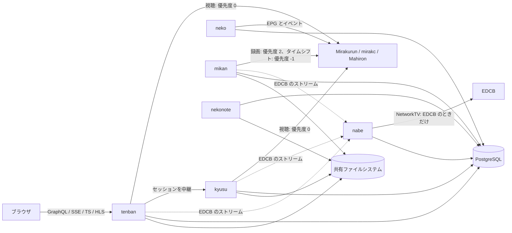
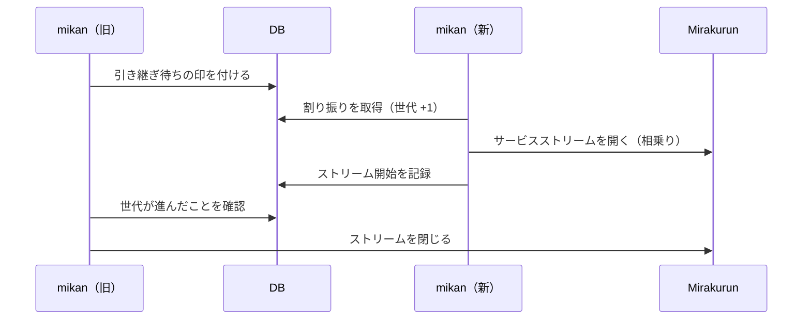
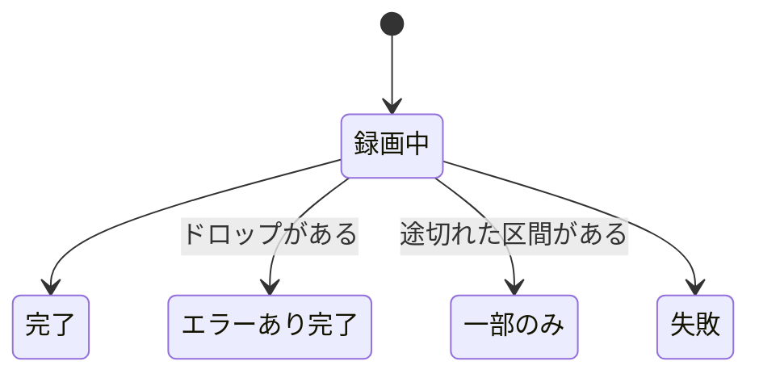

# Kotatsu 設計書 v1

| 項目 | 内容 |
|---|---|
| 状態 | 承認済み |
| 作成日 | 2026-10-09 |
| 対象 | Kotatsu v1 |
| ライセンス | Apache License 2.0 |

この文書は、Kotatsu v1の設計をまとめたものです。
各章の決定事項は、関連プロジェクトの調査と議論を経て合意したものです。
実装しながら確かめる必要がある事項は、[12章](#12-要検証事項)にまとめています。

## 目次

- [0. 概要](#0-概要)
- [1. 全体アーキテクチャ](#1-全体アーキテクチャ)
- [2. 技術選定](#2-技術選定)
- [3. チューナーサーバーと EPG の連携](#3-チューナーサーバーと-epg-の連携)
- [4. 予約エンジン](#4-予約エンジン)
- [5. 録画の実行とストレージ](#5-録画の実行とストレージ)
- [6. 後処理、通知、移行](#6-後処理通知移行)
- [7. ライブ視聴と録画の再生](#7-ライブ視聴と録画の再生)
- [8. データモデル](#8-データモデル)
- [9. API と認証](#9-api-と認証)
- [10. フロントエンドと UI/UX](#10-フロントエンドと-uiux)
- [11. 運用と開発](#11-運用と開発)
- [12. 要検証事項](#12-要検証事項)
- [付録 A. 既定値の一覧](#付録-a-既定値の一覧)
- [付録 B. ライセンスの境界](#付録-b-ライセンスの境界)
- [付録 C. 参考にしたプロジェクト](#付録-c-参考にしたプロジェクト)

## 0. 概要

### 0.1 Kotatsu とは

Kotatsuは、日本のテレビ放送を予約、録画、視聴するためのWebアプリケーションです。
チューナーサーバーにはMirakurun、mirakc、Mahironを使います。
l3tnun/EPGStationの後継として、録画予約から再生までを一つのアプリケーションで扱います。

名前は、こたつに入ってテレビや録画をゆったり楽しむ情景から取りました。
やわらかい角丸と暖色のアクセントを基調にした、居心地のよいホームサーバーを目指します。

### 0.2 背景

EPGStationは長く使われてきましたが、次の課題を抱えています。

- 技術スタックが古くなっています。v2系はNode.js 18とVue 2を前提にしており、新しいNode.jsでは録画が始まらない不具合の報告もあります。
- コンテナやKubernetesと相性がよくありません。録画のタイマー、プロセス内のロック、エンコードのキューをメモリ上にだけ持つので、複数のプロセスで処理を分け合えません。Kubernetesで動かす場合も、レプリカを1つに固定するしかありません。
- 開発が長く止まっていました。v2.10.0（2024-06）の後は更新がなく、2026-10にv3ブランチで大規模な更新が始まりました。ただしv3も、上に挙げたプロセス構成を引き継いでいます。
- 低スペックのマシンには重い構成です。エンコードや配信の子プロセスを含めると、コンテナのメモリ使用量が1 GiB近くに達した運用例があります。エンコードや配信のためのFFmpegのコマンドも、利用者が設定ファイルに書く必要があります。

関連するプロジェクトにも、Kotatsuが埋められる隙間があります。
tsukumijima/KonomiTVは先進的なプレイヤーを持ちますが、録画予約はEDCBをバックエンドにしたときだけ使えます。
Mirakurunやmirakcの上では、番組表を見られても予約はできません。
EDCBは予約エンジンの完成度が高い一方で、状態を単一のプロセスとテキストファイルで管理しており、HTTPのAPIも持ちません。

### 0.3 ゴール

- Mirakurun、mirakc、Mahironの上で、番組表、予約（ルール予約を含む）、録画、録画の再生、ライブ視聴を一つのアプリケーションで扱えるようにします。
- KonomiTVと同じ水準の視聴体験を提供します。対象は、ニコニコ実況のコメント、ARIB字幕、データ放送、mpeg2toh264によるブラウザ内での変換です。BS4K（ISDB-S3）の番組も、ブラウザで見られるようにします（#806）。
- 低スペック機1台からKubernetesのマルチレプリカ構成まで、同じバイナリで動かせるようにします。
- 何も設定しなくても安全な状態で動くようにします。認証は必須で、第二要素も必須です。既定ではプライベートネットワークからしか接続できません。外部のサービスへ問い合わせる機能（ニコニコ実況、アニメの連携、ドラマの連携）は、既定では使いません。
- EPGStationから移行できるようにします。
- 暖色と角丸を基調にした、やさしいUIにします。

### 0.4 コンポーネント名

コンポーネントには、こたつにちなんだ名前を付けます。
名前はCLIのサブコマンド、KubernetesのDeployment名、Goのパッケージ名まで統一して使います。
サブコマンドは役割名でも受け付けます（`kotatsu neko`と`kotatsu scheduler`は同じ意味です）。
`--help`とログには、`neko (scheduler)`のように役割名を必ず併記します。

| 名前 | 役割名 | 由来と役割 |
|---|---|---|
| kotatsu | アプリ全体 | アプリケーションと単一バイナリの名前です。 |
| tenban（天板） | server | みんなで囲み、物を置く場所です。API、画面、配信の窓口になります。 |
| neko（猫） | scheduler | 猫はこたつで丸くなります。こたつの中の猫は1匹だけで、アクティブなインスタンスが1つであることに対応します。普段は番組表を眺め、時間が来たら録画を割り振ります。 |
| mikan（みかん） | recorder | みかん狩りのように、放送から番組を摘み取ってかごに入れます。 |
| nekonote（猫の手） | worker | 「猫の手も借りたい」から取りました。録画後の雑用を手分けしてこなします。 |
| kyusu（急須） | transcoder | 1つの急須から複数の湯呑みにお茶を注ぎます。1つのエンコーダーの出力を複数の視聴者で共有することに対応します。 |
| nabe（鍋） | hub | こたつで囲む鍋です。1つの鍋を、みんなでつついて分け合います。EDCBのNetworkTVの1本のTSを、ほかのロールに配ります（#1535）。 |
| kago（かご） | 保存先プール | みかんを入れておくかごです。 |
| yunomi（湯呑み） | プレイヤー | 注がれたものを受け取って味わいます。 |
| futon（布団） | UIのデザインシステム | やわらかく全体を包みます。 |

## 1. 全体アーキテクチャ

### 1.1 ロール

単一のバイナリ`kotatsu`のサブコマンドでロールを選びます。
`all`を指定した場合は、全ロールが1プロセスで動く構成です。
1台構成とDocker Composeでは`all`を既定にします。

| ロール | 台数 | 担当 | 共有ファイルシステム |
|---|---|---|---|
| tenban | N | GraphQL API、SPAの配信、ライブTSの中継、録画ファイルの配信、kyusuへの中継 | 読む |
| neko | アクティブは1 | EPGの同期、ルールの照合、チューナーの割り当て、録画の割り振り、番組のアーカイブ | 使わない |
| mikan | N | Mirakurunから受け取ったTSのファイルへの書き込みと、書き込み中の解析 | 書く |
| nekonote | N | Riverのジョブ（サムネイル、容量の管理、取り込んだ録画の解析、通知の配信、アニメの番組と作品の結びつき） | 読み書き |
| kyusu | 0〜N | サーバー側でのその場トランスコード（任意。GPUノード向け） | 読む |
| nabe | 0〜2 | EDCBのNetworkTVのTSを、サービスごとに1本開いて、ほかのロールにMirakurun互換のAPIで配る（任意。EDCBのときだけ。[3.1](#31-接続先)） | 使わない |

管理用のサブコマンドとして、`kotatsu migrate`、`kotatsu import epgstation`、`kotatsu import edcb`、`kotatsu import files`、`kotatsu admin setup-token`、`kotatsu admin reanalyze`、`kotatsu admin redetect-cm`を持ちます。

ビルドのときに、版とコミットを`2026.10.0+<コミット>`の形でバイナリに埋め込みます（リリースはタグの版、mainのイメージは`edge`）。`-ffmpeg`のイメージにも、イメージのタグの接尾辞を付けない同じ版を埋め込みます。
埋め込まないビルドは`dev`とし、コミットはGoが埋め込むVCSの情報から取ります。
版は`kotatsu --version`、起動時のログ、GraphQLの`version`（ログインしたユーザーだけ）で確かめられ、画面ではユーザーのメニューに出します。

### 1.2 構成図

### 1.3 ロールの境界

処理が何を必要とするかで、置くロールを決めます。

- **neko**：全体を見て結果を一つに決める処理を担います。2か所で同時に動くと結果が食い違うので、アクティブにするのは1台だけです。
- **nekonote**：独立していて、再試行でき、数秒から数分遅れても困らない処理を担います。これらの処理はRiverに載せます。
- **mikan**：開始時刻に厳密で、何時間も続き、落ちたら数秒で引き継ぐ必要がある処理を担います。

| 処理 | ロール |
|---|---|
| Mirakurunのイベント購読、EPGの差分反映、定期的な全量の突き合わせ | neko |
| 放送が終わった番組のアーカイブと、保持期間を過ぎた番組の削除 | neko |
| 放送が終わった予約の削除 | neko |
| ルールの照合（自動予約） | neko |
| チューナー割り当ての再計算 | neko |
| 録画の割り振り | neko |
| タイムシフトの割り振り | neko |
| 録画の実行と引き継ぎ、ドロップの集計、シーク用の索引の作成 | mikan |
| EDCBのNetworkTVを開き、1本のTSをほかのロールに配る（[3.1](#31-接続先)、#1535） | nabe |
| 録り始めに、EIT[p/f]で番組表の番組と録画を書き直し、同じ回を録画済みならやめる（[5.1](#51-録画に使うストリーム)、#1500） | mikan |
| タイムシフトのチャンクの書き込みと索引の作成 | mikan |
| 遅れて始めた録画の冒頭を、タイムシフトのバッファから写して補う | mikan |
| サムネイルとシークバー用プレビュー画像の生成 | nekonote |
| 録画のCMの区間の見分け | nekonote |
| 容量の管理と自動削除 | nekonote |
| 保持時間を過ぎたタイムシフトのチャンクの破棄 | nekonote |
| EPGStationから取り込んだ録画の解析 | nekonote |
| 通知の配信 | nekonote |
| 視聴予約の通知 | nekonote |
| アニメの番組と作品の結びつきに使う、連携先の情報の取り込み（[3.8](#38-アニメの番組と作品の結びつき)） | nekonote |
| アニメの番組と、しょぼいカレンダーの作品と話の照合（[3.8](#38-アニメの番組と作品の結びつき)） | nekonote |
| 見たアニメの、AnnictとAniListへの記録（[3.8](#38-アニメの番組と作品の結びつき)）。連携とプレイヤーの報告の受け付けはtenbanが行います | nekonote |
| Annict、AniListでフォローしている人の、作品の視聴状況の取得（[3.8](#38-アニメの番組と作品の結びつき)、#1372）。取得の依頼の受け付けとアバターの中継はtenbanが行います | nekonote |
| EPGStationからの移行 | `kotatsu import epgstation`（管理用のサブコマンド） |
| プールにあるTSの取り込み（[6.5](#65-プールにある-ts-の取り込み)） | `kotatsu import files`（管理用のサブコマンド） |
| ライブラリのファイル（録画として登録していないTS）のシーク用の索引の作成（[5.8](#58-ライブラリのファイルの再生)） | tenban |
| ライブラリのファイルの代表画像とシークバー用のプレビュー画像の生成（[5.8](#58-ライブラリのファイルの再生)） | nekonote |
| ライブラリのファイルのCMの区間の見分け（[5.8](#58-ライブラリのファイルの再生)） | nekonote |
| ライブラリのファイルの字幕の自動生成（[5.8](#58-ライブラリのファイルの再生)） | nekonote |

EPGの同期をnekoに置く理由は2つあります。
Mirakurunのイベント購読は1本で足り、複数の場所で購読すると同じ更新を重複して処理することになります。
また、EPGの更新はルール照合とチューナー割り当ての起点なので、同じプロセスに置けば一貫した状態のデータで処理を進められます。

EPGStationからの移行をサブコマンドにするのは、移行元のDBへの接続や録画ファイルのパスの対応付けを、対話的に確かめながら1回だけ実行する処理だからです。
取り込んだ録画の解析のような重い後続の処理は、Riverのジョブとしてnekonoteに回します。

### 1.4 協調の仕組み

ロール間で共有する状態は、DBと共有ファイルシステムだけです。
Redisなどの追加の依存は持ちません。

- **nekoのリーダー選出**：DBのリーステーブルで行います。KubernetesのLeaseと違って、Docker Composeや1台構成でも同じ仕組みで動きます。リースには世代番号を持たせ、古いリーダーの書き込みを世代番号で拒否します。リーダーの書き込みのトランザクションはリースの行をロック（`FOR KEY SHARE`）し、ほかのインスタンスはリースを取る前に行を`FOR UPDATE`でロックするので、書き込みの途中でリーダーは入れ替わりません。延長の`UPDATE`はこのロックとぶつからないので、長い書き込みの間もリースを延ばせます（#729）。リースを取る、延ばす、手放すときは、ロックを待つ時間に上限（付録Aの既定値は2秒）を設けます。固まったトランザクションが残っても、待ち続けずにあきらめ、後でやり直します。リーダーの処理が失敗したとき（DBの瞬断など）は、プロセスを終えずにリースを手放し、次の延長の間隔で取り直します。全ロールを1つのプロセスで動かす構成で、一時的な失敗で録画中のmikanごと止まらないようにするためです。
- **DBの接続**：トランザクションの中で何もしない時間と、1つの問い合わせの時間に上限を設けます（付録A）。固まったトランザクションや問い合わせが、リースを取れないまま残らないようにするためです。マイグレーションは長くかかることがあるので、問い合わせの時間の上限は付けません。PgBouncerなどのトランザクションプーリングを経由するときは、接続の開始のパラメーターを渡せないので、プーラーの側で設定します。
- **ジョブ**：Riverを使います。
- **変更の通知**：PostgreSQLのLISTEN/NOTIFYを使います。PgBouncerなどのトランザクションプーリングを経由するとLISTENが使えないので、ポーリングも併用します。見張り始めるときの最初の問い合わせが失敗しても、間を空けてやり直します。tenbanは、何が変わったかをGraphQLのsubscriptionでブラウザに送ります。
- **インスタンスの登録簿**：各ロールのインスタンスは、自分のアドレスとハートビートをDBに書きます。tenbanは、この登録簿を引いてkyusuのセッションへリクエストを中継します。

ライブ視聴の中継（mpeg2toh264の経路）には協調が要りません。
同じチャンネルを見る視聴者が何人いても、Mirakurunが1本のチューナーで相乗りさせるので、どのtenbanが中継しても余分なチューナーを消費しないからです。
EDCBは相乗りさせないので、1つのプロセスの中で、同じサービスのストリームを1本のNetworkTVで分け合います（[3.1](#31-接続先)、#1535）。
ロールを分けた構成では、nabeがNetworkTVを開き、tenban、mikan、kyusuはインスタンスの登録簿でnabeを引いて、TSを受け取ります。
エンコーダーを視聴者間で共有する必要があるのは、kyusuの経路だけです。

### 1.5 録画の受け渡し

録画の開始には、Riverの予約ジョブを使いません。
Riverの予約ジョブは、リーダーが5秒ごとに実行可能な状態へ移すので、開始が最大5秒ほど遅れます。
この遅れは、開始の少し前にジョブを投入してジョブの中で待てば避けられます。
問題は録画中の障害の扱いです。
Riverは実行中のジョブのハートビートを持たず、ワーカーが落ちて止まったジョブを救出するのは`RescueStuckJobsAfter`（既定1時間で、ジョブのタイムアウトより長くする必要があります）を過ぎてからです。
数時間かかる録画では、引き継ぎが数時間後になってしまいます。

そこで、録画の受け渡しには専用の割り振りテーブル（`recording_assignments`）を使います。

1. nekoが、録画開始の数分前（既定は2分前）に割り振りの行を書きます。
2. mikanは`SELECT ... FOR UPDATE SKIP LOCKED`で行を取り、数秒ごとにリースを延長しながら録画します。
3. リースが切れたら、別のmikanが行を取り直し、続きを新しいファイルに書きます。
4. 行には世代番号を持たせます。古いmikanは、延長で世代番号が進んでいたと分かった時点（ほかのmikanが取った時点）で書き込みをやめます。リースの期限は、mikanの時計ではなくDBの時刻で決めます。mikanを複数のマシンで動かすと時計がずれ、時計の進んだmikanが、ほかのmikanの録画中の行をリースが切れたとみなして取ってしまうためです。
5. 録画を終えたら、行を終わったことにします。録画を始めずに終えたとき（始める前に予約を無効にしたときなど）は、行を消します。残すと、予約を有効に戻しても、nekoが行を書き直せないためです。
6. 録画できない理由がそのmikanにあり、ほかにmikanが動いていれば、行をまだ取っていない状態に戻して手放し、しばらく（付録Aの既定値は1分）行を取りません。ほかのmikanが取って録画します。理由は、プールがマウントされていないとき（最初のセグメントを作るとき）と、まだ何も録っていないのにチューナーサーバーにつながらないまま30秒（付録A）が過ぎたときです。チューナーサーバーの再起動はすべてのmikanに同時に起きるので、一度つながらないだけでは手放しません。手放すときは、録画できなかった理由を録画の行に残し、ほかのmikanも録れなければ、nekoがその理由で録画を失敗にします（[5.5](#55-録画の状態)）。ほかにmikanがいなければ、手放さずに、これまでどおり自分で扱います。

DBに届かず、リースを延長できない間は、リースの期限が過ぎても書き込みをやめません（#1073）。DBに届いた後のエラー（権限など）は、DBが止まったのではないので、今までどおりリースの期限で書き込みをやめます。
ほかのmikanが行を取るにもDBが要り、取れば世代番号が上がるので、DBに届くようになってからの延長で、取られたかどうかが分かります。
期限が切れていても、世代番号が進んでいなければ誰も取っていないので、延長の`UPDATE`は期限を条件にしません。
こうしておくと、DBの更新や再起動で数十秒から数分止まっても、録画は欠けません。
延長の問い合わせは、DBへの接続が応答のないまま詰まっても延長を続けられるよう、延長の間隔で打ち切ります。
mikanは、自分が録っている行を、期限が切れていても取り直しません。DBが戻った直後に、行を取る処理が延長より先に動くと、自分で世代番号を進めて録画を止めてしまうためです。

DBに届かない間に予定の終わりが来ても、最後に読めた予約で終わりを決め、録画を止めます。セグメントを閉じた記録と、録画の完了は、DBに届くまでやり直し、録画を止めた時刻で記録します。DBが戻った時刻で記録すると、録画の終わりと途切れた区間がずれるためです。
DBに届かない間は、予約の変更（無効にする、時刻を動かす）は分からないので、最後に読めた予約に従います。
DBを待った後に予定の終わりを過ぎていれば止め、録画を止めた時刻は、DBを待つ前の時刻にそろえます。DBを待った分だけ、録画の終わりが遅れないようにするためです。ただし、待つ前の時刻が予定の終わりより前なら、止めた時刻は予定の終わりにします（#1549）。待つ間に予定の終わりを過ぎたのに、待つ前の時刻にすると、予定の終わりより前に止めたことになり、録った時間が短く記録されるからです。DBへの接続が応答のないまま詰まっても、DBを待つのは1回に5秒までにし、予定の終わりに気づけるようにします。延長中なら、最後に読めた番組の終わりで延長を続けます。予約した番組が遅れているときは、前の番組のセグメントを消せないので、DBに届くようになってから待ち始めます。
DBが予定の終わりをまたいで止まり、戻った直後にほかのmikanが割り振りを取ると、録り終えたmikanは世代番号が進んでいるので録画を完了にできません。そのため、予定の終わりの後に割り振りを取ったmikanは、録画中のまま残った録画を、前のmikanが覚えていた記録を書く間（再試行の間隔の3倍）待ってから、予定の終わりで完了にします。落ちたmikanの代わりなら、録れなかった終わりの部分は途切れた区間になります。
録画を始めるときやストリームが切れて開き直すときにDBに届かなくても、最後に読めた予約と録画設定で、ファイルに書き始めます。録画とセグメントの記録は、DBに届くようになったら、録画が終わるのを待たずに、書き始めた時刻で記録します。割り振りを取ったmikanは、開始の前に予約を読むので、割り振りを取った後にDBが止まっても録画は始まります。割り振りを取る前から止まっていれば、DBが戻るまで始まりません。

DBが戻った直後に、ほかのmikanが、期限の切れた行を延長より先に取ることがあります。
そのときは、古いmikanは次の延長で取られたと分かっても、引き継ぎ（[5.4](#54-引き継ぎと再起動)）と同じく、新しいmikanがストリームを開くまで書き続けてから止まります。それまで2つのmikanが同じ番組を書きます。
DBには届くのに、あるmikanだけが届かないとき（ネットワークの分断）も、ほかのmikanが期限の後に取り、分断が直るまで2つのmikanが書きます。
どちらも録画が重なるだけで、欠けません。重なった区間は、引き継ぎと同じく、セグメントをつなぐときに捌きます（[5.4](#54-引き継ぎと再起動)）。

割り振りを取ったmikanは、その時点ではまだチューナーを確保しません。
自分のタイマーで待ち、開始時刻からマージンとチューニングにかかる時間を引いた時刻にストリームを開き、開始時刻からマージンを引いた時刻から書き込みます（[5.1](#51-録画に使うストリーム)）。

### 1.6 チューナーの優先度

Mirakurunは、チューナーの利用者を「IP:ポート」で区別します。
そのため、Mirakurunから見ると、Kotatsuの各インスタンスはそれぞれ別の利用者です。
優先度の高い視聴のリクエストは、どのインスタンスから来ても、録画中のチューナーを奪えてしまいます。

これを防ぐため、全ロールが共通の優先度表に従います。

| 用途 | Mirakurunに渡すpriority |
|---|---|
| 録画 | 2 |
| 競合すると判定された録画（チューナーが空いていれば録る） | 1 |
| 視聴（ライブ視聴、kyusu） | 0 |
| タイムシフト（[5.7](#57-タイムシフト)） | -1 |

EPGの収集は、Mirakurunの内部でpriority -1として動きます。
タイムシフトは、録画にも視聴にも譲ります。
Mirakurunが使用中のチューナーを奪わせるのは、priorityが0以上のリクエストだけです。そのため、EPGの収集は、タイムシフトのチューナーを奪えません。タイムシフトは、ある種別のEPGの収集に要る最後のチューナーを使いません（[5.7](#57-タイムシフト)）。
v1では、これらの値を設定で変えられないようにします。mirakcで無条件にチューナーを奪う値128を、誤って使わないようにするためです。

EDCBは優先度を持たないので、この表は使いません（#1536）。Kotatsuの中の優先度は、nekoの割り当て（[4.5](#45-チューナーの割り当て)）で今までどおり効きます。
EDCB自身の予約とは、EDCBが勝つ前提で、その予約がチューナーを使う時間帯を割り当てから外して避けます（[3.6](#36-チューナーの把握)）。EDCBの予約は、Kotatsuが使っているNetworkTVのチューナーも取っていくからです（#1258）。
競合した予約を優先度1で試みる方式（4.5）も、EDCBでは使いません。先に録り始めた競合した予約が、後から始まる割り当て済みの予約のチューナーを取っても、譲らせる手段がないからです。EDCBでは、競合した予約は録りに行きません。録りに行かない予約は、予定の開始が過ぎたら、チューナーを確保できなかった（`tuner_unavailable`、[5.5](#55-録画の状態)）録画の失敗として記録し、Mirakurunでチューナーを確保できずに失敗したときと同じく、録画の失敗を通知します（[6.2](#62-通知)）。録画の行は予約ごとに1つなので、同じ予約を何度も記録したり通知したりしません。

## 2. 技術選定

### 2.1 バックエンド

| 項目 | 選定 | 理由 |
|---|---|---|
| 言語 | Go | メンテナーが習熟しており、コントリビューターも参入しやすいためです。Kotatsuの負荷はI/Oと外部プロセス（FFmpeg）とブラウザに集まるので、Rustとの性能差はほぼ出ません。`CGO_ENABLED=0`でarm64の静的バイナリも作れます。 |
| API | GraphQL（gqlgen） | スキーマ（SDL）をAPIの原本にします。subscriptionをSSEで配信できます。 |
| HTTP | 標準のnet/http、echo v5 | 映像の配信と認証の手続きは、GraphQLの外の素のHTTPで扱います。tenbanの一番外側のルーターはecho v5にし、ルートをまとまりごとに`http.ServeMux`からechoのハンドラーへ移しました（#1606）。echoのハンドラーは、ロガーを受け取らずに、リクエストのロガー（`echo.Context.Logger`、`*slog.Logger`）に書きます。部品の名前（`component`）は、ルートに掛けるミドルウェアで付けます。`http.ServeMux`と同じく、ルートを探す前に、二重のスラッシュや`.`と`..`の区切りを除いたパスへ307でリダイレクトし、`/api`と`/internal`は末尾にスラッシュを付けた先へリダイレクトします。echoのルートに当たらないリクエストは、`/api`と`/internal`の下なら404にし、ほかは画面を返します。メソッドの違うOAuthの端点へのリクエストも、`http.ServeMux`のときと同じく画面に渡します。エラーの応答は、echoの既定（JSON）にせず、これまでと同じ形でハンドラーが書きます。`http.ServeMux`と同じく、GETのルートはHEADにも答えます。`/internal`の下の端点では、パスに当たってメソッドが違うリクエストに、`Allow`を付けて405を返します。移したのは、`/api`の下の端点（予約のiCalendar、IPTV、署名付きの配信、EPGStation互換のAPI）と、ログインやログアウトなどの手続き（`/internal/auth/*`）、画像と実況のコメント、データ放送の通信の中継、キャプチャ（`/internal/media/*`）、映像の配信（`/internal/streams/*`）、GraphQL（`/internal/graphql`）、OAuthの認可サーバーとMCPサーバーの端点です。tenbanのルートは、どれもechoで受けます。GraphQLは、メソッドの扱いをGraphQLのハンドラーに任せるので、どのメソッドも渡します。 |
| ジョブ | River（riverpgxv5） | PostgreSQLのトランザクションの中でジョブを投入できます。 |
| DB | PostgreSQL、pgx v5、sqlc | PostgreSQL（17以降）だけに対応し、SQLiteなどのほかのDBには対応しません。PostgreSQLを用意できない利用者には、OSごとの入れ方を案内します（[setup.md](setup.md#バイナリで動かす)）。SQLiteへの対応は、クエリの約2割を作り直し、スキーマとクエリの変更を2系統で続けることになるので見送りました（#1254）。バイナリで動かす利用者から、PostgreSQLを用意しにくいという声が続いたら、`PATH`のPostgreSQL（`initdb`と`postgres`）をKotatsuが起動する形を考えます。 |
| マイグレーション | `schema.sql`に宣言的に書き、Atlasで差分を生成します | 実行時は、Goに埋め込んだマイグレーションを`kotatsu migrate`が適用します。 |
| 列挙型 | go-enum | 型のコメントに`ENUM(...)`で値を並べ、値の一覧（`<型>Values`）、`Parse<型>`、`IsValid`を生成します。一覧とパースを手で書き写して、値を足したときに直し漏れるのを防ぎます（#1609）。DBの列は、`--sql`の`Scan`とsqlcの`overrides`で列挙型として読み、知らない値ならエラーにします。GraphQLの列挙は、gqlgenの`enum_values`で同じ型にひも付け、文字列の変換を挟みません。 |
| 依存の組み立て | wire（goforj/wire） | 部品の組み立てを、コンパイル時にコードとして生成します（#1607）。組み立ての宣言は`internal/cli/wire.go`（`wireinject`のビルドタグ）に書き、`wire_gen.go`に生成します。実行時の仕組みを持たないので、組み立ての誤りは生成とコンパイルで分かります。今の`Deps`を入力にして、自己完結した部品の集まりから順に移します。どのロールを動かすかと、設定によって部品を作らないかは、wireの外で手で決めます。wireの依存のグラフは静的だからです。 |
| ログ | log/slog（JSON形式） | |
| 可観測性 | OpenTelemetryとPrometheus形式の`/metrics` | OTLPの送信先を設定したときだけ、トレースとメトリクスを送ります。メトリクスは`/metrics`と同じものです。 |
| 設定 | YAMLと環境変数 | 置き場所の基準は[11.2](#112-設定の置き場所)で定めます。 |
| 認証 | go-webauthn、pquerna/otp、coreos/go-oidc、x/crypto/argon2、webpush-go | |
| OSの電源管理 | WindowsはSetThreadExecutionStateとschtasks、macOSはIOKitをpuregoで呼びます | `CGO_ENABLED=0`のままクロスコンパイルできるよう、cgoを使わずに、実行時にOSのライブラリを読み込みます（[11.7](#117-対応するos)、#1522）。 |
| ARIBの処理 | tsreadexを子プロセスとして使います | GoにはARIBの文字符号を扱える成熟したライブラリがありません。番組情報はMirakurunがJSONで返し、字幕とデータ放送はブラウザで描画するので、Kotatsuの中でARIBの文字符号を解く必要はありません。 |

Kotatsuの中でTSを解析するのは、パケット単位の処理（ドロップの集計、PATとPMT、Iフレームの位置）だけです。
これらはARIBの知識を必要としないので、Goで直接書きます。
CDTで送られるサービスのロゴ（[3.1](#31-接続先)）もPNGのバイナリなので、ARIBの文字符号を解かずに、Goで直接読みます（#1308）。

PostgreSQL以外のDBを使いたい利用者には、SupabaseなどのマネージドなPostgreSQLを勧めます。
マネージドDBがトランザクションプーリングの接続口を提供している場合、そこを経由するとLISTENが使えません。
直接接続を推奨としたうえで、プーラー経由でもポーリングだけで動くモードを用意します（Riverの`PollOnly`もこのためのものです）。

### 2.2 パスワード強度の判定

パスワードの強度はzxcvbn-ts（日本語辞書`@zxcvbn-ts/language-ja`を含む）で判定し、弱いパスワードを拒否します。
クライアントでの判定は入力中のフィードバックに使い、拒否するかどうかはサーバーで判定します。
APIを直接呼べばクライアントの判定は素通りできるからです。

Goに移植されたzxcvbnは、どれも更新が止まっています（trustelem/zxcvbnの最終更新は2024-04、nbutton23/zxcvbn-goはアーカイブ済みです）。
そこで、zxcvbn-tsそのものを、Pure GoのJavaScriptエンジンであるgojaの上で動かします。
クライアントとサーバーが同じバージョンの同じ辞書で判定するので、両者の結果は食い違いません。
バージョンはnpmのパッケージとしてRenovateで追跡します。

この方式は、使い捨ての実験コードで確かめました。

| 項目 | 結果 |
|---|---|
| 互換性 | 用意した27件のパスワードすべてで、Node.jsと結果が一致しました（スコア、推定試行回数、警告文、提案文）。ES2015、ES2017、ES2020のどのバンドルもgojaで動きました。 |
| 速度 | VMの生成と辞書の読み込みに約0.2秒、初回の判定に約0.13秒かかり、2回目以降は1件あたり約40 msでした。 |
| メモリ | VMを保持している間、ヒープが約37 MiB増えました。 |
| バイナリサイズ | gojaで約9 MB、gzipで圧縮した辞書バンドルで約0.9 MB増える見込みです（後述の対処で約1.8 MBになりました）。 |

この結果から、VMはパスワードの設定時と変更時にだけ作って捨てます。
入力の長さに上限を設け、`vm.Interrupt`でタイムアウトさせ、判定APIの呼び出し回数を制限します。

ただし、上の速度は短いパスワードでの値です。
数字や記号の多い長いパスワードでは、zxcvbn-tsのl33tの照合が遅くなります。
l33tの照合は、`4→a`のような読み替えの候補を最大100通り作り、候補ごとに辞書全体を引き直すからです。
64文字のパスワードの判定は、手元のgojaで約3.5秒、負荷の高い機材では12秒を超えました。

そこで、zxcvbn-tsに次のパッチを当て、判定の結果を変えずに速くします（`frontend/patches`）。

- l33tの候補では、読み替えた文字を含む部分だけを辞書で引き、引いた結果を候補の間で使い回します。読み替えた文字を含まない部分の一致は、もともと捨てられます。
- 順位を付け終えた辞書を受け取れるようにします。サーバーのバンドルには、ビルドのときに順位を付けた辞書をJSONの文字列で埋め込みます。gojaの`JSON.parse`はGoで動くので、辞書を展開して順位を付け直すより速いからです。
- 辞書の照合で、部分文字列を1文字ずつ伸ばしながら引くとき、辞書のどの語にも現れない2文字の組が出たら、その位置から伸ばすのをやめます。その組を含む部分は、どの語にも一致しないからです。語に現れる組は、ビルドのときに辞書から求めてバンドルに埋め込み、ユーザーの入力の語の組は判定のたびに加えます。

パッチを当てた後の判定は、元のzxcvbn-tsをNode.jsで動かした結果と、無作為な長いパスワードやl33tを含む626件すべてで一致しました。
VMの生成と辞書の読み込みは約0.4秒から約0.1秒に、128文字の記号入りの判定は手元のgojaで約1秒から約0.6秒になりました。
代わりに、埋め込む辞書のバンドルは、gzipで約0.9 MBから約1.8 MBに増えます。

日本語辞書の収録語はローマ字だけです。
かなや漢字のフレーズは総当たりの組み合わせ数で評価されるので、実際より強めに判定されます（実験コードでは「こたつでみかん」がスコア2、「猫はこたつで丸くなる」が3でした）。
そのため、NIST SP 800-63B-4に沿った長さの規定とブロックリストの照合を併用します（[9.3](#93-ローカルアカウント)）。
日本語表記のパスワードフレーズの辞書は用意しません。

### 2.3 フロントエンド

ReactのSPAをVite+ でビルドし、Goのバイナリに埋め込みます。
本番環境でNode.jsを動かさないことが、低スペック機への配慮として最も効くからです。
Next.jsの利点はSSRとRSCですが、そのためには本番でNode.jsのプロセスを1つ増やす必要があります。
詳細は[10章](#10-フロントエンドと-uiux)で定めます。

### 2.4 コンテナイメージ

同じバイナリを載せたイメージを2種類用意します。

| イメージ | ベース | 用途 |
|---|---|---|
| `ghcr.io/slashnephy/kotatsu:<バージョン>` | `gcr.io/distroless/static-debian13:nonroot` | tenban、neko、mikan |
| `ghcr.io/slashnephy/kotatsu:<バージョン>-ffmpeg` | Debian 13のslimにDebianの`ffmpeg`パッケージとVAAPI・QSVのドライバを入れ、tsreadexと、whisper.cppの`whisper-cli`と`whisper-vad-speech-segments`をソースからビルドして同梱します | kyusu、nekonote、`all` |

FFmpeg（VAAPIやQSVのドライバを含む）とtsreadexは共有ライブラリを必要とするので、staticのイメージには入りません。
サムネイルの生成にFFmpegが要るので、全ロールを1プロセスで動かす`all`も`-ffmpeg`イメージを使います。
whisper.cpp（字幕の自動生成、[6.1](#61-後処理のジョブ)、#1682）は、C++のビルドがQEMUでは遅いので、ビルドするマシンのアーキテクチャで対象のアーキテクチャへクロスコンパイルし、共有ライブラリを持ち込まないよう静的にリンクします。命令セットはビルドするマシンに合わせず（`GGML_NATIVE=OFF`）、amd64はAVX2とFMA（x86-64-v3）、arm64はARMv8.0を前提にします。AVX2のないCPUでは、自分でビルドした`whisper-cli`を設定（`captions.whisper_command`）で渡します。モデルは大きく、使う人も選ぶので、イメージに入れず、管理者が画面からダウンロードします。
`-ffmpeg`イメージの実行ユーザーは、distrolessの`nonroot`と同じUID 65532にそろえます。
VAAPIとQSVのドライバには、Debianのパッケージ（`mesa-va-drivers`、amd64では加えて`intel-media-va-driver-non-free`、`libvpl2`、`libmfx-gen1.2`）を使います。IntelのVAAPIのドライバだけは、non-freeコンポーネントの`intel-media-va-driver-non-free`を入れます。mainの`intel-media-va-driver`は、Gen11以前のGPUで、縮小（VPP）とHEVCのエンコードができないからです（#509）。ライセンスの扱いは[付録B](#付録-b-ライセンスの境界)で定めます。NVENCのライブラリは、NVIDIA Container Toolkitがホストから渡します。
どちらもamd64とarm64に対応します。

## 3. チューナーサーバーと EPG の連携

### 3.1 接続先

接続するチューナーサーバーは1台だけです。
設定するのはURLと、必要に応じてBASIC認証の資格情報です。
複数のチューナーサーバーを束ねる処理は、MirakurunのリモートチューナーやMahironのremotesといった、チューナーサーバー側の機能に任せます。
Kotatsuは、スクランブルを解除する機能を持ちません。カードリーダーも扱いません。スクランブルされたまま届いたパケットは、解除せずに数えるだけです。録画では警告を付け（[5.5](#55-録画の状態)）、ライブ視聴では理由を出して止めます（[7.1](#71-再生経路)、#1517）。
EDCBも、チューナーサーバーとして使えます（#1258）。EPGの同期、チューナーの把握、録画、タイムシフト、ライブ視聴に使います。
KotatsuはEDCBに自分の予約を入れません。EDCBのスリープは、Kotatsuの録画を考えずにPCを眠らせ、Kotatsuの録画の前に起こさないので、EDCBのスリープは使わず、Kotatsuの電源の管理（[11.7](#117-対応するos)の「スリープ」）に任せるよう案内します（#1539）。Kotatsuの予約をEDCBにも入れる作りは、EDCBの予約と二重に録るおそれがあり、作る量も多いので取りません。
チューナーサーバーの種類は、設定（`tuner.kind`、`KOTATSU_TUNER_KIND`）で選びます（#1530）。既定は`mirakurun`（Mirakurun互換。Mirakurun、mirakc、Mahiron）で、`url`を使います。`edcb`を選ぶときは、`url`を空にし、EpgTimerSrvのTCPの待ち受け（`tuner.edcb.address`、host:port、ポートを省けば4510）と、Kotatsuが使うNetworkTVのIDの範囲（`tuner.edcb.network_tv_id_start`と`_count`、既定は1000から32個。[付録A](#付録-a-既定値の一覧)）と、Kotatsuがライブと録画に使うBonDriverの名前（`tuner.edcb.bon_drivers`、既定は空で、すべてのチューナーを使う。[3.6](#36-チューナーの把握)、#1532）を設定します。NetworkTVのIDはEpgTimerSrv全体で1つの名前空間なので、ほかのクライアント（KonomiTVは500から、EpgTimerの視聴やTVTestは小さい番号）と重ならない範囲にします。CtrlCmdのTCPにはパスワードもTLSもないので、資格情報の設定はありません。EDCBを選ぶと、Mirakurun互換のサーバーと同じく、どのロールもEDCBをチューナーサーバーとして使います（#1533）。ロールを分けた構成でnabeを動かしていれば、ストリームだけはnabeから受け取ります（#1535）。ログの画面では、URLと同じく、EDCBの接続先のホスト名を伏せます。サービスと番組のIDは、どちらの種類でも同じ式で作るので（[3.2](#32-識別子)）、種類を替えても、DBのサービスと番組をそのまま引き継ぎます。EDCBは物理チャンネルの代わりにTSIDを返すので、サービスのチャンネルだけは書き換わります。

Kotatsuは、チューナーサーバーを、サーバーの種類に依らない型とinterface（`backend/internal/domain/tunerserver`）で扱います。
チャンネル、サービス、番組、チューナー、イベント、ストリームの開き方と、開けなかった理由（チューナーが足りない、サービスがないなど）は、この型で表します。
サーバーのAPIの形、イベントの種類の文字列、HTTPのステータスの意味は、サーバーごとの実装が読み替えます。
実装は、Mirakurun互換のAPIのクライアント（`backend/internal/infra/mirakurun`）と、EDCBの実装の2つです。EDCBのEpgTimerSrvとCtrlCmdのTCPで話すクライアント（`backend/internal/infra/edcb`、#1529）を使い、サービスと番組とイベントとチューナーとストリームを、この型に読み替えます（`edcb.TunerServer`、#1531、#1532、#1533）。CtrlCmdは、1つの接続で1つのコマンドを送る、HTTPではない独自のバイナリのプロトコルで、パスワードもTLSもありません。

EDCBのサービスと番組は、次のように読み替えます（#1531）。
- サービスの一覧には、EpgTimerSrvのチャンネルの設定（`ChSet5.txt`、CtrlCmdの`FILE_COPY`で取ります）を使います。サービスの一覧のコマンド（`ENUM_SERVICE`）は、EPGを読み込んだサービスしか返さないからです。リモコンのキーIDだけは、`ENUM_SERVICE`から取ります。`ChSet5.txt`は、BOM付きのUTF-8かUTF-8ならそのまま、そうでなければShift_JIS（古いWindowsのEDCB）として読みます。
- EDCBは物理チャンネルを返さないので、チャンネルにはTSIDを10進の文字列で入れます。チャンネルの種別は、ネットワークIDから決めます（0x7880〜0x7FE8は`GR`、4は`BS`、6と7は`CS`、0x0Bは`BS4K`、ほかは`SKY`）。ロゴのIDは持たせません。
- 番組名、概要、詳細の文は、EDCBが外字とCP932に寄せて書いたものを戻します。改行は`\r\n`から`\n`に、`～`（U+FF5E）は`〜`（U+301C）に、`―`（U+2015）は`—`（U+2014）にします。ARIBの追加記号は、EDCBが`[字]`のような角括弧の形に置き換えて返すので、角括弧の形だけを元の記号（🈑など）に戻します。EDCBの外字の表（`GaijiTable`）から作った対応表を使い、同じ形が複数の記号に当たるもの（`[三]`など）は戻しません。中くらいの大きさの英数字は半角のまま返り、`⁉`と`!?`のように区別できなくなった記号もありますが、照合は正規化（NFKC）してから比べるので、困りません。
- 詳細は、「`- 項目名`」の行で項目を分け、本文の行の先頭のハイフンの重ね（`--`）を1つ外します。
- サブチャンネルの番組は、共有のイベントグループだけを持ち、番組名などを持たないので、指す先の番組の番組名、概要、詳細、ジャンル、映像、音声を写します（Mirakurunと同じです）。サービスを絞って番組を引いたときは、指す先のサービスの番組も引きます。
- EDCBの番組の取得には、放送中の番組だけを返す仕組みがないので、`OnAirPrograms`は空を返します。
- イベントには、EpgTimerSrvの通知（`GET_STATUS_NOTIFY2`）を使います。通知は、巡回カウンタより後の通知が来るまで応答を保留するロングポーリングです。EPGのデータを読み込み直した通知（`NotifyUpdateEPGData`）は、どのサービスが変わったかを持たないので、サービスが変わったイベントに読み替え、全量を突き合わせます。予約が変わった通知（`NotifyUpdateReserveInfo`）は、EDCBの予約がチューナーを使う時間帯が変わるので、チューナーが変わったイベントに読み替えます（#1536、[3.6](#36-チューナーの把握)）。ほかの通知は読み飛ばします。
- EpgTimerSrvがEPGのデータを読み込んでいる最中は、サービスと番組の取得が`CMD_ERR_BUSY`で断られます。このときは突き合わせを諦め、空の一覧として扱いません。
- 音声の言語コードは、EDCBが返さないので空にします。
- サービスのロゴは、EDCBが集めたものを返します（#1537）。サービスとロゴのIDの対応を`LogoData.ini`の`[LogoIDMap]`から読み（キーはネットワークIDとサービスIDを4桁ずつの16進、値はロゴのID）、画像を`LogoData\{ネットワークID}_{ロゴのID}_000_{種類}.png`から`FILE_COPY2`で取ります。種類は、録画のTSから集めたロゴと同じく、HDの大きいロゴ（64×36）を先にします。対応は10分ごとに読み直します。EDCBがロゴを持っていなければ、録画とタイムシフトのTSから集めたロゴを返します。EDCBは、ロゴを集める設定を有効にしていないと`LogoData.ini`を書かないとみています（確かめていません）。
- サービスのストリームは、NetworkTVで開きます（#1533）。`NWTV_ID_SET_CH`で開き、TSを受け取れるようになるまで`RELAY_VIEW_STREAM`をやり直します。開いた直後は、TSを送るFIFO（Windowsでは名前付きパイプ）ができていないためです（2026年11月にLinuxのEDCBで測ったときは、0.2秒で受け取れました）。EDCBは中継の接続が切れてもNetworkTVを閉じないので、ストリームを閉じたら、必ず`NWTV_ID_CLOSE`を送ります。中継の接続は、Mirakurunのストリームと同じく、データが10秒（付録A）届かなければ切れたとみなします。接続を保ったまま送らなくなっても、録画の始まりの待ちなどで止まったままにならないようにするためです（#1723）。
- EDCBが送るTSは、サービスで絞ったものです（PATには、そのサービスとNITだけが載ります）。スクランブルを解くかどうかは、EDCBのBonDriverと設定で決まるので、ストリームの設定の`Decode`は使いません。優先度もありません。チャンネルのストリームは、そのTSのサービスのうち、チャンネルの設定で最初のものを開くので、ほかのサービスは含みません。
- サービスがチャンネルの設定になければ、サービスがないもの（404に当たります）とします。NetworkTVのIDが足りないときと、EDCBがチューナーを開けないときは、チューナーが足りないもの（503に当たります）とします。EDCBは、使えるチューナーがないときも、サービスを受信できないときも、同じ失敗を返すので、見分けません。そのため、EDCBでは、選局の失敗（500に当たります）にならず、続けて選局できないチャンネルの判定（[6.2](#62-通知)）には、チャンネルの設定にないサービスしか数えません。
- EDCBの予約がNetworkTVのチューナーを使うと、Kotatsuが受け取っているTSは、接続が切れないまま別の局に変わります。プロセスも同じままなので、プロセスのIDでは気づけません。そこで、受け取ったTSのPATを見張り、TSIDかサービスが、開いたときから変わったら、チューナーを取られたとみなしてストリームを切ります（#1534）。EDCBは、NetworkTVを開いた直後に、サービスを載せずNITだけを載せたPATを送ることがあります（2026年11月にLinuxのEDCBで、20回開いて8回）。そのため、サービスがPATにないことで取られたとみなすのは、サービスを載せたPATを受け取った後にします。TSIDが違えば、最初のPATから取られたとみなします。あわせて、5秒ごとにNetworkTVがまだ開いているかを問い合わせ（`NWTV_ID_SET_CH`を`useSID=0`で送ります）、閉じていても切ります。切った後は、ストリームが途切れたときと同じく、つなぎ直しを試みます。つなぎ直せなければ、録画の失敗の理由を`tuner_preempted`にし、今の録画の失敗の通知で知らせます。新しい通知は作りません。Mirakurun互換のサーバーでは、つないだまま局が変わることを確かめていないので、見張りません。
- EDCBの予約とEPGの取得は、Kotatsuのチューナーの使い方を左右します（#1536）。EDCBの予約がチューナーを使う時間帯は、nekoの割り当てから外します（[3.6](#36-チューナーの把握)、[4.5](#45-チューナーの割り当て)）。EPGの取得の時刻の前後は、ライブ視聴とタイムシフトに、EPGの取得に要る空きチューナーを使わせません。取得している最中は、取得中のチューナーを使わせません（[3.6](#36-チューナーの把握)、[5.7](#57-タイムシフト)、#1856、#1873）。
  - EPGの取得の時刻と、予約のマージンの既定と、EPGの取得に要る空きチューナーの数は、`EpgTimerSrv.ini`（`[EPG_CAP]`、`[SET]`の`StartMargin`、`EndMargin`、`NGEpgCapTime`、BonDriverの節の`GetEpg`、`EPGCount`）から読みます。CtrlCmdには、EPGの取得の時刻を返すコマンドがありません。EpgTimerSrvは、互換動作（`[SET]`の`CompatFlags`の0x80）を有効にしたときしか、`EpgTimerSrv.ini`を`FILE_COPY2`で返しません（`FILE_COPY`は`ChSet5.txt`しか返しません）。返さなければ、EPGの取得の時刻は分からないので、ライブ視聴などは取得している最中だけを避け、タイムシフトの割り振りはBonDriverごとに1本をいつも残し（[5.7](#57-タイムシフト)）、マージンの既定はEDCBの既定（開始5秒、終了2秒）とみなします。`EpgTimerSrv.ini`は10分ごとに読み直します。読み直せなければ、前に読んだものを使い続けます。
  - `[EPG_CAP]`に`Count`がなければ、EpgTimerSrvと同じく、毎日23:00に取得するとみなします。時刻は「時:分」で、曜日を指定するときは`w1`（月）〜`w7`（日）を続けます。`{n}Select`が0の時刻は除きます。
- NetworkTVのIDは、設定した範囲から、Kotatsuの中で配ります。tenban、mikan、kyusu、nabeが何台あってもぶつからないよう、DBにIDと開いたサービス（`edcb_network_tvs`）と、その持ち主のインスタンス（`edcb_network_tv_holders`）を記録し、空いている最も小さいIDを取ります。持ち主が止まって閉じられなかったIDは、nekoが1分ごとに探し、`NWTV_ID_CLOSE`を送ってから消します。取った直後のIDは、持ち主がまだ登録していないかもしれないので、インスタンスの生存の判定の時間（`AliveTTL`）が過ぎるまで待ちます。
  - 1つのIDは、2つまでのインスタンスが持てます（#1850）。EDCBは、1つのNetworkTVのTSを、2つの`RELAY_VIEW_STREAM`にまで送るからです（2026年11月に、LinuxのEDCBで、3つ目の中継は断られることを確かめました）。あるサービスを開くとき、ほかのインスタンスが同じサービスのIDを持っていて、生きている持ち主が2つに満たなければ、そのIDに加わります。開いているIDに、同じサービスで`NWTV_ID_SET_CH`を送ると、EDCBは選局し直さずに同じプロセスを返すので、チューナーを増やさずに同じTSを受け取れます。生きている持ち主は、インスタンスが`AliveTTL`のうちにハートビートを書いたか、取った直後のものです。止まった持ち主の中継は切れているので数えず、そのIDにも加わります。同じサービスのIDを取るのと加わるのは、DBのロックで、インスタンスをまたいで1つずつにします。2つのインスタンスが同時に開いても、別々のIDを取ってチューナーを2本使わないためです。
  - 加わったIDの中継が2秒たっても受け取れなければ、中継に空きがない（止まったはずの持ち主の中継がまだ切れていないなど）とみなし、加わるのをやめて、自分で別のIDを取って開き直します。開いた直後のIDに加わったときに、FIFOができるのを待てるよう、測った時間（0.2秒）より長くしています。
  - ストリームを閉じたら、IDの持ち主から外れます。ほかに生きている持ち主がいれば、閉じません。`NWTV_ID_CLOSE`を送ると、そのIDの中継はすべて切れるからです。最後の持ち主なら、閉じ始めたことを記録してから`NWTV_ID_CLOSE`を送り、IDを消します。閉じ始めたIDには、ほかのインスタンスは加わりません。外れるのと加わるのは、IDの行のロックで1つずつにするので、加わった直後のインスタンスの中継を切りません。NetworkTVを閉じられなくてもIDは消します。開いているIDに`NWTV_ID_SET_CH`を送れば、EDCBが選局し直すか開き直すからです。DBに届かずに持ち主から外れられなかったときは、ほかの持ち主の中継を切らないよう閉じず、外れられるまで10秒ごとにやり直してから、最後の持ち主なら閉じます。やり直している間にプロセスが止まったときは、持ち主の行が残るので、nekoが閉じます。
  - プロセスが止まるときは、最後の持ち主でもすぐには閉じず、外れた時刻を記録して、ほかのインスタンスが加わるのを5秒（付録A）待ちます。nabeの受け手は、切れてから2秒ほどでもう1台のnabeにつなぎ直し、そのnabeがこのIDに加わるので、選局し直さずに済みます。5秒のうちにだれも加わらなければ、閉じてIDを消します。プロセスは、開いたNetworkTVのストリームを閉じ終えるまで、15秒を上限に待ってから終わります。待ちきれずに終わったときと、待つ間にプロセスが殺されたときは、nekoが閉じます。
  - nekoは、生きている持ち主のいないIDだけを閉じます。止まった持ち主は、IDの持ち主から外すだけにし、ほかに生きている持ち主がいれば、その持ち主が受け取り続けるので閉じません。止まるときに外れた直後のIDは、ほかのインスタンスが加わるかもしれないので、`AliveTTL`が過ぎるまで閉じません。閉じ始めたまま30秒たったID（閉じる途中で止まったインスタンスのIDと、nekoが閉じられなかったID）は、閉じ直します。
- EDCBは、同じ局でもNetworkTVごとにチューナーを使い、1本のTSを受け取れるのも2つまでです（#1258）。そこで、1つのプロセスの中では、同じサービスのストリームを1本のNetworkTVで分け合います（#1535）。最初の受け手が来たら開き、最後の受け手が去ったら`NWTV_ID_CLOSE`で閉じてIDを返します。チャンネルのストリームは、そのTSの最初のサービスのストリームと分け合います。`kotatsu all`では、ライブ視聴、録画、タイムシフト、kyusuが同じサービスを見ても、チューナーは1本です。
  - NetworkTVは、受け手ではなく、分け合う仕組みが持つcontextで開きます。受け手が待ちきれずに去っても、ほかの受け手の開きと受け取りは止めません。開いている途中に来た受け手はその開きを待ち、閉じている途中に来た受け手は、閉じてIDを返し終えるのを待ってから開き直します。同じサービスに2つのNetworkTVを開きません。
  - TSは、パケット（188バイト）の区切りで受け手に配ります。途中から加わった受け手も、パケットの区切りから読めます。
  - 受け手ごとに、溜められる量に上限（付録Aの既定値は32 MiB）を設けます。読むのが遅く、上限を超えた受け手だけを切り、ほかの受け手は待たせません。BS4K（毎秒4 MBほど）を録る録画が、ディスクの書き込みで数秒詰まっても切られない量にしています。切られた受け手は、ストリームが途切れたときと同じく、つなぎ直します。
  - 局が変わったときの切断（#1534）は、1本のTSで1度だけ判定し、すべての受け手に同じ理由で知らせます。1回に読んだTSの途中で局が変わったときは、変わったと分かったパケットより前の、自分の局の分は渡します。TSが終わるか切れたときは、NetworkTVを閉じてIDを返してから、受け手に知らせます。受け手がすぐにつなぎ直しても、閉じていないNetworkTVとIDが残らないようにするためです。
- ロールを分けた構成では、プロセスごとにNetworkTVを開くので、tenbanのライブ視聴とmikanの録画が同じサービスを見ると、チューナーを2本使います。そこで、NetworkTVを開いて配るロール（nabe）を置けるようにします（#1535）。Mirakurun互換のチューナーサーバーでは使いません。Mirakurunが自分で相乗りさせるので、層が増えるだけだからです。
  - nabeは、自分のプロセスのEDCBのチューナーサーバー（上の分け合う仕組み）を、Mirakurun互換のAPIの一部（`/api/version`、`/api/channels`、`/api/services`、`/api/services/{id}/stream`、`/api/services/{id}/logo`、`/api/channels/{type}/{channel}/stream`、`/api/programs`、`/api/tuners`、`/api/events/stream`）として、インスタンスのサーバーの`/internal/nabe/`の下に公開します。mirakcの`/events`は持たないので、KotatsuのMirakurunのクライアントはMirakurunとして扱います。一覧を読めないときは、空の一覧ではなく503を返します。空の一覧で返すと、受け手がDBのサービスや番組を消してしまうからです。
  - nabeのAPIは、kyusuと同じく、アプリの秘密キーから導いたトークン（`Authorization: Bearer`）を付けたリクエストだけを受け付けます。用途ごとに別のトークンを導くので、kyusuのトークンではnabeを使えません。EDCBを使うnabeは、アプリの秘密キーがなければ起動しません。
  - tenban、mikan、kyusuは、nabeを動かしていないプロセスでは、インスタンスの登録簿でnabeを引き、サービスとチャンネルのストリームだけをnabeから受け取ります。サービス、番組、チューナー、イベント、ロゴは、今までどおりEDCBから直接読みます。nabeが何台いても同じサービスは同じnabeから受け取るよう、kyusuと同じく、サービスからnabeの順番を決め（rendezvous hashing）、先頭のnabeから受け取ります。先頭のnabeに届かないとき（止まった、落ちた）と、チューナーが足りないこととサービスがないこと以外の理由で断られたときは、次のnabeから受け取ります（#1850）。届かなかったnabeは、登録簿から外れるまで（`AliveTTL`）後ろに回し、つなぎ直すたびに待たされないようにします。`kotatsu all`のようにnabeを同じプロセスで動かしていれば、HTTPを挟まずに分け合います。
  - nabeに断られたとき（チューナーが足りない、サービスがない）は、そのまま返します。自分で開いても同じ理由で開けないからです。動いているnabeがいないとき、登録簿を引けないとき、どのnabeにも届かないか、ほかの理由で断られたとき（秘密キーが違うなど）は、今までどおり自分でNetworkTVを開きます。チューナーを余分に使うことより、録画を止めないことを先にします。ただし、DBが止まっているときは、NetworkTVのIDを取れないので、自分でも開けません。DBが止まる前から受け取っていたストリームは、nabeからでも自分で開いたものでも、そのまま受け取り続けます。アプリの秘密キーがないプロセスも、nabeに送るトークンを作れないので、自分で開きます。
  - nabeが止まったり落ちたりすると、nabeから受け取っていたストリームは切れます。録画とタイムシフトは、ストリームが途切れたときと同じくつなぎ直し（[5.4](#54-引き継ぎと再起動)、[5.7](#57-タイムシフト)）、もう1台のnabeから受け取ります。もう1台のnabeは、止まったnabeと同じNetworkTVのIDに加わるので、選局し直さず、チューナーも増やしません。落ちたnabeの中継は、接続が切れるので、加わるnabeの中継の空きになります。止まるnabeは、tenbanの配信と同じく、流しているストリームを打ち切ってから、最後の持ち主だったNetworkTVを5秒閉じずに待ち、もう1台のnabeが加わるのに任せます。nabeが1台だけなら、つなぎ直すときにnabeがいないので、自分でNetworkTVを開きます。落ちたnabeが最後の持ち主だったNetworkTVは、持ち主のいないNetworkTVとして、nekoが閉じます。
  - nabeが、EDCBの予約にチューナーを取られて（#1534）ストリームを終えたときは、その理由を応答のトレーラー（`X-Kotatsu-Stream-Error: tuner-preempted`）で返します。KotatsuのMirakurunのクライアントは、これを受け取ると、チューナーを取られたことにするので、録画の失敗の理由は、EDCBに直接つないだときと同じ`tuner_preempted`になります。ほかの理由で途中で切れたときは、応答を打ち切り、受け手に、流し終えたのではなく切れたと分からせます。
  - nabeは、冗長にするときは2台動かします（#1850）。どちらのnabeも、自分の受け手のためにNetworkTVを開き、同じサービスなら同じIDを持ちます。ふだんは、サービスごとに先頭のnabeだけが開き、もう1台は、先頭のnabeが止まったときに受け手を引き継ぐときだけ加わります。3台以上にもできますが、1つのNetworkTVを受け取れるのは2つのインスタンスまでなので、冗長にはなりません。

2026年11月に、同じアンテナにつないだMahironとEDCBで、地上波の両方にある番組5979件を比べました。文字列の94%は一致し、残りのほとんどはNFKCで同じになりました。EDCBは先の番組を短い期間しか持たないので、Mahironにだけある番組が4089件ありました。
設定から実装を選ぶ所は、ロールを組み立てる`cli`の1か所にまとめます。

Mirakurun互換の実装は、サーバーごとの追加機能を、接続時と定期的に判定します。
起動時に一度だけ判定して使い続けることはしません。
EPGStationはMirakurunのAPI定義を起動時に取得してキャッシュし続けたため、古い定義のまま固まり、再起動しないと復帰しないことがありました。

| サーバー | 判別の方法 | 追加で使う機能 |
|---|---|---|
| Mirakurun | 既定 | `/api/events/stream` |
| mirakc | `/events`の有無 | `/events`（SSE）、`/api/onair` |
| Mahiron | `/api/version`の`server`が`mahiron` | `/api/events/stream` |

mirakcの録画予約のAPI（`/api/recording/*`）は使いません。
mirakcは予約を自身のノード上のファイルに保存するので、Kotatsuのスケジューラと予約を二重に管理することになるからです。

チャンネル種別は列挙型にせず、チューナーサーバーが返す文字列をそのまま保持します。
Mahironは`BS4K`や`EXT1`のような任意の種別を返すことがあるからです。
GR、BS、CS、SKYには表示名と並び順の既定値を持たせ、それ以外の種別は文字列のまま表示します。
管理者は、種別ごとの表示名と並び順を画面から変えられます。

サービスのロゴは、チューナーサーバーの`/api/services/{id}/logo`から取って中継します。
mirakcは放送からロゴを集めず、設定で指定した画像だけを返すので、既定ではロゴが出ません。
そこで、mikanは、録画しているTSとタイムシフトのバッファのCDT（table_id 0xC8、PID 0x29）から、ロゴのデータ（data_type 0x01）を集めて、DBに残します（#1308、[5.3](#53-書き込みながら行う解析)）。
ロゴは、ネットワークごとのlogo_idと種類（大きさ）ごとに残し、サービスとは、チューナーサーバーが返すサービスの`logoId`で結びます。
放送のロゴはパレットを持たないPNGなので、受信機の共通固定色（ARIB STD-B24）の128色のパレット（PLTEとtRNS）を補ってから残します。
同じロゴは繰り返し送られるので、版が替わったときだけ書き直します。
tenbanは、チューナーサーバーがロゴを返さないとき（404か503、ほかのエラー、チューナーサーバーの設定がないとき）に、集めたロゴのうち、HDの大きいロゴ（64×36）を先にして返します。
チューナーサーバーがロゴを返せば、そちらを先にします。
地上波でも、CDTでロゴを送る局があり（2026年11月に、テレビ東京のタイムシフトのバッファから集まりました）、それも集めます。
SDTTで予告してデータカルーセルで送るロゴは、カルーセルの組み立てが要るので、集めません。
CDTは送る間隔が長いことがあり、2026年11月に試したときは、BSの2つのチャンネルで10分の間に届きませんでした。
放送のTSは信じず、幅か高さが256を超える画像は、展開する前に断ります。
MirakurunとmirakcのサービスのストリームはCDTを残すので、どちらでも集まります。

### 3.2 識別子

- 番組が同じかどうかは、(networkId, serviceId, eventId)と開始時刻の組で判定します。EIDは再利用されることがあるからです。Mirakurunの番組IDは属性として保持します。
  - 放送中とこれからの番組（`programs`）では、上流と同じく(サービス, eventId)で一意にし、放送時間が変わっても同じ番組として更新します。番組予約は、これで時間の変更に追従します（[4.6](#46-番組の変更への追従)）。開始時刻は、放送が終わった番組を`program_archives`に移すときに、再利用されたEIDと見分けるのに使います。
- サービスは、MirakurunのサービスID（networkId × 100000 + serviceId）で識別します。
  - EDCBにはサービスIDがないので、同じ式で作ります。番組のIDも、Mirakurunと同じく、サービスID × 100000 + eventIdで作ります。
- 予約、ルール、録画といったKotatsu自身のデータには、独自のIDを振ります（[8.1](#81-共通の約束)）。

### 3.3 EPG の同期

nekoは、次の手順でEPGを同期します。

1. 接続したときと定期的に、チャンネル、サービス、番組の全量を取得し、DBと差分で突き合わせます。上流にあってDBにない番組は追加し、内容が変わった番組は更新し、上流から消えた未来の番組は削除します。ただし、上流がサービスの番組を1つも返さなかったときは、そのサービスの番組を消しません。チューナーサーバーが一時的に空の一覧を返すと、未来の番組と、そこから作ったルール予約が全部消えてしまうためです。全件を削除して入れ直す方式は取りません。EPGStationでは、全件の削除と挿入を1つのトランザクションで行う処理が多重に起動してロックを奪い合い、そのまま回復しなくなることがありました。全件を入れ替えると、テーブルの統計情報も崩れます。
2. 全量の取得と次の取得の間は、イベントストリームを購読して差分を反映します。購読先は、MirakurunとMahironでは`/api/events/stream`、mirakcでは`/events`、EDCBでは通知（`GET_STATUS_NOTIFY2`、[3.1](#31-接続先)）です。イベントは、Mirakurun互換の実装が「番組が作られた、変わった、消えた（そのサービス）」「サービスが変わった」「チューナーが変わった」のどれかに読み替えます。mirakcの`epg.programs-updated`と`onair.program-changed`は、番組が変わったことにします。
3. Mirakurunのイベントストリームにはハートビートがなく、60分で切れます。変化がなければ何分でも黙るので、放送のストリームと違い、データが届かないことでは切れたとみなしません（#954）。番組の削除イベントも、時間の重なる番組に置き換えられたときにしか届きません。そのため、イベントは「変化があった」という合図として扱い、データの正しさは全量の突き合わせで保証します。
4. 全量の突き合わせは、既定では30分ごとと、再接続したときに行います。実行の間隔には下限を設け、再接続が続くときはバックオフします。
5. イベントは1〜2秒分をまとめ、1つのトランザクションで反映します。反映したら、変更のあったサービスと時間帯を添えて「EPGが変わった」と通知し、ルールの照合とチューナーの割り当てを走らせます。アニメの番組と作品の照合（[3.8](#38-アニメの番組と作品の結びつき)）も、この通知の記録を読みます。立て続けに来る変更は間引きます。

番組の映像の解像度（`video.resolution`。2160p、4320pなど）も取り込みます（#806）。BS4Kと8Kの番組を見分け、再生の経路を選ぶのに使います（[7.1](#71-再生経路)）。Mahironは、BS4Kの番組の映像の種類（`video.type`）を`mpeg2`と返すので、映像の種類は解像度で見分けます。録画には、録画を始めたときの番組の解像度を写し、セグメントを閉じたら、映像から読んだ解像度で置き換えます（#1310）。EPGの解像度は、時刻予約の録画には写せず、実際の映像と違うこともあるからです。mikanは、Iフレームを探すのと同じく、映像の先頭のシーケンスヘッダー（MPEG-2）かSPS（H.264とHEVC）を読み、映像の符号化方式、大きさ（クロップを除いたもの）、インターレースかどうか、フレームレート（HEVCは読みません）を、セグメントごとに記録します。録画の解像度には、録画の最初の、形式を読めたセグメントの値を使います。EPGStationから取り込んだ録画は、解析するときに読みます。タイムシフトから昇格した録画は、まだ読みません。録画の詳細に、映像の形式（例：MPEG-2 1440×1080i 29.97fps）を出し、途中で変わった録画では、変わった順に並べます。
番組表の番組は、nekoの同期のほかに、録り始めのmikanもEIT[p/f]で書き直し、EPGの変更として記録します（[5.1](#51-録画に使うストリーム)、#1500）。

放送前の番組の番組名と概要が書き換わったら、書き換えの前と後の文を、見つけた時刻と放送の開始時刻と一緒に`program_rewrites`に記録します（#1558）。書き換えが放送開始のどれだけ前まで起きるかを測り、ルール予約の直前の猶予（[4.2](#42-ルール)）を決め直す根拠にするためです。見つけた時点で放送が始まっている番組の書き換えは、猶予に関わらないので記録しません。記録は90日で消します（付録A）。

番組のシリーズの記述子（`series`）の話数（`episode`）と、再放送かどうか（`repeat`が0でない）も取り込みます（#1311）。番組名から話数を読めないアニメの番組を、話に結びつけるのに使います（[3.8](#38-アニメの番組と作品の結びつき)）。記述子を送っても、どの値も0にする局があるので（2026年11月に調べた放送では、記述子を送るのは地上波の1局だけで、どの値も0でした）、話数が0なら、どちらもないものとします。mirakcもMirakurunと同じ形で返します。再放送の印は、重複の回避（[4.4](#44-重複の回避)）には使いません。送る局が限られ、番組名の`[再]`の印と同じく、送らない局の番組を見分けられないからです。一方、記述子の話数は、同じ回の束ね（[4.4](#44-重複の回避)、#1498）で、番組名から読んだ話数より先に使います。局が回として送っている値だからです。
映像も音声も流さないサービス（データ放送、エンジニアリングサービスなど）は、視聴も録画もしないので取り込みません。種別はEPGStationの`isMediaService`と揃えます。取り込みをやめる前に入ったそのようなサービスと番組は消さずに残し、番組の検索とルールの照合では対象にしません。
アーカイブへ移す猶予を過ぎた番組は、上流が返しても突き合わせません。上流は放送の終わった番組をしばらく返し続けるので、足すと、移したそばから`programs`に戻ってしまいます。

サブチャンネルがメインチャンネルと同じ番組を流していても、放送のEITにイベント共有の記述子（event_group_descriptor）がなく、event_idも違うことがあります（2026年10月に、NHK総合1と2で確かめました）。上流はこの番組に`relatedItems`の`shared`を付けないので、同期のときに補います。
地上波の同じTS（ネットワーク、チャンネルの種別とチャンネル）で種別が同じサービスの番組のうち、開始、長さ、番組名が同じで、どれも`shared`を持たない番組には、互いを指す`shared`を足します。
BSとCSでは補いません。1つのTSに別の放送局のサービスが入り、「インフォメーション」のような番組名が同じ時間に重なるからです。
足した`shared`は、上流が付けたものと同じに扱います（[3.5](#35-検索と照合)、[4.2](#42-ルール)、[4.4](#44-重複の回避)）。
番組名で比べるので、「この時間はメインチャンネルをご覧ください」のような、サブチャンネルだけの番組はまとめません。
地上波では、イベントで一部のサービスの番組を突き合わせるときも、同じTSで種別が同じサービスの番組をまとめて突き合わせます。片方のサービスの番組だけでは、同じ番組かを比べられないからです（#1024）。

MirakurunのイベントストリームはSSEでもNDJSONでもありません。
最初に`[`を送り、その後はイベントのJSONと`,`を改行で区切って送り続け、配列を閉じません。
このストリームを逐次に読む専用のパーサーを用意します。

### 3.4 過去の番組の保持

番組は2つのテーブルに分けて持ちます。

- **`programs`**：放送中の番組と、これから放送される番組です。
- **`program_archives`**：放送が終わった番組です。

nekoは、放送が終わってから一定の猶予（既定24時間）が過ぎた番組を、`programs`から`program_archives`へ移します。
猶予を置くのは、Mirakurunが放送の終わった番組をしばらく持ち続け、その間に更新が届くことがあるからです。
放送前に予定から消えた番組は、アーカイブせずに削除します。

アーカイブの保持期間は設定で指定します（既定は90日、0で無期限）。
GR、BS、CSをすべて受信する環境では、1日に数千件の番組が増える見込みです。
1年分だと百万件規模になり、低スペック機のディスクには重くなるので、既定値は短めにしています。
保持期間を過ぎたアーカイブは、nekoが少しずつ削除します。

過去の番組が検索の性能を落とさないように、次のように扱います。

- ルールの照合、今日から先の番組表、通常の番組検索は`programs`だけを読みます。対象は、過去の番組をどれだけ残しても数万件のままです。
- 番組表では、過去の番組の保持期間の中の、最も古い過去の番組の日まで遡れます（#1121）。今より前の時間帯を出すときだけ、`programs`に加えて`program_archives`も読みます。放送が終わってから猶予の間は同じ番組が両方にあるので、`programs`の番組（サービス、イベントID、開始時刻）は二重に出しません。読む範囲は、番組表と同じく開始時刻と終了時刻で絞るので、過去の番組が増えても読む量は変わりません。過去の番組の詳細では、録画と視聴の予約のボタンを出さず、その番組の録画（番組の放送時間に重なる、同じイベントIDの録画）と、タイムシフトのバッファに残っていれば追っかけ再生を開くボタンと、同じ番組名を条件に過去の放送も含めて番組検索を開くボタンを出します。
- 過去の番組の検索は、UIで「過去の放送も含める」を選んだときだけ行います。期間の指定は必須で、既定は直近30日です。期間で絞るインデックスを効かせたうえで、番組名を照合します。
- pg_trgmやPGroongaのような全文検索の拡張は前提にしません。日本語への対応がまちまちで、マネージドDBで使えるとも限らないからです。

### 3.5 検索と照合

番組名と説明には、NFKCで全角と半角をそろえた検索用の列を持たせます。
Mirakurunはサービス名を全角で返すので（例：`ＴＯＫＹＯ　ＭＸ１`）、正規化しないと半角で入力した語が一致しません。
ARIBの囲み文字（🈟、🈑、🅊、🆞など）は、EPGStationと同じく`[新]`、`[字]`、`[HV]`、`[4K]`のような括弧の書き方にしてから正規化します。EPGStationから移したルールの`[再]`のようなキーワードが、そのまま一致するようにするためです。`新`のように括弧のないキーワードも一致します。括弧にするのは、囲み文字の表（[4.2](#42-ルール)）にあるものだけです。表にない囲み文字（🄰、🈲など）は、NFKCで中の文字にするだけにします。🈀は番組名の一部（「〜ほか」）なので、括弧にせず「ほか」にします。㊙も「㊙情報」のように言葉の一部として使われるので、括弧にせず「秘」にします。EPGStationは、この2つも`[ほか]`、`[秘]`にしていました。書き方を変える前に書いた番組の列は、作り直しません（#840）。
詳細も、見出しの順に見出しと本文をつないで正規化した列を、EPGの同期のときに持たせます。
ルールの照合は番組の変わるたびに全番組を読み、番組の検索も候補を1件ずつ照合するので、そのたびに正規化し直すと重いからです（2万番組を最後まで照合する検索で、時間の8割近くが正規化でした。#852）。
アーカイブへ移すときも、この列を写します。
この列を足す前に書いた番組と、列を写すようにする前に移したアーカイブは、照合のときに正規化します。
番組には、回の読み方（[4.4](#44-重複の回避)）で番組名から読んだシリーズ名と話数の列も、EPGの同期のときに持たせます。録画の詳細とホームに出す続きの放送（#1564）を引くのに使います。この列を足す前に書いた番組は、次の全量の突き合わせで埋めます。アーカイブへ移すときは写しません。
録画にも、番組名と概要を正規化した列を持たせます。録画を記録するときと、予約の追従で番組情報を写し直すときに作ります。録画の検索のキーワードは、正規化してから、番組名と概要の部分一致で探します（大文字と小文字は区別しません）。録画の詳細は、再生の画面に出すために写すだけなので（#1646）、正規化した列を持たず、詳細では探しません。列を足す前の録画は、`kotatsu migrate`が埋めます。列を知らない古いバイナリがローリング更新の間に書いた録画は、次の`kotatsu migrate`で埋まるまで、正規化していない番組名と概要で探します（#1044）。

番組の検索では、期間、チャンネル、ジャンル、無料かどうかによる候補の絞り込みはSQLで行います。
正規表現でなく番組名と概要だけを見るキーワードも、正規化した列の部分一致でSQLで粗く絞り、照合する候補を減らします。
候補は、開始時刻のインデックスの順に、一定の件数ずつ読みます。放送前の番組とアーカイブを1つの問い合わせで読むときも、インデックスの順に読めるように書きます。そうしないと、読むたびにカーソルより後ろの候補をすべて並べ替えるので、候補の数の2乗に比例して遅くなります（#852）。
ルールの照合は、放送前の全番組を一度に読んでGoで照合し、SQLでは絞りません。ルールごとに部分一致で絞ると、ルールの数だけ全番組を走査するので、かえって遅くなるためです（2万番組と50ルールで、照合全体の約90msに対し、SQLの部分一致は1ルールで約75ms。#530）。
正規表現でないキーワードは、正規化した文字列の部分一致で探します。大文字と小文字を区別しないときは、正規表現の`(?i)`と同じく、大文字と小文字の組を同じ文字とみなします。かなや漢字のように大文字と小文字のないキーワードは、番組の文字列を畳まずに探します。
正規表現の照合は、Goのregexp（RE2）で行います。
RE2は入力の長さに対して線形の時間で動くので、ユーザーが書いた正規表現で処理が止まる（ReDoS）ことはありません。
ただし、Goのregexpは1文字あたりが遅く、長い詳細を多くのルールで照合すると重くなります（2万番組と50ルールで、詳細まで探す正規表現の照合は1回に約12秒。#852）。
そこで、正規表現に一致する文字列が必ず含む文字列（`(?i)abc|def`なら、大文字と小文字を区別しない`abc`か`def`）を構文から取り出し、どれも含まない番組は正規表現にかけずに落とします。
`[0-9]+`のように、必ず含む文字列を決められない正規表現は、そのまま照合します。結果は、正規表現だけで照合したときと変わりません。
このような正規表現で詳細まで探すルールが多いと、それでも照合が重くなるので、ルールの照合では、番組をCPUの数（GOMAXPROCS。コンテナのCPUの制限に従います）のまとまりに分け、並べて照合します（2万番組と50ルールで、約7.8秒が20コアで約0.84秒、4コアで約2.0秒。#878）。1つの番組に一致したルールの順は、並べないときと変わりません。
ルールの作成と編集の画面では、必ず含む文字列を決められない正規表現で詳細まで探すキーワードがあれば、一致する番組のプレビューの上で、照合が重くなることを警告します。照合の前段がそのキーワードから文字列を取り出せるかどうかで判定します。書ける正規表現を狭めないよう、警告にとどめ、保存は止めません（#904）。
含めるキーワードは、すべてに一致する番組か、いずれかに一致する番組かを選べます（既定はすべてに一致）。除外するキーワードは、いずれか1つに一致すれば除外します。
ルールの照合（neko）と番組の検索（tenban）は同じ照合関数を使うので、両者の結果は一致します。
EDCBにある、編集距離を使ったあいまい検索は設けません。
サブチャンネルがメインチャンネルと同じ番組を流している（イベント共有）ときは、ルールの照合と同じく、番組の検索でもサービスIDの最も小さい番組だけを返します。放送のEITに共有の記述子がない番組も、同期のときに補った`shared`（[3.3](#33-epg-の同期)）で同じように扱います。

### 3.6 チューナーの把握

チューナーの一覧と、各チューナーが受信できる種別は、イベントと定期的な取得で更新し続けます。
EPGStationのように起動時に固定することはしません。

1本のチューナーで複数の種別を受信できる機器（PX-MLTなど）も扱えるようにします。
同じチャンネルの予約どうしは、1本のチューナーを共有します。

EDCBでは、チューナーの一覧を`ENUM_TUNER_RESERVE`から作ります（#1532）。チューナーが足りない予約を集めた行（tunerIDが0xFFFFFFFF）は除きます。
- 受信できる種別は、チャンネルの設定（ChSet5.txt）のネットワークIDから決め、すべてのチューナーで同じとみなします。BonDriverごとに受信できるチャンネル（ChSet4）は、`FILE_COPY`でも`FILE_COPY2`でも取れません。
- 使っているかどうかは、`ENUM_TUNER_PROCESS`（起動しているチューナーのプロセス）から決めます。使っている人の概念はないので、利用者は空にします。
- NetworkTV（`NWTV_ID_SET_CH`）は、EpgTimerSrv.iniの`[TVTEST]`に並べたBonDriverしか使いません。EpgTimerSrvは、互換動作（`compatFlags`の0x80）を有効にしたときしかEpgTimerSrv.iniを返さないので、Kotatsuがライブと録画に使うBonDriverを、設定（`tuner.edcb.bon_drivers`）で教えます。並べていないBonDriverのチューナーは、使えないもの（`IsAvailable`が偽）とします。設定がなければ、すべてのチューナーを使えるとみなします。
- EDCBの予約がチューナーを使う時間帯を、`ENUM_TUNER_RESERVE`（EpgTimerSrvが予約に割り当てたチューナー）と予約の一覧（`ENUM_RESERVE2`）から作り、DB（`tuner_occupancies`）に持ちます（#1536）。時間帯は、マージン（個別に指定していなければEpgTimerSrv.iniの既定）を含めた予約の時間に、前に2分、後ろに30秒（付録A）を足したものです。EDCBは、予約の始まりの20秒前にNetworkTVのチューナーを引き継ぎ（`READY_MARGIN`）、チューナーが空いていれば録画のアプリを起こす時間（`RecAppWakeTime`、既定2分）の前に開くからです。視聴の予約もチューナーを使うので含め、無効にした予約と、チューナーが足りない予約は除きます。予約が変わった通知（`NotifyUpdateReserveInfo`）を受けたら、チューナーの構成と一緒に取り直します。読めなかったときは、EDCBの予約のチューナーへ割り当ててしまわないよう、前に読んだものを残します。
- EPGの取得の時刻（3.1）の5分前から2分後まで（付録A）は、ライブ視聴、kyusu、タイムシフト（優先度0以下のストリーム）が新しくNetworkTVを開くと、開くチューナーのBonDriverで、EPGの取得に要る空きチューナーが足りなくなるなら、開かずに、チューナーが足りないもの（503に当たります）とします（#1536、#1873）。EpgTimerSrvは毎分0秒に取得の時刻かを確かめ、取得に使うBonDriverごとに、取得に使うチューナーの数だけ使っていないチューナーがなければ、ほかのBonDriverのチューナーが空いていても、その回の取得をしないからです（`ReserveManager.cpp`の`CheckEpgCap`、`GetEpgCapTunerList`）。
  - 取得に使うチューナーの数は、BonDriverの節の`EPGCount`です。0（既定）なら、そのBonDriverのすべてのチューナーです。`GetEpg`が0のBonDriverは、取得に使いません。`[SET]`の`NGEpgCapTime`が0なら、EpgTimerSrvは足りないBonDriverがあっても、使っていないチューナーで取得するので、取得に使うBonDriverのどれかに1本空いていればよいとします。
  - 開くチューナーは、EpgTimerSrvが選ぶものと同じく、`[TVTEST]`に並べたBonDriverのうち、IDの最も大きい空きチューナー（下記）とみなします。開く前から足りないなら、開かなくても取得されないので開きます。数える空きチューナーは、`[TVTEST]`に並べていないBonDriverのものも含めます。
  - EDCBの予約の始まりが`NGEpgCapTime`（既定は20分）より近いチューナーも、EpgTimerSrvは使っていないものとして数えません。Kotatsuは、これを数えません。
  - EPGを取得している最中（`ENUM_TUNER_PROCESS`の取得中の印）は、新しいNetworkTVが取得中のチューナーを選ぶなら、ライブ視聴などに開きません。NetworkTVは、取得中のチューナーを選ぶと、取得を取り消すからです（`TunerBankCtrl.cpp`の`OpenNWTV`）。EpgTimerSrvは、`[TVTEST]`に並べたBonDriverのチューナーをIDの大きい順に試し、録画やNetworkTVに使っているチューナーを飛ばして、空いているか取得中のチューナーで開きます（`EpgTimerSrvMain.cpp`の`NWTV_ID_SET_CH`、`ReserveManager.cpp`の`OpenNWTV`）。EPGの取得は、空いているチューナーをIDの小さい順に使うので、ふつうはIDの大きい空きチューナーが先に選ばれ、取得は続きます。2026年11月に、LinuxのEDCB（チューナー2本）で、チューナー1で取得している最中にNetworkTVを開くと、空いているチューナー2で開き、取得が続くことを確かめました。
  - すでに開いている同じサービスのNetworkTVに加わるだけなら、チューナーを増やさないので確かめません。録画（優先度1以上）は空けません。EPGが古くなるより、録画を録り逃すほうが困るからです。
  - EDCBの状態を読めなければ、空けずに開きます。EDCBに届かなければ、どのみちNetworkTVも開けないからです。

Kotatsuを通さずにチューナーを使う利用者（TVTestなど）もいるので、Kotatsuの割り当てはあくまで予測です。
実際にチューナーを確保できなければ、mikanが予定の終わりまで再試行します。
それでも確保できなければ、失敗の理由を`tuner_unavailable`として記録します。nekoは、1分ごとの割り当ての計算し直しで、チューナーの状態を反映します。

### 3.7 時刻と縮退

時刻の基準はOSの時計（NTPで同期済みのもの）とします。
チューナーサーバーが返すHTTPのDateヘッダーと比べて10秒より大きくずれていたら、警告します。nekoはログに残し、画面では、システムの状態でずれを強調し、ホームで全員に知らせます。録画の開始と終了がずれうるので、管理者でなくても気付けるようにします。通知は送りません。

EDCBのCtrlCmdには、Dateヘッダーに当たるものがありません。EDCBでは、Dateヘッダーとの比較をやめ、システムの状態には「測れない」と出します（#1532）。時計のずれは、次の放送の時刻との比較だけで見ます。

Dateヘッダーとの比較では、チューナーサーバーとKotatsuの時計が同じ向きにずれたときに気付けません。そこで、mikanは、録画しているTSのTDTとTOT（PID 0x14）から放送の時刻（日本標準時）を読み、届いた時点のOSの時計と比べます（#1309）。TOTは秒単位で、数秒ごとにしか届かず、TSが届くまでの遅れも含むので、1〜2秒の差は測れません。PCRで補うことはしません。差は、書いているセグメントの様子と同じく10秒ごとに書き、Dateヘッダーとの差とは別の値として、システムの状態に出します。閾値（10秒）を超えたら、mikanはログに残し、ホームで全員に知らせます。Dateヘッダーとの差を知らせている間は、そちらを優先します。録画していない間は、最後に測った値のまま出し、測った日時を添えます。

チューナーサーバーに接続できない間は、UIに縮退中であることを表示し、バックオフしながら再接続を続けます。
再接続できたら、全量の突き合わせからやり直します。
チューナーサーバーの状態は、Kotatsuの起動やlivenessの判定には影響させません。

### 3.8 アニメの番組と作品の結びつき

アニメと特撮の番組を、しょぼいカレンダーの作品（TID）と話数に結びつけ、Annict、AniList、MyAnimeListの作品IDを引けるようにします（#926）。
以前、同じ照合をTVTestのプラグイン（TVTestAnnictRecorder）として作り、視聴している最中に行っていました。Kotatsuでは、照合を視聴するときではなく、EPGを同期した後に行い、結果をDBに持ちます。
過去の番組を保持しているので（[3.4](#34-過去の番組の保持)）、何か月後に録画を再生しても、元の放送時刻で照合した結果を使えます。
結びつきは、AnnictとAniListへの記録（#927）や、見たいリストからの予約（#928）にも使います。

- **既定では使いません。** 管理者が連携の画面（`/admin/integrations`）で有効にしたときだけ動きます。外部（しょぼいカレンダーと、GitHubのraw。Annictのトークンを設定すれば、AnnictとAniListも）へ問い合わせるので、何も設定しなくても安全に動くという方針（[0.3](#03-ゴール)）に合わせます。外部へ出られない環境もあります。有効にするかどうかの変更は、外部へ問い合わせ始めるかどうかを決める操作なので、再認証を求めます（[9.5](#95-セッションと防御)）。無効にすると問い合わせをやめますが、取り込んだ情報と結びつきは消さずに残します。
- **作品と話の結びつきのために外部へ問い合わせるのは、nekonoteのジョブだけです。** nekoのEPGの同期には入れません。nekoはアクティブが1つだけで、同期はチューナーの割り当てにつながっているので、しょぼいカレンダーが遅いときや落ちているときに、同期まで遅らせないためです。見たアニメの記録（後述）では、記録と見たいリストの取り込みはnekonoteのジョブで行いますが、利用者が連携するときと連携を外すときだけ、tenbanが記録先に問い合わせます（トークンの引き換え、アカウントの名前、トークンの取り消し）。
- 外部への問い合わせには、`Kotatsu/<版> (+https://github.com/SlashNephy/kotatsu)`のUser-Agentを付け、問い合わせ元がKotatsuだと分かるようにします。

#### 取り込む情報

| データ | 取り込み元 | 中身 |
|---|---|---|
| チャンネルの対応 | バイナリに埋め込んだ定義（`backend/internal/infra/animedata/channels.json`。[saya-definitions](https://github.com/SlashNephy/saya-definitions)の`definitions.json`をもとに、このリポジトリで直しています。#1589） | サービスと、しょぼいカレンダーのチャンネル（ChID）、Annictのチャンネル、ニコニコ実況のチャンネルの対応 |
| 作品IDの対応 | [arm](https://github.com/kawaiioverflow/arm)の`arm.json`（設定で、同じ形のJSONに向け直せます） | しょぼいカレンダーのTIDと、Annict、AniList、MyAnimeListの作品IDの対応 |
| 作品IDの対応（自前） | AnnictとAniListのGraphQL API（管理者がAnnictのトークンを設定したときだけ） | AnnictのしょぼいカレンダーのTIDとMyAnimeListのIDから作った、TIDと、Annict、AniList、MyAnimeListの作品IDの対応（#1223） |

- nekonoteは、1時間ごとに取り込み直す時期が来たかを確かめ、前に問い合わせてから1日たった取り込み元を取り込みます。管理者が連携を有効にしたときは、1時間を待たずに取り込みます。前に取り込んだときのETagを送り、変わっていなければ読み直しません。
- 取り込めなかったら、前に取り込んだ内容を残し、理由を記録して、1時間後に問い合わせ直します。1つの取り込み元が取り込めなくても、ほかの取り込み元は取り込みます。連携の画面には、取り込み元ごとに、取り込んだ日時と件数、取り込めなかった理由を出します。
- チャンネルの定義は、Kotatsuの更新で届きます。外部へは問い合わせず、中身のハッシュをETagの代わりにして、変わったときだけ取り込み直します。saya-definitionsはアーカイブされて直せないので、定義をこのリポジトリに移しました。地上波の系列局は、saya-definitionsではキー局の項目にまとめられていたので、サービスIDの地域（ARIB TR-B14の上位6ビット）と系列から局を決め、局ごとに分けました。ChIDは、しょぼいカレンダーの`ChLookup`（`ChID=*`）の局名と、AnnictのチャンネルのIDは、Annict DBのチャンネルの一覧の局名と突き合わせて決めました（2026年11月）。AnnictのチャンネルのIDは、ChIDと同じとは限りません（長崎国際テレビは、ChIDが171、Annictが173）。しょぼいカレンダーにない局（秋田放送など）は、ChIDを持たせません。キー局のChIDで引くと、放送時間の違う別の作品に結びつくためです。ニコニコ実況のチャンネルは、系列局もキー局のものを持ちます。saya-definitionsの誤り（BSよしもとにBS松竹東急のChIDの271、BS松竹東急にAnnictのJ:COM BSのIDの302）も直しました。別の局に同じChIDやAnnictのチャンネルを当てていないことは、テストで確かめます。
- 定義は、地上波のネットワークIDを持ちません（地域ごとに違うので、`15`が入っています）。そこで、地上波は種別とサービスIDで、BSとCSはネットワークIDとサービスIDで、サービスと照らし合わせます。同じサービスが2度出てきたら、先に出てきたものを使います（TVTestAnnictRecorderと同じです）。
- 地上波の他の地域の局を、Mirakurunで`EXT1`のような地上波でない種別として受けていることがあります。ネットワークIDが地上波のもの（ARIB TR-B14）なら、種別が地上波でなくても、サービスIDで照らし合わせます（#1566）。定義は系列局を局ごとに持つので（#1589）、系列局も、その局のChIDに当たります。
- 地上波のサブチャンネル（サービスIDがメインの1つ後か2つ後で、対応のないもの）には、メインの対応を使います（#1566）。メインで野球中継をし、サブチャンネルでアニメを放送することがあるためです。実況の対応表（[7.4](#74-字幕データ放送実況)）と同じ寄せ方です。しょぼいカレンダーで別のチャンネルを持つサブチャンネル（Eテレ2とEテレ3、TOKYO MX2）には、そのChIDを使い、Annictのチャンネルは付けません。サブチャンネルで放送する番組は、しょぼいカレンダーではそのチャンネルに登録されるので、メインのChIDで引くと、メインの別の番組に結びついてしまうためです。
- 管理者は、サービスの画面（`/admin/services`）で、サービスごとにChIDとAnnictのチャンネルを上書きできます。項目ごとに上書きし、空にすると取り込んだ対応に戻ります。取り込み直しても、上書きは残ります。家族の中で完結する操作なので、再認証は求めません。変えたことは監査ログに残します。
- 1つのTIDに複数の作品が対応することがあります（分割して登録された作品など）。
- 作品IDの対応は、設定（`anime_linking.arm_url`、`KOTATSU_ANIME_LINKING_ARM_URL`）で、armの`arm.json`と同じ形のJSONに向け直せます。自分で作った対応を、公開しない場所に置いて取り込むときに使います。URLには資格情報を含められるので、秘密情報として扱い、`_FILE`で終わる環境変数でファイルから渡せます。取り込めなかった理由にはURLを書かず、取り込み元の名前（`arm`）だけを書きます。取り込んだ対応は、向け直しても`arm`の取り込み元として持ちます。
- armだけでは、arm-supplementaryが直していた誤りや抜けが直りません。また、Annictの[API利用規約](https://annict.com/terms/api)（2026年11月25日に施行）は、APIで取得したデータを、まとまったデータとして第三者が取り出せる形で提供することを禁じているので、armが更新され続けるかは分かりません。そこで、管理者がAnnictのアクセストークンを設定すれば、作品IDの対応を自前で作ります（#1223）。規約は、アプリケーションの提供に要る範囲での保存を認めているので、取得したデータはインスタンスのDBにだけ持ち、外には出しません。
  - Annictの`searchWorks`で、作品のしょぼいカレンダーのTIDとMyAnimeListのIDを引き、`annict_works`に持ちます。TIDのない作品も持ち、AnnictでTIDが外れたら、対応からも外します。Annictで消えた作品は、`annict_works`に残ったままです。
  - Annictは、全件を一度に引かず、間を空けて1つずつ問い合わせるよう求めています。そこで、今期と来期の作品は1日に1回引き直し、すべての作品は、1回の取り込みで20ページ（1,000作品）ずつ、数日に分けて引きます。引いたところまでを覚えるので、途中で失敗しても、次は続きから引きます。すべて引き終えたら、30日後に初めから引き直します。問い合わせの間は1秒以上空けます。
  - AniListのIDは、TIDを持つ作品について、MyAnimeListのIDから、AniListの公開のAPI（`Page.media(idMal_in:)`）で50件ずつ引きます。1回の取り込みで20回まで、2秒以上空けて問い合わせ、引いてから30日たったら引き直します。MyAnimeListのIDが変われば、すぐに引き直します。1つのMyAnimeListの作品に複数のAniListの作品が対応したら、小さいIDを使います。
  - 引いた作品から、`anime_works`に`annict`の取り込み元の行を作り直します。1つのTIDに複数の作品が対応すれば、AnnictのIDの順に並べます。作品IDを引くときは、TIDごとに、`annict`の行があればそれを、なければ`arm`の行を使います。armは、予備として取り込み続けます。
  - トークンは、管理者が連携の画面で入れ、アプリの秘密キーで暗号化して保存します（[8.4](#84-秘密情報)）。画面にも、ログにも、監査ログにも出しません。サーバーが外部へ問い合わせるときの秘密情報なので、変えるときは再認証を求め、変えたことだけを監査ログに残します。空にすると消え、自前の対応は作り直さなくなります（作った対応は残します）。読み込みの権限だけの個人用アクセストークンで足ります。
  - 取り込めた日時と件数、取り込めなかった理由は、ほかの取り込み元と同じく、`annict_works`の取り込み元として連携の画面に出します。1時間ごとに、引く時期の来たものだけを引くので、ほかの取り込み元の「1日ごと」の間隔には従いません。取り込めなかったら（429を含む）、1時間後に問い合わせ直します。429の`Retry-After`が1時間までなら、これで守れます。取り込みのジョブは、間を空けて60回ほど問い合わせるので、時間の上限を15分にします。
- 番組との結びつきには、TIDまでを持ち、作品IDは、使うときに作品IDの対応から引きます。armが後から更新されたときに、しょぼいカレンダーを引き直さなくても、過去の番組の結びつきまで直るからです。

#### 照合

照合するのは、ジャンルがアニメ・特撮（大分類が0x7）で、しょぼいカレンダーのChIDに対応するサービスの番組だけです。外部への問い合わせと、持つ行の数を減らします。
nekonoteは、次の3つの機会に照合します。どれも、しょぼいカレンダーの`ProgLookup`の放送時間データで、番組を作品と話に結びつけます。

| 機会 | 対象 | 間隔 |
|---|---|---|
| EPGが変わったとき | EPGの同期が「EPGが変わった」と通知したサービスと時間帯（[3.3](#33-epg-の同期)）の番組。前に読んだ変更の記録（`epg_changes`）の版数を覚え、その後の記録を読みます | 1分ごとに記録を読みます |
| 照合し直し | 放送中と、これから1週間に放送される番組 | 6時間ごと |
| 放送が終わった後の確定 | 放送が終わり、まだアーカイブへ移していない番組（[3.4](#34-過去の番組の保持)の24時間の猶予の間） | 1時間ごと |

- **しょぼいカレンダーへの問い合わせは控えめにします。** 番組ごとではなく、ChIDと日（日本時間）ごとに放送時間データを引いてDBにキャッシュし、6時間は引き直しません。引き直すときは、ChIDごとに続いた日を1つの期間にまとめ、同じ期間を引くChIDを10個までまとめて、1回の`ProgLookup`にします。問い合わせの間は2秒以上空けます。放送時間データのないChIDと日（`db.php`は、条件に一致するデータがないと、`Result`の`Code`に404を返します）は、失敗とせず、0件を引いたものとしてキャッシュします。失敗として扱うと、照合のたびに同じChIDと日を問い合わせ直してしまうためです（#1303）。
- しょぼいカレンダーの登録は、放送の直前まで変わります（延期、話数の訂正）。照合し直すたびに、6時間より古い放送時間データを引き直し、引き直した期間になかった放送時間データは、しょぼいカレンダーから消えたものとしてキャッシュからも消します。
- 放送が終わった番組は、放送が終わった後に引いた放送時間データで照合し直し、結びつきを確定させます。確定させた番組は、それからは照合し直しません。しょぼいカレンダーに問い合わせられなかった番組は確定させず、1時間後にやり直します。
- 放送時間データの放送時間（`StTime`と`EdTime`を`StOffset`だけずらしたもの）と番組の放送時間が、短いほうの半分以上重なれば結びつけます。2話連続の放送のように、1つの番組に複数の放送時間データが重なれば、すべてに結びつけます。削除された放送時間データは使いません。
- 話数は`Count`から読みます。複数の話をまとめた放送時間データは、サブタイトルが`#1～#2`の形になるので、そこから話数の範囲を読みます。サブタイトルは、タイトルのサブタイトルの表から引いたもの（`JOIN=SubTitles`の`STSubTitle`）を使い、なければ放送時間データのサブタイトル（特番の名前など）を使います。`Flag`の`[新]`と`[終]`の印と、再放送の印（8）も持ちます（#1233）。再放送の印は、照合し直しで付くので、この印を持つ前に確定させた過去の番組には付きません。
- 照合した記録は、どの話にも結びつかなかった番組も残します。番組と結びつきは、`programs`とは別のテーブルに、サービスと開始時刻で持ちます。`programs`の主キーのEIDは使い回されるからです。アーカイブへ移す処理には手を入れずに、過去の番組の結びつきも残ります。放送時間が変わった番組（[4.6](#46-番組の変更への追従)）は、前の放送時間の結びつきを消します。番組表からも過去の番組からもなくなった番組の結びつきは、照合し直しのときに消します。
- しょぼいカレンダーの放送時間データのキャッシュは、放送が終わってから2日で消します。
- 管理者がチャンネルの対応を上書きしたときと、取り込み直したチャンネルの対応が変わったときと、連携を有効にしたときは、6時間を待たずに照合し直します。
- 照合が長く止まり、EPGの変更の記録（24時間残します）を読みそこねても、照合し直しが6時間ごとに、これから1週間の番組をすべて照合します。
- 1回の`ProgLookup`の期間は7日までにします。`db.php`は1回に5,000件までしか返さないので、5,000件が返ってきたら、取りこぼしがあるかもしれないものとして、キャッシュせずに失敗として扱います。
- 録画に結びついた作品については、同じ話の別の放送の実況の過去ログ（[7.4](#74-字幕データ放送実況)）を引くため、`ProgLookup`を`TID`で引き、放送の話数、チャンネル、放送時間を`anime_episode_broadcasts`に持ちます（#1361）。放送時間データのキャッシュは放送の2日後に消しますが、録画は何か月後にも再生するので、別に持ちます。nekonoteが1時間ごとに、まだ引いていないTIDから20個まで引きます。同じ話は録画の後に別の局でも放送されるので、録画を終えて14日の間は1日ごとに引き直します。話数のない放送と削除された放送は持ちません。放送のチャンネルと実況のチャンネルの対応は、saya-definitionsの`nicojkId`から取り込みます。受信していない局の放送も、実況のチャンネルがあれば使えます。

#### 番組名の解析

しょぼいカレンダーで引けない番組（ChIDに対応しないサービスの番組や、アニメ専門チャンネルのリピート放送など）は、番組名を解析して話に結びつけます。TVTestAnnictRecorderと同じく、作品名の後に`#1`や`#1-#2`（`#1・2`）と書いた話数を読み、`第1話`の書き方も読みます。話数の後に`「」`で書いたサブタイトルも読みます。番組名の前後の`[新]`や`[字]`のような印は除きます。番組名に`[再]`の印（囲み文字の🈞を含みます）があれば、再放送とします（#1233）。

番組名に話数が書かれていなければ、シリーズの記述子の話数（[3.3](#33-epg-の同期)）を使い、印を除いた番組名を作品名とします（#1311）。番組名の話数と記述子の話数が食い違えば、番組名の話数を使います。番組名は人が書くので、記述子より誤りに気付かれやすいからです。同じ回の束ね（[4.4](#44-重複の回避)）は、逆に記述子の話数を先に使います。束ねは、結びつけた話でなく、局が送る値どうしを比べるからです。記述子の再放送の印があれば、`[再]`の印と同じく再放送とします。

番組と録画が1つの話に結びついていれば（TIDと話数の両方があり、2話連続のような複数の話ではないもの）、同じ回の束ね（[4.4](#44-重複の回避)）は、番組名の規則より先に、TIDと話数で同じ回かを決めます（#1498）。

- 作品名からTIDを引くため、しょぼいカレンダーのタイトルの一覧（`TitleLookup`の`TID=*`で、TID、タイトル名、更新日時だけ）を、ほかの取り込み元と同じく1日ごとに取り込みます。初めは1回の問い合わせですべてのタイトルを引き、それからは前に取り込んだときより後に更新されたタイトルだけを引きます。更新されたタイトルがなければ（`Code`が404）、0件を取り込んだものとします。
- 作品名とタイトル名は、NFKCで正規化し、空白を除き、小文字にして比べます。1つのタイトルだけに一致すればTIDを付けます。同じ名前のタイトルが複数あれば、どれか決められないので、TIDは付けず、話数とサブタイトルだけを持ちます。
- 話数が書かれていない番組は、結びつけません。

#### 録画への写し

録画には、解像度と同じく（[3.3](#33-epg-の同期)）、録画を始めたときの番組の結びつきを写します。番組とはサービスと開始時刻で照らし合わせるので、写すのは番組予約とルール予約の録画と、タイムシフトのバッファから昇格した録画です。時刻予約の録画には写しません。
録画を始めた後に、放送が終わるまでの照合し直しや、放送が終わった後の確定で結びつきが変わったら、その番組の録画の写しも写し直します。予約が番組の変更に追従する間は録画にも番組情報を写すのと同じです（[4.6](#46-番組の変更への追従)）。アーカイブへ移した後は、写し直しません。

EPGStationから取り込んだ録画（[6.3](#63-epgstation-からの移行)）と、録画への写しが入る前（v2026.11.0より前）にKotatsuで録った番組の録画は、nekonoteのジョブが、10分ごとに、まだ照合していない録画を古い順に照合します（#1658）。写しが入る前の録画は、照合が動いたときには番組がもう番組表から消えていたので、写されていませんでした。時刻予約の録画（番組のeventIdを持たないもの）は、番組と対応しないので照合しません。同じ番組を照合していれば、その結びつきを写し、なければ録画のサービスと開始時刻で照合します（確定と同じく、放送が終わった後に引いた放送時間データを使います）。取り込んだ録画は何年分もあり、日がばらばらなので、1回に問い合わせるChIDと日の組を14までに抑えます。それだけで14を超える、15日以上にまたがる録画は、終わりの時刻が壊れているとみて、しょぼいカレンダーに問い合わせず、番組名を解析して話に結びつけます。上限で打ち切ると、古い順の先頭にあるとき、毎回そこで止まり、後の録画を照合できないためです（#1417）。取り込んだ録画はジャンルを持たないことが多いので、ジャンルのない録画も照合し、アニメと特撮でないジャンルを持つ録画だけを外します。ChIDに対応しないサービスの録画は、番組と同じく、番組名を解析して話に結びつけます。しょぼいカレンダーに問い合わせられなかった録画は、照合したことにせず、次の機会に回します。

#### 画面

番組の詳細と録画の詳細に、結びついた話の話数とサブタイトル、`[新]`と`[終]`と再放送の印（#1233）と、Annict、AniList、MyAnimeList、しょぼいカレンダーの作品のページへのリンクを出します。2話連続の放送は、1話ずつ並べます。作品のページは、TIDから作品IDの対応を引いて決めるので、armが直れば、過去の番組と録画のリンクも直ります。

#### 見たアニメの記録

結びつきを使って、Kotatsuで見たアニメを、ユーザーが連携したAnnictとAniListに記録します（#927）。TVTestAnnictRecorderをKotatsuに移すものです。

- **連携はユーザーごとです。** 管理者は、AnnictとAniListに、Kotatsuのリダイレクト URI（`/internal/auth/<記録先>/callback`。記録先は`annict`か`anilist`。連携の画面に出します）を登録したアプリを作り、クライアント IDとシークレットを連携の画面（`/admin/integrations`）で登録します。利用者を記録先へ送り出すアプリを決める操作なので、変えるときは再認証を求めます（[9.5](#95-セッションと防御)）。利用者は、アカウントの連携の画面（`/settings/account`）から記録先へ移って認可し、Kotatsuに戻ってきます。管理者が連携を無効にしているときは、設定を出さず、記録もしません。
- **認可は、認可コードフローにPKCE（S256）とstateを組み合わせます。** stateはSHA-256だけを、認可を始めたセッション、ユーザー、記録先と一緒にDBに持ち、10分で期限切れにします。戻ってきたら、引くと同時に消し、始めたセッションと記録先のまま戻ってきたことを確かめます。ほかの端末やアカウントで始めた認可を、別のユーザーに繋がせないためです（CSRFとアカウントの取り違えを防ぎます）。API トークンやMCPのクライアントのトークンでは始められません。結果は、`/settings/account`に`connected=<記録先>`か`error=<理由>`を付けて伝え、理由にはトークンなどの中身を入れません。
- アクセストークンは、アプリの秘密キーで暗号化して保存し（[8.4](#84-秘密情報)）、画面にも、ログにも、監査ログにも、ジョブの引数にも出しません。連携を外すと、Kotatsuからトークンを消し、Annictではトークンを取り消します。AniListはトークンを取り消すAPIを持たないので、AniListの設定の画面からもアプリを外すよう、画面で案内します。
- 記録先への問い合わせは、決まったホスト（`annict.com`、`api.annict.com`、`anilist.co`、`graphql.anilist.co`）だけにし、リダイレクトはたどりません。設定（`anime_records.annict_url`、`anime_records.anilist_url`）で向け直せますが、本物の記録先の代わりに検証用のサーバーへ向けるときだけ使います。見たいリストの作品の高画質の画像（#1315、後述）は、AniListの公開のAPIと、Jikan（`api.jikan.moe`。設定の`anime_records.jikan_url`で向け直せます）から引きます。
- **見たかどうかは、プレイヤーが実際に再生した区間で決めます。** ライブ視聴と録画の再生のプレイヤーは、映像の時刻が進み、放送の時刻が壁の時計と同じくらい進んだ区間だけを、放送の時刻の区間として、30秒ごとと、画面を閉じるときにサーバーへ送ります（[7.5](#75-その他のプレイヤー機能)）。一時停止の間は進まず、シークで飛んだ分は区間を切るので、最後までシークしただけでは記録しません。サーバーは、区間の端を秒にそろえ（1秒に満たない区間は数えません）、ユーザーと番組（サービスと開始時刻）ごとに、区間を重ねずにまとめて持ちます。細かくばらけた区間をたくさん送られても行が大きくなりすぎないよう、1つの番組に持つ区間は1,000までにし、超えたら間の最も短い隣どうしをまとめます。端末の時計が進んでいて、今より5分以上先の区間が届いたら、断らずに、その分を切り捨てます（断ると、端末が送り直し続けるためです）。同じ区間を送り直しても、順番が入れ替わっても、複数のタブで同時に見ても、多く数えません。ライブ視聴と録画の再生で見た区間も、同じ番組なら合わせて数えます。ライブ視聴では、サービスの番組のうち区間に重なるものに、録画の再生では、録画した番組に数え、番組の外の区間は数えません。終了時刻が未定の番組は、長さが分からないので数えません。
- 番組の長さのうち、ユーザーが決めた割合（既定は20%、TVTestAnnictRecorderと同じ）を見たら、TIDに結びついた話を、連携した記録先ごとに、1話ずつの記録として作ります。2話連続の放送は、すべての話を記録します。記録は`(ユーザー, 番組, 話, 記録先)`で1回だけ作るので、見続けても、見直しても、送り直しません。
- 見たアニメを記録するかは、端末ごとにも切り替えられます（#1283。既定では記録します）。家族と共用する端末や、流し見する端末で記録しないためです。切った端末では、プレイヤーは再生した区間をサーバーへ送りません。この設定はブラウザに覚え、ほかの端末とは同期しません。
- **記録は、nekonoteのRiverのジョブで送ります。** 話を1話ずつ送り、送れた話はすぐに記録したことにします。ジョブの期限（15分）が来ていても、記録先に送れた話は、送れたことを残します。残せないと、送り直しで記録が二重になるからです。同じ番組と記録先のジョブは終わるまで1つにするので、動いている間に増えた話（照合し直しで結びついた話など）は、ジョブが、送る話がなくなるまで引き直して送ります。記録先が5xxや429を返したり、届かなかったりしたら、Riverの再試行で、送れなかった話だけを送り直します（8回まで）。トークンが使えない、エピソードが見つからないなど、送り直しても変わらないものと、最後の試行でも送れなかったものは、記録できなかったことにします。結果は、送れた話と送れなかった話に分けて、見たユーザーだけに通知します（[6.2](#62-通知)）。
- **Annict**には、エピソードごとに記録します。エピソードは、記録するときにユーザーのトークンで引き、話数、話数の文字列（`第1話`、`#1`）、サブタイトルの順に照らし合わせます。エピソードのない作品（劇場版など）は、作品の状態を「見た」にします。1つのTIDに複数の作品が対応するときは、エピソードが見つかった最初の作品に記録します。
- **AniList**は、エピソードごとではなく、何話まで見たか（`SaveMediaListEntry`の`progress`）を持つので、今の値より大きいときだけ進めます。見直しで巻き戻さないためです。話数のない放送は、1話だけの作品なら1話を見たことにし、ほかは記録できないものとします。
- **作品の状態**は、ユーザーごとに選べます（既定では、Kotatsuからは状態を送りません。ただし、AniListは、`progress`を送った項目の状態を自分で決めることがあります。新しく作った項目を`CURRENT`にするなど。AniListの振る舞いは、本物で確かめていません）。Annictでは、状態の変更を、記録を付けたことを残してから別に送り、失敗してもログに残すだけにして、記録は付け直しません。AniListでは、話数と状態を1回の`SaveMediaListEntry`で送ります。第1話（`[新]`）を見たら「見てる」にする、最終話（`[終]`）以外を見たら「見てる」にする、最終話を見たら「見た」にする、の3つです。すでに「見た」の作品は「見てる」に戻しませんが、`[新]`なら戻します（分割2クールなど）。AniListでは、「見てる」を`CURRENT`、「見た」を`COMPLETED`にします。
- 記録先は、Goのinterfaceの裏に置き、MyAnimeListなども後から足せるようにします。TwitterやFacebookへの同時投稿は扱いません。通知から記録を取り消す操作は、まだ設けません。
- **手で記録する**（#1232）：配信サービスやほかの端末で見た話、見た割合が足りなかった話、結びつきが後から直った話のために、番組の詳細と録画の詳細から「見たことを記録する」で、結びついた話を記録できます。視聴管理の画面のカードからは、次に見る話を「第N話を見たことを記録する」で記録できます（TIDに引ける作品で、次の話の話数が分かるときだけ）。視聴者も使えます。送るのは、見た割合から記録するときと同じジョブで、結果も同じく、記録したユーザーだけに通知します。tenbanは記録の行を作ってジョブを入れるだけで、記録先には問い合わせません。
  - 番組の詳細と録画の詳細からの記録は、見た割合から作るときと同じく`(ユーザー, 番組, 話, 記録先)`で1回だけ作るので、手で記録した番組を後からプレイヤーで見ても、二重に記録しません。
  - カードからの記録は、番組によらないので、サービスを0に、開始時刻を記録を頼んだ日時にした行にします。同じ話の記録（記録できなかったものを除きます）がどの番組にもあれば作らず、カードから記録した話は、後からその話の番組を見ても記録しません。どの記録先にも記録済みなら、記録済みと示します。
  - 記録できたら、見たいリストの進み具合も進めます（前述）。作品の状態は、見た割合から記録するときと同じ設定に従います。
  - 手で記録した話の取り消しは、通知からの取り消しと同じく、まだ設けません。間違えたときは、記録先で消します。
- 見た区間は、最後に足してから90日で、nekonoteが1日ごとに消します。

#### 見たいリストの放送

ユーザーがAnnictとAniListで「見たい」「見てる」にした作品の、これからの放送を、録画の候補として出します（#928）。見たい作品を登録すれば、番組表を探さずに予約できます。

- **候補を出すだけにし、ルールは自動では作りません。** ルールと予約は家族の共有物なので（[9.7](#97-ロールと権限)）、1人の見たいリストで勝手に予約を増やさないためです。予約できるユーザーが、候補から1回の操作でルールを作るか、放送ごとに予約します。視聴者は、自分の候補を見られますが、ルールも予約も作れません。
- **トークンは、見たアニメの記録（前述）の連携のものを使います。** 別の認可は求めません。Annictの`read write`のスコープで、ライブラリーを読めます。AniListはスコープを持たず、トークンでリストを読めます。管理者が連携を無効にしているときと、ユーザーが連携していないときは、取り込まず、候補も出しません。
- **取り込むもの**：Annictは、`viewer.libraryEntries(states: [WANNA_WATCH, WATCHING])`をページ（100件）ごとに、AniListは、`Viewer { id }`でユーザーを引いてから、`MediaListCollection(userId, type: ANIME, status_in: [PLANNING, CURRENT])`をチャンク（500件）ごとに引きます。記録先ごとに2,000件までにします。作品は、記録先の作品ID、状態（見たいか見てるか）、記録先の作品名を、ユーザーと記録先ごとに持ち（`anime_wishlist_entries`）、取り込み直すたびにすべて入れ替えます。視聴管理の画面と手動の記録（#1229）のため、次に見る話、見終えた話数、全話数、放送の時期（年とシーズン）、作品の画像のURLも取り込みます（#1230）。Annictは、`nextEpisode`（グローバルID、話数、話数の文字列、サブタイトル）と、作品の`seasonYear`、`seasonName`、`episodesCount`、`image.recommendedImageUrl`を引き、見終えた話数は持たないので、次に見る話の話数の1つ前とします。AniListは、`progress`と、作品の`episodes`、`season`、`seasonYear`、`coverImage.extraLarge`（なければ`large`。#1315）を引き、次に見る話は持ちません。シーズンは、AnnictのAUTUMNとAniListのFALLをどちらも秋とし、冬、春、夏、秋の4つで持ちます。全話数と年は、0なら分からないものとします。進み具合は、記録先ごとに持ちます（AnnictとAniListの両方と連携していても、まとめません）。中断（Annictの`ON_HOLD`、AniListの`PAUSED`）は取り込みません。予約の画面の「見たいリスト」タブの候補を変えないためです。
- **進み具合を新しく保つ**：取り込みは6時間ごとなので、kotatsuが記録先に話を記録できたら（`anime_records`が`recorded`になったら）、その記録先の作品の見終えた話数を、記録した話数まで進めます。見終えた話数は戻しません。記録した話数以下の次に見る話は、もう次ではないので消し、次に取り込むときに引き直します。話数のない話と、整数でない話数（12.5話など）では進めません。進められなくても、記録は付け直さず、ログに残すだけにします。作品が見たいリストから外れたら、候補からも消えます。連携を外すと、取り込んだ作品も消えます。
- **取り込む間隔**：記録先への問い合わせを控えめにするため、nekonoteが10分ごとに時期を確かめ、取り込めてから6時間たった連携を取り込みます。連携したときと、利用者が取り込み直しを押したときは、待たずに取り込みます。問い合わせは、このプロセスの中では1つずつ、1秒以上空けて送ります。取り込めなかったら、前に取り込んだ作品を残し、理由と問い合わせ直す日時を連携に残して、1時間後に問い合わせ直します。記録先が429を返したら、`Retry-After`（秒かHTTPの日時）が示す長さだけ待ちます（1時間までにし、示さなければ1時間）。時期は10分ごとに確かめるので、実際には、示された長さの後の最初の確かめで問い合わせ直します。429を返した記録先は、ほかのユーザーの連携も、次の機会に回します。
- **作品と番組の結びつけ**：作品は、使うときに作品IDの対応（`anime_works`）でTIDに引き、TIDに結びついた番組（`program_anime_episodes`）のうち、これから1週間に始まる、終了時刻の決まった番組を候補にします。
- **候補から外すもの**：予約のある番組（ルール予約と、無効にした予約を含みます）と、それと同じイベントを共有する番組は、候補から外し、外した数を作品に示します。ルールに一致した番組は、照合でルール予約になるので、これで外れます。重複の回避で見送った番組（[4.4](#44-重複の回避)）は、予約がないので候補に残ります。予約していない放送が残らない作品は、候補にしません。放送のどれかに予約がある作品と、放送のどれかから作るルールと同じキーワードとサービスのルール（無効にしたルールも含みます）がもうある作品は、予約済みとし（次の2つ）、残りの放送も出します。ルールを作ってから照合が予約を作るまでの間や、重複の回避で予約しなかった放送でも、ルールがあれば予約済みとするためです。無効にしたルールは、家族が録らないと決めたものなので、見たいリストから作り直させません。キーワードは、照合と同じくNFKCで正規化し、大文字と小文字をそろえて比べます。
- **局の選び方**：同じイベントを共有する放送（メインチャンネルとサブチャンネルなど）は、重複の回避（[4.4](#44-重複の回避)）と同じく、サービスIDの最も小さい1つにまとめます。同じ作品を複数の局で放送するときは、すべての放送を出し、最初に放送する局（同じ時刻ならサービスIDの小さい局）を、録るのに選ぶ局として示します。重複の回避を付けたルールで録ると、最初に録った放送のほかは、同じ番組名を録画済みとして見送るからです。予約済みの作品では、録る放送はルールか手動の予約でもう決まっているので、残りの放送の局を、録る局に選び直しません。
- **ルールの作り方**：候補から作るルールは、最初の放送から条件を決めます。ルールは作品（TID）では照合できない（[4.2](#42-ルール)）ので、最初の放送の番組名から、番組名の解析（前述）と同じく話数の前を作品名として読み、番組名のキーワードにします。話数が書かれていなければ、印を除いた番組名を使います。話数まで入れると、その話にしか一致しないからです。サービスは、最初の放送のサービスに限ります。時間帯は、放送の延期や特番で外れると録り逃すので、条件に入れません。名前は作品名にし、重複の回避とその期間、イベントリレーへの追従、同じ回の束ねは、ルールを作るときの既定値に従います。前の回を録らない設定は切にします（#1499）。予約済みの作品からは、ルールを作れません（サーバーも断ります）。サーバーは、作品のTIDごとのアドバイザリーロックを取ったトランザクションの中で候補を求め直し、予約済みでなければ同じトランザクションでルールを作ります。家族が同時に押しても、二度押したり、古い画面から押したりしても、後から来た方は先に作ったルールで予約済みになるので、同じ作品のルールを重ねて作りません。作ったルールは、作品が見たいリストから外れても、見終えても消しません。家族で共有するものとして、ユーザーがはっきり作ったものだからです。
- 候補は、ユーザーごとのものです。ほかのユーザーの候補は、管理者にも見せません。ほかのユーザーの見たいリストの作品からは、ルールを作れません。

#### フォロー中のユーザーの視聴状況

番組の詳細と録画の詳細に、AnnictとAniListでフォローしている人が、その作品をどうしているかを出します（#1372）。録るか見るかを決める材料にするためです。

- **トークンは、見たアニメの記録（前述）の連携のものを使います。** 別の認可は求めません。管理者が連携を無効にしているときと、作品を引ける記録先と連携していないときは、問い合わせず、欄も出しません。
- **結果は本人にだけ見せます。** フォロー関係は本人のトークンで引くものなので、ユーザーごとに持ち、ほかのユーザーには、管理者にも見せません。
- **画面を開いたときに、nekonoteのジョブで問い合わせます。** tenbanは記録先に問い合わせません。問い合わせの間隔の制御を1か所に集めるためです。画面は、問い合わせる時期が来ていれば取得を頼み、取得を終えたらデータの変更（`ANIME_FOLLOWING`）の知らせで読み直します。同じユーザーと作品のジョブは、終わるまで1つにします。順番を待つジョブがほかのジョブの枠を埋めないよう、専用のキューで1つずつ実行します。詳細の本体は待たせず、読み込めなくても詳細は出し続けます。
- **問い合わせる時期**：取得できてから6時間たったら問い合わせ直します。取得できなかったら（ジョブの期限や停止で取り消されたときは除きます）、前に取得した視聴状況を残し、1時間後（429の`Retry-After`が示せば、その長さ。1時間まで）より後に画面を開いたときに問い合わせ直します。429を返した記録先には、その間、ほかのユーザーや作品の分も問い合わせません。
- **問い合わせるもの**：Annictは、`libraryEntries`を作品IDで絞れないので、`viewer.following`を50人ずつ引き、1人ごとに`works(annictIds:, state:)`を状態別に引きます。AniListは、`Page.mediaList(mediaId:, isFollowing: true)`を作品ごとに50件ずつ引きます。問い合わせは、見たいリストの取り込みと合わせて、このプロセスの中では1つずつ、1秒以上空けて送ります。記録先ごとに20ページ、1,000人までにします。
- **1人に1つの状態にまとめます。** 1つのTIDに複数の作品が対応して、同じ人が複数の作品に状態を付けていたら、見た、見てる、見直している、一時中断、視聴停止、見たいの順で早い状態を使います。AnnictとAniListで同じ人かは見分けられないので、まとめず、記録先の名前を添えて出します。
- **出し方**：折りたたんだ状態では、アバターと状態ごとの人数を1行で出します。開くと、人ごとの状態と、AniListの進捗、スコア（10点満点）、メモを出します。メモはネタバレを含むことがあるので、開いたときだけ出します。フォローしている人が誰も状態を付けていなければ、欄を出しません。
- **アバターは、tenbanが同じオリジンで中継します。** CSPの`img-src`を緩めないためです。ログイン中のユーザーが取り込んだ視聴状況にあるアバターだけを、作品の画像（前述）と同じ制限で取ります。
- **短い間だけ持ちます。** Annictの[API利用規約](https://annict.com/terms/api)は、利用者情報を、表示に要る範囲を超えて溜めないことと、連携を解除したら消すことを求めています。取得できてから24時間たった視聴状況は出さず、nekonoteが1日ごとに消すので、DBには最長で約48時間残ります。連携を外すと、すぐに消えます。

#### 視聴管理の画面

見たいリストの作品を、作品ごとに、次に見る話、次の放送、まだ見ていない録画と並べます（`/anime`、#1231）。予約の画面の「見たいリスト」のタブは、予約していないこれから1週間の放送しか出さないので、「次に何を見るか」を決めるのには、こちらを使います。

- **作品のまとめ方**：作品IDの対応でTIDに引ける作品は、TIDごとに1つにまとめます。AnnictとAniListの両方に入れた作品も1つにします。1つの記録先の作品が複数のTIDに対応すれば（分割して登録された作品など）、TIDごとのどの作品にも出します。TIDに引けない作品は、記録先の作品ごとに1つにし、放送も録画も引けないことをそのまま示します。作品名、時期は、Annictの値を先に選びます。
- **見終えた話数と次の話**：見終えた話数は、記録先ごとの見終えた話数のうち、大きいほうを使います。次に見る話は、Annictが示した次の話を使い、なければ見終えた話数の次の話数だけを示します。Annictが示した次の話が、AniListで見終えた話なら使いません。どの記録先も見終えた話数を示さなければ、次の話は分からないものとします。
- **次の放送**：これから1週間に始まる、作品の番組（放送中を含みます）のうち、見終えた話数より後の話の放送で最も早いものを、次の放送とします。なければ、最も早い放送とします。再放送や見終えた話の放送が先にあっても、次に見る話の放送を示すためです。番組は、AnnictやしょぼいカレンダーのnextProgramではなく、Kotatsuの番組の結びつきから引きます。局、日時、始まるまでの時間（放送中なら放送中）と予約の状態を出し、予約のない放送では、予約できるユーザーに「予約する」を置きます。無効にした予約がある放送は「予約は無効」と示し、「予約する」を置きません。番組の予約は、無効にした予約を有効に戻さないからです。
- **まだ見ていない録画**：録画に写した結びつきで、作品の話の録画を引きます。録れなかった録画と、話数のない録画は出しません。見終えた話数より後の話の録画を、話数の順に並べ、押すとその録画の再生を開きます。同じ話の録画が複数あれば（2局で録ったときなど）、新しく録ったものを開き、数を添えます。見終えた話数が分からない作品では、見たかどうかを決めずに、録画のある話をすべて並べます。Kotatsuの再生の位置（続きから見る）は、未視聴の判断には使いません。記録先の見終えた話数は、Kotatsuで見て記録した話でも進むからです（前述）。
- **並び順**：次の放送の早い順に並べ、放送の予定のない作品は、作品名の順に後ろに回します。
- **絞り込み**：作品の状態（見てる、見たい、すべて）、放送の時期（今期か、年とシーズン）、放送（終了、昨日、今日、明日、それより後、未定）、曜日で絞り込め、再放送を除けます（#1233）。状態の既定は「見てる」です。どれかの記録先で「見てる」にしていれば、見てる作品とします。今期は、表示のタイムゾーンの日付で、1〜3月を冬、4〜6月を春、7〜9月を夏、10〜12月を秋とします。絞り込みは、URLのクエリに持ちます（[10.3](#103-画面)）。
- **放送の時期のバッジ**：カードに、放送の時期（今日、昨日、明日、終了）のバッジと、次の放送が再放送なら再放送のバッジを出します（#1233）。日の区切りは、番組表と同じ放送日（4時から翌4時）にします。今日に始まる（始まった）放送があれば「今日」、なければ、昨日に始まった放送があれば「昨日」、明日に始まる放送があれば「明日」、この1週間で最も新しい放送が最終話（[終]）で、これからの放送がなければ「終了」とします。それより後の放送しかない作品と、放送が分からない作品には、バッジを出しません。始まった放送は、番組がアーカイブに移っていても分かるよう、番組の結びつきの開始時刻と印から読みます。
- **再放送を除く**：再放送を除くと、次の放送と放送の時期を、本放送だけで決めます。再放送しかない作品（アニメ専門チャンネルの再放送だけを見ている作品）も一覧から消さず、これからの放送がないものとして出します。
- **ルールを作る**：「見たいリスト」のタブの候補（これから1週間に予約していない放送がある作品）にある作品だけ、作品ごとに「ルールを作る」を置き、同じ処理でルールを作ります。予約済みの作品には「予約あり」の印を付けます。
- 視聴者も、自分の作品を見られますが、ルールも予約も作れません。作品はユーザーごとのものなので、ほかのユーザーの作品は、管理者にも見せません。
- **作品の画像**（#1235）：見たいリストの取り込みで持った画像のURL（[3.8](#38-アニメの番組と作品の結びつき)、#1230）の画像を、カードに出します。AniListの画像を先に選び、なければAnnictの画像を使います。AniListの画像はAniListの配信のホストにあり、Annictの画像は作品の公式サイトなどにあって、消えたり差し替わったりしやすいためです。画像がないか読めなければ、その作品の最も新しい録画の代表画像を出します。代表画像もないか読めなければ、壊れた画像を残さないよう、画像の枠を出しません。
  - 高画質の画像（#1315）：AniListの作品は、取り込みで`coverImage.extraLarge`を引きます。Annictの画像は、公式サイトの小さな画像のことが多いので、作品IDの対応（`anime_works`）からMyAnimeListの作品IDを引き、AniListの`coverImage.extraLarge`を先に、AniListになければJikan（MyAnimeListの非公式のAPI）の大きい画像（`images.jpg.large_image_url`）を引いて、Annictの画像の代わりに使います。annict-trackerと同じ選び方です。見たいリストを取り込むジョブ（nekonote）の後に、まだ引いていない作品を50件まで引きます。AniListには1回でまとめて問い合わせ、Jikanには1件ずつ、1秒以上空けて10件まで問い合わせます。Jikanに届かないか断られたら、残りは次の機会に回します。引いた画像は、MyAnimeListの作品IDごとに、ユーザーをまたいで持ち（`anime_artworks`）、30日たったら引き直します。どちらにもない作品は、Annictの画像のままにします。管理者がアニメの連携を無効にしているときは引きません。中継（下記）は、これまでどおり、ログイン中のユーザーの見たいリストにある作品の画像に限ります。
  - 画像は、tenbanが`/internal/media/anime-works/<記録先>/<作品ID>/image`で中継します。ブラウザに外部の画像を直に読ませると、CSPの`img-src`を画像のホストごとに緩める必要があり（[10.4](#104-content-security-policy)）、外部へ通信しない環境もあるからです。見たアニメの記録の外部への問い合わせはnekonoteのジョブが行いますが（前述）、画像は画面を開いたときに要るので、ユーザーのアイコン（[10.2](#102-見た目の方針)）と同じくtenbanが取ります。
  - Annictの画像は、どのホストにもありうるので、ログイン中のユーザーの見たいリストにある作品の画像だけを、グローバルなアドレスにだけ接続して取ります。リダイレクトは3回までたどり、向け直した先への接続もグローバルなアドレスに限ります。古い公式サイトはhttpのことがあるので、httpの画像も取ります（ブラウザはtenbanから読むので、混在コンテンツにはなりません）。LANの中のサーバーへリクエストを送らせないためです。4 MiBを超える画像と、中身が画像でないもの（SVGを含みます）は断ります。
  - 取ってきた画像は、tenbanのメモリに64 MiBまで覚え、超えたら古く覚えたものから忘れます。ブラウザには1日覚えさせ、画像のURLが変わったら、中継のURLに添えた版も変えます。
- **配信サービスで探す**（#1235）：カードの「配信で探す」のメニューに、作品名で検索するリンクを並べます（dアニメストア、dアニメストア ニコニコ支店、ABEMA、Netflix、Prime Video、ニコニコチャンネル、バンダイチャンネル、YouTube。URLの形はannict-trackerと同じにします）。録画がない話を配信で見るためです。どのサービスを出すかは、画面の「配信サービス」から端末ごとに選びます。Kotatsuは、検索のリンクを作るだけで、配信サービスに問い合わせません。
- 管理者がアニメの連携を有効にしているときだけ、ヘッダーに視聴管理の画面へのリンクを出します。連携の設定を読めなかったときは、ほかのリンクだけを出します。

### 3.9 ドラマの番組と作品の結びつき

ドラマの番組を、[TMDb](https://www.themoviedb.org/)の作品（TV）とシーズン、話に結びつけます（#1651）。アニメの結びつき（[3.8](#38-アニメの番組と作品の結びつき)）と同じく、照合を視聴するときではなく、EPGを同期した後に行い、結果をDBに持ちます。ドラマの視聴管理の画面（#1652）と、Simklへの記録（#1649）の土台です。続きの放送（[4.4](#44-重複の回避)、#1564）でも、番組名から話数を読めないドラマのシリーズを決めるのに使います。
地上波の無料のドラマ25本（今期の国内ドラマ18本、昔の作品の再放送2本、海外ドラマ5本）で調べると、すべてTMDbに載っていました。映画は、まだ結びつけません。

- **既定では使いません。** 管理者が連携の画面（`/admin/integrations`）で有効にしたときだけ動きます。番組名をTMDbへ送るので、何も設定しなくても安全に動くという方針（[0.3](#03-ゴール)）に合わせます。有効にするかどうかの変更は、外部へ問い合わせ始めるかどうかを決める操作なので、再認証を求めます（[9.5](#95-セッションと防御)）。無効にすると問い合わせをやめますが、結びつきは消さずに残します。
- **TMDbのAPIの読み取りアクセストークン（API Read Access Token）は、管理者が連携の画面で入れます。** 連携を使うかどうかと同じ画面で決められるよう、作品IDの対応を作るためのAnnictのトークン（[3.8](#38-アニメの番組と作品の結びつき)）と同じく、アプリの秘密キーで暗号化してDBに持ちます（`tmdb_tokens`、[8.4](#84-秘密情報)）。入れたトークンは画面に二度と出さず、「設定済み」と末尾の4文字だけを示します（32文字より短いトークンは、末尾も出しません）。入れ直すことも、消すこともできます。サーバーが外部へ問い合わせるときに使う秘密情報なので、変えるときは再認証を求め（[9.5](#95-セッションと防御)）、監査ログには変えたことだけを残し、値は残しません。前後の空白は除き、2048文字を超えるものと、空白や制御文字、ASCIIの外の文字を含むもの（`Authorization`ヘッダーに入れられないもの）は断ります。入れたときにTMDbへ問い合わせて確かめることはしません。トークンを入れていなければ、連携を有効にしても問い合わせず、連携の画面に、トークンを入れるよう案内を出します。nekonoteは、照合のたびにDBからトークンを読むので、入れ直したトークンは、起動し直さずに次の照合から使います。入れたときは、6時間ごとの照合し直しを待たずに照合するジョブを入れます。トークンは`Authorization`ヘッダーで送り、URLにも、ログにも、エラーの文にも出しません。問い合わせ先は決まったホスト（`api.themoviedb.org`）だけにし、リダイレクトはたどりません。設定（`tmdb.url`、`KOTATSU_TMDB_URL`）で向け直せますが、検証用のサーバーへ向けるときだけ使います。
- **TMDbへ問い合わせるのは、nekonoteのジョブだけです。** tenbanは、DBに持った結びつきを読むだけにします。管理者の上書き（後述）も、DBに書いて照合し直すジョブを入れるだけで、TMDbには問い合わせません。
- 問い合わせには、アニメの連携と同じUser-Agent（`Kotatsu/<版> (+https://github.com/SlashNephy/kotatsu)`）を付け、言語は日本語（`ja-JP`）にします。TMDbは上限を公開していません（[文書](https://developer.themoviedb.org/docs/rate-limiting)では、毎秒40回ほどまでとしています）が、控えめにするため、問い合わせはこのプロセスの中では1つずつ、250ミリ秒以上空けて送ります。1回の照合で問い合わせるのは300回までにし、超えた番組は、1分後に続きを照合します。TMDbが429を返したら、そこで照合をやめ、`Retry-After`が示す長さ（1時間まで）だけ待ってから続けます。待つ間は、ほかの照合も問い合わせません。トークンが断られた（401）ときも、そこで照合をやめ、1時間はどの照合も問い合わせず、続きとしては照合し直しません（次の定期の照合に任せます）。設定を直すには起動し直すので、断られ続けるトークンで問い合わせ続けないためです。

#### 照合

照合するのは、最初のジャンルの大分類がドラマ（0x3）の番組です。ドラマのジャンルを2つ目以降に持つ番組（ドラマの宣伝をする情報番組や、ドラマのジャンルを持つバラエティ）は照合しません。番組名に宣伝や総集編の印（`PR`、`見どころ`、`予告`、`ダイジェスト`、`メイキング`）がある番組と、10分より短い番組（ドラマの見どころの短い番組など）は、作品に結びつけません。
nekonoteは、アニメと同じ3つの機会（EPGが変わったとき、6時間ごとの照合し直し、放送が終わった後の確定）に照合します。前に読んだ変更の記録の版数は、アニメとは別に`drama_match_cursor`に持ちます。照合し直しでは、近い放送から照合します。

- **作品の探し方**：番組名から作品名を読み、TMDbの`/3/search/tv`で探します。番組名は、NFKCで正規化し、囲み文字、煽り文句の隅付き括弧（`【心底ムカついています】`）、`★`のような飾り、週の数え方（`第7週`）を除いてから、ドラマの放送枠の名前（`土曜ドラマ`、`ドラマ２４`、`【連続テレビ小説】`、`中国ドラマ`、`懐ドラ`、`おはよう！時代劇`、`日曜ミステリー`など）、話数（`#7`、`第7話`、`（4）`）、サブタイトル（`「」`）を除きます（外部のサービスで作品を探す作品名と同じ読み方です。#1650）。作品名そのもの、後ろの`〜副題〜`を除いたもの、後ろの続編の番号（`晩酌の流儀５`の`５`、`スケバン刑事Ⅱ`の`II`）を除いたものの順に探します。TMDbは続編を1つの作品のシーズンにまとめることが多いからです。どれでも作品名が一致する候補がなく、作品名に空白があれば、最初の空白より前（`南田南弁護士は天才肌 嘘をつくのは悪いことです!`の`南田南弁護士は天才肌`）でも探します。空白の後ろに副題を付けた番組名は、そのままでは見つからないからです。頭と同じ名前の昔の別の作品もあるので、こうして見つけた作品は、名前の頭だけが一致する候補と同じく、放送日の話があるかで確かめてから結びつけます。
- **誤った作品に結びつけるより、結びつけないほうを選びます。** 作品名を、NFKCで正規化し、小文字にし、空白と表記の揺れやすい記号（`〜`、`・`、`！`など）を除いて比べ、TMDbの作品名か元の言語の名前が一致する候補だけに結びつけます。一致する候補が複数あれば、番組の放送日より前に始まった（放送日から30日後までに始まるものを含みます）作品のうち、最も新しく始まった作品を選びます。一致する候補がなく、作品名の前方だけが一致する候補（`真田十勇士`で探したときの`真田十勇士 SHADOWS OF THE TEN NINJA`）があれば、3つまで、番組の放送日に放送した話があるかを確かめ、1つだけに確かめられたら結びつけます。アニメーションのジャンルの作品は、しょぼいカレンダーで結びつけるので候補にしません（`真田十勇士`で探すと、アニメの`BRAVE 10`も出ます）。
- **シーズンと話の選び方**：シーズンの番号は、番組名の数字と合いません（`晩酌の流儀５`はTMDbではシーズン7）。そこで、再放送でなければ、TMDbの話の放送日と、番組の放送日（日本時間の暦の日。深夜の番組は、5時間戻した日も）が一致する話を選びます。ただし、番組名の話数があり、その日の話の番号と食い違えば、放送日では選びません（1週遅れて放送する局では、その日に次の話が当たるため）。放送日より前に始まった、新しいほうの2つのシーズンと、特別編（シーズン0）から探します。同じ日に複数の話があれば、番組名の話数の話を選びます。放送日で選べなければ（遅れて放送する局や、TMDbにまだ放送日のない話）、番組名の話数（なければシリーズの記述子の話数）で、今放送しているシーズン（放送日より前に始まった最も新しいシーズンで、始まって1年以内のもの）の話を選びます。その話の放送日が番組の放送日より後なら選びません。
- **再放送**（番組名の`[再]`の印か、シリーズの記述子の再放送の印）は、放送日では話を選べません。番組名の話数で選びます。シーズンがいくつもある作品は、どのシーズンの話か決められないので、作品だけに結びつけます。再放送の印がなくても、放送日で選べず、今放送しているシーズンもない番組（昔の作品や海外ドラマの再放送。印を付けない局があります）は、再放送と同じく選びます。
- 番組との結びつきには、TMDbの作品のID、シーズンと話の番号、作品と話を決めた出どころ（検索か管理者の上書き、放送日か番組名の話数）だけを持ちます（`program_drama_matches`）。アニメと同じく、サービスと開始時刻で番組を指し、アーカイブへ移した後も残します。作品に結びつかなかった番組の行も残し、照合したことを表します。放送時間が変わった番組の、前の放送時間の結びつきは消し、番組表からも過去の番組からもなくなった番組の結びつきは、照合し直しのときに消します。
- **キャッシュ**：検索の結果は作品名ごとに（`tmdb_searches`）、作品のシーズンの一覧は作品ごとに（`tmdb_series`）、話の一覧はシーズンごとに（`tmdb_seasons`）DBに持ちます。検索の結果は3日、作品とシーズンは1日たったら、照合で使うときに引き直します。始まったばかりの作品がTMDbに載るのと、話の放送日が足されるのを待つためです。

#### TMDbの利用規約

- [TMDbのAPIの利用規約](https://www.themoviedb.org/api-terms-of-use)は、取得した情報を6か月を超えて持つことを禁じています。そこで、TMDbから引いた情報（検索の結果、作品とシーズンと話の名前、放送日）は、引いてから180日たったら、nekonoteが照合し直しのときに消します（連携を無効にしている間も消します）。番組と録画の結びつきには、作品のIDと、シーズンと話の番号だけを持ち、名前はキャッシュから引きます。IDと番号は、TMDbの作品のページを指すための参照で、TMDbの情報の中身ではないので、キャッシュとは別に、結びつきとして残します。録画履歴（`recording_history`）にも、続きの放送で録った話を外すために、録画が結びついた作品のIDとシーズンと話の番号だけを写し、録画を消した後も残します（#1564）。結びつきのある作品とシーズンは、何か月も前の録画にも名前を出し続けるよう、引いてから150日たったら、照合し直しのときに20件ずつ引き直します。キャッシュが消えた作品は、名前の代わりに「作品名を取得していません」と出し、TMDbへのリンクは出し続けます。
- 利用規約とFAQは、TMDbの情報を出すところに、TMDbのロゴと「This product uses the TMDB API but is not endorsed or certified by TMDB.」の注記を、このアプリについての画面にも同じ表示を求めています。番組と録画の詳細、連携の画面、このアプリについての画面（`/about`）に、ロゴと注記を出します。ロゴは[TMDbが配る](https://www.themoviedb.org/about/logos-attribution)ものをそのまま同梱し（CSPの`img-src`を緩めないよう、外部から読みません）、Kotatsuのロゴより目立たないよう、文字と同じくらいの高さにします。作品のポスターなどの画像は出しません。
- 利用規約は、TMDbとの契約なしの商用の利用を認めていません。Kotatsuは家族の録画サーバーとして、各インスタンスの運用者が自分のトークンで問い合わせるので、運用者がTMDbの規約に従います。

#### 管理者の上書き

検索で誤った作品に結びついたときや、見つからなかったときのために、管理者は、番組名から読んだ作品名ごとに、結びつけるTMDbの作品を決められます（`drama_title_overrides`）。番組の詳細の「作品を直す」で、その番組の作品名に、TMDbの作品のIDかURLを結びつけるか、どの作品にも結びつけないかを決めます。録画の詳細には置きません。上書きは番組表にある番組にしか及ばず、録画の番組はアーカイブへ移っていることが多いからです。連携の画面では、番組名を入れて決めることと、決めたものの一覧から消すことができます。家族の中で完結する操作なので、再認証は求めません。変えたことは監査ログに残します。

- 上書きは、照合のときに、TMDbを探すより先に使います。どの作品にも結びつけないと決めた作品名は、TMDbに問い合わせません。話は、検索で決めた作品と同じく、放送日と番組名の話数で選びます。
- 変えたら、番組表にある、同じ作品名の番組の確定を外し、照合し直すジョブを入れます。アーカイブへ移した番組と、その録画の結びつきは、変えません。

#### 録画への写し

アニメと同じく（[3.8](#38-アニメの番組と作品の結びつき)）、録画には、録画を始めたときの番組の結びつきを写します（`recording_drama_matches`）。放送が終わるまでの照合し直しや確定で結びつきが変わったら、写し直します。番組がアーカイブから消えても、録画の結びつきは残ります。EPGStationから取り込んだ録画と、この結びつきが入る前に録った録画は、まだ照合しません。

#### 画面

番組の詳細と録画の詳細に、結びついた作品の名前、シーズンと話（`シーズン7 第7話`、シーズン0は`特別編`）、話の名前と、TMDbの話のページ（話を決められなければ作品のページ）へのリンクを、TMDbのロゴと注記を添えて出します。管理者が決めた作品には、その印を付けます。作品を見ている作品に足す操作と、話を見たことにする操作も置きます（後述、#1652）。

#### 見ている作品と見た話

ドラマにも、アニメの視聴管理の画面（[3.8](#38-アニメの番組と作品の結びつき)、`/anime`）と同じく、見ている作品を、次に見る話、次の放送、まだ見ていない録画と並べる画面を置きます（`/drama`、#1652）。アニメの作品の一覧は、AnnictとAniListの見たいリストを取り込んだものですが、ドラマには同じ一覧の出どころがないので、Kotatsuの中に持ちます。外部のアカウントがなくても使えるようにするためです（[0.3](#03-ゴール)）。Simklのウォッチリストの取り込みは、Simklとの連携（#1649）で後から足します。

- **アニメと別の画面にします。** 作品の出どころ（記録先の見たいリストか、Kotatsuの中か）も、作品と話の数え方（しょぼいカレンダーの話数か、TMDbのシーズンと話か）も、絞り込み（放送の時期の今期は、アニメのシーズンの決まりです）も違うので、タブで並べず、別の画面にします。管理者がTMDbとの連携を有効にしているときだけ、ヘッダーにリンクを出します（連携の設定を読めなかったときは、ほかのリンクだけを出します）。
- **見ている作品**：番組の詳細と録画の詳細の「視聴管理に足す」から、結びついた作品を「見ている」か「見たい」にし、状態を変え、外せます（`drama_watchlist_entries`）。作品はユーザーごとに持ち、ほかのユーザーの作品は、管理者にも見せません。視聴者も使えます。足せるのは、番組か録画に結びついた作品だけです。TMDbの作品のIDを手で入れて、名前の分からない作品を増やさないためです。TMDbの利用規約（前述）に合わせ、作品のIDだけを持ち、名前はキャッシュから引きます。見ている作品と、見た話の作品も、結びついた作品と同じく、150日たったら名前を引き直します。
- **見た話**：アニメの記録と同じ判定（[3.8](#38-アニメの番組と作品の結びつき)）で、プレイヤーが実際に再生した区間が、番組の長さのうち、ユーザーが決めた割合（見たアニメを記録する割合と同じ設定。既定は20%）に届いたら、番組に結びついた話を見た話にします（`drama_watched_episodes`）。プレイヤーは、アニメと同じ報告（`reportAnimePlayback`）で区間を送り、見た区間もアニメと同じ行に持つので、アニメとドラマを合わせて多く数えません。管理者がアニメの連携を無効にしていても、TMDbとの連携が有効なら、プレイヤーは区間を送り続けます。割合の設定は、アニメの連携の画面にあるので、アニメの連携が無効の間は既定の20%を使います。この端末で見たアニメを記録するかの設定（#1283）を切った端末では、見たドラマの話も記録しません。話まで決まっていない番組（作品だけに結びついた番組）は、見た話にしません。見ている作品に入れていない作品の話も、見た話にします。見てから作品を足しても、続きから並べられるようにするためです。
- **手で付ける**：番組の詳細と録画の詳細の「見たことにする」と、視聴管理の画面のカードの「（次に見る話）を見たことにする」で、見た話を手で付けられます。配信やほかの端末で見た話のためです。アニメの記録と違い、Kotatsuの中で完結するので、押すと取り消せます。手で付けられるのも、番組か録画に結びついた作品の話だけです。手で付けた話のシーズンは、TMDbにないこともあるので、話の名前を引き直す対象にしません。見た区間は90日で消しますが、見た話は、ユーザーが取り消すまで残します。
- **最後に見た話と次に見る話**：見た話のうち、シーズンと話の番号で最も後の話を、最後に見た話とします。特別編（シーズン0）は、本編のどこに入るか分からないので、最後に見た話にしません。次に見る話は、TMDbのキャッシュにあるシーズンの話で、最後に見た話より後の最初の話です。シーズンの最後の話まで見ていれば、次のシーズン（特別編を除く）の最初の話にし、次のシーズンがなければ、最後の話まで見たものとします。キャッシュにシーズンの話がなく、話数も分からなければ、次の番号の話とします。見た話がなければ、次に見る話は分からないものとします。
- **次の放送**：これから1週間に始まる、作品の番組（放送中を含みます）のうち、最後に見た話より後の話の放送で最も早いものを、次の放送とします。なければ、最も早い放送とします。局、日時、始まるまでの時間（放送中なら放送中）と予約の状態を出し、予約のない放送では、予約できるユーザーに「予約する」を置きます。番組名の`[再]`の印かシリーズの記述子の再放送の印があれば、再放送のバッジを出します。ルールを作る操作は置きません。ドラマの番組名は、作品名だけでは決まらない（放送枠の名前などを含む）ので、番組の詳細の「ルールを作る」を使います。
- **まだ見ていない録画**：録画に写した結びつきで、作品の話の録画を引きます。録れなかった録画と、話まで決まっていない録画は出しません。見た話と、最後に見た話より前の話の録画は、見たものとして外し、残りをシーズンと話の順に並べ、押すとその録画の再生を開きます。同じ話の録画が複数あれば、新しく録ったものを開き、数を添えます。見た話がひとつもない作品では、見たかどうかを決めずに、録画のある話をすべて並べます。特別編だけを見た作品では、見た特別編の録画だけを外します。
- **放送の時期のバッジと絞り込み**：アニメの画面と同じく、今日、昨日、明日、終了のバッジを出し（終了は、この1週間で最も新しい放送がTMDbのシーズンの最後の話で、これからの放送がないときです）、作品の状態（見ている、見たい、すべて。既定は見ている）、放送（終了、昨日、今日、明日、それより後、未定）、曜日で絞り込めます。絞り込みは、URLのクエリに持ちます（[10.3](#103-画面)）。放送の時期（今期など）と、再放送を除く絞り込みは置きません。
- **並び順**：次の放送の早い順に並べ、放送の予定のない作品は、作品名の順に後ろに回します。
- 画面を開いても、TMDbには問い合わせません。作品のポスターなどの画像は出さず（前述）、画面の下に、TMDbのロゴと注記を出します。
- 映画は、テレビで放送するものはほとんどが1回で終わり、「次に見る話」が合わないので、この画面では扱いません。

## 4. 予約エンジン

### 4.1 予約の種類

| 種類 | 指定する内容 | 番組の変更への追従 |
|---|---|---|
| 番組予約 | 番組（networkId, serviceId, eventId） | 放送時間の変更とイベントリレーに追従します |
| 時刻予約 | サービスと、開始と終了の時刻 | 追従しません |
| ルール予約 | ルールが自動で作ります | 番組予約と同じです |

録画しない視聴予約（[4.8](#48-視聴予約)）は、ここでいう予約とは別に持ちます。

どの予約も、番組情報のコピーを持ちます。
番組がEPGから消えても、予約の内容を表示できるようにするためです。
終了時刻が未定の番組から予約を作るとき（手動の番組予約とイベントリレーの引き継ぎ先）は、予約の終わりを始まりから1時間後にしておき、終了時刻が決まったら追従で直します。未定の長さを、Mahironは0、Mirakurunは1ミリ秒で返すので、そのまま写すと予約になりません。

1つの番組に対する予約は、常に1件だけです。
複数のルールに一致した場合も予約は1件にまとめ、一致したルールを関連として残します。
録画の設定には、一致したルールのうち最も古く作ったルールの上書きを使います。
番組の詳細では、ルール予約のもとになったルールを並べ、そのルールの画面へ移れるようにします。
手動で予約した番組では、手動の設定をルールの設定より優先します。

### 4.2 ルール

ルールには次の条件を指定できます。

- キーワードと除外キーワード。それぞれに「正規表現として扱う」「大文字と小文字を区別する」「照合の対象（番組名、概要、詳細）」を指定できます。キーワードを複数書いた場合は、すべてに一致する番組か、いずれかに一致する番組かを選べます（既定はすべてに一致）。除外キーワードは、いずれか1つに一致したら除外します。
- チャンネル種別の集合と、サービスの集合。どちらかに含まれる番組を対象にします。
- 除外するサービスの集合。チャンネル種別やサービスで対象になっても、ここに含まれるサービスの番組は除きます。サブチャンネルがメインチャンネルと同じ番組を流している（イベント共有。同期のときに補ったものを含みます。[3.3](#33-epg-の同期)）ときは、共有の元（サービスIDの最も小さいサービス）を除外すれば、サブチャンネルの番組も除きます。メインチャンネルを除外しても、同じ番組をサブチャンネルで録ってしまわないようにするためです。サブチャンネルだけを除外しても、元の番組は除きません（#899）。
- ジャンル（含めるものと除くもの）
- 曜日と時間帯の組（複数指定できます）
- 番組の長さの最短と最長
- 無料放送に限るかどうか
- 番組名の囲み文字（含めるものと除くもの）。ARIBの囲み文字の中身（🈟なら`新`、🅊なら`HV`）で指定します。局によっては囲み文字の代わりに`[新]`、`【再】`、`(字)`のように括弧で書くので、同じ囲み文字とみなします。括弧で書いたものは、ARIBの記号に使われる語（`4K`や`5.1`などを含みます）に限ります。`[前]`と`[後]`（前編と後編）や`[劇場版]`は番組名の一部とみなし、`[字幕]`、`[吹替]`、`[無料]`は`字`、`吹`、`無`とみなします。含める囲み文字は、いずれか1つを持つ番組を対象にし、除く囲み文字は、いずれか1つを持てば除外します。書き方を変える前に書いた番組の検索用の列では、囲み文字が`新`のように括弧のない文字になっていて番組名の文字と見分けられないので、囲み文字は正規化する前の番組名から取り出します。画面では、囲み文字の表（下記）からチップで選びます（#840）。
- ルール自体の有効期間
- 重複の回避（[4.4](#44-重複の回避)）
- 同じ回の束ね。局をまたいで同じ回を束ね、最初の放送だけを予約します（[4.4](#44-重複の回避)、#1498）
- 前の回を録らない。追っているシリーズの、録った回や予約してある回より話数の小さい回を予約しません（[4.4](#44-重複の回避)、#1499）

ルールには、番組を選ぶ条件（含めるキーワード、チャンネル種別、サービス、ジャンル、含める囲み文字）が1つ以上要ります。時間帯と曜日、番組の長さ、無料放送、除外の条件は、絞り込みとしてだけ効き、それだけでは条件に数えません。「平日19時台 全局」のようなルールは、その時間の全局を録ってディスクを埋めるからです。除外キーワードだけのルールも同じです。番組を選ぶ条件のないルールは、保存で断り、画面では保存のボタンを押せなくし、プレビューに「条件なし」と示します（#1501）。囲み文字は、「[新]だけ」で新番組を録るような使い方があるので、条件に数えます。番組の検索と視聴ルール（[4.8](#48-視聴予約)）は、この制限の対象にしません。

ルールは、名前、メモ、有効かどうか、録画設定の上書き、作成者を持ちます。
ルールは多くとも1つのグループに入れられます（#1493）。グループは名前だけを持ち、ルールの一覧を分けて並べるのに使います。照合には関わりません。1つのルールを1つのグループに限るのは、一覧のどこに並ぶかを1つに決め、まとめて無効にするときなどに数え違えないためです。グループはルールと同じく家族で共有し（[9.7](#97-ロールと権限)）、視聴者は作ることも変えることもできません。グループの名前は1〜100文字で、前後の空白を除きます。ほかのグループと同じ名前にはできません。新しいグループは並びの最後に足し、並びは変えられます。グループを消しても、中のルールは消さず、どのグループにも入らないルール（一覧の「その他」）に戻します。ルールをグループへ移しても、照合には関わらないので、ルールの変えた日は変えません。APIでルールを変える（`updateRule`）ときに`groupId`を省くと、グループは今のままにします。ルールの全体を渡して変えるMCPのクライアント（[9.10](#910-mcp-サーバー)）が、黙ってグループを外さないためです。視聴ルール（[4.8](#48-視聴予約)）は、ユーザーごとで数も少ない見込みなので、グループを持ちません。
新しいルールの入力は、録画の既定値の画面の「ルールを作るときの既定値」（重複の回避とその期間、イベントリレーへの追従、同じ回の束ね）から始めます。同じ回の束ねは、既定値を入にしています。この設定を足す前からあるルールは切のままです（#1498）。APIでルールを作るときに省くと切になり、ルールを作るときの既定値には従いません。前の回を録らない設定は、ルールを作るときの既定値に持たず、新しく作るルールも、この設定を足す前からあるルールも切です（#1499）。番組名を変えずに1話から数え直すシリーズ（毎年の新シーズンなど）を、黙って飛ばさないためです。ルールは家族で共有するので、既定値も全体で1つにし、管理者が変えます。既定値を変えても、作ったルールは変わりません。番組の条件は既定値に含めません（#470）。
ルールの条件は、Goの型で定義して検証し、スキーマのバージョンを付けてJSONBに保存します（[8.3](#83-ルールの条件を-jsonb-に保存する理由)）。
ルールの条件は番組の項目だけを見るので、アニメの作品（しょぼいカレンダーのTID。[3.8](#38-アニメの番組と作品の結びつき)）では照合できません。見たいリストの候補から作るルールも、番組名のキーワードとサービスで作ります（[3.8](#38-アニメの番組と作品の結びつき)、#928）。ルールを作品に紐付けて照合することは、#926の展望として残します。

番組の詳細の「ルールを作る」は、番組名から読んだ作品名をキーワードに、番組のサービスをチャンネルにして、ルールの作成画面を開きます（#1240）。話数やサブタイトルまでキーワードに入れると、その話にしか一致しないからです。作品名は、tenbanが正規化した番組名から読み（`Program.ruleKeyword`）、頭の飾り（【50周年記念】、＜日本初＞、[新]のような印、「華◆」のような枠の名前、「TVアニメ」のような前置き）を除き、話数（`#1`、`第1話`、`第六話`、`第1回`、`（15）`、`CHAPTER:5`、`Episode: 5`など）、サブタイトルのかぎ括弧、印（【一挙】のような編成の印を含みます）、注記の山括弧、`▽`のようなサブタイトルの区切り、「出演：」の手前までとします。「TVアニメ『作品名』」のように前置きの後の作品名を括弧で囲んでいれば、括弧の中を、話数の前のかぎ括弧（「ドラマ「作品名」 第3話」）は作品名に含めます。照合はキーワードを正規化した番組名の部分文字列として探すので、読んだ作品名は正規化した番組名のひと続きの部分にし、元の番組にも一致するようにします。作品名が読めなければ、印を除いた番組名を使います。見たいリストの候補から作るルール（[3.8](#38-アニメの番組と作品の結びつき)）は、作ったルールとの突き合わせを変えないよう、これまでの読み方のままにします。番組の詳細の「同じ番組名で探す」は、過去の同じ番組を探すものなので、印を除いた番組名のままにします。

ドラマと映画の番組の詳細と録画の詳細には、Filmarksで作品名を探すリンクを置きます（#1650）。Filmarksには記録を送る公開のAPIがないので、記録しやすくする導線だけを置きます。ジャンルがドラマなら`https://filmarks.com/search/dramas?q=<作品名>`を、映画なら`https://filmarks.com/search/movies?q=<作品名>`を開きます。ジャンルは並びの順に見て、先に当たったほうを使います。アニメの映画と、しょぼいカレンダーの話に結びついた番組には出しません。アニメの記録先へのリンクがあるからです。作品名は、tenbanが番組名から読みます（`Program.workTitle`、`Recording.workTitle`）。頭の飾りの後に、ドラマや映画の放送枠の名前（土曜ドラマ、日曜劇場、ドラマ24、連続テレビ小説、金曜ロードショー、映画など）があれば除き、続くかぎ括弧の中を作品名とします（土曜ドラマ「作品名」 第3話）。かぎ括弧がなければ、枠の名前の後から「ルールを作る」と同じように読みます。枠の名前は、後ろに空白かかぎ括弧が続くときだけ除きます。枠の名前がなければ、「ルールを作る」と同じ作品名にします。最後に、作品名の途中や後ろに残ったすみ付き括弧（`救命病棟24時【最終章へ…】`の`【最終章へ…】`）を除きます。除いて何も残らなければ、除く前の作品名にします。Kotatsuは、Filmarksに問い合わせません。リンクを押したときに、ブラウザーがFilmarksへ移るだけです。

番組の詳細と録画の詳細には、見逃し配信のサービスで作品名を探すリンクも置きます（#1354）。NHKの局（サービス名がNHKで始まる地上波とBSの局）の番組なら`https://www.web.nhk/search?query=<作品名>`（NHK ONE）を、NHKでない地上波の局の番組なら`https://tver.jp/search/<作品名>`（TVer）を開きます。配信しているかは、配信のサービスに問い合わせないと分からないので、Kotatsuからは問い合わせず、押したときにブラウザーが移るだけにします。民放のBSとCSは、TVerで配信していない番組が多いので出しません。

囲み文字の表は次のとおりです。この表だけが、正規化で括弧にするもの（[3.5](#35-検索と照合)）、番組名から取り出して照合するもの、条件で選べるもの、画面で番組名から外して描くもの（[10.2](#102-見た目の方針)）を決めます。表はGoで持ち（`backend/internal/domain/enclosed.go`）、画面が使うTypeScriptの表は`mise run //backend:generate`でそこから作ります。条件に表にない囲み文字を指定すると、条件の検証で拒みます。出典は、Unicodeの符号表（Unicode 18.0のU+1F100、U+1F200、U+2600の各ブロック）が、その文字の出どころとして示すARIBの規格です。ARIBの規格書は有料で、公開されている見本には追加記号の表がないため、Unicodeの注記によります（#840）。

| 囲み文字 | 出典 |
| --- | --- |
| 新 終 再 初 生 前 後 字 二 多 解 双 デ 手 吹 声 演 無 料 映 天 交 販 | ARIB STD-B24（Squared ideographs and kana from ARIB STD B24） |
| 鍵（⚿） | ARIB STD-B24（Miscellaneous symbol from ARIB STD B24） |
| B N P S W | ARIB STD-B24（各文字の注記） |
| HV MV SD SS PPV | 放送の用語（hdtv、multi-view television、sdtv、surround stereo、pay-per-view）の注記はあるが、ARIBの名はない |
| 3D 2ndScr 2K 4K 8K 5.1 7.1 22.2 60P 120P d HC HDR Hi-Res Lossless SHV UHD VOD | ARIB STD-B62（Squared Latin letter sequences from ARIB STD B62） |

表は、囲み文字ごとに、画面で並べるカテゴリと、ツールチップや読み上げに使う説明（新なら新番組）を持ちます。説明は、Unicodeの符号表の注記を日本語にしたものです。画面では、カテゴリごとにすべての囲み文字をチップで並べ、押すたびに「含める」「除外する」「選ばない」を切り替えます。

| カテゴリ | 囲み文字 |
| --- | --- |
| 基本 | 新 終 再 初 字 解 手 吹 二 多 |
| 番組の種類 | 生 前 後 映 演 声 天 交 販 N |
| 映像 | HV SD W P MV 2K 4K 8K 3D HDR SHV UHD 60P 120P |
| 音声 | S SS B 5.1 7.1 22.2 Hi-Res Lossless |
| データ・連携 | デ 双 HC d 2ndScr VOD |
| 料金・視聴制限 | 無 料 PPV 鍵 |

ARIB由来でも、次のものは表に入れていません。番組名の一部として残します。

- 野球の囲み文字（投、捕、一、三、遊、左、中、右、指、走、打）と、亀甲括弧の〔本〕〔三〕〔二〕〔安〕〔点〕〔打〕〔盗〕〔勝〕〔敗〕。番組の種類を表すものではないからです。
- 🈀（ほか）。番組名の一部として扱います（[3.5](#35-検索と照合)）。
- ㊙（秘）。Unicodeの符号表ではARIB由来とされていませんが、EPGStationは囲み文字として扱っていました。「㊙情報」のように言葉の一部として使われるので、表に入れません（[3.5](#35-検索と照合)）。

### 4.3 ルールの照合

ルールの照合は、何度実行しても同じ結果になるように作ります。
EPGやルールが変わるたびに、nekoは全ルールについて「予約すべき番組の集合」を計算し、既存のルール予約と突き合わせます。
同じ照合で、ユーザーごとの視聴ルール（[4.8](#48-視聴予約)）も同じ番組に照合します。番組を照合する形にするのが重いので、録画のルールと視聴ルールを、番組の1回の走査でまとめて照合します。

- 集合にあって予約がない番組には、予約を作ります。
- 予約はあるのに、どのルールにも一致しなくなった番組は、録画が始まっていなければ予約を削除します。ただし、次の予約は残します。
  - 番組がEPGから消えたか、終了時刻が未定になった予約。どちらも一時的なことがあり、消すと録り逃すからです（#518）。
    - ただし、番組がEPGから消えた有効な予約は、同じサービスの同じ枠に、有効なルールのどれかに一致する別のイベントの番組がEPGにあれば、差し替えられたとみなして消します。局が番組を別のイベントIDで出し直して差し替えると、古いイベントはEPGから消え、残した予約で同じ放送を2本録るからです（#1875）。猶予の内でも消します。
    - 同じ枠とみなすのは、2つの放送の重なりが、短い方の長さの半分を超えるときです。前後の回が少し重なっただけで、一時的に消えた回の予約を消さないためです。差し替え先の番組は、重複の回避などで絞り込む前の一致で見ます。差し替え先を、取り消したり録画済みで外したりしても、古い予約でその枠を録らないためです。
    - 差し替え先の番組に一致するのは、古い予約を作ったルールでなくてもかまいません。古いイベントが消えた枠に別の番組が出ていれば、古い番組はその時刻に放送されないからです。どのルールにも一致しない番組しか出ていないときは、EPGが書き換わる途中かもしれないので残します。
    - 無効の予約は消しません。録画せず、取り消しの記録（下の#1504）にもなるからです。手動の予約は、ここでも消しません。
    - 代わりに、番組がEPGから消えた有効な手動の予約の時刻（開始から終了。マージンは含めません）に、開始から終了まで収まる同じサービスの番組は、予約すべき集合から外し、ルール予約を作りません。手動の予約は、番組を見失っても予定の終わりまで録る（[5.1](#51-録画に使うストリーム)）ので、差し替え先をルールで予約すると、同じ放送を2本録るからです（#1903）。手動を優先する方針に合わせ、手動の予約を消したり差し替え先に付け替えたりはしません。
      - 手動の予約は古い時刻のまま録ります。差し替え先が予約の時刻から少しでもはみ出す（遅れる、早まる、延びる）ときは、手動の予約ではその分を録り逃すかもしれないので、外さずにルール予約を作ります。録り逃すより、2本録るほうを選びます。マージンの内に収まっても、はみ出したとみなします。マージンは、割り当てで隣の録画と重なると削られることがあるからです（[4.5](#45-チューナーの割り当て)）。上の、ルール予約どうしの差し替え（#1875）は、古い予約を消して新しい番組を録るので録り逃さず、重なりで見ます。
      - 外すのは、イベント共有で1つに絞った後で、同じ回の束ねより前です。手動で予約した同じ回を、束ねる相手に入れないのと揃えます（[4.4](#44-重複の回避)）。外した番組は、「重複で見送り」の一覧には出しません。
      - その番組に有効なルール予約が既にあれば（予約の時刻からはみ出すうちに作った後で、番組が予約の時刻の内に動いたときなど）、猶予の内でも消します。無効のルール予約は、取り消しの記録なので残します。
      - 無効の手動の予約は録らないので、その枠はルール予約で録ります。手動の予約を消せば、次の照合で差し替え先をルールで予約します。
  - ユーザーが無効にした予約と、録り始めに同じ回を録画済みと分かってKotatsuが無効にした予約（[5.1](#51-録画に使うストリーム)、#1500）。ルールがある間は残し、ルールを消したときに消します。
  - 放送の直前の予約。開始が「今＋直前の猶予」より前なら残します。番組表は放送の直前まで書き換わる（[新]が付く、副題が入る、誤字が直るなど）ので、その拍子に外れた予約を消すと録り逃すからです。余分な録画より、誤って消すことの損が大きいので、迷えば録ります（#1501）。猶予は、管理者が録画の既定値の画面で変えられます（付録A）。
  - 番組表にあるのに、番組名が空の番組の予約。条件から外れたのか、まだ読めていないだけなのかを区別できないからです（#1501）。
  - 放送の直前の予約と、番組名が空の番組の予約は、予約を作ったルールを消したか無効にしたら、すぐ消します。人が押した結果なので、迷う理由がないからです。重複の回避（[4.4](#44-重複の回避)）で外れた予約と、同じ回の束ねで「録画済み」として外れた予約も、すぐ消します。外れた理由が、番組表の書き換えでなく、同じ番組名や同じ回の録画を終えたことだからです。イベント共有で別のサービスの番組に付け替わった予約と、同じ回の束ねで「別の放送で録る」として外れた予約は、番組表の変化で外れたものなので、猶予の内なら残します（#1498）。前の回を録らない設定で外れた予約は、理由に録画（録画履歴か録画中の録画）が含まれればすぐ消し、予約や番組表の放送だけが理由なら、猶予の内は残します（#1499）。残した予約は、取り消しの記録を残さずに残すので、条件に戻れば、そのまま有効な予約として続きます。
- ユーザーがルール予約を削除する操作をしたときは、予約を消さずに「無効」にします。消してしまうと、次の照合でまた作られてしまうからです。
- 人が取り消した（無効にした）予約は、(サービス, イベントID)だけでなく、放送でも覚えます（#1504）。局が同じ番組を別のイベントIDで送り直すと、取り消したはずの回がまた予約されるからです。照合で予約すべき番組から、取り消した予約と、物理チャンネルが同じで、番組名が完全に一致し、開始の差が許容幅（[付録 A](#付録-a-既定値の一覧)）の内の番組を外します。
  - 対象は、まだ終わっていない、番組名のある、番組を指定した予約です。手動の予約を取り消した分と、イベントリレーで引き継いだ予約を取り消した分も含めます。予約を無効にするのは、人の操作と、録り始めに同じ回を録画済みと分かって録画をやめたとき（[5.1](#51-録画に使うストリーム)、#1500）です。どちらも同じ放送をもう一度予約しないよう、ここでは無効の予約をすべて取り消したものとみなします。2つは、予約に持たせた理由（`reservations.disabled_reason`）で見分けます。
  - この判定は、重複の回避、イベント共有、同じ回の束ね、前の回を録らない設定でまとめる前に行います。
  - 許容幅を設けるのは、開始が少し動いても追いかけ、同じ日の再放送は別の回として扱うためです。
  - 枝番の局の束ねが一時的に外れる経路は、同期のときにイベント共有を補う（[3.3](#33-epg-の同期)）ので、今のKotatsuでは起きません。
  - ルールを消すと、そのルールの無効の予約も消えるので、取り消しの記録も消えます。
- 終了時刻が未定の番組は、ルールの対象にしません。手動での予約はできます。
- 条件を読めないルール（ローリング更新の途中で、新しい版が足した条件を古い版が読むときなど）は、照合から外してログに残し、ほかのルールの照合を続けます。外したルールに結び付いた予約は、一致しなくなったとはみなさず、残します。
- 番組を選ぶ条件のないルール（[4.2](#42-ルール)。この制限を入れる前に保存したもの）も、「条件なし」として照合から外し、読めないルールと同じく扱います。人が直すまで外れ続けるので、ログには、外れ始めたときに1回だけ残します（#1501）。

### 4.4 重複の回避

ルールには「同じ番組名を指定の日数以内に録画済みであれば、予約しない」という条件を付けられます。

- 録画履歴（`recording_history`）には、正常に終了し、ドロップが閾値以下で、スクランブルの警告（[5.5](#55-録画の状態)）のない録画だけを記録します（閾値は[付録 A](#付録-a-既定値の一覧)）。録画を削除しても、履歴は残します。タイムシフトのバッファから昇格した録画も同じです。
  - スクランブルされたまま録れた録画を「録画済み」とみなすと、カードを直した後の再放送を、重複の回避で録らなくなるからです（#1517）。
  - 履歴には、記録したKotatsuの録画を結びつけます（録画を消したら空にします）。録画の後に解析し直して（[6.1](#61-後処理のジョブ)）、スクランブルの警告が変わったら、履歴も合わせて直します。警告が付いたら、その録画から記録した履歴を消し、警告が外れたら、ほかの条件を満たしていれば記録します。警告が変わらなければ、履歴に触れません。EPGStationから取り込んだ録画のように、終えたときに記録しなかった録画を、解析だけで記録し始めないためです。EPGStationから取り込んだ履歴と、結びつけを足す前に記録した履歴は、録画と結びつかないので、直しません。
- 照合に使うキーは、番組名を正規化したものです。正規化では、NFKCで表記をそろえ、`[新]`、`[再]`、`[字]`のような記号を取り除きます。話数は残します。話数まで取り除くと、2話目以降がすべて「録画済み」と判定されてしまうからです。
- 同じイベントを複数のサービスで放送している場合（relatedItemsの`shared`。同期のときに補ったものを含みます。[3.3](#33-epg-の同期)）は、どれか1つだけを予約します。
- 重複の回避で予約しなかった番組は、予約として残しません。予約の画面の「重複で見送り」のタブで、照合と同じ計算でその場で求めた一覧（番組、外したルール、見送った理由）を見られ、そこから手動で予約できます。理由は、同じ番組名を録画済み（前に録った日時）、同じ回を録画済み（録った局と日時）、同じ回を別の放送で録る（その放送の局と日時）、追っているシリーズの前の回（比べた相手の一番大きい話数）のどれかです。手動の予約は重複の回避、同じ回の束ね、前の回を録らない設定の対象にならないので、次の照合でも消えません。予約のある番組は一覧に出しません（#469、#1498、#1499）。EPGから消えた番組の手動の予約の時刻に収まるので外した番組（[4.3](#43-ルールの照合)、#1903）も、その番組を手動の予約が録るので、一覧に出しません。
- 録画履歴を（正規化した番組名, サービス）で引くインデックスを、最初からマイグレーションに含めます。EPGStationでは、このインデックスがないために重複回避の照合が番組表の全件を走査し、利用者が手でインデックスを足していました。

#### 同じ回の束ね

`[新]`のようなゆるい条件のルールは、同じ回を局を替えて何度も予約します（地上波のキー局、BS、地方局と流れる回や、地上波とBSの同時放送など）。上の重複の回避は（正規化した番組名, サービス）を録画履歴と比べるだけなので、別の局の同じ回、まだどれも録っていないこれからの放送どうし、局によって番組名の飾りが違う同じ回を防げません。そこで、ルールに「局をまたいで同じ回を束ね、最初の放送だけを予約する」設定を設けます（#1498）。

- **候補の放送**：この設定を入れたルールのどれかに一致した、これからの放送です。人が取り消した放送（[4.3](#43-ルールの照合)）と、イベント共有で落とした側の放送は、束ねる前に外します。予約を受け持つルールが別でもかまいません。手動で予約した同じ回は、比べる相手に入れません。
- **録った回**：録画履歴のうち、「録った回を見る期間」（[付録 A](#付録-a-既定値の一覧)）の内に始まったものと、ほかの録画ソフトから引き継いだもの（期間で切りません）、それに録画中の録画です。録画履歴は上と同じく、正常に終了し、ドロップが閾値以下で、スクランブルの警告のない録画だけを持つので、乱れた録画やスクランブルされたまま録れた録画は録った回に数えず、再放送で録り直せます。録画中の録画は、ドロップと警告がまだ決まらないので数えます。録り終えて履歴に入らなければ、次の照合から再放送を予約します。解析し直して警告が変わったときも、履歴に合わせて次の照合から変わります。消した録画も、履歴が残る間は数えます。履歴には、回を読むために、録画の概要と、番組のシリーズの記述子の話数、1つの話に結びついたときのTIDと話数（[3.8](#38-アニメの番組と作品の結びつき)）も写します。引き継いだ履歴と、この設定を足す前の履歴は番組名だけを持つので、番組名だけで回を読みます。
- **弾かれた放送**：割り当ての結果が「競合」の予約の番組です（[4.5](#45-チューナーの割り当て)）。
- **回の読み方**：比べる前に、NFKCで半角に寄せ、囲み文字を括弧の書き方にし、小文字にし、空白を除きます。番組名から、括弧で囲んだ放送の種類の印（新、終、再、字、解、デ、二、多、SS、初、最終回、無料、無、生、映）を除き、先頭の`<…>`（枠の名前）、先頭の鍵括弧（作品名）、期（`第2期`、`第二シーズン`など。すぐ後ろが`#`か「第＋数字」か番組名の終わりのときだけ）、話数（`#N`、`第N話`、`第N回`、無ければ`episode`や`file`などの英語の呼び方）、話数の後ろの副題（末尾の【…】の並びは枠の名前として除きます）、末尾の「…編」（総集、特別、番外、完結を含むものは除きます）、作品名の先頭の「アニメ・」「ドラマ・」の枠を読みます。シリーズ名は作品名と編、芯はシリーズ名の一番長い語です。話数は、シリーズの記述子の話数（[3.3](#33-epg-の同期)）があればそれを先に使います。副題が▼▽◆◇■□★☆で始まるときは、後ろの枠名や出演者かもしれないので「確かでない副題」とします。番組名に副題が無いか、確かでない副題しか無いときは、概要（無ければ詳細）から、鍵括弧の副題が付いた話数を、無ければ行の先頭や記号の直後にある副題の無い話数を読みます。「前回」「次回」「予告」のある文の話数は読みません。揃えた概要は、長さが「概要の指紋の最短」以上なら概要の指紋とします。
- **同じ回の判定**：TIDと話数が両方にあれば、それで決めます。無ければ、話数が違えば違う回、編が両方にあって違えば違う回、概要の指紋が一致すれば同じ回（シリーズ名が違うときは、シリーズ名の中の数字の並びが同じで、片方がもう片方を含むときだけ）、副題が片方にしか無ければシリーズが同じかで決め、副題が食い違えば片方が確かでなくシリーズが同じときだけ同じ回、副題が一致すればシリーズが同じか、片方の芯（「芯の最短」以上の長さ）がもう片方のシリーズ名に含まれるときに同じ回とします。シリーズが同じとは、シリーズ名が一致するか、作品名が一致し、片方が編を持たず、もう片方が期を持たないことです。期を書かない番組名は1期の回かもしれないので、2期を録り逃すより1本多く録ります。候補と録った回の全部で、数字を置き換えた概要の指紋が同じなのに話数が2種類以上あれば、その概要は毎週同じ番組紹介とみなし、指紋に使いません。
- **束ね方**：回の分かる放送を、確かに同じ組（概要が一致する、副題が一致して同じ回、片方に副題が無くシリーズ名が完全に一致する）で推移的につなぎます。できた束どうしは、互いにつながる束の集まりの中で、どの2つの束も同じ回の組を持つときだけ1つにまとめます。1組でも相手でなければ、取り違えて録り逃すより1本多く録るほうを選び、どれもまとめません。回の分からない放送は、作品名が完全に一致し、時間が重なる放送を持つ束が1つだけなら、その束に入れます（総集編、特別編、番外、一挙、振り返り、スペシャル、SPの印があれば入れません）。それ以外は、飾りの印を除いた番組名が同じで時間が重なるものだけを束ねます。時刻をまたいで束ねると、毎日の「ニュース」が初回しか録れなくなるからです。間の放送を介してつながるだけで、重ならない組がある束は、束ねずにどれも録ります。回の分かる束は、どれか1本でも録った回と同じ回なら、束の全部を「録画済み」として外します。
- **束から1本を選ぶ**：一番早い放送と時間が重なる放送の中から、字幕付き、衛星（地上波でない局）、開始の早いもの、サービスIDの小さいもの、イベントIDの小さいものの順に1本を選びます。選んだ放送が弾かれた放送なら、それも予約したまま残し（空けば録れるからです）、残りから同じ手順でもう1本選びます。競合の結果は前回の割り当てで決まるので、次の放送が予約されるのは次の照合からです。選ばなかった放送は「別の放送で録る」として外します。
- 外した放送からは、この設定を入れたルールだけを外します。この設定を入れていない別のルールも一致していれば、そのルールが予約します。
- 番組表の時点では回が分からず、放送の直前のEIT[p/f]にだけ話数や副題を載せる局があります。この設定を入れたルールの予約の録画は、録り始めにEIT[p/f]で番組情報を書き直し、同じ回をもう一度判定して、録画済みならやめます（[5.1](#51-録画に使うストリーム)、#1500）。
- 回の読み方の規則は、限られた局の書き方を基に作ったものです。ほかの地域の局での効き方は確かめていません。復号できない局とコピー禁止の番組は、Kotatsuが見分けられるようになってから、候補から外すか、弾かれた放送に入れるかを決めます。ケーブルテレビの再送信を衛星とみなすかは、チャンネル種別の文字列で足りると見込んでいますが、確かめていません。
- 照合（`backend/internal/usecase/rule`）は、回の読み方と束ね方を、DBに触れない関数（`backend/internal/domain/episode`）として持ちます。

#### 前の回を録らない

途中の回から追い始めたシリーズでは、前の回の一挙放送や再放送を録りたくないことがあります（ほかの録画ソフトから移ってきた直後など）。そこで、ルールに「追っているシリーズの前の回を予約しない」設定を設けます（#1499）。回の読み方は、上の同じ回の束ねと同じです。

- **対象**：この設定を入れたルールのどれかに一致した、これからの放送のうち、シリーズ名と話数の読めるものです。人が取り消した放送は、対象にも相手にもしません。外すと、取り消しの記録（無効の予約）を消してしまうからです。
- **比べる相手**：
  - **録った回**：シリーズ名が一致する録画履歴の全部と、録画中の録画です。期間で切りません。1期を数か月前に録り、2期の放送中に別の局が1期を流す場合も外せるようにするためです。録画履歴は、正常に終了した録画だけを持つので、失敗した録画は数えません。消した録画も、履歴が残る間は数えます。ほかの録画ソフトから引き継いだ履歴も、録画履歴に入っているので数えます。
  - **予約してある回**：録画しない状態（無効）でも競合でもなく、まだ録り始めておらず、終わりが現在より後の予約です。手動の予約も含みます。回は、番組名と概要（と、番組があればシリーズの記述子の話数）から読みます。Kotatsuでは今、録画しない予約も取り消した予約も、無効の予約です。
  - **候補の放送**：対象の放送のうち、弾かれていない（割り当ての結果が競合でない）ものです。コピー禁止の番組を見分けるようになれば、それも除きます。
- **外す条件**：相手のうち、シリーズ名が完全に一致し（編と期を含みます）、開始がその放送より前で、話数がその放送より大きいものが1つでもあれば外します。理由には、その中で一番大きい話数を添えます。シリーズ名は、同じ回の判定の「シリーズが同じ」のように緩めず、完全一致だけで比べます。緩めると、局ごとの飾りの違いで、別の期や編の回を前の回とみてしまうからです。しょぼいカレンダーのTIDと話数では比べません。番組名の話数と数え方が違うことがあり、完全一致より広く当たるからです。
- **開始で絞る理由**：番組表には翌週以降の放送も並ぶので、時刻で絞らないと、翌週の6話があるだけで今週の5話が外れてしまいます。逆に、4話より前に流れる1〜3話の一挙放送は外しません（4話を録ってから流れる一挙放送は外します）。
- 話数の読めない放送は外さず、話数の読めない回は比べる相手にもしません。弾かれた放送、録画しない予約、取り消した予約、失敗した録画は、相手に数えません。同じ照合で消えるルール予約（どのルールにも一致しなくなった予約のうち、[4.3](#43-ルールの照合)の残し方で残さないもの）も、相手に数えません。消える予約を理由に若い回を外すと、両方の予約が消えるためです（#1724）。別の局の5話を、録れない見込みの6話を理由に落とさないためです。
- 外した放送からは、この設定を入れたルールだけを外します。この設定を入れていない別のルールも一致していれば、そのルールが予約します。すでに予約があれば引っ込めます（猶予の扱いは[4.3](#43-ルールの照合)）。
- 同じ回の束ねの後に行います。両方に当たる放送は、「重複で見送り」の理由に、同じ回の束ねのもの（別の放送で録る、録画済み）を優先して出します。外したルールには、両方のルールを並べます。
- 録画履歴は、番組名から読んだシリーズ名（`series`）を持ち、候補の放送のシリーズ名で引きます。期間で切らないので、シリーズ名に索引を付けて、読む量を抑えます。シリーズ名は、回の読み方と同じく半角に寄せて小文字にし、空白を除いたものなので、全角と半角のどちらで書かれた番組名でも同じ値になります。シリーズ名はGoの回の読み方で読むので、列を足す前の履歴と、列を知らない古いバイナリが書いた履歴は、`kotatsu migrate`がGoで埋めます。埋まっていない履歴も、読み落とさないよう引きます。
- 本番の番組表（2026年10月〜11月の約6週間、話数の読める4,041シリーズ）を、「4話以上の後に同じシリーズ名で1話が来て、3週間の内に2話が続き、前の最大の話数に届かない」という目安で数えると、話数を1から数え直すシリーズは124ありました。目安なので、正確な数ではありません。うち40を見た限りでは、BSやCSで同じシーズンを繰り返し流すものが多いように見えましたが、番組名を変えずに新しいシーズンを1話から始めるものと、この期間では見分けられませんでした。どちらも、この設定を入れると1話以降を外します。既定を切にするのは、このためです（#1499）。
- 局によって話数の数え方（シリーズ通しか、クールごとか）が違う場合の振る舞いは確かめていません。

#### 続きの放送

録画の詳細に、その録画のシリーズの続きの放送を出し、そこから予約するか、シリーズのルールを作れるようにします（#1564）。見終えた直後に、次の回を録り逃さないためです。ホームには、ユーザーが見たシリーズごとに、次の放送を出します。回の読み方は、上の同じ回の束ねと同じです。知らせ（Web Pushなど）は出しません。見に来たときに出すもので、知らせにすると多すぎるからです。外部との通信は増えません。

- **シリーズの決め方**：強い順に、次のどれかで決めます。
  - 録画がしょぼいカレンダーの1つの話（1話分）に結びついていれば（[3.8](#38-アニメの番組と作品の結びつき)）、そのTIDと話数です。TIDに結びついた番組のうち、話数が録画より大きいものを続きとします。しょぼいカレンダーの話数は、番組名の話数と数え方が違うことがあるので、しょぼいカレンダーの話数とだけ比べます。
  - 結びついていなければ、番組名から読んだシリーズ名と話数です。シリーズ名が完全に一致し（編と期を含みます）、話数が録画より大きい番組を続きとします。前の回を録らない設定と同じく、「シリーズが同じ」のように緩めません。局ごとの飾りの違いで、別の期や編の回を出さないためです。
  - 番組名からシリーズ名か話数を読めず、録画がTMDbの話に結びついていれば（[3.9](#39-ドラマの番組と作品の結びつき)）、その作品とシーズンと話の番号です。同じ作品の同じシーズンの話に結びついた番組のうち、話の番号が録画より大きいものを続きとします。番組名に話数を書かないドラマでも、続きを出すためです。TMDbの話の番号は、TMDbの話の番号とだけ比べます。今のシーズンの後の話がこれから1週間に放送されなければ、次のシーズンの第1話の放送を続きとします。今のシーズンの話が残っているうちは、次のシーズンを出しません。どれが続きか紛らわしくなるからです。予約や録画済みで外れる話も、放送はされるので、残っているものとみなします。特別編（シーズン0）の話は、放送の順に番号が付いていないので、続きを探しません。作品だけに結びついた録画（話を決められなかった再放送など）にも出しません。照合はnekonoteのジョブが済ませているので、続きを探すときにTMDbへは問い合わせません。
  - 話数の読めない録画（ニュースや帯番組など）には出しません。毎日の番組をすべて「続き」とみなしてしまうからです。
- **出す放送**：これから1週間に始まる、終了時刻の決まった番組表の番組を、放送の早い順に10件まで出します（[付録 A](#付録-a-既定値の一覧)）。次の放送は外します。
  - 予約のある放送と、予約のある放送と同じイベントを共有する放送。無効にした（取り消した）予約も含みます。ルールで予約される放送は、もう予約があるので、これで外れます。
  - 予約のある放送と同じ話数の、ほかの局や再放送の放送。録ると決めた回を、別の放送でまた薦めないためです。
  - 録画履歴に同じ話数があるシリーズの放送（同じ回を録画済み）。シリーズ名で探すときは、シリーズ名が一致する履歴の番組名と概要（と記述子の話数）から話数を読み、TIDで探すときは、履歴のTIDと話数で比べ、TMDbの作品で探すときは、履歴のTMDbの作品とシーズンと話の番号で比べます。録画履歴には、録り終えたときに録画が結びついていたTMDbの作品とシーズンと話の番号を写します。録画を消すと録画の結びつきも消えるからです。この列を足す前に書いた履歴は埋めません。
  - 同じイベントを共有する放送が並べば、サービスIDの最も小さい1つだけを出します。
- **番組のシリーズ名と話数**：番組表の番組（`programs`）は、回の読み方で読んだシリーズ名と話数（`series`、`episode_number`）を持ち、EPGの同期で書きます。シリーズ名と放送の時刻に索引を付け、続きの放送をSQLで引きます。提案のたびに、1週間分の番組名をGoで読み直さないためです。シリーズ名を読めない番組は空、話数を読めない番組はNULLにします。列を足す前に書いた番組と、列を知らない古いバイナリが書いた番組（どちらもNULL）は、次の全量の突き合わせ（[3.3](#33-epg-の同期)）で埋めます。番組の中身は変わらないので、EPGの変更としては記録しません。EIT[p/f]で番組名などを書き直した番組（[5.1](#51-録画に使うストリーム)）は、列を空にし、次の全量の突き合わせで読み直します。放送が終わった番組（`program_archives`）は、この列を持ちません。続きの放送には、これからの番組しか使わないからです。
- **画面**：録画の詳細に「続きの放送」の欄を置き、放送ごとに番組名、日時、局と「予約」のボタンを、欄に「このシリーズのルールを作る」を置きます。ルールは、番組の詳細の「この番組からルールを作成」と同じく、番組名から読んだ作品名をキーワードに、局を限った条件で、ルールの作成の画面を開きます（録画と同じ局の放送があればその局、なければ最初の放送の局）。プレビューでほかの回も当たることを確かめてから保存できます。この画面で予約した放送は、読み直すとサーバーが外すので、画面を離れるまで「予約済み」として出し続けます。視聴者には、ボタンを出しません。
- **ホームの「続きの放送」**：ユーザーが見たシリーズごとに、次の放送を1件ずつ出します（[10.3](#103-画面の構成)）。
  - 見た回は、直近30日に、録画の長さの半分以上まで再生した録画です（[付録 A](#付録-a-既定値の一覧)）。再生位置（`watch_progress`）は最後の位置しか持たないので、最後の位置で決めます。途中を飛ばしても見たとみなします。続きから見るの一覧から外した録画は、再生位置を消すので、見た回からも外れます。ライブ視聴は、番組ごとの視聴の記録を持たないので数えません。
  - 割合は、アニメの記録の「見たとみなす割合」（[3.8](#38-アニメの番組と作品の結びつき)、既定20%）を使いません。あれは記録先に送るための緩い値で、管理者が連携を無効にすると設定を出さず、変えられなくなるからです。少しだけ見て止めたシリーズを薦めないよう、半分にしました。
  - 見た回を、上のシリーズの決め方でシリーズにまとめ、シリーズごとに見た回の最大の話数より大きい放送を、録画の詳細と同じ決まりで選び、最も早い1件を出します。最も早い放送が、違う決め方で探したシリーズの両方で同じ番組なら、同じ作品とみなし、強い方（TID、シリーズ名、TMDbの作品の順）の1行だけにします。同じドラマを、番組名の話数を読める録画と読めない録画で見たときも、これで1行になります。シリーズは、次の放送の早い順に10まで出します。
  - 見た回は最後に見た新しい順に200件まで読み、候補の番組、録画履歴、予約は、シリーズの数によらず、決め方ごとにそれぞれ1つのクエリでまとめて引きます。シリーズ名で引く番組は、上の索引を、TMDbの作品で引く番組と録画履歴は、作品のIDの索引を使います。
  - 行ごとに「予約」と「このシリーズのルールを作る」を置きます。ルールの条件は、その行の放送の作品名と局です。この画面で予約した放送は、読み直すと同じシリーズの次の回に入れ替わるので、画面を離れるまで、そのシリーズの行は「予約済み」として出し続けます。視聴者には、ボタンを出しません。続きの放送がなければ、欄を出しません。
  - 見た回はユーザーごとです。ほかのユーザーの見た回は使いません。
- 再生を終えたときの画面と、「このシリーズは提案しない」の設定は、まだありません（#1564）。

### 4.5 チューナーの割り当て

nekoは、予約の集合、チューナーの構成、現在時刻から、割り当てを毎回すべて計算し直します。
同じ番組を2台のmikanで同時に録る冗長録画はしません。

1. 各予約を、マージンを含めた時間区間に展開します。同じチャンネルで重なる区間は、1本のチューナーを共有する1つの需要にまとめます。EDCBでは、相乗りの単位はサービスです（#1536）。EDCBのTSはサービスで絞られるので、同じチャンネルの別のサービスは別のチューナーになります（[3.1](#31-接続先)）。
2. 需要を「優先度、開始時刻、予約ID」の順に並べます。並べ替えのキーが一意なので、同じ入力からは常に同じ結果が出ます。
3. 先頭から順に、その種別を受信できるチューナーへ割り当てます。候補が複数あるときは、削られる録画時間が最も少ないチューナーを選びます。
   先に置いた予約と本編が重なるときは、後から置いた予約の本編を削ります。録画はひと続きの区間なので、本編の残る区間のうち最も長いものを録ります。同じ長さなら前を録ります。たとえば、優先度の低い19:00〜20:00の予約は、同時に始まる高い19:00〜19:30の予約に負けると19:30〜20:00を録り、高い19:05〜19:30の予約を含むときも19:30〜20:00を録ります（#1718）。捨てた側は空くので、さらに優先度の低い予約が録れます。チューナーを選ぶときの削られる時間も、この残し方で見積もります。
4. 同じチューナーで別のチャンネルの予約が隣り合い、マージンどうしが重なるときは、前の録画の終了マージンを先に削り、次に後の録画の開始マージンを削ります。番組の本編は削りません。
5. 録画がすでに始まっている予約は、チューナーを動かさず、録画の始まりから本編の終わりまでを削りません。終了マージンは、録画の前と同じく手順4で後の録画に譲ります。録画が始まったときに戻すと、後の録画の冒頭が欠けるためです。

EDCBの予約がチューナーを使う時間帯（[3.6](#36-チューナーの把握)）は、どの需要よりも先にそのチューナーに置いた、マージンを持たない予約とみなします（#1536）。その時間帯には、どの予約も置かず、隣り合う予約のマージンと本編は手順3と4で削ります。録画が始まった予約も、EDCBの予約には勝てないので、その時間帯にかかる分を削った見込みにします。
EDCBでは、NetworkTVがどのチューナーを使うかはEpgTimerSrvが選ぶので、割り当てたチューナーの番号は、本数を見込むためのものです。EpgTimerSrvは、`[TVTEST]`のチューナーをIDの大きい順に試し、空いているチューナーで開きます（[3.6](#36-チューナーの把握)）。そのため、録画が始まった予約も、EDCBの予約がそのチューナーをふさいで本編を削るなら、本編を削られずに置ける別のチューナーに移します。そのようなチューナーがなければ、削った見込みにします。
EpgTimerSrvがEDCBの予約に割り当てるチューナーと、KotatsuのNetworkTVが実際に使うチューナーは、Kotatsuからは決められません。Kotatsuの録画が、EDCBの予約が割り当てられたチューナーで開くこともあり、そのときはEDCBの予約の始まりで切れ、空いているチューナーでつなぎ直します（[3.1](#31-接続先)、#1534）。割り当ては本数を見込むので、つなぎ直す先のチューナーは残ります。

各予約の割り当て結果は、次の3つの状態として保存し、UIに表示します。

| 状態 | 意味 |
|---|---|
| 正常 | 全編を録画できる見込みです |
| 一部のみ | 本編の一部が欠ける見込みです |
| 競合 | チューナーが足りません。録画は優先度1で試み、チューナーが空いていれば録ります。EDCBでは試みず、予定の開始が過ぎたら`tuner_unavailable`の失敗として記録します（[1.6](#16-チューナーの優先度)） |

競合した予約を優先度1で試みる方式は、EPGStationの`conflictPriority`にならったものです。
後から別の録画が優先度2で来ればチューナーを譲り、優先度0の視聴には奪われません。

競合か一部のみになった予約には、チューナーを取り合っている相手の予約を、番組名と局名で示します（#1502）。「競合」とだけ出しても、どの予約を外せば録れるのか分からないからです。
相手は、画面とnekoの判断が食い違わないよう、割り当ての結果から求めます。次のすべてを満たす予約です。

- その予約の種別を受けられるチューナーに割り当てられている
- 区間（マージン込み）が、相手の録画する予定の時刻と重なる
- 物理チャンネルが違う（同じチャンネルは1本のチューナーを共有するので、諦めても何も空きません）。EDCBでは、サービスが違う

EDCBの予約に押されて競合か一部のみになったときは、EDCBの予約は相手に示しません。EDCBの予約はKotatsuの予約ではないからです。
ただ時間が重なっているだけの予約は示しません。たとえば、地上波と衛星を兼ねるチューナーに地上波の予約が先に入ったせいで衛星の予約が競合したなら、地上波だけのチューナーにいる予約は相手にしません。
相手は、録画する予定の始まりの早い順に並べ、割り当ての結果と一緒に予約に持たせます。予約の一覧と番組の詳細に出します。ルールのプレビューと、競合の通知には出しません。

割り当てを計算し直すきっかけは、予約の変更、予約中の番組に関わるEPGの変更、チューナー構成の変更です。
録画状態の変化は、1分ごとの計算し直しで反映します。
立て続けに起きた変更は間引きます。
新たに競合が生じたときは通知します（[6.2](#62-通知)）。同じ予約の競合は、通知してから24時間が過ぎるか、予約を変えるまで、もう一度は通知しません。チューナーの一覧が一時的に変わると、チューナーがちょうど足りるかどうかの境目にある予約が、競合と競合でない状態を行き来し、そのたびに通知してしまうからです。

### 4.6 番組の変更への追従

- EPGで放送時間が変わったら、予約の番組情報と時間を更新し、割り当てを計算し直します。
- 予約の終わりが過ぎた後は、同じ放送の終わりが延びたときだけ追従します。番組が予約の終わりより後に始まるなら、eventIdが別の番組に再利用されたものとみなし、古い予約を書き換えません。終わりが過ぎてから届いた放送時間の変更も、同じく扱います。ルール予約は、照合で変更後の番組に作り直されます。
- 録画の予定の終わりと番組の終わりの遅いほうから猶予（付録Aの既定値は1時間）が過ぎ、録画も終わった予約は消します。番組の予約は（サービス, eventId）で1件なので、残すとeventIdが再利用されたときに新しい番組を予約できないためです。録画と録画履歴は残ります。消したことは監査ログに残します。録画の設定は予約から引けなくなるので、後からファイル名を付け直すときは全体の既定値を使います。
- イベントリレーで別のサービスに引き継がれる番組では、引き継ぎ先の予約を自動で作ります。この動作は予約ごとに設定でき、既定で有効です。引き継ぎ先の予約を作れなくても、ほかの予約の追従は続けます。
  - スポーツ中継の延長などで、番組が臨時のサブチャンネル（NHK総合2など）へ移るときも、放送局はイベントリレーで知らせます（2026年10月に、実機のEPGで総合1から総合2へのイベントリレーを確かめました）。移る先の番組は、移った時点で初めてEPGに出ることがあるので、予約の終わりが過ぎても1時間（付録A）は、引き継ぎ先の番組が出るのを待ちます。引き継ぎ先の予約は、もう始まっていても作り、割り当てられた時点から録ります。元の予約の録画は、元のサービスで番組が終わったところで止まるので、続きは引き継ぎ先の録画になります（#639）。
  - 引き継いだ予約をユーザーが削除する操作をしたときは、ルール予約と同じく、予約を消さずに「無効」にします。消してしまうと、引き継ぎ元がある限り、次の追従でまた作られてしまうからです。
- 録画は、録画を始めたときの予約の番組情報（番組名、説明、詳細、開始と終了の時刻）を写します。その後に予約が番組の変更に追従したら、録画の番組情報も同じく直します。録り始めた後に繰り下げや延長が届いても、録画に古い時刻を残さないためです（#1045）。予約が消えた後は、録画の番組情報を直しません。詳細は、再生の画面で番組の説明の下に出します（#1646）。
- 録画中の延長への追従は、[5.1](#51-録画に使うストリーム)で定めます。

### 4.7 録画設定

録画設定は、全体の既定値の上に、ルールごとや予約ごとの上書きを重ねる2層で持ちます。
EDCBにある、録画設定のプリセットは設けません。
設定項目は、保存先プール、ファイル名のテンプレート、マージン、優先度、分かれた録画のファイルを1つにつなぐかどうか（[5.4](#54-引き継ぎと再起動)）、録画が終わったらCMの区間を見分けるかどうか（[6.1](#61-後処理のジョブ)）、録画が終わったら音声から字幕を自動生成するかどうか（[6.1](#61-後処理のジョブ)、#1682）、録画が終わったら変換するときの画質（[6.1](#61-後処理のジョブ)、#1253）と、変換で出すコマ数（自動、30、60。#1509）です。CMの区間を見分けるかどうか、字幕を自動生成するかどうか、変換するかどうかの全体の既定値は、どれも使わないです。変換で出すコマ数の全体の既定値は、自動です（付録A）。
ファイル名のテンプレートは、Goのtext/templateで書きます。使える項目は`.StartAt`、`.EndAt`、`.ServiceName`、`.ChannelType`、`.Channel`、`.Name`、`.EventID`です。
関数として、曜日を漢字1文字にする`weekdayJa`と、全角の英数字と空白を半角にする`half`（画面の表示の半角化と同じ範囲）を使えます。
当てはめる時間と確保するメモリを際限なく延ばせないよう、使える書き方は、項目（メソッドの呼び出しを含む）、`if`と`with`、関数`half`と`weekdayJa`に限ります（`printf`などの組み込みの関数、繰り返し、変数、テンプレートの定義と呼び出しは使えません）。テンプレートは1024バイトまで、当てはめた結果は4096バイトまでにします。
Goを書かない利用者のために、テンプレートの入力欄（録画の既定値とルールの画面）では、使える書き方を、見本の番組を当てはめた例とともに表にして示し、押すとカーソルの位置に差し込みます。
よく使うテンプレート（既定値と、EPGStationと同じ名前になるもの）も選べます。表の中身はサーバーが持ち、関数や項目を足したときに食い違わないようにします。
テンプレートに書いた`/`は、ディレクトリの区切りにします（例：`{{.ChannelType}}/{{.StartAt.Format "2006-01"}}/{{.Name}}`）。番組名などの値に入っている`/`と`\`は取り除くので、番組名でディレクトリを掘ることはありません。
ディレクトリの名前の1つずつも、ファイル名と同じく整え、整えて空になった要素（空の要素、`.`、`..`）は捨てます。深さは8段までで、それより深い分は捨てます。ディレクトリは、プールの中に限って作ります。
録画を消して空になったディレクトリは、プールの直下まで遡って消します。
ファイル名のテンプレートを変えても、既存の録画のファイルは元の名前のままです。管理者は、保存先の画面で、今の録画設定のテンプレートで付け直すと名前が変わる録画と、元の名前と新しい名前の一覧を確かめてから、付け直せます。整え方を変えたとき（Windowsで使えない記号を取り除くなど）も、元の名前のままの録画は、付け直すと新しい整え方の名前になります。
付け直す先にほかのファイルがあれば、連番を付けます。大文字と小文字やUnicodeの正規化だけを変えるときは、付け直す先が自分自身として見つかりますが、ほかのファイルとはみなしません（#1095）。ほかの録画が名前をふさいでいて連番が付いた録画は、付け直しても名前が変わらないので、一覧に出しません。
録画設定は、録画のときと同じく、全体の既定値にルールと予約の上書きを重ねて求め、分かれた録画の2つ目以降のセグメントには連番を付けます。
付け直しは同じプールの中だけで行い、記録のパスを書き換えます。索引や画像は、セグメントのファイルのIDで置くので移しません（[5.6](#56-保存先プール)）。移す先に同じ名前があれば連番を付けます。
変換したMP4（[6.1](#61-後処理のジョブ)の録画の変換）のうち、最初のセグメントの名前から作った名前のもの（例：`foo.720p.mp4`）は、最初のセグメントを移した先の名前に合わせて移します。CMのチャプターは、最初のセグメントの名前から作った名前のMP4に書くので、移さないと書けなくなるためです（#1720）。連番を付けるとその名前と合わなくなるので、移す先がふさがっていれば移しません。取り込んだMP4のような、ほかの名前のファイルは移しません。プールにあったTSを取り込んだファイル（[6.5](#65-プールにある-ts-の取り込み)）は、Kotatsuが名前を付けたものではないので、付け直しません（#1734）。
録画中と、セグメントをつないでいる途中の録画は付け直しません。つなぐジョブと同じ録画ごとのロックを取り、取れなければ（つないでいるか、ほかのジョブが読んでいれば）付け直しません。つないだ後、つないだファイルに置き換えて元のファイルを消すまでも、途中とみなします。2つ目以降のセグメントだけを移すときに、置き換えのジョブが消すはずの元のファイルを動かして、消し残さないためです（#1721）。記録を書き換えられなければ、移したファイルを元に戻します。元の名前が今の整え方で使えない文字を含んでいても、整え直さずに元の名前に戻します。戻せなかったファイルは、記録を移した先のパスに合わせ、ファイルと記録がずれないようにします（#917）。付け直したことは監査ログに残します。
画面からは100件ずつ送り、進み具合を示します。
入力が止まると、テンプレートに番組（見本の番組か、ルールの画面ならプレビューに出ている番組）を当てはめ、録画と同じ整え方をしたファイル名を示します。テンプレートの誤りもその場で示します。
保存先プール、前後のマージン、ファイル名のテンプレート、優先度、分かれた録画のファイルをつなぐかどうか、CMの区間を見分けるかどうか、字幕を自動生成するかどうかは、ルールの画面と、予約ごとの録画の設定（番組の詳細と予約の一覧から開きます）で上書きできます。保存先プールの一覧は管理者だけが見られる状態に含まれるので、プールのIDだけを、ログインした誰でも読めるように返します（#463）。番組予約では、予約ごとの録画の設定で、イベントリレーへの追従（[4.6](#46-番組の変更への追従)）も切り替えられます。番組の詳細では、ワンクリックの予約の横のメニューの「設定して予約」から、同じ設定を入れてから予約を作れます。
入力欄を空にすると上書きをやめ、従う値（ルール予約ならルールの設定、なければ全体の既定値）を入力欄の説明に示します。
分かれた録画のファイルをつなぐかどうか、CMの区間を見分けるかどうか、字幕を自動生成するかどうかは、従う値（全体の既定値に従う）と、する、しないの3つから選びます。変換の画質は、従う値と、変換しないと、画質の中から選びます。変換で出すコマ数は、従う値と、自動、30、60から選びます。CMの区間の見分け方は、従う値（ルール予約ならルールの設定、なければ見分けるときの全体の設定）と、無音とシーンの切り替わり、局ロゴから選びます（#1505）。手で作る予約とルールの初期値は、従う値です。どちらも録画を終えるときに求めるので、予約を作った後で全体の既定値やルールの設定を変えても、従う値を選んだ予約に効きます（#1209）。

### 4.8 視聴予約

録画はしなくても、見たい番組に視聴予約を付けると、放送の少し前に通知を受け取れます（#428）。

- 録画の予約とは別に、ユーザーごとに持ちます。録画の予約は家族で共有し、チューナーの割り当てと競合の計算に入りますが、視聴予約はチューナーを使わない個人のものなので、混ぜません。閲覧だけのユーザーも使えます。
- 番組は、番組予約と同じく（サービス, eventId）で持ちます。番組情報のコピーは持たず、放送時間が変わっても、通知の時刻が付いていきます。番組がEPGから消えたら、視聴予約も黙って消します。
- 放送が始まった番組には付けられません。
- 何分前に通知するかは、ユーザーごとの設定です（付録Aの既定値は5分前、0〜60分）。視聴予約ごとには選びません。
- nekonoteの定期ジョブ（付録Aの既定値は30秒ごと）が、通知の時刻を過ぎ、放送が終わっていない視聴予約を消して、予約したユーザーだけに届く通知を記録します。消すのと記録するのを1つのトランザクションで行うので、nekonoteが何台あっても二度は通知しません。通知の時刻を過ぎてから付けたときは、次のジョブですぐに通知します。放送が終わった番組の視聴予約は、通知せずに消します。
- 通知先は、画面内の通知一覧とWeb Pushです。Webhookは管理者が設定する全体向けの通知先なので、送りません。通知を押すと、そのサービスのライブ視聴を開きます。
- 視聴予約を付け外ししたときと、何分前に通知するかを変えたときは、ユーザーの設定の変更（[9.1](#91-graphql)）として、同じユーザーのほかの端末に知らせます。

#### 視聴ルール

条件に一致する番組に、自動で視聴予約を付ける視聴ルールを、ユーザーごとに持てます（#1093）。

- 録画のルール（[4.2](#42-ルール)）は家族で共有しますが、視聴ルールは視聴予約と同じく個人のものなので、別のテーブルに、ユーザーごとに持ちます。閲覧だけのユーザーも作れます。ほかのユーザーの視聴ルールは見えません。録画のルールに「録画せず通知だけ」の種類を足すと、1人の通知のために共有のルールが増えるので、分けます。
- 視聴ルールは、名前、有効かどうか、条件を持ちます。条件は録画のルールと同じもので、同じ検証をし、同じ照合関数で照合します。有効期間、重複の回避、録画設定の上書きは持ちません。
- 1ユーザーが持てる視聴ルールは50個までです（付録A）。照合は、ルールの数に比例して重くなるからです。
- nekoのルールの照合（[4.3](#43-ルールの照合)）が、有効な視聴ルールを、録画のルールと同じ番組（放送が始まっていない、終了時刻の決まった番組）に照合し、一致した番組に、そのユーザーの視聴予約を作ります。すでに視聴予約があれば何もしません。同じイベントを複数のサービスで放送している番組は、録画のルールと同じく1つだけに付け、二度通知しないようにします。
- 通知の時刻を過ぎた番組には作りません。通知のジョブは、通知した視聴予約を消すので、作り直すと二度通知してしまうからです。そのため、通知の時刻を過ぎてから作った視聴ルールは、その番組には通知しません。通知の時刻を過ぎたかは、照合を始めた時刻ではなく、作る直前の時刻で確かめます。
- 通知を送った番組も、手で外した番組と同じく覚え、付け直しません。放送が遅れたり、何分前に通知するかを縮めたりして、通知の時刻がまた先になっても、二度は通知しません。
- 照合の間に消した視聴ルールの分は作りません。照合の全体（録画のルールの予約も）を巻き戻さないためです。
- ユーザーが手で外した視聴予約は、付け直しません。外した番組をユーザーごとに覚え、番組が`programs`からなくなったら（アーカイブに移ったか、EPGから消えたら）、照合のときに消します。外した番組に手で付け直すと、覚えた記録を消します。
- 視聴予約は、どの視聴ルールが作ったかを持ちます（複数の視聴ルールに一致したら、最も古く作ったもの）。視聴ルールが作った視聴予約のうち、そのユーザーのどの有効な視聴ルールにも一致しなくなったもの（条件を変えた、視聴ルールを無効にしたなど）は、放送の前なら照合で消します。録画のルールと同じ扱いです。ただし、録画のルールと同じく、終了時刻が未定になった番組と、条件を読めない視聴ルールを持つユーザーの視聴予約は消しません。手で付けた視聴予約は消しません。
- 視聴ルールを消したときは、作った視聴予約のうち、放送の前のものも、同じトランザクションで消します（#1268）。録画のルールを消したときと同じ扱いです。放送が始まった番組の視聴予約は、まもなく通知するので消さずに残し、手で付けたものとして扱います。視聴ルールが作った視聴予約に手で付け直したときは、手で付けたものにします。
- 通知の時刻と送り先は、手で付けた視聴予約と同じです。
- 照合で視聴予約を付け外ししたときと、視聴ルールを作り、変え、消したときは、ユーザーの設定の変更（[9.1](#91-graphql)）として、そのユーザーのほかの端末に知らせます。視聴ルールの変更は、録画のルールと同じく、照合を走らせるきっかけにします。
- 視聴ルールは個人のものなので、視聴予約と同じく、監査ログには残しません。

#### 見たいリストの作品の放送の通知

アカウントの連携の画面の設定で、見たいリスト（[3.8](#38-アニメの番組と作品の結びつき)）の作品の放送を、視聴予約で通知できます（#1234）。視聴ルールは番組名のキーワードで照合するので、作品ごとに作るのは手間がかかり、作品名の揺れで取りこぼすこともあります。見たいリストの作品は、作品IDの対応でTIDに引けるので、作品名の揺れによらず放送を見つけられます。

- 既定では通知しません。ユーザーごとの設定です（`anime_record_settings.notify_wishlist`）。管理者がアニメの連携を無効にしているときは、通知しません。
- nekoのルールの照合が、視聴ルールと一緒に、通知するユーザーの見たいリストの作品の、これからの本放送に視聴予約を付けます。付けるのは、見終えた話数（記録先の進み具合）より後の話ごとに、最も早い放送だけです。同じ話を複数の局で放送するときに、二度通知しないためです。再放送（[3.8](#38-アニメの番組と作品の結びつき)の再放送の印）と、話数のない放送（特番など）には付けません。「見たい」と「見てる」のどちらの作品にも付けます。
- 視聴ルールと同じく、手で外した番組と、通知を送る時刻を過ぎた番組には付けず、通知した番組には付け直しません。見たいリストの通知が付けた視聴予約は、そのことを持ち（`watch_reservations.from_wishlist`）、手で付け直すと、手で付けたものにします。
- 作品が見たいリストから外れた、見終えた、通知をやめた、管理者が連携を無効にしたときは、見たいリストの通知が付けた、放送の前の視聴予約を、照合で消します。手で付けたものと、視聴ルールが付けたものは消しません。
- 設定を変えたら、照合を走らせます。見たいリストを取り込み直した分は、次の照合で反映します。
- 通知の時刻と送り先は、ほかの視聴予約と同じです。

## 5. 録画の実行とストレージ

### 5.1 録画に使うストリーム

MirakurunからTSを受け取る方法は2通りあります。

| 方法 | 長所 | 短所 |
|---|---|---|
| 番組ストリーム（`/api/programs/{id}/stream`） | MirakurunがEIT[p/f]を見て、放送の開始から終了までを正確に出力します。延長にも自動で追従します。 | 開始前のマージンを取れません。eventIdが差し替わると、何も出力しないまま終わります。 |
| サービスストリーム（`/api/services/{id}/stream`） | マージンを自由に取れます。時刻予約と同じ仕組みで録れます。 | 終了時刻をKotatsu側で判断する必要があります。 |

Kotatsuはサービスストリーム（`decode=1`）で録画し、終了時刻を自分で判断します。
EDCBでは、NetworkTVで開いたサービスのTSを、同じように録画します（[3.1](#31-接続先)、#1533）。ロールを分けた構成でnabeを動かしていれば、mikanはnabeからTSを受け取ります（#1535）。

- mikanは、開始時刻からマージンとチューニングにかかる時間（既定5秒）を引いた時刻にストリームを開きます。開始時刻からマージンを引いた時刻（予定の開始）までに届いたデータはmikanの時計で読み捨て、その後に届いたデータをすべて書き込みます。録画の先頭は、チューニングにかかる時間に関わらず、設定したマージンの分だけ番組の前になります（#847）。読み捨てる長さはストリームを開いたときに決め、経過時間で測ります。読み捨てている間にサーバーの時計が戻っても（NTPの補正など）、読み捨て続けて冒頭を失わないようにするためです。読み捨てた後は、TSパケットの区切りから書き始めます。予定の開始より後にストリームを開いたとき（つなぎ直しや引き継ぎ）は、読み捨てずに書き込みます。
- 終了時刻は、最新のEPGから計算します。録画中のチャンネルのEIT[p/f]はMirakurunが解析し、番組の更新としてイベントで届くので、延長や繰り下げはこれで分かります。
- mirakcの`/api/programs`はEIT[schedule]から作られ、延長や繰り上げは番組表を取り直すまで反映されません。mirakcでは、`/api/onair`が返す放送中と次の番組（EIT[p/f]）を番組表に重ねて反映し、`onair.program-changed`のイベントでも同期し直します。
- 延長中で終了時刻が未定になったときは、5分ずつ録画を延ばします。延長には上限（既定3時間）を設けます。
  - 延ばした後に終了時刻が決まったら、決まった終わりに後ろのマージンを足した時刻まで録ります。予定の終わりは、過ぎると割り当てで計算し直さないので、番組の終わりから求めます。
- 番組がEPGから消えたときは（eventIdの差し替えなど）、予定の終了時刻とマージンまで録り続け、録画に「番組情報を見失った」と記録します。

延長や繰り下げがイベントとして届くまでの時間を、チューナーサーバーごとに測りました（[12章](#12-要検証事項)、#23）。
MirakurunとMahironでは、EIT[p/f]が変わってから2秒以内に届くので、サービスストリームだけで追従できます。
mirakcは、放送中の番組を1分ごとにしか調べないので、最大で1分ほど遅れます。
延長が番組の終わりの1分前より後に決まると、Kotatsuは延長を知る前に録画を止めることがあります。
mirakcを使うときは、終了後のマージンを1分以上にしてください。
番組ストリームを併用する方式には切り替えません。

EPGだけでは、予約した番組が実際に放送されているかは分かりません。
放送局の番組表（EIT[schedule]）に時間の重なった番組が入り、実際には放送されなかった番組を予約すると、その時間に流れていた別の番組を録画として残してしまいます（#331）。
そこで、mikanは、録画中のサービスストリームに流れる自局のEIT[p/f]（table_id 0x4E）を、録画しながら読みます。
EIT[p/f]の放送中の番組は1つだけなので、番組表に重なりがあっても、実際に放送されている番組が分かります。
番組予約とルール予約では、eventIdで次のように判断します（eventIdが同じなら、番組名が変わっても同じ番組として追います）。

- 放送中の番組が予約した番組になったら、実際の放送の開始の時刻を記録します。
- 前の番組（スポーツ中継など）が延びて、予約した番組が遅れて始まるときは、前の番組の分を残さず、放送中になってから書き始めます（#1046）。EPGが繰り下げを知らせないまま遅れることがあるので、EIT[p/f]で判断します。
  - 予定の開始からは、今までどおり書きます。時間どおりの番組でも、予定の開始の時点では前の番組が放送中で、予約した番組は次の番組にいるからです。
  - 実際に録画を始めた時刻と予定の開始の早いほうに、開始マージンを足した時刻（番組が始まるはずの時刻）から30秒（付録A）が過ぎても、予約した番組が一度も放送中にならず、次の番組にいれば、遅れたとみなします。録り始めた後にEPGで予約の開始が後ろに動いても（[4.6](#46-番組の変更への追従)）、この時刻は動かしません。チューナーの空きを待つなどで録画を始めるのが遅れても、予定の開始で決めます。
  - 遅れたとみなしたら、それまでに書いたセグメントを消します。予約した番組はまだ始まっていないので、セグメントには前の番組しか入っていません。消したことは、録画に「放送を待った」と記録します。
  - ストリームは開いたまま、書かずに読み、直近の分（開始マージンと30秒（付録A）の短いほう）をメモリに溜めます。開始マージンは1時間まで設定できるので、マージンの全部は溜めません。
  - 予約した番組が放送中になったら、新しいセグメントを作り、溜めた分を先に書いてから続けます。実際に録画を始めた日時は、溜めた分の最初を読んだ時刻にします。放送中にも次の番組にも出なくなったとき（eventIdの差し替えなど）と、EIT[p/f]を10秒読めないときも、取りこぼさないよう、その時点から書きます。
  - まだ何も書いていない録画で、番組が始まるはずの時刻から30秒が過ぎてからストリームを開いたとき（待っている間につなぎ直したときや、ほかのmikanに引き継いだとき）も、先にEIT[p/f]を読んでから、待つかを決めます。読んでいる間の分は溜めておくので、時間どおりに放送中の番組を録り始めるのが遅れても、その間を取りこぼしません。
  - 放送を待った録画は、冒頭が欠けたかを、予定の開始でなく、実際の放送の開始から先に書く分の長さを引いた時刻と比べて確かめます（[5.2](#52-ファイルへの書き込み)）。遅れた分は、途切れた区間にしません。
- 放送中の番組が別の番組に切り替わったら、実際の放送の終了の時刻を記録し、終了後のマージンを録って止めます。ただし、予定の終わりまでは録ります。臨時ニュースなどに割り込まれたのか、早く終わったのかは見分けられないので、戻ってきたときに続きを取りこぼさないようにするためです（#636）。
  - EPGで終了時刻が未定のままでも、切り替わった後は延長しません（#643）。
  - 切り替わった後も、次の番組が予約した番組なら、臨時ニュースなどに割り込まれただけとみなし、終わったとはしません。予約した番組に戻るまで録り続けます（#636）。
  - 録画を止める前に予約した番組に戻ったら、記録した放送の終了を取り消して、録り続けます。
  - 割り込みの間、予約した番組が次の番組にも出なくても、予定の終わりまでに戻れば録り続けます。戻らなければ、予定の終わりで止めます。
  - 放送中のセクションが、番組を含まない空のセクションで届いたときは、1分の間は前の状態のまま判断を保留します。番組の切り替わりなどで一瞬だけ空のセクションを送る局があっても、延長中の録画を止めないためです。空のまま1分を超えたら（放送の休止など）、空になった時刻に放送が終わったとみなします（#637）。
- 予定の終わりを過ぎても、予約した番組が放送中か、次の番組（繰り下げ）なら、5分ずつ延ばします。延ばすのは、延長と同じ上限までです。
  - 次の番組のまま上限に来たら、放送されなかったとして、上限で止めます（#640）。遅れたとみなした時点で前の番組の分は消しているので、録画は`program_not_found`で失敗にし、放送されなかったことと、その時間に放送されていた番組を記録します（#1046）。
- 予定の終わりまでに、放送中にも次の番組にも出てこなければ、放送されなかったとして、予定の終わりで止めます。録ったTSは残し、録画に「放送されなかった」ことと、その時間に放送されていた番組を記録して、完了の通知でも知らせます。
- ストリームが切れてつなぎ直しても、それまでに読んだ放送の状態を引き継ぎます。つながらない間と、つなぎ直した後のEIT[p/f]を読むまでは、最後に読んだ状態で判断します。切れている間に番組が切り替わったら、つなぎ直した後のEIT[p/f]で気づいた時刻を放送の終了として、終了後のマージンを録って止めます（#638）。
- 同じチャンネルで続く番組を予約したときは、前の録画はEIT[p/f]で切り替わってから終了後のマージンまで（予定の終わりより前に切り替わったときは、予定の終わりまで）、後の録画は予定の開始から録ります。延長や繰り下げで切り替わりが遅れても、境界を取りこぼしません。切り替わりが30秒（付録A）より遅れたときは、後の録画は前の番組の分を消して、放送中になるまで待ちます（#1046）。繰り上がったときは、それがEPGに届いて後の録画の予定の開始が早まってから録り始めるので、届くまでの間（MirakurunとMahironで2秒以内）は、前の録画にだけ入ります（#641）。前の録画は、予定の終わりまで録るので、この間も録れます（#636）。
- EIT[p/f]を読めないTS（時刻予約、データの流れないサービスなど）では、今までどおりEPGだけで判断します。

録画の画面には、実際の放送の時刻と、放送されなかったことを出します。

#### 録り始めに同じ回かを確かめ直す

局によっては、話数や副題を放送の直前のEIT[p/f]にしか載せません。数日前の番組表では同じ回と分からないので、予約の時点の同じ回の束ね（[4.4](#44-重複の回避)）をすり抜けて、同じ回を2本録ってしまいます。
そこで、mikanは録り始めにEIT[p/f]で番組情報を書き直し、もう一度同じ回かを判定します。録画済みと分かれば、録画をやめます（#1500）。
判定はmikanで行います。nekoが番組の更新を受けて判定するやり方は、録り始めから待つ上限の内に決められるかを確かめていないので取りません。

- **対象**：同じ回を束ねる設定を入れた有効なルールが作ったルール予約の録画で、結び付いた有効なルールのどれもがこの設定を入れているものです。設定を入れていない有効なルールも結び付いていれば、そのルールが受け持って録るので、見直しません。手動の予約、イベントIDの無い録画（時刻予約など）、人が有効に戻した予約（下記）は、確かめずに録ります。
- まだ何も書いていない録画を新しく始めるときだけ確かめます。引き継ぎや再開で続きを録るとき（[5.4](#54-引き継ぎと再起動)）は、もう読んであるので読みません。DBに届かずに録画を記録できていないとき（#1073）も、確かめずに録ります。
- **EIT[p/f]を待つ**：録画のストリームで、自局のEIT[p/f] actual（table_id 0x4E）のセクション0（いま）と1（次）を読み、どちらかに予約のイベントIDが出れば、その番組の短形式イベント記述子（番組名と概要）、拡張形式イベント記述子（詳細）、シリーズ記述子を読みます。開始マージンの間は前の番組が「いま」なので、「次」も見ます。予定の開始まで読み捨てる分（[5.1](#51-録画に使うストリーム)の冒頭）のEIT[p/f]も読むので、多くは書き始める前に決まります。
  - 文字は、ARIB STD-B24の8単位符号を、チューナーサーバーの番組情報と同じ書き方で読みます。標準の大きさの英数と空白は全角に、中型のものは半角にし、追加記号はUnicodeの文字にします（表はaribb24.jsから作りました。付録B）。外字（DRCS）とJIS X 0213の第2面は読みません。2026年11月に、実放送の地上波、BS、BS4Kで集めた236件（同じ番組を何度か数えます）で、Mahironの番組情報と比べました。地上波とBSでは、番組名と概要がすべて一致しました。BS4Kでは、番組名の11件と概要の4件が、書き方だけ違いました（🆞と[4K]、～と〜）。MahironはBS4Kの番組情報をMMTのEITから作り、TSにはARIBの符号に置き換えたEIT[p/f]を入れるからと見ています（推測です）。詳細は、同じ見出しが続く番組と、番組表とEIT[p/f]で中身が違う番組で食い違いました（840項目のうち681項目が一致）。
  - BS4Kでも同じように読みます。Mahironが返すBS4KのTSに、EIT[p/f]が入っていることを確かめました。
- 待つ上限（「p/fを待つ上限」、付録A）は、録画の最初のデータが届いたときから数えます。選局にかかった時間は数えません。上限を過ぎたら、番組表の情報のまま録り続けます。迷ったら録るので、待っている間に書いた分も消しません。
- **書き直す項目**：番組名、概要、詳細は、EIT[p/f]の値が空でなく、正規化して今の値と違えば、番組表の番組と録画の両方を書き直します（正規化した列も作り直します）。空なら、前の値を残します。番組表で読めていた話数を消さないためです。チューナーサーバーと書き方が違うだけの値（波ダッシュの〜と～など）では書き直しません。書き直すと、録画履歴の番組名のキーが変わり、重複の回避で同じ番組名と分からなくなるからです。シリーズの記述子は、EIT[p/f]が載せていれば、その値（話数が0なら、どちらも無いもの。[3.3](#33-epg-の同期)）で書き直し、載せていなければ触りません。時刻は書きません。延長への追従は上の処理で行います。録画履歴の番組名のキーと、前の回を録らない設定（#1499）で引くシリーズ名は、録り終えたときの録画の番組名から作るので、書き直した後の番組名から作られます。
  - 詳細で同じ見出しが続くときは、本文をつなぎます。Mahironは片方だけを返すことがあり、そのときはnekoの次の同期で、番組表の詳細がチューナーサーバーの値に戻ります。
  - 番組表を書き直したら、EPGの変更として記録して通知し（[3.3](#33-epg-の同期)）、ルールの照合をやり直させます。書き直した録画は後から来る放送と突き合わせるときにも使います。たとえば、BSが先に流れてBSを録れば、その録画がEIT[p/f]の「第6話」を持つので、後の地上波の「#6」は予約の時点で外れます。
- **判定**：同じ回の束ね（[4.4](#44-重複の回避)）の判定に、この録画1本を候補として渡します。相手は録画履歴のうち、この録画の開始から「録った回を見る期間」の内に始まったものと、引き継いだもの（期間で切りません）、それに、この録画より先に作った録画中の録画です。同じ番組の録画（取り消して戻した続きなど）は除きます。
  - 先に作ったかは録画の`api_id`で決めます。`api_id`は録画を作るときに振る番号です。EPGStationから取り込んだ録画は取り込み元のIDを引き継ぎますが、取り込むのは録り終えた録画だけなので、録画中の録画どうしでは作った順になります。「先に作ったもの」に限るのは、同時に始まった同じ回の録画が、互いを録画済みとみなして両方やめないためです。
  - EIT[p/f]を読んだときに判定し、録画済みでなくても、待つ上限が来たらもう一度判定します。同時に録り始めた先の録画が、後から番組情報を書き直すことがあるからです。
  - 結果が「録画済み」のときだけやめます。EIT[p/f]が届かないとき、書き直しても回が読めないとき、確かめられない（DBのエラーなど）ときは録ります。
- **やめたとき**：ストリームを閉じてチューナーを返し、書いたファイル（開始マージンと待った分）と、録画の記録を消します。録らないと決めたものが録画の一覧に失敗として並ばないよう、失敗にはせず、失敗の累計（[5.5](#55-録画の状態)）にも数えません。
  - 予約は、有効なままなら無効にし、理由（同じ回を録画済み）と、先に録った局を持たせます。人が取り消した予約（[4.3](#43-ルールの照合)、#1504）と見分けるためです。予約の画面には「同じ回を（局名）で録画済みなので録画しない」と出し、局名が分からなければ（引き継いだ履歴のサービスが無いなど）省きます。
  - 録画の記録を消して予約を有効のまま残すと、スケジューラがまた録り始めます。予約を無効にすれば、スケジューラと割り当ては無効の予約を録らず、ルールの照合もルールがある間は無効の予約を残すので、録り始めたことを残す列を別に足さなくても、もう一度は録り始めません（テストで確かめました）。割り振りは、録画の行がないので消します。
  - 人が予約を有効に戻すか、手動で予約し直したら、理由を消して録ります。有効に戻したルール予約は、録り始めにもう確かめ直しません（`reservations.episode_recheck_waived`）。確かめ直すと、また同じ回と分かってやめてしまうからです。理由は無効な予約でだけ読みます。この列を知らない古いバイナリがローリング更新の間に有効に戻すと、理由が残り、確かめ直すのもやめないので、録り始めにまたやめることがあります。
- 録画の開始の通知（[6.2](#62-通知)）は、確かめ終えてから送り、やめた録画には送りません。確かめている間にmikanが止まり、ほかのmikanが続きを録るときは、開始の通知を送りません。
- 待つ上限を開始マージンより長くすると、本編の冒頭に入ってからやめることがあります。開始マージンは録画ごとに変えられるので、短いマージンの録画では起こりえます。

### 5.2 ファイルへの書き込み

mikanが書き込む先は、最終的な保存場所です。
EPGStationは一時領域に書いてから移していましたが、直接書けば、どのtenbanからでも録画中のファイルを読めるので、追っかけ再生ができます。

1つの録画は、複数のファイル（セグメント）を持てます。
新しいセグメントを始めるのは、次のいずれかが起きたときです。

- ストリームが途中で切れて、再接続したとき。チューナーサーバーが、接続を保ったままデータを送らなくなったときも、10秒（付録A）届かなければ切れたとみなして閉じ、開き直します。ライブ視聴の中継とkyusuのライブも、同じく閉じます
- 書き込みに失敗したとき（ディスクが一杯、I/Oエラー）。録画全体を失敗にせず、保存先を選び直して新しいセグメントに書きます。保存先を選べなければ、選べるようになるまで、予定の終わりまでやり直します
- 別のmikanが録画を引き継いだとき
- 再起動したプロセスが録画を再開したとき

チューナーサーバーは、チューナーの空きを待つ間、ストリームの要求に応答しないことがあります。ストリームを開くときは、応答の頭を30秒（付録A）まで待ち、届かなければ要求をやめて、チューナーを確保できなかったときと同じく開き直します。開き直すのは予定の終わりまでなので、応答を待ったまま予定の終わりを過ぎて録画中に残ることはありません。ライブ視聴の中継とkyusuのライブは、つながらなかったことを返します。

チューナーサーバーがストリームの要求を断ったときは、状態コードで、選局を断られたのか、チューナーの空きがないのかを分けます（#1519）。Mirakurunは、チャンネルかサービスが設定になければ404を、チューナーの空きがなければ503（`Tuner Resource Unavailable`）を、ほかのストリームの失敗には500を返します（ソースで確かめました）。Mahironは、設定にないチャンネルに、すぐに本文なしの404を返しました。404と500は選局を断られたもの、503はチューナーの空きがないものとします。ほかの状態（リバースプロキシが返す502など）は、選局を断られたとは言えないので、チューナーの空きがないものと同じく扱います。どれも、予定の終わりまで開き直すのは同じです。

mikanは、ストリームを開くたびに、そのストリームを受信しているチューナーを探し、セグメントに記録します（#1467）。開き直して別のチューナーに移ったことも分かるよう、録画ではなくセグメントごとに持ちます。チューナーサーバー（Mirakurun、mirakc、Mahiron）がストリームの応答で返す`X-Mirakurun-Tuner-User-ID`を、`/api/tuners`の利用者のIDと突き合わせて見つけます。チューナーの構成は変わるので、番号と名前の写しを持ちます。見つけられなくても録画は続け、そのセグメントには記録しません。録画を遅らせないよう、探すのは2秒までにします。名前は上流のチューナーのホスト名を含むことがあるので、録画の詳細の画面では、管理者にだけ見せます。

途切れた区間は、録画の記録に残します。
録画を始めるのが予定の開始より30秒（付録A）を超えて遅れたときは、予定の開始から最初のセグメントまでの冒頭の欠けも、途切れた区間にします。
完了にすると録画履歴に載り、重複の回避で再放送も録らなくなるためです。
サービスをタイムシフトで録っていれば、欠けた冒頭をバッファから写して補い、写せなかった分だけを途切れた区間にします（[5.7](#57-タイムシフト)）。
書き込みは数MiB単位でバッファし、セグメントを閉じるときにfsyncします。ビットレートが低くても1秒ごとにバッファを書き出し、録画ファイルの更新時刻を遅らせません。遅れると、落ちたmikanのものとみなして早すぎる時刻で閉じ、実際にはない途切れを記録してしまうためです。

### 5.3 書き込みながら行う解析

mikanは、書き込むTSを188バイトのパケット単位で流し読みし、次の処理をその場で行います。

- PIDごとに、ドロップ（continuity counterの不連続）、エラー（transport_error_indicator）、スクランブル（transport_scrambling_control）の数を数えます。
  - PMTの更新でESが外れたときと加わったときは、そのPIDのcontinuity counterを数え直します。放送局は、番組の境目で解説放送の音声などをPMTから外し、戻すときにcontinuity counterを0から始め直します。discontinuity_indicatorは立ちませんが、パケットは欠けていないので、ドロップと数えません。
  - 録画には全PIDの合計を記録し、セグメントごとに、PIDごとの内訳も、PMTと決まったPIDから分かる種類（映像、音声、字幕・データ、番組情報、不明）と一緒に記録します。映像のドロップか、データ放送のような見なくてよいPIDのドロップかを見分けるためです。PMTに載っているPIDには、stream_typeと、ストリーム識別記述子のcomponent_tagも記録します（#827）。component_tagは、EPGの映像と音声のコンポーネントと対応づけるのに使います。録画中は、書いているセグメントのバイト数、ドロップ、エラー、スクランブルの数と、直前の間隔のビットレートを、10秒ごとにDBの`recording_live_stats`に書きます（#829）。セグメントを閉じたら、閉じたセグメントの数は録画とファイルに足し、この表は0に戻します。システムの状態の画面と`/metrics`は、閉じたセグメントの数とこの表を足して読みます。30秒より前に書いた様子は、mikanが落ちた後の古い値なので、ビットレートとして出しません。DBに届かずに仮の録画で始めた間は（#1073）、録画の行がないので書きません。見るためだけなので、書けなくても録画は止めません。引き継ぎで2つのmikanが同じ録画を書く間は、後から書いた方が残ります。録画の詳細の品質の欄から、セグメントを足し合わせた表を開けます。表には、stream_typeから決めたコーデックの名前（MPEG-2、H.264、HEVC、AACなど。名前のないものは0x06のように書きます）と、component_tag、パケットの数を録画の長さ（途切れた区間を除きます。終えた日時を記録できずに止まった録画では分からないので、出しません）で割った平均のビットレート、全PIDの合計の行を出します。記録する前に録ったセグメントでは、コーデックとcomponent_tagは出しません。録画しながら数えた内訳は、引き継ぎで重なった区間を二重に数えます。解析し直す（6.1）と、重なった区間を除いた内訳に置き換えます（#473）。
  - スクランブルされたままかを決める（[5.5](#55-録画の状態)、[7.1](#71-再生経路)、#1517）ために、PIDごとに、ペイロードを持ち、transport_error_indicatorの立っていないパケットの数と、そのうちスクランブルされていたものの数も数えます。割合は、PMTに載ったES（映像、音声、字幕・データ）のPIDだけで出します。PAT、PMT、ECM、EITのようなセクションはスクランブルされないので、数に入れると割合が薄まり、復号できているように見えるからです。ペイロードのないパケットはスクランブルの対象にならず、誤りのあるパケットはヘッダーを信用できないので、数えません。この数を記録する前に録ったセグメントでは、パケットの数からエラーの数を引いた数と、スクランブルの数で近い値を出します。
  - 引き継ぎで古いmikanと新しいmikanが同じ時間を重ねて録ったときは、新しいmikanのセグメントが始まった後の分を、古いmikanの集計から差し引きます。重なった区間は新しいmikanでも数えるので、差し引かないと二重に数えます。録画の後に解析し直すとき（6.1）も、つながずに残したセグメントでは、後のセグメントの最初のIフレームのPTSに届いた時点までを、前のセグメントの集計とします（#525）。映像のないサービス（ラジオ）ではPTSで位置を合わせられないので、差し引きません。
- CDTで送られるサービスのロゴを集めます（#1308、[3.1](#31-接続先)）。録画では、書いているセグメントの様子と一緒に10秒ごとと、セグメントを閉じるときに書き、タイムシフトでは、チャンクを閉じるときに書きます。書けなかったロゴは、次に書くときに書き直します。
- 衛星（BS、CS）のNIT[actual]（table_id 0x40、PID 0x10）から、ネットワークの構成（トランスポートストリームごとの周波数と、サービスリスト記述子のサービス）を集めます（#1519）。NITが複数のセクションに分かれていれば、同じ版の全部のセクションが揃ってから1つの構成にし、ロゴと同じ時機にDB（`broadcast_lineups`）に書きます。ネットワークごとに、最後に読んだものだけを持ちます。同じ版は5分に1回だけ書き直し、読んだ時刻を新しくします。放送の顔ぶれと、チューナーサーバーのサービスの一覧を比べ、スキャンし直しを促すのに使います。
- 地上波のSDT[actual]（table_id 0x42、PID 0x11）から、ネットワークのサービス（サービス記述子のあるサービスのservice_idとservice_type）を集めます（#1519）。地上波のNITには自分のTSのぶんしか載らず、チューナーサーバーはチャンネルのサービスをSDTから作るので、SDTで比べます。地上波のネットワークID（ARIB TR-B14の0x7880〜0x7FE8）のSDTだけを使い、サービス記述子が1つもないSDTは使いません。ロゴの対応だけを載せたSDTが先にそろうと、局が全部消えたように見えるためです。複数のセクションは同じ版の全部が揃ってから1つにし、衛星の構成と同じ時機と間隔でDB（`terrestrial_lineups`）に書きます。
- EIT[p/f]の、放送中の番組の音声コンポーネント記述子から、音声の構成を記録します。EPGから音声の構成を写せなかった録画（時刻予約など）で、音声のメニューに使います（[7.5](#75-その他のプレイヤー機能)）。
- シーク用の索引を作ります。Iフレームの位置（バイト単位のオフセット）と時刻の対応を、データディレクトリの索引のファイル（[5.6](#56-保存先プール)）に追記していきます。2時間の録画でも数百KB程度の大きさなので、DBには入れません。
  - Iフレームとみなすのは、MPEG-2ではIピクチャ、H.264ではIDRかIスライスのピクチャ、HEVC（BS4K）ではIRAPのピクチャ（BLA、IDR、CRA）です。BS4Kの録画でも、索引があればサムネイルとシークバー用のプレビュー画像を作れます（#691）。

録画が終わってからファイル全体を読み直す必要はありません。
索引が録画と同時に伸びていくので、追っかけ再生中のシークもできます。

### 5.4 引き継ぎと再起動

終了のシグナル（SIGTERM）を受けたmikanは、担当している録画に「引き継ぎ待ち」の印を付けます。
自分のストリームを閉じるのは、別のmikanが録画を引き継いでストリームを開いたことを確かめてからです。
新旧が重なっている間も、Mirakurunが同じチャンネルを相乗りさせるので、チューナーは増えません。

重なった数秒分は、2つのセグメントに重複して入ります。
再生するときに、索引の時刻を使って重複を切り詰めます。

引き継いだmikanと、再起動して続きを録るmikanは、録り始めに同じ回かを確かめ直しません（[5.1](#51-録画に使うストリーム)、#1500）。

mikanが1台だけの構成（`all`を含む）では、引き継ぎ先がありません。
再起動の間だけ録画が途切れ、プロセスが起動したら新しいセグメントで録画を再開します。
途切れずに更新するにはmikanを2台以上にする必要があることを、ドキュメントに明記します。

#### 分かれたセグメントをつなぐ

引き継ぎや再起動で分かれたセグメントは、録画が終わったら1つのファイルにつなぎます。
つなぐかどうかは録画設定（[4.7](#47-録画設定)）で選べ、既定ではつなぎます。

新旧のmikanが重なって受け取ったパケットは、PATのcontinuity_counterのほかは、同じものが同じ順に並びます。
チューナーサーバーが同じチャンネルを相乗りさせ、PATだけをクライアントごとに作り直すからです。
地上波、BS、CSのそれぞれで、Mahironから時間をずらして2本受け取って確かめました。
重なった約25秒のパケットは、PATのcontinuity_counterを除いてすべて一致しました。

そこで、次のようにつなぎます。

1. 前のセグメントの末尾のパケットの並びを、次のセグメントの先頭から探します。PATのcontinuity_counterは比べません。
2. 重なり全体が一致することを確かめ、次のセグメントは重なりの後からつなぎます。
3. 次のセグメントのPATのcontinuity_counterを、前のセグメントの続きになるようにずらします。

こうしてつないだファイルは、1本のストリームを録り続けたものとバイト単位で同じになり、フレームの欠けや乱れは生じません。
重なりに違うパケットが1つでもあれば、つなぐと録画が壊れるので、分けたまま残してログに理由を残します。
再起動で間が空いたセグメントは、欠けた分を戻せないので、そのまま後ろにつなぎます。

つなぐ処理は、nekonoteが2つのジョブに分けて行います。

1. つないだものを一時ファイルに書き、DBのファイルの記録を置き換えます。後片付けのジョブも、同じトランザクションで投入します。
2. 後片付けのジョブは、一時ファイルを最初のセグメントの名前に置き換え、つないだ元のファイルを消します。そのあと、索引と集計、画像を作り直させます。

どちらで止まっても、ジョブをやり直せば同じ結果になります。

- 1のDBの記録を置き換えた時点で、つないだ結果は確定します。後片付けのジョブは、NFSなどが止まっていても諦めず、2週間ほどにわたってやり直します。プールがマウントされていなければ、取りやめずに、マウントされるのを待ちます。
- 1のコミットでエラーが返っても、DBを読み直して、確定していれば一時ファイルを残します。消すと、後片付けのジョブが元のファイルを消して、録画の後半を失うためです。
- つないでいる間に録画が消されたら、一時ファイルを消して取りやめます。つないだ後に消されたら、後片付けのジョブは置き換えずに、一時ファイルとつないだ元のファイルを消します。
- 同じ録画を二重につながないよう、つなぐ間は録画ごとのロック（PostgreSQLのadvisory lock）を持ちます。ロックが取れなければ、後でやり直します。実行中のジョブをほかのnekonoteに渡すまでの時間（Riverの救出）は、つなぐジョブの時間の上限（2時間）より長い3時間にします。
- 1を終えてから2で置き換えるまでは、DBの記録はつないだ1本でも、最初のセグメントのファイルはまだつなぐ前のままです。録画のファイルを読むジョブ（変換、CMの見分け）は、同じロックを取ったあとで後片付けのジョブが残っていないかを確かめ、残っていれば読まずに1分後にやり直します。後片付けのジョブも同じロックを取り、ほかのジョブが読んでいる間は、置き換えずに1分後にやり直します（#1719）。
- つないでいる間は、全長分をもう1本使います。最初のセグメントのプールに、全長を書いても閾値を下回らない空きがなければ、つながずに分けたまま残します。

### 5.5 録画の状態

スクランブルされたまま録れた録画には、状態とは別に、警告の印を付けます（#1517）。チューナーサーバーのB-CASカードが読めなかったり、契約のない局を選んだりすると、TSはスクランブルされたまま届き、録画は終わってもファイルから映像を取り出せないからです。

- 録画を終えるとき（タイムシフトのバッファから昇格した録画を含みます）に、全セグメントのPIDごとの集計（[5.3](#53-書き込みながら行う解析)）から、ESのPIDだけで、スクランブルされていたパケットの割合を出します。TSを読み直す必要はありません。録画の後に解析し直したとき（[6.1](#61-後処理のジョブ)）も、置き換えた内訳で決め直します。
- 録画全体か、判定できたセグメントのどれかで、割合が閾値（付録A）を超えたら、警告の印を付けます。セグメントごとにも見るのは、途中からカードが読めなくなった録画を見分けるためです。録画全体の割合も記録します。
- ESのパケットが判定に要る最少の数（付録A）に満たない録画とセグメントは、判定しません。中身がほとんどない録画では、スクランブルされているとも、復号できているとも言えないからです。
- 失敗の理由にはしません。暗号のままでも再生できる場合があり、Kotatsuには自分で復号する経路がないので、失敗にしても打てる手がないからです。電波は二度と来ないので、録画も残します。ドロップもあるときは、「エラーあり完了」と警告の印の両方を出します。録画済みとはみなさず、録画履歴には記録しません（[4.4](#44-重複の回避)）。
- 録画の一覧と詳細では、警告を琥珀色の印で出し（[10.2](#102-見た目の方針)）、詳細では、割合と、チューナーサーバーのB-CASカードかこの局の契約を確かめるよう添えます。

失敗の理由は、次の列挙型で記録します。

| 理由 | 意味 |
|---|---|
| `tuner_unavailable` | チューナーを確保できませんでした。ストリームを開くときに、チューナーサーバーが空きがない（503）と返したときと、応答を返さないまま開く時間の上限を過ぎたときのほか、選局を断ったとは言えないエラー（リバースプロキシの502など）を返したときも、まだ一度も開いていないので、こちらにします。EDCBで、競合したので録りに行かなかった予約も、予定の開始が過ぎたらこの理由にします（[1.6](#16-チューナーの優先度)、#1536） |
| `tuner_server_unreachable` | チューナーサーバーに接続できませんでした |
| `stream_interrupted` | ストリームが中断し、再接続もできませんでした |
| `storage_unavailable` | 保存先に書き込めませんでした |
| `storage_full` | 保存先の容量が足りませんでした。空き容量を調べられたプールが1つもないときは、`storage_unavailable`にします |
| `program_not_found` | 番組が見つかりませんでした。遅れて始まるのを待った番組が、延長の上限まで放送中にならなかったときに記録します（[5.1](#51-録画に使うストリーム)、#1046）。タイムシフトのバッファから昇格した番組で、書き出す範囲のチャンクがもう残っていなかったときにも記録します（[5.7](#57-タイムシフト)）。番組がEPGから消えたときは、失敗にせず、予定の終わりまで録り続けて、番組情報を見失ったと記録します |
| `cancelled` | ユーザーが録画を取り消しました |
| `recorder_unavailable` | 録画を始める時刻に、割り振りを取るmikanがいませんでした。nekoが、取られないまま予定の終わりが過ぎた割り振りを消す前に、失敗として記録します |
| `tuner_preempted` | 録画中に、チューナーサーバー（EDCB）の予約にチューナーを取られ、つなぎ直せませんでした（#1534）。取られた後に、チューナーを確保できずにつなぎ直せないときも、こちらにします。取られたチューナーが空かないことが元だからです |
| `tuning_refused` | チューナーサーバーが選局を断りました（#1519）。チャンネルかサービスがチューナーサーバーの設定にない（404）か、選局に失敗した（500）ときです。予定の終わりまで開き直しても、最後の試しで断られたときに記録します。チューナーの空きがないときと分け、続けて選局できないチャンネルの判定（[6.2](#62-通知)）に数えます |

失敗の理由と一緒に、その理由に至った最後のエラーの本文（例：チューナーサーバーが返したエラーの応答）も記録します（#1467）。理由だけでは、チューナーサーバーの先のどこで失敗したかを追えないためです。本文は1,000文字までに切り詰めます。録画が失敗せずに終わったとき（途中で切れても、つなぎ直して録れたとき）は残しません。録画できずに割り振りを手放したmikanは、理由と一緒に本文も残し、nekoがその録画を失敗にするときも、その本文を使います。本文は上流のチューナーのホスト名などを含むので、録画の詳細の画面では、システムの状態の最後のエラー（[3.7](#37-時刻と縮退)）と同じく、管理者にだけ見せます。

録画を終えるのは、録画しているmikanです。
mikanがいなくなったか、予約を消して割り振りが消えると、録画を終える人がいなくなり、録画が「録画中」のまま残ります。
そこでnekoは、割り振りを見直すたびに、番組の終わりから10分が過ぎても「録画中」のままで、録画している割り振り（終わっていないもの）もない録画を、`stream_interrupted`で失敗にし、録画の失敗を通知します。タイムシフトのバッファから昇格している録画は、nekonoteのジョブが終えるので、失敗にしません（[5.7](#57-タイムシフト)）。録画できずに割り振りを手放したmikanが理由を残していれば、その理由で失敗にします。
録画した時間の終わりは、書いたセグメントの終わりにします。

録り始めに同じ回を録画済みと分かってやめた録画（[5.1](#51-録画に使うストリーム)、#1500）は、失敗にしません。録画の記録とファイルを消し、予約を理由とともに無効にします。録らないと決めたものなので、録画の一覧にも、失敗の累計にも出しません。

録画が失敗に変わるたびに、理由ごとの失敗の累計に1を足し、最後に失敗した日時を残します。
累計は、録画を失敗にするのと同じ文で足すので、mikanが終えたときも、nekoが失敗にしたときも、漏れずに数えます。
すでに失敗の録画をもう一度失敗で終えても、足しません。
録画を消しても累計は減らないので、「新しく失敗した」を監視に使えます（[11.3](#113-監視)）。
累計は、この仕組みを入れた版からの回数で、それより前の失敗は含みません。
検証で失敗させた分や、直した障害の分を消せるよう、管理者は、システムの状態の画面で、理由ごとに累計を0に戻し、最後に失敗した日時を消せます。戻したことは、戻す前の値とともに監査ログに残します。第三者に影響しない管理の操作なので、再認証は求めません。戻した日時は、その理由の累計の作成の時刻にし、PrometheusやOTLPの受け手がカウンターのリセットとして扱えるようにします（#1035）。

mikanは、録画を始めるのを待つ間に予約を読めなくても、諦めずに読み直します。
諦めると割り振りが終わったことになり、録画されないためです。

### 5.6 保存先プール

**保存先プール**（kago）は、ディレクトリと、その設定の組です。
オブジェクトストレージには保存しません。録画は大容量なので、クラウドのオブジェクトストレージでは費用が見合わないからです。
設定項目は、容量の閾値と、選ばれる優先順位です。

- ルールや予約で、使うプールを指定できます。
- 指定がないときは、推定サイズ（ビットレート × 時間）を書いても空き容量が閾値を下回らないプールのうち、優先順位が最も高いものを選びます。
  - どのプールも閾値を下回るときは、推定サイズが入るプールのうち、優先順位が最も高いものを選びます。閾値は録画を始めるかどうかの条件ではなく、容量の管理（[6.1](#61-後処理のジョブ)）が古い録画を消して保つ空き容量です。録画の間に、容量の管理が閾値まで空けます。
  - 推定サイズが入るプールもなければ、録画は`storage_full`で失敗します。録画の途中で新しいセグメントを作るときは、失敗にせず、選べるようになるまでやり直します（[5.2](#52-ファイルへの書き込み)）。
  - 推定サイズは、これから録る残りの時間から求めます。録画の途中で開き直すときに、番組の全長で選ぶと、終盤ほど選べるプールがなくなるためです。
  - 優先順位が同じプールは、設定（`KOTATSU_STORAGE_POOLS`か設定ファイルの`storage.pools`）に書いた順で、先のものを選びます。優先順位を設定していないプールは、どれも0なので、最初に書いたプールが既定の書き込み先になります。
- ファイルのパスは「プールID＋ プール内の相対パス」としてDBに保存します。ロールごとにマウント先のパスが違っていても動くようにするためです。プール内の相対パスは、Windowsでも`/`区切りにします。プールIDとマウント先の対応は、各ロールの設定で指定します。
- プールには、ディスクやNASのマウントポイントそのものではなく、その中のディレクトリを指定します（例：`/mnt/nas`をマウントするなら`/mnt/nas/kotatsu`）。マウントポイントそのものだと、マウントされていないときに空のディレクトリが残り、親のファイルシステムの容量と空き容量を測って、そこに録画を書いてしまうためです（#1038）。中のディレクトリなら、マウントされていないときはパスがないので、容量を測れず、書き込み先にも選びません。Kotatsuは、プールのディレクトリそのものを作りません。
  - Kotatsuは、マウントされているかを自分では確かめません。目印のファイルを置かずに見分ける手がかりは、パスがマウントポイントかどうかしかなく、コンテナではbind mountで常にマウントポイントに見え、ホストでマウントの中のディレクトリを使うと常にマウントポイントでないためです。
  - コンテナに渡すときも、ないパスを作らないようにします。Docker Composeの短い書き方（`./recordings:/recordings`）は、ホストにないディレクトリを作るので、`bind.create_host_path: false`の長い書き方にします。KubernetesのhostPathは、`type: Directory`にします（`DirectoryOrCreate`は作ります）。
- ファイル名はGoのtext/templateで組み立てます。パス区切りや制御文字を取り除き、Windowsで使えない半角の記号（`:`、`*`、`?`、`"`、`<`、`>`、`|`）も取り除いて、名前1つあたりの長さを255バイト以内に収めます。Windowsが装置の名前として予約している名前（`CON`、`PRN`、`AUX`、`NUL`、`COM0`〜`COM9`、`LPT0`〜`LPT9`、`CONIN$`、`CONOUT$`。大文字と小文字は区別しません）は、拡張子を付けても使えないので、最初の`.`の前に`_`を付けます（例：`NUL.m2ts`は`NUL_.m2ts`）。ディレクトリの名前も同じです。プールのファイルはSMBなどでほかのツールからも見るので、そこで扱えない名前を作らないためです（#881）。`half`で半角にした`：`や`＊`も取り除きます。全角のまま残したい記号は、`half`を通さずに書きます。同じ名前のファイルがあれば、連番を付けます。
- 索引、サムネイル、シークバー用のプレビュー画像などの生成物は、プールとは別のデータディレクトリ（`storage.data_dir`、`KOTATSU_STORAGE_DATA_DIR`）に、セグメントのファイルのID（`recording_files.id`）の名前のディレクトリを作って置きます（例：`<データディレクトリ>/<ID>/index`）。プールを設定するロールでは、データディレクトリの設定は必須です。タイムシフト用のディレクトリ（[5.7](#57-タイムシフト)）とライブラリ（[5.8](#58-ライブラリのファイルの再生)）を設定するロールでも必須です。プールをマウントするロール（mikan、nekonote、tenban、kyusu）で、同じディレクトリをマウントします。
  - 生成物は、DBに記録しません。置き場所はセグメントのファイルのIDと名前で決まり、あるかどうかと作った日時は、ファイルの有無と更新日時で分かるからです。
  - 録画のパスで置かないので、録画のプールに生成物が混ざらず、ファイル名の付け直しでも動かしません。ファイル名に使えない文字や長さの制限も受けません。
  - 索引は、録画中はmikanが書き、録画の後の解析ではnekonoteが一時ファイルに書いてから置き換えます。途中で止まっても、書きかけの索引を読ませません。セグメントをつないだときは、置き換えた最初のセグメントの索引を消し、解析し直して作ります。
  - 録画を消すときは、セグメントのファイルと一緒に、そのIDのディレクトリも消します。プールにあったTSを取り込んだファイル（[6.5](#65-プールにある-ts-の取り込み)）は、Kotatsuが書いたものではないので、録画を消しても残し、IDのディレクトリ（生成物）だけを消します。
  - ライブラリのファイル（[5.8](#58-ライブラリのファイルの再生)）の生成物は、IDのディレクトリでなく、`libraries/<ライブラリの名前とパスのハッシュ>/`に置きます。DBに行を持たないので、管理者が保存先の画面で`libraries/`の下を丸ごと片付けます。消すのは、同じデータディレクトリをマウントしたtenbanです（[生成物の片付け](#生成物の片付け)）。
- データディレクトリには、視聴画面で撮ったキャプチャ（[7.5](#75-その他のプレイヤー機能)）も、`captures/ユーザーのID/キャプチャのID.png`に置きます（#908）。キャプチャは、生成物と違って作り直せないユーザーのデータです。データディレクトリを設定していないtenbanは、キャプチャを受け取らず、一覧に残せないことを出します。
- 録画のファイルをKotatsuを通さずに消すと、録画の一覧に残り続けます。管理者は、保存先の画面で、セグメントのファイルが見つからない録画を探し、確かめてからDBから消せます。調べるのは、そのインスタンスにマウントしたプールだけで、マウントしていないプールのファイルは見つからないとはみなしません。セグメントが1つも見つからなければ録画ごと消し、一部だけなら、見つからないセグメントの記録だけを消します。記録を消したセグメントの生成物も、データディレクトリから消します。保護した録画と録画中の録画は消さず、消したことは監査ログに残します。
- 逆に、録画を消すのに失敗したときや、取り込みをやり直したときには、プールにDBに記録のないファイルが残ります。管理者は、保存先の画面で、DBにないファイルと、持ち主のセグメントのファイルのIDがDBにない、データディレクトリの生成物のディレクトリを探し、選んでから消せます。データディレクトリにある、IDの名前のディレクトリでないファイルも出します。タイムシフトのチャンクの索引のディレクトリ（[5.7](#57-タイムシフト)）は、DBにチャンクの行があるうちは出しません。ライブラリのファイルの生成物（`libraries/`の下。[5.8](#58-ライブラリのファイルの再生)）は、DBに行を持たないので出しません。管理者は、別のボタンで丸ごと片付けます（[5.8](#生成物の片付け)）。キャプチャの画像も、DBに行があるうちは出しません。行のない画像（記録する前に止まったものや、行を消した後に画像を消せなかったもの）は、DBにないファイルとして出します。調べるのは、そのインスタンスにマウントしたプールと、データディレクトリだけです。タイムシフト用のディレクトリは調べません。チャンクはDBの記録と突き合わせて破棄するので、DBにないファイルを探す対象に入れません。調べる対象でない場所のファイルは、消すよう頼まれても消しません。録画中のファイルは出しません。録画はファイルを作ってからDBに記録し、ファイル名の付け直しはファイルを移してから記録を書き換えるので、書くか名前を変えて1時間以内のファイルも出しません。セグメントをつないでいる途中のファイルと、つないだ後に消すのを待っている元のファイルも出しません。隠しファイル（`.`で始まる名前）と`lost+found`は調べません。走査で見つけた名前がDBのパスと一致しなくても、大文字と小文字やUnicodeの正規化だけが違い、ファイルシステムが同じファイルとみなすなら、DBにあるものとします。大文字と小文字を区別しないファイルシステム（NTFS、APFSの既定）や、名前をNFDで保存するHFS+では、見つかる名前がDBと違うことがあるためです（#1095）。消す前に確かめ直します。取り込み直す選択肢は出しません。消したことは監査ログに残します（#475）。
  - サムネイルは`thumbnail.jpg`、プレビュー画像は`preview.jpg`です。どちらも、書いたもののある最初のセグメント（始まりの順）のディレクトリに置きます。書いている最中のセグメントは、大きさを閉じるときに書くので、大きさが0でも書いたもののあるセグメントとみなします（録画中の代表画像。#1236）。録画の一覧では、このファイルがあればURLを返し、URLにはファイルの更新日時を添えて、作り直したらブラウザに読み直させます。
  - プレビュー画像のコマの大きさと並びは、`preview.json`に書きます。項目は、コマの幅と高さ（`width`、`height`）、1行のコマの数（`columns`）、各コマの録画の始まりからの秒数（`times`。途切れた区間を含めない再生の時間、[7.2](#72-ブラウザ内での変換)）です。
  - 録画のカードは、前回見た位置より前でいちばん近いコマを、代表画像の代わりに出します。コマの位置は、`preview.json`からtenbanが求めてGraphQLで返します（`Recording.watchFrame`）。
- 保存先の画面では、プールごとに、空き容量と、ファイルシステムの容量に対する使用率のバーを出し、容量の閾値の位置をバーに示します。使用量は、容量から使える空き容量を引いたもので、rootのために取っておく分も含みます。どれも、その画面を返したインスタンスから見た値です。

### 5.7 タイムシフト

**タイムシフト**は、管理者が選んだサービスを常に録り、サービスごとに決めた保持時間だけ残す機能です。
ライブ視聴でチャンネルを替えていて見つけた番組を、頭から見たり、録画として残したりできるようにするためです。
この版では、録ってバッファに残し、バッファから再生し、遅れて始めた録画の冒頭をバッファから補い、バッファにある番組を録画に昇格するところまでを作ります。

#### 設定

- タイムシフトで録るサービスと保持時間は、管理者が`/admin/timeshift`の画面で決め、DB（`timeshift_channels`）に持ちます。行のあるサービスを録ります。バッファは家族で1つを共有します。ライブ視聴している間だけ録ることもできます（[視聴している間だけ録る](#視聴している間だけ録る)）。
- 保持時間は、GraphQLでは秒で渡し、10分から24時間までを受け付けます（付録Aの既定値は2時間）。画面では1時間から24時間までを時間単位で選びます。時間単位でない値は、画面では近い時間に丸めて出します。
- 画面で足せるのは、ほかの画面でサービスを選ぶときと同じく、映像か音声を流す、非表示でないサービスです。
- サービスを足す、保持時間を変える、外したことは、監査ログに残します（[8.5](#85-監査ログ)）。第三者に影響しない操作なので、再認証は求めません（[9.5](#95-セッションと防御)）。
- チャンクは保存先プールとは別の、タイムシフト用のディレクトリ（`storage.timeshift_dir`、`KOTATSU_STORAGE_TIMESHIFT_DIR`）に書きます。絶対パスで書き、設定するならデータディレクトリ（[5.6](#56-保存先プール)）も要ります。設定がなければ、タイムシフトのどの処理も動きません。エラーにはしません。
- タイムシフト用のディレクトリが、保存先プールのマウント先かデータディレクトリと同じか、その中にあるか、それらを中に含むなら、設定を読むときに拒否します。パスは整えてから比べます。名前の上で重ならなくても、すでにあるディレクトリは、ファイルシステムが同じディレクトリとみなすかでも比べます。大文字と小文字を区別しないファイルシステム（NTFS、APFSの既定）や、シンボリックリンク、ジャンクションでは、名前の違うパスが同じディレクトリを指すためです（#1097）。重なると、容量の管理やDBにないファイルを探す機能が、チャンクを録画のファイルや生成物と取り違えて触るおそれがあるためです。
- タイムシフト用のディレクトリはプールではありません。録画の書き込み先、容量の管理（[6.1](#61-後処理のジョブ)）、DBにないファイルを探す機能（[5.6](#56-保存先プール)）の対象に入りません。録画のプールと同じファイルシステムに置くときは、バッファの大きさ（保持時間とビットレートでほぼ決まり、地上波は1時間で約7.5GB）を見込んで、プールの容量の閾値を決めます。
- tenbanは、タイムシフト用のディレクトリを設定していなければ、サービスを足すのを断ります（`CONFLICT`）。nekoはこの設定を見ずに割り振るので、録れない構成でサービスを足させないためです。前に足したサービスを外すのは、設定がなくてもできます。録るmikanと、チャンクを捨てるnekonoteにも、同じディレクトリを設定してマウントします。バッファから再生する（[再生](#再生)）tenbanにも、同じディレクトリとデータディレクトリをマウントします。設定していないtenbanは、バッファを流さず、番組の一覧も空にします。

#### 割り振り（neko）

- nekoは、タイムシフトで録るサービスごとに、終わりのない割り振り（`timeshift_assignments`、サービスごとに1行）を書きます。録画の割り振り（[1.5](#15-録画の受け渡し)）と同じく、リース、世代番号、引き継ぎ待ちの状態を持ちます。予約には結び付かないので、録画の割り振りとはテーブルを分けます。
- nekoは、予約か割り当てが変わったときと、10秒（付録A）ごとに、割り振りを見直します。割り振りを書いたか消したら、mikanに変更を通知します（`timeshift_assignments`）。
- 終わったことになった（`finished`の）割り振りは、どのmikanも取らないので、nekoはないものとして扱い、消します。録るサービスなら、新しい割り振りを書き直します。mikanはタイムシフトを終えるときに割り振りを消すので、ふつうは残りませんが、残ってもそのサービスを録れなくならないようにするためです。
- 予約の割り当て（[4.5](#45-チューナーの割り当て)）は、タイムシフトを見込みません。タイムシフトの見直しでは、予約が使うチューナーを先に除きます。除くのは、有効でチューナーを割り当てた予約のうち、予定の時間が今から先回りの時間までと重なるものが使うチューナーです。録画中の予約も含みます。
- 先回りの時間は、録画の割り振りを書く時刻（既定は録画開始の2分前）に、見直しの間隔（10秒）を足したものです。録画の割り振りを書く時刻を設定で変えたときは、それに合わせます。二つの見直しは別々に動くので、同じ時間にすると、タイムシフトを外すのが最大で見直しの間隔の分だけ遅れ、録画のストリームと重なることがあるためです。
- チューナーを割り当てた予約がチューナーを使うことになったら、nekoはタイムシフトの割り振りを消し、mikanにストリームを閉じさせます。予約の録画が始まる前に、チューナーを空けておくためです。
- nekoが数えるのはチューナーの本数で、どの物理的なチューナーを使うかはチューナーサーバーが選びます。そのため、次の場合は、nekoはタイムシフトを外さず、チューナーサーバーでの優先度（[1.6](#16-チューナーの優先度)）に頼ります。タイムシフトの優先度は-1なので、録画、競合した録画、視聴は、タイムシフトのチューナーを奪えます。EPGの収集（優先度-1）は奪えないので、nekoがEPGの収集に要るチューナーを残します（下記）。
  - 競合した予約の録画（優先度1）。チューナーを割り当てていないので、nekoが空けるチューナーがありません。
  - いくつもの種別を受信できるチューナーが混じる構成で、チューナーサーバーが、nekoの見込みと違うチューナーを選んだとき。
  - ライブ視聴（優先度0）。nekoはライブ視聴のチューナーを知りません。
- 予約と同じチャンネルのサービスは、予約の録画と同じストリームを相乗りするので、チューナーを使わずに録ります。ただし、相乗りできるのは、今から先回りの時間まで、予約が1つのチャンネルだけに使うチューナーです。同じチューナーで別のチャンネルの予約が続くなら、チャンネルが替わるので、どちらのチャンネルのサービスも相乗りせず、空きチューナーを使います。タイムシフトで録るサービスどうしも、同じチャンネルなら1本のチューナーを共有します。
  - EDCBでは、相乗りの単位をサービスにします（#1856）。EDCBのTSはサービスで絞られ、同じチャンネルの別のサービスは別のチューナーになるからです（[3.1](#31-接続先)）。予約や視聴と同じサービスだけを、チューナーを使わずに録ります。同じチャンネルの別のサービスと、タイムシフトで録る同じチャンネルのサービスどうしは、それぞれ空きチューナーを使います。予約の割り当て（[4.5](#45-チューナーの割り当て)）と同じ単位です。同じチューナーで別のサービスの予約が続くなら、同じチャンネルでも、どちらのサービスも相乗りしません。
- ほかのチャンネルには空いたチューナーのうち受信できるものを1本ずつ割り当てます。受信できる種別の少ないチューナーから使い、いろいろな種別を受信できるチューナーを残します。チューナーが足りなければ、チャンネル種別の並び順、サービスIDの順で先のチャンネルを録り、残りは録りません。
- チューナーサーバーのEPGの収集（優先度-1）は、タイムシフトのチューナーを奪えません（[1.6](#16-チューナーの優先度)）。そこで、予約にもタイムシフトにも録られないチャンネル（サービスのあるチャンネル種別とチャンネルの組）が残る種別では、その種別を受信できる最後の空きチューナーをタイムシフトに使わず、EPGの収集に残します。予約やタイムシフトで録っているチャンネルのEPGは、チューナーサーバーが同じチャンネルのチューナーに相乗りして取れるので、そのためには残しません。種別ごとに受信できる空きチューナーが1本残ればよく、いくつもの種別を受信できるチューナーは、どの種別にも数えます。受信できるチューナーがない種別のためには残しません。
  - EDCBでは、EPGの取得の時刻の5分前から2分後まで（付録A）だけ、種別と録っているチャンネルを問わず、BonDriverごとにEPGの取得に要る空きチューナーを残します（#1856）。BonDriverは、EDCBのチューナーの名前で分かります。要る数と、取得の時刻は、ライブ視聴などが新しくNetworkTVを開くときの判定と同じく、`EpgTimerSrv.ini`から決めます（[3.6](#36-チューナーの把握)）。EDCBのEPGの取得は、録画やNetworkTVのチューナーに相乗りせず、使っていないチューナーで取得するチャンネルをすべて回るので、Mirakurunの数え方は当てはまりません。nekoは、その時間に入ると、残すチューナーを使っているタイムシフトの割り振りを消し、過ぎたら書き直します。タイムシフトは開いたまま取得の時刻をまたぐので、EDCBのチューナーサーバーが新しく開くNetworkTVを断るだけでは、チューナーが空かないからです。時間の幅は、新しく開くNetworkTVを断る時間とそろえます。nekoは10秒ごとに割り振りを見直し、mikanは割り振りが消えたかを1秒ごとに確かめるので、5分前から消し始めれば、EpgTimerSrvが毎分0秒に確かめる取得の時刻までに空きます。取得が始まった後は、取得中のチューナーをNetworkTVが選ばないことを、EDCBのチューナーサーバーが確かめます。使う前から足りないなら、空けても取得されないので使います。`EPGCount`が0（既定）だと、取得の前後は、そのBonDriverのタイムシフトがすべて止まります。`EpgTimerSrv.ini`を読めなければ、取得の時刻も数も分からないので、時刻を問わず、BonDriverごとに1本を残します。
- EDCBでは、EDCBの予約が今から先回りの時間までにチューナーを使うなら（[3.6](#36-チューナーの把握)）、そのチューナーをタイムシフトに使いません（#1536）。EDCBには優先度がなく、NetworkTVはほかのNetworkTVのチューナーを奪わないので、録画や視聴がタイムシフトのチューナーを奪うことはありません。競合した予約も録りに行きません（[1.6](#16-チューナーの優先度)）。
- 予約に譲った時間と、チューナーが足りずに録らなかった時間は、バッファの穴になります。チューナーが空いたら、nekoが割り振りを書き直します。
- nekoはライブ視聴のチューナーを知らないので、視聴に奪われることは割り振りでは見込みません。
- nekoはタイムシフト用のディレクトリの設定を見ません。nekoは共有ファイルシステムを使わないロールだからです。設定のあるmikanがいなくても、取られない割り振りはチューナーを使いません。

#### 書き込み（mikan）

- タイムシフト用のディレクトリを設定したmikanは、録画の割り振りを取るWorkerとは別に、タイムシフトの割り振りを取るWorkerを動かします。どちらも同じインスタンスのIDを使い、リースの延長、引き継ぎ（[5.4](#54-引き継ぎと再起動)）、手放した後に割り振りを取らずに待つ時間を、同じ仕組みで扱います。
- タイムシフトのWorkerがエラーで止まっても、ログに残すだけで、録画のWorkerは止めません。タイムシフトのせいで、予約の録画を止めないためです。
- タイムシフトの処理がpanicしても、mikanのプロセスは落としません。サービスを録る処理の中でpanicしたら、拾ってスタックをログに残し、書いていたチャンクを閉じて、エラーで終えたものとして扱います。割り振りは消え、nekoが次の見直しで書き直します。タイムシフトのWorker自体がpanicしたら、ログに残してタイムシフトのWorkerだけを止め、録画のWorkerは動かし続けます。
- mikanは、サービスストリーム（`decode=1`）を優先度-1で開き、5分（付録A）ごとにチャンクのファイルを閉じて次を始めます。チャンクはTSパケットの区切りで替え、GOPの先頭には合わせません。続けて再生するときはバイトをそのままつなぐので、合わせなくても続きます。チャンクを1つだけ再生するときは、索引で最初のIフレームの位置を引く想定です。
- チャンクのファイルは`<タイムシフト用のディレクトリ>/<サービスID>/<チャンクの開始のUTC>.m2ts`（例：`<タイムシフト用のディレクトリ>/3273601024/20261026T120000Z.m2ts`）です。データが届いてから作るので、開いてすぐ切れ続けても、空のチャンクは作りません。
- チャンクごとに、録画と同じシーク用の索引（[5.3](#53-書き込みながら行う解析)）を、データディレクトリの、チャンクのID（`timeshift_chunks.id`）の名前のディレクトリに書きます。索引を作れなくても、索引なしで録り続けます。ドロップの集計と音声の構成は記録しません。
- チャンクは作るときにDB（`timeshift_chunks`）に記録し、閉じるときに大きさと終わりの時刻を書きます。終わりの時刻のないチャンクは、書いている途中のものです。DBに記録できなければ、作ったファイルを消します。
- DBに届かないときは、ストリームを閉じずにチャンクを替えて書き続けます（#1073）。チャンクの作成と終わり、放送中の番組の切り替わりの記録は、順番を保って覚えておき、DBに届くようになったら書きます。書くのは、ストリームを読む処理ではなく、割り振りを見張る処理です。書く前に、割り振りの世代番号が進んでいないかを確かめ、DBが戻った直後にほかのmikanが取っていたり、nekoが割り振りを消して止めていたりしたら、その記録を上書きしないよう、覚えた記録は書かずに捨てます。捨てた記録にチャンクの作成があれば、そのチャンクのファイルと索引も消します。DBに記録のないチャンクは、破棄のジョブも、DBにないファイルの探索も見ないので、残すと誰にも消されないためです（#1722）。ストリームを読む処理をDBで待たせると、読み込みが遅れるためです。同じ理由で、ストリームを読む処理からDBに書くときと、見張る処理が割り振りを確かめるときは、2秒で打ち切ります。DBへの接続が応答のないまま詰まっても、読み込みと見張りを止めないためです。
- ストリームが切れたら、チャンクを閉じ、5、10、20、40、60秒と間隔を延ばしながら開き直します。60秒の後は60秒ごとに開き直します。開いてからチャンクの長さ以上録れていれば、間隔を最初に戻します。視聴に奪われて切れたときも同じく開き直し、チューナーが空いたら録り直します。切れている間は、バッファの穴になります。
- 割り振りが消えたかは、1秒ごとに確かめます。nekoが割り振りを消したら、チャンクと放送中の番組を閉じて、録るのをやめます。番組は、今ではなく、録れていた最後の時刻（最後に閉じたチャンクの終わり）で閉じます。ストリームが切れて開き直せない間に消えたときに、録れていない時間を番組に含めないためです。そのmikanがチャンクを書いていなければ、落ちたmikanの後始末と同じく、そのサービスのチャンクの最後の終わりで閉じます（#1414）。
- 引き継ぎ（[5.4](#54-引き継ぎと再起動)）では、古いmikanが自分のチャンクを閉じ、新しいmikanは新しいチャンクを始めます。
- 落ちたmikanの割り振りを取ったときは、そのmikanが残した書きかけのチャンクを、ファイルの大きさと、最後に書き込んだ時刻（ファイルの更新時刻）で閉じます。ファイルを読めなければ、大きさ0、始まりの時刻で閉じます。放送中のまま残った番組は、そのサービスのチャンクの最後の終わりで閉じます。落ちてから録り直すまでは、バッファの穴になります。
- チャンクのファイルを作れない理由がそのmikanにあり、ほかにmikanが動いていれば、録画と同じく割り振りを手放して、ほかのmikanに回します（[1.5](#15-録画の受け渡し)）。手放すのは、まだ1つもチャンクを作れていないときか、タイムシフト用のディレクトリがマウントされていないときです。途中で作れなくなったときや、ほかにmikanがいないときは、開き直してやり直します。
- 録画の行は作りません。録画の状態（[5.5](#55-録画の状態)）と通知（[6.2](#62-通知)）の対象にもなりません。

#### 番組の記録

mikanは、録画と同じく、録っているサービスストリームのEIT[p/f]を読みます（[5.1](#51-録画に使うストリーム)）。
放送中の番組が替わったら、前の番組を閉じ、新しい番組の始まりを`timeshift_programs`に記録します。時刻は、mikanが替わったことに気づいた時刻です。
番組名はそのときの番組表から引き、なければ空にします。
引き継いだmikanは放送中として記録している番組の続きから追い、同じ番組を2つの行に分けません。
EIT[p/f]を読めないサービスでは、番組を記録しません。

#### 破棄（nekonote）

nekonoteは、1分（付録A）ごとと起動したときに、保持時間を過ぎたチャンクを捨てます（[6.1](#61-後処理のジョブ)）。

- 終わりに保持時間を足した時刻が今より前のチャンクを、ファイル、索引のディレクトリ、DBの行の順に消します。書いている途中のチャンクは消しません（下記の、外したサービスに残った書きかけを除きます）。
- タイムシフトから外したサービスのチャンクは、保持時間によらず、書き終えたものをすべて消します。
- タイムシフトから外したサービスに、割り振りがないのに、書きかけのチャンクか放送中のままの番組が残っていれば、先に閉じてから消します。mikanを強制終了した直後にサービスを外すと、閉じるmikanがいなくなって残り続けるためです。閉じ方は、落ちたmikanの割り振りを取ったときと同じです（ファイルの大きさと最後に書き込んだ時刻。ファイルを読めなければ大きさ0、始まりの時刻）。割り振りが残っているサービスは、mikanが書いているかもしれないので触りません。nekoが割り振りを消せば、mikanが自分で閉じます。
- ファイルを消せなければ、行を残して次の回にやり直します。ファイルがもうなければ、行を消します。
- 番組の記録は、サービスの残っているチャンクの最も早い始まりより前に終わったものを消します。チャンクが1つも残っていなければ、終わった番組の記録をすべて消します。タイムシフトから外し、チャンクのなくなったサービスも含め、番組の記録のあるすべてのサービスで、毎回まとめて整理します。最後のチャンクを捨てたときに番組がまだ放送中だったときや、整理に一度失敗したときも、記録を残し続けないためです。
- 録画に昇格している番組（[録画に昇格する](#録画に昇格する)）の、書き出す範囲と重なるチャンクは、書き出し終えるまで、保持時間を過ぎても、タイムシフトから外しても消しません。
- 空き容量を見て、保持時間より前に消すことはしません。バッファの大きさは、保持時間で決まるからです。
- タイムシフト用のディレクトリを設定していないnekonoteでは、何もしません。

`/admin/timeshift`の画面では、サービスごとに、バッファにある範囲と、mikanが録っているかを出します。バッファの長さは`/metrics`にも出します（[11.3](#113-監視)）。

#### 録画の冒頭を補う

ライブ視聴で見つけた放送中の番組を予約したときのように、録画を始めるのが予定の開始より30秒（付録A）を超えて遅れたら、mikanは、予定の開始からの分を、バッファから録画のセグメントに写します（#826）。
放送中の番組を予約すると、録画はすぐに始まりますが、番組の頭は過ぎているためです。

- 写すのは、そのmikanが録り始めた録画で、最初のセグメントを書き始めたときです。落ちたmikanの続きや引き継ぎ（[5.4](#54-引き継ぎと再起動)）では、前のmikanが冒頭を書いているので写しません。DBに届かずに録画を記録できていないとき（#1073）も写しません。
- 写し始めるのは予定の開始（開始マージンを含みます）です。遅れた番組を待った録画（[5.1](#51-録画に使うストリーム)、#1046）では、途切れた区間と同じく、放送の開始から先に書く分の長さを引いた時刻にします。予定の開始の手前のIフレームから写し、その手前のPATとPMTを先に置きます。
- バッファが予定の開始より後から始まるなら、バッファの始まりから写します。その間は、冒頭の欠けとして途切れた区間になります。
- バッファは、続いたチャンク（前のチャンクの終わりと同じ時刻に始まったもの）の並びごとに、別のセグメントに写します。並びの間は、チューナーを予約に渡したり、mikanが録り直したりしてバッファが途切れた区間なので、セグメントの間のすき間として、録画の途切れた区間になります。並びの中のチャンクは、バイトをそのままつなぎます。
- 写すのは、ライブのストリームで書き始める前に始まった並びです。書き終えた並びは終わりまで、書いている途中のチャンクは、ライブのストリームで書き始めてから5秒（付録A）待って測った大きさまでを写し、伸びるのを待ちません。写した分とライブのセグメントは、引き継ぎと同じく数秒重なり、再生とセグメントをつなぐ処理（[5.4](#54-引き継ぎと再起動)）で切り詰めます。重なりが、つなぐときに重なりを探す範囲より長いとつなげないので、待つのは短くします。
- 写したセグメントは、ライブのセグメントと同じく、保存先を選び、ファイル名を付け、索引とドロップの集計を作ります。録画を記録した日時（`recorded_from`）は、写した分の始まりに早めます。
- ライブのストリームで書くのを遅らせないよう、写すのは録画と並行して行います。録画を終える前に写し終えるのを待ち、写したセグメントも、途切れた区間とセグメントをつなぐ処理に入れます。
- セグメントは、写し終えてから、作成と終わりを1つのトランザクションで記録します。写している途中でmikanが落ちても、書きかけの記録が残って、写せなかった区間を録れたものと数えないためです。残ったファイルは、DBにないファイルとして保存先の画面から消せます（[5.6](#56-保存先プール)）。
- 写し終える前にリースを失ったり、写せなかったりしたら、書きかけのファイルを消し、冒頭の欠けを途切れた区間に残します。写せなくても、録画は失敗にしません。遅れた番組を待つために前の番組のセグメントを消すとき（#1046）は、写すのもやめさせます。
- タイムシフト用のディレクトリを設定していないmikanと、タイムシフトで録っていないサービスでは、写しません。

#### 録画に昇格する

ザッピング中に見つけた番組を、あとから録画として残せるよう、バッファにある番組を通常の録画に昇格できます（#1057）。
バッファにある番組の一覧（`/timeshift/<サービス>`）から、番組ごとに昇格します。GraphQLでは`promoteTimeshiftProgram`です。

- 昇格できるのは、予約を作れるユーザーです（視聴者は昇格できません。[9.7](#97-ロールと権限)）。昇格したことは、監査ログに残します（操作の種類は`timeshift.promote`。[8.5](#85-監査ログ)）。
- 放送中の番組は、その番組の番組予約を作り、続きを通常の録画として録ります。録画を始めるのが番組の開始より遅れるので、録画の冒頭は、[録画の冒頭を補う](#録画の冒頭を補う)と同じく、mikanがバッファから写し、重なった区間を切り詰めます。予約は、ほかの番組予約と同じく扱います。監査ログには、予約の作成とともに、昇格したことも残します。
- 放送の終わった番組は、予約のない録画（`reservation_id`と`rule_id`はNULL）を「録画中」として作り、nekonoteのジョブ（[6.1](#61-後処理のジョブ)）に、バッファから録画のプールへ書き出させます。昇格している間は、DB（`timeshift_promotions`）に、録画と書き出す範囲を記録します。同じ番組を書き出している途中なら、重ねて昇格させません（`CONFLICT`）。番組の一覧には、書き出している途中であることを出します。
- 録画の番組情報（番組名、説明、開始と終了、ジャンル、音声の構成）は、昇格したときの番組表から写します。終わった番組は過去の番組（[3.4](#34-過去の番組の保持)）に移っていることがあるので、両方から、同じイベントIDで、mikanが番組の始まりに気づいた時刻に最も近いものを引きます。番組表になければ、mikanが記録した番組名と時間を使います。
- 書き出す範囲は、番組表の時間と、mikanが番組の替わりに気づいた時間を合わせた範囲に、録画設定の全体の既定値（[4.7](#47-録画設定)）の前後のマージンを足したものです。mikanは番組の替わりに少し遅れて気づき、番組表は延長を反映しないことがあるので、合わせた範囲で欠けないようにします。終わりのマージンがまだ過ぎていなければ、過ぎてから5秒待って書き出します。書いている途中のチャンクが、書き出す範囲の終わりを確かに越えるようにするためです。
- nekonoteは、[録画の冒頭を補う](#録画の冒頭を補う)と同じく、続いたチャンクの並びごとに、録画の別のセグメントに書き出します。始まりは書き出す範囲の始まりの手前のIフレームから、終わりは書き出す範囲の終わりか、その後の最初のIフレームの手前までです。どちらも索引で引くので、GOPの境界に合います。並びの中のチャンクは、バイトをそのままつなぎます。保存先は、録画設定の全体の既定値のプールか、推定サイズの入るプールを選び、ファイル名もそのテンプレートで付けます。
- 並びの間のバッファの穴は、セグメントの間のすき間として、録画の途切れた区間になります。番組の頭がもうバッファにないときは、残っている分だけを録画にし、冒頭の欠けを途切れた区間にします。番組の終わりまでバッファに残っていなければ、終わりの欠けも途切れた区間にします。
- 書き出し終えたら、1つのトランザクションで、昇格の記録を消し、セグメントと途切れた区間を記録して、録画を予約の録画と同じ規則で完了、エラーあり完了、一部のみのどれかにします（[5.5](#55-録画の状態)）。録画履歴（[4.4](#44-重複の回避)）への記録と、完了の通知（[6.2](#62-通知)）も、予約の録画と同じく行います。完了の通知から、画像を作るジョブとセグメントをつなぐジョブ（[5.4](#54-引き継ぎと再起動)）が始まります。録画の一覧には、完了した録画と同じく出ます。
- 書き出している途中で失敗したら、書いたファイルを消し、ジョブをやり直します。5回試して書き出せなければ、録画を`storage_unavailable`か`storage_full`で失敗にし、昇格の記録を消して、失敗を通知します。書き出す範囲のチャンクが1つも残っていなければ、やり直さずに`program_not_found`で失敗にします。
- 書き出している途中で録画を消すと、昇格の記録も消えるので、書き出したファイルを記録せずに消します。
- 書き出している途中でnekonoteが落ちると、書きかけのファイルが残ります。ジョブは別のファイルに書き直すので、残ったファイルは、DBにないファイルとして保存先の画面から消せます（[5.6](#56-保存先プール)）。
- 最後に試している間にnekonoteが落ちると、Riverはジョブを捨て、録画を失敗にする人がいなくなります。そこでnekonoteは、1分ごとに、終わっていない昇格のジョブがない昇格を探し、録画を`storage_unavailable`で失敗にして、昇格の記録を消します。昇格の記録とジョブは同じトランザクションで作るので、記録があってジョブがないのは、ジョブを失ったときだけです。録画が「録画中」のまま残り、範囲のチャンクも破棄されなくならないようにするためです。
- 閉じられずに残ったチャンク（[書き込み（mikan）](#書き込みmikan)）は、ファイルの更新時刻までを録れたものとします。番組の終わりがそれより後なら、終わりの欠けを途切れた区間にします。
- 同じ番組を書き出している途中かは、書き出す範囲のほか、イベントIDと、mikanが番組の始まりに気づいた時刻でも確かめます。マージンを変えて範囲が変わっても、重ねて昇格させないためです。
- 昇格している録画は、録画しているmikanがいないまま「録画中」が続きますが、nekoはこれを、録画中のまま残った録画として失敗にしません（[5.5](#55-録画の状態)）。ジョブが終えるためです。

#### 視聴している間だけ録る

タイムシフトに選んでいないサービスでも、ライブ視聴を始めてから受信した分を遡れるようにする機能です（#1408）。

- 管理者が`/admin/timeshift`の画面で有効にします。ディスクを使うので、既定では無効です。保持時間は、ほかのサービスと同じく1時間から24時間までを時間単位で選びます（GraphQLでは秒で渡し、10分から24時間までを受け付けます。付録Aの既定値は1時間）。タイムシフト用のディレクトリを設定していないtenbanでは、有効にするのを断ります（`CONFLICT`）。第三者に影響しない操作なので、再認証は求めません（[9.5](#95-セッションと防御)）。変えたことは監査ログに残します（[8.5](#85-監査ログ)）。
- tenbanは、ログイン中のセッションでライブ視聴かバッファの再生の配信を流している間、15秒ごとに、そのサービスの視聴が続いている期限を`timeshift_watches`に書きます。記録するのはサービスと期限だけで、誰が見ているかは持ちません。バッファへシークするとライブの配信は閉じるので、バッファの配信でも期限を延ばします。署名付きURLの外部プレイヤーは遡れないので、数えません。
- 視聴が続いているとみなす時間は、最後に配信を要求してから2分です（付録A）。kyusuの経路では、一時停止するとセグメントを読まなくなるので、短い一時停止で録るのをやめないためです。視聴が新しく始まったら、tenbanはnekoに通知し（`timeshift_watches`）、nekoは次の見直しを待たずに録り始めます。
- nekoは、視聴が続いているサービスを、`while_watching`の印を付けて`timeshift_channels`に足し、割り振りを書きます。録る、捨てる、再生するところは、ほかのサービスと同じです。管理者が選んだサービスの行は変えません。印の付いた行は、管理の画面とメトリクスに出しません。管理者がそのサービスを選ぶと、印を消して、管理者の選んだサービスにします。
- 視聴のチューナーにMirakurunが相乗りさせるので、割り振りでは、視聴しているチャンネルに空きチューナーを当てません（[割り振り](#割り振りneko)）。同じチャンネルのほかのサービスも、そのチャンネルを録っているものとして扱います。EDCBでは、相乗りの単位がサービスなので、視聴しているサービスだけをそう扱い、同じチャンネルのほかのサービスには空きチューナーを当てます（#1856）。バッファを再生している間はライブの配信を閉じているので、mikanのストリームが単独でチューナーを持ちますが、優先度は-1なので、録画と視聴には譲ります。
- 視聴が終わると、nekoが割り振りを消して、録るのをやめます。残したバッファは、さらに5分（付録A）だけ再生でき、同じサービスに戻れば続けて遡れます。その後、nekoが行を消すと、破棄のジョブがチャンクを消します。無効に戻したときは、次の見直しで行を消します。
- ライブ視聴の画面は、有効でバッファがまだないときは、10秒ごとに読み直してバッファができるのを待ちます。

#### 再生

バッファの番組は、ザッピング中に見つけた番組を頭から見られるように、録画と同じ仕組みで再生します（#1056）。

- tenbanは、サービスと起点の時刻を受け取り（`GET /internal/streams/timeshift/{サービスID}?from=RFC 3339の時刻&start=秒`）、起点より後まで録ったチャンクを、録画のセグメントと同じく索引を使って連結して流します（[7.2](#72-ブラウザ内での変換)）。再生の時間は起点からの秒で表し、途切れた区間を含めません。流し始めた位置は、録画と同じく`X-Kotatsu-Start`で返し、HEADでも返します。
- 起点がバッファの始まりより前か、チャンクの間の穴にあれば、その後の最初のチャンクから流し、位置は起点からの時間で表します。ライブ視聴の画面は、バッファへ移ったときのバッファの始まりを起点にし続けるので、古いチャンクを破棄した後も位置をずらさないためです。
- 前のチャンクの終わりと同じ時刻に始まったチャンクは、mikanが同じストリームを区切って書き続けたものなので、バイトをそのままつなぎます。チャンクはGOPの途中で替わるので、録画のセグメントのように次のチャンクの最初のIフレームから流すと、区切りごとに映像が欠けるためです。終わりと始まりの時刻が違うチャンクは、引き継ぎか開き直しで分かれたものなので、録画のセグメントと同じく、重なった区間を切り詰め、穴は詰めてつなぎます。
- チャンクを1つだけ開いたときも、録画と同じく、起点からの位置の手前のIフレームから流し、その手前のPATとPMTを先に置きます。GOPの途中から始まる冒頭は流しません。
- サービスをタイムシフトで録っている間は、書いている途中のチャンクの末尾まで読んだら、伸びるのと、次のチャンクができるのを待ちながら流し続けます。チューナーを予約に渡したり、録り直すのを待ったりしてチャンクが途切れても、流すのを終えません。サービスを外したら、流し終えます。DBに届かない間の扱いは、録画の追っかけ再生と同じです。
- 流しているチャンクを、保持時間を過ぎて破棄したら、流すのをやめます。再生の画面は、録画と同じく今の位置から読み直します。
- 画面には、GraphQLで、サービスのバッファから再生できる番組（`Service.timeshiftPrograms`）を出します。番組は`timeshift_programs`の行で、始まりはmikanが番組の替わりに気づいた時刻です。mikanを録り直すと、放送中の番組を新しい行に記録し直すので、同じイベントIDの行が続いたら、1つの番組にまとめます。番組の時間と重なるチャンクがなければ、再生できないので出しません。番組ごとに、再生できる範囲の始まり（番組の頭のチャンクを破棄したか、録れていなかったら、番組の始まりより後）と、そこから番組の終わり（放送中なら今）までの途切れた区間を返します。途切れた区間は、チャンクの間の穴と、最後のチャンクの終わりから番組の終わりまでの録れていない部分です。放送中の番組で、ストリームが切れている間は、最後のチャンクの終わりから今までが途切れた区間になります（#1414）。区切っただけのチャンクの境目と、引き継ぎで重なったチャンクは、途切れた区間にしません。番組の頭から録れているかも返します。mikanが番組の替わりに気づいて記録した番組（前の番組の終わりと同じ時刻に始まった行）で、その始まりからチャンクが残っているものだけを、頭から録れているとします。タイムシフトに足したときと、落ちたmikanの後を録り直したときに放送中だった番組は、行の始まりが番組の頭ではないためです。
- 権限は録画の再生と同じで、どのロールも見られます（[9.7](#97-ロールと権限)）。配信は、ログイン中のセッションで認可します。外部プレイヤー向けの署名付きURL（[7.6](#76-外部プレイヤー)）は、この版では発行しません。
- 録画と同じく、ブラウザ内での変換（[7.2](#72-ブラウザ内での変換)）か、kyusuのトランスコード（[7.3](#73-kyusu-によるトランスコード)）で再生します（#1128）。kyusuは、録画と同じ仮想HLSで、起点からのバッファを流します。
  - tenbanは、`GET /internal/streams/timeshift/{サービスID}-{起点のUnixマイクロ秒}/hls/{画質}/{音声}/{ファイル}`を、録画と同じく担当のkyusuに中継します。HLSのセグメントはプレイリストからの相対のURLで引くので、起点はクエリでなくパスに入れます。GraphQLは、この元のURLを`hlsUrl`で返します。
  - バッファは伸び続けるので、プレイリストは録画中の録画と同じく`EVENT`にし、終わりの印（`#EXT-X-ENDLIST`）を付けません。起点より前のIフレームは載せません。
  - kyusuにも、タイムシフト用のディレクトリとデータディレクトリをマウントします。マウントしていないkyusuは、503を返します。
- 再生の画面（`/timeshift/<サービス>/play`）は、録画の再生と同じ部品で、番組の再生できる範囲の始まりから再生します。シークバーは、再生できる範囲の始まりから、番組の終わり（放送中なら今）までです。放送中の番組は、30秒ごとに読み直して長さを伸ばします。終わった番組は、終わりまで再生したら止め、次の番組へは進みません。画質のメニューで、録画と同じく経路を選べます。kyusuの経路では、仮想HLSの中を移るだけで、読み直しません。
- ライブ視聴の画面では、YouTubeのライブ配信と同じく、バッファへシークできます。サービスをタイムシフトで録っていて、ブラウザ内での変換かkyusuで見ているときは、操作バーに、バッファの始まりからライブの端までのシークバーと、再生と一時停止のボタンを出します。バッファの範囲は、GraphQLの`Service.timeshiftBuffer`（最も古いチャンクの始まりと、そこから今までの途切れた区間）で受け取り、1分ごとに読み直します。
  - 過去へシークすると、同じ画面のまま、バッファの配信に切り替えます。kyusuで見ているときは、バッファの仮想HLSに切り替えます。シークや読み直しのたびに、位置を放送時刻に直して、起点を最新のバッファに移します。古いチャンクを破棄した後に、破棄した範囲の途切れた区間を数え違えないためです。←と→（Shiftを押すと30秒）でも戻ったり進んだりできます。ライブの端から5秒より近くへシークしたら、ライブに戻ります。
  - バッファを再生している間は、ライブの印の代わりに「ライブに戻る」と、見ている放送時刻を出します。押すと、ライブに戻ります。
  - ライブを一時停止して、3秒より長く止めてから再開したら、止めた位置からバッファで続けます。止めた時間がライブの端から5秒より短くても、ライブには戻しません。バッファへシークできないときは、これまでどおり、長く止めた後は放送中の位置から読み直します。
  - バッファを再生している間は、実況のコメントとデータ放送を映像に重ねません。どちらもライブのものだからです。字幕の履歴とキャプチャには、見ている映像の放送時刻を使います。低遅延モードの追いつきもしません。
  - バッファの配信が切れたら、録画の再生と同じく、知らせを出さずに今の位置から読み直します。続けて切れるときは、ライブに戻ります。
  - バッファを再生している間は、見ている放送時刻を、5秒ごとにサービスごとに端末（ブラウザの`localStorage`）に覚えます（#1600）。ほかの画面を少し見て、同じサービスのライブ視聴に戻ったときに、ライブの端から遡り直さずに済むようにするためです。ライブの端を見ている間は覚えず、バッファからライブに戻ったときと、バッファを再生したままライブの端から5秒以内に追いついたときは忘れます。同じサービスのライブ視聴を開いたとき、覚えた位置がまだバッファに残っていれば（バッファの始まりより後で、ライブの端から5秒より前）、その位置からバッファで再生します。残っていなければ、ライブの端から始めて忘れます。再開しようとしている間は、開いた直後の位置で上書きしないよう、覚え直しません。見ている放送時刻が覚えた位置から15秒以内になったら、移れたとみなして、覚え直しを始めます。再開を待っている間に、利用者がシークしたり一時停止から再開したりしたら、待つのをやめて、移った先を覚えます。覚えるのは20サービスまでで、超えたら最後に覚えたのが古いものから忘れます。バッファは家族で共有しますが、どこまで見たかは端末を使う人のものなので、録画の再生位置（[7.5](#75-その他のプレイヤー機能)）と違ってサーバーには持ちません。
- バッファにある番組の一覧（`/timeshift/<サービス>`）は、ライブ視聴の画面の「そのほかの操作」のメニューから開きます。新しい番組を上に並べ、頭から録れていない番組には「途中から」の印を付けます。予約を作れるユーザーには、番組ごとに録画に昇格するボタン（「録画に残す」）を出します（[録画に昇格する](#録画に昇格する)）。書き出している途中の番組には、ボタンの代わりに「書き出し中」の印を出します。

### 5.8 ライブラリのファイルの再生

録画として登録していないTS（ほかの録画ソフトで録ったファイルや、バックアップしたファイル）を、録画として取り込まずに（[6.5](#65-プールにある-ts-の取り込み)）、ファイラーで選んでそのまま再生します（#1734）。再生は録画と同じ経路（[7.1](#71-再生経路)）で、字幕、ユーザーごとの再生位置の保存、番組の情報、実況の過去ログとそこから見つけた番組の区切り、キャプチャ、音声の構成（仮想サラウンド）、ドロップの集計も、録画と同じく使えます（[放送の情報](#放送の情報)）。シークバー用のプレビュー画像も、録画と同じ部品で作ります（[画像](#画像)）。CMの区間も、録画と同じ見分け方で見分け、シークバーの帯、CMを飛ばすボタン、CMの自動スキップに使います（[CMの区間](#cmの区間)）。字幕も、録画と同じ部品で、頼まれたときに音声から自動生成します（[字幕の自動生成](#字幕の自動生成)）。録画と同じく、端末に保存して、サーバーにつながらない場所でも見られます（[7.8](#78-録画の端末への保存)）。

- **ライブラリ**は、再生してよいフォルダです。保存先プール（[5.6](#56-保存先プール)）は、設定に書かなくても、そのままライブラリとして見せます。ほかのフォルダは、設定（`storage.libraries`、`KOTATSU_STORAGE_LIBRARIES=名前=パス,...`）で足します。パスはインフラの設定なので、画面からは足せません。
  - 名前は、プールIDと同じ規則（英小文字、数字、`-`、`_`）にし、プールIDと同じ名前は拒みます。パスは絶対パスで書き、データディレクトリかタイムシフト用のディレクトリと重なるものは拒みます。索引やチャンクを、ファイラーから見せないためです。
  - ライブラリを設定するロールでは、データディレクトリが要ります。索引を置くためです。
  - 一覧には、プールを設定の順に、足したフォルダを名前の順に並べます。
- ライブラリの中身は、一覧、情報（大きさと更新日時）、開く（途中から読める）の3つの口だけで読みます。クラウドストレージは、後でこの口に当てはめます。今は、rcloneなどでマウントしたフォルダをライブラリに足して使います。
- ライブラリの外へは出られません。パスはライブラリの中の`/`区切りの相対パスで受け取り、絶対パス、`..`、`\`、隠しファイル（`.`で始まる名前）を含むものは拒みます。ファイルは`os.Root`で開くので、ライブラリの外を指すシンボリックリンクもたどりません（ファイラーにも出しません）。
- 使えるのは、録画と同じく、ログインした家族全員（視聴者を含みます）です。
- ライブラリは、再生するtenbanとkyusuと、画像を作り、CMの区間を見分け、字幕を自動生成するnekonoteにマウントします。読むだけなので、読み取り専用でマウントできます。Helm Chartには、まだライブラリのボリュームを渡す項目がありません。

#### ファイラー

`/library`の画面で、ライブラリを選び、フォルダをたどって、拡張子が`.ts`、`.m2ts`、`.mts`のファイルを選びます。フォルダとこれらのファイルだけを、フォルダ、ファイルの順に、それぞれ名前の順に出し、大きさと更新日時を添えます。ファイルを選ぶと、再生の画面（`/library/play`）へ移ります。画面は、ユーザーのメニューから開きます。

#### 再生

- 録画の再生と同じく、ブラウザ内での変換（[7.2](#72-ブラウザ内での変換)）か、kyusuの仮想HLS（[7.3](#73-kyusu-によるトランスコード)）で流します。どちらも、録画の再生と同じ部品で、索引のIフレームの位置から流します。tenbanは`GET /internal/streams/library/{ファイルのID}?start=秒`で流し、流し始めた位置を`X-Kotatsu-Start`で返します（HEADでも返します）。kyusuへは`GET /internal/streams/library/{ファイルのID}/hls/{画質}/{音声}/{ファイル}`を中継します。ファイルのIDは、ライブラリの名前とパスを、URLのパスに置ける形に符号化したものです。HLSのセグメントはプレイリストからの相対のURLで引くので、クエリでなくパスに入れます。kyusuの作業ディレクトリには、IDのハッシュの名前で置きます。
- サービスの選び方（最初の映像と音声、tsreadexの`-n -1`）も、録画と同じです。索引も、最初の映像の番組のIフレームで作ります。
- 192バイトのパケットのBlu-ray（BDAV）の`.m2ts`は、188バイトのTSでないので再生できず、その理由を出します（[6.5](#65-プールにある-ts-の取り込み)と同じ見分け方です）。
- 映像の種類は、ファイルの頭から読みます。MPEG-2ならブラウザ内での変換を既定にし、MPEG-2でなければ（H.264やHEVC）、BS4Kと同じく扱ってkyusuに回します。4320pは再生できない理由を出します。
- 再生位置は、録画と同じく、ユーザーごとに保存し、次に開いたら続きから再生します（[7.5](#75-その他のプレイヤー機能)）。ファイルはDBに行を持たないので、ライブラリの名前、パス、大きさ、更新日時から作ったID（`library_watch_progress.file_id`）ごとに保存します。ファイルを書き換えるとIDが変わるので、前の位置は使いません。画面は、開いたときのファイルのIDを付けて保存を頼み、見ている間にファイルを書き換えていたら、tenbanは保存しません。前のファイルの位置を、書き換えた後のファイルの位置として残さないためです。保持期間とまとめて消す操作は、録画の再生位置と同じです。

#### 放送の情報

- 局、放送の時刻、番組は、録画の取り込み（[6.5](#65-プールにある-ts-の取り込み)）と同じく、ファイルの頭（32MiBまで）と終わり（16MiB）のSDT[actual]、EIT[p/f]、TOTから読みます。索引を作り始めるときに読んで、索引の記録（`source.json`）に置きます。索引を作るたびに読み直さないためです。音声の構成とドロップの集計は、索引を作り終えたときに、録画の解析（[6.1](#61-後処理のジョブ)）と同じく数えて置きます。前の版の記録（放送の情報のないもの）は、次に開いたときに索引ごと作り直して埋めます。
- サービスは、映像を持つ最初のサービスにします。索引と配信（tsreadexの`-n -1`）も、このサービスを使うからです。番組は、録った範囲に最も長く重なるものにします。
- 再生の0秒（最初のIフレーム）を、頭で最初に読んだTOTの時刻とみなします。取り込んだ録画と同じく、TOTの間隔（数秒）だけずれることがあります。ファイルの途中で途切れていても、途切れた区間は数えません。
- 同じネットワークとサービスIDのKotatsuのサービスがあれば、その名前とロゴを出し、なければSDTのサービス名を出します（引っ越す前の地域の局など）。
- 実況の過去ログ（[7.4](#74-字幕データ放送実況)）は、`GET /internal/media/library/{ファイルのID}/jikkyo.json`で、録画と同じく過去ログAPIから取って中継します。チャンネルは、Kotatsuのサービスがなくても、ネットワークとサービスIDで同梱の対応表から引きます。時間帯は、頭のTOTから、終わりのTOTか索引から求めた長さの終わりの遅い方までです。短いファイルでは、TOTを1度しか読めないためです。時間帯は索引を作り終えるまで決まらないので、画面は索引を作り終えてから過去ログを読み、tenbanは作り終える前の応答を使い回させません。コメントから番組の区切り（[7.5](#75-その他のプレイヤー機能)）も見つけます。同じ話の別の放送の過去ログと上映会のコメントは、アニメの作品との結びつきと、CMの区間が要るので使いません。
- キャプチャ（[7.5](#75-その他のプレイヤー機能)）は、録画でないキャプチャとして残し、放送時刻は録り始めから数えます。録り始めが分からなければ、撮った時刻にします。

#### 画像

- 代表画像とシークバー用のプレビュー画像は、録画（[6.1](#61-後処理のジョブ)）と同じ部品で、索引のIフレームから作ります。nekonoteのジョブ（`library_images_generate`、メディアのキュー）で作り、索引の置き場に、どのファイル（ファイルのID）から作ったかの記録（`images.json`）と一緒に置きます。tenbanが書く`source.json`と分けるのは、書く場所が違うロールだからです。
- ジョブは、画面がファイルを引いたときに、索引を作り終えていて、今のファイルから作った画像がなければ入れます。同じファイル（ID）のジョブが待っている間は重ねません。取りやめたか諦めたジョブ（Iフレームがない、FFmpegがない、何度試しても作れないなど）も、Riverが行を消すまで（取りやめたものは1日、諦めたものは7日）は重ねません。画面は画像が届くまで読み直すので、重ねると、開いている間ずっと同じ失敗を繰り返すためです。ジョブの画面からやり直せます。開いたファイルの数だけ入るので、録画の画像を待たせないよう、優先度を下げます（付録A）。索引を作り終えていなければ待たせ、書いている途中のファイルと、入れた後に書き換えたファイルは取りやめます。ライブラリをマウントしていないnekonoteでは、取りやめずにやり直させ、ジョブの画面に理由を残します（プールをマウントしていないときと同じ）。
- 画像は`GET /internal/media/library/{ファイルのID}/{thumbnail.jpg、preview.jpg、preview.json}`で配ります。今のファイルから作った画像だけを返します。URLにはファイルの大きさと更新日時から作ったIDを付け、書き換えたら別のURLにします。
- 画面は、索引を作り終えた後も、画像が届くまで間を空けて（付録A）読み直します。
- ファイルはライブラリの口（`Open`）で読みます。FFmpegにはパイプで渡すので、ローカルのパスは要りません。後でクラウドストレージを当てはめても、そのまま使えます。

#### CMの区間

- CMの区間は、録画（[6.1](#61-後処理のジョブ)）と同じ見分け方で、管理者が録画の既定値の画面で選んだもの（`cm_detector`）を使います。ライブラリのファイルには予約とルールがないので、全体の設定だけに従います。nekonoteのジョブ（`library_cm_detect`、CMのキュー）で見分け、索引の置き場に、どのファイル（ファイルのID）を見分けたかと一緒に置きます（`cm.json`）。
- 映像と音声は、索引と同じく、TSのSDTで映像を持つ最初のサービスから引きます。ほかのソフトで丸ごと録った、複数のサービスを含むTSもあるので、FFmpegとffprobeには、そのサービスの番組（MPEG-TSの`program_number`）の最初の映像と音声を読ませます。サービスが分からないファイルは見分けません。番組の窓（#1506）には、TSのEIT[p/f]から読んだ番組の始まりと尺を、TOTから読んだ録り始め（再生の0秒）からの時間にして渡します。どちらかが分からなければ渡しません。区間の時刻は、録画と同じく、ファイルの最初のIフレームを0にします。再生の0秒と同じです。
- ジョブの入れ方、重ねない間、取りやめとやり直しは、画像と同じです（[画像](#画像)）。優先度も、録画のCMの区間を待たせないよう下げます（付録A）。映像のないファイルは、区間のない結果を残し、画面を待たせません。
- 画面は、CMの区間を、録画と同じくシークバーの帯にし、CMの中ではCMを飛ばすボタンを出し、CMの自動スキップ（#1512）の設定に従って飛ばします。画面は、索引を作り終えた後も、CMの区間が届くまで、画像と同じ間隔で読み直します。
- ファイルは、画像と同じくライブラリの口で読みます。局ロゴの見分け方（`logo`）がffprobeで映像の大きさを読むときも、ファイルの頭（32 MiB）をパイプで渡し、長さは索引から求めて渡します。

#### 字幕の自動生成

- 字幕は、録画（[6.1](#61-後処理のジョブ)）と同じ部品で、FFmpegで取り出した音声を`whisper-cli`で書き起こします。ライブラリのファイルには予約とルールがないので、録画の詳細の「字幕を生成する」と同じく、視聴者でない利用者が再生の画面から頼んだときだけ生成します。前に生成した字幕は、生成し終えたら置き換えます。
- nekonoteのジョブ（`library_auto_captions`、字幕のキュー）で生成し、索引の置き場に、どのファイル（ファイルのID）から生成したかと一緒に置きます（`captions.json`）。同じファイルのジョブが待っている間は重ねません。頼んだ後に書き換えたファイルと、書いている途中のファイルは取りやめます。音声は、CMの区間と同じく、TSのSDTで映像を持つ最初のサービスから引き、サービスが分からないファイルには頼めません。
- 字幕の時刻は、録画と同じく、最初のIフレーム（再生の0秒）からの時間にそろえます。
- 状態（待っている、生成している、生成し終えた、失敗した、`whisper-cli`かモデルがない）は、録画と同じく、最後に入れたジョブと、置いた字幕から決めます。生成している間の進み具合は出しません。画面は、待っているか生成している間、画像と同じ間隔で読み直します。
- 再生の画面では、録画と同じく、設定のメニューで放送の字幕と自動生成の字幕を切り替えます。

#### 索引

- シーク用の索引（Iフレームの位置と時刻。[5.3](#53-書き込みながら行う解析)）は、tenbanが、ファイルを初めて開いたとき（再生の画面がファイルを引いたときと、配信を始めたとき）に、裏で作ります。データディレクトリの`libraries/<ライブラリの名前とパスのハッシュ>/`に、索引（作っている途中は`index.partial`、作り終えたら`index`）と、元のファイルの大きさと更新日時の記録（`source.json`）を置いて、使い回します。ファイルの大きさか更新日時が記録と違えば、同じ場所に作り直します。消したファイルや移したファイルの生成物は、自動では消さず、管理者がまとめて片付けます（[生成物の片付け](#生成物の片付け)）。
- nekonoteのジョブにせず、tenbanの中で作るのは、次の理由によります。
  - 開いてすぐにシークできるよう、ほかのジョブの後に並ばせずに、すぐ作り始めます。
  - 索引は配信の前に要るので、配信するtenbanで作ります。kyusuとnekonote（画像、CMの区間、字幕の自動生成）は索引を読むだけで、作りません。
  - ファイルは録画として登録しないので、ジョブの重複を防ぐDBの行がありません。同じtenbanの中では1つに束ね、別のtenbanが作っている途中の索引は、伸び続けていれば使います。書きかけの索引が一定時間（付録A）伸びなければ、作っていたtenbanが落ちたとみなして作り直します。
  - tenbanを止めたら、作るのをやめます。次に開いたときに、始めから作り直します。
- 最後に書いてから一定時間（付録A）たっていないファイルは、書いている途中（mikanが録っているプールの録画や、写している途中のファイル）とみなし、索引を作りません。作り終えるたびに大きさが変わり、作り直しを繰り返して、録画中のディスクも奪うためです。頭から再生することはでき、画面はその旨を出して、読み直しません。
- 1つのtenbanで同時に作る索引の数には、上限（付録A）を設けます。索引はファイルを読み通すので、ディスクを奪い合わないようにするためです。
- 索引は、Iフレームを見つけるたびに追記するので、作っている途中でも、できた所まで使えます。索引ができるまでは頭から再生でき、できた所までシークできます。再生の画面は、索引を作り終えるまで一定の間隔（付録A）でファイルを読み直し、シークできる所を伸ばします。
  - シークバーの長さは、作っている途中は、索引のできた所までのバイト数と時間の比から見込み、まだシークできない所を帯で示します。シークと続きからの再生は、索引のできた所までに収めます。配信は、求めた位置の手前のIフレームから流すので、索引のできた所より先を求めると、そこまで読み進めてから映ることになるためです。
  - 作っている途中は、長さが見込みなので、配信が終わりより手前で終わっても、切れたとはみなしません（[7.2](#72-ブラウザ内での変換)）。
  - kyusuの仮想HLSのプレイリストは、作っている途中は録画中の録画と同じく終わりの印を付けず、索引がまだなければ503を返します。そのため、kyusuの経路では、画面は索引のIフレームが届くまで読み込みを待ちます。

#### 生成物の片付け

- 元のファイルを消したり、移したり、書き換えたりすると、前の生成物（索引、画像、CMの区間、自動生成した字幕）は使われなくなります。置き場はライブラリの名前とパスで決まり、DBに行を持たないので、どれが使われていないかを見分けられません。そこで、生成物を選んで消すのではなく、管理者が保存先の画面（`/admin/storage`）で、データディレクトリの`libraries/`の下を丸ごと消します（#1896）。
- 消した後にファイルを開けば、索引、画像、CMの区間は、初めて開いたときと同じく作り直します。自動生成した字幕は、頼み直すまで作りません。ユーザーごとの再生位置（`library_watch_progress`）はDBにあり、ファイルの大きさと更新日時から作ったIDで引くので、消しません。
- 消す前に、消える量（大きさとファイルの数）を出して確かめます。量は、確かめるボタンを押したときに数えます。ファイルが多いと数えるのに時間がかかるので、画面を開いただけでは数えません。
- 消すのは、同じデータディレクトリをマウントしたtenbanです（[5.6](#56-保存先プール)）。nekonoteのジョブにしないのは、そのtenbanが作っている途中の索引を取りやめ、止まるのを待ってから消すためです。片付けている間は、そのtenbanは索引を作り始めません。
- `libraries/`を、データディレクトリの中の`.`で始まる名前に移してから消します。nekonoteのジョブなどが書いている途中に消すと、記録（`source.json`や`images.json`）だけが残って中身がない置き場ができ、作り直されなくなるためです。移した後に書き続けたものは、移した先に入るか、置き場がなくて失敗するので、新しい置き場には残りません。移した後に消しきれなかったものは、次に片付けるときに一緒に数えて消します。`.`で始まる名前なので、DBにないファイルの一覧（[5.6](#56-保存先プール)）には出ません。
- 書いている途中の生成物は、次のように扱います。どれも、次に開いたときに作り直すので、害は残りません。
  - ほかのtenbanが作っている途中の索引は、作り終えたときに置き場がなく失敗します。
  - 動いているnekonoteのジョブ（画像、CMの区間、字幕の自動生成）は、そのまま終えさせます。書き終えたものは新しい置き場に残り、置き場がなくて書けなければ、やり直します。
  - まだ動いていないライブラリのジョブ（`library_images_generate`、`library_cm_detect`、`library_auto_captions`）は、行を消します。索引がなくなると、画像とCMの区間のジョブは索引を作り直すまで待ち続け、字幕のジョブは失敗するためです。取りやめ（`cancelled`）にしないのは、画像とCMの区間のジョブが、取りやめた後もRiverが行を消すまで同じファイルのジョブを重ねないためです。
- 再生中のファイルは、そのまま流し続けます。配信は元のファイルを読み、開いたときに読んだ索引を使うからです。ただし、シークなどで配信を開き直すと、索引を作り直すまで、索引のできた所までしかシークできません。kyusuの仮想HLSは、開き直すと、索引を作り直すまで503を返します（[索引](#索引)）。確かめる画面で、このことを伝えます。
- 管理者だけができ、監査ログに残します（操作の種類は`library_artifacts.clear`。消した大きさ、ファイルの数、消したジョブの数を要約に入れます）。消すものがなければ、何もせず、監査ログにも残しません。家族の中で完結する操作なので、再認証は求めません。

## 6. 後処理、通知、移行

### 6.1 後処理のジョブ

nekonoteは、次のジョブをRiverで実行します。

| ジョブ | 内容 |
|---|---|
| サムネイル | 索引からIフレームの位置を引き、FFmpegで代表画像を1枚作ります。代表画像は録画の4分の1の位置に最も近いIフレームから作ります。CMの区間を見分けていれば、区間（境目のずれを見込んで前後に1秒を足したもの）にかかるIフレームを避け、区間の外で最も近いものにします。どのIフレームも区間にかかれば、区間を気にせずに選びます。CMの区間を見分け終えたら、代表画像だけを作り直し、見分ける前に作った代表画像がCMの絵になっていても選び直します。プレビュー画像は作り直しません。プレビュー画像を作っている間に見分け終えたら、書く前に新しい区間で代表画像を選び直し、古い区間で選んだ代表画像で上書きしません（#1810）。Bフレームだけを捨ててデコードします。Iフレームをフィールド単位で符号化したMPEG-2（IフィールドとPフィールドの対）では、Pフレームまで捨てると、片方のフィールドの行が欠けて緑の縞になるからです（#424）。インターレースの映像は、縮める前に、kyusuと同じくbwdifで解除します。2つのフィールドが混ざり、動きのある場面が二重写しになるからです。あわせて、シークバーにカーソルを乗せたときのプレビュー画像（一定間隔の画像を1枚のタイル画像にまとめたもの）も作ります。低スペック機向けに、プレビュー画像の生成は設定で無効にできます。視聴者でなければ、録画の詳細から作り直しを頼めます。作り直すまでは今の画像を出し、作り直したら画像のURLが変わるので、ブラウザに残った古い画像は使われません。同じ録画のジョブを待っている間は、重ねて入れません。録画中の録画は、録り始めてから5分たったものを、5分ごとに、書いた終わりの10秒前に最も近いIフレームから代表画像だけを作り直し、今の様子を示します（#1236）。終わりのIフレームは、GOPの続きをまだ書いていないことがあるので、少し前にし、取り出せなければ前のIフレームで試し直します。プレビュー画像は、録画を終えてから作ります。作っている間に録画を終えていたら、録画を終えたときのジョブが作る画像を上書きしないよう、書かずにやめます。録画の一覧は、代表画像を書くたびに読み直します。 |
| CMの区間 | 録画を終えたら、録画のセグメントを読み、CMとみなす区間を見分けてDBに残します（#479）。FFmpegを子プロセスとして動かし、録画したサービスの最初の映像と音声を読みます。デジタルの無音（付録A）の真ん中を境目の候補にし、候補の間隔が15秒の倍数（60秒まで）で2本以上続くところをCMとみなします。CMの前後の無音はどれも1秒ほどでそろうので、無音の真ん中は、CMの長さと0.1秒ほどしか違いません。本編の台詞の間は、BGMや環境音が小さく残るので、デジタルの無音にはまずなりません。無音の前後でシーンが切り替わっている候補の間なら、ほかのCMの間に挟まる5秒、10秒、20秒の番組の宣伝も続きとみなします。並びの両端のこの短い間隔は、提供の表示や次回予告の題名のような本編の一部かもしれないので、CMに含めません。シーンの切り替わりは、Iフレームだけをデコードし、縮めて比べるので、30分の録画でCPUを30秒ほどしか使いません。FFmpegに流すのと同じTSをKotatsuでも読み、音声の構成（音声のストリームの数か、AACのチャンネル構成）が変わった時刻も、境目の候補にします。字幕の本文の有無は、手掛かりにしません。字幕の付いたCMが多く、本文が届いたことで本編とみなすと、CMの区間が途切れるからです。録画の始まりと終わりから15.5秒以内に区間があれば、端までをCMとみなします。録画の前後のマージンには、前後の番組のCMが途中から入るためです。区間は、録画を始めた日時からの時間で、見分け方の名前と版と一緒に残し、見分け直したら同じ見分け方の区間を置き換えます。区間の時刻は、セグメントごとに、そのファイルの最初のIフレームを0にします（#1811）。再生の時間は、録画の索引の最初のIフレームを0にするので、Iフレームは索引と同じ探し方で探します。録画の頭の、最初のIフレームより前のPESはデコードできず、再生にも入りません。版1の`ffmpeg`は最初の映像のPESを0にしていたので、CMの区間が本番の録画で0.3〜0.5秒遅れ、CMを自動で飛ばすと、本編の後にCMのコマが映りました。版1の区間は、見分け直すまでそのまま残ります。CMが見つからなくても、見分けたことは残します。見分け方は差し替えられるようにしてあり、管理者が録画の既定値の画面で選びます（`cm_detector`、#1505）。予約とルールの録画設定でも選べ、選んでいれば全体の設定より優先します（予約、ルール、全体の順。[4.7](#47-録画設定)）。予約とルールで選んだ見分け方は、録画を終えるときに見分けるジョブに載せ、選んでいなければ見分けるときの全体の設定に従います。既定は、ここまでに書いた無音とシーンの切り替わりの見分け方（`ffmpeg`）です。試験的な見分け方として、局ロゴが出ているかで見分ける`logo`を選べます。`logo`は、外部のツールを使わず、FFmpegを子プロセスとして使うだけで、録画ごとに局ロゴを学習します。キーフレームの上下の帯から、勾配の角を2倍にした向きをコマをまたいで足し、向きの揃う画素（局ロゴの縁）の塊を、右上、左上、右下、左下の順に隅から探して、ロゴの枠と型を作ります。白いロゴが暗い背景にも明るい背景にも乗ると勾配の符号が反転しますが、角を2倍にすれば同じ向きに数えられます。全コマのロゴの枠を、FFmpegで切り出して（`crop`の`exact=1`。付けないと奇数の位置が丸められ、細い縁が合わなくなります）、型の点で向きの合う割合から、型を斜めにずらしたときの割合を引いた点数を出し、点数がロゴの出ている所と出ていない所に分かれるのを使って、ロゴの出ていた区間を出します。白っぽい背景のように、半透明のロゴが見えなくなる背景では、明るさと肌理の段ごとに判断できるかを録画ごとに決め、判断できないコマでは直前の判断を持ち越します。ロゴの出ていない所をCMとみなします。区間の時刻は、コマの番号ではなく、FFmpegの`showinfo`が出すコマごとの時刻から求めます。コマが落ちたり時刻が飛んだりしても、ずれないようにするためです。切り出したコマの数と時刻の数が合わなければ、ロゴを使いません。FFmpegはログの頭と本文を別々に書くので、その間に`-progress`のまとまりが入ると、時刻の入った本文が`-progress`の行につながります。そこで、時刻は行のどこにあってもコマの番号との組で拾い、コマの番号で並べます（#1800）。進み具合は、全コマを読む間だけ、今の見分け方と同じく出します。ロゴを学習できない録画（局ロゴのない通販の枠など）と、ロゴの出ていた区間が1つもない録画では、`ffmpeg`の見分け方で見分けます。縦が1080ラインより大きい映像（BS4Kと8K）は、1080ライン以下になる整数の倍率（4Kは2、8Kは4）で縮めてから、ロゴを学習し測ります（#1505）。パラメーターを画素で持ち、地上波の1440×1080に合わせてあるので、4Kのままでは、常に出ている局ロゴも学習できなかったためです。学習ではコマを縮めてから帯を切り出し、全コマの読み出しでは、枠に倍率を掛けた範囲を切り出してから縮めます。縮め方は画素を平均するもの（`area`）なので、どちらも同じ画素になります（4Kの録画で比べると、丸めで1だけ違う画素が2%ありました）。枠と型は、縮めたコマの座標で持ちます。4KのHEVCはデコードが重いので、読むコマを減らします。学習では、使う間隔のキーフレームだけを、デコードの前に残します（入力に掛けるビットストリームフィルター`noise`の`drop`）。キーフレームを全部デコードすると、それだけで録画の長さの0.2倍ほどかかったためです。入力にビットストリームフィルターを掛けられないFFmpegでは、キーフレームを全部デコードしてから間引きます。全コマの読み出しでは、参照されないコマをデコードしません（`-skip_frame noref`）。BS4Kの録画では半分のコマになり、地上波の1080iと同じ30コマ/秒ほどになります。窓やならしはコマの数で数えるので、コマの速さには、測ったコマの時刻の間隔（1秒以上の空きを除く）から求めた値を使います。縦が1080ライン以下の映像の読み方は変えません。今の見分け方の材料は、全コマを読む間に、別のFFmpegで並べて読みます。材料を読むFFmpegは1スレッドで、続けて読むと4Kではその分（録画の長さの0.2倍ほど）が足されるためです。2026年11月に手元の機械（i7-12700K、ほかの重い処理と同時）で測ると、NHK BSP4Kの25分の録画は、9.3分（録画の長さの0.37倍）でロゴで見分けられました。縮めただけでキーフレームと全コマをそのまま読んだときは19.5分でした。地上波の1080iの30分の録画は、2.4分から1.9分になりました。4Kの全コマのデコードは、なお重く、録画の長さの0.35倍ほどかかるので、80分を超えるBS4Kの録画は、ジョブの時間の上限（30分）を超える見込みです（測っていません）。隅の中でロゴとした塊が、隅を横切る帯の端にあれば、その隅を諦めます（#1883）。締めた枠の行のどれかで、枠から画面の中央の側の隅の端までを、向きの揃う画素（揃い方が、隅を採る下限の0.3以上）が9割以上埋めるときです。隅に話題の帯（端にアイコンの付いた見出し）を出し続ける番組では、帯の中の文字は変わるので、動かない縁は帯の端のアイコンに集まります。そのアイコンを局ロゴとして覚え、帯の出ない本編をCMにしていました（BSテレ東4KとBSテレ東の同じ情報番組で、本編の後ろの3.7分。局ロゴは帯に重なる薄いもので、強い縁になりませんでした）。帯の縁の線は、アイコンの行を通って隅を横切るので、本編の上に単独で載る局ロゴと見分けられます。局ロゴの下や横に帯があっても、帯の線がロゴの行を通らなければ諦めません。ロゴで決めたCMの割合が上限（5割、仮の値。#1508）以上の録画も、ロゴの結果を使わずに`ffmpeg`の見分け方で見分け直し、それも上限以上ならCMなしにします。ロゴでない縁を覚えたときや、型が番組のロゴと合わないときに、「先頭の数秒だけ本編」のような結果が出て、CMの自動スキップが本編を飛ばすのを防ぐためです。本編を削るより、CMが残るほうが被害は小さく済みます。ロゴで決めた割合は、映像の欠け（コマの時刻が1秒以上空いた所。元のTSで映像をデコードできなかった所）を、CMの秒からも録画の長さからも外して求めます。番組の窓を置いた回は、割合を窓の中だけで数えます。窓の外は前後の番組なのでCMにするのは当然で、録画全体で数えると、遅れて始まった放送で前の番組が録画の大半を占めたときに、上限を超えてロゴの結果を捨ててしまうためです（#1506）。見分け直した結果の割合は、欠けを外さずに録画の長さで割ります（2つの見分け方で時刻の基準が違い、欠けとの重なりを求められないため）。録画の長さが分からないときは、見分け直した結果をそのまま使います。ロゴで決めたCMの端が映像の欠けにかかっていれば、CMから切り落とします。始まりが欠けの中なら欠けの終わりまで、終わりが欠けの中なら欠けの始まりまでずらし、長さが0になった区間は捨てます。CMの内側の欠けは、CMのまま残します。外すと、映像が何度も途切れる所で、CMが細かく分かれてしまうためです。ロゴで決められなかった理由（ロゴを学習できなかった理由や、捨てたときのCMの割合）と、映像の欠けの長さの合計は、見分けた記録に残し、録画の詳細に出します（#1508）。欠けの長さには、ファイルの始まりから最初のコマまでと、最後のコマの終わりからファイルの終わり（ffprobeの長さ）までの空きも、それぞれ1秒以上なら足します。CMの区間の時刻は最初のコマから数えるので、この2つは区間の切り落としと割合には使いません。ロゴの結果を割合で捨てたときは、理由に詳細を足します。当てた型の隅と枠、ロゴが出ていたとしたコマの割合、点数の分布（出たとみなす点数以上、続いているとみなす点数から出たとみなす点数の間、続いているとみなす点数未満のそれぞれの割合）、ロゴでCMとした区間（10個まで）とその中の点数の中央値です。本編なのにCMとした区間の点数が、続いているとみなす点数に近ければ、ロゴは写っていたのに届かなかったことが、0に近ければ、型と番組のロゴが合っていないことが分かります。ロゴで決められたときは、理由を空にします。理由が出ていること自体が、いつもの精度が出ていない合図になります。セグメントが複数あれば、理由はセグメントの番号を付けて並べ、欠けの長さは足し合わせます。理由の文は、ログと同じく英語のまま出します。局ロゴで見分けた回は、デコードで得た材料（コマごとの時刻と、ロゴの点数、明るさ、肌理、当てた型の隅と枠、コマの速さ、ファイルの長さ）を、数値だけに縮めて、録画と見分け方ごとに1件残します（`recording_cm_materials`、#1507）。次に見分けるときは、材料の形式の版が合い、セグメントが材料を作ったときのまま（保存先プールとパスと大きさが同じ）で、どのセグメントもロゴで決められれば、録画を読み直さずに材料から判定し直します。判定の規則を変えても、規則の版（`Detector.Version`）とは別に形式の版を持つので、材料から判定し直せ、元のTSが消えた録画でもやり直せます。規則の版を上げたときは、`kotatsu admin redetect-cm`で、最後に見分けた区間が、管理者が選んだ見分け方の今の版より古い録画を探し、見分けのジョブをまとめて入れます（#1814）。`--dry-run`では、対象の録画の数と一覧（放送の開始、録画のID、最後に見分けた見分け方と版、材料から判定し直せそうか読み直すか、番組名）だけを出します。`--all-detectors`では、ほかの見分け方で最後に見分けた録画も入れます。見分け方を替えたときに、替える前の結果を直すためです。コマンドはジョブを入れるだけで、見分けはnekonoteが1本ずつ行い、材料のない録画はそこで読み直します。ジョブは、録画の詳細から頼んだときと同じく、待っている録画には重ねて入れません。ロゴの結果を割合で捨てるセグメントがあれば、今の見分け方で読み直します。材料は、すべてのセグメントでロゴを学習できたときだけ残し、揃わなければ前の材料を消します。書けなくても、見分けは失敗にしません。形式は、先頭にJSONの長さ（int32、リトルエンディアン）、続けてJSON（セグメントごとのパス、速さ、長さ、隅と枠、コマ数、1コマ目の時刻のマイクロ秒）、続けて数の列（コマどうしの時刻の差のマイクロ秒をint32で、点数を1万倍したint16、明るさと肌理を100倍したuint16）を並べ、全体をgzipで縮めます。zstdは、Goの標準にないので使いません。本番の地上波の録画5本では、ロゴで決めたCMの割合は0.06〜0.23でした。セグメントが1つの録画では、番組表の時刻から番組の尺の窓を置き、窓の外のロゴを前後の番組のものとして捨てます（#1506の手順1）。録画の前後のマージンや、放送の遅れで入った前後の番組のロゴを、本編とみなさないためです。窓の置き場所の候補は、ロゴの区間の始まりに窓の頭を合わせる位置と、終わりに窓の尻を合わせる位置で、ファイルの始まりと終わりから2秒以内の端は候補にしません。各候補を、窓に入るロゴの秒数から、番組が始まるはずの時刻（番組の始まりを、セグメントを書き始めた日時からの時間にしたもの）とのずれの秒数の0.5倍を引いて評価し、最高点から1秒以内の候補のうち、番組が始まるはずの時刻に最も近いものを採ります。候補が1つもなければ、番組の頭を削らないよう、窓を置きません。番組の尺が録画より短くなければ置きません。番組の始まりは、番組表の始まりです（#1506）。ただし、前の番組の延長などで遅れて始まった録画では、録画中にEIT[p/f]で予約した番組が放送中になったのを見つけた日時（[5.1](#51-録画に使うストリーム)）にします。見つけた日時は、時刻どおりの放送でも数秒遅れ、録画を番組の途中から始めた回では録画を始めた直後になるので、番組表の始まりと録画を始めた日時のどちらよりも1分を超えて遅いときだけ、遅れて始まったとみなします。番組の尺は、番組表の終わり − 始まりのままです。窓の端を無音の境目に寄せることと、セグメントが分かれた録画に窓を置くことは、まだ行いません。材料から判定し直すときも、同じ窓を置きます。局ロゴを学習できた回は、今の見分け方の材料（無音の真ん中と、シーンの切り替わり、音声の構成の変化）も読み、無音の境目とロゴを組み合わせてCMを選びます（#1506の手順3〜5の骨格）。境目の候補は、無音の境目と録画の始まりと終わりで、ロゴの端は候補にしません。候補の間の区間ごとに、本編としての点（ロゴが見えた秒を足し、ロゴがなかった秒を引く）と、CMとしての点（15秒の倍数に合う長さを足し、合わなければ3秒分の本編と釣り合う点を引き、ロゴが見えた秒を3倍で引く）を付けます。録画の端に接するCMは、長さを問わず、ロゴが見えた秒だけを引きます。本編の直後の8〜16秒（提供1枚か2枚）で、次がCMか録画の終わりの区間は、提供として本編の側に数えて加点します。提供は、ロゴの出ていた本編の直後に、ロゴを消して出すので、始まりの前の3秒の内にロゴが見えない区間と、中でロゴが3秒より長く見える区間は、提供にしません。本編の直後の10秒は提供とも告知とも読めますが、番組の終わりに提供を出してからCMに入る並びが多いので、提供を先に採ります。5秒か10秒の区間は告知として、長さが合うほど加点し、その後にCMが続くときだけCMの側に数えます。CMと提供の後の告知は、CMの続きとして数えます（提供の後に、見逃し配信の案内を出してからCMに入る並びがあるため）。ただし、提供と告知を合わせて15秒の倍数に合うときは、本当のCMの途中の候補で分けたものかもしれないので、提供の後に続けません。告知だけで本編に戻るときは、尺の合わないCMと同じ扱いにします。本編、CM、提供の並びは、候補を順にたどる動的計画法で、点数の最も高いものを選びます。端に接しないCMの1本は、60秒（と許すずれの1秒）までです。ロゴの時刻は、ffprobeで読む最初のコマのPTSと、今の見分け方の基準（最初のIフレームのPTS）の差で、今の見分け方の時刻にそろえ、区間も今の見分け方の基準で残します。FFmpegがデコードする最初のコマは、索引の最初のIフレームと同じとは限りません。録画の頭のIフレームの後にPMTが届いた録画では、そのIフレームを索引に入れないので、最初のコマが索引の最初のIフレームより0.5秒前にありました。FFmpegがパイプの入力に付けるコマの時刻の0は、ffprobeで読むファイルの始まりと0.3秒ほどずれることがあり、ファイルの始まりでそろえると、CMの区間が0.3秒ほど遅れて、提供の後にCMのコマが映りました。本番の地上波の録画5本（局は別々）で、今の見分け方、ロゴだけの見分け方、組み合わせた見分け方を並べ、食い違う所のコマを見て正解を決めました。組み合わせた見分け方は、CMの区間の境目が無音にそろい、ロゴの見えにくい場面での短い区間も出ませんでした。今の見分け方が見落としていた録画の頭の15秒と12秒のCM、途中の30秒のCMも拾いました。提供が2枚続いて15.5秒になった所も、本編の側に数えます。本当の15秒のCMは、無音から無音までが15.0〜15.3秒でしたが、提供の条件（直前にロゴがあり、中にロゴがない）で、本編のロゴが消えた後のCMと見分けます。無音の境目が15秒の倍数で続く所（今の見分け方がCMとする並び。合わせて30秒以上）の8割を超える間、覚えた「ロゴ」が出続けていれば、局ロゴでないもの（CMの間も出し続ける時刻の表示など）を覚えたとみなし、ロゴを使わずに今の見分け方で見分け直します（#1508の安全弁）。CMの割合の上限は、CMが多すぎる結果を捨てますが、CMを見落とす結果は捨てられないためです。本番の5本目の録画（CMの間も時刻を出す番組）で、これが働き、今の見分け方のCMになりました。番組の頭の切れ目、ロゴの点数の変化などの規則は、まだ入れていません。無音に挟まれた、3秒より長いロゴのない所は、15秒の倍数に合わなくてもCMになります（番組のオープニングで局がロゴを消す場合）。今の見分け方の材料を読めない録画（音声のないものなど）では、ロゴの区間の外をCMにします。材料（`recording_cm_materials`）には、境目の候補と、時刻の差も残します（形式の版4）。材料には学習した枠と、その枠で測った点数が入るので、学習の規則を変えたら、形式が同じでも形式の版を上げて読み直させます（版5、#1883）。ロゴで決めたCMの区間のうち、14秒（15秒から許すずれの1秒を引いた長さ）より短く、ファイルの端に接しておらず、ほかの残す区間から2秒の内にもないものは捨てます（#1506の「捨てる短い区間」）。CMは15秒の倍数なので、それより短い孤立した区間は、本当のCMになりえません。本番のアニメの録画では、明るい場面で局ロゴが見えにくくなり、本編の中に2〜11秒の区間が14個出ましたが、コマを見るとどれも本編でした。捨てた後に残った区間は、今の見分け方の区間と0.5秒以内で合いました（頭は、オープニングで局がロゴを消すので、15秒長くCMになります）。CMに続く短い区間は、提供や局の告知かもしれないので残します。ロゴを使わずに今の見分け方で見分け直した録画では、番組表の時刻から、番組が始まるはずの時刻と終わるはずの時刻に最も近い（3秒以内の）無音の境目を探し、それより前と後を、録画の前後のマージンに入った前後の番組として、CMにします。今の見分け方は、15秒の倍数で2本以上続くところしかCMにしないので、マージンに入った1本だけのCMや番組の端を拾えないためです。本番の地上波の録画（マージンは前10秒、後ろ6〜8秒）では、頭と尻はもともとCMとして切られ、窓を置いても区間は変わりませんでした。型は保存せず、録画ごとに学習します。番組のオープニングで局がロゴを消すと、そこもCMとみなすことが分かっています（無音や長さと組み合わせて選ぶのは#1506で扱います）。パラメーターは付録Aに挙げず、`cmdetect/logo`の`DefaultParams`に置き、実放送の録画で測って決め直していきます。見分け方を替えても、見分け直すまでは前の見分け方の区間を使います。録画の区間と見分けの状態は、最後に見分けた見分け方のものを使います。15秒の倍数の長さの本編（次回予告や配信の告知）がCMに続くと、CMに含めてしまうことと、BSの1本が60秒を超える通信販売の番組は見分けられないことが分かっています。代表画像やセグメントをつなぐジョブを待たせないよう、別のキュー（`cm`）で1つずつ動かします。時間の上限は30分、試すのは3回までです。FFmpegがなければ取りやめます。セグメントをつなぐジョブと同じ録画ごとのロックを取り、ほかでファイルをつないでいる間は読まずに、後でやり直します。見分けるかどうかは、録画の完了のイベントでジョブを入れるところの1か所で決めます。TSのセグメントを書いた録画のうち、録画設定（[4.7](#47-録画設定)）で見分けるとした録画だけを見分けます（#1209）。予約かルールで、する、しないを選んでいればその値に（予約の値を先にします）、どちらも従う値なら、録画を終えるときの全体の設定に従います。全体の設定は、既定では使いません（付録A）。見分けるかどうかを載せていない完了のイベント（項目を足す前の版のmikanが出したもの）は、既定に合わせて見分けません。設定を、しないに変えても、見分けた区間は消しません。視聴者でなければ、録画の詳細の「CMを解析する」から、設定にかかわらず、すでにある録画を見分けられます。EPGStationから取り込んだ録画も、TSのセグメントがあれば見分けられます。TSのない録画（エンコード済みのMP4だけのものなど）と録画中の録画では頼めません。見分け直すと、前の区間を置き換えます。同じ録画のジョブを待っている間は、重ねて入れません。セグメントの一部が、マウントしていないプールにあれば取りやめます。EPGStationから取り込んだ録画は、取り込んだときには見分けません。見分け終えたときに、録画を変換したMP4があれば、そのチャプターを新しい区間で書き直すジョブを、区間と同じトランザクションで入れます（「録画の変換」の行、#1510）。CMが見つからなければ、チャプターを外します。管理者が録画の既定値の画面で有効にしていれば、同じく区間を書いたトランザクションで、TVTestのプラグインのTvtPlayが読むチャプターのファイルを書くジョブも入れます（#1737）。代表画像をCMの区間の外から選び直すジョブも、同じトランザクションで入れます（「サムネイル」の行、#1810）。このジョブ（キュー`media`、付録A）は、変換したMP4へのチャプターと同じ録画ごとのロックを取り、TSのセグメントごとに、セグメントのあるフォルダーの`chapters`フォルダーに、セグメントの拡張子を`.chapter`に替えた名前でファイルを置きます。TvtPlayは、TSのあるフォルダーに`chapters`フォルダーがあれば、そこの`.chapter`を最初に読み、参考にしたcomskip-tvtplayもここに書くからです。中身の書式とまとめ方は、ダウンロードの`.chapter`（[7.6](#76-外部プレイヤー)）と同じですが、位置は、各セグメントのファイルの始まりからの時間にします。CMの区間は録画を始めた日時からの時間なので、セグメントの始まりの日時との差だけずらし、つないだセグメントのように途切れた区間を挟むものは、ファイルにない区間の分を詰め、セグメントの外に出た分は切ります。CMの区間のないセグメントには書きません。書いたファイルは、その他のファイルとして記録し、録画を消すと一緒に消します。CMの区間がなくなったセグメントのファイルと、記録のうち今回書かなかったもの（名前を付け直す前の名前のもの）は消します。セグメントをつないだときと、録画のファイルの名前を付け直したときも、それぞれの記録を書いたトランザクションでこのジョブを入れて、つないだセグメントの長さや付け直した名前で書き直させます。記録のないファイル（comskip-tvtplayが書いたものなど）や、ほかの録画のファイルが同じ名前であれば、上書きしません。無効にしても、書いたファイルは消しません。既定では書きません。保存先にファイルを足すからです。録画の詳細には、見分けの状態を出します（#1571）。状態は、まだ見分けていない、待っている（試し直しを待っているときも含みます）、見分けている、見分け終えた、失敗した、の5つです。最後に入れた見分けのジョブと、見分けた記録から決めます。見分けている間は進み具合（下で定めます）を、見分け終えたらCMとみなした区間の数と、見分けた日時を出します。いつもの見分け方で決められなかった理由と、1秒以上の映像の欠けがあれば、その長さも出します（#1508）。見分け直している間と、見分け直しに失敗した後は、前に見分けた結果を使っていることを添えます。区間を書いてからRiverがジョブを完了にするまでの間は、ジョブが動いているように見えるので、今の試行を始めた後に見分けた記録があれば、見分け終えたとします。失敗は、試す回数を使い切ったジョブと、取りやめたジョブです。Riverがジョブを消す（取りやめは24時間、使い切ったものは7日）と、前に見分けた結果の状態に戻ります。失敗の理由は出さず、管理者がジョブの画面で確かめます。見分けのジョブを入れたときと、区間を書いたときは、録画の変更を知らせます（[9.1](#91-graphql-の範囲)）。失敗と進み具合は知らせないので、録画の詳細は、待っている間と見分けている間だけ、5秒ごとに読み直します。 |
| 字幕の自動生成 | 録画を終えたら、録画設定で字幕を自動生成すると選んだ録画（[4.7](#47-録画設定)）の音声から、字幕を書き起こしてDBに残します（#1682）。対象の選び方はCMの区間と同じで、録画を終えるときに、全体の既定値にルールと予約の上書きを重ねて求め、録画の完了のイベントに`generateCaptions`として載せます。全体の既定値は使わないで、管理者が有効にしたときだけ生成します。視聴者でなければ、録画の詳細の「字幕を生成する」から、設定にかかわらず生成し直せ、前の字幕は置き換えます。セグメントごとに、FFmpegで録画したサービスの最初の音声を16 kHzのモノラルのWAVに取り出し（デュアルモノは2つの音声を混ぜます）、[whisper.cpp](https://github.com/ggml-org/whisper.cpp)の`whisper-cli`を子プロセスとして動かして、日本語として読ませたWebVTTを読みます。本体とはリンクしません（付録B）。whisper.cppの`whisper-cli`と`whisper-vad-speech-segments`は`-ffmpeg`イメージに入れ（[2.4](#24-コンテナイメージ)）、モデルは入れません。モデルは、管理者が録画の既定値の画面からダウンロードして置きます（次の「字幕のモデルのダウンロード」）。手で置くこともできます（付録Aの`captions`、[docs/setup.md](setup.md)）。置き場所は、ジョブごとに探します。見つからなければ、ジョブは取りやめ、録画の詳細に「置かれていない」と出し、管理者には、モデルを置く画面へのリンクを添えます。音声の取り出しは、セグメントをつなぐジョブと同じ録画ごとのロックを持つ間に行い、字幕の時刻は、書き起こした後に直します。whisper（kotoba-whisper）は区切りの単位でしか時刻を返さず、前の区切りの終わりから次の区切りの始まりまでをつなげて埋めるので、台詞の間の無音や音楽の分だけ、字幕が早く出て長く残るからです（2分の録画で、2文字から14文字の台詞が13〜18秒出ていました）。終わりは、読む時間の見積もり（0.5秒と1文字あたり0.15秒、1〜7秒。仮の値）を超えないようにし、短すぎる字幕は次の字幕の始まりを超えない範囲で1秒にのばします。Silero VADのモデルを置いていれば（`whisper-vad-speech-segments`はイメージに入れています）、声のある区間を求め、字幕の始まりを重なる最初の声の始まりまで遅らせ、終わりをその声の終わりか読む時間の長い方にします。VADで切った音声をwhisperに読ませると、同じ録画で時刻と文が崩れたので、書き起こしにはVADを使いません。書き起こしの間はロックを外します。書き起こしは録画の尺の数割の時間がかかるので、つなぐジョブや名前の付け直しを待たせないためです。書く前に、セグメントが取り出したときのままかを確かめ、変わっていれば試し直します。字幕の時刻は、CMの区間と同じく、セグメントの最初のIフレームを0にした再生の時間に、録画を始めた日時からのセグメントの始まりを足したものにします（#1811）。WAVの始まりは最初の音声のPESなので、その最初のIフレームからの差を足します。FFmpegには時刻をPTSのまま扱わせ（`-copyts`）、`aresample`の`async`で、ドロップで欠けた所を無音で埋め、後の字幕の時刻がずれないようにします。本文の空の字幕（無音の区間）は捨て、本文のタグは取り除きます。字幕は録画ごとに1つの行に、始まりと終わりと本文の配列（JSONB）で残し、使ったモデルの名前と、生成の仕方の版を添えます。録画を消すと一緒に消えます。キューは、ほかのジョブを待たせないよう、別のもの（`captions`）にし、1つずつ動かします。時間の上限は、録画の変換と同じく6時間です。字幕の無い番組だけを選ぶ設定は、まだありません。 |
| 字幕のモデルのダウンロード | 管理者が録画の既定値の画面（`/admin/recording`）で選んだ字幕の自動生成のモデルを、データディレクトリの既定の場所（書き起こしは`whisper/ggml-model.bin`、VADは`whisper/ggml-silero-vad.bin`）にダウンロードして置きます（#1682）。選べるのは、入手先のURL、大きさ、SHA-256をコードに固定した一覧のモデルだけで、画面からは一覧のIDだけを受け取ります。書き起こしは[kotoba-whisper v2.0](https://huggingface.co/kotoba-tech/kotoba-whisper-v2.0-ggml)のq5_0（Apache-2.0。勧めるもの）と、whisper.cppが配るWhisperのsmallのq5_1とlarge-v3-turboのq5_0（MIT）、VADはSilero VAD v5.1.2（MIT）です。`whisper-cli`を動かすnekonoteのデータディレクトリに置くので、nekonoteのジョブ（既定のキュー）でダウンロードします。同じ置き場所に書くジョブは重ねず、種類ごとに1つずつ動かします。`.part`に書き、大きさとSHA-256が一覧と合ってから、置き場所の名前に変えます。それまでは、前に置いたモデルを使い続けます。大きさが違えば（途中で切れたなど）試し直し、SHA-256が違えば（入手先のファイルが変わった）試し直さずに取りやめます。転送は、HTTPSのHugging Faceとその配信網（`hf.co`の下）にだけ従います。User-Agentには、版とプロジェクトのURLだけを入れます。進み具合は、書いたバイト数を一覧の大きさで割り、ほかの後処理と同じく`job_progress`に書いて、画面に出します。置いたモデルは`caption_models`に記録します。画面には、記録とデータディレクトリのファイルから、種類ごとに、置いていない、ダウンロード中（進み具合）、置いた、失敗を出します。記録のないファイルと、大きさが記録と違うファイルは、手で置いたものとして出します。設定（`captions.whisper_model`、`captions.vad_model`）で場所を書いていれば、ジョブはそちらを読むので、画面にその旨を出します。これはtenbanの設定で決めるので、nekonoteと同じ設定にしておきます。待っているか動いているダウンロードは取り消せ、置いたモデル（手で置いたものも）は消せます。消すのは、同じデータディレクトリをマウントしたtenbanが行います（[5.6](#56-保存先プール)）。どの操作も管理者だけができ、監査ログに残します。家族の中で完結する操作なので、再認証は求めません。DBにないファイルを探す機能（[5.6](#56-保存先プール)）は、置き場所のモデルを出しません。止まったダウンロードの`.part`は出します。時間の上限と試す回数は付録Aで定めます。 |
| 容量の管理 | 定期ジョブで各プールの容量と空き容量を調べ、測った値と時刻をDBに残します。閾値を設定していないプールも測ります。残した値は`/metrics`に出します（[11.3](#113-監視)）。nekonoteは、どれもすべてのプールをマウントする前提です。マウントしていないプールは設定から外したものとみなし、前に測った値を消します。空き容量が閾値を下回ったら、保護されていない古い録画から削除して通知します。録画ファイルが1つも見つからない録画は、消しても空きが増えないので消さず、次に古い録画へ進みます。プールにあったTSを取り込んだファイル（[6.5](#65-プールにある-ts-の取り込み)）は、録画を消しても残すので、そのプールにほかのファイルを持たない録画は、消す対象にしません（#1734）。続けて50件見つからなければ、プールの実体がマウントされていないとみなし、その回はやめます。空のディレクトリを測っているときに、録画の記録を消し続けないようにするためです。録画を消しても空きが増えなければ（スナップショットや、ファイルを開いたままの視聴者があるとき）、その回は消すのをやめます。録画を消したときは、消した後の空き容量を残します。 |
| 録画の解析 | EPGStationから取り込んだ録画について、索引、ドロップの集計、音声の構成を後から作ります。解析と、その後に作る取り込んだ録画の画像は、優先度を下げて入れます。大量に取り込んでも、新しく録った録画の画像が、取り込んだ分の後ろで待たないようにするためです。視聴者でなければ、録画の詳細から、Kotatsuが録った録画も含めて解析をやり直せます。頼まれたやり直しと、分かれたセグメントを1つにつないだ後の解析（[5.4](#54-引き継ぎと再起動)）は、優先度を下げずに入れます。解析の後に作る画像は、解析と同じ優先度で入れます。録画中の録画はやり直せません。索引か代表画像がデータディレクトリにない録画は、`kotatsu admin reanalyze`でまとめて解析し直せます。取り込んだ録画と同じく、優先度を下げて入れます。`--dry-run`で数だけを確かめ、`--all`で生成物のある録画も含めます（#897）。セグメントをつなぐジョブと同じ録画ごとのロックを取り、ほかでファイルをつないでいる間は読まずに、後でやり直します（#476）。 |
| 録画の変換 | 録画が終わったら、録画設定で画質を選んだ録画（[4.7](#47-録画設定)）を、MP4に変換して足します（#1253）。元のTSは残します。字幕、データ放送、ドロップの集計、索引など、TSに頼る機能を残すためです。録画は、配信と同じく、引き継ぎで重なった分を除いた1本のTSとして読み（[7.2](#72-ブラウザ内での変換)）、FFmpegの標準入力に流します。映像は、kyusuと同じく、bwdifでインターレースを解除してから縮め、エンコーダーもkyusuの設定（x264、VAAPI、QSV、NVENC）を使います（[7.3](#73-kyusu-によるトランスコード)）。CPUでは、ファイルに残すので、速さより大きさを優先します。音声は最初の音声をAACにします。MP4は、索引を先頭に置き（faststart）、読み込み終える前から再生できるようにします。選べる画質は、kyusuの画質のうち、映像を変換するH.264とHEVCです。フィールドごとに1コマにする1080p60と720p60は、画質ではなく、出すコマ数で選びます。出すコマ数は、録画設定で、自動、30、60から選びます（#1509）。放送の1080iは毎秒60フィールドで、フィールドごとに1コマにすると、実写の動きはなめらかになりますが、変換の時間とファイルが大きくなります（合成の60iの30秒を720pのx264で変換すると、CPUの時間は1.8倍、MP4は1.4倍、コマ数は2倍でした）。アニメやフィルムは、24pを3:2プルダウンで載せているだけなので、60コマにしても同じ絵が並ぶだけです。そこで、自動では、変換の前に映像から24p系、30p、60iを見分け、60iのときだけ60コマにします。放送のTSには本当のコマ数が入っていない見込みなので（ffprobeの平均フレームレートとフィールド順、MPEG-2のコマごとのインターレースの印、`idet`の判定は、素材によらずほぼ同じになるとみています。本番の録画ではまだ確かめていません）、フィールドどうしを直接比べます。録画全体に散らした窓（付録A）ごとに、セグメントのファイルを直接`-ss`でシークして読みます。窓は、(尺−窓の長さ)を窓の数＋1で等分した内側の点に置き、尺が窓より短くて位置が重なれば、同じ位置を2回測りません。エンコードの前に測るのでCMの位置はまだ分からず、散らせばCMに乗る窓は一部に留まります。冒頭に固めると、アバンとOPの激しい動きに引きずられます。セグメントが分かれている録画では、位置ごとに当たるセグメントを選び、窓がセグメントの終わりをはみ出すときは、中に収まるよう前にずらします。1つの窓では、主映像（`[0:v:0]`。地上波のTSに残るワンセグに当たらないようにします）を`split`で2本に分け、上フィールドだけを並べた差（`field=type=top`）と、上下を交互に並べた差（`separatefields`）を、`signalstats`のYDIFで出します。出力は、番号ではなく、フィルタに付けた名前（`metadata@top`、`metadata@fields`）で見分け、どちらも前のない先頭の値を捨てます。1秒ごとに、上フィールドの差の平均が動きの閾値以上の秒だけを数えます。上下を交互に並べた差は、上と下で行がずれるので、静止した絵でも細かい模様の分だけ大きく出るため（合成の静止画で、上フィールドの差が0.03に対して0.75）、動いているかの判定には使いません。繰り返し度（rep）は、上フィールドの差30個を添字mod 5の5つの位相に分けて合計し、最小の位相の合計を、残り4つの合計の平均で割ったものです。3:2プルダウンでは、同じフィールドが5回に1回繰り返されるので0に近く、60iと30pは1に近くなります。上下の揃い度（wr）は、交互に並べた差60個のうち、同じコマの上と下の差の平均と、コマをまたぐ差の平均の、小さいほうを大きいほうで割ったものです。30pは上下が同じ時刻の絵なので低く、60iとテレシネは1に近くなります。窓の値は、動いている秒ごとの値の中央値です。repを数えた秒が最小の秒数に足りないか、FFmpegが失敗すれば測れない窓、repが閾値未満なら24p系、wrを数えた秒が足りなければ測れない窓、wrが閾値未満なら30p、どちらでもなければ60iとします。60iの窓の数が、24p系と30pの窓の数の合計以上なら60コマにします。測れた窓が1つもないときも60コマです。本当に60iの素材を30コマにすると動きが壊れますが、逆の誤りなら無駄が出るだけだからです。窓ごとのrep、wr、分類はログに出し、閾値を詰め直す材料にします。最初のセグメントの映像の形式（#1310）がプログレッシブなら（720pの局、BS4Kの59.94p）、フィールドを倍にする話にならないので、測らずに元のコマ数のまま出します（HEVCのフレームレートは、ffprobeで読みます）。映像の形式がなければ、インターレースとみなして測ります。60コマでは、bwdifをフィールド単位（send_field）にし、kyusuの1080p60と720p60と同じく59.94コマに固定して、ビットレートを1.4倍にします。30コマでは、フレーム単位（send_frame）にします。どちらも、インターレースの印のあるコマだけを解除するので（deint=interlaced）、30を選んでも、プログレッシブの映像は元のコマ数のまま出ます。24p系と見分けた素材も30コマで出し、24コマには戻しません（[7.5](#75-その他のプレイヤー機能)）。60コマに起こしてから重複を落とす方法（`mpdecimate`）は使いません。bwdifは、同じ絵の2つのフィールドから、わずかに異なる2枚を作るので、動きの大きいアニメが重複と見なされず、60コマの素材と取り違えるからです。出したコマ数は、変換したMP4の記録に残し（プログレッシブの映像は元のコマ数を丸めた値）、録画の詳細の「その他のファイル」に「60コマ/秒」のように出します。CMのチャプターを書き直しても、コマ数の記録は変えません。この機能より前に変換したMP4は、コマ数を出しません。出すコマ数を載せていない録画の完了のイベント（項目を足す前の版のmikanが出したもの）と、足す前の版が入れたジョブは、既定値（自動）で出します。測っている間（9つの窓で、1440×1080のMPEG-2なら40秒ほど）は、進み具合を出しません。書いたMP4は、最初のセグメントの隣に、セグメントの名前の拡張子を「.画質.mp4」に変えた名前（例：`foo.720p.mp4`）で置き、その他のファイル（[6.3](#63-epgstation-からの移行)）として記録します。書いている途中は、ジョブごとに重ならない`.part`の名前で書き、書き終えたら置きます。前に変換したMP4は置き換えますが、ほかの録画のファイルや、DBに記録のないファイル（利用者が手で置いたものなど）が同じ名前であれば、上書きせずに取りやめます。録画を消すと、MP4も消します。セグメントをつなぐジョブと同じロックを取り、つないでいる間は読みません。録画を読み通してエンコードするので、ほかの後処理を待たせないよう、別のキュー（`transcode`）で1つずつ動かします。GPUを持つノードへの割り振りは、後で扱います。変換したMP4には、CMの区間の境目をチャプターとして書きます（#1510）。MP4を持ち出して外部のプレイヤーで見るときも、チャプター送りでCMを飛ばせるようにするためです。ファイルは切り詰めません。見分けを誤っても、本編を失わないようにするためです。チャプターは、CMの区間と、その裏返しの本編を交互に並べ、「本編」と「CM」と名付けます。1秒（付録A）以下のCMの区間は捨て、1秒以下の本編は作らずに、前後のCMを1つにするか、CMを端まで延ばします。チャプターの時刻は、録画の再生の画面がCMの区間をシークバーに置くのと同じく（[7.5](#75-その他のプレイヤー機能)）、途切れた区間を詰めた再生の時間（[7.2](#72-ブラウザ内での変換)）に直してから、変換で先頭を捨てた分だけ前に詰めます。詰めて始まりが負になったら0にし、1秒以下になった区間は捨てます。CMの区間は、最初のセグメントでは、そのファイルの最初のIフレームから数えます（版1の`ffmpeg`の区間だけは、最初の映像から数えます。#1811）。変換は、録画を最初のIフレームから流すので、GOPの途中から録り始めていれば、そこまでの映像を捨てます。一方、MP4は、TSの最初のパケット（映像より先に届く音声）を0にするので、最初のIフレームは少し後（edit list）に置かれます。そこで、先頭を捨てた長さは、最初のセグメントの始まりの再生の時間から、MP4の映像の始まりの時刻を引いたものにします。版1の`ffmpeg`の区間では、最初の映像から最初のIフレームまでの長さも足します。どれも、録画のTSと索引、MP4から測り直せるので、録画ごとに残さず、書くたびに測ります。CMの区間を見分け直したときも同じ量を引き、この機能より前に変換したMP4にも同じく書けます。合成の録画では、捨てた映像は0.37秒、MP4の映像の始まりは0.17秒でした。途切れた区間は、FFmpegが、PTSが10秒を超えて飛んだところだけを詰めます（合成の録画で確かめました）。10秒以下の途切れはMP4に残るので、その後のチャプターは途切れた長さだけ早く入ります。録画の再生の画面と同じ対応にそろえ、ここは既知の制約とします。MP4の時刻は、ffprobeで読みます。書くのは、CMの区間を見分けるジョブ（キュー`cm`）とは別に終わるので、別のジョブ（キュー`media`、付録A）にします。変換を終えたときにCMの区間があるか、CMの区間を見分け終えたときに変換したMP4があれば、その録画ごとのロックを持ったまま入れます。同じ録画のジョブを待っている間は、重ねて入れません。ジョブも同じロックを取ってから区間とファイルを読むので、どちらが先に終わっても、新しい区間で1回だけ書きます。MP4は、FFmpegで、チャプターを書いたffmetadataの一時ファイルを2本目の入力にし、再エンコードせずに写し直し（`-map 0 -map -0:d? -map_chapters 1 -c copy`、faststartも付け直します）、CMがなければチャプターを外します（`-map_chapters -1`）。MP4のチャプターは、FFmpegにはデータのストリーム（QuickTimeのチャプタートラック）としても見え、`-map 0`だけでは書き直すたびに増え、外しても残るので、データのストリームを除きます。ジョブ固有の`.part`の名前に書き、画質の違うMP4が複数あれば全部を書き終えてから、まとめて置き換えます。書けなかったり中止されたりしたら、一時ファイルを消します。書き直すのは、最初のセグメントの名前から作った、変換したMP4の名前のファイルだけです。EPGStationから取り込んだMP4は、録画の時間軸とそろっているか分からないので、書き換えません。 |
| タイムシフトの破棄 | 定期ジョブで1分ごとに、保持時間を過ぎたタイムシフトのチャンクと、タイムシフトから外したチャンネルのチャンクを消します（[5.7](#57-タイムシフト)）。書いている途中のチャンクと、録画に昇格している番組の範囲と重なるチャンクは消しません。ただし、外したチャンネルで、割り振りがなく、録るmikanのいない書きかけのチャンクは、閉じてから消します。タイムシフト用のディレクトリを設定していなければ、何もしません。 |
| タイムシフトの昇格 | タイムシフトのバッファにある、放送の終わった番組を、録画のプールに書き出し、録画を完了にします（[5.7](#57-タイムシフト)）。書き出しは数分かかるので、画像やセグメントをつなぐジョブを待たせないよう、それらとは別のキューで動かします。時間の上限は2時間、試すのは5回までです。定期ジョブで1分ごとに、ジョブを失った昇格を片付けます。 |
| 通知の配信 | [6.2](#62-通知)で定めます。 |
| 視聴予約の通知 | [4.8](#48-視聴予約)で定めます。 |
| 連携先の情報の取り込み | [3.8](#38-アニメの番組と作品の結びつき)で定めます。 |
| アニメの番組の照合 | [3.8](#38-アニメの番組と作品の結びつき)で定めます。 |

管理者は、ジョブの画面（`/admin/jobs`、#1279）で、ジョブが待っているか、動いているか、失敗したかを確かめられます。River UIの構成を模し、状態（動いている、待っている、予定、再試行を待つ、保留、完了、取り消し、破棄）のタブに数を添え、ジョブを新しい順に並べます。River UIを組み込まないのは、引数のJSONをそのまま出すだけで、どの録画のジョブかを読み取れず、Kotatsuの権限や監査ログとも結びつかないからです。

- ジョブの種類は、上の表の名前で出します。引数のJSONは出さず、録画を対象にするジョブでは、その録画を名前で出し、録画の詳細へのリンクを付けます。
- 行を開くと、試した回数と上限、作成と次に試す時刻、試したときのエラーを出し、「すぐに試し直す」と「取り消す」を置きます。動いているジョブは試し直せず、終えたジョブは取り消せません。取り消すと録画を失ったり、録画のファイルを壊したりしうるジョブ（タイムシフトの昇格、セグメントをつなぐジョブ）は、画面からは取り消せません。どちらの操作も、監査ログに残します。家族の中で完結する操作なので、再認証は求めません。
- 完了したジョブは、Riverが消すまで（既定は24時間）出します。画面は5秒ごとに読み直します。
- 動いている録画の変換とCMの区間の見分けと字幕の自動生成には、進み具合（割合と残り時間）を出します（#1511）。進み具合の決め方は、下で定めます。
- 録画の詳細には、CMの区間の見分けの状態（「CMの区間」の行、#1571）と、字幕の自動生成の状態（「字幕の自動生成」の行、#1682）を出します。ほかのジョブの状態を利用者向けの画面に出すことは、別に扱います。

録画の変換、CMの区間の見分け、字幕の自動生成、変換したMP4へのチャプターの書き込みで動かすFFmpegと`whisper-cli`は、急がないので、OSの最低の優先度で動かします（#1511、[11.7](#117-対応するos)）。ライブ視聴の変換（kyusu）とCPUを取り合っても、ライブが先にCPUを使えます。ほかに何も動いていなければ、速さは変わりません。サムネイルは、画面から求められて作るので、普段の優先度のままにします。

録画の変換とCMの区間の見分けは、進み具合を、FFmpegが実際にどこまで進んだかで出します（#1511）。

- FFmpegに`-nostats -progress`を渡し、`key=value`の行のまとまり（`progress=continue`か`progress=end`で終わり、0.5秒ごとに届きます）を読みます。変換は、標準出力を使っていないので、標準出力に出させます。CMの区間の見分けは、標準出力をシーンの切り替わりに使っているので、標準エラー出力に混ぜて出させ、行の形（英小文字、数字、`_`のキーと`=`）で見分けます。fd 3に出させる方法は、Windowsで使えないので使いません。
- 割合の分子は、エンコードしたコマ数（`frame`）にします。`out_time_us`は、muxが最後に書いたパケットの時刻で、疎な字幕で先に飛んだり、壊れた副音声で止まったりするからです。分母（見込みのコマ数）は、録画を最初のIフレームから流したときの再生の時間（途切れた区間を含めず、最後のIフレームの後に1間隔続くものとし、索引から求めます）に、最初のセグメントの映像のフレームレート（#1310で記録する映像の形式。HEVCは読んでいないので、ffprobeで補います）を掛けたものです。コマごとに解除するときは、インターレースの映像も、bwdifで1コマから1コマを作るので倍にしません。フィールドごとに1コマにするとき（#1509）は、元のフレームレートによらず59.94を掛けます。合成の録画（6分、29.97fps）では、見込み10,800コマに対して実際は10,789コマでした。
- 見込みのコマ数が出せないとき（索引のないセグメントがある、フレームレートが読めない）は、FFmpegに流したバイト数を、流す録画の大きさで割ります。CMの区間の見分けは、シーンの切り替わったコマだけを出力するので、コマ数は見込みを出せません。いつも読んだバイト数を、セグメントの大きさの合計で割ります。Iフレームだけを1本のスレッドでデコードし、読むのがほぼ律速なので、デマクサが先に読み進む分は、パイプとバッファの数十KBにとどまります。出どころ（コマ数か読み位置）は、ジョブの始めに1つに決め、途中で切り替えません。止まった数を動いている速さで割って、桁違いに長い残り時間を出さないようにするためです。分子が取れないまとまりでは、前の値を保ちます。
- 割合は、前の値より下げません。`progress=end`が来るまでは、頭打ちの割合（付録A）で止めます。最後のコマの後にも、溜めたコマの書き出しと、MP4の索引を先頭に移す後処理が残るので、早く100%を出すと止まって見えるからです。`progress=end`で1にします。CMの区間の見分けは、セグメントごとにFFmpegを動かすので、最後のセグメントの`progress=end`だけで1にします。
- 残り時間は、直近の残り時間の窓（付録A）の中の割合の増え方から、（1 − 割合）÷ 窓の中の増分 × 窓の幅 で求めます。窓の幅が最短の窓（付録A）に満たないか、割合が増えていなければ、不明として「残り時間を計算しています」と出します。
- 進み具合は、ジョブのIDをキーにした表（`job_progress`）に、試した回数と一緒に、書き戻しの間隔（付録A）以上空けて書きます。FFmpegが終わったときは、空けずに書きます。Riverのメタデータは使いません。実行中に書けるのは`output`（ジョブの結果の欄で、ほかのジョブは結果を書くのに使っています）だけで、`MetadataSet`は試し終えるまで書かないからです。画面は、動いているジョブの、今の試行で書いたものだけを出し、試し直す前の値は出しません。Riverの表には外部キーを張れないので、24時間書き直されていない行は、後のジョブが書き始めるときに消します。
- ジョブを止めた後に届いたまとまりは読みません。止めてからFFmpegが終わり、後片付けを終えるまでの間に、表示が戻ったり100%になったりしないようにするためです。止める前に読んで書いていない値は、止めた後でも書きます。
- 字幕の自動生成は、`whisper-cli`が`-pp`で標準エラー出力に出す割合（%）を、取り出したWAVの大きさで重み付けして、セグメントをまたいだ割合にします（#1682）。音声の取り出しの間は数えません。割合の頭打ち、残り時間、書き戻しは、FFmpegと同じに扱います。

### 6.2 通知

通知するイベントは、録画の開始、完了、失敗、新たな競合の発生、空き容量の不足、チューナーサーバーへの接続不可、スクランブルされたまま録れた録画が続いたこと、衛星の局の顔ぶれがチューナーサーバーのチャンネルと食い違ったことと、続けて選局できないチャンネルがあること（チャンネルの変更）、視聴予約した番組の放送が近いこと（[4.8](#48-視聴予約)）、見たアニメを記録したことと記録できなかったこと（[3.8](#38-アニメの番組と作品の結びつき)）です。
視聴予約の通知は、予約したユーザーだけに届け、Webhookでは送りません。見たアニメの記録の通知も、見たユーザーだけに届け、Webhookでは送りません。`payload`の`externalUrl`に、記録した作品かエピソードの記録先のページ（httpsのURLだけ）を載せ、画面内の通知一覧に「記録先で開く」として新しいタブで開くリンクを出します。記録できなかった通知には、理由（`reason`）を載せます。通知の`payload`の`url`に、押したときに開く画面（そのサービスのライブ視聴）のパスを載せ、Web Pushでも送ります。

スクランブルされたまま録れた録画（[5.5](#55-録画の状態)、#1517）は、完了の通知の`payload`に`scrambleWarning`と割合（`scrambledRatio`）を載せ、文にも警告を添えます。判定できた録画が続けて（付録A）スクランブルされたままだったら、「チューナーサーバーのB-CASカードが読めていない可能性があります」と、有効な管理者にだけ知らせます。カードを確かめられるのは管理者だからです。管理者が設定するWebhookでも送ります。同じ知らせを繰り返さないよう、知らせるのは管理者へ知らせる間隔（付録A）に1回までにします。続いた数は、スクランブルされていない録画を判定したら0に戻し、判定しなかった録画では変えません。同時に録画を終えるmikanが数え間違えないよう、数は、録画を終えるトランザクションの中で、1行の表を更新して数えます。解析し直したときは、通知を送らず、数も進めません。ほかのユーザーには届かないので、ほかのユーザーの通知設定には、この種類を出しません。

衛星の局の顔ぶれの食い違い（#1519）は、nekoが比べます。mikanが書いた衛星の構成（[5.3](#53-書き込みながら行う解析)、`broadcast_lineups`）を、チューナーサーバーのサービスの一覧（DBのサービスではなく、その時点でチューナーサーバーが返す一覧）のテレビのサービスと、比べる間隔（付録A）ごとに比べます。DBのサービスは、チューナーサーバーから消えたものも残すので、終わった局を数え違えるためです。

- 比べるのは、ネットワークごとのテレビのサービス（service_type 0x01）の集合です。4K・8K（BS-7、BS-17）と、中継器の周波数の割り当て（ARIB STD-B20）に当てはまらない中継器のサービスは除きます。放送にあってチューナーサーバーにない局を「新しい局」、その逆を「終わった局」と数えます。チューナーサーバーの一覧はトランスポートストリームを持たないので、トランスポートストリームを移った局は数えません。
- NITの版（version_number）ごとに確かめ済みを覚え、同じ版は比べ直しません。食い違いを初めて見たら覚えるだけにし、同じ版の食い違いを、放送から読んだ時刻で読み直しの間隔（付録A）以上あけてもう一度読んだら知らせます。放送に古い構成の情報が混ざることがあるからです。
- 「BSのチャンネルが放送で変わりました（新しい局N、終わった局N）。チューナーサーバーのチャンネルをスキャンし直してください」と、有効な管理者にだけ知らせます。数が0の項目は書きません。スキャンし直せるのは管理者だからです。管理者が設定するWebhookでも送ります。`payload`には、種別（`kind`）、ネットワークID（`networkId`）、数（`added`、`removed`）と、押したときに開くシステムの状態の画面のパス（`url`）を載せます。
- 知らせた版は確かめ済みにし、続いている間は同じ知らせを繰り返しません。DBに書けずに知らせられなかったら、次に比べるときにもう一度知らせます。チューナーサーバーの一覧が変わったら（スキャンし直したら）、確かめ済みを忘れて比べ直します。チューナーサーバーが空の一覧を返したときは比べません。比べた状態はnekoのプロセスの中だけに持つので、nekoが起動し直すと、続いている食い違いも、2回読み直したところでもう一度知らせます。
- わざとチューナーサーバーに入れていない局があれば、その局の知らせは出続けます（#1519で決めました）。
- 地上波は、mikanが書いたネットワークのサービス（`terrestrial_lineups`）のテレビのサービスを、チューナーサーバーの同じネットワークIDのテレビのサービスと、衛星と同じ間隔で比べます。食い違えば「地上波の27chで受かる局が、チューナーサーバーの登録と食い違っています（新しい局N、終わった局N）。再スキャンすれば、新しい局を選べるようになります」と、衛星と同じ宛先と種類で知らせます。チャンネルは、チューナーサーバーのそのネットワークのサービスのチャンネルです。`payload`の種別（`kind`）は`GR`にし、チャンネル（`channel`）を添えます。食い違いを覚え、同じ食い違いが続いている間は繰り返さず、同じになったら忘れます。チューナーサーバーにないネットワーク（スキャンし直して消したチャンネルなど）は比べません。
- 続けて選局できないチャンネルも、衛星と同じ間隔で、録画の結果から決めます（#1519）。直近30日に始めた録画のうち、受信できた録画（完了、エラーあり完了、一部のみ）と、選局を断られて失敗した録画（`tuning_refused`、[5.5](#55-録画の状態)）を、チャンネル（サービスのチャンネル種別とチャンネル）ごとに、始めた順に並べます。録画は予定の終わりまで開き直すので、選局を断られた録画の1つを、最後の試しでも断られた1回とします。チューナーの空きがなかった録画と、途中で切れた録画は数えず、数も戻しません。
  - 選局を断られた録画を数え、受信できた録画があれば0に戻します。前に数えた失敗から、同じ回とみなす間隔（付録A）の内に始めた失敗は、同じ1回と数えます。続けて並んだ番組の録画を、別々の回に数えないためです。受信できた後の最初の失敗は、間が短くても1回と数えます。
  - 続けて受信できなかった回数（付録A）に届き、かつ、続き始めてから、同じチャンネル種別のほかのチャンネルの録画が1つでも受信できているときだけ、続けて選局できないと決めます。その種別が全部だめなら、原因はチャンネルではなく、アンテナかチューナーにあるからです。
  - 「地上波の22ch・25chの選局が続けて失敗しています。周波数が変わったのなら、チューナーサーバーで地上波を再スキャンすれば選局できるようになります」と、局の顔ぶれと同じ宛先と種類で知らせます。衛星などほかの種別では「BSのBS15_0の選局が続けて失敗しています。放送で変わったのなら、チューナーサーバーのチャンネルをスキャンし直せば選局できるようになります」とします。`payload`には、チャンネル種別（`kind`）と、チャンネルの昇順の一覧（`unreachable`）を載せます。
  - チャンネル種別ごとに、知らせたチャンネルの組を覚え、同じ組が続いている間は繰り返さず、なくなったら忘れます。組が変われば、また知らせます。覚えた組はnekoのプロセスの中だけに持つので、nekoが起動し直すと、続いているものも1回知らせ直します。チューナーサーバーの一覧にないチャンネル（スキャンし直して消したものなど）は知らせません。
  - 選局を断られた録画を消すと、その回は数えなくなります。受信できた録画を消しても、録画履歴（[4.4](#44-重複の回避)）に残っていれば、受信できたものに数えます。消した録画を抜くと、その前後の失敗が続いて見え、誤って知らせるからです。録画履歴に残らない録画（スクランブルされたまま録れたものなど）を消したときは、数えなくなります。
- 管理者には、画面内の通知のほかに、本文の上のお知らせの1行で、未読の最新の知らせを出します。システムの状態の画面へのリンクを添え、その画面を開くと知らせを既読にして、お知らせを消します。開かなくても、お知らせを出しておく長さ（付録A）を過ぎた知らせは出しません。システムの状態の画面には、既読のものも含めて、新しい知らせから10件を並べます。お知らせは画面内の通知から作るので、画面内の通知でこの種類を受け取らない設定にした管理者には出ません。

各ロールは、出来事をDBに書くトランザクションの中で、通知するイベントも記録します。
nekonoteは、配っていないイベントを定期ジョブで読み、受け取るユーザーごとの通知にします。
複数のnekonoteが動いていても、ロック中のイベントは飛ばすので、同じイベントを二度配ることはありません。
ユーザーは、イベントの種類ごとに、どの通知先で受け取るかを設定できます。設定していない種類は、どの通知先でも受け取ります。

録り始めに同じ回かを確かめ直す録画（[5.1](#51-録画に使うストリーム)、#1500）では、録画の開始の通知を、確かめ終えてから送ります。同じ回を録画済みと分かってやめた録画には、開始も失敗も通知しません。

予約にまつわる通知（録画の開始、完了、失敗と、競合）は、受け取るユーザーを予約で決めます。
手動の予約（番組予約と時刻予約）は、予約したユーザーにだけ届けます。
ルール予約は、一致したルールを作ったユーザーに届けます。
予約したユーザーやルールを作ったユーザーが分からない予約（取り込んだ予約や、ユーザーを消した後）は、全員に届けます。
タイムシフトのバッファから昇格した、予約のない録画（[5.7](#57-タイムシフト)）の完了と失敗は、手動の予約と同じく、昇格したユーザーにだけ届けます。ユーザーを消した後は、全員に届けます。予約がないので、`payload`に予約の種類（`reservationKind`）は載せず、もとになったルール（`rules`）は空にします。
ユーザーは、予約にまつわる通知の種類ごとに、ルール予約の分を受け取るかどうかも設定できます（既定は受け取る）。
通知の`payload`には、予約の種類（`reservationKind`）と、もとになったルール（`rules`、ルールを作った順）を載せ、Webhookでも受け取れます。

| 通知先 | 内容 |
|---|---|
| 画面内の通知一覧 | GraphQLのsubscriptionで届けます。既読はユーザーごとに管理します。一覧を開くと、その時点の通知をすべて既読にします。1件ずつ既読にする手間を省くためです。開いたときに未読だった通知は、その一覧の中では新着として示します。ヘッダーのベルを押すと、新しい10件をポップオーバーで出し、ページを移らずに読めます。ポップオーバーを開いたときも、通知のページを開いたときと同じく既読にします。ほかの通知は、ポップオーバーの「すべての通知を見る」から、通知のページ（`/notifications`）で見ます（#1086）。配り終えた通知は、保持期間（付録Aの既定値は90日、管理者が画面から変えられます）を過ぎたら、既読か未読かにかかわらずnekonoteが1日ごとに消します。まだ配っていない通知は消しません（#551）。 |
| Web Push | PWAから購読します。VAPIDキーを使い、ユーザーごとに購読情報と、イベントごとの通知設定を持ちます。ブラウザのベンダーが運営するプッシュサービスを経由するので、外向きの通信が発生します。iOSでは、ホーム画面に追加したPWAからしか購読できません。購読はセッションに結びつけ、ログアウトしたときと、そのセッションを失効させたときに消します（#1365）。結びつける前に購読した端末は、失効させても残るので、ログアウトするか、購読し直すまでは通知が届きます。配信のジョブは、送る直前に、購読の持ち主がジョブを積んだときと同じで、今もその種類を受け取る（ユーザーが有効で、受け取る設定のまま）かを確かめ直し、違えば送りません（#1435）。通知を押すと、開いているアプリのタブで目的の画面へ移り、そのタブを前に出します。Service Workerの制御下にないタブ（初めて開いて、まだ読み直していないタブ）は移れないので、ほかのタブを試し、どれも移れなければ新しいタブで開きます（#1431）。 |
| Webhook | 管理者が設定します。汎用のJSON形式のほか、DiscordとSlackの形式を用意します。ペイロードにはHMACの署名を付けます。 |

Webhookは、nekonoteが、イベントを配るときにジョブとして送ります。
送れなかったときは、Riverの再試行に従い、間隔を空けて送り直す仕組みです。
送れなかったときのエラーは、ログとRiverのジョブの記録に残ります。DiscordとSlackのURLはパスに秘密のトークンを含むので、エラーに残すURLはホストまでにします。Web Pushの送り先も同じです（#1016）。
Webhookを消すか無効にすると、送り直しを取りやめます。

汎用のJSON形式の本文は、イベントのID、種類、起きた日時と、画面に出す文の材料（`payload`）です。
DiscordとSlackの形式には、表示のタイムゾーンで書いた1行の文を送ります。番組名とサービス名は、画面の表示と同じく、全角の英数字と空白を半角にして書きます。画面内の通知一覧とWeb Pushの文も同じです。`payload`には、EPGのままの名前を載せます。
番組名とサービス名は、ユーザーや放送局が決める文字列なので、DiscordとSlackの文では、名前の中の記法が効かないように打ち消します（#1010）。Discordでは、強調、コード、偽装リンク、`<@id>`のようなメンションを始める記号の前にバックスラッシュを置き、改行を空白にし、`allowed_mentions`を空にしてどのメンションでも通知を飛ばしません。Slackでは、`&`、`<`、`>`を実体参照にします。

どの形式でも、次のヘッダーを付けます。

| ヘッダー | 内容 |
|---|---|
| `X-Kotatsu-Event-Id` | イベントのID。送り直しても変わらないので、受信側は重複を除けます |
| `X-Kotatsu-Event-Kind` | イベントの種類 |
| `X-Kotatsu-Signature` | `t=<UNIX時刻>,v1=<署名>`の形の署名 |

受信側は、次の手順で署名を確かめてください。

1. `X-Kotatsu-Signature`から、`t`と`v1`の値を取り出します。
2. Webhookを作ったときに受け取った署名用の秘密キーで、`<tの値>.<本文>`のHMAC-SHA256を計算し、16進数にします。
3. 計算した値と`v1`の値を、時間が一定の比較で比べます。一致しなければ、リクエストを捨ててください。
4. `t`の時刻が古すぎるリクエストは、再送の攻撃を避けるため捨ててください。

EPGStationの外部コマンドの仕組み（番組情報を環境変数で渡してコマンドを実行するもの）は引き継ぎません。
distrolessのイメージにはシェルがなく、マルチレプリカ構成ではどのインスタンスでコマンドを実行するかも決められないからです。
代わりに、同じ情報（番組情報、録画ID、プール内の相対パス）をWebhookのペイロードに載せます。

### 6.3 EPGStation からの移行

`kotatsu import epgstation`は、EPGStationのDB（MySQL、MariaDB、SQLite）に読み取り専用で接続し、データを取り込みます。

| 対象 | 扱い |
|---|---|
| ルール | チャンネル種別ごとの真偽値の列を、種別の集合に変換します。エンコードの設定は捨てます。番組を選ぶ条件のないルール（時間帯と曜日だけなど。[4.2](#42-ルール)）は取り込まず、計画と結果に理由を出します。チャンネル種別だけのルールは、その種別の全番組に当たりますが、取り込みます。取り込みの記録で確かめてください（#1501）。「重複を避ける」を付けたルールは、同じ回の束ね（[4.4](#44-重複の回避)）も入れます（#1498）。前の回を録らない設定（[4.4](#44-重複の回避)）は、EPGStationにないので切で取り込みます（#1499）。 |
| 未来の手動予約 | 番組予約か時刻予約として取り込みます。ルール予約は、取り込んだルールからnekoが作り直します。 |
| 録画済みの番組とファイル | しょぼいカレンダー、Annict、AniListとの連携を使っていれば、取り込んだ後に、nekonoteがアニメの作品と話に結びつけます（[3.8](#38-アニメの番組と作品の結びつき)）。録画の保存先ディレクトリとKotatsuのプールとの対応は、ユーザーに指定してもらいます。WindowsのEPGStationは、ファイルのパスを`\`で区切って記録するので、`/`区切りにして取り込みます（#1098）。EPGStationは、ファイル名の`\`を`￥`に置き換えるので、`\`は区切りにだけ使われます。 |
| ドロップの集計 | 録画の記録に取り込みます。 |
| 録画履歴 | 重複の回避を移行後も続けるために取り込みます。 |
| タグ | 録画のタグとして取り込みます。 |

- 最初に、取り込みの計画だけを表示するdry runを行えます。
- 取り込み元のDBのパスワードは、環境変数`KOTATSU_IMPORT_SOURCE_PASSWORD`でも渡せます。URLに書くと、記号をエスケープする必要があり、プロセスの一覧にも見えるからです。
- 取り込み元のURLを読めないときは、エラーにURLを残しません。エスケープしていない記号を含むパスワードがログに出ないようにするためです（#1012）。
- 取り込み元のIDを記録しておくので、何度実行しても同じデータが二重に取り込まれることはありません。
- EPGStationにはユーザーの概念がないので、取り込んだデータの作成者は、指定したKotatsuのユーザーにします。
- エンコード済みのMP4のようなTS以外のファイルは、「その他のファイル」として登録します。Kotatsuが録画を終えた後に変換したMP4（[6.1](#61-後処理のジョブ)）も、同じくその他のファイルです。変換したMP4には、CMの区間を見分けていれば、本編とCMのチャプターが入ります（#1510）。ブラウザがそのコーデックに対応していれば、そのまま再生できます。
  動画（MP4、WebM、Matroska、TS）以外は、ダウンロードとして返します（`Content-Disposition: attachment`）。HTMLやSVGをKotatsuと同じオリジンで表示させず、中のスクリプトを動かさないためです。どの応答にも`Content-Security-Policy: sandbox`を付けます。
- 取り込みが終わったら、索引とサムネイルを作るジョブをnekonoteに投入します。

### 6.4 EDCB からの移行

`kotatsu import edcb --address host:port`は、EDCB（EpgTimerSrv）からキーワード予約、手動の予約、録画済みの一覧をCtrlCmdのTCPで読み、取り込みます（#1503）。CtrlCmdのクライアントは、チューナーサーバーとして使うもの（[3.1](#31-接続先)）と共有します。

- 3つの一覧は、取り込みを始める前に全部読みます。どれかを読めなければ、その理由を返して始めません。EpgTimerSrvが忙しい（EPGの読み込み中など）と答えたら、待ってから送り直します（[付録A](#付録-a-既定値の一覧)）。
- 取り込む順は、録画の履歴、ルール、手動の予約です。録画済みの回を、ルールが動き出した時点で予約してしまわないためです。
- dry runでも、サービスと番組を引くためにDBに接続します。書き込みはデータごとのトランザクションで巻き戻すので、DBは変わりません。dry runでは`--user`を省けます。
- 取り込み元のIDを`import_sources`（取り込み元は`edcb`）に記録するので、何度実行しても二重に取り込みません。録画の履歴は、録画済みのIDで見分けます。同じ局と開始（予約したときの開始、なければ開始）が一覧の中に2回出れば、録画の履歴にするもの（番組名があり、録れたもの）のうち、先のものだけを使います。録れていない記録が先にあっても、後の正常に録れた記録を履歴にします（#1725）。

| 対象 | 扱い |
|---|---|
| キーワード予約 | ルールにします。ANDキーワードの先頭の印（`^!{999}`は無効、`C!{999}`は大小を区別、`D!{1`と数字8桁と`}`は番組の長さ。最短と最長を4桁ずつの分とみています）を外して読みます。NOTキーワードの先頭の`:note:`のメモは外します。ANDキーワードは空白（全角も）で区切った語のすべてを含む条件に、NOTキーワードは語のどれか1つを含めば除く条件にします（EDCBのNOTキーワードも、語のどれか1つを含めば除きます）。「|」の語で分けた組がどれも1語なら、いずれかに一致する条件にします。正規表現は、Go（RE2）で読めない式なら飛ばします。局はネットワークIDとサービスIDで引き、Kotatsuにない局は外してメモに残します。局が空のルールは飛ばします。EDCBでは、局が空のルールは何にも当たらないので、Kotatsuの「空なら全局」にはしません。ジャンル情報なしと拡張ジャンルは外します。時間帯は、両端を含むので長さに1分を足し、開始の曜日と長さで表します。時間帯のNOTは、補集合の時間帯にします。無効のルールと、録画モードが視聴か無効のルールは、無効のルールとして取り込みます。録画済みかのチェックは、録画履歴による重複の回避と同じ回の束ね（[4.4](#44-重複の回避)）にします。有料だけの条件、語ごとの照合範囲（`:title:`など）、2語以上の組のORは、Kotatsuで表せないので飛ばします。あいまい検索は、普通の検索として取り込みます。 |
| 手動の予約 | 番組予約にします。コメントが「EPG自動予約」で始まる予約は、ルールから作り直すので飛ばし、何件飛ばしたかを出します。終わりが過ぎたもの、録画モードが録らないもの、時刻だけの予約（イベントIDが0xFFFF）も飛ばします。Kotatsuの番組表にない番組は飛ばすので、番組表が埋まってから、もう一度実行してもらいます。 |
| 録画済み | 録画履歴にします。番組名が空でなく、録画の結果が正常に終わったもの（正常、次の予約のための終了、開始時刻の変更、別のフォルダへの保存）だけを使います。終わりは開始と長さから求めます。Kotatsuにない局の録画済みは飛ばします。録画のファイルは移せません。CtrlCmdに、ファイルを送るコマンドはないからです。 |

### 6.5 プールにある TS の取り込み

`kotatsu import files プールID:ディレクトリ`は、保存先プールのディレクトリの中にある、Kotatsuが録っていないTS（拡張子が`.ts`か`.m2ts`のもの）を、録画として取り込みます（#1734）。録画として残さずに見るだけなら、ライブラリから再生できます（[5.8](#58-ライブラリのファイルの再生)）。ほかの録画ソフトのDBが残っていないファイルや、手で置いたファイルを、索引、シーク、字幕、CMの区間、実況の過去ログ、代表画像、視聴位置の保存といった録画の機能で見られるようにします。

- 探すのは、指定したプールの、そのディレクトリの中（下のディレクトリも含みます）だけです。プールの外を指すディレクトリは拒みます。ディレクトリを空にすると、プールの全体を探します。プールをマウントしたロールで実行します。
- 番組の情報は、ファイルの頭（PAT、PMT、SDT[actual]、TOT、EIT[p/f]が揃うまで。32MiBまで）と、終わりの16MiBから読みます。
  - サービスは、PATとPMTで映像を持つサービスを、SDT[actual]のoriginal_network_idとサービスIDで、Kotatsuのサービスに引きます。SDTを読めなければ、サービスIDが同じKotatsuのサービスが1つだけのときに、それにします。映像を持つサービスが複数あれば、Kotatsuにある最初のもの（サービスIDの順）にします。
  - Kotatsuにないサービス（引っ越す前の地域の局など）のファイルは取り込まず、理由（ネットワーク、サービスID、サービス名）を出します。録画は局を必須にしているからです。
  - 録った範囲は、頭で最初に読んだTOTから、終わりで最後に読んだTOTまでです。録画の再生、CMの区間、実況の過去ログは、この始まりから数えます。
  - 番組は、頭と終わりのEIT[p/f]の放送中と次の番組のうち、録った範囲に最も長く重なるものにします。録画は番組の前にマージンを取って始まるので、頭で放送中の番組は、前の番組であることが多いからです。番組名、概要、詳細、イベントIDを録画に写します。
  - EIT[p/f]を読めなければ、ファイル名（拡張子を除く）を番組名に、録った範囲を番組の時間にします。TOTを読めなければ、番組の時間を録った範囲にし、どちらも読めなければ、ファイルの更新日時にします。
- 188バイトのパケットのTSだけを取り込みます。Blu-ray（BDAV）の`.m2ts`は、パケットの前に4バイトの時刻を付けた192バイトの形で、Kotatsuの索引と配信が前提にする形でないので、見分けて取り込まず、理由を出します。
- 最後に書いてから10分（付録A、`--min-age`で変えられます）たっていないファイルは、ほかのソフトが書いている途中かもしれないので飛ばします。
- もう録画のファイルとして記録されているファイル（Kotatsuが録った録画や、EPGStationから取り込んだ録画）は取り込みません。
- 取り込み元のID（プールID、プール内のパス、大きさ、更新日時から作ったもの）を`import_sources`（取り込み元は`files`）に記録するので、何度実行しても二重に取り込みません。取り込んだ録画を消しても、この記録は残るので、次に実行しても取り込み直しません。ファイルを書き換えれば、別のファイルとして取り込めます。
- 取り込んだファイルは、Kotatsuが書いていないファイル（`recording_files.external`）として記録します。録画を消してもファイルは残し、索引や画像などの生成物だけを消します（[5.6](#56-保存先プール)）。容量の管理（[6.1](#61-後処理のジョブ)）でも、消しても空かないので消さず、ファイル名の付け直し（[4.7](#47-録画設定)）もしません。消した録画のファイルは、DBにないファイル（[5.6](#56-保存先プール)）として保存先の画面に出るので、要らなければそこから消せます。
- 取り込んだら、EPGStationからの取り込み（[6.3](#63-epgstation-からの移行)）と同じく、索引とドロップの集計を作り、続けて画像を作るジョブをnekonoteに投入します。しょぼいカレンダー、Annict、AniListとの連携を使っていれば、アニメの作品と話にも結びつけます（[3.8](#38-アニメの番組と作品の結びつき)）。
- `--dry-run`で、取り込むファイルと番組、取り込まないファイルと理由だけを出します。サービスと取り込んだ記録を引くためにDBに接続しますが、書き込みはファイルごとのトランザクションで巻き戻すので、DBは変わりません。dry runでは`--user`を省けます。
- 取り込んだことは、`--user`で指定したユーザーの操作として、録画ごとに監査ログ（`recording.imported`）に残します。

## 7. ライブ視聴と録画の再生

### 7.1 再生経路

| 経路 | 対象 | サーバーの負荷 | 帯域 |
|---|---|---|---|
| ブラウザ内での変換（mpeg2toh264） | MSEかManagedMediaSourceが使えるブラウザ（iPhoneを含みます。#1256） | 中継だけ | 13〜24 Mbps |
| サーバー側でのトランスコード（kyusu） | 変換が重い端末、帯域の細い回線 | エンコードあり | 画質に応じて選べます |

EDCBでは、どちらの経路でも、tenbanとkyusuは、NetworkTVのTSを同じプロセスの中で分け合うか、nabeから受け取ります（[3.1](#31-接続先)、#1535）。

yunomiは、端末の能力と、放送の映像の種類を見て、経路を自動で選びます。
映像の種類は、番組の映像の解像度とチャンネル種別から決めます（[3.3](#33-epg-の同期)、#806）。

- 2Kの番組では、ブラウザ内での変換を既定にします。MediaSourceがなく、ManagedMediaSourceだけがある端末（iPhoneのSafari）では、変換のプレイヤーにManagedMediaSourceを使わせます（#1256）。変換の負荷と電池の消費が気になる端末では、画質のメニューからkyusuの画質を選べます。
- BS4Kの番組（2160pのHEVC）は、MPEG-2でないので、ブラウザ内での変換では再生できません。
  - BS4Kの映像（HEVC Main10、2160p）をそのまま復号できる端末では、映像を変換しない画質（[7.3](#73-kyusu-によるトランスコード)）を既定にします。
  - 復号できない端末では、kyusuでH.264に変換します。既定の画質は、PCでは1080p、それ以外では720pです。
  - kyusuが動いていなければ、BS4Kの番組を再生できない理由を表示します。
  - 2026-10-19に、LinuxのChrome 155（NVIDIAのGPU）では、HEVCを復号できないことを確かめました（[12章](#12-要検証事項)）。
- 8Kの番組（NHK BS8K、4320p）は、ブラウザでは再生できないので、その理由を表示します。
ユーザーは、画質のメニューで「自動」と「オリジナル（ブラウザで変換）」「1080p」「720p」などを切り替えられます。
選んだ画質は端末ごとに覚え（ライブと録画で共通）、次に開いたときも使います。覚えた画質がその画面で選べないとき（kyusuが止まっているなど）は、自動で選んだ経路に戻します。

画質の「自動」（#1513）は、上の規則で選んだ経路から始め、端末のデコードが追いつかなければ段を下げます。回線が足りなければ段を下げ、回線の余裕を確かめてから上げます。

- 覚えた画質が無いときと、「自動」を覚えているときは、「自動」です。オリジナルや720pなどを手で選んで覚えているときは、段を動かしません。
- 段は、上から、オリジナル（ブラウザ内での変換）、kyusuの1080p、720p、540p、360pです。kyusuの段はH.264のものだけを使い、60pとHEVCと映像を変換しない画質は、その高さより下の段へ下げます。
- 「デコードが追いつかない」の判定（[7.2](#72-ブラウザ内での変換)）が立ったら、「自動」の間は1段下げ、理由（例:「この端末の処理が追いつかないため、画質を720pに下げました」）を映像の上に5秒出します。オリジナルからは、kyusuの720pへ移します。1080iのH.264のソフトウェアデコードが重いのが原因なので、kyusuの1080pでは軽くならない見込みです（推測）。
- 下げた段より上へは、タブを開いている間は上げません。端末の重さは選局し直しても変わらないので、選局やシークでも上限は捨てません。読み込み直すと捨てます。上限は、段を下げる画面（下の項）を開いたときだけ引き継ぎ、録画を終えた録画の再生では引き継ぎません。
- 手で選んだ画質で判定が立ったら、段を動かさずに、「自動」にすれば画質を下げて続けられる旨を映像の上に出します。判定が30秒立たないか、「自動」に切り替えたら消します。今の段より下の段が無ければ出しません。
- 段を下げるのは、ライブ、追っかけ再生、放送中の番組のタイムシフトの再生だけです。録画を終えた録画の再生では下げません。
- 画質のメニューの「自動」の行には、今の形式と高さを添えます（例:「自動（H.264 540p）」。オリジナルなら「自動（オリジナル）」）。
- 回線の側の兆し（詰まり、映像だけ止まる、バッファの減少、放送に対する遅れの伸び、受け取りの速さの不足）が立ったら、「自動」の間は、受け取りの速さ × 0.8 に収まる最も高い段（今の段より下）へ下げます。速さが分からなければ1段下げます。判定と値は[7.5](#75-その他のプレイヤー機能)に書きます。段は、ライブ、追っかけ再生、タイムシフトの再生、録画の再生のどれでも動かします。
- ライブを流している間は、最も低い段（360p）でも足りなければ、kyusuの映像を送らない画質（音声だけ。[7.3](#73-kyusu-によるトランスコード)）まで下げます。追っかけ再生と、録画とタイムシフトの再生では、音声だけにしません。
- 回線のために下げた段は、タブを開いている間、選局し直しても、ほかの視聴の画面を開いても引き継ぎます。回線は選局し直しても変わらないからです。ライブは試しのデータで（[7.3](#73-kyusu-によるトランスコード)）、録画と追っかけ再生とタイムシフトの再生は受け取りの速さで余裕を確かめて、1段ずつ上げます。上げるのは、上の規則で選んだ経路と、デコードが追いつかなかった段の上限までです。
- 回線のために動かしたときは、理由（例:「回線の帯域が足りないため、画質を540pに下げました」「回線の帯域が戻ったため、画質を720pに上げました」）を5秒出します。手で選んだ画質で回線が足りなければ、段を動かさずに、「自動」にすれば画質を下げて続けられる旨を出し、30秒足りない状態が起きなければ消します。
- 回線のために段を替えるときも、今の画質の切り替えと同じく、前の段の配信を止めてから新しい段を読みます（kyusuの段どうしでは、hls.jsを作り直し、読みかけのセグメントを捨てます）。ブラウザからは、TCPの接続そのものを張り直させることはできません。handover（#1083）には乗せていません。
kyusuが動いていない環境で、ブラウザ内での変換を使えない端末からアクセスした場合は、再生できない理由を表示します。

#### スクランブルされたまま届くライブ

チューナーサーバーのB-CASカードが読めなかったり、契約のない局を選んだりすると、TSはスクランブルされたまま届きます。エンコーダー（FFmpeg）は、ESを読めずに、理由の分からないエラーで降り、利用者には「映らない」としか見えません。そこで、パケットを数えて、スクランブルされたままかを決め、理由を出します（#1517）。エンコーダーのエラーの文から理由を推し量ることはしません。

- 数えるのは、kyusuの経路ではエンコーダーに流すTS、ブラウザ内での変換の経路ではtenbanが中継するTSです。データ放送の中継、外部のプレイヤーに流す中継、統計を見るために別に開くストリーム（`liveStreamRates`）では数えません。追っかけ再生とタイムシフトのバッファの再生（ファイルから読む経路）も数えず、録画の判定（[5.5](#55-録画の状態)）に任せます。
- 数えるパケットは、録画と同じく、PMTに載ったESのPIDの、ペイロードを持ち、transport_error_indicatorの立っていないものだけです（[5.3](#53-書き込みながら行う解析)）。PMTを読むまでは、何も数えません。
- ESのパケットを窓の大きさ（付録A）ずつ数え、窓ごとに、スクランブルされているものの割合を出します。窓1つの割合が閾値（付録A）以下なら、「スクランブルされていない」と決めて、数えるのをやめます。閾値を超えた窓が、続ける窓の数（付録A）以上続き、かつ続き始めてから抑止時間（付録A）以上たったら、「スクランブルされたまま」と決めます。続き始めの時刻は、閾値を超えた最初の窓の、1個目のパケットを数えた時刻です。選局した直後は、鍵がそろう前のパケットがスクランブルされたまま流れることがあり、先頭の窓1つだけで決めると、無料の局のライブを止めてしまうからです。ビットレートの低い局では、窓1つで抑止時間を越えてしまうので、窓を2つ以上要ります。
- kyusuで、最初のセグメントができる前にエンコーダーが降りたら、いちばん新しい窓だけで決めます。埋まりかけの窓が、早く降りたときの最少数（付録A）以上あればそれを、なければ最後に埋まった窓を使い、閾値を超えていれば「スクランブルされたまま」とします。窓が1つもなければ決めません。原因はエンコーダーではないので、エンコードの方式を変えて起動し直すことはしません。
- 「スクランブルされたまま」と決めたら、決めたkyusuかtenbanが、サービスと決めた日時をDBに書き（`live_scramble_verdicts`）、版数を上げて知らせてから、ストリームかセッションを閉じます。プレイヤーの購読を受けるtenbanは、ストリームを中継するtenbanやkyusuとは限らないので、DBを通して届けます。kyusuは、待っているプレイリストの要求に503を返します。
- 決めたことは、ヘッダーで購読している`viewerEvents`に、サービスと決めた日時（`liveStreamScrambled`）を載せて届けます。ライブ視聴では映像とデータ放送のTSも接続を使い続けるので、判定のために購読の接続を増やさないためです（[9.1](#91-graphql-の範囲)）。届くのは、購読を始めた後に決めたものだけで、ライブの画面は、さらに画面を開いた後に届いた、自分のサービスの知らせだけを扱います。前に見た人の判定で、カードを直した後の視聴を止めないためです。決めた日時は、決めたホストの時計がずれていても、そのサービスの前の日時より必ず進めます。後から決めたのに日時が戻ると、新しい判定と見分けられないからです。届いたら、自動のつなぎ直しをやめ、次の理由を出します。チューナーサーバーはカードの状態をKotatsuに教えないので、カードが読めないのか、契約がないのかは区別できません。

  > この局の映像と音声がスクランブルされたまま届いています。チューナーサーバーのB-CASカードか、この局の契約を確かめてください。

  「今すぐつなぎ直す」で、カードを直した後に試し直せます。

### 7.2 ブラウザ内での変換

mpeg2toh264は、MPEG-2の映像を画素まで復号せずに、量子化係数や動きベクトルを書き換えてH.264のビットストリームに変換します。
変換した映像は、ブラウザ標準のH.264デコーダが復号します。
WebAssemblyのスレッドを使わないので、COOPとCOEPのヘッダーは要りません。

先行実装での実測値は次のとおりです。
測定に使ったのは1440x1080の地デジ1局で、ブラウザはGPUのないヘッドレスのChromiumと、GPUのある実機のChromeです。
この値は、設計の目安として扱います。放送全体に当てはまる定数とはみなしません。

| 項目 | 実測値 |
|---|---|
| 変換の速度 | 実時間の7〜8倍（変換ワーカー4つ） |
| CPU | 1080iのH.264はGPUのデコーダに載らず、ソフトウェアで復号されます。1ストリームあたり約1コアを前提にします。 |
| 帯域 | 13〜24 Mbpsを前提にします（地デジの低い局で約13.6 Mbps、BSでは最大24 Mbps程度）。 |

経路の動作は次のとおりです。

- ライブ視聴では、tenbanがMirakurunのサービスストリーム（`decode=1`、優先度0）を中継します。ストリームは`/api/services/{id}/stream`で取得します。`/api/channels/{type}/{channel}/services/{id}/stream`は、サーバーによって受け付けるIDの形式が違うので使いません。
- ブラウザが接続を切ったら、tenbanは上流の接続も閉じてチューナーを解放します。
- 録画の再生では、tenbanが索引を使って、指定された時刻をGOPの先頭のバイト位置に変換し、そこからファイルを流します。セグメントは連結し、重複している部分は切り詰めます。シークするときは、新しい開始時刻でリクエストし直します。流し始めるのは指定した時刻の手前のIフレームからなので（索引のないセグメントは、その始まりから）、tenbanは実際に流し始めた位置（録画の始まりからの秒）を`X-Kotatsu-Start`ヘッダーで返し、HEADでも返します。ただし、録画を終えた録画を開始時刻（`start`）なしで求められたときは、1つのファイルとしてRangeに答えて返し（[7.6](#76-外部プレイヤー)）、このヘッダーは付けません。画面は、先にHEADで位置を引き、それを再生位置の起点にします。録画の再生では、読み直した先の手前のコマ（Iフレームから求めた位置まで）は出しません（#1512）。最初のコマが求めた位置より手前なら、`currentTime`を、最初のコマの`currentTime`に（求めた位置−`X-Kotatsu-Start`）を足した時刻へ進めます。読み込んである範囲の外へ進めると、変換のプレイヤーが配信を読み直すので、その時刻まで届いてから進めます。求めた位置以上のコマが映るまでは、映ったコマの位置を再生位置として使いません。進めるまでに映る手前のコマは、CMを自動で飛ばすときは蓋（[7.5](#75-その他のプレイヤー機能)）の下に隠れます。HEADに答えないか位置を返さないときは、求めた位置から流したものとして数えます。
  - 再生の時間（再生位置、`X-Kotatsu-Start`、仮想HLSのセグメントの時刻、録画の長さ）には、途切れた区間を含めません。途切れた区間の前後はそのままつないで流すので、プレイヤーとエンコーダーの時間にも、その区間がないからです。時間は、前のIフレームからのPTSの差を足して求め、差が5秒を超えるかPTSが戻ったところは途切れたとみなして、Iフレーム1つ分の間隔に詰めます（#754）。シークバー用のプレビュー画像のコマの時刻も、同じく詰めます。
- 追っかけ再生では、録画中のファイルの末尾まで読んだあと、ファイルが伸びるのを待ちながら流し続けます。録画を終えたか、次のセグメントができたかはDBで確かめるので、DBに届かない間は、録画が続いているものとして、ファイルが伸びた分を流しながら、DBに届くようになるのを待ちます（#1084）。DBへの問い合わせは2秒で打ち切り、接続が詰まっても流すのを止めません。流し始めるとき（シークや再接続）はDBで録画を引くので、DBが止まっている間はできません。録画の長さは、録画を終えるまで今の時刻まで伸ばして扱い、再生の画面は録画を30秒ごとに読み直して、録画を終えた時刻が分かったら伸ばすのをやめます。
  セグメントを閉じるか録画が終わったら、流し終えます。索引が指す位置までファイルが伸びないまま閉じたときも、待ち続けずに終えます。
- タイムシフトのバッファ（[5.7](#57-タイムシフト)）も、録画と同じ仕組みで、チャンクをつないで流します。違いは、5.7の「再生」に書きます。
- ライブラリのファイル（[5.8](#58-ライブラリのファイルの再生)）も、録画と同じ仕組みで、ファイル1本を流します。索引を作っている途中は、できた所までのIフレームから流し、索引によらずファイルの末尾まで流します。
- 1080iのインターレースはyadifで解除します。既定で有効にします。解除した映像は、フィールドごとに1コマを作り、59.94pで出します（yadifの`doubleRate`、#1655）。1コマに入っている時刻の違う2つのフィールドを、どちらも見せるので、放送そのままのなめらかさになります。フィールドごとに出すかは、プレイヤーの設定で端末ごとに切り替えられ（既定は出す）、再生を止めずに切り替わります。表示が追いつかない端末では、コマが間に合わずにかえってがたつくので、等速で再生している間に、間に合わなかったコマが1秒に6コマ以上の秒が5秒続いたら（付録A）、コマごとに出します（29.97p）。戻したら、シークしても戻したままにし、画面を開き直すか、つなぎ直しで映像を読み込み直したときに、もう一度フィールドごとに出します。等速でない間（早送り、倍速、低遅延モードで速さを寄せている間）は数えません。1秒あたりのフィールドが画面の更新より多くなり、端末が遅くなくても間に合わないコマが出るからです。60Hzの画面で59.94フィールドを出すと、画面の更新とずれて、ときどき間に合わないコマが出るので、数コマは見逃します。戻したときは、再生の情報の「放送の映像」に、そう示します。フレームレートは、`video`の要素が数えるコマの数ではなく、yadifが実際に出したコマの数を出します。次の項の24pの組み直しは、フィールドごとに出す設定でも、プルダウンを見つけている間はそちらを使います。コマの補間を入れたときは、24pとコマごとの29.97pの間に、yadifの中で補間したコマを挟みます（[7.5](#75-その他のプレイヤー機能)）。アニメのように、24コマの映像を2:3プルダウンで60フィールドに載せた放送は、yadifがプルダウンを見つけたら、フィールドを組み直して24pで出します（#1284）。フィールドを補間しないので縞が残らず、コマの間隔も元の映像どおりになります。再生の情報のフレームレートは、24pで出している間は、yadifが実際に出したコマの数を出します。プルダウンでない映像は、これまでどおり解除します。プルダウンの検出は、浮動小数点の描画先（`EXT_color_buffer_float`）を持つGPUでだけ使い、持たなければふつうの解除のままにします。プルダウンを見つけた後は、フィールドが同じかを決めるブロックごとの差の閾値が緩みます。そのため、プルダウンの後に60iのまま掛けたフェードでは、どのフィールドも少しずつ明るさが違うのに、繰り返しと読まれ、時刻の違うフィールドを組み直して平らな面に横縞が残りました（#1779）。フィールド全体の符号付きの差の平均が1階調弱（0.004）を超える2つのフィールドは、ブロックの差によらず違うとみなし、フェードの間はプルダウンを手放してふつうに解除します。フェードは全体を同じ向きに動かしますが、本当に繰り返したフィールドの圧縮の揺らぎは両方向に散るので、プルダウンの前に掛けたフェードでは、合成の素材で0.0031までにとどまり、組み直しを続けます。24pで出しているときは、再生の情報の「放送の映像」に、そう示します。放送によっては、繰り返しのフラグで表すソフトプルダウンと、1080iに載せた2:3プルダウンを、数秒おきに切り替えます。ソフトプルダウンの区間は、プログレッシブのまま表示します。切り替えのたびにプルダウンを検出し直すと、組み直せない間に縞が残るので、直前まで見ていた周期を再生位置から計算して引き継ぎ、1080iに戻った最初のコマから組み直します。ブラウザがコマの知らせを取りこぼしたとき（`requestVideoFrameCallback`が、出したコマの一部で呼ばれなかったとき）も、同じように周期を引き継ぎます（#1781）。取りこぼしは、ソフトプルダウンから1080iに戻る切り替えの直後に起きやすく、取りこぼすたびに検出し直すと、短い1080iの区間では見つけ直す前に区間が終わり、フィールドごとの59.94pで出ていました。再生の情報も「1080i」と、59.94pと24pを混ぜた約40〜50 fpsを出していました。シークや一時停止をしたときと、周期を最後に確かめてから60秒を超えたときは、引き継ぎません。yadifはWebGL2で動くので、WebGL2を使えないブラウザでは作れません。そのときは、インターレースを解除せずにそのまま再生し、再生の情報の「放送の映像」に、解除していないことを添えます（#1617）。エラーとして扱うと、ライブではつなぎ直しを繰り返すだけで再生できないからです。
- 解除したコマは、設定で入れたときに、映像を描く矩形の端末の画素の大きさまで、縁を見ながら拡大し、鮮鋭化してから描きます（#1654、[7.5](#75-その他のプレイヤー機能)）。ブラウザに引き伸ばさせると、大きな画面や高解像度のディスプレイではぼやけるからです。拡大はAMD FidelityFX Super Resolution 1（FSR 1、MIT。付録B）のEASU（縁の向きに沿った拡大）とRCAS（鮮鋭化。強さは端末ごとの設定で4段から選び、粒状のノイズらしい所は弱める）を、WebGL2のフラグメントシェーダーに書き直したもので行います。#1653の調べではWebGPUを考えていましたが、yadifのcanvasをWebGPUへ写す方法は使えなかったので（[7.5](#75-その他のプレイヤー機能)のコマの補間）、コマの補間と同じく、yadifに小さなフックを足し（上流に入っていない修正。付録B）、yadifのWebGL2のコンテキストとテクスチャのまま処理します。フックを入れている間、yadifはcanvasの描画の大きさを、元のコマの大きさから、拡大の処理が決めた大きさに変え、元の大きさのテクスチャに描いた絵（解除したコマ、補間したコマ、プログレッシブのコマ）を拡大の処理に渡して描かせます。大きさが変わると描画が消えるので、最後のコマを描き直します。止めている間に切り替えても、黒くなりません。描く大きさは、canvasの端末の画素での大きさ（`devicePixelContentBoxSize`。ブラウザの拡大率の変更も追います）に、表示の比率の切り抜き（#496）の倍率を掛けたものです。縦と横のどちらも元の大きさ以下に映すとき（小さなプレイヤーなど）は拡大しません。片方だけが大きいとき（1440×1080を1920×1080に映すなど）は、小さい方を元の大きさのままにし、その向きだけ拡大します。GPUが描ける一辺を超える大きさは、比を保って縮めます。浮動小数点の描画先は使いません（中間の絵はRGBA8）。拡大の処理を作れないか、途中で失敗したら、拡大をやめて、今までどおり元の大きさで描きます。WebGL2がなくyadifを作れない端末では、拡大もしません。kyusuの経路（素の`video`）では拡大しません。再生の情報の「放送の映像」には、拡大している大きさを添えます。
- ライブ視聴が切れたら、まず知らせを出さずに、すぐ1回つなぎ直します（#1083）。tenbanの入れ替えや回線の瞬断なら、これで戻ります。ブラウザ内での変換では、切れる前に受け取った映像を流したまま、裏で新しい接続を読み込み、映像が出てから切り替えます。切り替えると、裏で読み込んだ分だけ放送に近い位置へ進みます。2つの接続を重ねるのは切り替えまでの数秒で、Mirakurunが同じサービスを相乗りさせるので、チューナーは増えません（[1.4](#14-協調の仕組み)）。すぐのつなぎ直しは30秒に1回までにし、つないではすぐ切れるときは、次に進みます。
- 止まる前のtenbanから知らせが届いたら（[11.4](#114-バックアップと更新)、#1085）、切れるのを待たずに、同じく裏で新しい接続を読み込んでから切り替えます。録画の再生も、今の位置から、裏で読み込んでから切り替えます。録画とタイムシフトの再生では、裏で読み込んでいる間も、映っている映像で再生位置を進め、シークバー、実況のコメント、視聴位置の保存を止めません。切り替える前に、裏で読み込んだ映像を、映っている映像が進んだ分だけ進め、読み込んでいた数秒ぶん巻き戻らないようにします（#1728）。進める先が読み込んだ範囲に5秒たっても入らないときと、新しい接続が流し始めた位置がまだ分からないときは、進めずに切り替え、その分だけ巻き戻ります。ライブは、放送に近い位置へ進むので、進めません。
- すぐのつなぎ直しでも戻れなかったときだけ、切断を知らせます。録画のためにチューナーを奪われて視聴が切れたときは、その理由を表示します。その後の再接続は、5、10、20、40、60秒と間隔を延ばしながら試みます。「今すぐつなぎ直す」で、待たずにつなぎ直せます。
- ブラウザ内での変換のプレイヤーは、読むのを止めている間に接続が切れると、エラーも終わりも知らせずに待ち続けます。そこで、再生しているのに映像が5秒より長く進まなければ、切れたとみなします。
- 続きのないセグメント（mikanが落ちて書きかけのまま閉じたもの、引き継ぎや開き直しで分かれたもの）を前後のセグメントにつなぐときは、つなぎ目で長さの合わないPESを流しません（#1131）。プレイヤーは、つなぎ目の前で途中で切れたPESや、つなぎ目の後に続くPESの残りを、前のPESに足して1つのフレームとして復号に渡すので、ブラウザが音声の復号に失敗して再生を止めるためです。
  - 書き終えたセグメントの終わりでは、長さを持つPES（音声と字幕）のうち、終わりまでに全部が届かないものの始まりで切ります。映像のPESは長さを持たないので、切る位置には使いません。タイムシフトのチャンクで、次のチャンクが続き（前のチャンクの終わりと同じ時刻に始まったもの）なら、次のチャンクが残りを運ぶので切りません。
  - 前のセグメントにつなぐセグメントの頭では、PIDごとに、PESの始まりを見るまでのパケット（前から続くPESの残り）を落とします。流し始めの範囲は、プレイヤーが残りを捨てるので、そのまま流します。
  - 書いている途中のセグメントは、書き終える前に末尾まで流すので、終わりは切りません。書きかけのまま閉じられたときは、次の項のプレイヤーの側の扱いで続けます。
- 放送の受信で壊れた音声のフレームなどで、映像の要素が復号に失敗すると、ブラウザは再生を止めます。プレイヤーはこれを切れたものとして扱います。同じ位置から読み直すと、同じフレームでまた止まるので、録画とタイムシフトのバッファの再生では、位置を1秒進めて、壊れた所の後のIフレームから読み直します。前に飛び越えた先より進んでいれば、30秒に1回の制限を掛けずに飛び越えます。進んでいなければ、これまでどおり、30秒に1回までの読み直しに戻します。
- 録画の再生が切れたら、知らせを出さずに、今の位置から読み直します（#1083）。ブラウザ内での変換では、配信が録画の終わりの10秒より手前で終わったときも、切れたとみなします。tenbanを止めると、配信はきれいに終わるからです。読み直しも30秒に1回までにし、続けて切れるときは、エラーを出して「やり直す」に任せます。ブラウザ内での変換では、録画の終わりから2秒より近い位置からは読まず、終わりの2秒前から読みます（#1576）。終わりの直前から読むと、届くTSにMPEG-2のコマが1つもなく、変換のプレイヤーがエラーを出すからです。CMの区間が録画の終わりまで続く回で、CMを飛ばすと、この位置になります。
- 切断の知らせと、録画の再生のエラー（「やり直す」で今の位置から読み直せます）は、通常は映像の下に出します。全画面と別のウィンドウ（PiP）では映像の外が見えないので、映像の真ん中に重ねて出します（#435）。
- 画面の外に出たプレイヤーと、非表示のタブでも、再生は止めません。ほかのタブを見ながら音声だけを聞けるようにするためです。ライブ視聴では、その間もチューナーと帯域を使い続けます。見えていない間は、実況のコメントの描画と、データ放送の受信だけを止めます。
- ライブ視聴を一時停止している間も、ストリームは受け取り続けるので、再開すると止めた分だけ放送から遅れます。10秒より長く止めていたら、再開するときに読み直し、放送中の位置から流します。
- ライブの低遅延モード（端末ごとの設定。既定では切ります）では、手元に貯める量（目標量）を、実際に止まったかどうかと、映像の届き方の揺れから決め、再生の速さで寄せて、放送からの遅れを小さくします（#495、#1514）。貯める量を決め打ちにしないのは、宅内向けの量では宅外で止まり、宅外向けの量では宅内で余計に遅れるからです。値はすべて付録Aの初期値です。
  - 使うのはブラウザ内での変換だけです。タイムシフトのバッファを再生している間は使いません。kyusuの経路は、セグメント（約2秒）が単位でこの制御が効きにくいので、hls.jsにライブの端から4秒（2セグメント）後ろを保たせ、遅れが広がったら1.1倍までの速さで追いつかせます（`liveSyncDuration`、`maxLiveSyncPlaybackRate`）。
  - バッファは、`buffered`の末尾 − `currentTime`です。`buffered`の末尾が伸びたら、映像の塊（変換のプレイヤーがMSEへ追加した断片。開発用の環境では約0.5秒）が届いたとみなし、前の塊との間隔を記録します。間隔を数えるのは、再生中で、一時停止とシークをしておらず、タブが見えている（別のウィンドウに出しているときを含みます）間だけです。隠れたタブは、届き方も描き方も絞られるからです。シーク、一時停止、タブが隠れたときは、前の到着時刻を忘れます。数える上限（3秒）より長い間隔は、揺れではなく途絶えとみなして覆いません。
  - 覆う量は、直近60秒の届く間隔の最大と、いま空いている最中の間隔（3秒まで）の長い方を、間隔 × 1.25 + 0.25秒 に通し、初期の最小量（1秒）から上限（5秒）の間に丸めた量です。
  - 止まったら（`waiting`）、すぐに目標量を決め直します。覆う量が目標量より大きければ、空きで説明がつく詰まりとみなし、目標量を覆う量（下限以上）へ上げます。下限は動かしません。直近8秒に届いた映像の長さが、経った時間の0.9倍に満たなければ（受け取りの速さが放送のビットレートを下回っていれば）、回線が足りずに貯めきれなかった詰まりとみなし、目標量を1秒増やします。端末の詰まりではないので、下限は動かしません。下限を上げると、回線が45秒細っただけで1.0秒から3.9秒に上がり、1.0秒へ戻るまで約1時間、遅れたままになりました（#1514の実測）。どちらでもなければ説明がつかない詰まりとみなし、下限を「目標量 + 0.5秒」（今の下限より下げません）に、目標量を1秒増やします。選局、飛び、MediaSourceの作り直し（画質の切り替えやつなぎ直し）の直後5秒の詰まりは数えません。映像だけの遅れを直すために飛び直した後3秒の詰まりも数えません（後の項、#1513）。数えると、伸ばした値が下限として残り、遅れが戻らないからです。
  - 止まっていない間は、5秒ごとに決め直します。最後に止まってから30秒たつまでは、目標量を据え置きます。それより後は、目標量の10%（少なくとも0.05秒）ずつ縮めます。どちらも、下限と覆う量より下にはしません。最後に止まってから10分たち、下限を最後に動かしてからも10分たっていれば、下限を0.5秒下げます（覆う量と初期の最小量より下には下げません）。
  - 下限は、端末のlocalStorageに覚え、次に開いたときは、その値（初期の最小量から上限の間に丸めます）から始めます。毎回初期値から始めると、開いてすぐに決まって1回止まるからです。再生の情報（[7.5](#75-その他のプレイヤー機能)）には、覚えた下限があるときだけ、それを捨てるボタンを出します。押すと、下限を消し、目標量を初期の最小量まで詰めて、放送の今へ戻します。回線を繋ぎ替えた直後に、前の経路の値のまま遅れるのを解くためです。
  - 再生の速さは、0.2秒ごとと映ったコマごとに測ったバッファの、直近4秒の最小値に、同じ4秒の届く間隔の最大を足した値（比べる値）で寄せます。届いた直後のバッファは塊のたびに跳ねるので、それで速めると次の空きで使い切るからです。いま空いている最中の間隔も比べ、長い方を足しますが、直近60秒の最大までにします。比べる値が目標量の1.25倍を超えたら1.1倍にし、1.1倍以下になったら等速に戻します。映像だけが遅れている間は速めません（後の項、#1513）。目標量を下回ったら0.95倍にし（音程は`preservesPitch`で保ちます）、目標量に戻ったらすぐ等速に戻します。Safariと、iPad・iPhoneのすべてのブラウザ（中身がWebKitです）では、速さを変えるたびに音と映像がつまずくことがあるので（要確認）、遅くはせず、「目標量 + 1秒」を超えたら速め、目標量の1.05倍以下で戻します。タブが隠れている間も、速めたまま戻らないおそれがあるので、同じ寄せ方にします。
  - バッファが「目標量 + 2.5秒」を超えたら、末尾 − 目標量 へ飛びます。変換のプレイヤーは、再生位置より8秒先まで貯めると変換を止めるので（`maxAheadSeconds`）、飛ぶ所（上限 + 2.5秒）をそれより手前に置きます。一時停止の後の追っかけ（わざと遅れて見ている状態）では飛ばず、遅くもせず、バッファが目標量の1.5倍以下に戻ったらライブに戻します。
  - 再生を始める前に目標量を貯める待ち方、選局のときに前の局の最後のコマを重ねる蓋、映るまでの内訳の記録、局を先に開いておく先回りは、まだ入れていません（#1514）。
- デコードが間に合わない端末では、音と字幕は再生位置に乗って進むのに、映像だけが遅れていきます。ブラウザは遅れたまま出し続けて、自分では戻りません。そこで、映像だけの遅れを測り、遅れたら少し先へ飛び直します（#1513）。ブラウザ内での変換とkyusuの経路の両方で、ライブ、録画、タイムシフトの再生のどれでも行います。値はすべて付録Aの初期値です。
  - 遅れは、`requestVideoFrameCallback`で映ったコマごとに、`currentTime` − そのコマの`mediaTime`を測ります。負なら0とします。開発用の環境（ヘッドレスのChromium、ブラウザ内での変換）では、無事なときの最大が約0.03秒、GPUのプロセスを絞っても約0.1秒でした。
  - 遅れが0.15秒を超えたら、`currentTime`を0.1秒先へ進めて飛び直します。飛ぶとデコーダは積み残しを捨てて出し直します。同じ値を代入し直しても飛んだことにならないので、少し進めます。飛ぶたびにこの分の音が欠けます。飛び先の先に0.1秒以上読み込んでいないときは飛びません。読み込んだ範囲の外へ進めると、変換のプレイヤーが配信を読み直すからです。
  - 飛び直しは5秒に1回までです。一時停止中とseek中は飛びません。飛んだ直後の1コマと、`seeking`を受けた直後の1コマ（低遅延モードの飛び、利用者のシークを含みます）と、タブが見えるようになった直後の1コマは測りません。そのコマは飛ぶ前の時刻を持っていることがあり、飛んだ幅の分だけ大きく遅れて見えるからです（開発用の環境で、低遅延モードの飛びの直後に約2.5秒の遅れに見えるコマを確かめました）。
  - 飛び直した後3秒の詰まりは、自分で起こしたものとして、低遅延モードの目標量の決め直しに数えません。数えると、遅れを直すたびに目標量が増えます。
  - 遅れが0.15秒を超えたか飛び直した後10秒は、低遅延モードの速め（1.1倍）をしません。速めるとデコードがさらに重くなります。遅くする方は続けます。
  - コマ落ちは飛び直しの合図にしません。WindowsのEdgeは落ち着いていてもコマを落とし続けるので、合図にすると最短間隔ごとに飛び続けます。
  - Windowsのブラウザは映像を別の面に出すので、面の側が遅れても`mediaTime`に出ず、遅れを測れません。`navigator.userAgentData.platform`が「Windows」か、無ければUser-AgentにWindowsがある端末では、測った遅れで飛ばず、詰まって（`waiting`）から動き出したとき（`playing`）に、測らずに1回飛び直します（最短間隔の制限は同じです）。映像が止まった直後なので目立ちません。測れる端末で詰まりのたびに飛ぶと、遅れていないのに音が飛ぶので、測れる端末ではしません。
  - 次のどちらかで、「その端末にはその段が重い」（デコードが追いつかない）とみなし、画質の「自動」の段を下げます（[7.1](#71-再生経路)）。判定したら数えたものを捨て、`video`を作り直したとき（画質の切り替え、つなぎ直し）も捨てます。
    - 測った遅れによる飛び直しが、60秒の間に3回あった。測れない端末の詰まりのたびの飛び直しは数えません。
    - `getVideoPlaybackQuality()`で、直近10秒に出したコマが150以上あり、そのうち捨てたコマが30%を超えた。150コマに満たない窓は数えません。
    - どちらも、一時停止中、seek中、タブが隠れている間と、低遅延モードで寄せる速さ（1.1倍）より速く再生している間（倍速、早回し）は数えません。速いと、遅くない端末でもコマを捨てます。
  - 開発用の環境のヘッドレスのChromiumは、遅れたコマを出さずに捨てるので、映像だけの遅れが伸びるのを再現できていません。GPUのない環境で、変換したオリジナルの段（1080p）は、捨てたコマが約70%で「重い」の判定が立ち、kyusuの720pへ下がると捨てたコマはほぼ0になりました。

mpeg2toh264のプレイヤーはnpmに公開されていません。
commit SHAをRenovateで追跡できる形で固定し、Rustとwasm-bindgen-cli（miseで導入）でビルドして同梱します。
上流に入っていない修正は`frontend/vendor/mpeg2toh264/patches/`に置き、ビルドするときに当てます。
WebAssemblyのファイルは明示的なURLで配信します。
Viteがワーカーのチャンクにbase64で埋め込むと、ストリーミングコンパイルが効かなくなるからです。

### 7.3 kyusu によるトランスコード

- ライブ視聴と録画の再生のどちらも、HLS（MPEG-TSのセグメント）で配信し、すべてのブラウザでhls.jsを使います。FFmpegはfMP4のセグメントにID3 timed metadataを入れないので、字幕を運べるMPEG-TSにします。hls.jsは、MPEG-TSをブラウザが再生できる形に変換します。iOSのSafariでも、ManagedMediaSource経由でhls.jsが動きます。セグメント単位のリクエストは、ロードバランサーを挟んでも扱いやすい形です。
- 処理の流れは、tsreadexで入力を正規化し、FFmpegでエンコードする、というものです。インターレースは、FFmpegのbwdifで解除します。yadifを土台にw3fdifと3次補間を足したもので、斜めの線のギザギザやちらつきが少ないからです（#1463）。エンコーダーはVAAPI、QSV、NVENC、ソフトウェアのx264から設定で選びます。IntelのGPUでは、Gen11以前ならVAAPIを使います。QSVは、DebianにあるQSVの実行環境（oneVPL）がGen12以降にしか対応しないので、Gen11以前では動きません。ソフトウェアのx265は、1080pでほぼ実時間でしか変換できないので、HEVCのプリセットには、ハードウェアエンコードを使います（[12章](#12-要検証事項)）。tsreadexの`-d`オプションで、字幕をID3 timed metadataに変換して運びます。
- 変換した映像のコマの間は、設定で入れたときに、ブラウザが補間してなめらかに表示します（[7.5](#75-その他のプレイヤー機能)、#1655）。2:3プルダウンの映像は、組み直さずにbwdifで解除するので、補間しても動きの間隔は揃いません。
- BS4Kの映像（HEVC Main10、2160p、59.94pのプログレッシブ）も、同じ流れで変換します（#806）。bwdifはインターレースの印のあるフレームだけを解除するので、BS4Kの映像はそのまま通ります。縮めた後は、どのエンコーダーでも8ビット（`yuv420p`か`nv12`）にします。10ビットのまま渡すと、x264はブラウザで再生できないHigh 10で書き、NVENCは受け付けないからです。NVENCでは、映像の復号もGPU（CUDA）でします。2160pのHEVCをCPUで復号すると重いからです。VAAPIとQSVでは、復号はCPUのままです（[12章](#12-要検証事項)）。HDRのHLGからSDRへの変換（トーンマッピング）はしません。HLGは、SDRの表示でも見られるように作られているからです。
- ライブ視聴では、FFmpegに、入力の放送のPTSをそのまま出力に使わせ（`-copyts`）、mpegtsのmuxerにPTSを遅らせないようにさせて（`-muxdelay 0 -muxpreload 0`）、セグメントのPTSを放送のPTSにそろえます（#1515）。画面が、映しているコマの放送からの遅れを出し、実況のコメントを場面に合わせるためです（[7.4](#74-字幕データ放送実況)、[7.5](#75-その他のプレイヤー機能)）。付けないと、FFmpegは入力の始まりを0に寄せたうえで1.4秒を足し、寄せ幅は映像と音声の始まりの差で変わるので、入力の`start:`だけでは戻せません（手元の測りで0.4秒ずれました）。エンコーダーを起こし直しても、PTSは放送のまま続きます。録画の仮想HLSは、これまでどおりです。
- ライブ視聴のセッションは（サービス, 画質）の組ごとに1つ作り、視聴者で共有します。セグメントへのリクエストが一定時間（既定10秒）なければ、エンコーダーを止めます。ライブを一時停止したら、プレイヤーはプレイリストもセグメントも読みません。読み続けると、止めたセッションをプレイリストの要求で起動し直す、を繰り返すからです。8秒以内に再開したら続きから読み、それより長く止めていたら、セッションを止めているので最新の位置から読み直します。どちらの経路でも、一時停止してから読み直すまでは放送から遅れているので、操作バーの「ライブ」の印を、押すと読み直して放送中の位置へ戻る「ライブに戻る」に変えます。
- 録画の再生には、仮想HLSを使います。索引から固定長のセグメントの一覧を先に作っておき、まだ生成していないセグメントが要求されたら、その時刻の直前のIフレームからエンコーダーを起動します。動いているエンコーダーがすぐ後に書くセグメントなら、起動せずに待ちます。エンコーダーは、視聴者の要求した最も先のセグメントから一定の量（既定60秒）まで書いたら、録画を流すのを止め、見進められるまで待ちます。見ない部分のためにCPUやGPUを使わないようにするためです。
- 録画の再生で映像を変換しないプリセットでは、索引のIフレームで区切った、長さのそろわない仮想HLSを使います（#806）。セグメントは、前のセグメントの始まりから2秒以上進んだ最初のIフレームから始めます。FFmpegのHLSのmuxerは、出力の始まりからの時間で切るので、起動した位置によって区切りがずれます。そのため、FFmpegには入力のPTSを保たせて（`-copyts`）、1本のTSで出力させ、kyusuがそれを索引のIフレームのPTSの位置で区切ります。tsreadexは、PATとPMTを受け取るまで出力しないので、流し始めのIフレームを落とすことがあります。そのため、区切りは、出力の始まりからの時間ではなく、PTSで決めます。出力のPTSは、録画の始まりからの時間に10秒を足したものになるようにずらします。流し始めた位置（シークの余裕の分だけ手前）のPTSが負にならないようにするためです。各セグメントの先頭には、直前のPATとPMTを写し、書き終えてから置きます。エンコーダーを止めたときや、書くのに失敗したときは、書きかけのセグメントを置かずに消します（#1094）。録画中の録画では、まだ索引にない先の区切りも、同じ規則（前の区切りから2秒以上進んだ最初のIフレーム）で決めます。索引のないセグメントを含む録画は、PTSが分からないので、このプリセットでは再生できません。途切れた区間をまたぐと、出力のPTSは放送のPTSのまま飛ぶので、プレイリストの時刻とずれます。既知の制約とします。
- 録画の再生のセッションは、同時に開く数に上限（既定4つ）を設け、超えたら503を返します。視聴者の位置から一定の量（既定5分）より前のセグメントは消し、そこへ巻き戻したら書き直します。多くの録画を開いたり、長い録画を見続けたりしても、CPUと作業ディレクトリを使い切らないようにするためです。
- 録画の再生のセッションは（録画, 画質, 音声）の組ごとに1つ作り、視聴者で共有します。同じ録画を離れた位置で見る視聴者がいても互いのエンコーダーを止め合わないよう、1つのセッションでエンコーダーを複数（既定2つ）まで動かします。超えたら、最も長く使われていないエンコーダーを止めます。後ろのエンコーダーが前のエンコーダーの書いた位置に追いついたら、後ろを止めます。エンコーダーごとに、書かせるセグメントへのリクエストが一定時間（既定10秒）なければ止めます。
- セグメントはkyusuのPod内の一時領域（emptyDir）に置きます。Chartでは、emptyDirの容量の上限（sizeLimit）を設定できます。tenbanは、インスタンスの登録簿で担当のkyusuを引いて、リクエストを中継します。DBに届かない間は、最後に引けた登録簿で中継を続けます（#1084）。DBに届くようになった直後は、止まっていた間にハートビートを書けなかったkyusuが止まったように見えるので、届かなくなってからハートビートの期限（15秒）の間は、引けた登録簿が空なら、最後に引けた登録簿を使います。
- 画質のプリセットは、1080p、720p、540p、360pのH.264を基本にし、HEVCの選択肢も用意します。インターレースのフィールドごとに1フレームにして59.94fpsで送る1080p60と720p60（H.264）も用意します（#499）。動きはなめらかになりますが、エンコードの負荷とビットレートが増えるので、既定の画質にはしません。録画の変換（[6.1](#61-後処理のジョブ)）は、30fpsの画質を土台にし、60コマで出すときは、1080p60と720p60と同じくbwdifをフィールド単位にして59.94fpsに固定し、ビットレートを1.4倍にします（#1509）。どちらで出すかは、映像から測って選べます。BS4Kの59.94pのプログレッシブの映像は、どのプリセットでも59.94fpsのまま送ります。BS4Kの番組には、映像を変換せずに放送のHEVCのまま送るプリセット（`source`）も用意します（#806）。HEVCを復号できる端末なら、サーバーで映像をエンコードせずに、元の画質で見られます。音声と字幕は、ほかのプリセットと同じく扱います。セグメントはIフレームの位置でしか切れないので、長さは2秒ちょうどになりません。ライブ視聴では、FFmpegのHLSのmuxerで書きます。QSVEncCやNVEncCには、v1では対応しません。
- H.264の段の映像の平均のビットレートは、1080pが6000 kbps、720pが3500 kbps、540pが2000 kbps、360pが1000 kbpsです（`backend/internal/usecase/kyusu/preset.go`の`VideoBitrate`）。音声はどの画質でも128 kbpsのAACです。エンコーダーには`-maxrate`をこの1.5倍、`-bufsize`を2倍で渡すので、瞬間の速さはこれより上がります。画質の「自動」（[7.1](#71-再生経路)、#1513）は、映像と音声を足したもの（1080pは6128 kbps）を、その段を流すのに要る速さとします。GraphQLの`StreamPreset.videoBitrate`でも返します。
- 映像を送らない画質（`audio`、#1513）は、音声と字幕だけをHLSで送ります。画質の「自動」が、ライブで最も低い段でも回線が足りないときにだけ使います。画質のメニューと画質の一覧（`transcoding.presets`）には載せません。録画の仮想HLSはIフレームでセグメントを区切るので、録画とタイムシフトのバッファの再生では受け付けず、404を返します。
- 試しのデータ（`GET /internal/streams/probe?bytes=N`、#1513）。画質の「自動」が、ライブで段を上げる前に、回線の余裕を測るのに使います。tenbanが、起動したときに作った256 KiBの乱数を繰り返して、求めた量だけ返します。圧縮されて速さを測り違えないよう、乱数にします。
  - ほかの配信と同じく、ログイン中のセッションでだけ受け付けます。外部とは通信せず、DBも読みません。配信の数（`streams`）には数えません。
  - 量は64 KiB〜8 MiBで、範囲の外は400にします。`Cache-Control: no-store`を付けます。
  - 同じユーザーには5秒（試しの間隔の制限。付録A）に1回まで返し、超えたら429と`Retry-After`（残りの秒を切り上げたもの）を返します。数えるのはtenbanのインスタンスごとで、複数のtenbanに振り分けると、そのぶん多く返します。
  - 画面は、429を受けたら`Retry-After`（無ければ試すまでの無事の時間）の間は測りません。5xxと、通信の失敗と、打ち切り（取っている間に足りない兆しが出たとき）は、余裕が無かったと測ったことにします。測っていないことにすると、刻みごとに取りに行くからです。

### 7.4 字幕、データ放送、実況

- **字幕と文字スーパー**：aribb24.jsで描画します。ブラウザ内での変換では、プレイヤーがprivate PESをイベントとして渡すので、それを使います（private_stream_1が字幕、private_stream_2が文字スーパーです）。kyusuの経路では、hls.jsが取り出したID3のデータを使います。
  - 字幕の見た目と、文字スーパーを出すかどうかは、ユーザーごとの設定（端末をまたいで同期します）で選べます（#491）。文字スーパーは、ライブと録画で別々に出すかどうかを選べ、既定ではどちらも出します。KonomiTVは録画で出しませんが、録画で出さないと速報を見落とすためです。見た目は、放送の指定によらず黒で縁取るかどうか（既定では切ります）と、背景の不透明度（放送の指定する色に代えて黒で塗ります。既定は放送の指定どおり）を選べます。設定は、次に字幕を描くときから効きます。フォントは同梱の1種のままにします。
  - 字幕とデータ放送のフォント（Rounded M+ 1m WadaLab mix）は、ビルドのときに、基本の字のファイルと、JIS X 0213で足された漢字（第3・第4水準）のファイルの2つに分け、WOFF2にします（#1520）。元のTTF（7.5 MB）に対し、基本のファイルは1.6 MB、後のファイルは1.0 MBです。後のファイルの字は字幕と番組情報にめったに出ないので、2つを同じファミリ名の面として宣言し、後の面にだけunicode-rangeを付けて、その字が出たときだけ読み込みます。canvasは描く前に読み込みを待たないので、後の面の字のある字幕は、後の面を読み終えてから描きます。範囲の一覧が書き方に合わなければ、後の面は宣言せず、その字はほかのフォントで描きます。分け方は符号化の規格で決まります。JIS X 0208に無く、JIS X 0213にある漢字を後のファイルに入れます。ARIBの追加漢字は、基本のファイルに残します。データ放送の文書（BML）はEUC-JPの字と追加記号だけで書かれるので、データ放送には基本のファイルだけを渡します。2つのファイルは、Viteが中身のハッシュを名前に入れて出す資産なので、URLがそのまま版になります。
  - 右の列（狭い画面では映像の下）の枠に、字幕の履歴を出します（#450）。枠の見出しで、実況のコメントの一覧と、再生の情報（[7.5](#75-その他のプレイヤー機能)）と切り替えます。実況を使えないとき（実況のチャンネルがない、実況を切っている、録画に過去ログがない）は、字幕の履歴と再生の情報だけを出します。aribb24.jsのTextRendererを、描画用の描画器と並べて字幕の層に付け、字幕が出るたびに文を取り出します。文字スーパーは入れません。空の字幕は入れず、ライブでは直前と同じ文を、録画では2秒以内の位置にある同じ文（シークで戻って出し直したもの）を1つにまとめ、100件まで残します。ライブでは出た時刻を、録画では再生位置の放送時刻を添え、録画では行を押すとその位置へ移ります。各行から、字幕の文をコピーできます。字幕を隠していても、履歴は残します。
  - 字幕の外字（DRCS。放送局が独自に作った文字）は、同梱の既定の表と、管理者が登録した表で文字に置き換えます（#825）。既定の表は、libaribcaptionの`b24_drcs_conv.cpp`から、`frontend/vendor/libaribcaption/SOURCE`で固定したcommitを使ってビルドのときに作り、リポジトリには置きません。管理者の登録は既定の表より優先し、登録を消すと既定の表に戻ります。置き換えられない外字は、映像に重ねる字幕では、なめらかにした形で描きます（#1518）。放送の外字は16〜36画素四方ほどの画像で、字の枠いっぱいに引き伸ばすと階段になるためです。縦横に整数倍して送られた外字を元の大きさに畳み、Scale2x（EPX）で全画面の字の枠（72画素）に届くまで拡大して、さらに2倍の細かさで角を丸め、二値に戻した輪郭をaribb24.jsに文字のpathとして渡します。aribb24.jsは、置き換え表で文字にした外字を、文字をpathに置き換える表（`replace.glyph`）で描くので、置き換え表に無い外字には、映像に重ねる描画器にだけ、私用領域の1文字を割り当てます。置き換え表を引くMD5は、なめらかにする前の元の画像から取ります。字幕の文（履歴とコピー、キャプチャに書き込む字幕）では、今までどおり「〓」にし、置き換えられなかった外字の一覧にも残します。外字には放送をまたいで使える番号がないので、aribb24.jsと同じく、外字の画像のMD5で引きます。表は全体の設定（`system_settings`）に持ち、ログインしていれば誰でも読め、変えるのは管理者に限ります。字幕を描く画面を開いたときに読みます。管理者の画面では、管理者が変えたら読み直します（変更の知らせ（ADMIN）は管理者にだけ届くので、ほかの人は画面を開き直すと新しい表になります）。表を変えるときは、変えた外字だけを送り、サーバーが今の表に当てます（消すときは文字を空にします）。表を丸ごと送らせないのは、字幕の履歴と管理画面から、あるいは複数の管理者が続けて登録したときに、古い表で上書きして前の登録を消さないためです。監査ログには、変えた外字の前と後の文字を残します。読めなくても、置き換えずに字幕を出します。置き換える文字は1〜4文字（コードポイントで数えます）にします。aribb24.jsは、置き換えた文字を外字の1文字の枠に縮めて描くので、長いと読めないためです。登録できる外字は2,000件までにします（既定の表は数えません）。管理者には、字幕の履歴の上に、字幕に出たが既定の表にも登録にもない外字を、画像とMD5を添えて新しい順に100個まで出し（高さを抑えて、中でスクロールさせます）、置き換える文字を書けばその場で登録できるようにします。文字スーパーの外字は、字幕の文を取り出さないので、この一覧には出ません。登録した表は、管理画面の「字幕の外字」で見直し、直したり消したりできます。
  - 録画の音声から自動生成した字幕（[6.1](#61-後処理のジョブ)、#1682）は、録画の再生で、設定の「字幕の種類」で「放送」と「自動生成」から選んで出します。自動生成した字幕がある録画でだけ選べ、既定は放送の字幕です。字幕を出す切り替え（`c`）は、どちらにも効きます。「自動生成」を選んだ間は、放送の字幕と文字スーパーを重ねません。誤りが混ざるので、放送の字幕と見分けられるよう、半透明の帯に「自動生成」の印を添えて、映像の下に出します。aribb24.jsは使わず、画面の要素で描きます。字幕は録画の時間軸の日時で受け取り、CMの区間と同じく、途切れた分を詰めた再生の位置にして、画面の更新ごとに今の位置の字幕を選びます。ブラウザ内での変換とkyusuのどちらの経路でも出します。hls.jsのWebVTTのトラックは、CSPに合わないので使いません。
- **データ放送**：ライブ視聴でだけ、web-bmlで表示します。BS4Kと8Kのデータ放送は、BMLでなくHTML5で作られていて、web-bmlでは描けないので、表示しません（#806）。tenbanは、チューナーサーバーから受け取ったTSから、データ放送に要るPID（PAT、PMT、NIT、SDT、EIT、TOT、BIT、データカルーセルのES、PCR）だけを残したTSを、データ放送用のエンドポイントで配信します。ブラウザは、Web Workerの中でweb-bmlの`decodeTS`にこのTSを渡し、出てきたメッセージを`BMLBrowser`に渡して描画します。この方法は、チューナーサーバーの種類と、再生の経路（ブラウザ内での変換かkyusuか）によらず同じように使え、外部のプログラムも要りません（[12章](#12-要検証事項)）。文書は決まった大きさ（960x540か720x480）で描かれるので、縦横の比を保って、縦と横の小さいほうの比率で映像の領域に合わせて拡大し、余りは中央に寄せます。データ放送の文書のスクリプトはカルーセルで届くので、受け取り始めてからdボタンを受け取れるようになるまで、局によっては数秒かかります。文書が見えるようになるまで、dボタンを0.2秒ごとに押し直し、20秒で諦めます。諦めた後に次の文書を読んだら、もう一度押し直します。テレビ東京の共通の起動文書は、初めての受信機では、系列のNVRAMに印を書くまで1分ほど待ってから局の文書へ移るからです（#718）。文書が見えて止めたときと、利用者がリモコンを使ったときは、押し直しません。ただし、見える文書でも、映像と音声のほかに何も描かず（文字、画像、色を塗った要素がない）、dボタンを待っている待機文書なら、読んでから1秒後に確かめ、3秒ごとに押し直します。テレビ朝日の`/61/0000/stream.bml`とフジテレビの`/40/0100/startup.bml`は、見える文書のまま、dボタンを受け取ってから中身のある文書へ移るからです（#717）。中身のある文書にdボタンを渡すと最初の文書へ戻ってしまうので、文書の名前ではなく、描いているもので見分けます。そのため、ライブ視聴の画面では、一度データ放送を出したあとは、消しても裏で受け取り続け（地上波で約1.8Mbps）、次に出すときにすぐdボタンを押した状態で表示します。初めて出すときの待ちもなくしたい利用者は、端末ごとの設定（データ放送のプリロード、既定では切る）で、画面を開いた時点から受け取っておけます。データ放送を出すことは多くないので、既定では転送量を抑えます。文書が見えるか隠れるか（web-bmlの`invisible`）の変化は、300ミリ秒待ってから画面に反映し、その間に元に戻れば何もしません。文書が移る途中で見えては隠れる、を短い間に繰り返すと、そのたびに映像を移し直してちらつくためです。最初の文書を読む前は、まだ映像を移していないので、待たずに反映します。「受信中」の知らせも、消すのを300ミリ秒遅らせます（#445）。映像が流れている間に、データ放送の接続だけが切れたら（tenbanの入れ替えなど）、映像の再接続と同じ間隔（5、10、20、40秒、その後は60秒ごと）でつなぎ直し、出していればまたdボタンを押した状態に戻します。文書を読めたら、間隔を最初に戻します。4xxが返ったときは、つなぎ直しても同じなので、やめます。web-bmlは、`<style>`要素と`style`属性でスタイルを書くので、そのままではCSP（[10.4](#104-content-security-policy)）に止められます。`<style>`要素にはCSPのnonceを付け、`style`属性はCSSOMで書くようにパッチを当てて使い、CSPは緩めません。映像の下には、データ放送を操作するリモコン（矢印、決定、戻る、dボタン、4色のボタン、開閉できる数字の1〜12と0）を出します。dボタンは文書に渡します。局によっては、自動でdボタンを押し直して入った後も、何も描かない待機文書のままで止まり、もう一度dボタンを押すと中身のある文書へ移るためです（#433）。文書が使うと宣言したキーのグループ（basic、data-button、numeric-tuning。宣言がなければbasicとdata-button）のボタンだけを押せます。全画面と別のウィンドウ（PiP）では、映像の下が見えないので、リモコンを映像の左下に重ねます。映像を隠さないよう、開くボタンだけを出しておき、押したときにリモコンを開きます（#435）。リモコンの矢印は、押し続けると繰り返します（0.4秒後から0.12秒ごと）。データ放送を出している間は、キーボードでも操作できます。矢印は⌥（Alt）+矢印、決定はEnter、戻るはBackspace、数字は0〜9、色は⌥+b/r/g/y（青、赤、緑、黄）です。修飾キーのない矢印とrは、プレイヤーのショートカット（[7.5](#75-その他のプレイヤー機能)）に残します。文字を入力している欄と、データ放送の文書が自分で受け取ったキーは横取りしません（#441）。文書の文字は、字幕と同じ等幅の丸ゴシック（Rounded M+ 1m WadaLab mix）で描きます。文書は受信機の字幅を前提に作られているので、OSのフォントで描くと、はみ出したり折り返したりするためです。角ゴシックの字形は同梱しないので、角ゴシックの指定も同じフォントで描き、字幅をそろえます（#443）。文書が鳴らす効果音は、プレイヤーの音量とミュートに合わせ、鳴らすたびにその時の音量で鳴らします。ブラウザの自動再生の制限で音が止まっていれば、データ放送を出す操作とリモコンの操作で動かします（#439）。天気やニュースなど、郵便番号で地域を選ぶ文書のために、受信機の郵便番号を端末ごとの設定（データ放送の郵便番号、既定は空）で入れられます。自宅の外から見ることもあるので、アカウントには保存しません。web-bmlが`localStorage`に書くキーには`kotatsu.bml.`のprefixを付け、Kotatsu自身のキーと分けます（#442）。文書が保存したデータ（NVRAMなど）は、端末ごとの設定のボタンで消せます。局の文書が壊れた値を読み続けて表示がおかしいままになったときに、やり直すためです。消すのは`kotatsu.bml.`の下のキーだけで、受信機の設定である郵便番号は残します（#502）。文書の双方向の通信（投票やプレゼントの応募など）は、管理者が連携の画面で有効にしたときだけ、tenbanが中継します（#501）。既定では中継せず、web-bmlに通信の機能（`ip`）を渡さないので、文書には、受信機がインターネットにつながっていないものとして答えます。有効にすると、通信の機能を渡し、文書が読むインターネットの文書や画像（GET）と、`transmitTextDataOverIP`の送信（Denbunのフォームを送るPOST）を、`POST /internal/media/data-broadcast/requests`でtenbanに中継させます。tenbanは、上流の状態コード、`Content-Type`、`Cache-Control`と本文を、中継の成否と分けてJSONで返します。インターネットへ接続できるかの確かめ（`confirmIPNetwork`）には、`POST /internal/media/data-broadcast/connectivity`で、tenbanが宛先の80番にTCPで接続できるかで答えます。ICMPは特権がないと送れないので、どちらを求められてもTCPで確かめます。tenbanが文書の指す宛先へ接続するので、名前を引いた後の、接続するときのアドレスで、グローバルでないアドレス（プライベート、ループバック、リンクローカル、未指定、マルチキャスト、CGNATの共有アドレス、文書用やベンチマーク用の範囲、NAT64や6to4のようにIPv4を埋め込むIPv6の範囲など）を断ります。DNSの応答を後から変えられたときや、リダイレクトの先にも効きます。宛先はhttpとhttpsだけにし、リダイレクトはhttpとhttpsのまま3回まで追います。1回のリクエストは10秒、送る本文は64 KiB、受け取る本文は1 MiBまでにします。プロキシの環境変数は使わず、Cookieは送りも覚えもしません。ログイン中のセッションでだけ受け付け、署名付きURLでは受け付けません。ほかのオリジンからは断ります。文書が送る内容には、受信機の郵便番号（#442）などが入ることがあり、有効にすると、放送局などの外部のサーバーに届きます。そのため、有効にするか変えるときは再認証を求めます（[9.5](#95-セッションと防御)）。中継したリクエストは監査ログには残さず、ユーザー、メソッド、宛先のホストと上流の状態コードだけを、tenbanのログ（info）に残します。文書が通信するたびに監査ログを埋めないためと、パスとクエリに受信機の情報が入ることがあるためです。設定を変えたことは、ほかの全体の設定と同じく監査ログに残します。文書が別の局への選局（`epg.tune`など）を求めたときは、勝手に移らず、移る先の局名を出して確かめてから移ります。チャンネルの一覧にない局なら、求めを断ります。文書が音声の切り替え（`setMainAudioStream`）を求めたときは、確かめずに従います。二重音声の副音声の指定は副音声に、それ以外はその成分タグの音声に切り替えます。音声を選べるのはブラウザ内で変換する経路だけなので、kyusuで再生しているときは求めを断ります（#440）。
- **ニコニコ実況**：NX-Jikkyoを使います。ライブ視聴ではtenbanの中継でリアルタイムのコメントを受け取り、録画の再生では過去ログを取得して流します。コメントはniconicommentsで描画します。投稿はNX-Jikkyoへの投稿に限り、ニコニコ本家へは投稿しません。TwitterやXとも連携しません。右の列（狭い画面では映像の下。[10.3](#103-画面の構成)）の枠には、見出しで字幕の履歴や再生の情報と切り替えて、常に開いたコメントの一覧を出します。既定ではコメントの一覧を出します。流れていったコメントは、時刻つきで読み返せます。ライブ視聴では、投稿の欄を一覧の下端に付けます。ライブでは届いた順に新しいものを下に足し、録画では再生位置までに流れたものを出します。どちらも新しいほうから500件までにし、長く開いていてもメモリを使い切らないようにします。各行のメニューから、コメントとユーザーIDをコピーでき、そのコメントを書いたユーザーをミュートできます（#767）。コメントの見た目は、ユーザーごとの設定（端末をまたいで同期します）で、不透明度（0.1〜1）、流れる速さ（0.5〜2倍。流れるコメントを出しておく3秒を縮めるか延ばします。上下に固定するコメントの表示時間は変えません）、文字の大きさ（0.5〜1.5倍）、重なってもすべて出すかどうか（切ると、画面に同時に出すのを40件までにし、古いものから隠します）を変えられます。キーワード（含む、で始まる、で終わる、一致、正規表現。全角と半角、大文字と小文字は区別しません）とユーザーIDのほか、コマンドでもミュートできます（#1359。`big`、`ue`、色など。大文字と小文字は区別せず、自由に入力でき、よく使うものは候補に出します。位置のコマンドは、実際に効く最初の指定だけを見ます）。上下に固定するコメント（`ue`と`shita`）は、まとめてミュートする切り替えがあります。ミュートしたコメントは流さず、一覧にも出しません。罵倒や差別の語の一覧は持ちません（#488）。
- **実況を使う条件**：実況は、外部のサービスと通信するので、既定では使いません（[0.3](#03-ゴール)）。実況のコメントはソースごとに扱い、ソースごとにオプトインします（#1405）。ソースは、NX-Jikkyo（ライブのコメントと過去ログ）とNICOLOG（上映会のコメント。後述）です。あるソースをオプトインしても、別のソースとは通信しません。管理者が連携の画面（`/admin/integrations`）でソースを有効にし（外部へ問い合わせ始める操作なので、再認証を求めます。[9.5](#95-セッションと防御)）、ユーザーも設定の画面で同じソースを有効にしたときだけ、通信します。NX-Jikkyoのソースは、プレイヤーの実況のボタンでも有効にできます。NX-Jikkyoのソースが全体の設定かユーザーの設定で無効なら、次のようにします。サービスの`jikkyo`は外部へ問い合わせずにnullを返し、過去ログの中継は外部へ問い合わせずに404を返します。全体の設定で無効にしている間は、実況の画面（プレイヤーの実況のボタンとコメントの一覧、カードの勢い、「人気の実況」のタブ、実況のコメントの設定）を出しません。全体の設定で有効で、ユーザーの設定で無効のときは、同梱の対応表で引いたチャンネルのID（`Service.jikkyoChannelId`）を、外部へ問い合わせずに返し、プレイヤーの実況のボタンを出して、そこから有効にできるようにします。全体の設定とユーザーの設定は、ソースの一覧として持ちます。ソースごとのオプトインを入れる前に実況を有効にしていた環境とユーザーは、NX-Jikkyoのソースをオプトインしたものとして引き継ぎます。
- **ライブのコメントの中継**：ブラウザはNX-Jikkyoへ直接つなぎません。視聴者のIPアドレスと見ているチャンネルを、第三者に渡さないためです。ブラウザは同じオリジンのWebSocket（`/internal/media/jikkyo/{channel}/ws`）にだけつなぎ、受信と投稿を1本で行います。SSEにしないのは、HTTP/1.1ではブラウザが同じホストに開ける接続が6本までで、視聴の画面の接続を圧迫するからです。接続を始めるときに、ログイン、同じオリジンからの要求であること、実況を使えること、チャンネルが対応表にあることを確かめます。接続の間も15秒ごとにセッションと実況の設定を確かめ直し、使えなくなったら切ります。
  - 受信は、tenbanのプロセスごと、チャンネルごとに、NX-Jikkyoへの接続を1本だけ持ち、見ている人で共有します。最後の視聴者が抜けて10秒たったら閉じます。局を行き来しても、つなぎ直さずに済ませるためです。複数のtenbanで動かすときも調整はせず、tenbanごとに1本を持ちます。
  - 投稿は、ブラウザとの接続ごとに、初めて投稿するときにNX-Jikkyoへの視聴セッションを別に開いて行います。NX-Jikkyoの連投の制限（0.5秒以内の投稿は黙って捨て、続くと接続が切れるまで受け付けません）は視聴セッションごとにかかるので、ほかの視聴者の投稿に巻き込まないためです。tenbanでも、ユーザーごとに1秒の間隔を空けさせます。接続を増やしても間隔は縮められません。接続元はtenbanのIPアドレスにまとまるので、投稿者を見分けるCookie（`NX-User-ID`）に、アプリの秘密キーとユーザーのIDから作った値を付けて送ります。NX-Jikkyoはこの値からユーザーのIDを作るので、IDでのミュートはユーザーごとに効きます。KotatsuのユーザーIDは渡しません。自分の投稿は画面が先に流すので、tenbanは、投稿した接続にだけ、NX-Jikkyoから届いた自分の投稿を返しません。
  - コメントセッションの接続先は、NX-Jikkyoが知らせたものを使わず、tenbanが自分で組み立てます。外部から届く値で、接続先を決めないためです。
  - コメントは、書き込まれた時刻（NX-Jikkyoの`date`と`date_usec`）を添えて画面へ渡します（`postedAt`、Unixミリ秒。#1515）。NX-Jikkyoは、ライブでは数で、過去ログでは文字列で送るので、どちらでも読みます。読めなければ時刻なしで渡し、コメントは捨てません。
  - 画面は、映している場面の時刻に合わせてコメントを流します（#1515）。ライブの端を見ている間は（ブラウザの中で変換する経路と、kyusuの経路のどちらでも）、再生の情報と同じ放送の時計（[7.5](#75-その他のプレイヤー機能)）をtenbanから受け取り、映しているコマの放送からの遅れを出して、書き込まれた時刻 + 遅れ がサーバーの今の時刻に届いたときに流します。映している場面の時刻を、遅れて届いたものを流す幅（付録A）より前に過ぎたコメントは流さず、一覧にだけ残します。放送の時計がないとき（タイムシフトのバッファを再生している間、時計がまだ届かない間）と、書き込まれた時刻がないコメントは、これまでどおり、受け取った時刻に手元のバッファの分（10秒まで）を足して流します。NX-Jikkyoとtenbanの時計がずれていれば、その分だけ場面とずれます。
- **実況の過去ログ**：過去ログは、tenbanが[ニコニコ実況 過去ログ API](https://jikkyo.tsukumijima.net/)から取得して中継します。このAPIは、NX-Jikkyoのスレッドとニコニコ生放送の実況の両方のコメントを、時間帯を指定して返します。tenbanは録画の時間帯を指定して取得し、描画とミュートに使う項目（時刻、コマンド、本文、ユーザーID）に絞って返します。ユーザーIDは、過去ログ APIが公開している匿名のIDで、IDでのミュートに使います（#488）。コメントの時刻は、録画の配信と同じく、最初のセグメントを書き始めた時刻からの秒にします。録画の行を作ってからチューナーを開いて書き始めるまでの分、`recorded_from`とはずれるからです。ブラウザが接続する先を増やさずに済み、CSPを狭いまま保てます。録画中の録画を追っかけ再生している間は、過去ログに取った後のコメントがないので、ライブ視聴と同じくtenbanの中継でリアルタイムのコメントも受け取り、書き込まれた時刻（tenbanが中継で渡すもの。[7.4](#74-字幕データ放送実況)のライブのコメントの中継）の放送に当たる録画の中の位置に流します（#1515）。過去ログと同じく書き込まれた時刻を使うので、届くまでの遅れの分だけ後ろにずれません。書き込まれた時刻がないコメントは、届いた時刻の位置に流します。位置の基準をそろえるため、tenbanは過去ログといっしょに、コメントの時刻の基準（最初のセグメントを書き始めた時刻）も返します。ただし、過去ログ APIは実時間より10分ほど遅れて反映され（2026-10-18の測定で10〜13分）、リアルタイムのコメントは画面を開いてからの分しか届かないので、追っかけ再生を始める直前の10分ほどのコメントは欠けます。過去ログを取り直して埋めることはせず、既知の制約とします（#667）。
- **録画の実況のコメントの位置**：録画の再生では、コメントを流す位置を前後にずらせます（#1357）。投稿者がコメントを打つまでの時間があり、コメントが映像より遅れて見えることがあるためです。ずらす量は-30〜+30秒を0.5秒刻みで変えられ、既定は0秒です。実況のコメントの設定、録画の再生の設定のメニュー、キーボードショートカットから変えられます。音ずれ補正と同じく端末ごとに1つ覚え、録画ごとには覚えません。端末に保存した録画の再生にも効きます。コメントの一覧も、流すタイミングと時刻を、ずらした後の位置に合わせます。
- **実況のコメントからの番組の区切り**：録画の再生では、過去ログの書き込みから番組の区切りを見つけ、シークバーに印を出します（#1358）。CMの見分けを有効にしていない録画でも、番組の構成が分かるようにするためです。記号は`OP`、`A`、`B`、`ED`、`C`で、全角と半角は同じ記号にします。小文字は区切りと関係のない連投が多いので、記号にしません。同じ記号の書き込みが8秒以内の間隔で続いて2件以上固まった位置を区切りとし、最初の書き込みの時刻に印を出します。離れた位置の1件は区切りにしません。同じ記号の固まりが60秒以内に続くときは、最初の固まりにまとめます。OPの開始から120秒以内の`A`は、その前にCMを挟まない区切りとして扱い、吹き出しにそう出します。書き込みが映像より遅れる分は区切りの時刻から引かず、コメントの位置（上記）をずらすと印も同じだけ動きます。CMの区間と重なるときは、CMの帯の上に印を重ね、吹き出しには区切りを出します。印を押すと、その位置へ移ります。押してから動かしたときと、キーボードで動かしたときは、印へ寄せません。
- **別の放送の過去ログ**：録画の再生では、同じ話の別の放送の過去ログも混ぜられます（#1361）。コメントの少ない局の録画でも実況を楽しむためです。ユーザーごとの設定で、既定では混ぜません。1話だけに結びついた録画（[3.8](#38-アニメの番組と作品の結びつき)）を終えた後だけを対象にし、放送が終わった別の放送の過去ログを、tenbanが古い順に5件まで中継します。録画と同じチャンネルで時間帯が重なる放送は除きます。局ごとにCMの位置と長さが違うので、画面が、両方の放送の過去ログから区切りを見つけて対応づけます。同じ記号の組のうち、順番を保ち、となりの組とのずれの変化が180秒以内で、ずれの変化の小さいものを選びます。共通の区切りが2つ未満の放送は混ぜません。録画の区切りごとに、その区間の始まりの差だけコメントをずらします。最初の区切りより前のコメントと、区間の長さが違うときにはみ出したコメント（CMの間など）は捨てます。混ぜたコメントはミュートとコメントの位置の対象になり、一覧にも出します。番組の区切りの印は、録画自身の過去ログだけから作ります。
- **上映会のコメント（NICOLOG）**：コメントのソースとしてNICOLOGをオプトインすると、録画の再生で、ニコニコ生放送の上映会のコメントを流せます（#1363）。NICOLOGは、ニコニコ生放送のアニメのコメントのアーカイブです。nekonoteが、1時間ごとに、1話だけに結びついてCMの区間のある録画（[3.8](#38-アニメの番組と作品の結びつき)）を20本まで調べ、しょぼいカレンダーのタイトルを正規化して完全に一致するフォルダから、`<作品名> <話数>話上映会.xml`を探して、結果をDBに持ちます。見つからなければ、録画を終えて14日の間は1日ごとに調べ直します。問い合わせの間は2秒以上空けます。コメントはtenbanが取得して中継し、ブラウザはNICOLOGへ直接つなぎません。上映会にはCMがないので、録画のCMの区間を除いた時間軸で、両方の`OP`の書き込みの位置を合わせ、CMの区間の分だけ時間をずらします。`A`と`B`はCMが明けたパートを指すので、上映会には書き込まれません。録画自身の過去ログの`OP`を使うので、NX-Jikkyoのソースもオプトインしている必要があります。どちらかに`OP`がなければ混ぜません。`OP`より前のコメントは、録画と上映会でずれることがあるので捨てます。残ったずれは、コメントの位置（上記）で直せます。取得できなくても、ほかのコメントは流します。
- **実況チャンネルの対応表**：NX-Jikkyoのチャンネル情報API（`/api/v1/channels`）は、実況チャンネルのID（`jk1`など）と名前、スレッドの一覧を返しますが、ネットワークIDとサービスIDを持ちません。そのため、サービスと実況チャンネルの対応表をKotatsuに同梱します。対応表はKonomiTVの`jikkyo_channels.json`を元に作り、BSとCSはネットワークIDとサービスIDの組で、地上波はサービスIDで引きます。地上波のサブチャンネルは、サービスIDが1つ前か2つ前のメインチャンネルに寄せます。チャンネル情報APIはtenbanが取得して1分キャッシュし（古くなったら取り直しを0.5秒まで待ち、間に合わなければ前に取った一覧を返します。NX-Jikkyoが応答しなくても長く待たせません）、対応表で見つかった実況チャンネルのうち、APIが返さないものは表示しません。対応表には、管理者がサービスの画面（`/admin/services`）で、サービスごとにチャンネルを足したり変えたりできます（#1869）。足した対応は全体の設定に持ち、同梱した対応表より優先します。番組表の一覧はサービスごとに引くので、足した対応は10秒だけ覚えて読み直します。変えたtenbanではすぐに、ほかのtenbanでは10秒ほどで効きます。
- **実況の勢い**：1分あたりのコメントの数です（#490）。チャンネルの一覧では、チャンネル情報APIが返す放送中のスレッドの勢い（`jikkyo_force`）を出します。全局のコメントを受け取り続けずに済むためです。「人気の実況」のタブには、勢いが1以上の局を、種別をまたいで勢いの強い順に並べます。サブチャンネルのように同じ実況のチャンネルを使う局は、最初の1局だけを出します。勢いのある局がなければ、タブも出しません。勢いのデータがない局には、勢いを出しません。放送中のスレッドがない局、勢いが届かない局、勢いが0で、見ている人かその日のスレッドのコメントも0の局が当たります。見ている人がいて、その日のコメントもある局には、勢いの0を出します。視聴中は、届いたコメント（ミュートしたものも含みます）の数から、直近1分の勢いを5秒ごとに数え直して、実況の欄に出します。つないでから1分たたない間は、それまでの数を1分あたりに直し、10秒たたない間は出しません。

### 7.5 その他のプレイヤー機能

- 視聴の画面の並び。ライブ視聴と録画の再生は、YouTubeの視聴の画面に倣い、映像の下に番組名と、サービスのロゴと名前、放送の時間（日付と曜日を添えます。今年でなければ年も書きます。終了時刻が未定なら、そう示します）の行を置きます。その下に、番組の説明を出します（#1266。ライブ視聴では放送中の番組の説明です）。3行を超える説明は畳んでおき、「もっと見る」で開きます。幅が62em以上の画面では、映像の右に幅400pxの列を設け、実況のコメントの一覧と字幕の履歴と再生の情報（[7.5](#75-その他のプレイヤー機能)）を切り替える枠と、ほかの局や録画の一覧を置きます（[10.3](#103-画面の構成)）。狭い画面では、右の列の中身を番組名の下に並べ、映像を列の幅いっぱいに広げます。右の列を置くので、視聴の画面は本文の幅の上限を外し、映像が画面の高さに収まる幅までにします。広い画面で右の列に出すものがなければ、並び全体を映像が画面の高さに収まる幅にして中央に置きます。
- キャプチャ（字幕とコメントを焼き込むかどうかを選べます。ファイルへの保存と、クリップボードへのコピーができます。保存するファイル名は`YYYY-MM-DD HH.mm.ss - サービス名 - 番組名.png`です。端末ごとの設定で、ファイル名のテンプレートを書けます（#500）。書き方は、録画のファイル名のテンプレート（[4.7](#47-録画設定)）と同じGoのテンプレートの書き方のうち、`{{.Name}}`（番組名）、`{{.ServiceName}}`（サービス名）、`{{half .Name}}`と`{{half .ServiceName}}`（英数字と空白を半角にする）、`{{.StartAt.Format "layout"}}`（撮った場面の時刻をGoの時刻の書き方で。タイムゾーンと秒の端数の書き方は受け付けません）、`{{weekdayJa .StartAt}}`（曜日）です（#1707）。テンプレートはブラウザの中で当てはめるので、`if`や`with`、ほかの項目は受け付けません。前の版の書き方の`%date%`（YYYY-MM-DD）、`%time%`（HH.mm.ss）、`%year%`、`%month%`、`%day%`、`%hour%`、`%minute%`、`%second%`、`%service%`（サービス名）、`%title%`（番組名）と、TVTestと同じ名前の`%service-name%`と`%event-name%`（#814）も、並べて使えます。TVTestから移ってくる人が、同じ書き方を使えるようにするためです。当てはめた番組名やサービス名の中の書き方は、もう一度は当てはめません。知らない書き方はそのまま残し、ファイル名に使えない文字は`_`に置き換えます。空なら、上の既定の形にします。保存の仕方は端末ごとに違うので、アカウントには保存しません。時刻は端末のローカル時刻で、録画では再生位置の放送時刻を使います。番組名からは囲み文字を外し、ファイル名に使えない文字は`_`に置き換えます。撮ったキャプチャは、保存してもコピーしても、番組情報を書き込んだPNGを、番組名、サービス名、放送時刻、撮った時刻、撮ったときに出ていた字幕の文、録画で撮ったものは録画と再生位置と一緒に、サーバーに残します（#908）。キャプチャは撮ったユーザーだけのもので、ほかのユーザーには、管理者にも見せません。視聴者も残せます。画像はデータディレクトリ（[5.6](#56-保存先プール)）に置き、`POST /internal/media/captures`で受け取り（撮った場面の情報のJSONとPNGのmultipart。PNGの先頭のシグネチャを確かめ、20 MiBまで受け付けます）、`GET /internal/media/captures/{id}`で撮ったユーザーにだけ返します（ほかのユーザーには、見つからないものとして答えます）。どちらもセッションでだけ受け付け、署名付きURLでは受け付けません。受け取るのは、ほかのオリジンからは断ります。残せなくても、保存とコピーは続け、残せなかったことを映像の上に短く出します。枚数の上限は設けません。録画を消しても、キャプチャは残し、録画の参照だけを外します。ユーザーのメニューのキャプチャの一覧から、どの端末でも、探す（空白で区切ったすべての語を、番組名かサービス名に含むもの。録画の検索と同じくNFKCで正規化し、大文字と小文字を区別しません）、保存する、コピーする、消す（画像も消します）、録画で撮ったものは撮った場面から再生するができます。前の版で端末のIndexedDBに残していた履歴（#457）は、サーバーに移さず、画面を開いたときに消します。録画の再生の画面は、URLの`t`（録画の始まりからの秒）で再生を始める位置を受け取ります。保存するPNGには、iTXtのチャンクで、番組名（Title）、サービス名（Source）、放送時刻（Creation Time、RFC 1123）と、撮ったときに出ていた字幕の文（Description。出ていなければ書きません。#458）を書き込みます。サーバーに残す画像にも書き込むので、一覧から保存し直した画像にも、撮ったときの字幕が入ります。クリップボードでは、ブラウザが落とすことがあるので書き込みません）
- 小さなプレイヤー（#1602）。再生中に視聴の画面から別の画面へ移ったら、プレイヤーを閉じずに、画面の右下に映像だけを小さく出し、再生を続けます。止めていたら閉じます。小さなプレイヤーを押すと、元の視聴の画面へ戻り、プレイヤーは作り直さずに大きく戻ります。マウスを乗せると（タッチの端末ではいつも）、戻る、再生と一時停止、閉じるのボタンを出します。小さくしている間は、番組の情報、操作バー、実況のコメント、データ放送を出さず、キーボードとゲームパッドの操作もほかの画面に譲ります。字幕は出します。ライブ視聴では、小さくしている間もチューナーと帯域を使い続けます。スリープタイマー、再生した区間の報告、再生位置の保存、Screen Wake Lock、Media Sessionは、視聴の画面のまま動き続けます。別の視聴の画面を開いたら、小さなプレイヤーは閉じて、新しい画面に替えます。端末ごとの設定（既定では使う）で切れます
- Document Picture-in-Picture（コメントと字幕を含む視聴画面を、そのまま別ウィンドウに出せます）。端末ごとの設定（既定では切る）で、再生中にほかのタブへ移ったら、自動で別ウィンドウに出せます。ブラウザがMedia Sessionの`enterpictureinpicture`で知らせるときだけ、ユーザーの操作なしに開けるので、それを受け付けないブラウザでは設定の項目を出しません
- 5.1chの仮想サラウンド（#454）。主音声が5.1ch（component_type 9）の番組を、ブラウザの中での変換で見ているときだけ、設定のメニューに切り替え（端末ごとの設定。既定では切ります）を出します。L、R、C、SL、SRを、それぞれ左30度、右30度、正面、左110度、右110度に、ブラウザのHRTFのPannerNodeで置いて2chに混ぜ、LFEは両耳にそのまま足します。外部のデータは使いません。ブラウザの中での変換は5.1chのAACを6chのまま渡しますが、kyusuは2chにしてから送るので、kyusuの経路では使えません。音量の補正と同じWebAudioのグラフに、補正の手前に挟みます。
- 音量の補正（#499）。設定のメニューの切り替え（端末ごとの設定。既定では切ります）で、番組とCM、局どうしの音量の差を縮めます。100%を超える音量と同じWebAudioのグラフに、コンプレッサー（閾値-30 dB、比4）と、抑えた分を戻す増幅（約+4 dB）を挟みます。WebAudioを通すと、iOSのSafariやバックグラウンドの再生で動きが変わるおそれがあるので、既定では切ります。24fpsへの変換は、要らないので作りません。
- スリープタイマー（#821）。設定のメニューで、15、30、60、90分後か、ライブ視聴では番組が終わったら、プレイヤーを止めるように選べます。ブラウザからOSを眠らせることはできないので、ほかの端末から止めたとき（[7.7](#77-ほかの端末のプレイヤーの操作)）と同じく、プレイヤーを閉じてチューナーと帯域を手放します。閉じた後は、ライブ視聴はチャンネルの一覧へ、録画の再生は録画の詳細へ、タイムシフトの再生はそのサービスのライブ視聴の画面へ移ります。画面の外や隠れたタブでも再生を止めない作りなので、寝落ちしたときに視聴を続けないためです。番組の終わりは、プレイヤーの状態のイベントの「番組が変わった」で知ります。残りの分は、メニューに出します。選択は覚えず、画面を開くたびに切った状態から始めます。
- 音ずれ補正（#818）。音だけをWebAudioのDelayNodeで遅らせ、映像より早く聞こえる音を合わせます。遅らせることしかできないので、音が映像より遅いときは補正できません。設定のメニューの欄か、キー（]と[）で、0〜500 msを20 msずつ変え、端末ごとに覚えます。ライブ視聴では、選局したら元に戻すかも選べます（端末ごとの設定。既定では戻しません）。100%を超える音量と同じく、0より長くしたときにだけWebAudioを通します。
- コマの補間（#1655）。24コマや30コマの映像の間に、動きから推し量ったコマを挟み、画面の書き換えに合わせてなめらかに見せます。端末ごとの設定で、既定では切ります。作ったコマは、速い動きや場面の切り替わりで崩れることがあり、映像も1コマ遅れるからです。ブラウザ内での変換（[7.2](#72-ブラウザ内での変換)）では24pと29.97pのコマを、kyusuの画質（[7.3](#73-kyusu-によるトランスコード)）では`video`のコマを補間します。
  - 処理はすべてWebGL2のフラグメントシェーダーで行います。#1653の調べではWebGPUを考えていましたが、yadifが描いたWebGL2のcanvasを、WebGPUへ毎コマ写すと、主スレッドが平均5.3ms止まり、写した画素も黒になりました（LinuxのChromium 157）。WebGL2なら、yadifの中（同じコンテキスト）でも同じ処理を使えます。
  - ブラウザ内での変換では、yadifの中で補間します。yadifに小さなフックを足し（上流に入っていない修正。付録B）、yadifは、補間するコマを1枚遅らせて出し、その間の画面の書き換えごとに、自分のWebGL2のコンテキストと、解除したコマのテクスチャを渡します。補間するのは、プルダウンを組み直した24pと、コマごとに出す29.97p（フィールドごとの表示を切ったときと、追いつかずに戻したとき）だけです。フィールドごとの59.94pは、放送そのもののなめらかさで、60Hzの画面では間を埋める書き換えもないので、補間しません。再生の情報のフレームレートは、補間したコマも数え、「放送の映像」に、補間していることを添えます。
  - kyusuの画質では、`video`が新しいコマを出すたびに、テクスチャへ写し、前のコマとの動きを推し量ります（推し量り方は下の項）。画面を書き換えるたびに、映像を1コマ分遅らせた時刻の、2コマの間のコマを作り、`video`に重ねたcanvasに描きます。時刻は、最後のコマの映像の時刻と、それが画面に出る時刻から外挿します。
  - 動きは、輝度を半分の解像度にした8×8画素のブロックごとに、上下左右8画素の範囲で探します（原寸では16×16画素、±16画素）。範囲を総当たりで探すと、内蔵GPU（UHD Graphics 770）で1回47msかかり、24コマの1コマの間にも終わらないので、2段で探します（付録A）。まず1/4の解像度で、ブロックにその周りの2画素を足して、範囲の全体を総当たりで探します。周りも比べるのは、棚や水玉のような細かい繰り返しの模様で、1周期ずれた所を選ばないためです。次に半分の解像度で、見つけたずれを2倍にした所の周り（±1画素）と、上下左右のブロックが見つけたずれを試し、最も合うものを選びます。
  - 補間したコマを出す回数の上限を、端末ごとの設定で選べます（画面の書き換えに合わせる、1秒に120回、60回。既定は画面の書き換えに合わせる）。ブラウザは画面の書き換えの速さを教えないので、書き換えの間隔を測って合わせます。上限を選ぶと、上限の間隔で決めた時刻に最も近い書き換えでだけ描き、描かない書き換えでは前のコマをそのまま映します（144Hzの画面で120なら、6回に5回描きます）。上限は補間したコマに掛け、ブラウザ内での変換では、yadifがそのまま出す元のコマ（24pなら1秒に24コマ）は、上限の外で出します。
  - 動いていない所を優先します。見つけた場所の差が、ずれのないときの差よりはっきり小さいとき（付録A）だけ、動きとみなします。粒状のノイズのある平らな所では、ずれのない所とずれた所の差がノイズ程度しかなく、でたらめなずれを選ぶと、静止した所をずらして読み、じらじらしたノイズになるからです。
  - 合成するときは、画素ごとに、ブロックのずれでずらして読んだ前後の2画素と、ずらさずに読んだ前後の2画素を比べます。ずらさずに読んだ方がよく合い、その値が、ずらして読んだ2画素のどちらかに近ければ、ずらさずに読んだ方を使います（付録A）。動く背景の上の止まったテロップの縁のように、1つのブロックに動く所と止まった所が入ると、ブロックのずれで止まった所までずらして読み、テロップの色を周りへにじませるからです。後の条件は、止まった背景の上を流れる文字のような細い物を、背景で消さないためのものです。
  - 見つけたブロックの1画素あたりの差が閾値（付録A）を超える所は、動きを当てにせず、近い方のコマをそのまま出します。
  - 動きを当てにしないブロックが一定の割合（付録A）を超えたら、2コマの間で場面が切り替わったとみなし、コマ全体を近い方のコマにします。切り替わりでも、前後の場面で偶然似たブロックは閾値を下回るので、ブロックごとに決めるだけでは、前の場面の断片が新しい場面に混ざるからです。割合は、ブロックを縦横1つおきに数えて出します。
  - kyusuの画質では、一時停止、シーク、読み直しの直後、コマの実時間の間隔（映像の間隔を再生の速さで割ったもの）が、画面の書き換えの間隔の1.5倍より短いとき（60コマの映像を60Hzの画面で見るとき、30コマの映像を倍速で見るときなど）は、canvasを隠し、`video`をそのまま見せます。WebGL2か、コマが出るたびに知らせる`requestVideoFrameCallback`がないときと、コンテキストを失ったときも同じです。
  - どちらの経路でも、映像が1コマ（30コマで約0.033秒、24コマで約0.042秒）遅れます。その分、音は自動では遅らせません。音を遅らせるにはWebAudioを通す必要があり、音ずれ補正と同じく、使う人だけに限るからです。気になるときは、音ずれ補正で合わせます。字幕とコメントも、`video`の時刻で出すので、映像より1コマ早く出ます。
  - キャプチャとCMを飛ぶ間の蓋（下の項）は、これまでどおり`video`から写します。
  - kyusuは2:3プルダウンを組み直さずにbwdifで30コマにするので（[7.3](#73-kyusu-によるトランスコード)）、アニメのように24コマの映像は、補間しても動きの間隔が揃いません。
- この端末で試す（#1771）。プレイヤーの設定に置き、補間やフィールドごとの表示を入れてよいかを、端末の上で確かめます。合成の映像を、フィールドごとの表示（59.94p）、コマごとの表示（29.97p）、コマごとの表示の補間、プルダウンを組み直した24p、その補間の5つの経路で短く再生し、1秒あたりに出したコマと、間に合わなかったコマ（yadifが作ったのに出さなかった絵と、ブラウザが捨てたコマの和）を測ります。
  - 利用者の設定は書き換えず、TsPlayerに経路ごとの設定を渡します。補間したコマは、出す回数の上限によらず、画面の書き換えごとに出します。消音して流し、結果は画面に出すだけで、どこにも送りません。小さなプレイヤー（上の項）で再生していれば、GPUを取り合って結果が濁るので、試し始める前に閉じます。結果は、不具合の報告に貼れるテキスト（ブラウザのUser-Agent、GPUの名前、画面の書き換えの間隔、経路ごとの数と判定）でコピーできます。
  - 経路を1回ずつ順に回すのを3回繰り返し、各回は、再生を始めてから3秒待ち、続く5秒を測って、中央値を出します。端末の温度や、ほかの負荷の変化が、特定の経路にだけ偏らないようにするためです。全体で2分ほどかかります。
  - 測っている間は、プレイヤーをモーダルに出します。画面の外のcanvasは合成されないので、GPUが追いつかなくても、出したコマの数に表れないからです（設定画面のカードの中で、画面の外に出して測ると、補間の推定を総当たりで探していた版でも60 fpsと出ました）。タブを隠した回と、プレイヤーの半分以上が画面から外れた回は数えません。
  - フィールドごとの表示と、補間ありの経路には、なめらかかの判定を出します（付録A）。フィールドごとの表示は、途中でやめず（[7.2](#72-ブラウザ内での変換)）、59.94の95%以上を出せばなめらかとします。補間は、画面の書き換えの速さの95%以上を出し、間に合わなかったコマが補間なしの経路より1秒に1を超えて増えなければ、なめらかとします。
  - 補間の推定にかかる時間も、再生とは別のWebGL2のコンテキストで、1440×1080の合成の2コマを推し量って測ります。GPUの時間（`EXT_disjoint_timer_query_webgl2`）を測れない端末（多くのスマートフォン）では、まとめて回し、1画素を読み戻すまでの時間で測り、そうと分かるように出します。この測り方はGPUの時間より小さく出ることがあります（#1655の評価で、UHD Graphics 770のGPUの時間の11.4 msに対して、読み戻しまでの時間は6.4 msでした）。
  - 合成の映像は、1440×1080の1080i（トップフィールドが先）のMPEG-2で、30コマ（1.001秒）です。ブラウザの中で、静的なデモ（[10.1](#101-技術の構成)）と同じ書き換えで時刻を進めながら16秒ぶん繰り返し、blobのURLでTsPlayerに渡します。30コマは、プルダウンの5コマの周期とGOPの15コマで割り切れるので、つなぎ目でも周期が崩れません。フィールドごとの表示とコマごとの表示には、59.94枚の絵をフィールドに分けて載せた映像を、24pには、23.976枚の絵を2:3プルダウンで載せた映像を流します。どちらも放送並みの13 Mbpsで符号化し、画面全体を横に流します（1秒に96画素）。止まった所が多いと、yadifがプルダウンを見つけられないからです。絵は、幅96画素の止まった絵を横に15枚並べた模様にし、1回の繰り返しでちょうど96画素だけ流します。継ぎ目で絵が元の位置へ飛ぶと、見ていて酔うので、継ぎ目でも同じ絵につなぎ、同じ向きに流れ続けるようにします。24pの映像は、平らな色の面（`smptehdbars`）にします。`testsrc2`のような細かい絵では、プルダウンで繰り返すフィールドにも符号化の誤差が乗り、yadifが同じフィールドとみなせませんでした。作り方は`frontend/scripts/build-benchmark-streams.sh`に残し、`MISE_ENV=demo-stream mise run //frontend:benchmark-streams`で動かします。FFmpegは、静的なデモの映像と同じ版を使います。映像は`frontend/public/benchmark`に置き、Service Workerの事前キャッシュには入れません。
- 映像の拡大（#1654）。ブラウザ内での変換で、解除したコマを、映す大きさまで縁を見ながら拡大し、鮮鋭化します（[7.2](#72-ブラウザ内での変換)）。端末ごとの設定で、既定では切ります。GPUの負荷が増え、鮮鋭化は圧縮のノイズも少し目立たせるからです。再生を止めずに切り替わります。鮮鋭化の強さは、RTX Video Super Resolutionの品質の段のように、1（弱い）から4（強い）の4段から端末ごとに選べます。映像の質と画面によって、ちょうどよい強さが違うからです。止めている間に変えても、今のコマを新しい強さで描き直します。拡大するのは、映像を描く矩形が、端末の画素で元の映像より大きいときだけです。1080pの画面に地上波（1440×1080）を全画面で映すときは、横だけを拡大します。拡大の方式はFSR 1のEASUとRCASの1つだけで、Anime4KのようなCNNの方式は入れていません。この端末で試す（上の項）は、経路の違いだけを測るよう、拡大を切って測ります。
  - LinuxのChromium 157（RTX 3080、ANGLEのOpenGL）で、拡大だけのGPUの時間は、1コマずつ間を空けて測ると、1440×1080から3840×2160で2.1〜2.4ms、1920×1080へ0.5〜0.6ms、1920×1080から3840×2160で1.6〜1.7msでした。続けて10回描く平均では、それぞれ0.45ms、0.11ms、0.41msです（GPUのクロックが上がりきらない間は長く出ます）。合成の1080iを再生しながら、yadifの1コマあたりのGPUの時間（解除と描画）を測ると、フィールドごとの表示で3840×2160に拡大したときに3.0msから4.6msに、1920×1080で3.1msから3.4msに増えました。コマごとの表示と補間では2.6msから3.1msです（yadifは補間したコマの描画を測らないので、補間したコマの拡大はこの値に入りません）。間に合わなかったコマの数は、拡大の有無で変わりませんでした。
- 100%を超える音量、音ずれ補正、5.1chの仮想サラウンド、音量の補正は、videoごとの1つのWebAudioのグラフに載せます。グラフは、元の音、名前の付いた段を決まった順に並べたもの、音量のGainNode、出力の順に繋ぎます（#812）。段は、音ずれ補正（ほかの段の効き方を変えないので最初に置きます）、仮想サラウンド（元のチャンネルを読むので、その次に置きます）、音量の補正（混ぜた後の音に効かせます）の順で、切っている段は飛ばして繋ぎます。段は初めて入れたときに作り、切っても残しておきます。イコライザーや音ずれ補正のような段を足すときは、名前と並べる位置を決めて足します。
- 表示の比率（#496、#824）。設定のメニューの「表示の比率」で、そのまま、L字放送を切り抜く、4:3の左右の黒い縁を消す（4/3倍に拡大し、上下が切れます）、4:3を横に伸ばして合わせる（横だけを4/3倍にします）、画面いっぱいに広げる（全画面のとき。#1599）を選べます。L字放送を切り抜くときは、拡大率（1.1〜1.5倍）と拡大の起点（左上、右上、左下、右下、中央）を選ぶと、映像と字幕をまとめて拡大し、枠の外に出た部分を隠します。字幕は映像の座標に載るので、一緒に動かさないとずれるためです。実況のコメントは動かしません。キャプチャも、映像と字幕を画面と同じ範囲で切り出し、コメントは切り抜かずに重ねます。画面いっぱいに広げるときは、全画面の間だけ、16:9の枠に収めた映像と字幕を、画面を覆うまで中央を起点に拡大し、はみ出た分を切ります。縦と横の倍率のうち大きい方で拡大するので、16:9より横長の画面では上下が、縦長の画面では左右が切れます。縦向きの画面では、覆うと映像の大半が切れるので、拡大しません。端末を回して画面の比率が変わったら、覆い直します。実況のコメントと操作バーは、16:9の枠に置いたまま動かしません。キャプチャは、画面に映った範囲ではなく、16:9の枠のまま写します。切り抜きは、その場限りで覚えません。データ放送を出している間は、映像がデータ放送の文書の中へ移るので、切り抜きは効きません。
- プレイヤーの操作は、IDを持つコマンドとして1つの登録簿（`yunomi/commands.ts`）にまとめます（#809）。キー、ショートカットの一覧、OSのメディア操作、ほかの端末からの操作（[7.7](#77-ほかの端末のプレイヤーの操作)）、操作バー、データ放送のリモコンは、どれも同じIDで操作を呼びます。画面は、そのとき使える操作だけを渡し、渡していない操作のキーやOSのボタン、操作バーのボタンは出しません。操作バーのボタンの名前とアイコンは、今の状態（再生中か、ミュートかなど）に合わせて、ボタンが持ちます。設定、キャプチャのメニュー、別のウィンドウから戻す操作、早回し（#1572。押している間だけ効くので、押すたびに1回で終わる登録簿の操作にはしません）は、登録簿の操作ではなく、操作バーが直接持ちます。キーの割り当ては登録簿と別の表（`yunomi/shortcuts.ts`）に持ちます。
- プレイヤーの今の状態（見ている番組、一時停止、音量、音声、データ放送の出し入れなど）は、画面ごとに1つの形（`yunomi/playerState.ts`の`PlayerSnapshot`）にまとめます（#811）。タブのタイトル、OSのメディア操作、ほかの端末に送る状態（[7.7](#77-ほかの端末のプレイヤーの操作)）は、どれもこれを読みます。描くたびに前の状態と比べ、変わったところを型付きのイベント（番組が変わった、一時停止した、音量が変わった、音声が変わった、データ放送を出し入れした）として配ります。状態の変わり目に何かするものは、既存の処理に手を入れず、イベントを購読して足します。再生位置と長さは描くたびに変わるので、イベントにしません。局を変えたときは画面ごと作り直すので、イベントを出しません。
- 全画面にしたら、端末を横向きに固定します（`screen.orientation.lock`。#1599）。縦向きのまま全画面にすると映像が小さいので、そのたびに端末を回すのを省くためです。全画面を抜けたら（戻るボタンやEscで抜けたときも）、固定を外します。端末ごとの設定で切れます。既定では固定します。固定は全画面の間しか効かず、iOSのSafariやPCのブラウザでは断られるので、断られたら何もしません。向きの固定を持たないブラウザでは、設定の項目を出しません。
- 全画面で、映像の左右の端を縦にスワイプして、明るさと音量を変えられます（#1598）。左の帯（幅の3割。画面の端からのジェスチャーと取り合わないよう、端の24pxは除きます）は明るさ、右の帯は音量です。指が16px動くまでは縦か横かを決めず、決めたら指を離すまで変えません。縦に24px動かすごとに1段変え（音量は5%、明るさは10%）、変えた値を映像の上に短く出します。音量は0〜200%の仕組みにつなぎます。ブラウザからOSの明るさは変えられないので、明るさは、映像と字幕にCSSの`filter: brightness()`を掛けて代わりにし、50〜150%の間で変えます。キャプチャはvideoから写すので、明るさは焼き込みません。明るさは、その場限りで覚えません。2本指の操作（ピンチ）、マウス、操作バーを出している間は受け付けません。タップで操作バーを出し隠しする操作は、押したときに切り替わるので、縦のスワイプと決めたら隠し直します。タップ、ダブルタップでのシーク、長押しのメニューは、これまでどおり効きます。音量を変えられない端末（iPadなど。`video.volume`に書いても変わりません）では、音量の帯を出しません。端末ごとの設定で入れます。既定では切っておきます。タッチで操作できない端末では、設定の項目を出しません。
- タッチで、映像を長押ししたまま横に滑らせて、再生位置を動かせます（#1601）。シークバーは細く、指で目的の位置に合わせにくいので、映像の広い面を使って細かく合わせるためです。0.5秒動かさずに押すと長押しとし、そのまま横に16px動かしたら滑らせ始めます。プレイヤーの幅いっぱいに滑らせると、120秒動きます。端（先頭か終わり）で止まったら、溜まった移動量を切り詰め、戻す向きに動かしたらすぐに効かせます。滑らせている間は、シークバーにつまみを乗せたときと同じく、行き先の経過時間と放送時刻（録画では、プレビュー画像も）を映像の上に出し、シークバーのつまみを動かしている間と同じく扱います（CMの自動スキップを止めます）。指を離したら、その位置へシークし、自分でシークしたものとして扱います。取り消されたら（着信などで`pointercancel`が来たら）、元の位置に戻します。滑らせずに離したら、長押しのメニューを開きます。ブラウザが長押しで出すメニュー（Androidの`contextmenu`）は止め、離したときに開きます。離した後にブラウザが送るマウスの互換のイベントで、開いたメニューが閉じたり、指の下のメニューの項目を押したりしないよう、メニューは離してから0.25秒後に開きます。滑らせている間にシークできなくなったら（ライブのバッファが使えなくなったなど）、元の位置に戻します。長押しになる前に指を動かしたら、スワイプやスクロールに残します。使えるのは、録画、タイムシフトの再生、バッファへシークできるライブ視聴です。映像の上の横の動きをブラウザに取らせないよう、プレイヤーには`touch-action: pan-y pinch-zoom`を掛けます。
- キーボードショートカットと、Media Session APIによるOSのメディア操作への対応。ショートカットの一覧は、`?` キーか操作バーのボタンで、プレイヤーの中に出します（全画面や別のウィンドウでも見えます）。ライブ視聴では、データ放送を出している間に使えるキー（[7.4](#74-字幕データ放送実況)）も並べます。キーは、再生と一時停止（Space、k）、10秒のシーク（←、j、→、l。録画、タイムシフトの再生、バッファへシークできるライブ視聴（[5.7](#57-タイムシフト)）だけ）、30秒のシーク（Shift+←、Shift+→。10秒のシークと同じ画面だけ。Alt+←はブラウザの「戻る」、Ctrl+←は単語の移動とぶつかるので、Shiftにします。#498）、音量の上げ下げ（↑、↓。5%ずつ）、ミュート（m）、字幕（c）、全画面（f）、データ放送の出し入れ（d。ライブ視聴の、データ放送のある映像（HD）だけ）、直前に見ていた局へ戻る（b。ライブ視聴だけ。もう一度押すと元の局へ戻ります。#816）、キャプチャの保存（s。メニューと同じく、字幕とコメントを写すかどうかの選択に従います）、プレイヤーの読み直し（r。ライブは放送中の位置から、録画は今の位置から読み直します）、音ずれ補正（]で遅らせ、[で戻します。#818）、実況のコメントの位置（,で早め、.で遅らせます。録画の再生で実況を出しているときだけ。#1357）、一覧（?）です。これは既定の割り当てで、設定のページの「キーの割り当て」で、端末ごとに変えられます（#810）。操作バーの15秒のシーク（#1572）は、既定ではキーにもゲームパッドのボタンにも割り当てませんが、ここで割り当てられます。操作に「キーを足す」を押してから押したキーを、その操作に足し、ほかの操作に割り当てていたキーは、そちらから外します。キーを外すことも、すべて既定に戻すこともできます。キーボードとして見えるUSBやBluetoothのリモコンも、ここで割り当てれば使えます。Ctrl、Alt、Metaと一緒に押すキーは、ブラウザやOSとぶつかるので割り当てられません。ショートカットの一覧も、変えた割り当てで出します。ゲームパッドでも、同じ操作を呼べます（#810）。Gamepad APIの標準の配置で、既定では、Aで再生と一時停止、Bでミュート、Xで字幕、Yでデータ放送の出し入れ、LBとRBで前後の局、LTとRTで30秒のシーク、Backで直前の局、Startで全画面、十字キーの上下で音量、左右で10秒のシークにします。ボタンも、キーと同じ設定の欄で、端末ごとに足したり外したりできます。押し続けたときは、キーと同じく、繰り返してよい操作（シークと音量）だけを、0.4秒後から0.15秒ごとに繰り返します。ブラウザは、ボタンを1度押すまでゲームパッドを見せないので、つないだ知らせを受けてから読み始めます。マウスでは、映像の上のホイールと中クリックにも操作を割り当てます（#810）。既定では、TVTestから移ってくる人が同じ手つきで使えるよう、TVTestに合わせ、ホイールで音量を5%ずつ変え（上へ回すと上げます）、中クリックでミュートを切り替えます。ホイールは「10秒ずつシークする」か「使わない（ページを流す）」に、中クリックは全画面や再生と一時停止か「使わない」に、同じ設定の欄で端末ごとに変えられます。ホイールは、トラックパッドの細かい量を溜め、マウスの1目盛り（deltaYの100）ごとに1回の操作にします。行やページの単位で届くとき（Firefox）は、1回の知らせを1目盛りとみなします。横のホイールと、呼ぶ操作がないとき（シークできないライブでシークを選んだときなど）は、ページのスクロールを止めません。プレイヤーを別のウィンドウに移しても、同じように使えます。再生の様子は、ライブ視聴、録画の再生、タイムシフトの再生のどれでも、右の列の枠の「情報」に出します（#828）。映像の上に重ねる統計情報は置かず、ここにまとめます（#1260）。見出しで、実況のコメントの一覧と字幕の履歴に並べて切り替えます。ビットレートを大きく出し、直近60秒の1秒ごとの推移を線で描きます（カーソルを乗せた秒の値を出します）。ブラウザの中で変換する経路では、届いたTS全体のビットレートを、変換のプレイヤーが読んだバイト数を、変換を終えたメディアの長さの伸びで割って出します。読むのにかかった時間で割らないのは、バッファが満ちて変換を止めている間も、ビットレートとして0にしないためです。ただし、録画とタイムシフトのバッファでは、プレイヤーが変換より数十MB先まで読むので、この方法では測れません。録画では、TSのセグメントの大きさの合計を、録っていた長さ（途切れた区間を除きます）で割った平均を出し、タイムシフトのバッファでは出しません。kyusuの経路では、hls.jsが読んだセグメントの大きさを長さで割った、エンコードした後のビットレートと、hls.jsが推定した帯域を出します。放送の内訳として、映像、音声、字幕・データ、番組情報、不明（PMTに載っていないPID）ごとのビットレートも出します（#812、#1156）。ライブ視聴では、「情報」を開いている間だけ、tenbanがGraphQLのsubscription（`liveStreamRates`）の中で、同じサービスのストリームをチューナーを奪わない優先度（-1）で別に開き、録画の解析と同じ解析器で数えて、1秒ごとに送ります。見ている人がいれば、チューナーサーバーが同じチューナーに相乗りさせるので、チューナーは増えません。ブラウザに届くTSではなく放送の内訳なので、kyusuの経路でも出せます。どのtenbanが数えても同じなので、協調は要りません。kyusuのライブでは、TSの異常の数も、tenbanが数えたものを出します。タイムシフトのバッファを再生している間も、放送中の内訳を出します。タイムシフトの再生では、ブラウザの中で変換する経路のビットレートは、録画と同じ理由で測れず、録画のような平均も記録していないので出しません。放送の内訳も、EPGの番組の音声も出しません。録画では、録画しながら記録したPIDごとのパケットの数（[5.3](#53-書き込みながら行う解析)）を種類ごとに足し、録画の長さで割った平均を出します。並べて出すのは、画質、放送の映像の大きさと走査の方式（1440×1080iのように。ブラウザの中で変換する経路だけ。yadifが持つ映像の切り替わりの表から読みます）、放送から（映しているコマが放送からどれだけ遅れているか。ライブ視聴の、ブラウザの中で変換する経路と、kyusuの経路のライブの端（タイムシフトのバッファの再生では出しません）。#1515。kyusuの経路では、ライブのセグメントのPTSを放送のPTSのままにするので（[7.3](#73-kyusu-によるトランスコード)）、hls.jsが画面の時刻0に置いたPTS（`initPTS`）を、画面の時刻の起点にします。tenbanが`liveStreamRates`の中で、同じストリームのPMTのPCR_PIDのPCRと、それを受け取ったサーバーの時計の組（受け取った時刻からPCRを引いた量が最も小さい組を、30秒の区切りの今と1つ前から選びます）と、送る時点のサーバーの時計を送ります。画面は、変換のプレイヤーが知らせる画面の時刻0に当たる放送の時刻（最初のコマのDTS）と`currentTime`から、映しているコマのPTSを出し、組の受け取った時刻 +（PTS − PCR）を放送の時刻とします。端末の時計は当てにせず、配られたサーバーの時計との差で今の時刻を直します。0.1秒の刻みで出します。チューナーの中と、チューナーサーバーからtenbanまでの時間は含みません）、再生している映像の大きさとコーデック、フレームレート（受け取ったフレームの数を、再生位置の進みで割ります）、EPGの番組の音声の形式（ステレオ、5.1chなど）とサンプリング周波数と言語、TSのドロップとエラーとスクランブルの数（ライブではブラウザの中で変換する経路だけで、変換のプレイヤーが数え、読み直すと数え直します。録画では、経路によらず、録画しながら数えた数（[5.3](#53-書き込みながら行う解析)）を出します。プレイヤーは、録画のファイルを読み始めたところでもドロップとして数えることがあるためです）、捨てたフレーム、バッファ、再生速度です。ライブの低遅延モードの間は、目標量、覚えた下限（捨てるボタン）、届く間隔の最大、速さを変えた回数と数えた詰まりの回数も出します（#1514）。映像だけの遅れ（最後に測った値、今の`video`での最大、飛び直した回数。遅れを測れない端末ではその旨と、詰まりのたびに飛び直した回数）も出します（[7.2](#72-ブラウザ内での変換)、#1513）。画質を自動で下げた理由と、手で選んだ画質が重い旨は、映像の上に重ねて出します（[7.1](#71-再生経路)）。音量、ミュート、シーク、データ放送の出し入れ、キャプチャの保存、プレイヤーの読み直し、音ずれ補正は、結果を映像の上に短く出します。操作バーのボタンでミュートやデータ放送の出し入れをしたときも、同じく出します。マウスでは、映像をダブルクリックすると全画面を切り替えます（データ放送を出している間は、データ放送の操作に譲ります）。映像を右クリックすると（Androidでは長押し）、ブラウザの動画用のメニューの代わりに、カーソルの位置に操作のメニューを出します（#1140）。その画面で今使える操作を、操作の登録簿の順に並べ、キーを割り当ててあれば添えます。再生と一時停止は、切り替えがあるので並べません。全画面と別のウィンドウでも見えるよう、プレイヤーの中に描きます。操作バーの上と、FirefoxのShift+右クリックでは、ブラウザのメニューのままにします。データ放送を出している間も、このメニューを出します。タッチでは、録画の再生で、映像の左右の3分の1をダブルタップすると10秒戻るか進みます。OSには、番組名（囲み文字を外します）、再生か一時停止か、録画では再生位置と長さと再生速度を知らせます。録画の再生とタイムシフトの再生では、OSからのシークも受け付けます。バッファへシークできるライブ視聴では、OSの10秒の早送りと巻き戻しを受け付けます。OSの操作でシークしたときも、キーと同じく結果を映像の上に短く出します
- 15秒のシークと早回し（#1572）。録画の再生とタイムシフトの再生では、操作バーの再生のボタンの隣に、15秒戻るボタンと15秒進むボタンを出します。日本のCMは15秒を単位にするので、CMを1本ずつ飛ばせます。ボタンと再生位置を操作バーに収めるため、この2つの画面では、幅が420px以下のプレイヤーでミュートのボタンを外し（スマートフォンは本体の音量キーで操作でき、iOSでは音量を変えられないためです）、380px以下ではキャプチャのボタンも外します。外した操作は、映像の右クリック（Androidでは長押し）のメニューと、キー（mとs）で使えます。真ん中の再生位置は、入りきらないときも省かず（1時間を超える録画の`1:02:03`の形でも）、続く長さと放送時刻のほうを省きます。キーの10秒と30秒のシークとは別の操作で、登録簿の操作として、キーやゲームパッドのボタンにも割り当てられます。自分でシークしたときと同じく、移った先がCMの区間の中でも、自動では飛ばしません。15秒進むボタンを0.5秒より長く押し続けると、離すまで、選んでいる再生速度の2倍で再生します（早回し）。離すと元の速さに戻し、15秒は進みません。キーボードでボタンを押したときは、いつも15秒進みます。早回しの間は、速さを映像の上に出しておきます。指がずれて押すのが取り消されたときや、ウィンドウやタブを離れたときも、元の速さに戻します。タッチで長押ししても、ブラウザのメニューは出しません。録画中の録画の追っかけ再生と、放送中の番組のタイムシフトの再生では、再生できる端の10秒手前からは、押していても元の速さで再生します。端に追いつくと、まだ届いていない所を待つことになるためです。バッファへシークできるライブ視聴には出しません（低遅延モードの追いつきも再生の速さを変えるためです）。
- 映像を読み込んでいる間は、映像の中央にスピナーを出します。読み込みを始めてから（録画のシークと画質の切り替えを含みます）映像が動き出すまでと、止めたままシークしている間に出します。再生の途中の待ちは、ちらつかないよう、1秒続いたときだけ出します。自動再生を断られて再生ボタンを出している間は出しません
- 再生している間は、Screen Wake Lockで画面を消さないようにします。止めたときと画面を離れたときに手放し、タブが隠れて手放されたら、見えるようになったときに取り直します。対応していないブラウザでは何もしません
- ライブ視聴では、別のウィンドウ（Document Picture-in-Picture）に出している間だけ、操作バーを出している間、映像の上端に、放送中の番組の名前と時間帯（終了時刻が未定なら、そう示します）と、次の番組を重ねます。別のウィンドウでは映像の下の番組名が見えないので、何を見ているか分かるようにするためです。ページの中と全画面では、映像を隠さないよう重ねません。ただし、選局して映像が出たときと、放送中の番組が変わったときは、ページの中でも全画面でも、同じ番組の情報を5秒だけ重ねます（#815）。番組が変わったことは、プレイヤーの状態のイベントで知ります。タイムシフトのバッファを再生している間は、映像の番組と放送中の番組が違うので重ねません。
- 視聴している間は、タブのタイトルに番組名を出します。ライブ視聴とタイムシフトの再生では「番組名 - サービス名 | Kotatsu」にして番組が変わったら変え、録画と端末に保存した録画の再生では「番組名 | Kotatsu」にします（[10.3](#103-画面の構成)、#1261）。囲み文字は外し、画面を離れたら元に戻します
- 再生速度の変更と、音声の切り替え（二か国語放送やデュアルモノ）
- 音声の言語の優先（#819）。選べる音声が2つ以上ある番組では、音声のメニューの下で、優先する言語（日本語、英語、韓国語、中国語）を選べます（端末ごとの設定。既定では決めず、主音声を聞きます）。利用者が音声を選ぶまでは、番組ごとに、EPGの番組の音声の構成から、優先する言語の音声（デュアルモノの副音声も含みます）を選びます。番組が変わっても、選び直します。中国語は、zhoとchiのどちらのコードでも当てます。
- 音量は0〜200%で変えられます（端末ごとに覚えます）。100%までは`video.volume`だけで変え、100%を超える分は、初めて超えたときにWebAudioのGainNodeを挟んで上げます。WebAudioを通すと、iOSのSafari、別のウィンドウ、バックグラウンドの再生で動きが変わるおそれがあるので、使う人だけに限ります。ユーザーが一度も操作していないとWebAudioを動かせないので、100%を超える音量を覚えていても、最初の操作までは100%で鳴らします（#453）
- 再生位置を含めたURLの共有。録画の再生とタイムシフトの再生では、映像の下の「共有」のボタンか、映像を右クリックしたときのメニューで、今の位置から始まるURLをクリップボードに入れます。結果は映像の上に短く出します。URLの`t`で位置を渡され、録画では、続きから再生するときの保存した位置よりも優先します。録画の`t`は録画の始まりからの秒です。タイムシフトの再生位置の起点は、番組の頭のチャンクを捨てると動くので、`t`は番組の始まりからの放送の秒にし、捨てた所を指していたら再生できる範囲の始まりから再生します。位置を渡されて開いた場面がCMの区間の中でも、自分でシークしたときと同じく自動では飛ばしません。ログインしていない端末で開いたら、ログインの後に同じURLへ戻します。ライブ視聴は、URLで放送の位置を表せないので対象にせず、端末に保存した録画（`/offline`）は、その端末でしか開けないので対象にしません。
- 実際に再生した区間の報告（#927）。ライブ視聴と録画の再生では、映像の時刻が進み、放送の時刻が壁の時計と同じくらい進んだ区間を、1秒ごとに確かめて集め、30秒ごとと画面を閉じるときに、放送の時刻の区間として`reportAnimePlayback`で送ります（閉じるときは`keepalive`の要求にします）。一時停止の間とシークで飛んだ分は含めません。ライブ視聴でタイムシフトのバッファを再生している間は、その位置の放送時刻を使います。送れなかった区間は残しておき、次に送ります。サーバーが記録の対象でない（連携していない）と答えたら、その画面では送るのをやめます。サーバーは、これで見たアニメを記録します（[3.8](#38-アニメの番組と作品の結びつき)）
- 再生位置の保存と、続きからの再生（ユーザーごと）。自分の再生位置は、録画ごとに消すほか、プレイヤーの設定の画面からまとめて消せます。最後に更新してから保持期間（`/admin/retention`で変える。既定は365日、0なら無期限）が過ぎた再生位置は、nekonoteが1日ごとに消し、「続きから見る」の一覧からも外れます（#1366）。続きから再生するときは、保存した位置の少し前から始め、止めた直前の場面から見直せるようにします。保存した位置は変えません
- 録画の再生では、経過時間に並べて、再生位置の放送時刻を出します。シークバーにカーソルを乗せるか、つまみを動かしている間は、その位置の経過時間と放送時刻を、シークバー用のプレビュー画像があればその位置より前で最も近いコマと一緒に、吹き出しで出します（#755）。録画が途切れた位置には、シークバーに印を出し、カーソルを乗せると途切れていた長さを出します（#479）。途切れた区間はシークバーの長さに含めないので（[7.2](#72-ブラウザ内での変換)）、長さのない印にします。CMとみなした区間（[6.1](#61-後処理のジョブ)）は、シークバーに青い区間で重ね、カーソルを乗せると「CM」と長さを出します（#479）。区間は、途切れた区間と同じく録画の時間軸の日時で受け取り、途切れた分を詰めた再生の位置にします。CMの区間を再生している間は、YouTubeの広告のスキップと同じく、映像の右下に「CMをスキップ」のボタンを出し、押すと区間の終わりへ移ります（#1300）。区間の終わりの1秒の間は、押してもほとんど飛ばせないので出しません。操作バーを出している間は、操作バーに重ならないよう、その上に出します。端末ごとの設定（既定では切ります。#1282）で、再生してCMの区間に入ったら、自動で区間の終わりへ移れます。CMの見分けは間違えることがあるので、既定では切ります。自分でCMの区間の中へシークしたときは、見たいものとして飛ばしません。録画を始めた時刻に再生位置を足し、その位置より前の途切れた区間の長さも足します。録画を始めた時刻より前の部分（遅れて録り始めたときの冒頭の欠け）は、位置の基準より前なので足しません（#1427）。実況の過去ログから見つけた番組の区切りの印も、シークバーに出します（[7.4](#74-字幕データ放送実況)、#1358）。CMの区間を自動で飛ぶときは、CMのコマを1コマも画面に出さないようにします（#1512）。
  - 判定は、映ったコマごとに`requestVideoFrameCallback`で、そのコマの時刻（`mediaTime`）で行います。`timeupdate`はおよそ250msごとにしか来ず、`currentTime`は代入した時点で飛び先を返すためです。`requestVideoFrameCallback`のないブラウザでは、`requestAnimationFrame`ごとに`currentTime`で判定します。取りこぼさないよう、`timeupdate`でも判定します。
  - 「いまのコマの時刻＋先読み量」がCMの区間に入っていれば飛びます。描画の側へ渡し済みのコマがあるので、CMに入ってから飛ぶと、CMのコマが映ります。代わりに、本編の末尾の先読み量の分が止まった絵になります。
  - 飛び先は、入ったCMの区間の終わりです。そこから連結の隙間（付録A）以内に次の区間が始まっていれば、その終わりまで伸ばし、続いたCMを1回で跨ぎます。15秒ずつ飛ぶと、そのたびに止まった絵と移動が起きるためです。「CMをスキップ」のボタンは、これまでどおり区間ごとに出し、区間の終わりの1秒の間は出しません。自動で飛ぶ設定のときにボタンを押したら、続いたCMの終わりまで、黒い蓋を出して1回で飛びます。ボタンはCMから出る操作なので、自分でシークしてCMを見ていた扱いを消します。
  - 飛ぶ直前に、いま映っているコマを写した蓋を、映像が実際に出ている矩形（レターボックスを除き、端末の画素の境目へ外側に丸めた範囲）に重ねます。黒は「切れた」ように、止まった絵は「飛んだ」ように見えるためです。写すのは、いまのコマが本編のときだけです。CMの中で写すと、蓋がCMのコマになるからです。CMの中のときと、写せないとき（大きさが0、例外）は、プレイヤーの枠全体を黒で覆います。写す元は`video`の要素です。yadifが描くWebGLのcanvasは描き終えた画を残さない設定（`preserveDrawingBuffer`なし）で、写すと黒になるためです。そのため、インターレースの映像では、動きのある場面で縞の残ったコマになることがあります。全画面の切り替えや要素の大きさの変化に合わせ、蓋を出している間は毎フレーム置き直します。蓋を出している間は、字幕を消します（CMの字幕を残さないため）。録画の再生にはデータ放送がないので、データ放送の小窓への移動は考えません。
  - 飛んだ後、映ったコマごとに、再生していて、seekの途中でなく、そのコマの位置が飛び先以上なら数え、満たさないコマが来たら0に戻します。蓋を外すまでのコマ数（付録A）だけ続いたら外します。`requestVideoFrameCallback`はコマを描画の側へ渡した時点で来るので、1コマでは外しません。WindowsのChromeとEdgeは、映像をDOMとは別の面に出すので、蓋を外す変更が映像より先に画面へ出ることがあるためです。`timeupdate`からの判定は、この数に入れません。蓋を出してから外し忘れの上限（付録A）がたったら、条件を満たさなくても外します。一時停止の間（自動再生を断られて止まっているときを含みます）はコマが来ず、外すと手前のコマが見えるので、外さずに待ちます。
  - ブラウザの中で変換する経路では、蓋を出したまま配信を読み直し、読み直した先の手前のコマは出しません（[7.2](#72-ブラウザ内での変換)）。kyusuの経路は`currentTime`を代入するので、手前のコマは出ませんが、蓋と外す条件は同じです。
  - 飛び先が映るのを待っている間、シークバーのつまみをつまんでいる間、一時停止の間は飛びません。読み直しや画質の切り替えなどでプレイヤーを作り直したときは、求めた位置以上のコマ（kyusuの経路では、求めた位置の近くのコマ）が映るまで、映ったコマの位置で判定しません。作り直したばかりのプレイヤーは、先頭のような正しくない位置を返すことがあり、そこで判定すると、観ていないCMを飛ぶためです。自動で飛んだ位置は、自分でシークした位置として数えません。
  - 進む向きの相対の移動（10秒と30秒のシークのキー、ダブルタップ、15秒進むボタン（#1572））は、行き先を選んだシークではないので、CMを見たい意思とみなしません。行き先がCMの区間の中なら、そこへは移らず、黒い蓋を出して、続いたCMの終わりへ飛びます。行き先へ移ってから飛ぶと、読み直したCMのコマが映るためです。自分でシークして見ていたCMの区間の中で動いたときは、そのまま移ります。戻る向きの移動は、CMの終わりへ押し戻すとCMより前へ戻れなくなるので、これまでどおり自分でシークしたものとして扱います。早回しは位置を移さないので、ほかの再生と同じく、CMに入る手前で飛びます。
  - 開いた位置がCMの中なら、最初からCMの終わり（続いた区間をまとめた終わり）を開始位置にして配信を求め、黒い蓋で覆ったまま、その位置以上のコマが映るまで待ちます。CMの区間も開始位置も、開いた時点で揃っているので、一度だけ決めます。開いてから飛ぶと、頭のCMを飛んでから続きへ移ったり、読み直すたびに知らせが出たりするためです。URLの`t`で位置を渡されて開いたときは、自分でシークしたときと同じく飛びません。
  - 自動で飛ぶ設定を入れた瞬間にCMの中にいれば、次に映ったコマで飛びます。自分でシークしてCMの区間の中にいたときも、設定を入れたことを飛ばしたい意思として扱い、飛びます。一時停止の間に入れたときは、再生を始めたときに飛びます。
  - 飛んだら、「CMをスキップしました」を、ほかの短い知らせと同じ時間（付録A）だけ映像の上に出します。黙って飛ぶと壊れたように見えるためです。続きから開いて、開いた位置のCMを飛ばしたときは出しません。頭から開いて、頭のCMを飛ばしたときは出します。

画質の「自動」の回線の側の判定（#1513、[7.1](#71-再生経路)）。0.5秒（回線の判定の刻み）ごとに、次の兆しを見ます。どれかが立てば「足りない」です。値はすべて付録Aの初期値で、実機で測って決め直します。

| 兆し | 判定の条件 |
|---|---|
| 詰まり | `waiting`から`playing`までの間。または`readyState`が`HAVE_FUTURE_DATA`未満の状態が1秒続いた |
| 映像だけ止まる | 最後にコマが映ってから1.5秒たっても次のコマが来ない（音声だけの段と、`requestVideoFrameCallback`が無い端末では見ません） |
| バッファの減少 | 先のバッファが4秒未満で、8秒の窓の最初と最後の2.5秒の区間の底（最小値）どうしと山（最大値）どうしがどちらも下がり、底の下がり方が1秒に0.2秒以上 |
| 放送に対する遅れの伸び（ライブ） | 実時間 −「届いている映像の端」のメディア時刻 が、20秒の窓の最初と最後の5秒の区間の最小値どうしで1.5秒以上伸びた |
| 受け取りの速さ（録画、追っかけ、タイムシフトの再生） | 受け取りの速さ × 0.8 が今の段に足りない状態が6秒（3秒の窓の2つ分）続いた |

- 選局、シーク、段の切り替えの後は、再生が始まって（最初のコマが映るか`playing`が来て）から8秒（切り替え直後の無視時間）は数えません。読み込みに時間がかかっても、始まるまでの詰まりを「足りない」と取り違えないためです。一時停止の間と、タブが隠れている間（別のウィンドウに出しているときを除きます）も数えません。
  ライブのシークは、数え直しません。ライブでは利用者はシークせず、シークはプレイヤー（hls.js）が詰まりからライブの端へ移すものだからです。細い回線では数秒おきに端へ移るので、数え直すと無視時間が切れ目なく続き、最も低い段でも足りない兆しを一度も見られず、音声だけにできませんでした（300 kbpsで約4分、#1513の実測）。
- 映像だけの遅れを直そうと自分で飛び直した後3秒の詰まり（[7.2](#72-ブラウザ内での変換)）は数えません。
- バッファの減少は、塊が届くたびに増え、次の塊まで減るのこぎりの歯の形を「減り続け」と読まないよう、区間の底と山で比べます。低遅延モードで1.1倍に速めているときの減り方（1秒に0.1秒）は、閾値（0.2秒）より小さいので数えません。バッファの減少は、下げる兆しにだけ使い、試すまでの無事（後の項）を途切れさせません。周期的に途切れる回線（帯域は足りている）では、途切れるたびにバッファの減少が立ちます。途切れさせると無事が30秒続かず、下げた段から上げられなかったからです（10秒ごとに2.5秒止まる回線で、360pのまま150秒上げなかった、#1513の実測）。
- 放送に対する遅れは、1回の刻みで5秒以上伸びたら、別のストリームになったとみなして測り直します。区間の最小値で比べるのは、キーフレームやセグメントの塊で揺れるのを除くためです。
- 受け取りの速さは、ライブでは、届いた量を3秒の窓で割ったものです。録画の再生では、kyusuの経路はセグメントを読むのにかかった時間（最初のバイトから読み終えるまで）の合計で割り、変換の経路は、プレイヤーが先に6秒以上読んでいて読むのを絞っている間は「分からない」とします。
- サーバのバックログとエンコードの速さの兆しは、判定の仕組みにはありますが、今のtenbanとkyusuは画面へ返さないので、使っていません。
- 足りなければ、受け取りの速さ × 0.8 に収まる最も高い段へ下げます（速さが分からなければ1段）。どの切り替えの後も15秒（切り替え後の据え置き）は動かしません。下げた段が、下げてから15秒（下げてから映るまでの上限）たっても映り出さなければ、受け取りの速さに収まる段へ（新しい段のセグメントが1つも届かず速さが分からなければ、最も低い段へ）、最も低い段なら音声だけへ、もう一度下げます。下げた段も回線に収まらないと、最初のセグメントが届かず、映り出さないまま待ち続けるからです（300 kbpsで1080pへ下げたとき、映るまで約40秒、#1513の実測）。ライブで最も低い段に移ってから30秒たち、直近60秒のうち半分以上の刻みが「足りない」なら、音声だけにします。途切れずに続いたかでは数えません。
- 上げるのは、録画、追っかけ、タイムシフトの再生では、受け取りの速さが次の段の1.5倍以上の状態が10秒続いたときです。ライブでは、足りない兆しが無い状態が30秒続いたら試しのデータ（[7.3](#73-kyusu-によるトランスコード)）を取り、試しの速さと、試しの間に映像が受け取った速さの和が次の段の1.3倍以上なら1段上げます。kyusuのセグメントは、読んでいた時間のうち試しに重なる割合だけを、試しの間に受け取った量に数えます。試しの前に測った受け取りの速さは足しません。回線が詰まっていると、試しの間は映像が細るので、同じ帯域を二重に数えて上げすぎるからです（4 Mbpsの回線で、試し4.0 Mbpsと受け取り3.1 Mbpsを足して720pへ上げ、30秒で戻した、#1513の実測）。足りなければ、もう30秒待ちます（待ちの倍率は掛けません）。測った値は20秒だけ使います。
- 試しの量は、（次の段 × 1.3 − 今の受け取りの速さ）で2秒かかる量を、256 KiB〜4 MiBに丸めたものです。4秒で打ち切り、打ち切ったらそこまでに届いた量で割ります。速さは、最初の塊が届いてから最後の塊までの間に届いた量で割ります。最初の塊までは往復の待ちで、回線の速さではないからです。
- 最高画質（オリジナル）へ戻すときは、その段が足りていた間に測った受け取りの速さと比べます。測っていなければ、録画の平均のビットレート、それも無ければ20 Mbpsと比べます。
- 上げた段で30秒（上げ直後の見張り時間）のうちに足りなくなったか、上げてから15秒たっても映り出さなければ、元の段へ戻し、次に上げるまでの待ちを2倍にします（上限5分）。見張り時間のあいだ問題なく続けば、1倍に戻します。
- 再生の情報には、受け取りの速さ、立っている兆し、最後に試しで測った速さ、最後に段を動かした先とそのときの兆し、次に試すまでの時間を出します。

音声のメニューは、ブラウザの中で変換する経路では、プレイヤーが読んだ番組の音声から作ります。
kyusuの経路では、EPGから読んだ番組の音声の構成から作り、第2音声がある番組でだけ出して、言語の名前も示します。
録画では、録画を始めたときの番組の構成を使います。構成が分からないときは、主音声と第2音声の2つを出します。

### 7.6 外部プレイヤー

VLCやmpvで開くためのURLを、録画の詳細とライブ視聴の画面から発行します。ライブ視聴では使うことが少ないので、チャンネルの選択の横の「そのほかの操作」のメニューから開きます（#487）。画面には、URLを使える期限までは何度でも開けることと、ライブではブラウザの視聴とは別にチューナーを使うことを示します。
URLは、期限まで、持っている人なら誰でも開けます。漏れたときの影響を小さくするため、管理者が連携の画面で有効にしたときだけ発行できます（`externalPlayerUrlsEnabled`、既定は無効、#1755）。
発行したURLは、発行したユーザー、サービス名か録画の名前、発行と期限と最後に開かれた日時を記録します（#1757）。管理者は、連携の画面で、期限の過ぎていないURLを新しい順に一覧し、1本ずつ取り消せます。期限の前に開き、期限を過ぎても流れ続けているURL（直近10分に使われたもの）も一覧に出し、取り消せます。取り消したURLは、期限の前でも断り、開いたままの配信も止めます（[9.6](#96-映像の-url)）。取り消しは権限を広げない操作なので、再認証を求めません。発行と取り消しは監査ログに残します。期限が過ぎ、直近10分に使われていない記録は、次にURLを発行するときに消します。無効の間は、発行の操作を出さず、発行済みのURLも期限の前に断ります（403）。もう一度有効にすると、期限の過ぎていないURLは、また使えるようになります。
URLには、録画1件やチャンネル1つに限った、短命の署名を付けます（[9.6](#96-映像の-url)）。URLは、ブラウザ内の再生とは別の`/api/streams/*`のものです（[9.1](#91-graphql-の範囲)）。
中身はTSをそのまま流します。
録画を終えた録画は、引き継ぎで重なった区間を切り詰めた後の流れを1本のファイルとして扱い、長さを返してHTTPのRangeに答えるので、外部プレイヤーでシークできます。録画中の録画は、長さが決まらないので、Rangeには答えずに流し続けます。
`download`を付けて要求すると、同じ1本のファイルを、録画ファイルの名前（最初のセグメントの名前）で保存させます（`Content-Disposition: attachment`）。録画の詳細の「ダウンロード」がこれを使います。「ダウンロード」は、録画をKotatsuの外へ持ち出す機能なので、管理者が連携の画面で有効にしたときだけ使えます（`recordingDownloadsEnabled`、既定は無効、#1762）。無効の間は、「ダウンロード」を出さず、`download`を付けた要求を、画面の経路でも署名付きのURLでも断ります（403）。`download`を付けない配信（ブラウザ内の再生と、端末に保存（[7.8](#78-録画の端末への保存)））は、この設定に関係なく流します。この設定は機能を出すかどうかを決めるもので、配信そのものを保存させない仕組みではありません。「ダウンロード」は、セッションのCookieで認証する画面の経路を使うので、外部プレイヤー用のURLを無効にしていても、有効にしていれば使えます。録画中の録画は、長さが決まらないので保存させません（409）。開始位置（`start`）とは併せられません（400）。外部プレイヤー用のURLを有効にしていれば、署名付きのURLでも使えるので、外部の道具でも落とせます。CMの区間を見分けた録画では、「ダウンロード」の隣の「CMのチャプター（TvtPlay）」から、ダウンロードしたTSと組で使う、TVTestのプラグインのTvtPlayが読むチャプターのファイルも保存できます（`GET /internal/media/recordings/{id}/tvtplay.chapter`、#1737）。名前は、ダウンロードしたTSの拡張子を`.chapter`に替えたもので、TSと同じフォルダーに置けばTvtPlayが読みます。中身は、BOM付きのUTF-8で、TvtPlayのチャプターコマンドの書式（`c-`で始め、チャプターごとに`{ミリ秒}c{名前}-`を足し、`c`で終える）に従い、CMの区間ごとに、TvtPlayがその間を飛ばすスキップの開始（`ix`）と終了（`ox`）を置きます。位置は、録画の再生の画面と変換したMP4のチャプター（[6.1](#61-後処理のジョブ)）と同じく、途切れた区間を詰めた再生の時間で、ダウンロードしたTSの始まりから数えます。隙間が1秒以内の区間は1つにまとめ、1秒以下の区間は捨てます。終わりがファイルの末尾から1秒以内なら、終了は末尾（TvtPlayの`e`）にします。CMの区間はセグメントの最初のIフレームから数えるので、TSの最初のパケットから数えるTvtPlayとは、その差（多くは1秒未満）だけずれます。ダウンロードと組で使うものなので、ダウンロードと同じく、管理者が有効にしていなければ断り（403）、録画中は断ります（409）。署名付きのURLでは返さず、画面の経路（セッションのCookie）でだけ返します。
EPGStationをシングルサインオンの背後に置いた運用では、外部プレイヤーのために認証の異なる別ホストを立て、BASIC認証の資格情報をURLに埋め込むパッチを当てる必要がありました。
署名付きのURLなら、資格情報をURLに埋め込まずに済み、Ingressも1系統で足ります。

### 7.7 ほかの端末のプレイヤーの操作

同じアカウントのほかの端末で再生しているプレイヤーを、手元の端末から操作できるようにします（#459）。
テレビにつないだPCやタブレットで再生しているときに、スマートフォンから操作する使い方を想定しています。
近くの端末どうしで直接つなぐのではなく、Kotatsuのサーバーを経由します。認証はセッションで済むので、ペアリングは要りません。

- プレイヤーを開いた端末は、自分を「再生中のプレイヤー」として登録し、状態を10秒ごとに送ります。状態は、ライブ視聴か録画の再生か、見ているもの、番組名、一時停止しているか、録画の再生位置と長さ、音量とミュート、選べる音声と選んでいる音声、データ放送を出しているかと、いまの文書が使うリモコンのキーのグループです。
- 30秒送られてこなければ、閉じたとみなし、一覧に出しません。スリープから戻ったときのように、また送れば一覧に戻ります。閉じたとみなしたプレイヤーは、次にプレイヤーを登録したときに消します。セッションを消すと、そのセッションで開いたプレイヤーも消えます。
- ほかの端末は、同じユーザーの再生中のプレイヤーを一覧し、1つを選んで操作を送ります。ほかのユーザーのプレイヤーは見えず、操作もできません。状態を送ったり取り消したりできるのは、プレイヤーを開いた端末（セッション）だけです。
- 操作は、再生と一時停止、シーク（録画の再生だけ）、音量、ミュート、音声の切り替え、データ放送のリモコンのキー、プレイヤーを閉じること、別のチャンネルか録画を開かせること（キャスト）です。操作は、操作される端末がsubscriptionで受け取ります。操作は順に積み、操作される端末は、前に読んだものより新しい操作を、届いた順に読みます。購読がつなぎ直されたときに、切れていた間に届いた操作を取りこぼさないよう、APIは、この操作より後のものから送るというIDを受け取ります。Webの画面は、つなぎ直すときも最初の変数のまま購読し直すので、0を渡して、プレイヤーを登録した後の操作をすべて受け取り、渡し終えた操作は画面の側で飛ばします。操作は1分残し、それより古いものは、次に操作を送るときに消します。
- 登録、取り消し、知らせるべき状態の変化（一時停止、音量、音声など）では、ユーザーごとの一覧の版を上げ、ほかの端末に一覧を読み直させます。再生位置が進んだだけのときは上げません。
- 登録と操作はDBに書き、[1.4](#14-協調の仕組み)の変更の通知（`players`）で知らせるので、どのtenbanを経由しても届きます。
- ライブ視聴と録画の再生の画面は、映像を読み込んだら登録し、画面を離れたら取り消します。一時停止、音量、音声、データ放送の出し入れのように、再生位置と長さのほかが変わったら、0.3秒待ってから知らせます。変わったことは、プレイヤーの状態のイベント（[7.5](#75-その他のプレイヤー機能)）で知ります。続けて変わったら、最後の変化から0.3秒待って、まとめて1回知らせます。追っかけ再生では、録画の長さも延び続けるので、長さの変化では知らせません。再生位置と長さは、10秒ごとに送る状態で伝えます。届いた操作は、キーやOSの操作と同じ、プレイヤーの操作の登録簿（[7.5](#75-その他のプレイヤー機能)）の操作にして呼びます。データ放送を出していないときにdキーが届いたら、データ放送を出します。閉じる操作では、ライブ視聴はチャンネルの一覧へ、録画の再生は録画の詳細へ移ります。
- 操作する側は、ユーザーのメニューから開くリモコンの画面（`/remote`）を使います。スマートフォンで片手で操作できるよう、縦に並べます。同じユーザーのほかの端末で再生中のプレイヤーを並べ、選んだものを操作します。自分の端末のプレイヤーは並べません。番組名と端末の名前、再生と一時停止、録画の再生ではシークバーと30秒の早送りと巻き戻し、音量とミュート、音声（2つ以上あるとき）、ライブ視聴ではデータ放送のリモコン（データ放送を出していなければ、出すボタン）、プレイヤーを閉じるボタンを出します。プレイヤーは状態を10秒ごとにしか送らないので、再生位置は、送った位置に経過を足して見積もります。一覧は、版が変わったときと、10秒ごとに読み直します。
- リモコンの画面からは、ほかの端末のプレイヤーに、別のチャンネルか録画を開かせられます（キャスト、#802）。チャンネルはチャンネル種別ごとの一覧から選び、録画は番組名や概要で探して選びます。操作される端末は、ライブ視聴か録画の再生の画面へ移ります。音ありの自動再生をブラウザに断られたら、移った先のプレイヤーが再生のボタンを出します。開かせられるのは、プレイヤーを開いている端末だけです。プレイヤーを開いていない端末を待ち受けとして登録することはしません。
- 操作を受け付けるかを端末ごとに決める設定は、後で決めます。

### 7.8 録画の端末への保存

録画を端末に保存し、サーバーにつながらない場所でも見られるようにします（#480）。

- 保存するのは、録画のTSそのものです。配信が返す1本のファイル（[7.6](#76-外部プレイヤー)。引き継ぎで重なった区間は切り詰めたもの）を、そのまま書きます。再生はブラウザ内での変換（[7.2](#72-ブラウザ内での変換)）で行うので、字幕も残ります。kyusuのHLSのセグメントは保存しません。画質は選べませんが、サーバーにエンコードの負荷をかけず、放送の中身をそのまま残せるからです。
- 保存できるのは、録画を終えたHDの録画で、ブラウザ内での変換を使える端末だけです。変換を使えない端末と、BS4Kと8Kの録画は、保存しても見られないので、録画の詳細に保存の操作を出しません。オリジンのプライベートファイルシステム（OPFS）に書き込めないブラウザでも出しません。
- 保存先はOPFSです。何GBにもなるTSを、メモリに溜めずに届いた順に書けるからです。CacheStorageは応答を丸ごと1つとして持つので、書いている途中の進み具合を見せにくく、Rangeで途中から読ませるのにも向きません。録画ごとのディレクトリに、TS、実況の過去ログ、録画の情報（番組名、サービス名、放送の時間、途切れた区間、大きさ、保存したときの表示のタイムゾーンなど）を置きます。録画の情報は、ほかを書き終えてから最後に書き、これのないディレクトリは書きかけで止まったものとして消します。保存している間は録画ごとのWeb Lockを持ち、ほかのタブが、保存している途中のディレクトリを消したり、同じ録画を重ねて保存したりしないようにします。保存し終えたときと消したときは、BroadcastChannelでほかのタブに知らせ、一覧を読み直させます。
- 保存の流れ。録画の詳細の「端末に保存」で、配信のTSを読み始め、`Content-Length`（なければセグメントの大きさの和）を`navigator.storage.estimate()`の空きと比べます。足りなければ書かずに知らせます。足りれば`navigator.storage.persist()`で保存の永続化を求めてから書きます。永続化を断られても保存はし、保存した録画の一覧に、ブラウザが消すことがあると示します。書いている間は、進み具合と「中止」を出し、中止したら書きかけのファイルを消します。保存は画面を移っても続きますが、タブを閉じると止まります。Background Fetchは使いません。
- 実況の過去ログ（[7.4](#74-字幕データ放送実況)）は、実況のチャンネルのある局の録画で、実況を使える間に、映像に続けて保存します。取れなくても映像は保存します。保存した過去ログは端末の中のデータで、外部と通信しないので、実況を無効にした後も再生で流せます。字幕を描くフォントは大きいのでアプリの外枠と一緒にはキャッシュせず、保存するときに一度読んで、Service Workerのキャッシュに残します（[10.1](#101-技術の構成)）。オフラインでは、JIS X 0213で足された漢字のファイルをその字が出たときに取りに行けないので、2つのファイルの両方を読みます（#1520）。
- 保存した録画の一覧（`/offline`）と再生の画面（`/offline/<録画>`）は、GraphQLを読まず、端末に保存した情報だけで描きます。オフラインでは自分のユーザーを読めず、ヘッダーのリンクが出ないので、保存した録画があれば、ヘッダーにこの一覧へのリンクを出します。ホームのオフラインの知らせと、ユーザーのメニューからも開けます。一覧には、番組名、サービス、放送の時間、大きさと、端末で使っている容量と上限を出し、録画ごとに再生と「端末から消す」を置きます。
- 再生では、保存したTSを`blob:`のURLで変換のプレイヤーに渡します。プレイヤーはRangeでファイルを読むので、ファイルの長さが映像の長さになり、シークもプレイヤーが受け持ちます。サーバーの配信と違って、指定した時刻からの配信（`start`）は使いません。字幕と実況の切り替えはその場限りで、ユーザーの設定は読みません。再生位置もサーバーに保存しません。
- サーバーで録画を消しても、端末に保存したものは、端末から消すまで残します。端末の保存は、サーバーの録画の一覧とは別に扱います。
- ライブラリのファイル（[5.8](#58-ライブラリのファイルの再生)）も、再生の画面から同じく保存できます（#1734）。配信のTSをそのまま書き、端末での再生も録画と同じ画面を使います。保存の名前には、パスを含まないファイルのID（大きさと更新日時から作るもの）を使い、書き換えたファイルは別に保存します。端末での再生は、録り始めと録り終わりの放送時刻で時計と長さを出すので、TOTから両方を読めたファイルだけで保存の操作を出します。書いている途中か、索引を作り終えていないファイルにも出しません。配信は`Content-Length`を返さないので、空きはファイルの大きさで見積もります。
- `/offline`は、サーバーにつながらない場所で見るための画面なので、ログインを確かめません。共用の端末で意図せず見られないよう、保存した録画があるときはログアウトの前に尋ね、「消してログアウト」と「残してログアウト」を選んでもらいます（#1365）。

## 8. データモデル

### 8.1 共通の約束

- Kotatsu自身のデータのIDは、Goで生成するUUIDv7にします。時刻の順に並ぶので、B-treeのインデックスへの挿入が末尾に偏り、ランダムなUUIDより効率よく書き込めます。PostgreSQL 18の`uuidv7()`に頼らないのは、マネージドDBの古いバージョンでも動かすためです。
- 時刻は`timestamptz`で保存し、内部ではUTCで扱います。表示のタイムゾーンは設定（`time_zone`）で決めます（既定はAsia/Tokyo、付録A）。すべてのロールに同じ値を渡します。Webの画面は、起動するときにGraphQLの`timeZone`で読み込み、日時の表示、番組表の放送日（4時から翌4時）、時刻の入力をこのタイムゾーンで扱います。夏時間のある地域では、切り替えの日の放送日は23時間か25時間になります。タイムゾーンのデータは`time/tzdata`でバイナリに埋め込みます。
- ユーザーが編集するデータには、`created_at`と`updated_at`を持たせます。誰が作ったかを画面に出すルールと予約には、`created_by`と`updated_by`も持たせます。ルールの編集画面と、予約の録画の設定のダイアログに、作成者と更新者を日時とともに出します。ユーザーのいないルール予約はnekoが作ったものとして「自動」と、ほかは消えたユーザーとして「削除されたユーザー」と出します。ほかのデータを誰が変えたかは、監査ログ（[8.5](#85-監査ログ)）で追います。
- スキーマは`schema.sql`に宣言的に書き、Atlasで差分のマイグレーションファイルを生成します。実行時は、Goに埋め込んだマイグレーションを`kotatsu migrate`が適用します。コンテナイメージにAtlasのCLIは入れません。

### 8.2 テーブル

| 領域 | テーブル | 内容 |
|---|---|---|
| EPG | `channel_types` | 種別の文字列、表示名、並び順 |
| | `services` | MirakurunのサービスIDを主キーにします。非表示の印と、並び順の上書きを持ちます。 |
| | `programs`、`program_archives` | [3.4](#34-過去の番組の保持)で定めた2つのテーブルです。NFKCで正規化した検索用の列を持ちます。`programs`は、続きの放送（[4.4](#44-重複の回避)、#1564）を引くための、番組名から読んだシリーズ名と話数と、その索引も持ちます。 |
| 予約 | `rules` | 条件（型付きのJSONB）、名前、メモ、有効かどうか、録画設定の上書き、重複の回避、同じ回の束ね、前の回を録らないかどうか（[4.4](#44-重複の回避)）、入っているグループ（`group_id`。グループを消すとNULLに戻ります） |
| | `rule_groups` | ルールのグループ（[4.2](#42-ルール)、#1493）。名前（重ならない）、並び順、作成者と更新者を持ちます |
| | `reservations` | 種類、番組のキー、番組情報のコピー、有効か無効か、Kotatsuが無効にした理由と先に同じ回を録った局（人が無効にした予約では空。#1500）、録り始めに同じ回かを確かめ直すのをやめたか、割り当ての結果（状態と、マージンを削った後の予定時刻）、イベントリレーへの追従、録画設定の上書き |
| | `reservation_rules` | 予約と、一致したルールの多対多の関係 |
| | `epg_changes` | EPGの変更の記録です。通知では版数だけを送り、受け取った側がこの表から変わった範囲を読みます（[3.3](#33-epg-の同期)）。 |
| | `program_rewrites` | 放送前の番組の、番組名と概要の書き換えの記録です。直前の猶予を決め直すのに使います（[3.3](#33-epg-の同期)、#1558）。 |
| 協調 | `leases` | nekoのリーダー選出に使います。世代番号を持ちます。 |
| | `recording_assignments` | mikanへの割り振りです。世代番号、担当のインスタンス、リースの期限、状態を持ちます。 |
| | `timeshift_assignments` | タイムシフトのmikanへの割り振りです。サービスごとに1行で、`recording_assignments`と同じく、世代番号、担当のインスタンス、リースの期限、状態を持ちます（[5.7](#57-タイムシフト)）。 |
| | `instances` | 各ロールのインスタンスの登録簿です。アドレスとハートビートを持ちます。 |
| | `change_versions` | 変更の通知に添える版数です。 |
| | `tuners`、`tuner_server_status`、`tuner_occupancies` | チューナーの構成と、チューナーサーバーの状態（[3.6](#36-チューナーの把握)、[3.7](#37-時刻と縮退)）。EDCBの予約がチューナーを使う時間帯（#1536） |
| | `edcb_network_tvs` | EDCBのNetworkTVのIDの持ち主のインスタンス（[3.1](#31-接続先)、#1533） |
| 録画 | `storage_pools` | 保存先プールの設定（[5.6](#56-保存先プール)） |
| | `recordings` | EPGStation互換のAPIで使う整数のID（[9.8](#98-api-トークン)）、番組情報（予約が番組の変更に追従する間は録画にも写し、予約が消えた時点で確定します。[4.6](#46-番組の変更への追従)）、状態、失敗の理由、保護の印、ドロップの集計、スクランブルの警告の印とその割合（[5.5](#55-録画の状態)、#1517）、途切れた区間、番組の音声の構成と映像の解像度、ジャンルと、録画を始めたときに一致していたルール（最も古いもの）とその名前。ルールを消すとルールのIDは空にし、名前は残します（#468）。録画を始めたときの番組とアニメの作品の結びつきは、`recording_anime_episodes`に写します（[3.8](#38-アニメの番組と作品の結びつき)）。NFKCで正規化した番組名と概要の検索用の列も持ちます（[3.5](#35-検索と照合)） |
| | `live_scramble_verdicts` | ライブで、スクランブルされたまま届くと決めたサービスと、最後に決めた日時（[7.1](#71-再生経路)、#1517）。サービスごとに1行です。 |
| | `scramble_alerts` | スクランブルされたまま録れた録画が続いた数と、最後に管理者へ知らせた日時（[6.2](#62-通知)、#1517）。行は1つだけです。 |
| | `recording_files` | セグメントとその他のファイルです。プールID、相対パス、サイズ、時間範囲と、セグメントではPIDごとの品質の集計（JSONB）と、映像から読んだ映像の形式（JSONB、#1310）を持ちます。 |
| | `recording_cm_materials` | CMの区間を見分けた材料（録画と見分け方ごとに1件。形式の版と、縮めた数値の列）です（[6.1](#61-後処理のジョブ)、#1507）。録画を消すと消えます。 |
| | `recording_cm_detections`、`recording_cm_sections` | CMの区間を見分けた記録（見分け方の名前と版、日時、いつもの見分け方で決められなかった理由、映像の欠けの長さ。#1508）と、見分けた区間（録画を始めた日時からのミリ秒）です（[6.1](#61-後処理のジョブ)）。 |
| | `recording_auto_captions` | 録画の音声から自動生成した字幕です（[6.1](#61-後処理のジョブ)、#1682）。録画ごとに1行で、始まりと終わりと本文の配列（JSONB）、使ったモデルの名前、生成の仕方の版、生成した日時を持ちます。録画を消すと消えます。 |
| | `recording_history` | 重複の回避と同じ回の束ねに使います。録画を削除しても残します。記録したKotatsuの録画を結びつけます（#1517）。回を読むための概要、シリーズの記述子の話数、TIDと話数と、ほかの録画ソフトから引き継いだかどうかも持ちます（[4.4](#44-重複の回避)、#1498）。前の回を録らない設定で引くための、番組名から読んだシリーズ名と、その索引も持ちます（#1499）。続きの放送で録った話を外すための、録画が結びついたTMDbの作品とシーズンと話の番号と、作品の索引も持ちます（#1564）。 |
| | `tags`、`recording_tags` | 録画のタグ |
| | `import_sources` | EPGStationから取り込んだ録画と、取り込み元のIDの対応（[6.3](#63-epgstation-からの移行)） |
| タイムシフト | `timeshift_channels` | タイムシフトで録るサービスと保持時間です。行のあるサービスを録ります（[5.7](#57-タイムシフト)）。視聴している間だけ録るサービスには、`while_watching`の印を付けます。 |
| | `timeshift_watches` | ライブ視聴しているサービスと、視聴が続いているとみなす期限です。誰が見ているかは持ちません（[5.7](#57-タイムシフト)）。 |
| | `timeshift_chunks` | タイムシフトのチャンクです。サービス、タイムシフト用のディレクトリからの相対パス、大きさ、始まりと終わり（書いている途中は空）を持ちます。 |
| | `timeshift_programs` | タイムシフトで録っている間の放送中の番組の履歴です。サービス、eventId、番組名、EIT[p/f]で替わったことに気づいた始まりと終わりを持ちます。 |
| | `timeshift_promotions` | タイムシフトのバッファから録画に昇格している、放送の終わった番組です。録画、サービス、書き出す範囲、昇格したユーザーを持ち、書き出し終えたら消します。 |
| ユーザー | `users` | ロール、パスワードのハッシュ（OIDCだけで使うユーザーでは空）、無効化の印 |
| | `user_totps`、`user_passkeys`、`user_recovery_codes`、`user_oidc_identities` | 認証の要素 |
| | `login_challenges`、`totp_enrollments`、`oidc_logins`、`webauthn_ceremonies` | ログインと、認証の要素の登録の途中の状態 |
| | `sessions` | サーバー側で持つセッションです。全インスタンスで共有します。 |
| | `login_throttles` | ログインの試行回数を制限するための、アカウント単位とIP単位のカウンタ |
| | `setup_tokens` | 初回セットアップのトークンのハッシュ |
| | `api_tokens` | 読み取り専用のAPIトークンです。名前、トークンのSHA-256、発行と最後に使った日時を持ちます（[9.8](#98-api-トークン)）。 |
| | `oauth_authorization_codes`、`oauth_grants`、`oauth_tokens` | MCPのクライアントの認可コード、連携、アクセストークンとリフレッシュトークンです。認可コードとトークンは、SHA-256だけを持ちます（[9.9](#99-mcp-のクライアントの認可)）。 |
| 視聴 | `watch_progress` | ユーザーごと、録画ごとの再生位置 |
| | `library_watch_progress` | ユーザーごと、ライブラリのファイルごとの再生位置（[5.8](#58-ライブラリのファイルの再生)）。ファイルはDBに行を持たないので、ライブラリの名前、パス、大きさ、更新日時から作ったIDで見分けます。 |
| | `players`、`player_commands`、`player_versions` | 再生中のプレイヤーと、プレイヤーへの操作、ユーザーごとの一覧の版（[7.7](#77-ほかの端末のプレイヤーの操作)）。再生の状態が変わるたびに設定の画面を読み直させないよう、`user_setting_versions`と分けます。 |
| | `user_settings`、`user_setting_versions` | 端末をまたいで同期するプレイヤーなどの設定です。変更はsubscriptionで配信するので、定期的なポーリングは要りません。 |
| | `guide_views` | ユーザーごとの番組表ビュー（[10.3](#103-画面の構成)） |
| | `watch_reservations` | ユーザーごとの視聴予約です。番組のキーと、作った視聴ルール（手で付けたものと、放送が始まってから視聴ルールを消したものは空）を持ちます（[4.8](#48-視聴予約)）。何分前に通知するかは`user_settings`に持ちます。 |
| | `watch_rules` | ユーザーごとの視聴ルールです。名前、有効かどうか、条件（`rules`と同じ型付きのJSONB）を持ちます（[4.8](#48-視聴予約)）。 |
| | `watch_rule_dismissals` | ユーザーが手で外したか、通知を送った視聴予約の番組です。視聴ルールに一致しても付け直しません。番組が`programs`からなくなったら消します（[4.8](#48-視聴予約)）。 |
| | `pinned_services` | ユーザーごとのお気に入りのサービスと、追加した日時です（#485）。画面では「お気に入り」と呼び、テーブルやAPIでは`pinned`と呼びます。 |
| | `captures` | ユーザーごとのキャプチャです。サービス名、番組名、NFKCで正規化した検索用の列、字幕の文、放送時刻、撮った時刻、画像の大きさと、録画で撮ったものは録画と再生位置を持ちます。録画を消すと録画の参照は空にします。画像はデータディレクトリに置きます（[7.5](#75-その他のプレイヤー機能)）。 |
| 通知 | `notification_events` | 通知のもとになる出来事です。出来事を書くトランザクションの中で記録し、後から配ります（[6.2](#62-通知)）。 |
| | `notifications` | 画面内の通知です。ユーザーごとに既読を管理します。 |
| | `web_push_subscriptions`、`notification_preferences` | Web Pushの購読と、イベントごとの通知設定 |
| | `webhooks` | 形式、対象のイベント、署名用の秘密キー |
| システム | `system_settings` | 画面から変える設定（[11.2](#112-設定の置き場所)） |
| | `schema_compatibility` | 動いているバイナリが対応するスキーマの版（[11.4](#114-バックアップと更新)） |
| | `caption_models` | 管理者が画面からダウンロードして置いた、字幕の自動生成のモデルです（[6.1](#61-後処理のジョブ)、#1682）。種類（書き起こしかVAD）ごとに1行で、一覧のモデルのID、大きさ、SHA-256、置いた日時を持ちます。 |
| | `vapid_keys` | Web PushのVAPIDキー。秘密鍵はアプリの秘密キーで暗号化する（[8.4](#84-秘密情報)） |
| アニメ | `anime_channel_definitions`、`anime_channel_overrides` | チャンネルの定義から取り込んだ、サービスとしょぼいカレンダーのChID、Annictのチャンネルの対応と、管理者の上書き（[3.8](#38-アニメの番組と作品の結びつき)）。取り込んだ対応は、定義の行のまま持ち、サービスとの照らし合わせ（他の地域の局やサブチャンネルの規則）は、読むときに行います。上書きはサービスごとに1行で、項目ごとに持ちます。 |
| | `anime_works` | armから取り込んだか、AnnictとAniListから作った（`annict`）、しょぼいカレンダーのTIDと、Annict、AniList、MyAnimeListの作品IDの対応です。取り込み元ごとに行を持ち、取り込み直すときは、その取り込み元の行だけを入れ替えます。TIDごとに、`annict`の行があればそれを使います。 |
| | `annict_works`、`annict_work_sync`、`anime_import_tokens` | Annictから引いた作品（TID、MyAnimeListのID、AniListから引いたID）と、引いたところまで、管理者が設定した暗号化したAnnictのトークン（#1223） |
| | `anime_imports` | 取り込み元ごとの、最後に問い合わせた日時、取り込めた日時と件数、ETag、取り込めなかった理由 |
| | `syobocal_programs`、`syobocal_lookups` | しょぼいカレンダーの放送時間データのキャッシュと、ChIDと日ごとに最後に引いた日時 |
| | `program_anime_matches`、`program_anime_episodes` | 番組を照合した記録と、番組に結びついた話です。どちらも、サービスと開始時刻で番組を指し、アーカイブへ移した後も残ります。話は番組と1対多で、TID、話数の範囲、サブタイトル、`[新]`と`[終]`の印、結びつけた出どころを持ちます。作品IDは持ちません。照合した記録は、確定させた日時を持ちます。 |
| | `anime_match_cursor` | 照合が読み終えた、EPGの変更の記録（`epg_changes`）の版数 |
| | `syobocal_titles` | しょぼいカレンダーのタイトルの一覧です。番組名を解析して、作品名からTIDを引くのに使います。 |
| | `recording_anime_matches`、`recording_anime_episodes` | 録画に写した、番組の結びつきと話です。EPGStationから取り込んだ録画では、照合した結果を持ちます。 |
| | `anime_record_apps` | 管理者がAnnictとAniListに登録したアプリのクライアントIDと、暗号化したクライアントシークレット（[3.8](#38-アニメの番組と作品の結びつき)） |
| | `anime_record_authorizations` | 記録先への認可の途中の状態です。stateのSHA-256、始めたセッションとユーザー、記録先、PKCEのverifier、リダイレクトURIを持ち、10分で期限切れにします。 |
| | `anime_record_connections`、`anime_record_settings` | ユーザーごとの記録先との連携（暗号化したアクセストークンと、記録先のアカウントの名前、見たいリストを最後に問い合わせた日時と取り込めた日時、取り込めなかった理由と問い合わせ直す日時）と、記録の設定（見たとみなす割合と、作品の状態を変える条件） |
| | `anime_wishlist_entries` | ユーザーと記録先ごとの、見たいリストの作品（記録先の作品ID、見たいか見てるか、記録先の作品名、取り込んだ日時。#928）と、次に見る話、見終えた話数、全話数、放送の時期、作品の画像のURL（#1230）です。TIDは持たず、使うときに作品IDの対応から引きます。連携を外すと消えます。 |
| | `anime_artworks` | 見たいリストのAnnictの作品の高画質の画像のURL（#1315）です。MyAnimeListの作品IDごとに、ユーザーをまたいで持ち、30日たったら引き直します。どちらにもない作品は、URLを持たずに引いた日時だけを持ちます。 |
| | `anime_following_fetches`、`anime_following_viewings` | ユーザー、記録先、作品（TID）ごとの、フォローしている人の視聴状況を問い合わせた様子と、視聴状況です（#1372）。名前、アバターのURL、状態、進捗、スコア、メモを持ちます。取得できてから24時間たったら出さなくなり、nekonoteが1日ごとに消すので、DBには最長で約48時間残ります。連携を外すと消えます。 |
| | `anime_watch_progress` | ユーザーと番組（サービスと開始時刻）ごとの、実際に再生した放送の時刻の区間を、重ねずにまとめたものと、その長さの合計 |
| | `anime_records` | 記録先に送る1話ごとの記録と、その状態（送る前、送れた、送れなかった）、記録先のページ、送れなかった理由です。`(ユーザー, 番組, 話, 記録先)`で一意にします。 |
| ドラマ | `program_drama_matches` | 番組を照合した記録と、番組に結びついたTMDbの作品のID、シーズンと話の番号、作品と話を決めた出どころ（[3.9](#39-ドラマの番組と作品の結びつき)）。サービスと開始時刻で番組を指し、アーカイブへ移した後も残ります。作品に結びつかなかった番組の行も持ちます。確定させた日時と、上書きを引く作品名の鍵も持ちます。 |
| | `recording_drama_matches` | 録画に写した、番組の結びつき |
| | `drama_match_cursor` | 照合が読み終えた、EPGの変更の記録（`epg_changes`）の版数 |
| | `drama_title_overrides` | 管理者が作品名ごとに決めたTMDbの作品（空なら結びつけない） |
| | `tmdb_tokens` | 管理者が連携の画面で入れた、暗号化したTMDbのAPIの読み取りアクセストークン（1行だけ持ちます） |
| | `tmdb_searches`、`tmdb_series`、`tmdb_seasons` | TMDbの検索の結果、作品の名前とシーズンの一覧、シーズンの話の一覧のキャッシュ。TMDbの利用規約に従い、引いてから180日で消します。 |
| 監査 | `audit_events` | [8.5](#85-監査ログ)で定めます。 |

Riverは、自身のテーブルを同じデータベースに作ります。

### 8.3 ルールの条件を JSONB に保存する理由

EPGStationは、チャンネル種別ごとに真偽値の列を持っていたため、種別が増えるたびにスキーマを変える必要がありました。
Kotatsuでは、ルールの条件をGoの型で定義し、検証してからJSONBに保存します。
条件にはスキーマのバージョンを持たせ、型を変えるときは読み込み時に変換します。
照合はGoで行い、SQLから条件を検索することはないので、条件を列に分ける利点はありません。
EPGStationのJSONの列が扱いにくかったのは、検証のない文字列として保存していたからです。

### 8.4 秘密情報

TOTPの秘密キー、VAPIDの秘密キー、Webhookの署名キー、AnnictとAniListのアプリのクライアントシークレットと、ユーザーごとのアクセストークン、作品IDの対応を作るためのAnnictのトークン（[3.8](#38-アニメの番組と作品の結びつき)）、TMDbのAPIの読み取りアクセストークン（[3.9](#39-ドラマの番組と作品の結びつき)）は、アプリの秘密キーで暗号化してからDBに保存します。用途ごとに別の鍵を導出するので、クライアントシークレットとアクセストークンも、別の鍵で暗号化します。
アプリの秘密キーは、環境変数かファイルで渡します。
TMDbのトークンは、画面に末尾の4文字を出すために、読むときに復号します。末尾を平文で別に持つことはしません。
外部プレイヤー用のURLに付ける署名キーも、アプリの秘密キーから導出したものです。
リカバリーコードは、アプリの秘密キーから導出した鍵で、ユーザーのIDとあわせてHMAC-SHA256をかけて保存します。コードは50ビットしかないので、鍵のないハッシュでは、DBが漏れると総当たりで戻せるからです。#1011より前に作ったコード（鍵のないSHA-256）も、作り直すまでは照合して使えます。

### 8.5 監査ログ

`audit_events`には、次の項目を記録します。

- 日時
- 操作者（ユーザーか、システムのロールか）
- 操作の種類
- 対象の種類とID
- 変更の要約（JSONB）
- 送信元のIPアドレスとUser-Agent
- MCPのクライアントを経由した操作では、クライアントのID（[9.10](#910-mcp-サーバー)）

記録する操作は次のとおりです。

- ルールと予約の作成、変更、削除、有効化と無効化
- ルールのグループの作成、名前の変更、並べ替え、削除（削除では、「その他」に戻したルールの数も残します）と、ルールのグループの変更（ルールごとに1件）
- タイムシフトのバッファにある番組の、録画への昇格
- 録画の削除、保護、タグの変更、ファイル名の付け直し、見つからないセグメントの片付け
- DBにないファイルの削除
- ユーザーの作成（初回セットアップとOIDCでの自動作成を含みます）、変更、無効化と有効化、削除
- 認証要素（パスワード、TOTP、リカバリーコード、パスキー、IdPとの紐付け）の変更と、セッションの失効
- APIトークンの発行と取り消し
- MCPのクライアントへの同意と、連携の取り消し（[9.9](#99-mcp-のクライアントの認可)）
- AnnictとAniListとの連携と、連携を外したこと（記録先とアカウントの名前だけを残し、トークンは残しません）、管理者が登録したアプリの変更（クライアントIDと、シークレットを変えたかどうかだけを残します。[3.8](#38-アニメの番組と作品の結びつき)）
- ログインと再認証の成功と失敗
- 設定（全体の設定、チャンネル種別、サービス、タイムシフトで録るサービス、保存先プール、Webhook）の変更
- ドラマの作品名ごとのTMDbの作品の上書きと、TMDbのトークンを入れたことと消したこと（値は残しません。[3.9](#39-ドラマの番組と作品の結びつき)）
- 字幕の自動生成のモデルのダウンロード、取り消し、削除（[6.1](#61-後処理のジョブ)、#1682）

監査ログの保持期間は、管理者が保持期間の画面（`/admin/retention`）で決めます（1〜3650日。ほかの記録と違い、無期限にはできません。#1869）。保持期間を過ぎた記録は、nekonoteが1日ごとに消します。長く溜まった後に保持期間を短くしても、1回のトランザクションで大量の行を消してほかの書き込みを待たせないよう、1,000件ずつ区切って消します。

送信元のIPアドレスとUser-Agentは、操作の記録より短い保持期間を設けます（既定は90日、#1367）。不正なログインに後から気づいたときの調査には足りる長さです。過ぎた記録は、同じジョブでこの2つだけを空にし、操作の内容は残します。画面では、IPアドレスを「-」と表示し、詳細に記録がないことを出します。保持期間は、同じ画面で変えます（1〜3650日）。

## 9. API と認証

### 9.1 GraphQL の範囲

- `POST /internal/graphql`でqueryとmutationを受け付けます。subscriptionは、同じエンドポイントでSSEを使って配信します。
- GraphQLは、ログイン済みのセッションがなければ一切実行しません。未認証のリクエストは、GraphQLの処理に入る前に拒否します。
- ログインやWebAuthnの手続きのように、Cookieの発行やリダイレクトを伴うものは、素のHTTP（`/internal/auth/*`）で扱います。GraphQLは、ログイン済みのユーザーがデータを扱う窓口に限定します。
- 件数が増え続ける一覧（録画、通知、監査ログ、予約、番組の検索、ルールのプレビュー、キャプチャ）は、Relay形式のカーソルでページングします。件数に上限のある一覧（ルール、ユーザー、Webhookなど）は、ページングせずに配列で返します。エラーは、`extensions`にエラーコードを入れて返します。
- subscriptionで配信するのは、データの変更、画面内の通知、ユーザー設定の変更、再生中のプレイヤーの一覧の変化、プレイヤーへの操作（[7.7](#77-ほかの端末のプレイヤーの操作)）の5種類と、接続を保つためのheartbeat（[9.5](#95-セッションと防御)）と、tenbanを止める前に視聴者につなぎ直してもらう知らせ（[11.4](#114-バックアップと更新)、#1085）と、ライブのサービスがスクランブルされたまま届くと決めた知らせ（[7.1](#71-再生経路)、#1517）です。何が変わったかだけを送るので、クライアントは、そのデータを読み直します。各tenbanは、[1.4](#14-協調の仕組み)の変更の通知を見張り、どのtenbanで起きた変更も、自分に接続している購読者に送ります。Webの画面は、ヘッダーで、データの変更、ユーザー設定の変更、未読の通知の数、tenbanを止める前の知らせ、ライブのサービスがスクランブルされたまま届くと決めた知らせを、`viewerEvents`の1本の接続でまとめて購読します。HTTP/1.1では、ブラウザが同じホストに同時に開く接続は6本までで、ライブ視聴では映像とデータ放送のTSも接続を使い続けるので、購読の接続の数を抑えます。そのうえで、予約の一覧（予約、割り当て、競合。見たいリストのタブは、予約とルール）、視聴管理の画面（予約、ルール、録画、番組表）、ドラマの視聴管理の画面（予約、録画、番組表）、ルールの一覧（ルール、予約）、番組表（番組表、予約）、ホーム（番組表、予約、割り当て、競合、チューナー、録画）、ライブ視聴の一覧（番組表）、番組の詳細（番組表、予約、割り当て）、ルールの詳細（ルール）とそのプレビュー（番組表）、システムの状態（チューナー）、録画の一覧と詳細（録画）、管理の画面（録画の既定値、サービス、タイムシフト、保存先、字幕の外字、保持期間、ユーザー、連携、監査ログ）を、関わる種類が変わったら読み直します。管理の画面のデータは、どれも監査ログに残る操作で変わるので、監査ログを書くたびに管理のデータ（ADMIN）の版数を上げ、管理者にだけ知らせます（#869）。録画の版数は、録画を始めた、終えた、失敗にした、消した、保護やタグを変えた、名前を変えた、サムネイルや解析の結果を書いた、放送されなかったことや番組を見失ったことを記録したときに上げます。録画中にファイルが伸びるだけでは上げません（#868）。通知の一覧は、未読の通知の数が変わったら読み直し、開いている間に届いた通知を新着として示します。ユーザー設定の変更では、通知の設定、視聴予約とその通知の設定、アカウントの設定（第二要素、パスキー、セッション）、アカウントの連携（AnnictとAniListとの連携と記録の設定）、プレイヤーの設定、番組表ビューも読み直します。番組表ビューはユーザーごとのものなので、データの変更ではなく、ユーザー設定の版数で知らせます。続けて届いたときは、届かなくなってから2秒待ってまとめて読み直します。購読を始めたときに届く今の版数では読み直さず、つなぎ直したときに版数が上がっていれば読み直します。編集中のフォームは読み直しません。接続が切れたら、間隔を30秒まで延ばしながら、諦めずにつなぎ直します。つなぎ直している間は、ヘッダーに切断のアイコンを出し、ほかの端末での変更が反映されないことをツールチップで伝えます。画面の操作は止めません。
- Webの画面は、一時的な障害（5xx、408、429、サーバーに届かない）で失敗したqueryを、間隔を30秒まで延ばしながら5分ほど送り直します。送り直している間は読み込み中のままにし、ヘッダーに切断のアイコンを出します。mutationは、同じ操作を2回行うおそれがあるので送り直しません。端末がオフライン（`navigator.onLine`が偽）のときも送り直さず、すぐにエラーを出します。送り直しても届かず、画面がオフラインの知らせを出せないまま、読み込み中で止まるからです（#1200）。それでも読み込めずにエラーを出した画面は、サーバーが戻ったら（送り直したqueryが通るか、subscriptionがつなぎ直せたら）、自動で読み直します。tenbanの入れ替えの間に、開いたままの画面がエラーのまま残らないようにするためです。
- 放送中の番組を出すホームとライブ視聴の一覧は、時刻が進むことでも中身が変わります。データの変更とは別に、放送中の番組のうち最も早く終わる時刻（ホームでは、これからの予約が始まる時刻も）に、時刻を決め直して読み直します。番組表にない番組が始まるのにも気づけるよう、長くても10分で読み直します。読み直す間も前の中身を出したままにします。端末のスリープの間はタイマーが進まないことがあるので、画面が見えるようになったときにも時刻を確かめます。番組表のいまの時刻の線は、読み直さずに1分ごとに進めます（#866）。
- クエリの深さと複雑度に上限を設けます。番組の検索とルールのプレビューのような重いフィールドは、複雑度を300と数え、エイリアスで並べて1回のリクエストで多数実行させないようにします。あわせて、tenbanごとに、同時に照合する検索（番組の検索とルールのプレビュー）を4つまでに抑えます。N+1問題はdataloaderで防ぎます。スキーマの公開（introspection）は、ログイン済みのユーザーにだけ許可します。

素のHTTPで扱うエンドポイントは次のとおりです。

| パス | 用途 |
|---|---|
| `/internal/graphql` | GraphQL（subscriptionを含みます）。セッションのCookieで認証します |
| `/internal/auth/*` | 初回セットアップ（`/internal/auth/setup`）、ログイン、ログアウト、WebAuthn、OIDCのリダイレクト |
| `/internal/media/*` | ロゴ、録画の画像、ユーザーのアイコン、見たいリストの作品の画像（#1235）、実況の過去ログとライブのコメントの中継と、キャプチャを受け取って返す（[7.5](#75-その他のプレイヤー機能)）。セッションのCookieで認証します |
| `/internal/streams/*` | ライブTSの中継、録画ファイルの配信、kyusuのHLSの中継、画質を上げる前の試しのデータ（[7.3](#73-kyusu-によるトランスコード)）。セッションのCookieで認証します |
| `/api/epgstation/api/*` | EPGStation互換の読み取り専用API。APIトークンで認証します（[9.8](#98-api-トークン)） |
| `/api/calendar/*` | 予約のカレンダー（iCalendar）。パスの秘密の値で認証します（[9.8](#98-api-トークン)） |
| `/api/iptv/*` | ライブ視聴の一覧（M3U）、番組表（XMLTV）、配信、ロゴ。パスの秘密の値で認証します（[9.8](#98-api-トークン)） |
| `/api/streams/*` | 外部プレイヤー用の、ライブTSの中継と録画ファイルの配信。署名付きURLで認証します（[9.6](#96-映像の-url)） |
| `/.well-known/*`、`/oauth/*` | MCPのクライアントにトークンを発行する、OAuthの認可サーバー（[9.9](#99-mcp-のクライアントの認可)） |
| `/mcp` | MCPサーバー。MCPのクライアントのトークンで認証します（[9.10](#910-mcp-サーバー)） |
| `/healthz`、`/readyz` | ヘルスチェック |
| `/metrics` | Prometheus形式のメトリクス（別の待ち受けアドレスで公開します） |

前段に認証のプロキシ（Authentikのforward-authなど）を置く構成のために、ブラウザ以外から叩くエンドポイントは`/api`の下にまとめます（#1605）。
`/api`の下は、セッションのCookieを見ず、APIトークン、パスの秘密の値、署名のどれかだけで認証します。Cookieで認証しないので、前段の認証から外しても、別のサイトからの要求（CSRF）で操作されません。
前段の認証から外すのは、`/api`、`/.well-known`、`/oauth`、`/mcp`、`/healthz`の5つです。ほかはすべて前段で認証できます。
画面がセッションのCookieで使うエンドポイントは、`/internal`の下にまとめます。`/internal`は、画面の都合と内部の通信のためのパスで、kyusuのロールの間の中継（`/internal/kyusu/*`、[7.3](#73-kyusu-によるトランスコード)）と、nabeのMirakurun互換のAPI（`/internal/nabe/*`、[3.1](#31-接続先)）も同じ前置きに置きます。
`/api`と`/internal`の下の知らないパスには、画面ではなく404を返します。ルートには、画面だけを置きます。

### 9.2 初回セットアップ

管理者が1人もいない間は、`/setup`の画面で最初の管理者を作れます。画面は、`GET /internal/auth/setup`でセットアップが要るかを確かめ、`POST /internal/auth/setup`で管理者を作ります。
その際、セットアップトークンを要求します。
トークンがなければ、Kotatsuを公開した状態で第三者に先に管理者を作られてしまうからです。
あわせて、README の「免責事項」と同じ文を画面に示し、同意のチェックを求めます（#1712）。`POST /internal/auth/setup`は、`acceptDisclaimer`が`true`でなければ、`DISCLAIMER_NOT_ACCEPTED`（400）を返して管理者を作りません。トークンが空のときは、同意より先にトークンの誤り（`INVALID_SETUP_TOKEN`）を返します。同意を求めるのは最初の管理者だけで、2人目からのユーザーと、管理者を作り終えた環境には求めません。同意は、`user.setup`の監査ログの記録で足り、別には保存しません。

- `all`の構成では、トークンを起動時にログへ出力します。
- マルチレプリカの構成では、`kotatsu admin setup-token`を`kubectl exec`で実行して発行します。
- DBにはトークンのハッシュだけを保存し、管理者を作った時点で無効にします。

2人目からのユーザーは、管理者が作るか、OIDCで初めてログインしたときに自動で作ります（[9.4](#94-oidc)）。誰でもできるユーザー登録は設けません。

### 9.3 ローカルアカウント

パスワードの扱いはNIST SP 800-63B-4に沿わせます。
次の規定は、パスワードを設定したローカルアカウントにだけ適用します。
パスキーだけで使うユーザーと、OIDCだけで使うユーザーは、パスワードを持ちません。

- 文字種の組み合わせ規則と、定期的な変更の強制は課しません。かえって推測しやすいパスワードを招くからです。
- 最小の長さは8文字です。パスワードでのログインには第二要素が必須なので、NISTが第二要素と組み合わせる場合に認める長さを採ります。最大の長さは64文字以上を許します。
- よく使われるパスワードと漏洩済みのパスワードの一覧に照らして、該当するものを拒否します。一覧はKotatsuに同梱します。Have I Been PwnedのAPIへの照会は外部への通信になるので、管理者が連携の画面（`/admin/integrations`）で有効にした場合だけ行います。外部へ問い合わせ始めるかどうかを決める操作なので、変えるには再認証を求めます（[9.5](#95-セッションと防御)）。照会するかどうかは、パスワードを確かめるたびにDBから読みます。読めなければ、照会できなかったときと同じく、警告を残して照会せずに通します（#1869）。
- zxcvbn-tsのスコアが閾値に満たないパスワードを拒否します（[2.2](#22-パスワード強度の判定)）。
- パスワードはArgon2idでハッシュ化して保存します。

対応する第二要素は、TOTP、パスキー、リカバリーコードの3つです。
パスワードでログインするときは、全ユーザーに第二要素を必ず求めます。
第二要素を1つも登録していないユーザー（初回セットアップで作った管理者や、第二要素を消したユーザー）は、パスワードを確かめた後に、その場でTOTPを登録してからログインします。
リカバリーコードはTOTPの予備で、TOTPを消すとあわせて消える仕組みです。
パスキーは単体でもログインに使えます。
端末を持っていることと、生体認証かPINの両方を確かめるので、パスキーだけで二要素の認証になるからです。

パスキーは、登録したときに接続していたホスト名でしか使えません。第二要素として確かめるときも、接続しているホスト名で登録したパスキーだけを候補にします。
パスワードを持たないユーザーの最後のパスキーは、ログインする手段がなくなるので消せません。

PWAのService Workerとパスキーは、Secure Context（HTTPSかlocalhost）でしか使えません。
パスキーは、IPアドレスで接続しているときも使えません。WebAuthnのRP IDは、ドメイン名でなければならないからです。
この制約は、ドキュメントに注意書きとして示します。
HTTPで接続している環境でも、TOTPによる第二要素は使えます。

### 9.4 OIDC

- 認可コードフローに、PKCE、state、nonceを組み合わせます。
- ユーザーは（issuer, subject）の組で特定します。
- OIDCで初めてログインしたユーザーを自動で作成するかどうかは、設定で選べます。自動作成を有効にする場合は、特定のclaim（IdPのグループなど）を持つユーザーに限り、ロールもグループから割り当てられるようにします。無効にした場合は、管理者があらかじめユーザーを作り、OIDCのIDと紐付けておく必要があります。
- OIDCでログインするユーザーの多要素認証は、IdPに任せます。
- 自動作成の条件は、グループのclaimのどれかが、管理者、メンバー、閲覧者のどれかのグループに当たることです。ロールは、当たる中で最も強いものにします。ロールは作るときだけ決め、後のログインではIdPのグループに合わせて変えません。
- 自動で作るユーザーの名前は、IdPのclaim（既定は`preferred_username`）から取ります。既存のユーザーと重なる場合は、乗っ取りを防ぐため、作らずにログインを拒否します。
- 紐付けたユーザーを無効にした場合は、IdPでログインできてもログインさせません。
- 事前の紐付けは、`kotatsu user link-oidc <ユーザー名> <subject>`で行います。issuerは、設定のIdPにします。
- ログイン中のユーザーは、設定の画面から、自分をIdPのユーザーと紐付けることもできます。IdPがsubjectを事前に知らせない場合（ハッシュにした値をsubjectにする場合など）に使います。ボタンは、OIDCが有効で、まだ紐付いていないときだけ出します。
  - 紐付けると、IdPのアカウントでこのユーザーとしてログインできるようになるので、重要な操作として、直近10分以内の再認証を求めます（[9.5](#95-セッションと防御)）。
  - IdPでログインして戻ってきたら、紐付けを始めたセッションのまま戻ってきたことを確かめてから、IdPで認証したユーザーと紐付けます。そのIdPのユーザーが、既にほかのユーザーと紐付いている場合は、紐付けを拒みます。
  - 紐付けを外す操作は設けません。パスワードもパスキーもないユーザーが紐付けを外すと、ログインできなくなるからです。
- 信頼済みのプロキシが付けるヘッダーによる認証は設けません。外部の認証基盤とは、OIDCでつなぎます。
- IdPでの再認証と紐付けは、終えたときに戻す画面のパス（`returnTo`）を受け取ります。開いたリダイレクトにならないよう、受け付けるのは同じオリジンのパス（`/`で始まり、`//`で始まらないもの）だけです。戻すときは、紐付けたら`linked=oidc`を、失敗したら`error=<理由>`をクエリに付けます。OIDCのログインに失敗したときは、`/login?error=<理由>`に戻します。

### 9.5 セッションと防御

- セッションはサーバー側のDBに持ちます。CookieにはHttpOnlyとSameSite=Laxを付け、HTTPSで接続されているときはSecureも付けます。
- ログアウトするときは、サーバーのセッションを失効させ、Cookieを消すほか、その端末のWeb Pushの購読を、サーバーとブラウザの両方で解除します。端末に保存した録画があれば、消すか残すかを尋ねます（[7.8](#78-録画の端末への保存)、#1365）。データ放送の郵便番号と保存データ、音量などの端末の設定は、ユーザーではなく端末のものなので、ログアウトしても残します。設定の画面から消せます。
- 無操作の期限と、絶対的な期限の両方を設けます。ユーザーはログイン中のセッションの一覧を見て、個別に失効させられます。今のセッションのほかを、まとめて失効させることもできます（使わなくなった端末で一覧が長くなったときや、覚えのない端末があるときに使います）。使えなくなったセッション（失効させた、どちらかの期限を過ぎた）は、nekonoteが1日ごとにDBから消します。ユーザーを無効にしたときは、そのユーザーのセッションをすべて失効させ、有効に戻しても前のセッションは使えません。パスワードを設定したときは、ほかのセッションを失効させます。本人が変えたときは今のセッションだけを残し、管理者やCLIで設定し直したときはすべて失効させます。接続中のsubscription（SSE）は、接続を始めたときに加えて、heartbeatの間隔（30秒）ごとにセッションを確かめ直し、使えなくなっていたら切ります。
- DBが止まっている間も視聴を続けられるよう、tenbanは、使えると確かめたセッションと、署名付きURLを発行したユーザーのロールを、プロセスの中で覚えます（#1084）。DBに届くときは、今までどおり毎回DBで確かめ、使えないと分かったら覚えた結果を忘れます。DBに届かないとき（接続を断られたとき、2秒待っても応答がないとき）だけ、DBで最後に確かめてから5分以内の結果で認証します。DBに届かない間は、セッションの失効やユーザーの無効化を知れないので、効くまでの遅れを、この5分で抑えます。同じtenbanで失効させた、無効にした、ロールやパスワードを変えたときは、DBに書いたときに覚えた結果も忘れます。ほかのtenbanで変えたときは、そのtenbanがDBで確かめるまで（視聴中なら次のリクエスト、多くは数秒）忘れません。DBに届かず、覚えた結果もないセッション（DBが止まってから初めて来たものや、ほかのtenbanで認証していたもの）は、確かめられないので503を返します。最後に使われた日時は、書けなくても認証を通します。
- 重要な操作の前には、直近10分以内の再認証を求めます。重要な操作は、次のものです。
  - 自分の認証に関わる操作：パスワードの変更、TOTPの登録と削除、リカバリーコードの作り直し、パスキーの登録と削除、IdPとの紐付け、APIトークンの発行、MCPのクライアントへの同意（[9.9](#99-mcp-のクライアントの認可)）、自分のアカウントの削除（[9.7](#97-ロールと権限)）
  - 第三者に影響しうる管理者の操作：ユーザーの作成、変更、無効化と有効化、削除、パスワードの設定し直し、Webhookの作成、変更、削除、MCPのクライアントとの連携を使わせるかどうかの変更、しょぼいカレンダー、Annict、AniListとの連携を使うかどうかの変更と、AnnictとAniListに登録したアプリの変更（[3.8](#38-アニメの番組と作品の結びつき)）、TMDbとの連携を使うかどうかの変更とTMDbのトークンの変更（[3.9](#39-ドラマの番組と作品の結びつき)）

  パスキーの名前の変更、APIトークンの取り消し、MCPのクライアントとの連携の取り消し、外部プレイヤー用のURLの取り消し（#1757）、セッションの失効は、権限を広げず、乗っ取られた後の被害を抑える操作なので、再認証を求めません。管理者の操作のうち、録画の既定値、チャンネル種別とサービスの表示、しょぼいカレンダーとAnnictのチャンネルの対応の上書き、タイムシフトで録るサービス、保存先プール、字幕の外字の置き換え、保持期間の変更と、録画やファイルの片付けは、家族の中で完結し、第三者に影響しないので、再認証を求めません。外部のサービスに読ませる、受信機の情報を外部のサーバーへ送らせる（データ放送の通信の中継。[7.4](#74-字幕データ放送実況)）、URLを持つ人に映像を見せる（外部プレイヤーとIPTVのクライアントのURLを発行させる、EPGStation互換のAPIを提供する。#1755、#1769）、録画をKotatsuの外へ持ち出させる（録画のダウンロード。#1762）、外部へ問い合わせ始める、人に使わせるといった、第三者に影響しうる操作にだけ求めます。読むだけの操作にも求めません。再認証は、ログイン中のセッションのまま、パスワードと第二要素（TOTPかリカバリーコード）か、パスキーだけで行います。再認証の失敗も、ログインと同じく試行回数を制限します。OIDCで紐付けたユーザーは、IdPでもう一度認証して再認証することもできます。このときは、IdPに認証し直させ、IDトークンの認証の日時（`auth_time`）が再認証を始めた後であることを確かめます。OIDCでログインしたセッションの認証の日時は、ログインした日時ではなく、IDトークンの`auth_time`にします。IdPは、自分のセッション（SSO）が残っていれば、資格情報を入れさせずにログインさせるので、ログインし直すだけで再認証を済ませたことにしないためです。`auth_time`がなければ、直近に認証したものとして扱いません（#1013）。IdPでの再認証は、画面のままIdPへ移り、終えると元の画面に戻ります。重要な操作のある画面（セキュリティ、管理画面のユーザーと連携、パスワードの変更、MCPのクライアントへの同意）は、開いたときに、重要な操作ができるか（`GET /internal/auth/reauth`）を確かめ、できなければ、中身の代わりに本人確認を出します（#981）。入力の途中で再認証を求めると、IdPでの再認証ではページを離れるので、入力が消えてしまうためです。本人確認は、画面の見出しのすぐ下に、中身の全体の代わりとして出し、画面の途中には挟みません。管理画面のほかの画面（録画の既定値、サービス、タイムシフト、保存先、字幕の外字、保持期間、システムの状態、監査ログ）は、本人確認を求めません。同意の画面は、どのアプリへの同意かを、本人確認の前にも出します。画面を開いている間に、直近の認証の期限（10分）が切れたときは、操作のときに本人確認を求めます。パスワードと第二要素か、パスキーで確かめたときは、画面を離れないので、そのまま操作を続けます。IdPで確かめたときは、ページを離れて読み込み直すので、戻ってきた画面は、開いたときと同じく本人確認の要否を確かめ、利用者にもう一度操作してもらいます（#916）。
- CSRFは、SameSiteに加えて、GraphQLでは`Content-Type: application/json`を必須にし、GETでのクエリの受け付けを無効にして防ぎます。`/internal/auth/*`と、キャプチャを受け取る`POST /internal/media/captures`では、状態を変えるPOSTのリクエストでOriginを検査します。GETは、状態を返すもの（`/internal/auth/setup`、`/internal/auth/oidc`、`/internal/auth/reauth`）と、IdPと記録先から戻るリダイレクト（`/internal/auth/oidc/callback`、`/internal/auth/annict/callback`、`/internal/auth/anilist/callback`。[3.8](#38-アニメの番組と作品の結びつき)）だけで、検査しません。
- ログインの試行回数は、アカウント単位とIP単位で制限します。パスワードの失敗と、第二要素の失敗の両方を数えます。アカウント単位の回数は、第二要素まで確かめ終えたときに数え直します。パスワードが合っただけで数え直すと、パスワードを知っている人が、確認をやり直しながら第二要素のコードを総当たりできてしまうからです。失敗が続いたら待ち時間を指数的に延ばしますが、永久にはロックしません。永久にロックすると、他人がわざと失敗を重ねるだけで正規のユーザーを締め出せてしまうからです。同じアカウントかIPの試行は、1つずつ確かめます。確かめている間に来た試行は、検証せずに1秒待たせます。同時に送った試行が、前の失敗を見ずに待ち時間を素通りしないようにするためです。パスワードを同時に確かめる数にも上限を設けます。

接続元は、既定ではプライベートアドレスに限ります。
許可するのは、RFC 1918のアドレス、ループバック、IPv6のユニークローカルアドレスとリンクローカルアドレスです。
Tailscaleが使う100.64.0.0/10は、既定では許可しません（#1758）。tailnetを共有した相手や、同じISPのCGNAT（RFC 6598の共有アドレス空間）の中からも届くためです。
許可する送信元は、家の中のネットワーク（`server.allowed_private_networks`。既定は上のすべて）と、家の外のネットワーク（`server.allowed_external_networks`。既定は空）の2つの項目に分けて書きます（#1759）。両方を合わせた範囲から受け付けます。
家の外から受け付けるのは危険を伴う設定なので、家の中の範囲とは別の項目に書かせ、書き間違いや、意味を知らずに広げてしまうことを防ぎます。家の中の項目に家の外の範囲を書いたり、家の外の項目に家の中の範囲を書いたりしたら、正しい項目を案内して起動しません。家の中の範囲と同じアドレスから始まる、それより広い範囲（`10.0.0.0/7`など）は、家の外とみなします。
インターネットやTailscaleからの接続は、家の外の項目に書いた場合だけ受け付けます。家の中の範囲を書き直さずに足せます。
前の版の`server.allowed_networks`が残っていたら、黙って無視せず、新しい2つの項目を案内して起動しません。

リバースプロキシを経由する構成では、`X-Forwarded-For`から送信元を判定します。
このヘッダーを信頼するのは、設定で指定した信頼済みのプロキシから届いた場合だけです。
信頼していない送信元から`X-Forwarded-For`付きのリクエストが届いたら、設定方法を案内するエラーを返します。
`X-Forwarded-For`が無ければ`X-Real-IP`を使います。
プロキシが`X-Real-IP`だけを設定し、`X-Forwarded-For`を設定し直さない構成では、送信元が書いた`X-Forwarded-For`が届いてしまいます。
この構成のために、送信元を読むヘッダーを設定で`X-Real-IP`に変えられます。このときは`X-Forwarded-For`を読みません。
Ingressを経由すると、送信元がIngressのプライベートアドレスに見えてしまい、接続元の制限をすり抜けるからです。

接続元の制限は、ブラウザの送信元で判定するので、DNSリバインディングを止めません。許可したネットワークの中にいる人が外部のサイトを開くと、そのサイトのホスト名を向け直して、Kotatsuにリクエストを届けられます。
これを防ぐため、受け付ける`Host`（信頼済みのプロキシが伝えた`X-Forwarded-Host`を含みます）のホスト名を、設定（`server.allowed_hosts`）で限れます。一覧にないホスト名のリクエストは拒みます。
信頼済みのプロキシが伝えた`X-Forwarded-Host`に値が複数並んでいたら、すべての値を確かめ、1つでも一覧になければ拒みます。値を上書きせずに追記するプロキシ（Apacheのmod_proxyの既定）の後ろでは、最左の値は送信元が書いた値で、許可したホスト名を書けば確認を通れてしまうためです。オリジンには、これまでどおり最左の値を使います（#1434）。
IPアドレスと`localhost`は、外部のサイトのホスト名から向け直されたものではないので、いつも受け付けます。IPアドレスで直接つなぐヘルスチェックも通ります。
設定が空なら、どの`Host`も受け付けます。既存の構成を、更新しただけで壊さないためです。

### 9.6 映像の URL

- ブラウザ内の再生は同じオリジンへのリクエストなので、セッションのCookieで認証します。`/internal/streams/*`と`/internal/media/*`は、Cookieでだけ認証し、署名付きURLは受け付けません。
- 外部プレイヤー用のURLには、HMAC-SHA256の署名を付けます。署名の対象は、リソース、ユーザーID、URLの記録のID（#1757）、有効期限です。開くときは、署名に加えて、URLの記録が残っていること（取り消していないこと）と、記録のユーザーが署名のユーザーと同じことを確かめます。使われた日時は、開くときと、流している間に確かめ直すときに、記録に1分ごとにしか書き直しません。DBから引けたときだけ書き、書けなくても配信は止めません。
- 有効期限は、漏れたときに使える時間を短くするため、見るものの長さに合わせます（#1756）。録画は、録画の長さ（番組の始まりから終わりまで。録画中の録画は予定の長さ）に1時間を足した長さです。見ている途中で一時停止やシークをして開き直しても切れないよう、1時間を足します。ライブは長さが決まらないので、発行から1時間にします。期限は開くときにだけ確かめるので、期限の前に開いたストリームは、期限を過ぎても流れ続けます。
- 署名付きURLは、ブラウザ内の再生とは別の`/api/streams/*`で配信し、署名でだけ認証します。Cookieは見ません（#1605）。同じパスで両方を受けると、前段の認証のプロキシから、署名付きURLだけを外せないためです。
- 署名付きURLは、管理者が外部プレイヤー用のURLを有効にしている間だけ受け付けます（[7.6](#76-外部プレイヤー)、#1755）。設定は要求のたびにDBから読み、無効にしたら、どのtenbanでもすぐに断ります。
- 開いたままの配信（ライブのTSは、止めるまで1つの要求で流れ続けます）も、30秒ごとに確かめ直し、管理者が外部プレイヤー用のURLを無効にしたか、URLを取り消したか（#1757）、URLを発行したユーザーを無効にしたら止めます（#1755）。確かめられないとき（DBに届かないなど）は流し続けます。
- 署名付きURLの記録と発行したユーザー、外部プレイヤー用のURLの設定も、DBが止まっている間は、セッションと同じく覚えた結果で認可します（[9.5](#95-セッションと防御)、#1084）。覚えた設定がなければ、503を返します。

### 9.7 ロールと権限

| 操作 | 管理者 | メンバー | 視聴者 |
|---|---|---|---|
| ライブ視聴、録画の再生、自分の設定と再生位置と視聴予約と視聴ルールの変更、自分のキャプチャを残す、消す、自分のAnnictとAniListとの連携と、見たアニメの記録、自分の見たいリストの放送の候補を見る | ○ | ○ | ○ |
| ルールと予約の作成、変更、削除、タイムシフトのバッファにある番組の録画への昇格 | ○ | ○ | × |
| 録画の削除、保護、タグ付け、CMの解析（[6.1](#61-後処理のジョブ)） | ○ | ○ | × |
| ユーザー、システム設定、Webhook、保存先プール、タイムシフトで録るサービス、監査ログの管理 | ○ | × | × |

システム設定（録画設定とルールの既定値、過去の番組の保持期間、字幕の外字を置き換える表）は、ルールを作るときの既定値に使うので、読むのはログインした全員に許し、変えるのは管理者に限ります。秘密の情報は含めません。
タイムシフトで録るサービス（[5.7](#57-タイムシフト)）は、読むのも変えるのも管理者に限ります。

**視聴者**は、子どもや来客のように見るだけの人を想定したロールです。

ルール、予約、録画は、家族の共有物です。キャプチャは、再生位置と同じく個人のもので、撮ったユーザーだけが見られます。AnnictとAniListとの連携、見た区間、見たいリストとその放送の候補も個人のもので、ほかのユーザーには、管理者にも見せません。候補からルールを作るのは、ルールの作成と同じく、メンバーと管理者に限ります。
メンバーは、誰が作ったルール、予約、録画でも変更や削除ができます。
家庭で使うサーバーなので、操作を止めるよりも、誰が何をしたかを監査ログに残すことを優先します。

ユーザーは、本人が`/settings/security`で、管理者が`/admin/users`で消せます（#1382）。

- ユーザーの行を消し、個人のデータは外部キーの`ON DELETE CASCADE`で一緒に消します。予約、ルール、タイムシフトの昇格の作成者は`NULL`にし、共有物そのものは残します。
- どちらも直近10分以内の再認証を求め（[9.5](#95-セッションと防御)）、セッションでだけ受け付けます。APIトークンとMCPのトークンでは消せません。
- 最後の有効な管理者は消せません。管理者の操作では自分自身を消せないので、自分のアカウントは本人の操作で消します。
- DBの外のものは、コミットの後に片付けます。キャプチャの画像を消し、Annictの連携のトークンを記録先で取り消します。AniListには取り消すAPIがないので、Kotatsuのトークンだけを消します。失敗してもユーザーの削除は戻しません。残った画像は、DBにないファイルとして管理者が消せます（[5.6](#56-保存先プール)）。
- 消した操作は`user.deleted`として監査ログに残します。何が残るかと、その理由は[プライバシー](privacy.md#アカウントの削除)にまとめます。
- 本人の操作では、その端末のWeb Pushの購読と、端末に保存した録画（[7.8](#78-録画の端末への保存)）も消して、ログインの画面に戻します。

### 9.8 API トークン

外のアプリ（スマートフォンのアプリなど）から読むために、ユーザーは、読み取り専用のAPIトークンを発行できます（#431）。

- トークンは、`kotatsu_`の印に、32バイトのランダムな値をbase64urlで続けたものです。印は、漏れたトークンを秘密の検出の仕組みで見つけやすくするために付けます。
- トークンそのものは、発行したときに一度だけ画面に出します。DBにはSHA-256だけを保存します。
- 発行には、ほかの重要な操作と同じく、直近10分以内の再認証を求めます（[9.5](#95-セッションと防御)）。トークンを持つ人は、そのユーザーとして読めるようになるからです。
- 名前は1文字以上64文字以下で、どのアプリに渡したかを見分けるのに使います。設定の画面で、名前、発行した日時、最後に使った日時を一覧し、個別に取り消せます。最後に使った日時は、リクエストのたびに書かないよう、1分ごとにしか書き直しません。
- トークンは、`Authorization: Bearer <トークン>`で送ります。発行したユーザーのロールのまま動きます。ユーザーを無効にすると、そのユーザーのトークンは使えなくなります。
- トークンは、セッションを持たず、認証した日時も持たないので、再認証の要る操作には使えません。GraphQLとsubscriptionもセッションのCookieでしか受け付けません。APIトークンで使えるのは、読み取り専用のAPIだけです。MCPのクライアントには、APIトークンではなく、OAuthで別のトークンを発行します（[9.9](#99-mcp-のクライアントの認可)）。

EPGStationのAPIで番組表と録画を読むクライアント（[kiririn](https://github.com/ci7lus/kiririn)など）から使えるよう、`/api/epgstation/api/*`に、EPGStation互換の読み取り専用APIを置きます（#431）。
EPGStationのクライアントは、設定したベースURLの後ろに`/api/…`を付けて呼ぶので、クライアントにはベースURLとして`https://<ホスト>/api/epgstation`を設定します。`/api`をEPGStation互換のAPIに明け渡さず、ほかのブラウザ以外から叩くエンドポイントと同じ`/api`の下に置くためです（#1605）。
クライアントが読む範囲だけを用意し、予約やルールのような書き込みのAPIは用意しません。EPGStationのAPIとの全面的な互換性は目指しません。`/api/epgstation/api/*`は、セッションのCookieでは受け付けず、APIトークンだけで認証します。トークンがなければ401を返します。
APIは、番組と録画の情報のほかに、ライブのTSと録画の動画も返し、トークンを持っている人なら誰でも使えます。そのため、管理者が連携の画面で有効にしたときだけ提供します（`epgstationApiEnabled`、既定は無効、#1769）。無効の間は、APIがあることを知らせないよう、トークンを確かめる前に404を返します。開いたままのライブのTSも、30秒ごとに確かめ直し、管理者が無効にしたか、トークンを取り消したら止めます。APIトークンはこのAPIにしか使わないので、無効の間は、トークンの発行も断り、セキュリティの設定に発行の操作を出しません。発行済みのトークンは残し、取り消せるようにします。設定は要求のたびにDBから読みます。

表のパスは、ベースURLからのものです。

| パス | 内容 |
|---|---|
| `GET /api/version` | Kotatsuの版 |
| `GET /api/config` | 放送波の種別（GR、BS、CS、SKY）ごとに、サービスがあるかどうか（`broadcast`） |
| `GET /api/channels` | 番組表に出すサービス（非表示のサービスと、映像も音声も流さないサービスを除きます）。チャンネルのIDは、Kotatsuのサービス ID（[3.2](#32-識別子)）です。 |
| `GET /api/channels/{id}/logo` | サービスのロゴ。チューナーサーバーから取って中継します。チューナーサーバーが返さなければ、放送から集めたロゴを返します（[3.1](#31-接続先)）。 |
| `GET /api/schedules` | `startAt`から`endAt`に重なる番組を、サービスごとに返します。GR、BS、CS、SKYに`false`を渡した種別は除きます。番組表の画面と同じく、一度に引けるのは8日と1時間までです。 |
| `GET /api/streams/live/{id}/m2ts` | ライブ視聴のTS。無変換のTSだけを返し、`mode`は読みません。 |
| `GET /api/recorded` | 録画を、録画を始めた日時の新しい順に、`offset`と`limit`（既定は24件、上限は100件）で区切って返します。`keyword`で番組名を絞れます。画面の録画の検索と同じく、キーワードと番組名を正規化して比べ、`%`と`_`も文字そのものとして探します（#1726）。セグメントがなく、再生できない録画は返しません。 |
| `GET /api/recorded/{id}` | 録画の詳細 |
| `GET /api/thumbnails/{id}` | 録画の代表画像 |
| `GET /api/videos/{id}` | 録画のTS。録画の配信（[7.1](#71-再生経路)）と同じく、セグメントをつないだ1つのファイルとして返し、Rangeに答えます。 |

応答の形は、EPGStationに合わせます。

- 時刻はミリ秒で返します。`startAt`と`endAt`もミリ秒で受け取りますが、秒で渡すクライアントもあるので、1973年より前になる値は秒とみなします。
- 番組のIDは、Mirakurunの番組IDと同じく、サービスID × 100000 + イベントIDです。
- 録画のIDは、`recordings.api_id`の整数です。EPGStationから取り込んだ録画は、取り込み元のIDを引き継ぎます。同じIDを複数の取り込み元から取り込んでいたら、先に取り込んだ録画に譲ります。ほかの録画は、取り込んだ録画のIDの後ろから振ります。この列を足した後に取り込んだ録画は、取り込み元のIDを引き継がず、続きの番号を振ります。
- 録画の動画とサムネイルは、録画ごとに1つだけなので、どちらのIDにも録画のIDを使います。動画の`size`は、セグメントの大きさの合計です。引き継ぎで重なった部分を除いて配信するので、実際に配信する大きさより少し大きくなることがあります。
- `isHalfWidth=true`なら、番組名と説明の全角の英数字、記号、空白を半角にします。EPGStationと同じく、カタカナとARIBの囲み文字は残します。チャンネルの`halfWidthName`も同じく作ります。
- 番組の詳しい説明（`extended`）は、見出しと本文を1行ずつ交互に並べます。本文の改行は空白にします。

#### 予約のカレンダー（iCalendar）

録画予約を、カレンダーのアプリ（Googleカレンダー、iPhoneのカレンダーなど）から購読できるよう、iCalendar（RFC 5545）で配信します（#1255）。

- カレンダーのアプリは、Cookieも`Authorization`も送れないので、URLのパスに入れた秘密の値で認証します（`GET /api/calendar/<秘密の値>/reservations.ics`）。秘密の値は、`kotatsu_cal_`の印に、32バイトのランダムな値をbase64urlで続けたものです。APIトークンと同じく、発行したときに一度だけ画面に出し、DBにはSHA-256だけを保存します。
- 購読用のURLは、ユーザーごとに1つだけです。セキュリティの設定の画面で発行し、発行し直すと前のURLは使えなくなります。取り消すこともできます。発行した日時と、最後に読まれた日時（1分ごとにしか書き直しません）を出します。発行と取り消しは監査ログに残します。
- URLを持つ人は、そのユーザーとして予約を読めるようになるので、発行にはAPIトークンと同じく直近10分以内の再認証を求めます（[9.5](#95-セッションと防御)）。ユーザーを無効にすると、そのユーザーのURLは使えなくなります。秘密の値が違うときは、URLがあることを知らせないよう404を返します。
- 載せるのは、有効な予約のうち、終わってから7日以内のものと、これから1年の間に始まるもので、1000件までです。予約1つを1つの予定にし、予約のIDを`UID`にします。予定の時間は番組の放送時間（マージンを含みません）、`LOCATION`はサービスの名前です。
- URLに秘密の値を含むので、`Cache-Control: private, no-store`を返し、途中のキャッシュに残させません。トレース（OpenTelemetry）は、リクエストのURLのパスを属性に残すので、このパスへのリクエストはトレースしません。手前に置くリバースプロキシのアクセスログにも残るので、残したくなければ、そちらで除いてもらいます。
- ライブ視聴の一覧（M3U）と番組表（XMLTV）は、次の節で配信します。

#### ライブ視聴の一覧（M3U）と番組表（XMLTV）

ライブ視聴を、IPTVのクライアント（Kodi、Jellyfin、Plexなど）から見られるよう、チャンネルの一覧をM3Uで、番組表をXMLTVで配信します（#1324）。

- URLは、取り消すまで、持っている人なら誰でも使えます。漏れたときの影響を小さくするため、管理者が連携の画面で有効にしたときだけ発行できます（`iptvFeedsEnabled`、既定は無効、#1755）。無効の間は、発行の操作を出さず、取り消していないURLも断ります（404）。開いたままのストリームも、30秒ごとに確かめ直し、管理者が無効にしたか、URLを取り消したか、ユーザーがライブ視聴を見られなくなったら止めます。発行済みのURLは、無効の間も取り消せます。もう一度有効にすると、取り消していないURLは、また使えるようになります。設定は、要求のたびにDBから読みます。
- IPTVのクライアントも、Cookieも`Authorization`も送れないので、予約のカレンダーと同じく、URLのパスに入れた秘密の値で認証します。秘密の値は、予約のカレンダーとは別にし（`kotatsu_iptv_`の印に、32バイトのランダムな値をbase64urlで続けたもの）、別々に発行し、取り消せます。カレンダーのURLを渡した先に、ライブ視聴まで見せないためです。発行の仕方、再認証、無効にしたユーザー、最後に読まれた日時、監査ログ、`Cache-Control`、トレースから外すことは、予約のカレンダーと同じです。秘密の値が違うときと、ライブ視聴を見られないユーザーの値のときは、404を返します。
- 配信するのは、次の4つです。どれも、同じ秘密の値で認証します。

| パス | 内容 |
|---|---|
| `GET /api/iptv/<秘密の値>/channels.m3u` | チャンネルの一覧（M3U）。番組表に出すサービス（非表示のサービスと、映像も音声も流さないサービスを除きます）を、番組表と同じ順に並べます。`tvg-id`はKotatsuのサービスID、`tvg-chno`は地上波ではリモコンキーID、ほかではサービスIDです。`group-title`はチャンネルの種別（GR、BSなど）です。番組表のURLを`url-tvg`と`x-tvg-url`に書きます。 |
| `GET /api/iptv/<秘密の値>/guide.xml` | 番組表（XMLTV）。M3Uと同じサービスの、放送中とこれから7日の番組を載せます。チャンネルのIDは`tvg-id`と同じです。時刻はUTCで書き、終了時刻が未定の番組は終わりを書きません。ジャンルは大分類だけを日本語で書きます。 |
| `GET /api/iptv/<秘密の値>/services/<サービスID>/stream.m2ts` | ライブ視聴のTS。EPGStation互換のAPIと同じく、無変換のTSです。IPTVのクライアントは、TSをそのまま読めるので、kyusuのHLSには変換しません。 |
| `GET /api/iptv/<秘密の値>/services/<サービスID>/logo` | サービスのロゴ（[3.1](#31-接続先)）。 |

- M3UとXMLTVに書くストリームとロゴのURLは、リクエストが届いたオリジン（信頼済みのプロキシが伝えたものを含みます）の絶対URLにします。
- Mahironも、`/iptv/playlist`と`/iptv/xmltv`（とHDHomeRunの真似）を持ちます。Mahironのものは、認証がなく、チューナーサーバーにあるすべてのサービスを、Mahironのストリームで配信します。Kotatsuのものは、ユーザーごとの秘密の値で認証し、Kotatsuの番組表に出すサービスだけを、どのチューナーサーバーの上でも同じ形で配信し、tenbanを止めるときに待つ配信（#1085）にも数えます。LANの中だけで、誰でも見られてよければ、Mahironのものを使えます。

### 9.9 MCP のクライアントの認可

MCPのクライアント（ClaudeやChatGPTなど）に、番組、予約、ルール、録画を扱わせるため、KotatsuはOAuthの認可サーバーを持ちます（#429、#963）。MCPの仕様（2026-07-28版）の認可に従い、MCPサーバー（`/mcp`）は、この認可サーバーが発行したトークンだけを受け付けます。

- 既定では使わせません。管理者が連携の画面で有効にしたときだけ、メタデータ、認可、トークン、失効のエンドポイントに答えます。無効なら、どれも404を返し、発行済みのトークンも使えません。
- 認可サーバーのissuerは、クライアントが接続したオリジンです。LANの中の名前と外から接続する名前のように、複数のオリジンで公開していても、あるオリジンで発行したトークンは、そのオリジンのMCPサーバーでしか使えません（RFC 8707）。

| パス | 用途 |
|---|---|
| `GET /.well-known/oauth-protected-resource/mcp` | MCPサーバーの保護リソースのメタデータ（RFC 9728） |
| `GET /.well-known/oauth-authorization-server` | 認可サーバーのメタデータ（RFC 8414） |
| `GET /oauth/authorize` | 認可のエンドポイント。何も確かめず、クエリを付けて同意の画面（`/authorize`）へ送ります |
| `POST /oauth/token` | 認可コードとリフレッシュトークンを、トークンに引き換えます |
| `POST /oauth/revoke` | トークンの失効（RFC 7009）。`client_id`が要ります。ほかのクライアントのトークンと知らないトークンは、何もせずに成功を返します |

**クライアントの登録**：Client ID Metadata Documents（CIMD）だけで受け付けます。client_idはクライアントのメタデータのURLで、Kotatsuが取りに行きます。DCRと、事前に登録したクライアントは受け付けません。ClaudeとChatGPTは、どちらもCIMDに対応しています。

- DCR（RFC 7591）は担いません。誰でもクライアントを登録できるエンドポイントを公開することになり、登録したクライアントを持ち続けて掃除する仕組みも要るからです。CIMDなら、クライアントの名前とリダイレクトURIは、クライアントが自分のドメインで公開する文書から取るので、Kotatsuは登録の記録を持たずに済みます。
- 管理者がクライアントIDとシークレットを発行し、利用者がそれをクライアントに手で入れる登録も担いません。シークレットを発行して保管し、漏れたら入れ替える仕組みと、それを扱う画面が要るからです。
- そのため、DCRか手で入れる登録にしか対応しないクライアントはつながりません。たとえばGeminiのカスタムコネクタは、2026年10月の時点でこの2つにしか対応していないので、Kotatsuにはつながりません。

- client_idは、httpsで、パスを持ち、`.`と`..`のセグメント（`%2e`のように符号化したものを含みます）、フラグメント、ユーザー情報を含まないURLに限ります。
- 取りに行くときは、接続するときのアドレスで、グローバルでないアドレスを断ります。誰でもclient_idを指定できるので、LANの中のサーバーへ接続させないためです。本文は5KB、時間は5秒までにし、リダイレクトはhttpsのまま3回まで追います。
- 取ってきたメタデータは、`Cache-Control`の`max-age`に従い、5分から24時間の範囲で、tenbanごとのメモリに覚えます。`max-age`がなければ15分です。エラーや正しくない文書は覚えません。
- メタデータを取ってこられなかったときは、理由を画面に返さず、ログにだけ残します。理由には、名前を引いたアドレスや、DNSとTLSのエラーのような、サーバーから見た内側のネットワークが入るからです（#1015）。
- メタデータは、`client_id`がURLと文字列として一致し、`client_name`と`redirect_uris`を持ち、`client_secret`を持たず、トークンのエンドポイントで秘密を使わない認証（`none`）を使えるものに限ります。ChatGPTは、`token_endpoint_auth_method`に`private_key_jwt`を書きつつ、`token_endpoint_auth_methods_supported`に`none`も載せ、認可サーバーが受け付けるものを選ぶので、受け付けます。
- リダイレクトURIは、メタデータにあるものと完全に一致するものだけを受け付けます。ループバックのhttpだけは、ポートを無視します（RFC 8252 7.3）。Claude Codeは、ポートのない`http://localhost/callback`を登録し、その都度選んだポートを付けて要求してくるからです。

**認可**：認可コードとPKCE（S256）で認可します。

- 認可のリクエストは、ログインした後に、同意の画面がGraphQLで確かめます。ログインしていない経路から、クライアントのメタデータの取得を起こさせないためです。client_idかリダイレクトURIを確かめられなければ、どこへ戻すかが分からないので、画面にエラーを出します。ほかのパラメーターが正しくなければ、エラーを付けてクライアントへ戻します。戻す先は、クライアントが自分の文書に書いたもので、誰でも好きなサイトを書けるので、画面に戻す先のホストを出し、利用者が押してから戻します（#1014、RFC 9700 4.11.2）。押さずに移ると、Kotatsuのリンクから任意のサイトへ飛ばせてしまうからです。
- 認可のリクエストの`resource`（RFC 8707）は必須で、そのオリジンのMCPサーバー（`/mcp`）でなければなりません。トークンのエンドポイントでは、送られたときだけ、認可したものと照らします。
- スコープは、読む（`mcp:read`）と書く（`mcp:write`）の2つです。書くスコープでは、読むツールも使えます。指定がなければ両方を求めたものとし、`openid`や`offline_access`のような知らないスコープは無視します。リフレッシュトークンは、いつも発行します。
- 同意の画面（`/authorize`）では、クライアントの名前とホスト、許可した後に戻るホストを出し、スコープを選んでもらいます。名前はクライアントが自分で名乗るものなので、ホストも並べます。視聴者は、予約とルールを変えられないので、書くスコープを選べません（[9.7](#97-ロールと権限)）。
- ログインしていなければ、ログインの画面へ移り、ログインを終えたら同意の画面へ戻ります。戻る先は、ブラウザのタブのsessionStorageに10分だけ覚えます。パスワード、パスキー、OIDCのどれでログインしても戻れるようにするためです。
- 連携中のクライアントは、個人の設定のログイン中の端末と連携の画面で一覧し、取り消せます。取り消すと、その連携のトークンもまとめて使えなくなります。
- 同意は、APIトークンの発行と同じく重要な操作なので、直近10分以内の再認証を求めます（[9.5](#95-セッションと防御)）。同意したことは、監査ログに残します。
- 認可のレスポンスには、成功でもエラーでも`iss`を付けます（RFC 9207）。
- 認可コードの有効期限は10分です。一度しか引き換えられず、引き換えに失敗しても使えなくします。

**トークン**：

- アクセストークン、リフレッシュトークン、認可コードは、それぞれ`kotatsu_at_`、`kotatsu_rt_`、`kotatsu_ac_`の印に、32バイトのランダムな値をbase64urlで続けたものです。DBにはSHA-256だけを保存します。中身の見えないトークンにしてDBで引くので、取り消しがすぐに効きます。
- アクセストークンの有効期限は1時間、リフレッシュトークンは30日です。
- 認可コードを引き換えた単位を「連携」と呼び、そこから入れ替えていくトークンをまとめます。
- リフレッシュトークンは、使うたびに入れ替えます。使い済みのものがもう一度来たら、盗まれたものが使われたとみなし、連携ごと取り消します。入れ替えるときに連携より広いスコープを求められたら断り、狭いスコープを求められても、連携のスコープのまま発行します。
- リフレッシュトークンを失効させると、連携ごと取り消します。アクセストークンを失効させると、そのトークンだけを消します。
- トークンは、連携したユーザーのロールのまま動きます。同意した後にロールを下げたら、トークンを使うときと入れ替えるときに、今のロールで許すスコープに絞ります。ユーザーを無効にすると使えなくなります。セッションを持たないので、再認証の要る操作には使えません。
- 期限を過ぎた認可コードとトークンと、トークンがなくなった連携は、nekonoteが1日ごとに消します。

### 9.10 MCP サーバー

tenbanは、`/mcp`で、MCPのクライアントに、番組、予約、ルール、録画を扱うツールを公開します（#964）。MCPの仕様（2026-07-28版）のStreamable HTTPで、公式のGoのSDKを使います。

- セッションを持たない（stateless）形で動かします。2026-07-28版にはセッションがないので、どのtenbanにリクエストが届いても答えられます。2025-11-25版のクライアントも、SDKが版を合わせてつながります。
- `/mcp`は、[9.9](#99-mcp-のクライアントの認可)で発行したアクセストークンだけで認証します。セッションのCookieとAPIトークンは受け付けません。管理者がMCPを有効にしていなければ404を返します。
- トークンがなければ401を返し、`WWW-Authenticate`に、保護リソースのメタデータのURL（`resource_metadata`）とスコープを載せます（RFC 9728 5.1）。ほかのオリジン宛てのトークンも、403ではなく401（`invalid_token`）で拒みます。403を返すと、クライアントが同じトークンにスコープを足そうとするからです。
- ツールに要るスコープが足りなければ、403（`insufficient_scope`）で、足りないスコープを返します。ツール名は、リクエストの本文から、SDKと同じ読み方で読みます。`Mcp-Name`ヘッダーは信用しません。ツールを実行するときにも、もう一度スコープを確かめます。

ツールの中身は、GraphQLの操作です。ツールは、トークンのユーザーとして、画面と同じGraphQLのハンドラーで操作を実行します。入力の確かめ、権限（[9.7](#97-ロールと権限)）、複雑度の上限、同時に照合する検索の数の上限も、画面と同じに効きます。ツールの入力のJSON Schemaは、操作の変数の型から作ります。

| ツール | スコープ | 内容 |
|---|---|---|
| `list_services`、`list_genres` | 読む | サービスとチャンネル種別、ジャンルの大分類の一覧。ほかのツールでIDと番号を指定するのに使います |
| `search_programs` | 読む | 番組の検索 |
| `list_reservations`、`get_reservation` | 読む | 予約の一覧と取得 |
| `create_reservation`、`update_reservation`、`delete_reservation` | 書く | 番組の予約の作成、変更、削除 |
| `list_rules`、`get_rule` | 読む | ルールの一覧と取得。ルールが入っているグループのIDと名前も返します |
| `create_rule`、`update_rule`、`delete_rule` | 書く | ルールの作成、変更、削除 |
| `search_recordings` | 読む | 録画の検索 |

- 読むツールには`readOnlyHint`を、削除のツールには`destructiveHint`を付けます。録画の削除のツールは置きません。
- ツールの応答は、60,000バイトまでにします。Claude Codeは、MCPの出力を既定で25,000トークンまでしか受け取らないからです。超えたら、件数を減らすよう伝えるエラーを返します。
- ツールの操作は、監査ログに、経由したクライアントのIDを添えて残します（[8.5](#85-監査ログ)）。
- `initialize`の応答の`serverInfo`の`icons`で、Kotatsuのアイコンを返します（#974）。SVGと、SVGを描けないクライアントのための192×192のPNGを、data URIで返します。前段に認証のプロキシを置く構成では、KotatsuのURLにしてもクライアントが取れないからです。ただし、claude.aiは2026年10月の時点で、カスタムコネクタのアイコンに`icons`を使いません。MCPサーバーのURLのapexのドメインのfaviconを出すので、Kotatsuからは変えられません。

## 10. フロントエンドと UI/UX

### 10.1 技術の構成

| 項目 | 選定 | 補足 |
|---|---|---|
| ビルド | Vite+（`vp`）、React 19、React Compiler | SPAとしてビルドし、Goのバイナリに埋め込みます。 |
| ルーティング | TanStack Router | 型安全な、ファイルベースのルーティングです。 |
| GraphQL | Relay、graphql-sse | subscriptionで届いた更新が正規化ストアに直接反映されるので、取得し直す処理の多くが要らなくなります。 |
| UI | Mantineに、Kotatsu用のテーマとラッパー部品（futon）を重ねます | 角丸の大きさと主色を、テーマで一括して決められます。 |
| 状態とフォーム | Reactの状態とRelayのストア | 画面をまたぐ状態はRelayのストアと`user_settings`に持たせ、状態管理のライブラリは使いません。フォームはMantineの部品で組み、検証はサーバーのGraphQLで行います。 |
| 番組表 | TanStack Virtual | 縦と横の両方を仮想化し、チャンネル数と番組数が多くても描画する要素を画面内に限ります。 |
| 再生 | mpeg2toh264、hls.js、aribb24.js、web-bml、niconicomments | |
| 認証 | @simplewebauthn/browser、zxcvbn-ts | |
| PWA | Service Workerでアプリの外枠だけをキャッシュし、Web Pushを受け取ります | 番組データと映像はキャッシュしません。外枠には、ブラウザ内での変換のWebAssemblyも含め、端末に保存した録画（[7.8](#78-録画の端末への保存)）をオフラインで再生できるようにします。字幕を描くフォント（基本の字が1.6 MBほど、JIS X 0213で足された漢字が1.0 MBほど。[7.4](#74-字幕データ放送実況)）はプリキャッシュせず、一度読んだら、2つのファイルのそれぞれで最後に読んだ1つだけを残します。片方を読んだときに、もう片方は消しません。端末に保存した録画は、画面がOPFSに書いて読むので、Service Workerは関わりません。Service Workerはvite-plugin-pwaの`injectManifest`で作ります。プリキャッシュの一覧はプラグインに注入させ、Web Pushの受信とナビゲーションの扱いは自前のService Workerに書きます。ページの`<meta name="theme-color">`は、表示中のテーマに合わせて書き換えます。ライトテーマはみかん色、ダークテーマは背景の焦げ茶です。アプリ内でテーマを切り替えたときも追従します（#425）。ページは`viewport-fit=cover`で画面の端（ステータスバー、ジェスチャーナビゲーションの帯、ノッチ）の下まで描き、中身が隠れないよう、上下左右の`env(safe-area-inset-*)`の分だけ余白を足します。ヘッダーは上の余白の分だけ高くします。左右から出るドロワーは見出しを上の端から離し、どのドロワーも中身の末尾を下の端から離します。AndroidにインストールしたPWAは、Chromeがedge-to-edgeで描くときだけ、ステータスバーとナビゲーションの帯の下までページが描かれます。帯は透明になり、ボタンの明暗はページの`theme-color`から決まります。edge-to-edgeでないときは、Chromeが帯をマニフェストの`theme_color`（みかん色）で塗り、ページの`theme-color`は帯に効きません。Chrome 156では、standalone のPWAをedge-to-edgeで描くのは既定で無効の機能で、ページの側からは有効にできません。iOSのホーム画面のアイコンには、透過のない180×180のPNGを、`apple-touch-icon`に`data:` URLで埋め込みます。iOS 27の「ホーム画面に追加」は、URLで指したアイコンを読み込めず、タイトルの頭文字のタイルを出すからです（#582）。埋め込みはビルド時に行い、元のPNGは`frontend/public/icons`に置きます。 |
| 文言 | i18next | 日本語と英語の文言を持ちます。言語は、ブラウザの言語の設定（`navigator.languages`）の順に、対応する言語を選びます。対応する言語がなければ英語にします。日時の書式も、画面の言語に合わせます。訳すのは画面の文言だけで、サーバーが作る文（画面内の通知、Web Push、Webhook、エラーの文）は日本語のままです（#831）。英語の訳がない文言は、日本語で出します。 |
| 品質 | OxlintとOxfmt（`vp check`）、Vitest、Storybook、Playwright | Storybookはfutonの部品の確認に使います。 |

Vite+ はnpmのdevDependencyとして導入し、Node.jsのバージョンはmiseで固定します。
Vite+ にもNode.jsのバージョンを管理する機能（`vp env`）がありますが、miseと役割が重なるので使いません。

tenbanを動かさずに画面を触れる、静的なデモも同じソースからビルドします（`mise run //frontend:demo`、#832）。
`vp build --mode demo`のときだけ、GraphQLと`/internal/auth/*`、実況の応答をブラウザの中で返します。
GraphQLは、graphql-jsで`schema.graphql`をメモリ上のデータに対して実行します。
`/internal/auth/*`は、いつもログインしているものとして答えます。
デモはCloudflare Pagesのサイトの直下に置きます。ルーターと静的なファイルのURLは、Viteの`base`に従います。
アプリの外枠のService Worker（PWA）は作らず、登録もしません。
代わりに、ライブ視聴と録画の再生の映像を流すだけのService Workerを、`base`に範囲を絞って、ESモジュールとして登録します（`frontend/demo/stream-sw.js`）。静的なファイルをそのまま渡すと、一気に届き終わり、ライブ視聴の画面は再生を始める前に、録画の再生は録画の終わりに届く前に、切れたものとして扱うためです。
映像は、自前で作った64.064秒の映像（`frontend/demo/stream.m2ts`）で、どの局と録画もこれを流します。長さは、映像の1920フレーム（29.97 fps）とAACの3003フレームがちょうど収まる長さにし、テロップ、字幕、雲の動き、音声を、終わりから頭へつながるように作ります。Service Workerは、この映像を繰り返し、繰り返すたびにPCR、PTS、DTSを映像の長さずつ進め、連続性指標も前の繰り返しの続きにして（`frontend/demo/stream-loop.js`）、途切れずに続く1本のTSとして流します（#1394）。ライブ視聴（`session`の付いた要求）は、頭から実時間の速さで、終わらずに流します。録画の再生（`start`の付いた要求）は、指定の位置の手前のIフレームから、プレイヤーが読む分だけ流し、実際に流し始めた位置を`X-Kotatsu-Start`で返します（HEADでも返します）。録画の`streamUrl`には録画の長さ（`length`）を付け、終わりの手前の、フレームの欠けないIフレームの切れ目で流し終えます。録画中の録画は、終わらずに流します。端末への保存とダウンロードは、どちらも付かない要求なので、Service Workerは手を出さず、ファイルをそのまま読みます。
放送の映像や、権利のはっきりしない素材は使わず、架空の局の朝の中継を描きます（#1050）。山のふもとの景色、局のロゴ、テロップを図形と文字で描き、朝の番組らしいBGMと小鳥のさえずりの音声と、ARIB字幕のストリームを入れます。
放送と同じく、1440x1080のMPEG-2の映像とAACの音声をMPEG-TSに入れます。
作り方は`frontend/scripts/build-demo-stream.sh`に残し、作り直すときは`MISE_ENV=demo-stream mise run //frontend:demo-stream`で動かします。FFmpegは、`frontend/mise.demo-stream.toml`で版を固定したconda-forgeのものを使い、同じ版からは同じファイルができます。
音声は、音源のファイルを使わず、式だけで合成します（`frontend/scripts/demo-stream-music.mjs`、#1394）。エレクトリックピアノの和音、ベース、旋律、シェイカーの24小節（約90 BPM）に、薄いリバーブを掛け、音量は放送の基準（-24 LKFS）に合わせます。曲は3回分鳴らして2回目を取り出し、前後にAACの1フレーム分ずつ続きを付けて符号化してから、符号化器の遅延の分を除いた3003フレームを使います。終わりの響きが頭に回り込み、繰り返しのつなぎ目でも音が途切れません。乱数は種を固定し、同じ版のNode.jsからは同じ音声ができます。
場面は、ASSの図形と文字で描き（`frontend/scripts/demo-stream-scene.mjs`）、文字には字幕と同じフォント（`frontend/vendor/caption-font`）を使います。
FFmpegはARIB字幕を書けないので、字幕のPESをaribb24.jsの符号化器で作り、TSに差し込みます（`frontend/scripts/demo-stream-captions.mjs`）。PMTには、component_tagが0x30のストリームとして足します。
実況は、外部のNX-Jikkyoにはつながず、架空のコメントを流します（`frontend/src/demo/jikkyo.ts`）。ライブ視聴では、tenbanの実況の中継のWebSocketを、同じ手順で応える偽物に差し替えます。録画の再生では、実況の過去ログの応答を、fetchの横取りで返します。デモでは全体の設定で実況を有効にしてあり、ユーザーの設定は切ってあるので、プレイヤーの実況のボタンで流せます。
通常のビルドは`import.meta.env.MODE`の比較でデモのコードを除き、tenbanに埋め込むSPAには含めません。

### 10.2 見た目の方針

- テーマは2つ用意します。既定ではOSの設定に従い、ユーザーが切り替えられます。ライトテーマは、生成り色の背景にみかん色のアクセントを合わせます。ダークテーマ（夜のこたつ）は、真っ黒の代わりに、温かみのある焦げ茶を基調にします。
- 角丸は大きめにします。
- 警告には琥珀色を使います。赤は、録画の失敗のように問題が起きたときだけ使います。
- 暖色を使いながらも、文字と背景のコントラスト比はWCAG 2.2のAAを満たすようにします。
- 本文と見出しには、丸ゴシック体（M PLUS Rounded 1c。SIL Open Font License）を使います。数字の幅が揃うので、日時の桁も揃います。フォントは外部のCDNを使わずに同梱します。
- 空の状態や処理中の状態を伝える文言は、やわらかい言い回しにします。
- ヘッダーのロゴは、端末ごとの設定で、採用版（既定）と、採用版の構図のまま猫の柄だけを変えた組（茶トラ、キジトラ、サバトラ、黒猫、白猫、ハチワレ。[docs/icons](icons/README.md)）から選べます（#1665）。選んだらすぐ、ロゴの画像を替えます。ブラウザのタブのアイコン（favicon）は、16pxでは柄の違いが見えないので、どの組でもみかんのfaviconのままにします。選んだ組はブラウザに覚え、ほかの端末とは同期しません。覚えた値が知らない組なら、既定の組に戻します。絵は`frontend/public/icons`に置いた同じオリジンのSVGで、CSPの`img-src`は緩めません。ホーム画面やアプリの一覧に入れたアイコン（マニフェストの`icons`と`apple-touch-icon`）は替えません。替えるには、組ごとにマスカブル版とPNGが要り、ブラウザが更新を拾うかもブラウザ次第だからです。
- ヘッダーのユーザーのメニューには、ユーザーのアイコンを出します（#778）。
  - スマートフォンの幅（576px未満）では、表示名を隠してアイコンだけを出し、部品の間も詰めて、360pxの幅にヘッダーを収めます（#1879）。表示名は、読み上げのためにボタンの名前に残します。
  - IdPと紐付けたユーザーには、IDトークンの`picture`の画像を出します。
  - 画像がないか、読めなければ、表示名の頭文字を、名前ごとに決まる色で出します。
  - `picture`は、ログインと再認証のたびに書き直します。httpかhttpsの絶対URLでなければ、ないものとして扱います。
  - 画像は保存せず、tenbanが`/internal/media/users/{id}/avatar`で中継します（[10.4](#104-content-security-policy)）。
  - `picture`のURLは、IdPによってはユーザーが自由に書き換えられるので、LANの中のサーバーへリクエストを送らせないようにします。
    - 接続できるのは、名前を引いた後のアドレスがグローバルなアドレスのときだけです。
    - IdPのissuerと同じホストだけは、IdPと同じく信じて、LANの中でも取りに行きます。自宅で動かすIdPは、LANの中にあることが多いからです。
    - リダイレクトには従いません。
    - 1MBを超える画像と、中身が画像でない応答は返しません。
    - ブラウザには1時間覚えさせます。
- `prefers-reduced-motion`を尊重し、キーボードだけでも操作できるようにします。
- 文字を打つ欄には、パスワードマネージャーに埋めさせない属性（1Passwordの`data-1p-ignore`、LastPassの`data-lpignore`、Bitwardenの`data-bwignore`）を既定で付けます（#1709）。番組名やルールの条件の欄に、ユーザー名やパスワードが入るのを防ぐためです。パスワードの欄、ワンタイムパスワードの欄、ログインと初期設定のユーザー名の欄には付けません。
- 設定の画面（`/settings`と`/admin`の下）は、設定をすべて自動で保存し、保存のボタンを置きません（#1740）。
  - 切り替え、選ぶ項目、チェックは、変えたらすぐ、その項目だけを保存します。
  - 数と文字の欄は、欄を離れたときかEnterで保存します。打っている途中の値（100を打つ途中の1や10）は保存しません。かな漢字変換を確定するEnterでは保存しません。値を変えずに欄を離れても、保存しません。
  - 不正な値（範囲の外、空にできない欄の空など）は、欄の下に理由を出し、保存しません。
  - 保存の結果は、どの画面でも同じ通知（画面の下のトースト）で知らせます。保存したら「保存しました」を少しの間出し、保存できなかったら、閉じるまで理由を出します。続けて変えたときは、通知を積まずに差し替えます。カードやページの上に、保存の結果を出す欄は置きません。
  - この端末だけに覚える設定（プレイヤーの設定の一部、番組表の見た目、ショートカット、アイコンなど）も、変えたら同じ通知を出します。通知は設定の画面で変えたときだけ出し、プレイヤーで変えたときやほかのタブで変えたときには出しません。
  - 保存は受け取った順に1つずつ送ります。保存の途中に別の項目を変えても、捨てたり押せなくしたりせず、前の保存を待ってから送ります。
  - 保存できなかったら、切り替えと選ぶ項目は変える前の値に戻します。数と文字の欄は打った値を残し、もう一度欄を離れるかEnterを押せば保存し直します。
  - 再認証を求める画面（`/admin/users`、`/admin/integrations`）では、再認証をやめたら、保存できなかった知らせを出さずに変える前の値に戻します。
  - ボタンを残すのは、設定の値ではない操作だけです。パスワードの変更、パスキーの名前の変更、記録先との連携と連携を外すこと、トークンやクライアントのシークレットの登録、行を足すことと消すこと（タイムシフトのサービス、外字、Webhook、ユーザーなど）、取り消しにくい操作（ユーザーの削除、パスワードの設定し直しなど）です。
  - 保存先プールの空き容量の閾値を、今の空き容量より大きくすると、容量の管理が古い録画を消し始め、取り消せません。この値だけは、すぐには保存せず、確かめてから保存します。
- ポップオーバー（メニューと選択肢の一覧を含みます）は、押した部品が画面の外に出たと判定しても隠しません（#1663）。スマートフォンのブラウザで、隠す・出すを繰り返して、2回目から開かなくなるためです。代わりに、一覧の中の部品から開いたまま一覧を動かすと、部品が見えなくなってもポップオーバーは残ります。
- スマートフォンの幅（360px以上）で、ページが横にはみ出さないようにします（#1879）。ホームとライブ視聴の画面の、放送中の番組のタブは折り返せないので、収まらなければタブの行だけを横にスクロールします。
- 番組名に入るARIBの囲み文字（🈑、🅊、🆞、⚿など）は、フォントによっては潰れるので、番組名から外して自前の印として描きます。外すのは囲み文字の表（[4.2](#42-ルール)）にあるものだけで、印には表の中身（字、HV、4K、鍵など）を書きます。表にない囲み文字は番組名に残します。🈀は「〜ほか」という番組名の一部なので、番組名に「ほか」と書きます。

### 10.3 画面の構成

| 画面 | 主な内容 |
|---|---|
| ホーム | 放送中の番組（チャンネルの種類ごとのタブで切り替えます。放送中の番組の情報がないチャンネルも、ライブの一覧と同じく「番組の情報はありません」として出します（#1116）。カードの星のボタンでチャンネルをお気に入りに追加でき、お気に入りのチャンネルがあれば、種類のタブの先頭の「お気に入り」で、追加した順に並べます。#485。タブとカードはライブの一覧と共通で、実況を使えるときは「人気の実況」のタブと実況の勢いも出します）、続きから見る（途中まで見た録画を最後に見た順に。10秒より前まで見た録画は含めない。終わりの10秒以内か、録画の長さの90%以上まで見た録画は、見終えたものとして含めない（#1301）。カードの右上のボタンで一覧から外せ、外すと自分の再生位置を消すので、次は始まりから再生する。#1074）、続きの放送（見たシリーズごとの次の放送と、「予約」「このシリーズのルールを作る」。[4.4](#44-重複の回避)、#1564）、最近の録画、これからの予約、競合と縮退と、チューナーサーバーの時計のずれの警告 |
| 番組表 | 日付と時間の移動（前後の日と現在時刻のボタン、移れる8日分から選ぶ日付と、カレンダーで選ぶ過去の日（過去の番組の保持期間の中、[3.4](#34-過去の番組の保持)）、朝・昼・夕方・夜・深夜の時間帯）、番組表ビューの切り替え、深夜を24時以降（28時間表記）で表すかどうか（端末ごとに覚え、既定は24時間表記）。マウスでは、番組表を押したままドラッグして動かせます（タッチはもともとスクロールできます）。ドラッグした後は、番組の詳細を開きません（#698）。チャンネルの見出しのボタン（マウスでは見出しにホバーしたときだけ出します）から、そのチャンネルの8日分（今日から、EPGが届く分）を、日付を列にして並べた番組表を開けます。列の時刻の軸は今日の放送日とそろえ、日付の見出しを押すとその日の番組表を開きます（#482）種別のタブの先頭の「お気に入り」で、お気に入りのチャンネル（追加はライブの一覧とホームの放送中の番組でします）だけを追加した順に並べます。お気に入りはユーザーごとに覚え、端末をまたいで同期します（#485）。番組表の見た目は、端末ごとの設定で変えられます。密度（チャンネルの幅と1分の高さ。狭い136px・2px、標準168px・3px、広い208px・4px）、通販番組（情報・ワイドショーのショッピング・通販）を灰色で出すかどうか、ジャンルの大分類ごとの色です。画面の大きさで見やすさが変わるので、アカウントには保存しません。色は、ライトでもダークでも文字が読める決まった色から選びます（#483）。 |
| 番組検索と番組詳細 | 予約ボタンと、ルールを作るボタン（番組検索は検索条件を、番組詳細は番組名（囲み文字を外したもの）とチャンネルを、条件の初期値に引き継ぎます）。番組詳細では、録画予約のボタンの横のメニューに、録画の設定をしてから予約する操作、予約の取り消し、ルールの作成をまとめます。録画予約済みのボタンを押すと、録画の設定を開きます。その横に、視聴予約（[4.8](#48-視聴予約)）を付け外しするベルのボタンを置きます。放送が始まった番組には付けられません。視聴予約した番組は、番組表の枠の時刻の前にベルの印を出します。録画のある番組（失敗した録画は数えません）は、時刻の前に赤い録画の印を出し、録画予約の赤い枠が消えた後も、録った番組を見分けられるようにします（#1278）。どの画面からも探せるよう、ヘッダーの通知のベルの左に虫眼鏡のアイコンを置きます（#1627）。押すと入力欄をポップオーバーで出し、Enterで、打った言葉を番組名のキーワードにして番組検索の画面を開きます。これから放送する番組を探す入り口なので、過去の放送は含めません。何も打たなければ、条件を入れずに開きます。番組検索の画面を開いたまま探し直したときも、新しい条件で始め直します。 |
| ルール | 一覧と編集。編集中に、条件に一致する番組をその場でプレビューできます。ルール自体の有効期間は、表示のタイムゾーンの日付で入れ、開始日の0時から終了日の翌日の0時まで（終了日を含む）とします。一覧では、有効でも期間の外にあるルールに「期間外」の印を付けます（#464）。一覧では、ルールごとに、一致した予約のうち終わっていないものの件数を示し、そのルールの予約の一覧と、そのルールで録った録画の一覧へ移れます（#468）。一覧は、画面の中で、ルールの名前、メモ、キーワードの語から探せます。全角と半角、大文字と小文字は区別せず（NFKCで正規化して照らします）、空白で区切った語は、すべてを含むルールに絞ります。状態（有効、無効、期間外）と、これからの予約があるかないかでも絞れ、作った日（既定。古い順）、名前、変えた日、これからの予約の件数で、昇順と降順に並べ替えられます。件数が同じルールは作った順に並べます（#1493）。グループ（[4.2](#42-ルール)）があれば、一覧をグループの並びの順の見出しに分け、どのグループにも入らないルールを最後の「その他」に並べます。並べ替えは見出しの中で効きます。見出しは押すと折りたため、折りたたんだ見出しは端末に覚えます。探す語や絞り込みがあるときは、当たったルールを隠さないよう、すべての見出しを開き、当たるルールのないグループの見出しは出しません。ルールの編集の画面では、グループを選ぶか、その場で新しいグループを作って選べます。視聴者でなければ、一覧でグループを作り、見出しのメニューから名前を変え、上と下へ移し、消せるほか、ルールを選んで、まとめて有効、無効にしたり、グループへ移したり、削除したりできます。まとめての操作は、選んだルールのうち、いま一覧に出しているもの（折りたたんだ見出しの下のルールは含めません）だけにかけ、絞り込んだルールをまとめて選ぶこともできます。消したルールで録画中の予約は消さず、最後まで録画します（#471）。録画のルールと、自分の視聴ルール（[4.8](#48-視聴予約)）は、タブで分けます。視聴ルールのタブでは、自分の視聴ルールの一覧（有効と無効を切り替えるスイッチ付き）から、作成、編集、削除ができ、編集の画面では、録画のルールと同じ条件の入力と、一致する番組のプレビューを使います。視聴ルールは、視聴者も作れます。 |
| 予約 | 終わっていない予約の一覧。放送中の予約を先頭に、続けて日ごとに1行ずつ並べます。状態は、録画中、競合、一部のみ、無効のときだけ示し、競合と一部のみの予約がひと目で分かるようにします。一部のみの予約は、録れない範囲が分かるよう、マージンを削った後に録画する予定の時刻も示します。番組の詳細でも同じ時刻を示します。終わった予約は出さず、録画の画面で見ます。ルールと、録画が欠ける見込みの予約（競合と一部のみ）で絞り込めます。時刻予約は、この画面から、サービス、開始と終了の時刻 (日本時間)、名前を入れて作り、行のメニューから時刻と名前を変えられます。視聴予約は、タブを分けて、自分の視聴予約を放送の早い順に並べ、通知する時刻を示し、ベルのボタンで外せます。「重複で見送り」のタブでは、重複の回避、同じ回の束ね、前の回を録らない設定で予約しなかった番組を、見送った理由と一緒に並べ、手動で予約できます（[4.4](#44-重複の回避)、#469、#1498、#1499）。「見たいリスト」のタブでは、自分がAnnictとAniListで「見たい」「見てる」にした作品の、これから1週間の予約していない放送を、作品ごとにまとめて並べます（[3.8](#38-アニメの番組と作品の結びつき)、#928）。作品には、見たいリストに入れた記録先と状態（記録先の作品のページへのリンク）、予約してある放送の数、録る局の印を出し、作品ごとの「ルールを作る」と、放送ごとの「予約する」のボタンを置きます。予約済みの作品（放送のどれかに予約があるか、同じキーワードとサービスのルールがもうある作品。[3.8](#38-アニメの番組と作品の結びつき)）には「予約あり」の印を付け、「ルールを作る」を出さず、録る局の印も出しません（残りの放送は、放送ごとに予約できます）。視聴者には、ボタンを出さず、ルールも予約も作れないことを示します。記録先ごとに取り込んだ作品の数と日時、取り込めなかった理由を出し、取り込み直すボタンを置きます。このタブは、管理者がアニメの結びつきを有効にしているときだけ出し、連携していなければ、アカウントの連携の画面へのリンクを出します。視聴者でなければ、予約を選んで、まとめて有効、無効にしたり削除したりできます。録画中の予約は、録画を止めないよう選べません（サーバーでも、無効にするときと削除するときは飛ばして件数で知らせます。#471）。 |
| 録画 | サムネイル付きのグリッド、タグと条件（番組名、状態、チャンネル、ジャンル、放送日の期間、録ったルール）での絞り込み、録画を始めた日時の新しい順と古い順の並べ替え、詳細、再生。再生の画面の右の列には、字幕の履歴（実況の過去ログがあれば、コメントの一覧と切り替えます。再生の情報とも切り替えます）と、ルールで録った録画なら同じルールで録ったほかの録画を新しい順に20件まで並べ、押すとその録画の再生へ移ります。詳細では、ルールで録った録画に、そのルールへのリンク（消したルールは名前だけ）を出します。詳細には、録画のシリーズの続きの放送を、放送ごとの「予約」と「このシリーズのルールを作る」と一緒に出します（[4.4](#44-重複の回避)、#1564）。視聴者でなければ、録画を選んでまとめて削除できます。保護した録画と録画中の録画は選べません（サーバーでも飛ばして件数で知らせます。#471） |
| ドラマ | 視聴管理（[3.9](#39-ドラマの番組と作品の結びつき)、#1652）。番組や録画の詳細で「見ている」「見たい」にした作品を、作品ごとのカードで並べます。カードには、作品名と見ている作品の状態（変えられます）、TMDbの作品のページへのリンク、最後に見た話、次に見る話と「見たことにする」、次の放送（話、局、日時、始まるまでの時間、予約の状態と「予約する」）、まだ見ていない録画（押すと再生）を出します。作品の状態、放送、曜日で絞り込めます。管理者がTMDbとの連携を有効にしているときだけ、ヘッダーにリンクを出します |
| アニメ | 視聴管理（[3.8](#38-アニメの番組と作品の結びつき)、#1231）。AnnictとAniListで「見てる」「見たい」にした作品を、作品ごとのカードで並べます。カードには、作品名と記録先の作品のページへのリンク、時期と見終えた話数（まだ見ていない作品は全話数）、次に見る話、次の放送（局、日時、始まるまでの時間、予約の状態と「予約する」）、まだ見ていない録画（押すと再生）を出し、「見たいリスト」のタブの候補にある作品には「ルールを作る」を置きます。作品の状態で絞り込めます。管理者がアニメの連携を有効にしているときだけ、ヘッダーにリンクを出します |
| ライブ | チャンネルの一覧と視聴。視聴の画面の「そのほかの操作」のメニューから、放送中の番組の詳細（番組表と同じもの）を開き、そこから録画予約やルールの作成ができます（#826）。外部プレイヤー用のURLも、同じメニューから発行できます。視聴の画面の中でも、一覧に戻らずに選局できます。右の列の下に、見ている局と同じ種別（チップで切り替えられます）の局と放送中の番組を番組表の順に並べ、押すとその局へ移ります（OSのメディア操作の前と次では、同じ種別の前後の局へ移ります）。この端末で最近見た局があれば、種別のチップの先頭に「最近」を置き、今見ている局を除いて、見た新しい順に並べます（#816）。見た局の履歴は、端末ごとに10局まで覚え、アカウントには保存しません。一覧でも、チャンネルをお気に入りに追加でき、お気に入りのチャンネルが番組表にあれば「お気に入り」のタブから開きます（#485）。実況を使えるときは、一覧に実況の勢いを出し、勢いのある局があれば、お気に入りの次に「人気の実況」のタブを置いて、種別をまたいで勢いの強い順に並べます（#490）。 |
| 通知 | 画面内の通知の一覧 |
| リモコン | 同じアカウントのほかの端末で再生しているプレイヤーの操作（[7.7](#77-ほかの端末のプレイヤーの操作)） |
| このアプリについて | Kotatsuの版とライセンス（Apache License 2.0）、免責事項（[9.2](#92-初回セットアップ)と同じ文。#1712）、同梱するソフトウェアとデータと、そのライセンスの文書（[付録 B](#付録-b-ライセンスの境界)、#1604）。ヘッダーのユーザーのメニューから開きます |
| 設定 | 個人の設定（プレイヤーと実況のコメント、番組表の見た目、アイコン（端末ごと）、通知と視聴予約の通知を何分前に送るか、セキュリティ（パスワード、第二要素、パスキー、IdPとの紐付け、APIトークン、予約のカレンダーの購読用のURL）、ログイン中の端末と連携中のMCPのクライアント）と、管理者向けの設定（録画の既定値（録画設定とルールの既定値）、サービス（チャンネル種別とサービスの表示、しょぼいカレンダーとAnnictのチャンネルの対応）、タイムシフトで録るサービス、保存先（保存先プールと録画のファイルの片付け）、字幕の外字、保持期間（過去の番組と通知）、ユーザー、連携（MCPのクライアント、データ放送の通信の中継、外部プレイヤーとIPTVのクライアントのURL、録画のダウンロード、EPGStation互換のAPI、ニコニコ実況、しょぼいカレンダー、Annict、AniList、Webhook）、システムの状態、監査ログ、ジョブ、ログ）。設定の入り口では、管理者向けの画面を「録画」「ユーザーと連携」「状態の確認」の見出しでまとめ、どのカードにも中身を表すアイコンを添えます |

タブのタイトルは「画面の名前 | Kotatsu」にし、画面の名前は見出しと同じにします（「設定 | Kotatsu」など。#1261）。ほかの画面は次のとおりです。データが届くまでと、ホームは「Kotatsu」だけにします。
タイトルを付けている画面がいくつかあるとき（小さなプレイヤーに切り替わる間など）は、最後に付けた画面のものを出します。画面を離れたら、その画面のタイトルを外し、残っている画面のタイトルに戻します。どの画面も付けていなければ「Kotatsu」にします。離れる画面が付ける前のタイトルを覚えて戻すと、小さなプレイヤーに切り替わる間に開いた画面が番組名を覚えてしまい、その画面を離れたときに番組名に戻るからです（#1775）。

- 録画の詳細、録画と端末に保存した録画の再生：「番組名 | Kotatsu」
- ライブ視聴、タイムシフトの再生：「番組名 - サービス名 | Kotatsu」。ライブ視聴で番組の情報がなければ、サービス名だけにします
- ルールと視聴ルールの編集：「ルールの名前 | Kotatsu」。作るときは見出し（「ルールを作成」など）にします
- 通知の設定：「通知 | Kotatsu」
- チャンネルの1週間の番組表：「サービス名 - 1週間の番組表 | Kotatsu」

番組名とサービス名は、囲み文字を外し、全角の英数字を半角にします。

視聴の画面（ライブ視聴、録画とタイムシフトの再生、端末に保存した録画の再生）は、各ルートの下ではなく、アプリの根元に置いた置き場（`WatchHost`）で描きます。ルートは、URLから読んだ値で何を描くかを置き場に渡すだけにします。再生中にルートを離れたら、プレイヤーを閉じずに小さなプレイヤー（[7.5](#75-その他のプレイヤー機能)、#1602）にします。

画面のURL（SPAのルート）は次のとおりです。パスのサービス、録画、ルール、視聴ルールのIDは、読めるように素のID（サービスはMirakurunのサービスID、録画とルールはUUID。例：`/live/3273601024`）にします（#1346）。画面は、ルートで素のIDをGraphQLのグローバルID（[9.1](#91-graphql-の範囲)）に読み替え、それより先ではグローバルIDを使います。GraphQLのグローバルIDのままのURL（前の形のブックマークや、送った通知のリンク）も、そのまま開けます。クエリのIDは、グローバルIDのままです。共有やブックマークで開き直せるよう、画面の状態のうち、絞り込み、タブ、開いている番組の詳細はクエリに持たせます。

| URL | 画面 | クエリ |
|---|---|---|
| `/` | ホーム | |
| `/guide` | 番組表 | `date`は放送日（`YYYY-MM-DD`。暦にない日付と形が違う値は無視し、今日の番組表を出します）、`type`は種別のタブ（お気に入りは`pinned`）、`view`は番組表ビュー、`program`は開く番組の詳細。ホームと予約の一覧からは`reservation`で予約を渡し、番組表がその番組を探して`program`に置き換えます |
| `/guide/channel/<サービス>` | サービスごとの番組表 | `program`は開く番組の詳細 |
| `/search` | 番組検索 | |
| `/live` | ライブ視聴の一覧 | |
| `/live/<サービス>` | ライブ視聴 | |
| `/timeshift/<サービス>` | タイムシフトのバッファにある番組の一覧と、録画への昇格（[5.7](#57-タイムシフト)） | |
| `/timeshift/<サービス>/play` | タイムシフトのバッファにある番組の再生（[5.7](#57-タイムシフト)） | `program`は再生する番組の始まりの時刻（RFC 3339）、`t`は再生を始める、番組の始まりからの放送の秒 |
| `/library` | ライブラリのファイラー（[5.8](#58-ライブラリのファイルの再生)） | `library`はライブラリの名前（なければライブラリの一覧）、`path`はライブラリの中のフォルダのパス（なければ根元） |
| `/library/play` | ライブラリのファイルの再生（[5.8](#58-ライブラリのファイルの再生)） | `library`はライブラリの名前、`path`はライブラリの中のファイルのパス、`t`は再生を始める、ファイルの始まりからの秒 |
| `/recordings` | 録画の一覧 | `rule`は録ったルールでの絞り込み |
| `/recordings/<録画>` | 録画の詳細。視聴者でなければ、代表画像の作り直し、解析のやり直し、CMの解析（[6.1](#61-後処理のジョブ)）を頼めます。CMの区間の見分けの状態（待っている、見分けている、見分け終えたなど）は、視聴者にも出します（#1571）。いつもの見分け方で決められなかった理由と、1秒以上の映像の欠けの長さも出します（#1508）。録画の一覧のカードにも、理由があれば印を、映像の欠けが5秒以上あれば別の印を出し、ツールチップに理由と長さを出します。印を出すかは、残した理由の文と長さから画面で決めるので、条件を変えても録ってある分に効きます。一覧では、録画ごとの最後の見分けを、まとめて1回で引きます。TSのセグメントのない録画と録画中の録画では、これらを出しません | |
| `/recordings/<録画>/play` | 録画の再生 | `t`は再生を始める、録画の始まりからの秒 |
| `/drama` | ドラマの視聴管理（見ている作品を、次に見る話、次の放送、まだ見ていない録画と並べる。[3.9](#39-ドラマの番組と作品の結びつき)、#1652） | `status`は作品の状態での絞り込み（`WANNA_WATCH`は見たい、`all`はすべて。既定は見ている）。`period`は放送（`ended`、`yesterday`、`today`、`tomorrow`、`later`、`unknown`）、`weekday`は曜日（0が日曜）での絞り込み |
| `/anime` | 視聴管理（見たいリストの作品を、次に見る話、次の放送、まだ見ていない録画と並べる。[3.8](#38-アニメの番組と作品の結びつき)、#1231） | `status`は作品の状態での絞り込み（`WANNA_WATCH`は見たい、`all`はすべて。既定は見てる）。`season`は放送の時期（`current`は今期、`2026-AUTUMN`のように年とシーズン）、`period`は放送（`ended`、`yesterday`、`today`、`tomorrow`、`later`、`unknown`）、`weekday`は曜日（0が日曜）での絞り込み。`rerun=exclude`は再放送を除く |
| `/reservations` | 予約の一覧 | `rule`はルールでの、`problems=true`は録画が欠ける見込みの予約での絞り込み。`watch=true`は視聴予約の、`skipped=true`は重複で見送りの、`wishlist=true`は見たいリストのタブ |
| `/rules` | ルールの一覧 | `watch=true`は視聴ルールのタブ。録画のルールのタブでは、`q`は探す語、`state`は状態（`enabled`、`disabled`、`outOfValidity`）、`reservations`はこれからの予約の有無（`some`、`none`）での絞り込み、`sort`は並べ替えの鍵（`name`、`updated`、`reservations`。既定は作った日）、`order=desc`は降順。知らない値は無視します。タブを切り替えると、これらは外します |
| `/rules/<ルール>`、`/rules/new` | ルールの編集と作成 | 番組検索や番組詳細から作るときの条件の初期値は、URLではなく画面の遷移の状態で渡します |
| `/rules/watch/<視聴ルール>`、`/rules/watch/new` | 視聴ルールの編集と作成（[4.8](#48-視聴予約)） | |
| `/captures` | サーバーに残した、自分のキャプチャの一覧（[7.5](#75-その他のプレイヤー機能)） | |
| `/offline` | 端末に保存した録画の一覧（[7.8](#78-録画の端末への保存)）。オフラインでも開けます | |
| `/offline/<録画>` | 端末に保存した録画の再生（[7.8](#78-録画の端末への保存)） | |
| `/notifications` | 通知 | |
| `/remote` | リモコン（[7.7](#77-ほかの端末のプレイヤーの操作)） | |
| `/about` | このアプリについて（[付録 B](#付録-b-ライセンスの境界)）。TMDbの帰属の表示（[3.9](#39-ドラマの番組と作品の結びつき)）も出します | |
| `/setup` | 初回セットアップ。免責事項への同意を求めます（[9.2](#92-初回セットアップ)） | |
| `/login` | ログイン | `setup=true`は初回セットアップの直後、`error`はOIDCのログインの失敗の理由 |
| `/login/second-factor` | ログインの第二要素 | `methods`は、ユーザーが登録した第二要素 |
| `/login/enroll` | 第二要素のない人の、ログインの途中での認証アプリの登録 | |
| `/authorize` | MCPのクライアントへの同意（[9.9](#99-mcp-のクライアントの認可)） | 認可のエンドポイントに届いたクエリを、そのまま受け取ります |
| `/settings` | 設定の入り口 | |
| `/settings/player` | プレイヤーと実況のコメントの設定 | |
| `/settings/guide` | 番組表の見た目 | |
| `/settings/icon` | アイコン（ヘッダーのロゴを、この端末で選びます。[10.2](#102-見た目の方針)、#1665） | |
| `/settings/security` | セキュリティ（パスワードの変更へのリンク、第二要素、パスキー、IdPとの紐付け、APIトークン、予約のカレンダーの購読用のURL（[9.8](#98-api-トークン)）、アカウントの削除（[9.7](#97-ロールと権限)）） | `linked=oidc`と`error`は、IdPとの紐付けから戻ったときの結果（[9.4](#94-oidc)）。`error`は、IdPでの再認証に失敗して戻ったときの理由（[9.5](#95-セッションと防御)） |
| `/settings/sessions` | ログイン中の端末と連携（ログイン中の端末の一覧と、ほかの端末を1台ずつか、まとめてログアウトさせる操作、連携中のMCPのクライアントの一覧と、連携の取り消し）。どちらも再認証を求めない操作なので、セキュリティの画面から分けます | |
| `/settings/account` | アカウントの連携（見たアニメを記録するAnnictとAniListとの連携、この端末で記録するか（端末ごと。#1283）、見たとみなす割合、作品の状態を変える条件。[3.8](#38-アニメの番組と作品の結びつき)）。見たとみなす割合と作品の状態を変える条件は、変えたらすぐ保存します（[10.2](#102-見た目の方針)、#1740）。連携した記録先の見たいリストの放送を、予約の画面の「見たいリスト」のタブに出すことを示し、そこへのリンクを置きます（#928）。管理者が連携を無効にしているときは、設定を出しません | `connected`と`error`は、記録先との連携から戻ったときの結果 |
| `/settings/notifications` | 通知の設定 | |
| `/settings/password` | パスワードの変更 | `error`は、IdPでの再認証から戻ったときの失敗の理由 |
| `/admin/recording` | 録画の既定値（録画設定とルールの既定値）。録画が終わったらCMの区間を見分けるかどうかと、字幕を自動生成するかどうか（#1682）も、ここで切り替えます（既定はどちらも使わない）。後処理（シークバー用のプレビュー画像を作るかどうかと、字幕の自動生成のスレッドの数）と、OSのスリープを扱うかどうかも、ここで変えます（#1869）。どの項目も、変えたらその項目だけを保存します（[10.2](#102-見た目の方針)、#1740）。その下で、字幕の自動生成のモデル（書き起こしとVAD）を選んでダウンロードし、進み具合を確かめ、取り消し、置いたモデルを消せます（#1682、[6.1](#61-後処理のジョブ)）。録画の詳細の「置かれていない」から、管理者はここへ飛べます | |
| `/admin/services` | サービス（チャンネル種別とサービスの表示、しょぼいカレンダーとAnnictのチャンネルの対応の上書き。[3.8](#38-アニメの番組と作品の結びつき)、ニコニコ実況のチャンネルの対応。[7.4](#74-字幕データ放送実況)、#1869）。どの項目も、変えたらその項目だけを保存します（[10.2](#102-見た目の方針)、#1740） | |
| `/admin/timeshift` | タイムシフトで録るサービスと、ライブ視聴している間だけ録るかどうか。保持時間と録るかどうかは、変えたらその項目だけを保存します（[10.2](#102-見た目の方針)、#1740）。サービスを足すのと外すのは、ボタンで行います | |
| `/admin/storage` | 保存先（保存先プール、見つからない録画、DBにないファイル、ファイル名の付け直し）。空き容量の閾値を今の空き容量より大きくするときは、確かめてから保存します（[10.2](#102-見た目の方針)、#1740） | |
| `/admin/captions` | 字幕の外字を置き換える表（[7.4](#74-字幕データ放送実況)）。置き換える文字は変えたら、足すのと消すのは押したら、その外字だけを保存します（#1740） | |
| `/admin/retention` | 保持期間（過去の番組、画面内の通知、録画の再生位置、外部との通信の記録、監査ログとその送信元の情報（#1869））。どの日数も、変えたらその日数だけを保存します（[10.2](#102-見た目の方針)、#1740） | |
| `/admin/users` | ユーザーの作成、変更、無効化、削除（[9.7](#97-ロールと権限)） | |
| `/admin/integrations` | 連携（外部との通信の記録、MCPのクライアント、データ放送の通信の中継、外部プレイヤーとIPTVのクライアントのURLを発行させるかどうかと、発行された外部プレイヤーのURLの一覧と取り消し（#1757）、録画のダウンロードを使わせるかどうか（#1762）、EPGStation互換のAPIを提供するかどうか（#1769）、しょぼいカレンダー、Annict、AniListとの連携と、連携先の情報を取り込んだ様子、見たアニメを記録させるAnnictとAniListのアプリのリダイレクトURIとクライアントIDとシークレット、TMDbとの連携とTMDbのトークン、ドラマの作品名ごとのTMDbの作品の指定（[3.9](#39-ドラマの番組と作品の結びつき)）、Have I Been Pwnedに照会するかどうかと、Web Pushの送り手の連絡先（#1869。送り手の連絡先は管理者だけが読めます）、Webhook） | |
| `/admin/system` | システムの状態（チューナーサーバー、チューナー、録画中の録画、チャンネルのTSを調べる、インスタンス、リース）。チューナーサーバーの欄には、縮退の状態と時計のずれのほか、チューナーサーバーの種類（Mirakurun、mirakc、Mahiron。[3.1](#31-接続先)）と、`/api/version`で名乗った版を出します（#1538）。種類と版は、nekoがチューナーの状態と一緒に確かめて記録し、接続できない間や判定に失敗したときは、最後に分かったものを出します。接続先のURLは出しません。録画中の録画は、直近のビットレートと、ドロップ、エラー、スクランブルの数を、10秒ごとに読み直して出します（#829）。チャンネルのTSを調べる欄では、管理者が物理チャンネルを選んで押したときだけ、tenbanがチューナーサーバーのチャンネル単位のストリーム（`/api/channels/{type}/{channel}/stream`）を、チューナーを奪わない優先度（-1）で5秒ほど開き、録画の解析と同じ解析器で数えます。TSID、全体のビットレート、PATに書かれたサービスごとのPMTとESの種類、コーデック、ビットレート、ドロップとスクランブルの数、PMTにないPID（SI、ECM、EMMなど）のビットレートを出します（#830）。マルチ編成でESを共有するサービスは、どちらのサービスにも数えます。サービスの名前は、Kotatsuが知っているサービスだけに添えます。サービスの取得にはチャンネル単位のURLを使いませんが（[3.1](#31-接続先)）、この欄だけは使います | |
| `/admin/audit` | 監査ログ | |
| `/admin/jobs` | ジョブ（nekonoteの後処理のジョブを、状態ごとに確かめます。動いている録画の変換とCMの区間の見分けと字幕の自動生成には、進み具合の割合と残り時間を出します。[6.1](#61-後処理のジョブ)、#1279、#1511、#1682） | |
| `/admin/logs` | ログ（このリクエストに答えたプロセスの直近のログと、チューナーサーバーのログを、時刻の新しい順に混ぜて並べます。出どころ、「警告とエラーだけ」、大文字と小文字を区別しない検索で絞り込み、一度に100行ずつ描きます。環境の欄と、伏せた不具合の報告を作る「Issue にする」を置きます。ログにはユーザー名や番組名が入るので、管理者だけが見られます。[11.3](#113-監視)、#1521） | |

重要な操作のある画面（`/settings/security`、`/admin/users`、`/admin/integrations`、`/authorize`）は、IdPでの再認証に失敗して戻ってきたときに、`error`のクエリで理由を受け取ります（[9.5](#95-セッションと防御)）。

**番組表ビュー**は、番組表に適用する条件をユーザーごとに保存したものです。
保存できる条件は、ジャンルの包含と除外、番組の最短の長さ、無料放送の番組だけを出すかどうか、サービスの並び、番組のないサービスを隠すかどうかです。
アニメだけ、映画だけといった番組表を、コードを変えずに作れます。

幅の広い端末では、ナビゲーションをヘッダーに並べます。
画面の幅が狭い端末では、ヘッダーのボタンから開く引き出しに入れます。

### 10.4 Content Security Policy

Content Security Policyは厳しく設定します。
明示的に許可するのは、WebAssemblyの実行（`wasm-unsafe-eval`）です。
実況のライブのコメントもtenbanが中継するので（[7.4](#74-字幕データ放送実況)）、NX-Jikkyoへの接続は許可しません。
このほか、再生とキャプチャのために、同じオリジンの`blob:`（画像、映像、Worker、接続）と、画像の`data:`を許可します。接続の`blob:`は、端末に保存した録画（[7.8](#78-録画の端末への保存)）の映像と実況の過去ログを、OPFSのファイルから読むのに使います。
インラインのスタイルは、レスポンスごとのnonceを付けたものだけを許可します。
実況の過去ログはtenbanが中継するので（[7.4](#74-字幕データ放送実況)）、過去ログ APIへの接続は許可しません。
データ放送の文書の双方向の通信も、有効にしたときはtenbanが中継するので（[7.4](#74-字幕データ放送実況)、#501）、文書の宛先への接続は許可しません。
ユーザーのアイコンも、IdPの画像をtenbanが中継するので（[10.2](#102-見た目の方針)）、IdPへの画像の読み込みは許可しません。見たいリストの作品の画像も、tenbanが中継するので（[3.8](#38-アニメの番組と作品の結びつき)、#1235）、AnnictやAniListの画像のホストへの読み込みは許可しません。

## 11. 運用と開発

### 11.1 配布物

| 配布物 | 内容 |
|---|---|
| コンテナイメージ | [2.4](#24-コンテナイメージ)の2種類です。ビルドに使うtsreadexとwhisper.cppのバージョンは、Renovateで追跡できる形で固定します。 |
| バイナリ | GoReleaserでGitHub Releasesに置きます。Linux、macOS、Windowsのそれぞれについて、amd64とarm64を作ります（#1054）。SPAは埋め込み済みです。FFmpegとtsreadexは利用者が別途用意します。対応するOSと注意点は[11.7](#117-対応するos)に書きます。 |
| Helm Chart | GitHub PagesのHelmリポジトリ（`https://slashnephy.github.io/kotatsu`）で配布します。Chartの本体はリリースに添付します。 |
| デモ | Cloudflare Pagesの`https://kotatsu-demo.pages.dev/`に置く、tenbanなしに画面を触れる静的なデモです（[10.1](#101-技術の構成)、#832）。Cloudflare PagesのGit連携で、mainにpushするたびに作り直します（`frontend`で`pnpm run build:demo`）。 |
| Kubernetesのマニフェスト | Helm Chartから`helm template`で生成します。 |
| Docker Composeの例 | `-ffmpeg`イメージの`all`構成とPostgreSQLの組み合わせです。 |
| 出所の証明 | コンテナイメージ（すべての種類）、リリースに添えるアーカイブ、Helm ChartのtgzにSigstoreの出所の証明（`actions/attest-build-provenance`）を付けます（#1524）。`checksums.txt`だけでは、リリースごとの差し替えを防げないからです。イメージは、タグが後で別のdigestを指しうるので、digestに付け、レジストリにも置きます。アーカイブとChartは、GoReleaserのOSS版が作る段と公開する段を分けられないので、公開の直後に付けます。そのため、証明の無いアーカイブがリリースに並ぶ時間が少しできます。利用者は`gh attestation verify`で確かめます（`docs/setup.md`）。 |

公開したコンテナイメージと、Goと画面の依存の脆弱性、Kubernetesのマニフェストの設定は、毎日確かめます（`.github/workflows/scan.yml`）。結果はSARIFでCode scanningに送り、直った脆弱性のアラートは次のスキャンで閉じます。

- イメージは、ghcr.ioにある`edge`と最新のリリースを、それぞれ2種類ともTrivyで見ます。ここでビルドし直したものではなく、利用者がpullするものを見るためです。Code scanningのcategoryは、版を含めずにイメージの種類ごとに固定します。版を含めると、次のリリースで前の版のアラートが閉じずに残るからです。修正版のない脆弱性は、対処のしようがないので除きます。アーキテクチャで入るパッケージは変わらないので、amd64だけを見ます。
- Trivyは、2026年3月にactionと配布物が乗っ取られたことがあります（CVE-2026-33634）。そこでactionは使わず、CLIを`mise.scan.toml`で版とチェックサムまで固定します（`MISE_ENV=scan`のときだけ読みます）。
- Goの依存と標準ライブラリは、govulncheck（`backend/go.mod`の`tool`）で見ます。呼び出しまで追うので、使っていない脆弱なコードはnoteに下がります。
- 画面（`frontend/`）の依存は、pnpm auditで見ます（#1590）。開発用の依存も、ビルドと開発で動くので含めます。Dependabot alertsとほとんど重なりますが、Code scanningでほかのスキャンとまとめて見られるようにします。pnpm auditはSARIFを出さないので、JSONから直して送ります（`.github/scan/pnpm-audit-sarif.jq`）。勧告ごとに規則を作り、当たった版ごとに、`pnpm-lock.yaml`でその版を書いた行を位置にします。
- Helm Chartから生成したマニフェスト（`deploy/kubernetes/`の`all.yaml`と`split.yaml`）の設定の誤り（securityContext、リソースの指定、プローブなど）は、kube-linterで見ます（#1590）。kube-linterも、Trivyと同じく`mise.scan.toml`で版とチェックサムまで固定します。
- 見つかってもworkflowは失敗にしません。新しく公開された脆弱性で、関係のないPRやRenovateの自動マージを止めないためです。スキャンの設定や、依存とマニフェストを変えたPRでも動かし、その時点の結果を見ます。

GitHub Pagesは、GitHub Actionsから配信します（`.github/workflows/pages.yml`）。
GitHub Pagesには、HelmリポジトリのChartの一覧（`index.yaml`）だけを置きます。
一覧は、リリースのworkflowがgh-pagesブランチに置き、そのリリースのタグから配信し直します。gh-pagesブランチには、GitHub App（kotatsu-artifacts）のトークンで、GitHubのAPIからコミットを作って書きます。コミットはAppの名前になり、GitHubが署名します（#1060）。

版はCalVerで`YYYY.M.N`（年、月、その月の何回目のリリースか。0から数えます）とし、タグは`v2026.10.0`の形にします。
HelmのChartの版とイメージのタグはSemVerの形を求めるので、月に0を付けず、数字を3つにします。
「v1」は機能の区切り（マイルストーン）の名前で、版とは結び付けません。

リリースは、Actionsの「Tag a release」をmainで手で動かして作ります。
このworkflowが、mainの今のコミットに次の版のタグを打ち、配布物を作るworkflowをそのタグで動かします。
リリースノートはGitHubが生成し、PRのラベルで、セキュリティ、新機能、不具合の修正、性能の改善、ドキュメント、依存関係の更新、その他に分けます（`.github/release.yml`）。
リリースノートの末尾には、そのタグの破壊的変更（`docs/breaking-changes.md`）へのリンクを付けます（`.goreleaser.yaml`、#1438）。

破壊的変更には、更新した利用者に対処が要る変更を、版ごとに、変わったことと対処を書きます。変更を入れるPRで、先頭の版の節に書きます。先頭の節が既にリリースした版なら、その次の版の節を足します。
見出しの版は書いた時点の次の版なので、月をまたいでリリースすると、打つ版とずれます（`v2026.11.4`のつもりが`v2026.12.0`になるなど）。そこで、リリースの前に、先頭の見出しを打つ版に直すPRをマージします。「Tag a release」は、タグを打つ前に先頭の見出しを確かめ、既にリリースした版でも打つ版でもなければ、タグを打たずに止まります（`scripts/check-breaking-changes-version.sh`）。先頭の見出しが既にリリースした版でも、その節がタグの時点から変わっていれば止まります。リリースした後にマージしたPRが、リリース済みの版の節に書いてしまったときに、気づけるようにするためです。
種類のラベルは、PRのタイトル（Conventional Commits）の`feat`、`fix`、`perf`、`docs`から、workflowが付けます。フォークからのPRには、workflowのトークンが読み取り専用になって付けられないので、手で付けます。依存関係の更新は、Renovateと、Dependabot（セキュリティアップデート）が付けるラベルで分けます。
セキュリティの修正は、`security`のラベルで、ほかのどの見出しより先に「セキュリティ」に入れます。Renovateは脆弱性を直す更新にこのラベルを付けます。Goのランタイムのようにそれ以外で直したPRには、手で付けます。

新しいリリースが出たことは、設定（`update_check.enabled`、`KOTATSU_UPDATE_CHECK_ENABLED`）を入れたときだけ知らせます（#506）。tenbanが1日に1回、GitHubのAPIで最新のリリースを確かめ、動いている版より新しければ、管理者にだけ、ヘッダーのメニューの印と項目、システムの状態の画面で知らせます。外部への通信になるので、既定では確かめません。CSP（[10.4](#104-content-security-policy)）があるので、ブラウザからは確かめません。mainのビルド（`edge`）と、版を埋め込まないビルド（`dev`）は、リリースと比べられないので確かめません。画面内の通知とWeb Pushでは知らせません。

Helm Chartは次の方針で作ります。

- `all`の構成とロールを分けた構成を、valuesで切り替えられるようにします。
- ロールごとに、台数、リソース、配置先（kyusuをGPUのあるノードに置く、など）、RuntimeClass（`runtimeClassName`）を指定できるようにします。RuntimeClassは、NVIDIAのランタイムが既定でないクラスター（k3sなど）で、kyusuにGPUを渡すのに使います（#509）。
- 接続先と秘密キーは、項目ごとに別のSecretから渡せるようにします。CloudNativePGが作るSecretを、そのまま使えるようにするためです。
- イメージはdigestでも固定でき、PodにはPriorityClassを付けられるようにします。
- mikanにはPodDisruptionBudgetと、引き継ぎに十分な`terminationGracePeriodSeconds`を設定します。
- tenbanには、止める前にServiceから外れるのを待つpreStop（5秒のsleep）を入れ、`terminationGracePeriodSeconds`を、preStopの待ち、視聴者がつなぎ直すのを待つ時間（20秒）、処理中のリクエストを待つ時間（20秒）に見合う60秒にします（#1085）。Serviceから外れる前に止まり始めると、止まりかけのtenbanに新しい接続が来るからです。
- securityContextの既定値を堅くします。`readOnlyRootFilesystem`、全capabilityの削除、非rootでの実行、seccompの`RuntimeDefault`を、そのまま使えるようにします。KotatsuはKubernetesのAPIを使わないので、既定ではPodにServiceAccountのトークンを渡しません（`automountServiceAccountToken`）。
- livenessとreadinessのプローブの待ち時間などを、全体（`probes`）とロールごとに変えられるようにします。CPUが飽和しがちなノードで、応答が遅れただけでPodが再起動されないようにするためです（#932）。
- readinessのプローブは、既定で起動から2秒待ってから始めます（`initialDelaySeconds`）。起動直後に最初のプローブが届くと、HTTPサーバーが待ち受ける前で失敗し、更新のたびにUnhealthyのイベントが出るためです。
- すべてのリソースに、入れる先のnamespaceを書きます。kustomizeの`helmCharts`で描画しても、namespaceが付くようにするためです。
- PostgreSQLはChartに含めず、外部のもの（CloudNativePGなど）を使う前提にします。
- `/metrics`を、Prometheus OperatorのPodMonitorで読めるようにします（`metrics.podMonitor.enabled`、[11.3](#113-監視)）。CRDのないクラスターで失敗しないよう、既定では作りません。
- メトリクスをOTLPで送る設定（`metrics.otlp`）を、全ロールに渡せるようにします。ヘッダーはSecretから渡します。
- IngressのほかにGateway APIのHTTPRoute（`httpRoute.enabled`）でも公開できるようにします（#1526）。IngressのAPIは機能が凍結されているからです。付けるGateway（`parentRefs`）がなければ、描画を止めます。APIサーバーが既定値を入れる項目（parentRefsとbackendRefsの`group`と`kind`、backendRefsの`weight`）は、省略されても書き出します。書かないと、マニフェストとクラスターにあるものが食い違い、GitOpsのServerSideApplyでOutOfSyncが続くからです。X-Forwarded-Forを信頼させるため、Ingressと同じく`ingress.trustedProxies`を必須にします。
- Podへ届く相手を絞るNetworkPolicy（`networkPolicy.enabled`）を作れるようにします（#1526）。CNIが対応していないと効かないので、既定では作りません。Ingressだけを絞り、`all`とtenbanのhttpは`httpFrom`から、kyusuのhttpはtenbanのPodから、nabeのhttpはtenban、mikan、kyusuのPodから、どのロールのmetricsも`metricsFrom`から受けます。ロールの間でHTTPを使うのは、tenbanからkyusuへの中継（[1.4](#14-協調の仕組み)）と、tenban、mikan、kyusuがnabeからTSを受け取るところ（[3.1](#31-接続先)）だけなので、neko、mikan、nekonoteのhttpは誰からも受けません。
- nabe（[3.1](#31-接続先)、#1851）は、ロールを分けた構成の`roles.nabe`で動かします。EDCBを使うときだけ意味があるので、既定では0台にし、使うときは`replicas`を2にします（#1850）。1台が止まっても、受け手はもう1台から同じチューナーのTSを受け取り続けます。1台でも動きますが、止まると受け手が自分でNetworkTVを開き直します。ほかのロールはインスタンスの登録簿でnabeのPodのIPを引くので、Serviceは作りません。アプリの秘密キーとチューナーの設定は、ほかのロールと同じものを渡します。録画のファイルもFFmpegも使わないので、保存先プールをマウントせず、FFmpegを含まないイメージを使います。
- タイムシフト用のディレクトリ（[5.7](#57-タイムシフト)）は、`storage.timeshift`のvolumeで渡します。保存先プールとデータディレクトリと同じロール（mikan、nekonote、tenban、kyusu）にマウントします。設定しなければ、タイムシフトは動きません。

Kubernetesのマニフェストは、全ロールを1つのPodで動かす構成例と、ロールを分けた構成例の2つを生成します。
Chartから生成した結果とリポジトリ上のマニフェストの差分は、CIの検査対象です。
CIでは、Chartの`fail`の検査が描画を止めること（知らない`mode`、信頼するプロキシのないIngressやHTTPRoute、GatewayのないHTTPRoute、二重の指定など）と、HTTPRouteとNetworkPolicyが期待どおりに描かれることも確かめます（`mise run deploy:test`、#1526）。

### 11.2 設定の置き場所

設定は、次の基準でYAMLとDBに分けます（#1869）。

- **YAMLと環境変数**：起動とインフラに要るものだけです。起動に必要なもの、ロールごとに異なるもの（ロールのファイルシステムのパスを含みます）、起動の前に要る秘密情報が当たります。待ち受けアドレス、接続を許可するネットワーク、信頼済みのプロキシ、DBの接続先（プーラーを経由するかどうかを含む）、チューナーサーバー、プールIDとマウント先の対応、データディレクトリとタイムシフト用のディレクトリ（`storage.timeshift_dir`、`KOTATSU_STORAGE_TIMESHIFT_DIR`。[5.7](#57-タイムシフト)）、ライブラリ（`storage.libraries`、`KOTATSU_STORAGE_LIBRARIES`。[5.8](#58-ライブラリのファイルの再生)）、OIDCの設定、アプリの秘密キー、検証用にAnnict、AniList、Jikan、TMDbへの問い合わせを向け直す先（`anime_records.annict_url`、`anime_records.anilist_url`、`anime_records.jikan_url`、`tmdb.url`）、作品IDの対応を取り込む先（`anime_linking.arm_url`。[3.8](#38-アニメの番組と作品の結びつき)）、Have I Been PwnedのAPIを向け直す先（`auth.hibp.url`）、kyusuのエンコーダーとデバイス、メトリクスとテレメトリーの送り先、字幕の自動生成の`whisper-cli`とVADのコマンドとモデルのパス（`captions.*_command`、`captions.*_model`。nekonoteのファイルシステムのパスで、tenbanとそろえる必要があるため。[6.1](#61-後処理のジョブ)）がこれに当たります。
  有効にするロールは、設定ではなく、起動するときのサブコマンドで選びます（[1.1](#11-ロール)）。
- **DB（画面から変更）**：機能と外部の連携に関わるものすべてです。外部の連携の秘密情報は、アプリの秘密キーで暗号化してDBに持ちます。録画設定の既定値（CMの区間を見分けるかどうかを含みます）、ルールを作るときの既定値、ルールから外れた予約を残す放送前の時間（[4.3](#43-ルールの照合)）、EPGと通知の保持期間、チャンネル種別の表示、タイムシフトで録るサービスと保持時間、Webhook、通知の設定、MCPを使わせるかどうか、データ放送の通信を中継するかどうか、外部プレイヤーとIPTVのクライアントのURLを発行させるかどうか、録画のダウンロードを使わせるかどうか、EPGStation互換のAPIを提供するかどうか、実況のコメントのソースごとのオプトイン、しょぼいカレンダー、Annict、AniListとの連携を使うかどうか、TMDbとの連携を使うかどうかと、TMDbのAPIの読み取りアクセストークン、ドラマの作品名ごとのTMDbの作品の指定、しょぼいカレンダーとAnnictのチャンネルの対応の上書き、AnnictとAniListに登録したアプリ、ユーザーごとの記録先との連携と記録の設定、字幕の外字を置き換える表、監査ログとその送信元の情報の保持期間（[8.5](#85-監査ログ)）、Have I Been Pwnedに照会するかどうか（[9.3](#93-ローカルアカウント)）、Web Pushの送り手の連絡先（[6.2](#62-通知)）、シークバー用のプレビュー画像を作るかどうかと、字幕の自動生成のスレッドの数（[6.1](#61-後処理のジョブ)）、OSのスリープを扱うかどうか（[11.7](#117-対応するos)）、同梱した対応表に重ねる実況のチャンネルの対応（[7.4](#74-字幕データ放送実況)）がこれに当たります。
  前の版で設定ファイルと環境変数で渡していた項目（`audit.retention_days`、`audit.client_info_retention_days`、`auth.hibp.enabled`、`web_push.subject`、`thumbnail.disable_preview`、`power.manage_sleep`、`captions.threads`、`jikkyo.channels`）は、書いてあっても起動を止めず、値を読まずに、起動のときに項目と変える画面をログで警告します。まだ利用者がいないので、今の値を引き継ぐ処理は作りません。使う側は、起動のときに1回読むのではなく、使うたびに（ジョブごと、パスワードを確かめるごと、スリープの判定ごとに）DBから読むので、画面で変えたら再起動せずに効きます。

環境変数の接頭辞は`KOTATSU_`にします。
秘密情報は、名前が`_FILE`で終わる環境変数でファイルのパスを指定しても渡せます（Dockerのsecretsと同じ流儀です）。
OTLPでメトリクスを送るときのヘッダー（MackerelのAPIキーなど、[11.3](#113-監視)）も、秘密情報として扱います。
EPGStationのように、秘密情報を平文の設定ファイルに書く必要はありません。

### 11.3 監視

- `/healthz`はliveness用で、プロセスが動いていれば成功を返します。
- `/readyz`はreadiness用で、DBに接続できれば成功を返します。チューナーサーバーの状態は判定に含めません（[3.7](#37-時刻と縮退)）。最後にDBに接続できてから5分の間は、接続できなくても成功を返します。DBが短い間止まっても、tenbanをServiceから外さず、覚えた結果で視聴を続けるためです（[9.5](#95-セッションと防御)、#1084）。起動してから一度も接続できていなければ、失敗を返します。
- `/healthz`と`/readyz`は、外部からの死活監視に使えるよう、認証なしで最小限の情報だけを返します。
- `/metrics`は、別の待ち受けアドレス（既定は`:9090`）で公開します。メトリクスのラベルには、番組名のように視聴の傾向が分かる情報を入れません。
- Helm Chartで入れたときは、`metrics.podMonitor.enabled`で、Prometheus OperatorのPodMonitorを作れます。どのロールのPodも`metrics`のポートで待ち受けるので、PodMonitorで全ロールのPodを直接読みます。ロールを分けた構成では、ServiceがtenbanのPodしか選ばないので、ServiceMonitorではnekoやkyusuの値を読めないためです。Podの`app.kubernetes.io/component`（`all`かロールの名前）は、`role`のラベルにします。DBから読まない値（`kotatsu_neko_leader`、`kotatsu_kyusu_sessions`、`kotatsu_tenban_streams`、`kotatsu_tenban_database_fallbacks_total`、`kotatsu_mikan_database_unreachable_seconds`）が、どのロールのものかを見分けるためです。間隔、ラベル、relabelingはvaluesで変えられます。
- 主なメトリクスは、録画中の件数、失敗の件数、ドロップの数、予約の割り当ての状態、チューナーの使用状況、保存先プールの空き容量、EPGの同期の遅れ、nekoのリースを持っているインスタンス、Riverのキューの長さ、kyusuのセッション数、tenbanの配信の本数です。名前は次のとおりです。

  | メトリクス | 内容 |
  |---|---|
  | `kotatsu_recordings{state}` | 状態ごとの録画の数 |
  | `kotatsu_recording_failures{reason}` | 失敗の理由ごとの録画の数。失敗した録画を消すと減ります。 |
  | `kotatsu_recording_failures_total{reason}` | 失敗の理由ごとの、録画の失敗の累計（counter、[5.5](#55-録画の状態)）。録画を消しても減らないので、`increase()`で新しい失敗を数えられます。録り始めに同じ回を録画済みと分かってやめた録画（[5.1](#51-録画に使うストリーム)、#1500）は、失敗に数えません。一度も失敗していない理由も0として出します。管理者が累計を0に戻した理由は、戻した日時を作成の時刻にします（[5.5](#55-録画の状態)）。 |
  | `kotatsu_recording_last_failure_timestamp_seconds{reason}` | 失敗の理由ごとの、最後に録画が失敗した時刻。一度も失敗していない理由は出しません。 |
  | `kotatsu_recording_active_packets{kind}` | 録画中の録画の、ドロップ、エラー、スクランブルの数の合計。書いているセグメントの数（#829）も含みます。スクランブルされたまま録れたかは、全PIDの合計では割合が薄まるので、この値ではなく、録画の警告の印（[5.5](#55-録画の状態)）で見ます。警告の印の付いた録画の数のメトリクスは、今は出しません。続いたときは管理者に通知で知らせるので（[6.2](#62-通知)）、まずはそれで足りるとみなします |
  | `kotatsu_recording_active_bitrate_bps` | 録画中の録画の、直近のビットレートの合計（bps。#829）。mikanが10秒ごとに測った値を足します。30秒より前に書いた値（落ちたmikanの録画）は足しません。書いたバイト数の合計は、録画を終えると減り、`rate()`が偽の増加を出すので、出しません |
  | `kotatsu_reservations{state}` | 録画の予定の終わりが来ていない予約の数。`ok`（正常）、`partial`（一部のみ）、`conflict`（競合）、`pending`（まだ割り当てていない）は割り当ての状態（[4.5](#45-チューナーの割り当て)）で、無効な予約は`disabled`として数えます。件数が0の状態も0として出します。視聴予約は数えません。 |
  | `kotatsu_recording_assignments{state}` | 状態ごとの録画の割り振りの数。`recording`が、録画に使っているチューナーの数です。 |
  | `kotatsu_tuners{state}` | 使える、使えない、故障の別のチューナーの数 |
  | `kotatsu_storage_pool_bytes{pool,kind}` | 容量の管理（[6.1](#61-後処理のジョブ)）が最後に測った、保存先プールのファイルシステムの容量（`total`）と、root以外が使える空き容量（`available`）。`total`はrootのために取っておく分も含むので、2つの差は使っている量と一致しません。一度も測っていないプールは出しません。 |
  | `kotatsu_storage_pool_threshold_bytes{pool}` | 保存先プールの容量の閾値。0は、録画を消さないことを表します。 |
  | `kotatsu_storage_pool_last_measured_timestamp_seconds{pool}` | 容量の管理が最後に保存先プールを測った時刻。今の時刻との差が大きければ、容量の管理が止まっています。 |
  | `kotatsu_epg_last_full_sync_timestamp_seconds` | nekoのリーダーが最後にEPGの全量を突き合わせた時刻。今の時刻との差が、同期の遅れです。 |
  | `kotatsu_neko_leader` | このインスタンスがnekoのリースを持っていれば1 |
  | `kotatsu_river_jobs{queue,state}` | 待っているか動いているRiverのジョブの数 |
  | `kotatsu_timeshift_buffer_seconds{service_id}` | タイムシフトで録るサービスごとの、バッファの長さ（秒）。最も古いチャンクの始まりから、最新のチャンクの終わりまでで、書いている途中のチャンクは今まで録れているものとします。チャンクがまだなければ0です。外したサービスは、チャンクが残っていても出しません。 |
  | `kotatsu_kyusu_sessions{kind}` | このインスタンスのkyusuのセッションの数（`live`か`vod`） |
  | `kotatsu_mikan_database_unreachable_seconds{kind}` | このインスタンスのmikanが、録っている割り振りのリースを、DBに届かずに延長できていない時間（秒）。録っている割り振りのうち、いちばん長いもの。届いていれば0。`recording`は予約の録画、`timeshift`はタイムシフト。DBが止まっていても録り続けるので（[1.5](#15-録画の受け渡し)、#1073）、止まっている長さはこれで見ます |
  | `kotatsu_tenban_streams{kind}` | このインスタンスのtenbanが、変換せずに流している最中の応答の数（[7.1](#71-再生経路)）。`live`はライブ視聴の中継、`data_broadcast`はライブ視聴と並べて開くデータ放送のストリーム、`recording`は録画の再生と取り込んだ録画のTS以外のファイル、`timeshift`はタイムシフトのバッファの再生（[5.7](#57-タイムシフト)）、`library`はライブラリのファイルの再生（[5.8](#58-ライブラリのファイルの再生)）です。EPGStation互換の配信（[9.8](#98-api-トークン)）も数えます。kyusuへの中継は数えません。見ている人の数ではなく、プレイヤーがRangeで取り直すたびに別の応答になります。HEADは数えません。 |
  | `kotatsu_tenban_database_fallbacks_total{kind}` | このインスタンスのtenbanが、DBに届かずに覚えた結果を使った回数（counter、[9.5](#95-セッションと防御)、#1084）。`session`はセッションの認証、`signed_url`は署名付きURLのユーザー、`kyusu_instances`はkyusuへの中継に使うインスタンスの登録簿です。覚えた結果に切り替えたときと、DBに届くようになって戻したときは、ログにも出します。 |

  録画、失敗の累計、予約、チューナー、保存先プール、ジョブのキュー、タイムシフトのバッファは、DBから読むので、どのインスタンスも同じ値を返します。集計するときは、インスタンスをまたいで足さずに、`max`などでまとめます。
- 録画の変換とCMの区間の見分けは、進み具合（[6.1](#61-後処理のジョブ)）を、1分ごとと、FFmpegが終わったときにログに出します（#1511）。割合と残り時間のほか、コマ数（済みと見込み）、読み位置と入力の大きさ（MB）、`speed`、出力の大きさ、ビットレート、`drop_frames`を並べます。割合に使わない読み位置も出すのは、詰まったときに、デマクサだけが先に進んでいるのか、本当に遅いのかを見分けるためです。
- トレースの送信先（`telemetry.otlp_endpoint`）を設定すると、HTTPのリクエストごとのspanを送ります。トレースも、メトリクスのラベルと同じく、視聴の傾向や視聴者が分かる情報を外に出しません（#1364）。
  - 送りません：`client.address`、`client.port`、`network.peer.address`、`network.peer.port`、`user_agent.original`、`user_agent.synthetic.type`。手前にプロキシがなければ`network.peer.address`も視聴者のIPアドレスになるので、`client.address`と一緒に除きます。
  - `url.path`は、先頭の2つのセグメントだけを残し、後ろのセグメントと数字を含むセグメントを`:id`にまとめて送ります。録画やサービスのID、ユーザー名から、何を再生したかや誰を見ているかが分からないようにするためです。
  - 除くのは、送信の直前（Exporterの手前）です。調査のためにIPアドレスを送るオプションは設けません。
  - パスに秘密の値を含む予約のiCalendarとIPTVは、これまでどおりトレースしません（[9.8](#98-api-トークン)）。
- OTLPの送信先（`telemetry.otlp_metrics_endpoint`）を設定すると、`/metrics`と同じメトリクスを、OTLPで決まった間隔（既定は60秒）で送ります。MackerelのラベルつきメトリクスやOpenTelemetry Collectorのように、pushで受け取る監視先でも見られるようにするためです。
  - 定義はPrometheusのレジストリ1つだけで、OTLPには`go.opentelemetry.io/contrib/bridges/prometheus`で橋渡しします。名前とラベルは`/metrics`と同じです。カウンターは累積（cumulative）で送ります。
  - pushでは、インスタンスの数だけ同じ系列が送られます。そこで、値を次の2つの範囲に分け、範囲ごとに送り方を変えます。

    | 範囲 | 中身 | 送るインスタンス | リソースの属性 |
    |---|---|---|---|
    | クラスター | DBから読む値（上の表のうち、`kotatsu_neko_leader`、`kotatsu_kyusu_sessions`、`kotatsu_tenban_streams`、`kotatsu_tenban_database_fallbacks_total`、`kotatsu_mikan_database_unreachable_seconds`を除くもの）と、nekoのリーダーだけが持つ`kotatsu_epg_last_full_sync_timestamp_seconds` | nekoのリースを持つインスタンスだけ | `service.name`だけ |
    | インスタンス | それ以外（`kotatsu_neko_leader`、`kotatsu_kyusu_sessions`、`kotatsu_tenban_streams`、`kotatsu_tenban_database_fallbacks_total`、`kotatsu_mikan_database_unreachable_seconds`、Goのランタイムとプロセス） | すべてのインスタンス | `service.name`、`service.version`、`service.instance.id`（インスタンスのID）、`kotatsu.roles`（動かしているロール） |

    クラスターの範囲には、インスタンスのIDも版も付けません。nekoのリーダーが替わっても、リリースしても、受け手から見て同じ系列のまま続くようにするためです。リーダーか分からないとき（DBに問い合わせられないとき）は、重複して送らないよう、その回は送りません。失敗の累計（`kotatsu_recording_failures_total`）には、どのインスタンスでも同じ作成の時刻を付け、送るインスタンスが替わってもカウンターのリセットとみなされないようにします。管理者が累計を0に戻した理由だけは、戻した日時を作成の時刻にします（#1035）。
  - 送り方は、gRPCとHTTP（protobuf）から選べ（`telemetry.otlp_metrics_protocol`、既定はgRPC）、常にgzipで圧縮します。送信先が`http://`なら、暗号化せずに送ります。ヘッダー（`telemetry.otlp_metrics_headers`、`名前=値`をカンマでつなぐ）は秘密情報として扱います（[11.2](#112-設定の置き場所)）。
  - 送らないメトリクスを、名前のパターンで指定できます（`telemetry.otlp_metrics_exclude`、例：`go_*`）。`/metrics`には影響しません。何を送るかは監視先の課金や見たいものによるので、既定では全部送ります。
  - 送れなくても、ロールは止めずに、警告のログに出します。停止するときは、溜まっている値を送り切ってから止めます。
  - Mackerelに直接送るときは、送信先を`https://otlp.mackerelio.com:4317`（gRPC）にし、ヘッダーに`Mackerel-Api-Key=<書き込みのできるAPIキー>`を渡します。Mackerelは系列の数で課金されるとみられるので、系列を減らしたいときは`exclude`に`go_*`と`process_*`を入れます。
    2026-10-26に、実際に送って次のことを確かめました。
    - リソースの属性は、ラベルとして見えます。インスタンスの範囲には`service.instance.id`などが付き、クラスターの範囲には付きません。
    - 累積のカウンターも、そのまま受け付けます。
    - Summary（`go_gc_duration_seconds`）は保存されませんが、送信は失敗しません。
  - OpenTelemetry Collectorを挟むときは、送信先をCollectorのOTLPの受け口（`http://collector:4317`など）にします。
- ログはslogのJSON形式で標準出力に書きます。
- 各プロセスは、ログの最後の8000行を、メモリのリングバッファにも写して持ちます（#1521）。ファイルにもDBにも書かないので、再起動すれば消えます。
  - 写しは、標準出力に書いた後に取ります。写しに失敗しても、標準出力への書き方は変えません。写しの仕組みは、プロセスで1回だけ組みます。
  - 行ごとに、時刻（epochミリ秒）、重さ（info、warn、errorの3段階。debugはinfo）、本文を持ちます。本文は、メッセージの後ろに、属性を標準出力と同じJSONの形で続けたものです。設定の秘密は、標準出力と同じく`[REDACTED]`のまま写します。1行は2000字（UTF-16の単位）で切り、末尾に「…」を付けます。
- 管理者は、`/admin/logs`で、直近のログを読み、不具合の報告を作れます（[10.3](#103-画面の構成)）。
  - 出どころは、リクエストに答えたプロセスと、チューナーサーバーの`/api/log`です。チューナーサーバーには3秒まで待ち、新しい方から8000行までを受け取ります。Mirakurunの形（`時刻 重さ: 本文`）、Mahironのlogfmt（`time=… level=…`）、JSONの行を読み、時刻の読めない行は捨てます。重さの無い行は、本文の言葉（fail、error、exception、fatal、critical、失敗、エラー、例外、できません、warn、警告、注意など）から推し量ります。推し量った重さは、絞り込みと、報告に入れる順にだけ使い、報告の行に印を付けません。ログを取れなかったときは、ホスト名を含めないよう、決まった一言（時間切れ、つながらない、APIが無い、エラーが返った）だけを出します。mirakcは`/api/log`を持たないので、APIが無いと出します。
  - チューナーサーバーの版、OS、アーキテクチャは、`/api/version`と`/api/status`から取り、環境の欄に出します。Kotatsuとは別の物なので、版をKotatsuと比べません。
  - 画面に送る前に、サーバーが知っている秘密の値を伏せます（1段目）。アプリの秘密キー、OIDCのクライアントシークレット、DBとチューナーサーバーのURLの資格、armの取り込み元のURL、OTLPのヘッダー（設定と`OTEL_EXPORTER_OTLP_*HEADERS`）、WebhookのURLと署名用の秘密キー、全ユーザーのWeb Pushの送り先と認証用の秘密、AnnictとAniListのアプリのシークレットとユーザーのトークン、作品IDを引くためのAnnictのトークン、TMDbのトークンです。8字以上の値だけを、長い順に、大文字と小文字を区別せずに当てます。JSONやlogfmtでエスケープされた形も探し、1行の上限で切った行の末尾に残った秘密の前半（4字以上）も伏せます。秘密の値を集められなければ、伏せていないログを返さないよう、失敗にします。秘密の値は、ブラウザには渡しません。
  - 「Issue にする」を押すと、ブラウザで、次の表の順に伏せます（2段目）。WebhookのURLは、URLのホスト部を伏せる前に、URLの全体を伏せます。印は種類の名前を入れた形にし、何度かけても変わりません（印をさらに伏せません）。番組名、局名、ファイル名、番組のID、epochミリ秒、日付は残します。

    | 順 | 対象 | 置き換え |
    |---|---|---|
    | 1 | サーバーから渡された秘密の値（8字以上、長い順、大文字と小文字を区別しない部分一致。サーバーは秘密の値をブラウザに渡さないので、今は空です） | `[REDACTED_SECRET]` |
    | 2 | サーバーから渡されたホスト名（リクエストが来たホスト名、チューナーサーバーとDBのホスト名。4字以上、長い順、前後が英数字・点・ハイフンでないところ）。公開ホスト、IPアドレスの形、`:`を含むもの、`[`で始まるものは除きます | `[REDACTED_HOST]` |
    | 3 | WebhookのURL（Discord、Slack、パスにhookかhooksの語を含むhttp(s)のURL）の全体 | `[REDACTED_WEBHOOK]` |
    | 4 | URLの中の資格情報（`scheme://ユーザー:パスワード@`）の資格の部分 | `[REDACTED_SECRET]@` |
    | 5 | Authorization、Proxy-Authorization、Cookie、Set-Cookieの値（行の終わりまで） | `[REDACTED_SECRET]` |
    | 6 | `Bearer`に続く値（8字以上で、数字か記号を含むもの） | `[REDACTED_SECRET]` |
    | 7 | Kotatsuが発行するトークン（`kotatsu_`、`kotatsu_at_`などの接頭辞の後に、大文字か数字を含むbase64urlの43字） | `[REDACTED_SECRET]` |
    | 8 | 名前にsecret、token、password、passwd、pwd、api key、private key、credential、session idを含む「名前=値」「名前: 値」とJSONの値（引用符の中は空白も含めて閉じる引用符まで。既に印なら触りません） | `[REDACTED_SECRET]` |
    | 9 | URLのクエリで、値が鍵として働くもの（code、state、nonce、token、access_token、id_token、refresh_token、key、sig、signature）の値。`?`か`&`の直後の名前だけ | `[REDACTED_SECRET]` |
    | 10 | メールアドレス | `[REDACTED_EMAIL]` |
    | 11 | カード番号（下を参照） | `[REDACTED_CARD]` |
    | 12 | IPv6（`::`を含む短い形と8組の形、`%ゾーン`を含む）。数字を含むときだけ | `[REDACTED_IP]` |
    | 13 | IPv4。ポートとCIDRの長さは残します。英字＋`/`の直後（製品の版）と、直後に`-英字`が続くもの（カーネルの版）は除きます | `[REDACTED_IP]` |
    | 14 | URLのホスト部（公開ホストは除きます） | `[REDACTED_HOST]` |
    | 15 | 「点の無い名前:ポート」のホスト名（ポートは2〜5桁、名前は英字を2字以上含む。後ろに`:数字`が続くものと、line、status、retryなどのホストでない語は除きます） | `[REDACTED_HOST]` |
    | 16 | 裸のドメイン名のうち、末尾がよくあるもの（local、lan、home、internal、arpa、com、jpなど。`.ts`や`.app`は入れません） | `[REDACTED_HOST]` |
    | 17 | ホームフォルダのユーザー名（`/Users/名前`、`/home/名前`、`C:\Users\名前`） | `[REDACTED_USER]` |

    伏せないホスト（公開ホスト）は、localhost、github.com、raw.githubusercontent.com、ghcr.ioです。カード番号は、4桁ずつ区切ったもののうちLuhnの検査を通るもの（4桁の数字を空白で並べただけのものと見分けるため）と、区切りの無い13〜19桁のうち、Luhnの検査を通り、主な国際ブランドの番号の範囲と長さに合い、番組のIDの形（下の5桁ずつが16ビットに収まる）でないものに当てます。区切りの無い13〜15桁の番号は、およそ4割が番組のIDの形と重なり、伏せません。
  - 伏せた後の各欄（タイトル、版、環境、ログ）を確認の窓で見せ、管理者が書き換えたり消したりしてから、ブラウザでGitHubの不具合の報告のフォームを開きます。問い合わせのキーはフォームの欄のid（`template`、`title`、`version`、`environment`、`logs`）です。URLは5500字までにし、ログの欄には、warnとerrorを先に、同じ重さなら新しい順に、入る行だけを選んで、出どころごとに古い順に並べ直します。書き足して上限を超えたら、ログの古い方から削り、何行省いたかを先頭に書きます。「コピー」と「ダウンロード」は、行を削らない全部入りの報告です。サーバーからはGitHubに何も送りません。
  - ログはプロセスごとに持つので、ロールを分けた構成では、答えたtenbanのログしか出せません。画面には、答えたインスタンスのIDとロールを出し、ほかのロールのログを`kubectl logs`で集めるよう案内します。各ロールのログをDBに溜めることはしません。溜める中身が増えると、プライバシーの説明が要るからです（[11.8](#118-外部との通信の記録)）。

EPGStationの運用では、不調を避けるために毎日再起動している例があります。
Kotatsuは、定期的な再起動を前提にしない作りにします。

### 11.4 バックアップと更新

Kotatsuは、独自のバックアップ機能（EPGStationのDBToolsにあたるもの）を持ちません。
PostgreSQLの標準的な手段（pg_dumpやCloudNativePGのバックアップ）を使います。
ドキュメントには、バックアップが必要なものとして、DB、プール上の録画とデータディレクトリ（生成物とキャプチャ）、アプリの秘密キーの3つを明記します。
アプリの秘密キーをなくした場合は、TOTPとWeb Pushの設定し直しと、Webhookの作り直しが必要です。

マイグレーションは、Helmのpre-upgradeフックのJobで`kotatsu migrate`を実行して適用します。
Jobには、ほかのロールと同じく、valuesの`config`の環境変数も渡します（`DATABASE_POOLER`などがないと、マイグレーションが失敗することがあるからです）。
`kotatsu migrate`は、同時に実行しても安全です。KotatsuとRiverのマイグレーションを、表（`goose_lock`）の行で取るロックの中で、1つずつ順に適用します。advisory lockを使わないのは、トランザクションプーリングを経由すると、取った接続と手放す接続が違って、手放せずに残ることがあるからです。行のロックには期限があり、取ったプロセスが落ちても、期限が過ぎれば取り直せます。
ローリング更新の間は新旧のバイナリが同時に動くので、マイグレーションは、列を追加し、新しい列を使うように切り替え、古い列を削除する、という段階を踏んで互換性を保ちます。
各ロールは起動時にスキーマのバージョンを確かめ、対応していないバージョンなら起動しません。
ルールの条件の形を広げる（新しい項目を足す）変更は、マイグレーションを伴わなくても、古いバイナリが読めない条件を書くので、動かしてよいバイナリの下限（`CompatibleSince`）を上げます。
列の値の範囲（`CHECK`）を狭める変更も、古いバイナリが書く値を受け付けなくなるので、下限を上げます（作品IDの対応の取り込み元からarm-supplementaryを外したときなど）。

終了のシグナル（SIGTERM）を受けた各ロールは、次のように止まります。

- tenbanは、止まる前に、流している視聴者に、新しい接続を張ってから切り替えてもらいます（#1085）。シグナルを受けたら、変更の購読（`viewerEvents`の`streamsDraining`）で、この tenban に購読している視聴者に知らせ、ライブ視聴と録画とタイムシフトの配信がなくなるまで、20秒を上限に流し続けます。その間も、HTTPサーバーと変更の購読は止めません。プレイヤーは、知らせを受けたら、ブラウザ内での変換では、今の映像を流したまま裏で新しい接続を読み込み、映像が出てから古い接続を閉じます（[7.2](#72-ブラウザ内での変換)）。kyusuの経路は、セグメントごとに読み、次のセグメントは止まらないtenbanに届くので、つなぎ直しません。データ放送の配信は、ライブ視聴をつなぎ直しても張り直さないので、待ちません。知らせは購読している tenban からだけ届くので、購読と映像を別の tenban につないだ視聴者には届きません。その視聴者は、20秒の後に映像が切れて、[7.2](#72-ブラウザ内での変換)のすぐのつなぎ直しで戻ります。
- HTTPサーバーは、新しい接続を受け付けるのをやめ、処理中のリクエストが終わるのを待ちます。ライブ視聴、録画の配信、変更の購読（SSE）のような終わらないストリームは、待たずに取りやめます。取りやめたら、応答を1秒まで待ってきれいに終えます。プレイヤーが、切れたのではなく流し終えたと分かり、受け取った分を再生し続けながらつなぎ直せるようにするためです（#1083）。1秒で終わらなければ（クライアントが読まずに書き込みが止まっているときなど）、打ち切ります。待つのは20秒までです。
- nekonoteは、実行中のジョブが終わるのを20秒まで待ちます。待ちきれなければ、ジョブに取りやめを伝え、5秒まで待ってから止まります。伝えずに止まると、ジョブはDBに実行中のまま残り、Riverが救い出すまで実行し直されないからです。

Docker Composeの例は、停止の猶予（`stop_grace_period`）を、Helm Chartの`terminationGracePeriodSeconds`と同じ5分にします。

### 11.5 リポジトリの構成

| パス | 内容 |
|---|---|
| `go.work` | Goのワークスペース。Goのモジュールを並べます |
| `backend/` | Goのモジュール（`github.com/SlashNephy/kotatsu`） |
| `backend/cmd/kotatsu/` | エントリポイント |
| `backend/internal/cli/` | ロールの組み立てとサブコマンド |
| `backend/internal/usecase/` | ビジネスロジック（`reserve/`、`rule/`、`assign/`、`epg/`、`auth/`など）と、各ロールの中心の処理（`neko/`のリーダー選出、`kyusu/`のトランスコード、`recording/`のmikanの録画、`stream/`のtenbanの配信の元、`nabe/`のEDCBのストリームの配り） |
| `backend/internal/query/` | トランザクションの外の読み取り。DBのプールだけを持ち、`domain`の型を返します |
| `backend/internal/domain/` | DBに触れない型と規則（番組のジャンルや音声の型、EPGの正規化と囲み文字の表、`match/`のルールの条件の照合、`tunerserver/`のチューナーサーバーの種類に依らない型とinterfaceなど） |
| `backend/internal/infra/` | DBと外部への接続（`database/`、`mirakurun/`のMirakurun互換のチューナーサーバーのクライアント（応答を`domain/tunerserver`の型に変換します）、`mirakurunapi/`の、`domain/tunerserver`の型をMirakurun互換のAPIとして公開するサーバー（nabeが使います）、`jikkyoclient/`のニコニコ実況のクライアント、`kago/`の保存先プール、`jobs/`、`notify/`など） |
| `backend/internal/web/` | HTTPの口（`graph/`のGraphQLのスキーマとリゾルバ、`mcpserver/`、`epgstationapi/`、`streamapi/`のtenbanの配信、`jikkyoapi/`の実況のコメント、`avatar/`、`httpserver/`、`spa/`、`webui/`のビルドしたSPAの埋め込み） |
| `backend/internal/lib/` | ドメインに依らない小さな部品（`clock/`、`config/`、`ts/`、`password/`など） |
| `backend/internal/testutil/` | テスト用の部品（`databasetest/`、`faketuner/`など） |
| `backend/db/` | `schema.sql`、マイグレーション、sqlcのクエリ |
| `frontend/` | フロントエンド（futonとyunomiを含みます） |
| `deploy/helm/kotatsu/` | Helm Chart |
| `deploy/kubernetes/`、`deploy/compose/` | Helm Chartから生成したKubernetesのマニフェストと、Docker Composeの例 |
| `docker/` | 開発用のComposeと、コンテナイメージのビルドで使う設定とスクリプト |
| `docs/` | ドキュメント |

`backend/internal/`の層は、次の向きにだけimportします。

- `cli`（組み立て）→`web`（HTTPの口）→`usecase`（ビジネスロジック）→`query`（トランザクションの外の読み取り）→`infra/database`
- `domain`と`lib`は、どの層からも使えます。`domain`は`lib`のほかにinternalのパッケージをimportしません。`lib`はほかの層をimportしません。
- `infra`は`domain`と`lib`のほかに、上の層をimportしません。
- トランザクションを張るのは`usecase`です。`web`はDB（`infra/database`）に直接触れず、`query`は受け取ったプールだけで読みます。
- sqlcの生成物を使えるのは、`usecase`、`query`、DBの基盤の部品（`infra/database`、`infra/lease`、`infra/notify`、`infra/registry`）と、組み立ての`cli`だけです。`query`が使える`infra`は`infra/database`だけです。
- GraphQLのモデル（`web/graph/model`）は、`web/graph`の外で使いません。テスト用の部品（`testutil`）は、テストと、E2Eの一式に立てる偽のサーバー（`cmd/faketuner`と`cmd/fakeidp`）のほかで使いません。

importで判定できる規則は、`backend/.golangci.yaml`のdepguardで強制します。テストのコードは、DBの準備などで層をまたぐので、対象にしません。

ツールチェーンはmiseで固定し、依存関係はRenovateで追跡します。

### 11.6 テスト

テストの中心は、リポジトリに同梱する偽のチューナーサーバーです。
偽のチューナーサーバーはMirakurun互換のAPIを持ち、合成したEPGとイベントを返し、合成したTSを流します。
これを使えば、EPGの同期、チューナーの割り当て、録画、引き継ぎを、毎回同じ結果になる形でテストできます。

Kotatsuは公開リポジトリなので、実際の放送のTSをテスト用のデータに含めません。
テスト用のTSは、FFmpegで作ったテストパターンの映像（MPEG-2とAAC）に、TSDuckで合成したSIを載せて作ります。

- Goのテストはtable-drivenで書き、testifyで検証します。時刻はclockのinterfaceで差し替えます。
- interfaceの偽物は、mockgen（`go.uber.org/mock`、`backend/go.mod`の`tool`）で生成します（#1608）。生成は、interfaceのそばに書いた`go:generate`で、`-typed`を付け、テストのパッケージ（`_test`）の`mock_<interface>_test.go`に書き出します。製品のコードには入れません。手で書いた偽物は、まとめて置き換えず、そのテストを直すときに置き換えます。偽のチューナーサーバーのように、HTTPの振る舞いごと真似るものは、そのまま使います。
- チューナー割り当てのアルゴリズムには、性質ベースのテストも加えます（同じ入力から常に同じ結果が出ること、録画が始まった予約を動かさないこと、など）。
- DBを使うテストは、本物のPostgreSQLで実行します。
- Goのテストは、配布するOS（Linux、Windows、macOS）のそれぞれのランナーでも実行します（[11.7](#117-対応するos)、#1099）。DBのサービスコンテナーはLinuxのランナーでしか動かないので、WindowsとmacOSでは、DBを使うテストを飛ばします（`KOTATSU_TEST_SKIP_DATABASE`）。macOSのテストは、macOS（arm64）のランナーの空きを待って取り消されることがあるので、ランナーを取る回数を減らすため、下のアーカイブを確かめるジョブの中で流します。そのため、macOSのテストは必須のチェックに入りません（#1691）。CIでは、ふつうはDBの接続先がないと失敗にし、飛ばしたまま通らないようにします。
- CIはGitHub Actionsで回します。golangci-lintと`vp check`、Goのテスト、Vitest、Helmのlintと生成物の差分の検査、PlaywrightによるE2Eテストを実行します。E2Eテストは2種類あります。ビルドしたSPAだけで確かめるもの（`frontend/e2e/mock`）と、PostgreSQL、偽のチューナーサーバー、偽のOIDCのIdP（`cmd/fakeidp`）、Kotatsu（`all`）を立てて主な流れを確かめるもの（`frontend/e2e/stack`、`mise run e2e:stack`）です。後者は、初回セットアップ（起動時のログからセットアップトークンを読み、認証アプリのコードはテストの中で作ります）、ルールの作成と一致する番組のプレビュー、ライブ視聴の開始を、1つのページで順に確かめます（#508）。Kotatsuは、ローカルのログインとOIDCを併用する設定で立て、その後で、OIDCのログインを通しで確かめます（#1525）。ログインのボタンからの流れはブラウザで、断る場面（stateの食い違い、途中の控えのCookieがない、グループに当たらない、グループのclaimがない、ユーザー名の重なり、無効にしたユーザー、紐付け済みのsubject、外へ出る戻り先、ほかのオリジンのPOST、GETのログアウト）と、ロールの割り当て、紐付け、ログアウト、ほかのセッションの失効は、素のHTTPのクライアントで、送ったものと返ったものをそのまま確かめます。偽のIdPは、認可のエンドポイントで人の操作をまねずにその場でコードを作り、制御用のエンドポイント（別のアドレスで待ち受けます）で、次に発行するIDトークンのsub、ユーザー名、グループを変えます。配るアーカイブは、リリースと同じ組み方（GoReleaserのスナップショット）でLinuxのランナーで作り、WindowsとmacOSのランナーで開いて確かめます（`scripts/ci-smoke-archive.sh`、#1523）。中のバイナリの`--version`が版とコミットを返すこと、同じランナーに立てたPostgreSQLと偽のチューナーサーバーで`migrate`と`all`が動き、ヘルスチェック、画面、埋め込んだ字幕のフォントとWebAssemblyが200を返すことを見ます。あわせて、近くに始まる予約をDBに置き、OSのスリープの抑止と起こす予約がOSに届き、予約を消すと外れることを見ます（[11.7](#117-対応するos)、#1522）。macOSのランナーは混むと長く待たされるので、このジョブは必須のチェックに入れず、赤くなったらそのOSで壊れたとして直します。PRでは、変わったファイルから関係するジョブだけを走らせます（文書だけならどれも走らせず、画面だけならGoのテストとlintを飛ばす、など）。同時に走るジョブを減らし、ランナーの空きを待つ時間を短くするためです。迷うファイルは走らせる側に倒し、ツールの版やCI自体を変えたときと、mainへのpushでは、すべて走らせます（#700）。
- READMEのスクリーンショット（`docs/screenshots`）は、静的なデモ（[10.1](#101-技術の構成)）をPlaywrightで開いて撮ります（`frontend/e2e/screenshots`、`mise run //frontend:screenshots`、#621）。番組表、録画の一覧、録画の詳細、ルールの編集、ライブ視聴を、ライトとダークの両方で撮ります。ライブ視聴は、再生が進んでから止め、映像の2秒の位置に戻して撮ります。デモのService Workerは毎回映像の頭から流すので、位置とフレームの対応は揃います。`seeked`の時点では、止める前のフレームがまだ表示されていることがあるので、`requestVideoFrameCallback`で戻した位置のフレームが表示されたのを確かめ、500ミリ秒置いてから撮ります（#1050）。映像に重ねた字幕は、戻すとaribb24.jsが消すので写りません。デモのデータは開いた時刻を基準に作られるので、時刻を固定して撮ります。それでも、ブラウザを起動するたびに、カードの角のアンチエイリアスが数ピクセルだけ変わります。そのため、画像はPlaywrightの`toHaveScreenshot`の比べる先として置き、許容差を超えて変わったものだけを書き換えます（`updateSnapshots: 'changed'`）。画面が変わらない限り、PNGは変わりません。正とするのはCIで撮ったものです。手元ではフォントなどが違うので、撮るとすべて書き換わります。mainへのpushのたびにCI（`screenshots.yml`）が撮り直し、差があれば、GitHub Appのトークンで画像を差し替えるPRを作り、auto-mergeを有効にします。`GITHUB_TOKEN`で作ったPRでは、ほかのworkflowが動かず、必須のチェックが付かないためです。PRでは、撮れることを確かめ、撮った画像をartifactに置くだけにします。GitHubのSocial previewに使う画像（`docs/screenshots/social-preview.png`、1280×640）も、撮り終えた番組表とライブ視聴のダークの画像から同じ流れで合成します（`frontend/e2e/screenshots/social-preview.html`）。GitHubのSocial previewは手でアップロードするもので、CIからは反映しません。

### 11.7 対応するOS

バックエンドは、Linux、macOS、Windowsのそれぞれで、amd64とarm64に対応します。エンコーダーを除き、どのOSでも同じ機能が動くようにします。

- プールの空き容量と容量は、LinuxとmacOSでは`statfs`で、Windowsでは`GetDiskFreeSpaceEx`で測ります。どちらも、Kotatsuを動かすユーザーが使える空き容量です（#1058）。
- ファイルの名前を変えた日時は、LinuxとmacOSではctimeで、WindowsではNTFSのChangeTimeで調べます。DBにないファイルを探すときに、名前を変えたばかりのファイルを除くために使います（[5.6](#56-保存先プール)）。
- ファイル名は、どのOSでも、Windowsで使えない記号と名前を避けて付けます（[5.6](#56-保存先プール)）。
- エンコーダーのうち、VAAPIとQSVはLinuxだけで使えます。macOSのハードウェアエンコーダー（VideoToolbox）には対応しません。
- 録画の後処理のFFmpeg（[6.1](#61-後処理のジョブ)）は、LinuxとmacOSでは起動した直後にnice値を19にし（`setpriority`）、WindowsではIDLE_PRIORITY_CLASSで起動します（#1511）。下げられなくても止めず、権限がなければ最初の1回だけ警告して、普段の優先度で続けます。LinuxとmacOSでは、起動してから下げるまでにFFmpegが作ったスレッドが、元の優先度のまま残り得ます。
- FFmpegとtsreadexは、`PATH`の通ったところに置きます。変換したMP4にチャプターを書くジョブ（[6.1](#61-後処理のジョブ)）は、FFmpegに付いてくるffprobeも使います。Windowsでも、`kotatsu.exe`と同じフォルダーに置くだけでは見つけません。字幕の自動生成（[6.1](#61-後処理のジョブ)）を使うときは、whisper.cppの`whisper-cli`（と、任意で`whisper-vad-speech-segments`）も、自分でビルドして`PATH`に置くか、設定の`captions`で渡します。モデルは画面からダウンロードできます。
- Windowsでは、プールやデータディレクトリをドライブ文字から書きます（例：`KOTATSU_STORAGE_POOLS=main=D:\rec`）。設定ファイルのYAMLでは、二重引用符で囲むと`\`がエスケープになるので、引用符なしか一重引用符で書きます。
- Windowsでは、開いているファイルを、ほかの処理が消したり名前を変えたりできません。そのため、録画や再生のファイルを読むときは、消すことと名前を変えることを許して開きます（`FILE_SHARE_DELETE`）。読み手のいる索引や画像を作り直して置き換えるときは、POSIXの意味のrenameを使います（#1096）。
- EPGStationのSQLiteのDBは、Windowsでは`sqlite:///C:/EPGStation/data/database.db`のように指定します（[6.3](#63-epgstation-からの移行)）。
- WindowsとmacOSでは、録画や視聴の間はOSをスリープさせず、次の録画の前にスリープから起こします（#1522）。下の「スリープ」に書きます。

#### スリープ

デスクトップのWindowsやmacOSでは、操作の無い間にOSがスリープし、録画や視聴が止まります。スリープしている機械では、次の録画も始まりません。
そこで、`all`の構成をWindowsかmacOSで動かすときは、録画、ライブ視聴、エンコードの間と次の録画の直前はスリープさせず、次の録画の少し前にスリープから起こす予約をOSに置きます。
管理者が録画の既定値の画面（`/admin/recording`）の「OSのスリープ」で切れます（#1869）。既定は入れています。判定のたびに設定を読むので、切ったら、再起動しなくても次の判定で抑止を外し、起こす予約を消します。Linuxとコンテナでは、入れていても何もしません。

- 判定の間隔（付録A）ごとに、次のどれかに当たるかを判定し、当たれば「スリープさせない」とします。判定の間隔は、起こす前倒しより十分短く、Windowsの無人のスリープ解除のタイムアウト（既定で約2分）より短くします。起きてから眠り直すまでに、必ず1回以上判定するためです。
  - mikanが録っている録画かタイムシフトの割り振りがある（引き継ぎ待ちも含みます）
  - 録画の後処理のうち、FFmpegで録画を読むジョブ（変換、CMの区間の見分け、チャプターの書き込み。[6.1](#61-後処理のジョブ)）と、字幕の自動生成とそのモデルのダウンロード（#1682）が動いている
  - tenbanがライブかタイムシフトを変換せずに流しているか、kyusuがライブをトランスコードしている
  - 録画する予定の時刻（[4.5](#45-チューナーの割り当て)のマージン込みで、手順4で開始マージンを前の録画に譲った予約は、譲った後の時刻）に入っていて、まだ終わっていない予約がある
  - 次の予約の録画する予定の開始まで、抑止の前倒し（付録A）未満である
- 録画の再生（ライブでないもの）は、判定に入れません。
- タイムシフト（[5.7](#57-タイムシフト)）を有効にしたサービスがあると、mikanがずっと録るので、ずっとスリープさせないことになります。これは仕様です。
- 状態が変わったときだけOSに伝えます。伝えられなかったら、状態を変えずに警告し、次の判定でもう一度試します。DBを読めなかったときも、状態を変えません。DBが止まっても、mikanは録り続けるからです（[5.4](#54-引き継ぎと再起動)）。警告は、続けて失敗している間は1回だけ出し、成功したら戻します。
- 起こす時刻は、次の予約の録画する予定の開始から、起こす前倒し（付録A）だけ前にし、秒に切り捨てます。次の予約が変わるたびに置き直し、予約が無くなれば消します。時刻を過ぎていれば置きません。もう起きていて、抑止の前倒しからの抑止が効いているからです。置いたときは、時刻をinfoのログに出します。
- Kotatsuを止めるときは、抑止を外し、起こす予約を消します。Kotatsuが動いていなければ、起こしても録画は始まらないからです。起動したときも、前のプロセスが残した予約を、置き直す前に消します。プロセスが落ちれば、どちらのOSも抑止を外すので、抑止が残ることはありません。
- Windows:
  - スリープさせないときは、`SetThreadExecutionState`に`ES_CONTINUOUS | ES_SYSTEM_REQUIRED`を渡し、外すときは`ES_CONTINUOUS`だけを渡します。画面を消すのは止めません（`ES_DISPLAY_REQUIRED`は付けません）。呼んだスレッドにだけ効くので、OSのスレッドに固定した専用のgoroutineから、いつも呼びます。戻り値が0なら失敗です。
  - 起こす予約は、タスク スケジューラに、「スリープを解除して実行」（WakeToRun）のタスク（`\Kotatsu\Wake`）を1つ登録します。時刻のトリガーはUTCで書きます。実行者はSYSTEM（S-1-5-18）にし、権限は最小にします。バッテリーでも止めず、実行の上限はタスクの実行の上限（付録A）にし、多重起動は無視します。中身は、何もせずに終わるコマンドです。
  - タスクの定義はUTF-16（BOM付き）のXMLで書き、`schtasks /Create /XML … /F`で登録します。消すときは、`/Query`であるかを確かめてから、`/Delete /F`で消します。
  - 実行者をSYSTEMにするので、タスクの登録には管理者の権限が要ります。管理者でなければ、登録できないことを1回だけ警告し、スリープさせないことだけを続けます。Windowsのサービスとして動かす仕組みは、まだ用意していません。
  - 電源オプションで「スリープ解除タイマーの許可」を有効にしている場合に限り、起こせます。
- macOS:
  - スリープさせないときは、IOKitの`IOPMAssertionCreateWithName`に、種類`kIOPMAssertionTypePreventUserIdleSystemSleep`とレベル255（On）を渡し、名前（`Kotatsu recording`）を付けて取ります。外すときは`IOPMAssertionRelease`を呼びます。止めるのは、操作が無いことで眠るのだけです。蓋を閉じることと、メニューからのスリープは止めません。名前はASCIIだけにします。`pmset -g assertions`は、ASCIIでない名前を空で表示するからです。
  - 起こす予約は、`IOPMSchedulePowerEvent`に、日時（CFDate）、名前、種類`kIOPMAutoWake`を渡して置きます。rootが要ります。CFAbsoluteTimeは2001-01-01 UTCからの秒なので、Unix時刻から978307200秒を引きます。
  - 取り消しの`IOPMCancelScheduledPowerEvent`は、置いたときと同じ時刻と名前を渡さないと効きません。そのため、時刻を秒に切り捨ててそろえます。予約はOSが覚えていて、プロセスを起動し直しても残るので、置いた時刻をデータディレクトリ（[5.6](#56-保存先プール)）の`sleep-wake`に書き、置き直すときと起動したときに、前のものを取り消してから置きます。時刻を過ぎた予約は、OSが使い終えているので、取り消さずにファイルだけを消します。
  - 配るバイナリはcgoを使わずに作るので（[11.1](#111-配布物)）、IOKitとCoreFoundationは、[purego](https://github.com/ebitengine/purego)で実行時に読み込んで呼びます。読み込めなければ、スリープを扱わないことを警告し、ほかは止めずに動きます。
- 休止状態やシャットダウンの状態からは起こせません。電源が切れたMacも起こせません。外からの視聴の要求でも起こせません（Wake-on-LANは扱いません）。外からいつも観るなら、OSをスリープしない設定にしてください（`docs/setup.md`）。
- 起きてから録画を始められるまで（チューナーやディスクが戻るまで）の時間は、まだ実機で測っていません。起こす前倒しは、測った時間より長くします。

macOSとWindowsの実機では、まだ動きを確かめていません。CIでは、WindowsとmacOSのランナーでも、DBを使わないテストを動かします（[11.6](#116-テスト)、#1099）。あわせて、リリースと同じ組み方で作ったアーカイブを、WindowsとmacOSのランナーで開いて起動し、画面と埋め込んだファイルを返すことを確かめます（#1523）。
同じランナーで、近くに始まる予約をDBに置き、スリープの抑止と起こす予約がOSに届くこと（Windowsは`powercfg /requests`に`kotatsu.exe`が出ることと、`schtasks /Query`でタスクがあること、macOSは`pmset -g assertions`と`pmset -g sched`に名前が出ること）と、予約を消すと外れることも確かめます（#1522）。Windowsのランナーは管理者で動き、macOSではKotatsuをsudoで動かします。

### 11.8 外部との通信の記録

実際に行った外部との通信を、抽象化した集計として利用者に開示します（#1369）。どんな通信がありうるかは[プライバシー](privacy.md)にまとめ、この記録は実際に通信したかどうかを示します。

- 管理者が`/admin/integrations`か`/network-activity`の画面で有効にしたときだけ記録します。既定は無効です。無効に戻すと、それまでの記録を消します。`/network-activity`の画面からは第三者に影響しない操作として再認証を求めず、`/admin/integrations`の画面からは、その画面のほかの設定と同じく再認証を挟みます。各プロセスは1分ごとに設定を読むので、有効にしてから記録が始まるまで1分ほどかかります。
- 1時間単位に集計し、時間帯、目的、接続先のホスト名、きっかけ（定期処理か画面の操作か）、結果（4xxと5xx、接続の失敗は失敗）、回数、送信量と受信量（本文の大きさ）だけを持ちます。URLのパスとクエリ、ヘッダー、本文、トークン、ユーザーID、番組名、チャンネルは持ちません。OTLPの送信は回数だけで、送受信量は数えません。
- 接続先から視聴の内容や設定の中身が分かるものは、ホスト名を残しません。目的ごとに決めた接続先の一覧にあるホストだけを残すので、設定で別の接続先に向け直したときも残りません。データ放送の通信の中継は「データ放送」、Webhook、OIDC、OTLPの送信先は「設定した送信先」と表示します。作品の画像とユーザーのアイコンは、配信元のホストから作品や本人が分かるので残しません。字幕の自動生成のモデルのダウンロード（[6.1](#61-後処理のジョブ)）は、接続先をHugging Faceとその配信網に限り、地域で名前の変わる配信網のホスト名もそのまま残します。
- 外部と通信するHTTPクライアントは`netactivity.NewClient`で作り、`http.RoundTripper`のラッパーに目的を渡します。チューナーサーバーやkyusuの中継など、内部の通信は記録しません。ラッパーを通さないクライアントは、golangci-lintのgocritic（ruleguard）で検出します。OTLPのメトリクスのgRPCはHTTPクライアントを通らないので、Exporterのラッパーで送るたびに数えます。
- `kotatsu user`や`kotatsu admin`などのCLIのコマンドは、ロールを動かさず、記録を書く処理もないので、対象にしません。
- 記録の処理が通信を妨げないよう、各プロセスのメモリで集計し、1分ごとにDBへ書きます。書けなくても通信は止めず、次の回に足し合わせて書きます。プロセスが異常終了すると、書く前の集計は失われます。画面にもその旨を出します。
- 保持期間は既定で30日で、`/admin/retention`で変えられます。nekonoteが1日ごとに、過ぎた時間帯を消します。
- 画面（`/network-activity`）は、ログイン中の全員が見られます。回数の少ない目的（実況の過去ログなど）から「その時間に誰かが再生した」ことまでは分かりますが、1時間単位にして誰が見たかを持たないことで、家族で共有する記録として許容します。上に保持期間の中の合計を、その下に日ごとに新しい順で、時間帯、目的の分類、題名、何をしたかの一文を並べ、接続先のホスト名を行に添えます。題名と一文は目的の種類ごとに決めた固定の文にし、通信の内容から文を作りません。「この記録は外部に送らない」こと、有効にした時点からの記録であること、利用者が押した外部へのリンクによる移動は対象外であることを明記します。

## 12. 要検証事項

次の事項は、実装の初期に検証してから設計を確定させます。

| 事項 | 確かめる内容 | 想定と異なった場合の方針 | 結果 |
|---|---|---|---|
| 延長の検知の遅れ | サービスストリームで録画している最中に、延長や繰り下げがMirakurun、mirakc、Mahironのそれぞれから、番組の更新イベントとして何秒以内に届くか | 番組ストリームを併用し、終了の判断をMirakurunに任せます。 | 確かめました。MirakurunとMahironは、EIT[p/f]が変わってから2秒以内にイベントが届きます。mirakcは、放送中の番組を1分ごとに調べるので、`onair.program-changed`と`/api/onair`への反映が最大で1分ほど遅れます。mirakcの`/api/programs`には反映されないので、`/api/onair`を重ねて使います。終了時刻が未定のとき、Mahironは長さを0で返します。延長と繰り下げは、EIT[p/f]を書き換える中継を挟んで起こしました。Mahironは書き換えられないので、終了時刻が未定から決まった実放送の事例で測りました（#23）。 |
| チューナーの解放 | ブラウザが接続を切ったときに、tenbanからMirakurunへの接続が閉じ、チューナーが解放されるか | 明示的なタイムアウトと切断の検知を足します。 | 想定どおりでした。Mahiron（実機）、Docker上のMirakurun 4.1.5とmirakc 3.4.89（録画したTSを流すチューナー）のどれでも、tenbanへの接続を切ってから0.2秒以内に`/api/tuners`から利用者が消えました（#52）。 |
| 長時間のストリームとタイムアウト | net/httpのタイムアウトの設定が、何時間も続くストリームを切らないか | ストリーム用のハンドラでだけ、書き込みのタイムアウトを外します。 | 想定どおりでした。tenbanのHTTPサーバーは`ReadHeaderTimeout`だけを設定し、書き込みのタイムアウトを設定していません。Docker上のmirakc 3.4.89（録画したTSを流すチューナー）からのライブ視聴のストリームを、tenban経由で3時間受け取り続けても切れませんでした（#53）。 |
| データ放送の渡し方 | web-bmlにデータを渡す方法として、ブラウザに届いたTSを使う方法、Mahironのデータ放送API、psisiarcのどれが使えるか | 使える方法をサーバーごとに選びます。どれも使えないサーバーでは、データ放送を表示しません。 | どれも使えますが、tenbanがTSからデータ放送に要るPIDだけを残して配信し、ブラウザでweb-bmlの`decodeTS`に渡す方法を、どのサーバーでも使います（#67）。実際の地上波の10秒のTSで比べると、PIDを絞ったTS（約1.8Mbps、元の約18%）から、元のTSと同じメッセージが出ました。ブラウザに届いたTSは、mpeg2toh264のプレイヤーが字幕と文字スーパーのPESしか外に出さないので、そのままでは使えません。MahironのAPIは、web-bmlの形に組み立て直す処理が重く、Mahironでしか使えません。psisiarcは帯域をさらに半分ほどにできますが、外部のプログラムが要るので使いません。web-bmlは`<style>`要素とstyle属性を書くので、今のCSPではそのままでは描画できません。この扱いは#68で決めます。 |
| デュアルモノ | mpeg2toh264のプレイヤーが、デュアルモノの音声を切り替えられるか | ブラウザ内での変換では主音声だけを再生し、切り替えはkyusuの経路で行います。 | 切り替えられました。プレイヤーは音声のフレームからデュアルモノを見分け、`selectDualMono`で副音声に切り替えます。実際の放送のデュアルモノの番組から取ったTSを再生し、切り替えの前は主音声と、後は副音声と、FFmpegで復号したものと波形が一致しました。切り替えは変換を終えたところから効くので、録画では最大で約8秒遅れて聞こえます（#69）。 |
| ハードウェアエンコード | Debianの`ffmpeg`とmainコンポーネントのドライバで、VAAPI、QSV、NVENCのH.264とHEVCのエンコードが動くか。IntelのGPUは、non-freeのドライバに頼りやすいGen11以前と、Gen12以降の両方で確かめます | 動かないエンコーダーやGPUの世代は、v1の対応から外します。 | 2026-10-18に確かめました（#509）。NVENC（GeForce RTX 3080）は、H.264とHEVCの全プリセットが9〜25倍速で動きます。IntelのGen9（HD Graphics 530）では、mainの`intel-media-va-driver`だと、縮小とHEVCができず、1080pのH.264しか動きません。non-freeの`intel-media-va-driver-non-free`なら、VAAPIで全プリセットが1.5〜4倍速で動くので、これを入れます。QSVは、Gen11以前では動きません（Gen11以前に要る`libmfx1`がDebian 13にありません）。Gen12（UHD Graphics 770）では、QSVとVAAPIのどちらでも、全プリセットが5〜30倍速で動きます。QSVの縮小（`scale_qsv`）は、幅に`-2`を受け付けないので、`-1`を渡します。KubernetesでのNVENCは、一時的なクラスター（kind）で確かめ、全プリセットが9〜33倍速で動きます。NVIDIAのランタイムが既定でないクラスターでは、RuntimeClassを指定しないとGPUが渡されないので、Helm Chartで`runtimeClassName`を指定できるようにしました。AMDのVAAPIは、手元にGPUがなく、動作未確認です。 |
| BS4Kの変換 | kyusuで、BS4Kの映像（HEVC Main10、2160p、59.94p）を、ブラウザで再生できる映像に変換できるか。実時間より速く変換できるか | 変換できないエンコーダーやGPUでは、BS4Kの番組を再生できないものとして扱います。 | 2026-10-19に、実機のBS4Kの放送（Mahironが、MMT/TLVをHEVCのTSにして返します）で確かめました。tsreadexはHEVCの映像を残し、字幕をID3 timed metadataに変換します。8ビットにそろえる前は、x264がHigh 10で書き、NVENCは10ビットの入力で失敗しました。そろえた後は、Debianの`ffmpeg`で、NVENC（GeForce RTX 3080、CUDAで復号）が4.1倍速、x264（20コアのCPU）が2.7倍速で1080pのH.264にします。CPUでの復号だけで3.75倍速なので、コアの少ないCPUでは実時間に届かないおそれがあります。IntelのGPU（VAAPIとQSV）は手元になく、HEVC Main10の復号を含めて動作未確認です。HLGの番組の色味も、まだ確かめていません。 |
| EIT[p/f]が届くまでの時間 | 録画の最初のデータから、予約のイベントIDがEIT[p/f]の「いま」か「次」に出るまで、局と種別ごとに何秒かかるか（#1500） | 待つ上限を延ばします。延ばすと開始マージンを超えるなら、やめるのが本編に入ってからになることを受け入れます。 | 2026年11月に、Mahironの無料の局（地上波9局、BS9局、BS4K6局）で、最初のデータから、予約に見立てた次の番組がEIT[p/f]の「次」に出るまでを120回測りました。地上波は最長0.95秒（中央値0.53秒）、BSは最長3.04秒（中央値1.34秒）、BS4Kは最長0.71秒（中央値0.09秒）で、どれも出ました。これを基に、p/fを待つ上限を10秒にしました（付録A）。CSは有料の局しかないので測っていません。番組表の時点では回が分からずEIT[p/f]で読めるようになる番組の数と、nekoに番組の更新が届くまでの遅れは、測っていません（#1500）。 |
| ブラウザのHEVCの対応 | 主要なブラウザ（Chrome、Safari、Firefox、Edge）が、BS4Kの映像（HEVC Main10、2160p、59.94p）を、変換せずにMSEで再生できるか | 再生できないブラウザでは、kyusuでH.264に変換します。 | LinuxのChrome 155（NVIDIAのGPU）は、HEVCをMainとMain10のどちらも復号できません（2026-10-19）。Safari、Firefox、WindowsとmacOSのChromeとEdgeは、まだ確かめていません。 |

## 付録 A. 既定値の一覧

設計の議論で合意した値と、実装を始めるための初期値をまとめます。
初期値は、実装と運用を通じて調整します。

| 項目 | 既定値 | 区分 |
|---|---|---|
| EPGの全量の突き合わせの間隔 | 30分 | 合意 |
| 放送が終わった番組をアーカイブするまでの猶予 | 24時間 | 合意 |
| 放送前の番組の、番組名と概要の書き換えの記録を残す期間（#1558） | 90日 | 初期値 |
| 録画の予定の終わりが過ぎてから、終わった予約を消すまでの猶予 | 1時間 | 初期値 |
| 番組の終わりが過ぎてから、録画している割り振りのない「録画中」の録画を失敗にするまでの猶予 | 10分 | 初期値 |
| 録画を始めるのが予定の開始より遅れても、冒頭が欠けたとはみなさない時間 | 30秒 | 初期値 |
| チューナーサーバーにつながらないまま、mikanが割り振りを手放すまでの時間 | 30秒 | 初期値 |
| EDCBのNetworkTVで、Kotatsuが使うIDの範囲（`tuner.edcb.network_tv_id_start`と`_count`、#1530） | 1000から32個 | 初期値 |
| EDCBからの移行で、EpgTimerSrvが忙しいと答えたときに送り直すまでの待ち時間と回数（#1503） | 5秒、12回 | 初期値 |
| プールにあるTSの取り込みで、書いている途中とみなして飛ばす、最後に書いてからの時間（`kotatsu import files --min-age`、#1734） | 10分 | 初期値 |
| EDCBで、Kotatsuがライブと録画に使うBonDriver（`tuner.edcb.bon_drivers`、#1532） | 空（すべてのチューナーを使う） | 合意 |
| EDCBで、同じサービスのストリームを分け合う受け手ごとに溜められる量（#1535） | 32 MiB | 初期値 |
| EDCBで、1つのNetworkTVのIDを持てるインスタンスの数（#1850） | 2 | 合意 |
| EDCBで、ほかのインスタンスが開いているNetworkTVに加わったときに、中継に空きがないとみなすまでの時間（#1850） | 2秒 | 初期値 |
| EDCBで、止まるインスタンスが、最後の持ち主だったNetworkTVを、ほかのインスタンスが引き継ぐのを待つ時間（#1850） | 5秒 | 初期値 |
| EDCBで、NetworkTVのIDの持ち主から外れられなかったときに、外れ直す間隔（#1850） | 10秒 | 初期値 |
| EDCBの予約がチューナーを使い始めると見込む、開始マージンを含めた予約の始まりより前の時間（#1536） | 2分 | 初期値 |
| EDCBの予約がチューナーを使い続けると見込む、終了マージンを含めた予約の終わりより後の時間（#1536） | 30秒 | 初期値 |
| EDCBのEPGの取得の時刻の前後で、ライブ視聴とタイムシフトに、EPGの取得に要る空きチューナーを使わせない時間（#1536、#1856） | 5分前から2分後まで | 初期値 |
| EDCBの`EpgTimerSrv.ini`（EPGの取得の時刻、マージンの既定）を読み直す間隔（#1536） | 10分 | 初期値 |
| チューナーサーバーの放送のストリームのデータが届かないまま、切れたとみなすまでの時間（イベントストリームには使いません） | 10秒 | 初期値 |
| ストリームを開くときに、チューナーサーバーの応答を待つ時間 | 30秒 | 初期値 |
| 録画できずに割り振りを手放したmikanが、割り振りを取らずに待つ時間 | 1分 | 初期値 |
| 過去の番組の保持期間 | 90日（0で無期限） | 合意 |
| 配り終えた通知の保持期間（既読か未読かにかかわらず消します。管理者が画面から変えられます） | 90日（0で無期限） | 合意 |
| 過去の番組の検索の既定の期間 | 直近30日 | 合意 |
| 録画の割り振りを行う時刻 | 録画開始の2分前 | 初期値 |
| チューニングにかかる時間の見込み | 5秒（この分だけ早くストリームを開き、予定の開始までは書き込まない） | 合意 |
| 延長中の録画の延長幅 | 5分 | 合意 |
| 延長の上限 | 3時間 | 合意 |
| 録り始めに同じ回かを確かめ直すとき、録画の最初のデータが届いてから、予約のイベントIDがEIT[p/f]に出るまで待つ上限（p/fを待つ上限。[5.1](#51-録画に使うストリーム)、#1500） | 10秒（2026年11月に、Mahironの無料の局で120回測った最長は、地上波0.95秒、BS 3.04秒、BS4K 0.71秒でした（[12章](#12-要検証事項)）。ARIB TR-B14の送出間隔（2秒）の5倍で、測った最長の3倍を超え、開始マージンの既定（15秒）より短くしました。CSは測っていません） | 初期値 |
| 遅れて始まる番組を待つまでの猶予 | 番組が始まるはずの時刻から30秒（[5.1](#51-録画に使うストリーム)） | 初期値 |
| 遅れて始まる番組を待った後に、先に書く長さの上限 | 30秒（開始マージンが短ければ、その長さ） | 初期値 |
| EIT[p/f]の放送中が空のときに、判断を保留する時間 | 1分 | 初期値 |
| ルールを作るときの既定値 | 重複の回避は切る（期間を区切らない）、イベントリレーへの追従は入れる、同じ回の束ねは入れる（この設定を足す前からあるルールと、APIで省いたルールは切。EPGStationから取り込むルールは「重複を避ける」を付けていれば入。#1498） | 初期値 |
| 前の回を録らない設定（[4.4](#44-重複の回避)、#1499） | 切（新しく作るルール、この設定を足す前からあるルール、APIで省いたルール、EPGStationから取り込むルール、見たいリストから作るルールのどれも。ルールを作るときの既定値には持ちません） | 初期値 |
| 同じ回の束ねで、自分で録った録画を「録った回」として見る期間（[4.4](#44-重複の回避)、#1498） | 1年（アニメやドラマの再放送は数か月から1年ほど後に来ることが多いと見込みました。ほかの録画ソフトから引き継いだ履歴は期間で切りません。再放送までの間隔は測っていません） | 初期値 |
| 同じ回の束ねで、番組名の先頭の`<…>`を枠の名前として除く中身の最長 | 10文字（測っていません） | 初期値 |
| 同じ回の束ねで、期と話数を数字として読む最大の桁数 | 4桁（長寿番組の回を読み、5桁以上の品番などを読まないため。測っていません） | 初期値 |
| 同じ回の束ねで、期として読む漢数字の最長 | 3文字（「十二」まで。測っていません） | 初期値 |
| 同じ回の束ねで、概要で話数として読む漢数字の最長 | 5文字（4桁までで十と百の位取りで書ける最大の「九百九十九」の長さ） | 初期値 |
| 同じ回の束ねで、末尾の「…編」を編として読む語の長さ | 2〜10文字（「編」を含みます。測っていません） | 初期値 |
| 同じ回の束ねで、概要の話数の後ろの鍵括弧を副題として読む最長 | 40文字（測っていません） | 初期値 |
| 同じ回の束ねで、概要の行の残りを副題とする最長 | 25文字（鍵括弧の副題より短くします。測っていません） | 初期値 |
| 同じ回の束ねで、概要の指紋に使う最短の長さ | 30文字（短い概要はどの回にも当たりやすいため。測っていません） | 初期値 |
| 同じ回の束ねで、芯で緩めるときの芯の最短 | 4文字（「最終回」の3文字より長くします） | 初期値 |
| 人が取り消した予約と同じ放送とみなす、開始の差の最大（[4.3](#43-ルールの照合)、#1504） | 10分（イベントIDが変わる経路では開始はほとんど動かず、延長や繰り下げではイベントIDが変わらないので、取り消した予約そのものが番組を追います。本番の番組表で、同じ局で同じ番組名の放送が15分未満の間隔で並ぶことがあるので、それより短くしました。開始の動く幅は測っていません） | 初期値 |
| どのルールにも一致しなくなったルール予約を、消さずに残す放送前の時間（[4.3](#43-ルールの照合)） | 3時間（0〜1440分。管理者が録画の既定値の画面で変えます。EIT[p/f]は放送中の番組の次の番組を送るので、次の番組の書き換えは今の番組の放送中に起きると見込み、多くの番組の長さを覆う時間にしました。書き換えの時期は測っていません） | 初期値 |
| 予約の終わりの後も、イベントリレーの引き継ぎ先を待つ時間 | 1時間 | 初期値 |
| 録画のストリームが切れたときに開き直すまでの間隔 | 2秒（開いてから2秒以上録れていれば、待たずに開き直す。予定の終わりまで開き直す） | 初期値 |
| Mirakurunに渡す優先度 | 録画2、競合した録画1、視聴0、タイムシフト-1 | 合意 |
| kyusuのセッションを止めるまでの無リクエストの時間 | 10秒 | 合意 |
| kyusuの録画の再生で、1つのセッションに動かすエンコーダーの数の上限 | 2 | 初期値 |
| kyusuの録画の再生で、要求されたセグメントより先に書く量 | 60秒（30セグメント） | 初期値 |
| kyusuの録画の再生で、同時に開くセッションの数の上限 | 4 | 初期値 |
| kyusuの録画の再生で、視聴者の位置より前に残すセグメント | 5分（150セグメント） | 初期値 |
| ライブの低遅延モードの初期の最小量（目標量の初期値で、縮めるときの最小。ブラウザ内での変換、#1514） | 1秒（変換の断片の約0.5秒の2つ分。開発用の環境で測りました） | 初期値 |
| ライブの低遅延モードの目標量と下限の上限 | 5秒（上限 + 飛ぶ余りを、変換を止める8秒より手前にします） | 初期値 |
| ライブの低遅延モードで、説明がつかない詰まりのときに目標量に足す量と、下限の持ち上げ幅 | 1秒、0.5秒 | 初期値 |
| ライブの低遅延モードで、無事が続いたときに目標量を縮める割合と最低の縮み幅、縮め始めるまでの無事 | 10%、0.05秒、30秒 | 初期値 |
| ライブの低遅延モードで、下限を一段下げるまでの無事 | 10分 | 初期値 |
| ライブの低遅延モードで、届く間隔を覚える長さと、間隔として数える上限 | 60秒、3秒 | 初期値 |
| ライブの低遅延モードの覆う量（間隔 × 係数 + 足し分） | 係数1.25、足し分0.25秒 | 初期値 |
| ライブの低遅延モードで、回線が足りずに止まったとみなす、届いた映像の長さを比べる直近の長さと割合 | 8秒、経った時間の0.9倍未満（断片の揺れ、1つで約6%より余白を取ります） | 初期値 |
| ライブの低遅延モードで、バッファの低い所を見る長さ、目標量を決め直す間隔、判断の刻み | 4秒、5秒、0.2秒 | 初期値 |
| ライブの低遅延モードで、選局や飛びの直後に詰まりを数えない時間 | 5秒（開発用の環境で、読み込んでから最初のコマまで1.2〜2.7秒でした） | 初期値 |
| ライブの低遅延モードで、速めるときと遅くするときの再生の速さ | 1.1倍、0.95倍 | 初期値 |
| ライブの低遅延モードで、速め始める倍率と、速めをやめる倍率 | 目標量の1.25倍、1.1倍 | 初期値 |
| ライブの低遅延モードで、Safari、iPad、iPhoneで速め始める余りと、やめる倍率 | 目標量 + 1秒、目標量の1.05倍 | 初期値 |
| ライブの低遅延モードで、大きく離れたら飛ぶ余り | 目標量 + 2.5秒 | 初期値 |
| ライブの低遅延モードで、追っかけを終える倍率 | 目標量の1.5倍 | 初期値 |
| kyusuのライブで、ライブの端から保つ長さと、追いつくときの速さの上限 | 4秒、1.1倍 | 初期値 |
| 映像だけの遅れで飛び直す遅れ（#1513） | 0.15秒（無事なときの遅れの最大より大きく、声と口のずれが分かり始める量より小さく置きます。開発用の環境では、無事なときの最大が約0.03秒、GPUのプロセスを絞っても約0.1秒でした。ずれの検知の限界は、ITU-R BT.1359などで要確認） | 初期値 |
| 飛び直しの幅と、飛び先の先に要る読み込んだ量 | 0.1秒、0.1秒 | 初期値 |
| 飛び直しの最短間隔 | 5秒 | 初期値 |
| 「デコードが追いつかない」とみなす飛び直し（数える窓、回数） | 60秒、3回 | 初期値 |
| 「デコードが追いつかない」とみなす捨てたコマ（数える窓、窓の最低コマ数、捨てた割合） | 10秒、150コマ、30%を超える | 初期値 |
| 遅れや飛び直しの後に、低遅延モードの速めをしない時間 | 10秒 | 初期値 |
| 飛び直しの後に、詰まりを低遅延モードの目標量に数えない時間 | 3秒 | 初期値 |
| 画質を自動で下げた理由を出す時間と、手で選んだ画質が重い旨を消すまでの時間 | 5秒、30秒 | 初期値 |
| 「デコードが追いつかない」でオリジナルから下げる先 | kyusuの720p（無ければ、それより下で最も高い段） | 初期値 |
| 画質の「自動」の回線の判定の刻みと、切り替え直後の無視時間（#1513） | 0.5秒、再生が始まってから8秒（低遅延モードの目標量の上限5秒と、kyusuの経路で最初のセグメントが映るまでより長く置きます） | 初期値 |
| 回線の判定で、詰まりとみなす時間と、コマの途絶とみなす時間 | 1秒、1.5秒（1コマと変換の断片の間隔0.5秒より十分長く置きます） | 初期値 |
| 回線の判定で、減少を見るバッファの量、減少の継続時間、その最初と最後の区間、減少の速さの閾値 | 4秒、8秒、2.5秒（kyusuのセグメントの間隔2秒より長く置きます）、1秒に0.2秒（低遅延モードで速めているときの1秒に0.1秒より大きく置きます） | 初期値 |
| 回線の判定で、放送に対する遅れの伸びを見る窓、窓の端の区間、伸びの閾値、端が戻ったとみなす伸び | 20秒、5秒、1.5秒、5秒 | 初期値 |
| 回線の判定で、サーバのバックログの継続時間と、エンコードの速さの閾値と継続時間 | 3秒、0.9、5秒（今のtenbanとkyusuは画面へ返さないので、使っていません） | 初期値 |
| 回線の判定で、余白の係数、受け取りの速さの窓、速さ不足の継続時間 | 0.8、3秒、窓2つ分（6秒。変換の経路の先読みの8秒より短く置きます） | 初期値 |
| 回線のために、速さが分からないときに下げる段数 | 1段（オリジナルからも1段。オリジナルとkyusuの1080pの差は、ほかの段どうしの差より大きいので、1段で足りるとみなします） | 初期値 |
| 回線のために、音声だけを考えるまでの時間、音声だけを判定する窓、音声だけにする割合 | 30秒、60秒、50% | 初期値 |
| 画質を切り替えた後の据え置きと、枠不足のあとの据え置き | 15秒、60秒（枠不足は、まだ画面で見分けていません） | 初期値 |
| 録画、追っかけ、タイムシフトの再生で、上げる余裕の倍率と継続時間 | 1.5倍、10秒 | 初期値 |
| ライブで、試すまでの無事の時間、試しの余裕の倍率、試しの量の時間、試しの量の下限と上限、試しの打ち切り、測った値の有効期間 | 30秒、1.3倍、2秒、256 KiB〜4 MiB、4秒、20秒 | 初期値 |
| 上げ直後の見張り時間、待ちの倍率、待ちの上限、上げてから映るまでの上限 | 30秒、2倍、5分、15秒 | 初期値 |
| 下げてから映るまでの上限（過ぎたら、もう一段か音声だけへ下げる） | 15秒 | 初期値 |
| 最高画質（オリジナル）のビットレートが分からないときの値 | 20 Mbps（地上波とBSのTSの13〜24 Mbpsの間） | 初期値 |
| 試しのデータの間隔の制限と、1回の量の範囲（tenban） | 同じユーザーに5秒に1回、64 KiB〜8 MiB | 初期値 |
| 操作バーのシークのボタンで動く長さ（録画、タイムシフト） | 15秒（日本のCMは15秒を単位にするため。#1572） | 合意 |
| 早回しの速さ | 選んでいる再生速度の2倍 | 初期値 |
| 早回しにするまで、15秒進むボタンを押し続ける時間 | 0.5秒 | 初期値 |
| 追っかけ再生と放送中のタイムシフトで、早回しを効かせない、再生できる端までの長さ | 10秒 | 初期値 |
| 文字スーパーを出すかどうか（ライブ、録画） | どちらも出す | 合意 |
| 字幕の縁取りと背景 | 縁取らない、放送の指定どおり | 初期値 |
| 音量の補正 | 切る（コンプレッサーの閾値-30 dB、比4、約+4 dBの増幅） | 初期値 |
| 音ずれ補正 | 0 ms（0〜500 ms、20 ms刻み。選局したら戻すかは、戻さない） | 初期値 |
| 外部プレイヤー用URLの有効期限 | 録画は録画の長さに1時間を足した長さ、ライブは1時間（#1756） | 合意 |
| 表示のタイムゾーン | Asia/Tokyo | 合意 |
| 画質の既定値 | 2Kの番組は、ブラウザ内での変換を使える端末はオリジナル、使えない端末はkyusuの720p。BS4Kの番組は、そのまま復号できる端末は映像を変換しない画質、できない端末はkyusuで、PCでは1080p、それ以外では720p（[7.1](#71-再生経路)）。選んだ画質があれば、端末ごとに覚えたもの。覚えていなければ「自動」で、デコードが追いつかなければ段を下げます（#1513） | 合意 |
| 重要な操作の前に求める再認証の期限 | 10分 | 合意 |
| MCPのクライアントに使わせるか | 使わせない（管理者が連携の画面で有効にします） | 合意 |
| しょぼいカレンダー、Annict、AniListとの連携（[3.8](#38-アニメの番組と作品の結びつき)） | 使わない（管理者が連携の画面で有効にします） | 合意 |
| TMDbとの連携（[3.9](#39-ドラマの番組と作品の結びつき)） | 使わない（管理者が連携の画面で有効にし、TMDbのトークンを入れます） | 合意 |
| ドラマの番組を照合する間隔 | EPGの変更の記録は1分ごと、これから1週間の番組の照合し直しは6時間ごと、放送が終わった番組の確定は1時間ごと | 初期値 |
| TMDbへの問い合わせ | このプロセスの中で1つずつ、250ミリ秒以上空けます。1回の照合で300回まで（超えたら1分後に続けます）。429なら`Retry-After`（1時間まで）だけ待ちます。1回の時間の上限は30秒、照合のジョブの時間の上限は5分 | 初期値 |
| TMDbの検索の結果、作品とシーズンを引き直すまでの間隔 | 検索の結果は3日、作品とシーズンは1日（照合で使うときに引き直します） | 初期値 |
| TMDbから引いた情報を持つ期間 | 180日（TMDbの利用規約の6か月より短くします）。結びついた作品とシーズンと、ユーザーが見ている作品と見た話の作品（#1652）は、150日たったら照合し直しのときに20件ずつ引き直します | 合意 |
| 照合するドラマの番組 | 最初のジャンルがドラマで、10分以上の番組。番組名に`PR`、`見どころ`、`予告`、`ダイジェスト`、`メイキング`があれば結びつけません | 初期値 |
| 見たアニメを記録する割合（ユーザーごと。[3.8](#38-アニメの番組と作品の結びつき)。見たドラマの話にも使います。[3.9](#39-ドラマの番組と作品の結びつき)） | 番組の長さの20%（1〜100%で変えられます） | 合意 |
| この端末で見たアニメを記録するか（端末ごと。[3.8](#38-アニメの番組と作品の結びつき)。見たドラマの話にも使います） | 記録する | 初期値 |
| ドラマの視聴管理の画面で、次の放送を探す範囲（[3.9](#39-ドラマの番組と作品の結びつき)） | これから1週間（放送中を含みます） | 初期値 |
| ヘッダーのロゴ（端末ごと。[10.2](#102-見た目の方針)、#1665） | 採用版（`main-v6.svg`） | 初期値 |
| 見たアニメの記録で、作品の状態を変える条件 | どれも選ばない（Kotatsuからは状態を送りません。AniListは自分で状態を決めることがあります） | 合意 |
| プレイヤーが再生した区間を送る間隔 | 30秒（1秒ごとに確かめ、画面を閉じるときにも送ります） | 初期値 |
| 見たアニメの記録を送り直す回数 | 8回まで（Riverの間隔で、1時間ほど） | 初期値 |
| 見たアニメの記録を送るジョブの時間の上限 | 15分 | 初期値 |
| 見た区間の持ち方 | 秒にそろえ、1つの番組に1,000区間まで | 初期値 |
| 記録先への認可を始めてから戻ってくるまでの期限 | 10分 | 初期値 |
| 見た区間を残す期間 | 最後に足してから90日 | 初期値 |
| 見たいリストを取り込み直す間隔（[3.8](#38-アニメの番組と作品の結びつき)） | 取り込めてから6時間（10分ごとに時期が来たかを確かめます。取り込めなかったら、1時間後に問い合わせ直します。429の`Retry-After`が示せば、その長さ（1時間まで）の後にします。連携したときと、取り込み直しを押したときは待ちません） | 初期値 |
| 見たいリストを引く問い合わせ | 1つずつ、1秒以上空けます。記録先ごとに2,000件まで（Annictは1回に100件、AniListは500件） | 初期値 |
| 見たいリストの放送を候補にする範囲 | これから1週間に始まる番組 | 初期値 |
| 続きの放送を探す範囲と、出す数（[4.4](#44-重複の回避)、#1564） | これから1週間に始まる番組を、放送の早い順に10件まで | 初期値 |
| ホームの続きの放送で、見た回に数える録画と、出すシリーズの数（[4.4](#44-重複の回避)、#1564） | 直近30日に、録画の長さの50%以上まで再生した録画。シリーズは、次の放送の早い順に10まで | 初期値 |
| フォロー中のユーザーの視聴状況を問い合わせ直す間隔（[3.8](#38-アニメの番組と作品の結びつき)） | 取得できてから6時間（画面を開いたときだけ問い合わせます。取得できなかったら、1時間後より後に問い合わせ直します。429の`Retry-After`が示せば、その長さ（1時間まで）の後にします） | 初期値 |
| フォロー中のユーザーの視聴状況を引く問い合わせ | 見たいリストの取り込みと合わせて1つずつ、1秒以上空けます。記録先ごとに20ページ、1,000人まで（1回にAnnictは50人、AniListは50件） | 初期値 |
| フォロー中のユーザーの視聴状況を出す期間 | 取得できてから24時間（過ぎたものは出さず、nekonoteが1日ごとに消します。DBには最長で約48時間残ります） | 初期値 |
| フォロー中のユーザーの視聴状況を取得するジョブ | キュー`anime_following`で1つずつ。時間の上限は15分、試すのは1回だけ | 初期値 |
| チャンネルの定義、arm、しょぼいカレンダーのタイトルの一覧を取り込み直す間隔 | 1日（1時間ごとに時期が来たかを確かめます。取り込めなかったら、1時間後に問い合わせ直します。タイトルの一覧は、前に取り込んだ後の更新だけを引きます） | 合意 |
| 連携先の情報を取り込むジョブの時間の上限 | 15分 | 初期値 |
| AnnictとAniListから作品IDの対応を作る間隔と量（[3.8](#38-アニメの番組と作品の結びつき)） | 1時間ごとに、今期と来期の作品は1日に1回、すべての作品は1回に20ページ（1ページ50作品）ずつ引き、引き終えたら30日後に引き直します。AniListのIDは、1回に50件ずつ20回まで、引いてから30日で引き直します。問い合わせの間は、Annictは1秒、AniListは2秒以上空けます。取り込めなかったら、1時間後に問い合わせ直します | 初期値 |
| アニメの番組を照合し直す範囲と間隔 | 放送中と、これから1週間の番組を、6時間ごと | 合意 |
| EPGの変更の記録を読んで、アニメの番組を照合する間隔 | 1分 | 初期値 |
| 放送が終わったアニメの番組の結びつきを確定させる間隔 | 1時間（アーカイブへ移すまでの24時間の猶予の間） | 初期値 |
| しょぼいカレンダーの放送時間データを引き直すまでの間隔 | 6時間（放送が終わった番組の確定では、放送が終わった後に引いたものを使います） | 初期値 |
| しょぼいカレンダーへの問い合わせ | 間隔は2秒以上。1回に10個までのChIDと、7日までの続いた日をまとめます。1回の時間の上限は30秒 | 初期値 |
| EPGStationから取り込んだ録画を照合する間隔と量 | 10分ごとに、古い順に100件まで。しょぼいカレンダーに問い合わせるChIDと日の組は、1回に14まで | 初期値 |
| しょぼいカレンダーの放送時間データのキャッシュを残す期間 | 放送が終わってから2日 | 初期値 |
| MCPのクライアントのアクセストークン、リフレッシュトークン、認可コードの有効期限 | 1時間、30日（使うたびに入れ替え、そこから数え直します）、10分 | 合意 |
| MCPのクライアントのメタデータ（CIMD）の取得 | 本文5KB、5秒、リダイレクトはhttpsのまま3回まで。`max-age`に従って5分から24時間覚えます（`max-age`がなければ15分） | 初期値 |
| 同じ予約の競合をもう一度通知するまでの時間 | 24時間（予約を変えたら、待たずに通知します） | 初期値 |
| 録画を続きから再生するとき、保存した位置から戻す長さ | 5秒（戻した位置が5秒より前なら、最初から再生します。終わりの10秒以内まで見ていたら、見終えたとみなして最初から再生します） | 初期値 |
| 続きから見るの一覧から、見終えたものとして外す再生位置 | 録画の長さの90%以上か、終わりの10秒以内（#1301） | 初期値 |
| 録画の代表画像 | 480×270。録画の長さの1/4の位置にあるIフレーム | 初期値 |
| 録画中の録画の代表画像（#1236） | 録り始めてから5分たった録画を、5分ごとに作り直します。書いた終わりの10秒前に最も近いIフレーム | 初期値 |
| シークバー用のプレビュー画像 | 1コマ320×180を、1行10コマで並べる。間隔は10秒（コマが100を超える長い録画では、100に収まるよう広げる） | 初期値 |
| CMの区間の見分け | 無音は-80 dB以下が0.3秒以上。1秒より近い候補は1つにまとめる。CMの長さは15秒の倍数（60秒まで）で、ずれは±0.5秒まで。CMが2本以上続けばCMの区間とみなす。シーンの切り替わりは、無音の前後0.5秒の中で、160×90に縮めたIフレームのscdetの値が10以上。録画の端から15.5秒以内の区間は端まで広げる | 初期値 |
| CMの区間を見分けるジョブ | キュー`cm`で1つずつ。時間の上限は30分、試すのは3回まで | 初期値 |
| 字幕を自動生成するジョブ（#1682） | キュー`captions`で1つずつ。時間の上限は6時間、試すのは3回まで。音声は日本語として読ませ（`-l ja`）、言葉でないトークンは出させない（`-sns`） | 初期値 |
| 字幕の自動生成の`whisper-cli`とモデル（設定の`captions`） | `whisper_command`は空で、PATHの`whisper-cli`を使う（`-ffmpeg`イメージに入れている）。`whisper_model`は空で、データディレクトリの`whisper/ggml-model.bin`を使う。`vad_command`は空で、PATHの`whisper-vad-speech-segments`を使い（`-ffmpeg`イメージに入れている）、`vad_model`は空で、データディレクトリの`whisper/ggml-silero-vad.bin`を使う。VADは任意で、既定の場所になければ使わない。モデルは、管理者が録画の既定値の画面からダウンロードして、既定の場所に置く | 初期値 |
| 字幕の自動生成のモデルのダウンロード（[6.1](#61-後処理のジョブ)、#1682） | 時間の上限は2時間30分（いちばん大きいモデル、550 MiBほどを1 Mbpsでも落とせ、ジョブを止まったとみなす3時間より短い）、試す回数は3回。進み具合は1秒ごとに測り、書き戻しの間隔で書く | 初期値 |
| 自動生成した字幕の時刻の直し（[6.1](#61-後処理のジョブ)、#1682） | 読む時間の見積もりは0.5秒と1文字あたり0.15秒で、1秒から7秒に収める。VADは、200ミリ秒以上の無音で声の区間を分け、前後に100ミリ秒のばす | 初期値 |
| 録画が終わったら変換するか（[6.1](#61-後処理のジョブ)） | 変換しない | 初期値 |
| 録画を変換するジョブ | キュー`transcode`で1つずつ。時間の上限は6時間、試すのは3回まで。音声はAACの192 kbps | 初期値 |
| 録画の変換で出すコマ数（[4.7](#47-録画設定)、#1509） | 自動（映像から24p系、30p、60iを測り、60iなら60コマ、ほかは30コマ）。60コマのビットレートは、画質の1.4倍 | 初期値 |
| 出すコマ数を自動で選ぶ窓（#1509） | 20秒の窓を9つ、録画全体に散らして置く。20秒で、動いている秒の中央値を19秒分から取る。30分の録画では窓の間隔が約3分になり、1回のCM（多くは2分以内）に2つの窓は乗らない。CMに乗る窓の数は、本番の録画のCMの位置ではまだ数えていない。9つの窓を測るのに、1440×1080のMPEG-2で40秒ほど（手元の機械）かかる | 初期値 |
| 出すコマ数を自動で選ぶ閾値（#1509） | 動きの閾値1（上フィールドの差の1秒の平均）、最小の秒数5、repの閾値0.5、wrの閾値0.6。合成の映像（testsrc2をMPEG-2のインターレースのTSにしたもの）で測った値から決め、本番の録画ではまだ測っていない。repは、3:2テレシネが0.11〜0.17、30pと60iが0.98〜0.99、24pのテレシネに60iのテロップの帯（高さの11%）を重ねたものが0.26〜0.27（24p系になり30コマ）。wrは、30pが0.27〜0.31、60iとテレシネが0.97〜0.99。上フィールドの差の平均は、黒が0、静止画が0.03、粒状のノイズを足した静止画が0.57、動く絵が2.1〜2.6 | 初期値 |
| 後処理の進み具合の頭打ちの割合（[6.1](#61-後処理のジョブ)、#1511） | 0.99。見込みのコマ数と実際のコマ数の差（合成の録画で0.1%）と、索引から求める尺のずれ（最後のGOPの長さで、30分の録画で0.03%）より上に置き、見込みのずれでバーが止まって見えないようにする | 初期値 |
| 後処理の残り時間の窓と最短の窓（#1511） | 1分と10秒。低い優先度で動かすので、ライブ視聴の変換が始まると速さが変わる。1分なら変化に1分で追いつき、0.5秒ごとのまとまりの揺れを120個で均す。最短の窓は、まとまりの間隔の20倍にし、始まってすぐの速さで、桁違いの残り時間を出さない | 初期値 |
| 後処理の進み具合を書き戻す間隔（#1511） | 5秒（ジョブの画面が読み直す間隔に合わせる。6時間の変換で4,320回）。ログに出す間隔は1分。書き直されなくなった進み具合は24時間で消す | 初期値 |
| 変換したMP4にCMのチャプターを書くジョブ（#1510） | キュー`media`。時間の上限は30分、試すのは3回まで。1秒以下の区間はチャプターにしない（CMの区間をセグメントをまたいでまとめる間隔に合わせる。#1506で決める値に替える） | 初期値 |
| TvtPlayのチャプターのファイルを書くジョブ（#1737） | キュー`media`。時間の上限は1分、試すのは3回まで。1秒以下の区間と、隙間が1秒以内の区間のまとめは、変換したMP4のチャプターに合わせる | 初期値 |
| 録画が終わったらCMの区間を見分けるか（[6.1](#61-後処理のジョブ)） | 使わない（管理者が録画の既定値の画面で有効にします。予約とルールの初期値は、全体の既定値に従う） | 合意 |
| 録画が終わったら字幕を自動生成するか（[6.1](#61-後処理のジョブ)、#1682） | 使わない（管理者が録画の既定値の画面で有効にします。予約とルールの初期値は、全体の既定値に従う。モデルは、管理者が同じ画面からダウンロードします） | 合意 |
| パスワードの最小の長さ | 8文字 | 合意 |
| パスワードの最大の長さ | 256文字 | 初期値 |
| パスワードの強度の閾値 | zxcvbn-tsのスコア2以上（試行回数を制限したオンラインの攻撃に耐える強さ。第二要素が必須なので、これで足ります） | 初期値 |
| zxcvbn-tsに渡すパスワードの長さの上限 | 128文字（これより長いパスワードは判定せずに十分強いとみなします） | 初期値 |
| zxcvbn-tsの1回の判定の時間の上限 | 5秒 | 初期値 |
| 番組の検索の1回の時間の上限 | 15秒（候補を最後まで照合するので、これで守ります。超えたら条件を絞ってもらいます） | 初期値 |
| ログインの試行回数の制限 | パスワードと第二要素の失敗を数えます。アカウント単位は5回、IP単位は20回の失敗までは待たせず、それを超えると1秒から倍々に延ばし、15分で頭打ちにします。最後の失敗から24時間で数え直します。同じアカウントかIPの試行を確かめている間に来た試行は、1秒待たせます | 初期値 |
| パスワードを同時に確かめる数 | CPUの数まで。順番を3秒待っても空かなければ、確かめずに1秒待たせます（Argon2idは1回で約19 MiBのメモリを使うため） | 初期値 |
| パスワードの確認から第二要素の確認までに許す時間 | 5分 | 初期値 |
| TOTPの方式 | HMAC-SHA1、30秒、6桁（認証アプリの既定）。時計のずれは前後1ステップまで許し、一度使ったコードは受け付けません | 初期値 |
| TOTPの登録を始めてから確かめるまでに許す時間 | 10分 | 初期値 |
| リカバリーコード | 10個。どれもBase32の10文字（50ビット）で、1回だけ使えます | 初期値 |
| OIDCでのログインの途中の状態を保つ時間 | 10分（IdPへ送り出してから戻ってくるまで） | 初期値 |
| パスキーの方式 | 認証器に保存するパスキー（discoverable credential）を求め、生体認証かPINでの本人の確認（user verification）を、登録と、どちらのログインでも必須にします。attestationは求めません。RP IDは、接続したホスト名です | 初期値 |
| パスキーの手続きを始めてから応答を受け取るまでに許す時間 | 5分 | 初期値 |
| 1人が登録できるパスキーの数 | 20個 | 初期値 |
| アプリの秘密キーの長さ | 32バイト以上 | 初期値 |
| Argon2idのパラメーター | メモリ19 MiB、反復2回、並列1（OWASPのPassword Storage Cheat Sheetの最小の構成） | 初期値 |
| `/metrics`の待ち受けアドレス | `:9090` | 合意 |
| APIの待ち受けアドレス（`server.listen`） | `:8080` | 初期値 |
| GraphQLのクエリの深さと複雑度の上限 | 深さ12、複雑度1000（番組の検索とルールのプレビューは1つで300と数えます） | 初期値 |
| GraphQLのリクエストの本文の大きさの上限 | 1 MiB | 初期値 |
| 予約のカレンダー（iCalendar）に載せる予約 | 有効な予約のうち、終わってから7日以内と、これから1年の間に始まるもの。1000件まで（[9.8](#98-api-トークン)） | 初期値 |
| GraphQLの一覧で一度に返す件数 | 既定50件。上限は、録画、通知、監査ログが200件、予約、番組の検索、ルールのプレビューが100件。続きから見るは12件 | 初期値 |
| GraphQLの一括操作で一度に渡せる件数 | ルール、予約、録画の有効化、無効化、削除と、見つからない録画、DBにないファイルの片付けは500件。ファイル名の付け直しは100件 | 初期値 |
| 番組表で一度に引ける時間帯の長さ | 8日と1時間（EPGStation互換のAPIも同じ） | 初期値 |
| EPGStation互換のAPIの録画の一覧で一度に返す件数 | 既定24件、上限100件 | 初期値 |
| 録画の再生の開始位置（`start`）の上限 | 24時間 | 初期値 |
| 実況のコメントのソース（全体の設定） | どのソースも使わない（管理者が連携の画面でソースごとに有効にする） | 合意 |
| 実況のコメントを出すか（ユーザーごと） | 出さない | 合意 |
| 実況の中継で、最後の視聴者が抜けてからNX-Jikkyoとの接続を閉じるまで | 10秒 | 初期値 |
| 実況の中継で、ユーザーごとの投稿の間隔の下限 | 1秒 | 初期値 |
| 実況の中継で、接続中にセッションと設定を確かめ直す間隔 | 15秒 | 初期値 |
| NX-Jikkyoのチャンネル情報を使い回す時間 | 1分（古くなったら取り直しを0.5秒まで待ちます。取れなかったら1分は取り直しません） | 初期値 |
| 録画の開始マージン | 15秒 | 初期値 |
| 録画の終了マージン | 15秒（mirakcでは1分以上を推奨。[5.1](#51-録画に使うストリーム)） | 初期値 |
| nekoのリースの有効期間と延長の間隔 | 15秒、5秒ごと | 初期値 |
| リースを取る、延ばす、手放すときに、行のロックを待つ時間の上限 | 2秒 | 初期値 |
| DBの接続で、トランザクションの中で何もしない時間の上限 | 1分 | 初期値 |
| DBの接続で、1つの問い合わせの時間の上限 | 5分（マイグレーションには付けません） | 初期値 |
| mikanのリースの有効期間と延長の間隔 | 10秒、3秒ごと | 初期値 |
| 止まるときに、処理中のリクエストと実行中のジョブを待つ時間の上限 | 20秒（終わらないストリームは待たずに取りやめ、きれいに終えるのを1秒まで待ちます。待ちきれないジョブには取りやめを伝え、さらに5秒待ちます） | 初期値 |
| HTTPのkeep-aliveの接続を開けておく時間 | 2分 | 初期値 |
| 受け付ける`Host`のホスト名 | 制限しません（`server.allowed_hosts`が空）。設定したときも、IPアドレスと`localhost`はいつも受け付けます | 初期値 |
| 止まるmikanが引き継ぎを待つ時間の上限 | 20秒（Kubernetesの既定の猶予30秒に収める） | 初期値 |
| セッションの無操作の期限 | 30日 | 初期値 |
| セッションの絶対的な期限 | 90日 | 初期値 |
| DBに届かない間に、視聴の認可で覚えた結果を使う時間の上限（[9.5](#95-セッションと防御)） | 5分（`/readyz`が接続できなくても成功を返す時間も同じ） | 初期値 |
| tenbanを止める前に、視聴者がつなぎ直すのを待つ時間の上限（[11.4](#114-バックアップと更新)） | 20秒（Helm Chartのtenbanは、preStopで5秒待ち、`terminationGracePeriodSeconds`を60秒にする） | 初期値 |
| 録画の再生位置の保持期間（[7.5](#75-その他のプレイヤー機能)） | 365日（0なら無期限。`/admin/retention`で変えられる）。ライブラリのファイルの再生位置（[5.8](#58-ライブラリのファイルの再生)）も同じ | 初期値 |
| ライブラリのファイルの索引を、作っていたtenbanが落ちたとみなす時間（[5.8](#58-ライブラリのファイルの再生)） | 書きかけの索引が1分伸びない | 初期値 |
| 1つのtenbanで同時に作るライブラリのファイルの索引の数（[5.8](#58-ライブラリのファイルの再生)） | 2 | 初期値 |
| ライブラリのファイルを、書いている途中とみなして索引を作らない時間（[5.8](#58-ライブラリのファイルの再生)） | 最後に書いてから1分 | 初期値 |
| ライブラリのファイルの再生の画面が、索引を作り終えるまで読み直す間隔（[5.8](#58-ライブラリのファイルの再生)） | 5秒 | 初期値 |
| ライブラリのファイルの再生の画面が、索引を作り終えた後、画像とCMの区間が届くまでと、字幕の自動生成を待っているか生成している間に読み直す間隔（[5.8](#58-ライブラリのファイルの再生)） | 30秒 | 初期値 |
| ライブラリのファイルの画像を作るジョブの優先度（[5.8](#58-ライブラリのファイルの再生)） | 3（録画の画像より後。試す回数と時間の上限は、録画の画像と同じ） | 初期値 |
| ライブラリのファイルのCMの区間を見分けるジョブの優先度（[5.8](#58-ライブラリのファイルの再生)） | 3（録画のCMの区間より後。試す回数と時間の上限は、録画と同じ） | 初期値 |
| 外部との通信の記録の保持期間（[11.8](#118-外部との通信の記録)） | 30日（`/admin/retention`で変えられる） | 初期値 |
| 監査ログの保持期間 | 365日（1〜3650日。`/admin/retention`で変えられる） | 初期値 |
| 監査ログのIPアドレスとUser-Agentの保持期間（[8.5](#85-監査ログ)） | 90日（1〜3650日。`/admin/retention`で変えられる） | 初期値 |
| 字幕の自動生成のスレッドの数（[6.1](#61-後処理のジョブ)） | 0で、nekonoteのCPUの数の半分（1〜8）にする（8スレッドを超えても速さがあまり伸びないため。#1682の計測）。0〜256。`/admin/recording`で変えられる | 初期値 |
| シークバー用のプレビュー画像を作るか（[6.1](#61-後処理のジョブ)） | 作る（`/admin/recording`で切れる） | 初期値 |
| Have I Been Pwnedに照会するか（[9.3](#93-ローカルアカウント)） | 照会しない（`/admin/integrations`で有効にできる） | 合意 |
| Web Pushの送り手の連絡先（[6.2](#62-通知)） | KotatsuのリポジトリのURL（`/admin/integrations`で変えられる） | 初期値 |
| 新しいリリースを確かめるか | 確かめない（確かめるなら1日に1回） | 合意 |
| 実況のコメントの表示（ユーザーごと） | 不透明度1、速さ1倍、大きさ1倍、重なってもすべて出す。ミュートなし。別の放送の過去ログは混ぜない | 合意 |
| 録画の実況のコメントの位置（端末ごと） | 0秒（-30〜+30秒、0.5秒刻み） | 初期値 |
| 実況のコメントからの番組の区切り | 同じ記号が8秒以内の間隔で2件以上。同じ記号は60秒以内をまとめる。OPから120秒以内のAはCMなし | 初期値 |
| 別の放送を引くジョブ | 1時間ごと、1回に20作品まで。録画を終えて14日の間は1日ごとに引き直す | 初期値 |
| 保存先プールの空き容量を調べる間隔 | 5分 | 初期値 |
| タイムシフトのチャンクの長さ（[5.7](#57-タイムシフト)） | 5分 | 初期値 |
| タイムシフトの保持時間 | 2時間（10分から24時間まで。画面では1時間から24時間までを時間単位で選ぶ） | 初期値 |
| ライブ視聴している間だけ録るタイムシフト | 無効 | 初期値 |
| ライブ視聴している間だけ録るタイムシフトの保持時間 | 1時間（範囲はタイムシフトの保持時間と同じ） | 初期値 |
| ライブ視聴が続いているとみなす時間 | 最後に配信を要求してから2分 | 初期値 |
| ライブ視聴が終わってからバッファを残す時間 | 5分 | 初期値 |
| nekoがタイムシフトの割り振りを見直す間隔 | 10秒 | 初期値 |
| 予約がチューナーを使い始める時刻から、そのチューナーのタイムシフトの割り振りを消し始めるまでの先回りの時間 | 録画の割り振りを行う時刻（既定は録画開始の2分前）に、タイムシフトの割り振りを見直す間隔を足した時間（既定は2分10秒） | 初期値 |
| タイムシフトのストリームが切れたときに開き直すまでの間隔 | 5、10、20、40、60秒と延ばし、その後は60秒ごと（開いてからチャンクの長さ以上録れていれば、最初の間隔に戻す） | 初期値 |
| mikanが、nekoがタイムシフトの割り振りを消したかを確かめ、消えていれば録るのをやめる間隔 | 1秒 | 初期値 |
| 保持時間を過ぎたタイムシフトのチャンクを捨てる間隔 | 1分 | 初期値 |
| 遅れて始めた録画の冒頭をバッファから補うとき、書いている途中のチャンクの大きさを測るまで、ライブのストリームで書き始めてから待つ時間（[5.7](#57-タイムシフト)） | 5秒 | 初期値 |
| OTLPでメトリクスを送る間隔（[11.3](#113-監視)） | 60秒 | 初期値 |
| OTLPでメトリクスを送る方法 | gRPC | 初期値 |
| 保存先プールの容量の閾値 | 0（録画を消さない。プールごとに画面から設定する） | 初期値 |
| 通知するイベントを配る間隔 | 10秒 | 初期値 |
| 視聴予約の通知を、放送の何分前に送るか（ユーザーごとに0〜60分で変えられます） | 5分 | 合意 |
| 通知の時刻を過ぎた視聴予約を探す間隔 | 30秒 | 合意 |
| 1ユーザーが持てる視聴ルールの数 | 50個 | 合意 |
| Webhookの1回の送信の時間の上限 | 10秒 | 初期値 |
| Webhookを送る回数の上限 | 8回（間隔はRiverの既定の指数バックオフ） | 初期値 |
| スクランブルされたままとみなす、ESのパケットのうちスクランブルされていたものの割合の閾値（録画とライブで共通。[5.5](#55-録画の状態)、#1517） | 50%を超えたら（正常な録画は0に、カードが読めていない録画は1に寄ると見込み、その真ん中に置きました。実機で測っていません） | 初期値 |
| スクランブルの判定に要る、ESのパケットの最少の数（録画とセグメント） | 30,000パケット（地上波の約3秒分、ビットレートの低いラジオの約7分分。実機で測っていません） | 初期値 |
| スクランブルされたまま録れた録画が続いたら、管理者に知らせる数（[6.2](#62-通知)） | 2本 | 初期値 |
| スクランブルされたまま録れた録画を、管理者へ知らせる間隔 | 1日に1回まで | 初期値 |
| 衛星の局の顔ぶれを、チューナーサーバーの一覧と比べる間隔（[6.2](#62-通知)、#1519） | 10分（読み直しの間隔より十分短くしました） | 初期値 |
| 同じ版の局の顔ぶれの食い違いを、2回目と数えるまでにあける時間（読み直しの間隔） | 30分（同じ周回で別の中継器を続けて読む時間より長くする見込み。周回の長さは測っていません） | 初期値 |
| 続けて選局できないチャンネルの判定で、前に数えた失敗からこの間に始めた失敗を同じ1回と数える間隔（同じ回とみなす間隔、[6.2](#62-通知)、#1519） | 1時間（録画は断られても予定の終わりまで開き直すので、1本の録画を1回の周回とし、続けて並んだ30分の番組の録画をまとめられる長さにしました。同じチャンネルを開き直す間隔は測っていません） | 初期値 |
| 続けて選局できないと決める、続けて受信できなかった回数（続けて受信できなかった回数） | 3回（1回の不調で決めつけないよう、2より多くしました） | 初期値 |
| 続けて選局できないチャンネルの判定に使う録画の期間 | 30日（週に1回の番組でも、回数に届く長さにしました） | 初期値 |
| 実況のライブのコメントのうち、映している場面の時刻を過ぎて届いたものを、まだ流す幅（[7.4](#74-字幕データ放送実況)、#1515） | 5秒（NX-Jikkyoのコメントは、書き込まれてから0.1〜0.3秒で届きました。中継が公式のコメントを取り込む遅れは測っていません） | 初期値 |
| 衛星の局の顔ぶれの変化のお知らせを、本文の上に出しておく長さ（[6.2](#62-通知)） | 7日（システムの状態の画面を開くまで出します） | 初期値 |
| 計算した中継器の周波数と、NITの周波数の差を、同じ中継器とみなす幅 | 2 MHz（NITの単位の10 kHzより十分大きく、中継器の間隔の半分より十分小さくしました） | 初期値 |
| ライブで、スクランブルの割合を出す窓の大きさ（[7.1](#71-再生経路)） | ESのパケット500個（地上波では0.1秒に満たず、ビットレートの低いラジオでも約8秒で埋まる見込み。実機で測っていません） | 初期値 |
| ライブで、スクランブルされたままと決めるのに、閾値を超えた窓が続く数 | 2 | 初期値 |
| ライブで、閾値を超えた窓が続き始めてから、スクランブルされたままと決めるまでの抑止時間 | 10秒（選局した直後に鍵がそろうまでの時間と、デスクランブラーがECMを問い合わせ直す時間より長く取る見込み。Mirakurun、mirakc、Mahironで測っていません） | 初期値 |
| ライブで、判定の前にエンコーダーが降りたとき、埋まりかけの窓を使ってよい最少のパケット数 | ESのパケット200個 | 初期値 |
| 重複の回避で「録画済み」とみなすドロップの閾値 | 4件以下（本番の録画の分布から決めました。BS4Kは本番の録画のすべてに3〜4件が出ていたので、それも録画済みとみなします。#1497） | 合意 |
| データ放送の受信機の郵便番号（端末ごと） | 空（文書に渡さない） | 合意 |
| 録画のCMを自動でスキップするか（端末ごと。#1282） | スキップしない | 初期値 |
| 1080iをフィールドごとに表示するか（端末ごと。[7.2](#72-ブラウザ内での変換)、#1655） | 表示する（59.94p） | 初期値 |
| コマを補間するか（端末ごと。[7.5](#75-その他のプレイヤー機能)、#1655） | 補間しない | 初期値 |
| 補間したコマを出す回数の上限（端末ごと。[7.5](#75-その他のプレイヤー機能)、#1655） | 画面の書き換えに合わせる | 初期値 |
| 映像を拡大するか（端末ごと。[7.2](#72-ブラウザ内での変換)、[7.5](#75-その他のプレイヤー機能)、#1654） | 拡大しない | 初期値 |
| 映像の拡大の鮮鋭化の強さ（[7.2](#72-ブラウザ内での変換)、#1654） | 端末ごとに1〜4から選び、既定は3。FSR 1のRCASで、最も強い鮮鋭化から、1は2段、2は1段、3は0.2段（FSR 1の例と同じ）弱め、4は弱めない。粒状のノイズらしい所は弱める（`FSR_RCAS_DENOISE`） | 初期値 |
| この端末で試すで、なめらかとみなす割合と、増えてよい間に合わなかったコマ（[7.5](#75-その他のプレイヤー機能)、#1771） | 目指すコマの数（フィールドごとの表示は59.94、補間は画面の書き換えの速さ）の95%以上を出すこと。補間は、間に合わなかったコマが補間なしの経路より1秒に1を超えて増えないことも求める。60Hzの画面で、コマごとの表示の補間は、補間の推定を総当たりで探していた版（#1815の前）では、UHD Graphics 770で40.9から42.6 fps（補間なしより1秒に5.6から7.0多く遅れた）、Pixel 10 Pro XLで54.7から54.9 fps（0.4から0.8多く遅れた）、2段で探す版では、どちらも60 fpsで、遅れの増えは0から0.4だった。コマの数の割合は、その間に置いた。遅れの増えは、2段の版がぶれで落ちないよう広めに取り、総当たりの版のPixelは、コマの数で落ちる。24pの補間は、推し量る回数が1秒に24回と少ないので、総当たりの版でもPixelでは58.4 fpsで、なめらかとみなした | 初期値 |
| コマの補間で、動きを当てにしないブロックの差（[7.5](#75-その他のプレイヤー機能)、#1655） | 1画素あたり0.1（0〜1の輝度）。前後の0.7倍から1.3倍の間で、近い方のコマへなだらかに寄せる。実放送から切り出した、正解の中間のコマのある組で振った。動きのある24組の正解とのPSNRは、画素ごとの選択（下の行）を入れる前の版で、0.06で38.77dB、0.08で39.06dB、0.1で39.18dB、0.12で39.23dB、0.16で39.27dBだった。上げるほど、中間のコマが前後のどちらかと同じ時刻の22組は下がった（34.71dB、34.46dB、34.31dB、34.21dB、34.08dB）。上げると、場面の切り替わりで動きを当てにしないブロックの割合も下がる（下の行） | 初期値 |
| コマの補間で、場面が切り替わったとみなす割合（[7.5](#75-その他のプレイヤー機能)、#1655） | 動きを当てにしないブロックが0.3を超えたとき。実放送の録画（1080iの情報番組と、アニメの番組のCM）から切り出した、場面の切り替わりをまたぐ24組と、切り替わりのない組で、シェーダーと同じ数え方で割合を測った。切り替わりの組の最小と、切り替わりのない組の最大は、動きを当てにしない閾値が0.1のとき0.45と0.16、0.16のとき0.33と0.11だった。その間に置いた。切り替わりの24組は、すべて近い方のコマと一致した（直す前は1画素あたり0.0〜2.4の差で、前の場面の断片が混ざっていた）。切り替わりのない組と、ずれの分かっている合成の組の結果は変わらなかった。UHD Graphics 770で、数える処理に約0.2ms | 初期値 |
| コマの補間で、ずらさずに読んだ2画素を選ぶ条件（[7.5](#75-その他のプレイヤー機能)、#1655） | ずらして読んだ前後の2画素の色の差（RGBの差の和、0〜3）より、ずらさずに読んだ2画素の差の方が、0.1小さいこと（0からこの差の間でなだらかに寄せる）。そのうえで、ずらさずに読んだ値と、ずらして読んだ2画素のどちらかとの差が0.05以下であること（0.15までなだらかに外す）。後の条件がないと、止まった背景の上を幅5画素の帯が1コマに12画素動く合成の組で、帯が背景で欠け、正解とのPSNRが選ばないとき（27.45dB）より下がった（21.72dB）。後の条件を入れると28.50dBになった。動く背景の上の止まったテロップの縁のにじみは、大きく減ったが、すべては消えていない。動きを当てにしない閾値が0.1のとき、動きのある24組は39.18dBから39.29dB、崩れたブロックは0.77%から0.68%になった | 初期値 |
| コマの補間で、動いていないとみなす差（[7.5](#75-その他のプレイヤー機能)、#1655） | 見つけた場所の差が、ずれのないときの差の0.85倍より大きいか、1画素あたり0.004（0〜1の輝度）しか小さくないとき。中身が同じで粒状のノイズ（±6）だけが違う合成の2コマでは、2コマを混ぜた絵との差が1画素あたり2.66から0.25になり、同じノイズで動く2コマでは、動きを使わずに混ぜたとき（9.6）より小さい2.6のままだった | 初期値 |
| コマの補間で、動きを推し量るブロックと範囲（[7.5](#75-その他のプレイヤー機能)、#1655） | 半分の解像度で8×8画素、上下左右8画素。2段で探し、1/4の解像度ではブロックの周りに2画素を足して比べる。LinuxのChromiumで、1440×1080の2コマに、UHD Graphics 770で11ms（総当たりでは47ms）、RTX 3080で0.5ms（同じく2.5ms）（GPUの時間）。実放送から切り出した、正解の中間のコマのある68組（ドラマと情報番組の1080i）で、正解とのPSNRは、動きのある組で38.61dBから38.77dB、静止した組で49.29dBから49.31dBと、総当たりより下がらなかった。周りを足さないと、動きのある組で38.27dBに下がった。ずれの分かっている合成の組（粒状のノイズ±6）でも、正解との差は総当たりと同じだった。UHD Graphics 770（60Hz）で29.97pの録画を補間すると、総当たりでは39〜41 fpsで、30秒に149〜169コマが間に合わなかった。2段では、13回のうち11回で52〜61 fps、16〜105コマだった（補間しないときは31 fps、14コマ）。ほかの作業の負荷が高かった（load average 23〜34）残りの2回は、180コマと480コマ（17 fps）だった。ぶれが大きく、画面の書き換えに合わせるときと上限を60にしたときの違いは読み取れなかった | 初期値 |
| フィールドごとの表示をやめる閾値（[7.2](#72-ブラウザ内での変換)、#1655） | 間に合わなかったコマが1秒に6コマ以上の秒が、5秒続いたとき。LinuxのChromium（RTX 3080、144Hzの画面）で、地デジの1080iを再生しながら、描画のたびに主スレッドを28ms塞ぐと、5秒ほどで29.97pに戻りました。塞がなければ、約59 fpsのまま戻りませんでした。録画を4倍速で再生しても戻りませんでした。60Hzの画面、内蔵GPU、スマートフォンではまだ測っていない | 初期値 |
| CMを自動で飛ばすときの先読み量（[7.5](#75-その他のプレイヤー機能)、#1512） | 0.2秒（30コマ/秒の合成の録画（CMの境目はGOPの途中）を、Linuxの実機のChromium（60Hzの画面）で再生して測りました。先読みが1コマ（約0.033秒）以下ではCMのコマが2コマ映り、2コマ（約0.067秒）以上では映りませんでした。判定したコマの次のコマまでは描画の側へ渡し済みで、蓋より先に出ます。24pで出しているとき（1コマ約0.042秒）、コマを落としたとき、WindowsのChromeとEdgeの分を見込んで、余裕を足しました。WindowsのChromeとEdge、120Hzの画面では測っていません） | 初期値 |
| 自動で飛ぶときに、続いたCMの区間とみなす隙間 | 1秒（tenbanがセグメントをまたいだ区間をまとめる間隔と同じ。区間の時刻はミリ秒で、提供の読み上げのような短い本編より十分小さい） | 初期値 |
| CMを飛んだ後、蓋を外すまでに、飛び先以上のコマが続けて映る数 | 3コマ（1より大きくしました。WindowsのChromeとEdgeの実機で、画面だけCMが残らない最小の値は測っていません） | 初期値 |
| CMを飛んだ後の蓋の外し忘れの上限 | 5秒（飛ぶと決めてから蓋を外すまでは、手元のChromiumで、ブラウザの中から流した合成の録画では0.35〜0.43秒でした。回線や録画の大きさを変えては測っていません。読み直しがこれより長くかかるなら、変換の映像が進まないとみなして読み直す時間（5秒）にかかるので、それとそろえました） | 初期値 |
| CMを飛ばした知らせを出す時間 | 0.8秒（シークや音量の結果の知らせとそろえる） | 初期値 |
| データ放送の双方向の通信を中継するか | 中継しない（管理者が連携の画面で有効にします） | 合意 |
| 外部プレイヤー用のURLを発行させるか | 発行させない（管理者が連携の画面で有効にします。#1755） | 合意 |
| 外部プレイヤーとIPTVのクライアントのURLで流している配信を、続けてよいか確かめ直す間隔 | 30秒（#1755） | 初期値 |
| IPTVのクライアント用のURLを発行させるか | 発行させない（管理者が連携の画面で有効にします。#1755） | 合意 |
| 録画のダウンロードを使わせるか | 使わせない（管理者が連携の画面で有効にします。端末に保存は含めません。#1762） | 合意 |
| CMの区間の見分け方 | `ffmpeg`（無音とシーンの切り替わり。局ロゴの`logo`は試験的。#1505） | 初期値 |
| 局ロゴの見分け方で縮める映像（[6.1](#61-後処理のジョブ)、#1505） | 縦が1080ラインより大きい映像を、1080ライン以下になる整数の倍率で縮める（4Kは2、8Kは4）。学習のキーフレームは、デコードの前に、録画の長さを300で割った間隔（0.5秒より詰めない）に間引く。全コマの読み出しでは、参照されないコマをデコードしない | 初期値 |
| CMの区間からTvtPlayのチャプターのファイルを書くか | 書かない（管理者が録画の既定値の画面で有効にします。保存先にファイルを足すため。#1737） | 初期値 |
| EPGStation互換のAPIを提供するか | 提供しない（管理者が連携の画面で有効にします。無効の間はAPIトークンも発行させません。#1769） | 合意 |
| データ放送の通信の中継の上限 | 1回10秒、送る本文64 KiB、受け取る本文1 MiB、リダイレクトはhttpとhttpsのまま3回まで。接続の確かめは、文書の指定がなければ4秒、長くても10秒 | 初期値 |
| 番組表の密度（端末ごと） | 標準（チャンネルの幅168px、1分の高さ3px） | 合意 |
| 通販番組を灰色で出すか（端末ごと） | 出さない（情報・ワイドショーの色） | 合意 |
| スリープさせないかを判定する間隔（[11.7](#117-対応するos)、#1522） | 30秒（起こす前倒しより十分短く、Windowsの無人のスリープ解除のタイムアウト（既定で約2分）より短くする） | 初期値 |
| 起こす前倒し（次の録画の開始の何分前に、OSに起こさせるか） | 5分（起きてから録画を始められるまでの時間は、実機で測っていません。測った時間より長くします） | 初期値 |
| 抑止の前倒し（次の録画の開始の何分前から、スリープさせないか） | 10分（起こす前倒しより長くし、起きた時点で抑止の範囲に入っているようにする） | 初期値 |
| Windowsの起こすタスクの実行の上限 | 1分（中身は何もせずに終わるコマンド） | 初期値 |
| WindowsとmacOSでOSのスリープを扱うか | 扱う（`all`の構成だけ。Linuxとコンテナでは何もしない。`/admin/recording`で切れる） | 初期値 |
| 番組表のジャンルの色（端末ごと） | ニュースは青、スポーツは緑、情報は水色、ドラマは桃、音楽は赤紫、バラエティは黄、映画は赤、アニメは橙、ドキュメンタリーは青緑、劇場は紫、趣味は黄緑、福祉は藍。その他は灰色 | 合意 |
| メモリに持つログの行数（保持行数。チューナーサーバーから受け取る行数の上限も同じ。[11.3](#113-監視)、#1521） | 8000行（2026-11-12に本番の`split`の構成で測った量は、nekoが約960行/時、nekonoteが約500行/時、mikanが約6行/時、tenbanとkyusuはほぼ0行/時で、`all`の構成では約1470行/時です。8000行は約5.4時間分で、2時間の番組の録画の前後が入ります。nekoのEPGの行が大半を占めます） | 初期値 |
| 溜めるときに1行を切る長さ | 2000字（UTF-16の単位。本番の行の長さは99.9%が412字以下で、最も長い起動時の設定の行は約1500字です。8000行が平均の長さ（約200字）なら約1.8 MiB、すべて上限のASCIIなら約16 MiB、すべて上限の日本語なら約47 MiBを使います） | 初期値 |
| チューナーサーバーにログを問い合わせて待つ時間 | 3秒 | 初期値 |
| ログの画面に一度に描く行数（「もっと見る」で増やす行数） | 100行（CPUを6分の1に落としたChromiumで、100行を足して描き終えるまで約45ミリ秒、200行では約120ミリ秒でした） | 初期値 |
| ログから伏せる秘密の値の最短の長さ | 8字（これより短い値は、1段目でも2段目でも使いません。設定で長さを決めている秘密はアプリの秘密キー（32バイト以上）だけで、ほかの秘密は短くても受け付けるので、8字に満たない秘密は形の規則でしか伏せません） | 初期値 |
| 報告で伏せる、渡されたホスト名の最短の長さ | 4字 | 初期値 |
| 報告でカード番号とみなす数字の桁数 | 13〜19桁（ISO/IEC 7812の番号のうち、発行されている長さ） | 初期値 |
| 報告で「名前:ポート」のポートとみなす数字の最少の桁数 | 2桁 | 初期値 |
| 報告で「名前:ポート」の名前に要る英字の数 | 2字 | 初期値 |
| 報告のIssueのフォームを開くURLの上限 | 5500字（GitHubは8192字以上のURLを414で断ります。ログインしていないブラウザでは、ログインの画面へ送る応答が約5740字から500になるので、それより下にしました。2026-11-12にChromiumで確かめました） | 初期値 |
| 報告に入れるときに1行を切る長さ | 400字 | 初期値 |
| 報告のタイトルの上限 | 120字、URLエンコード後600字 | 初期値 |
| 報告の環境の上限 | 1000字、URLエンコード後1600字 | 初期値 |

## 付録 B. ライセンスの境界

Kotatsu本体はApache License 2.0で公開します。
本体と異なるライセンスのソフトウェアは、次のように扱います。

| ソフトウェア | ライセンス | 扱い |
|---|---|---|
| @mpeg2toh264/yadif | LGPL-2.1-or-later（FFmpeg由来） | フロントエンドに同梱します。差し替えられる形（独立したモジュール）で配信し、ソースの入手先と、上流に加えた修正のパッチを一緒に置きます。 |
| FFmpeg（Debianの`ffmpeg`パッケージ） | GPL-2.0-or-later（`--enable-gpl`の構成） | `-ffmpeg`イメージにだけ同梱し、子プロセスとして実行します（サムネイル、CMの区間の見分け、トランスコードなど）。本体とはリンクしません。ライセンス文書とソースの入手先は、この表の後で示す方法でイメージに含めます。 |
| tsreadex | MIT | `-ffmpeg`イメージに同梱し、子プロセスとして実行します。 |
| whisper.cpp（`whisper-cli`、`whisper-vad-speech-segments`） | MIT | `-ffmpeg`イメージに同梱し、字幕の自動生成で子プロセスとして実行します（#1682）。本体とはリンクしません。ライセンス文書とソースの入手先は、tsreadexと同じくイメージに含めます。 |
| Silero VAD（ggmlの形式。`ggml-org/whisper-vad`） | MIT | 同梱しません。管理者が画面からダウンロードするか、手で置いたものを、自動生成した字幕の時刻を声に合わせるのに使います（#1682）。 |
| 字幕の自動生成のモデル（ggmlの形式） | モデルによります。画面で勧める[kotoba-whisper v2.0](https://huggingface.co/kotoba-tech/kotoba-whisper-v2.0-ggml)はApache-2.0、OpenAIのWhisperのモデル（[ggerganov/whisper.cpp](https://huggingface.co/ggerganov/whisper.cpp)が配るもの）はMITです（2026年11月に確かめました） | 同梱しません。管理者が画面で選んでダウンロードするか、手で置きます。画面で選べるモデルの一覧に、ライセンスを添えます。 |
| mpeg2toh264、aribb24.js、web-bml、niconicomments、hls.js、Mantine、Relay | MITまたはApache-2.0 | フロントエンドに同梱します。 |
| AMD FidelityFX Super Resolution 1（`ffx_fsr1.h`のEASUとRCAS） | MIT | 映像の拡大（[7.2](#72-ブラウザ内での変換)、#1654）のシェーダーを、WebGL2に書き直してフロントエンドに同梱します。著作権表示とライセンスの本文を`frontend/src/yunomi/upscaler.ts`の頭に残します。 |
| 見出し用のフォント | SIL Open Font License | フロントエンドに同梱します。 |
| 字幕とデータ放送のフォント（Rounded M+ 1m WadaLab mix） | Unlicense | フロントエンドに同梱します（リポジトリには置かず、ビルド時にGitHubのリリースから取得し、ハッシュを確かめます）。ビルド時に2つのサブセットに分け、WOFF2に変換した派生物を配ります（#1520。Unlicenseは改変と配布を制限しません）。分けるのに使う、JIS X 0213で足された漢字の表（`frontend/scripts/jisx0213-kanji.json`）は、符号化の規格とaribb24.js（MIT）の追加記号の表から作ります。字幕かデータ放送を描くときにだけ読み込みます。 |
| ARIBの追加漢字と追加記号の表（aribb24.jsの`symbol-unicode.ts`から作成） | MIT | 本体に埋め込み、出典と著作権表示を`backend/internal/lib/ts/aribsymbols.go`に残します。EIT[p/f]の番組情報を読むのに使います（[5.1](#51-録画に使うストリーム)、#1500）。 |
| zxcvbn-ts（`@zxcvbn-ts/core`と言語の辞書） | MIT | フロントエンドに同梱し、gojaで動かすバンドルを本体にも埋め込みます。 |
| goja | MIT | 本体にリンクします。 |
| purego | Apache-2.0 | 本体にリンクします。macOSで、IOKitとCoreFoundationを実行時に読み込んで呼ぶのに使います（[11.7](#117-対応するos)）。 |
| パスワードのブロックリスト（SecListsの`xato-net-10-million-passwords-100000.txt`から作成） | MIT | 本体に埋め込み、ライセンスと出典を`backend/internal/lib/password/`に残します。 |
| 実況チャンネルの対応表（KonomiTVの`jikkyo_channels.json`から作成） | MIT | 本体に同梱し、著作権表示を残します。 |
| 字幕の外字の既定の表（libaribcaptionの`b24_drcs_conv.cpp`から作成） | MIT（ファイルの見出しは同種の許諾の表示） | フロントエンドに同梱します（リポジトリには置かず、ビルド時に固定したcommitから作ります）。著作権表示を`frontend/public/licenses/libaribcaption.txt`に残します。 |
| saya-definitions | MIT | `definitions.json`をもとにした定義（`channels.json`）を本体に埋め込みます（#1589）。同じフォルダーの`channels.LICENSE`に、出典とライセンスの本文を置きます。 |
| arm | MIT（リポジトリにLICENSEのファイルはなく、`package.json`の`license`で示しています。2026年11月に確かめました） | 本体には同梱せず、実行時に取得します。 |
| AnnictとAniListの作品のID | AnnictのAPI利用規約（第6条で、まとまったデータとしての提供を禁じ、第7条で、アプリケーションの提供に要る範囲での保存を認めています）と、AniListのAPIの利用規約に従います | 本体には同梱しません。管理者がAnnictのトークンを設定したインスタンスが、実行時にAPIへ問い合わせ、作品IDの対応に使うID（TID、AnnictのID、MyAnimeListのID、AniListのID）だけをDBに持ちます。作品名や画像は持ちません（#1223）。 |
| 作品の高画質の画像（AniListの`coverImage`と、Jikan（MIT）が返すMyAnimeListの画像） | AniListのAPIの利用規約と、MyAnimeListの利用規約に従います（Jikanは、MyAnimeListを読む非公式のAPIです） | 本体には同梱しません。見たいリストのある作品の画像のURLだけをDBに持ち（#1315）、画像は、画面で使うときにtenbanが取って中継し、メモリに覚えるだけにします（[3.8](#38-アニメの番組と作品の結びつき)）。 |
| しょぼいカレンダーの放送時間データとタイトルの一覧 | ライセンスの表示はありません（取得の方法は、公式の文書で`db.php`の仕様として公開されています） | 本体には同梱しません。連携を有効にしたインスタンスが`db.php`に問い合わせ、照合に使う分だけをDBにキャッシュし、放送が終わってから2日で消します。照合の結果として、TID、話数、サブタイトルを持ちます。タイトルの一覧は、番組名から作品を引くために、TIDとタイトル名と更新日時だけを持ちます。 |
| TMDbの作品、シーズン、話の情報と、TMDbのロゴ | [TMDbのAPIの利用規約](https://www.themoviedb.org/api-terms-of-use)（帰属の表示、6か月を超えるキャッシュの禁止、契約なしの商用の利用の禁止）に従います | 情報は本体に同梱しません。管理者が連携を有効にし、トークンを入れたインスタンスが、実行時にAPIへ問い合わせ、照合に使う分だけをDBにキャッシュし、引いてから180日で消します。結びつきとして、作品のID、シーズンと話の番号を持ちます（[3.9](#39-ドラマの番組と作品の結びつき)）。TMDbが配るロゴ（`frontend/src/drama/tmdb-logo.svg`）は、帰属の表示のために同梱し、注記と一緒に、番組と録画の詳細、連携の画面、このアプリについての画面に出します。 |
| EDCB（xtne6f/EDCB）のCtrlCmdのプロトコル | GitHub上は「Other」。`Document/Readme.txt`で、フリーソフトに限り改変と組み込みを自由とし、公開するときは該当部分のソースも公開するよう求め（強制ではない）、商用やシェアウェアへの許可のない組み込みを禁じています | EpgTimerSrvとTCPで話すために、プロトコルの定義（`Common/CtrlCmdDef.h`、`Common/CtrlCmdUtil.cpp`、`Common/StructDef.h`）を読んで、Goで書き起こしました（`backend/internal/infra/edcb`、#1529）。外字を戻す対応表（`gaiji.go`、#1531）は、EDCBの外字の表（`GaijiTable`、`e6e3c61`）の一部から作ったので、EDCBの表の一部を含みます。Kotatsuはソースを公開したフリーソフトなので、この条件に収まると判断しました（2026年11月）。テストに使う応答は、実際のEDCBから取ったもので、番組名、概要、詳細は伏せ字に置き換えています。 |
| mirakc-arib、aribb24（C実装） | GPL-2.0、LGPL-3.0 | v1では使いません。将来使う場合も、子プロセスとして実行し、本体とはリンクしません。 |
| Intel Media Driver（`intel-media-va-driver-non-free`） | Expat（同梱のGoogle TestはBSD-3-Clause）。ただし、ソースのないGPUのバイナリ（メディアのカーネル）を含むので、Debianではnon-freeにあります | amd64の`-ffmpeg`イメージにだけ同梱します。FFmpegが、libvaを通して実行時に読み込むプラグインで、本体ともFFmpegともリンクしません。ライセンス文書は、ほかのDebianのパッケージと同じく残し、ソースパッケージの入手先も一覧に書き出します（GPUのバイナリは、ソースパッケージの中でもバイナリのままです）。#509で、Gen11以前のGPUで縮小とHEVCのエンコードができるように入れました。 |
| jellyfin-ffmpeg | GPL-3.0-or-later（libfdk-aacをリンク） | 使いません。GPLと両立しないlibfdk-aacを、FFmpegのnonfreeの判定を外してリンクしているためです。 |

同梱するソフトウェアとデータのライセンスの文書は、「このアプリについて」の画面（`/about`、[10.3](#103-画面の構成)、#1604）で示します。

- 画面に同梱するパッケージ（`dependencies`とその依存、`vendor/`のmpeg2toh264）は、画面のビルドで`licenses.json`に書き出します。ライセンスの文書がないパッケージがあれば、ビルドを止めます。文書を持たずに公開されているパッケージは、`vite.config.ts`で名前を挙げたものに限り、`package.json`が宣言するMITの文に著作者を入れて示します。
- 本体に組み込むGoのモジュールとGoの標準ライブラリは、本体のビルドの前に`printlicenses`で書き出し、本体に埋め込みます。配布するすべてのOSの分を合わせて書き出し、動いているバイナリが、自分に組み込まれたモジュールに絞って返します。版は古い版の脆弱性を狙う手がかりになるので、GraphQLで、ログインしたユーザーにだけ返します。ライセンスの文書がないモジュールがあれば、書き出しを止めます。
- どちらの一覧も、依存を上げるたびに変わるので、リポジトリには置かず、ビルドのたびに作ります。一覧を書き出さないビルド（開発用のビルド）では、画面に「一覧が含まれていない」と出します。
- フォントとデータの表、`-ffmpeg`イメージに同梱するプログラムは、画面に並べる一覧を手で保ちます（`frontend/src/about/licenses.ts`）。この表に行を足したときは、そちらにも足します。

`-ffmpeg`イメージには、ライセンス文書とソースの入手先を次のように含めます。

- Debianのパッケージは、各パッケージの`/usr/share/doc/<パッケージ>/copyright`と`/usr/share/common-licenses/`を削らずに残します。
- tsreadexとwhisper.cppは、ライセンス文書を`/usr/share/doc/kotatsu/third-party/`に置きます。
- イメージのビルド時に、入れたDebianのパッケージとソースパッケージの名前と版の一覧を`/usr/share/doc/kotatsu/third-party/`に書き出します。ソースの入手先には、その版を固定して取得できるsnapshot.debian.orgを示します。tsreadexとwhisper.cppは、ビルドに使ったリポジトリとコミットを示します。
- 音声のエンコードにはFFmpeg標準の`aac`エンコーダーを使います。libfdk-aacは使いません。

## 付録 C. 参考にしたプロジェクト

ライセンスとコミットは、表に足したときに確かめた既定のブランチのものです。

| プロジェクト | ライセンス | コミット | 参考にした点 |
|---|---|---|---|
| [Chinachu/Mirakurun](https://github.com/Chinachu/Mirakurun) | Apache-2.0 | [`563a9e7`](https://github.com/Chinachu/Mirakurun/commit/563a9e7) | チューナーサーバーのAPI、イベントストリーム、チューナーの選び方と優先度 |
| [ci7lus/kiririn](https://github.com/ci7lus/kiririn) | MPL-2.0 | [`9b7c84c`](https://github.com/ci7lus/kiririn/commit/9b7c84c) | プレイヤーの状態の見せ方（読み込み中、エラー、番組情報、操作の結果の知らせ）、データ放送の細かい扱い（dボタンの渡し方、効果音、選局、受信機の情報）、番組名やファイル名の細部（#432）。MPL-2.0なので、考え方だけを参考にし、コードや表は写しません。 |
| [DBCTRADO/LibISDB](https://github.com/DBCTRADO/LibISDB) | GPL-2.0-or-later | [`605649d`](https://github.com/DBCTRADO/LibISDB/commit/605649d) | 映像のシーケンスヘッダーとSPSから、大きさ、インターレースかどうか、フレームレートを読む作り（#1310）と、TOTで放送の時刻を読む作り（#1309）、EITのシリーズの記述子を読む作り（#1311）、CDTからロゴを集める作り（#1308）。GPL-2.0-or-laterなので、考え方だけを参考にし、コードは写さず、ISO/IEC 13818-2、ITU-T H.264、H.265、ARIB STD-B10、STD-B21、STD-B24、TR-B15を見て実装しました。 |
| [DBCTRADO/TVTest](https://github.com/DBCTRADO/TVTest) | GPL-2.0-or-later | [`dce8b3e`](https://github.com/DBCTRADO/TVTest/commit/dce8b3e) | プレイヤーの機能を、IDを持つコマンドとして1つにまとめ、キー、メニュー、外部からの操作で同じものを呼ぶ作り（#808、#809）。GPL-2.0-or-laterなので、考え方だけを参考にし、コードや表は写しません。 |
| [kawaiioverflow/arm](https://github.com/kawaiioverflow/arm) | MIT（`package.json`） | [`d045893`](https://github.com/kawaiioverflow/arm/commit/d045893) | しょぼいカレンダーのTIDと、Annict、AniList、MyAnimeListの作品IDの対応 |
| [l3tnun/EPGStation](https://github.com/l3tnun/EPGStation) | MIT | [`8d6f211`](https://github.com/l3tnun/EPGStation/commit/8d6f211) | 予約に番組情報のコピーを持たせる設計、録画履歴による重複の回避、優先度をMirakurunに渡す役割分担、空の変更通知でクライアントに取得し直させる方式。避けるべき設計（メモリ上だけにある状態、全件の入れ替え、チャンネル種別ごとの列）。v3ブランチの`.kiro/specs`（MIT）は、要件の洗い出しのチェックリストとして使えます。 |
| [mirakc/mirakc](https://github.com/mirakc/mirakc) | Apache-2.0またはMIT | [`50d8856`](https://github.com/mirakc/mirakc/commit/50d8856) | SSEのイベント、onairのAPI、ARIBの処理を外部コマンドに任せる構成 |
| [monyone/aribb24.js](https://github.com/monyone/aribb24.js) | MIT | [`aacee00`](https://github.com/monyone/aribb24.js/commit/aacee00) | 共通固定色の表（MIT）。ロゴのパレットを補う実装を、表と照らして確かめました（#1308）。表は写さず、規則から作っています。 |
| [MorpheApp/morphe-patches](https://github.com/MorpheApp/morphe-patches) | GPL-3.0（`NOTICE`の追加の条件つき） | [`44031c5`](https://github.com/MorpheApp/morphe-patches/commit/44031c5) | YouTubeアプリのプレイヤーの操作。左右の縦スワイプで音量と明るさを変える領域の分け方と、ほかのタッチの操作との分け方（#1598）、全画面で映像を画面いっぱいに広げ、横向きに固定する作り（#1599）、ライブで見ていた位置を覚えて戻す作り（#1600）。GPL-3.0なので、考え方だけを参考にし、コードは写しません。 |
| [otya128/mpeg2toh264](https://github.com/otya128/mpeg2toh264) | MIT | [`7b008c6`](https://github.com/otya128/mpeg2toh264/commit/7b008c6) | ブラウザ内でのMPEG-2からH.264への変換 |
| [rokoucha/Mahiron](https://github.com/rokoucha/Mahiron) | Apache-2.0 | [`8a7fd39`](https://github.com/rokoucha/Mahiron/commit/8a7fd39) | 任意の文字列のチャンネル種別、データ放送のAPI |
| [SlashNephy/annict-tracker](https://github.com/SlashNephy/annict-tracker) | MIT | [`ebe5075`](https://github.com/SlashNephy/annict-tracker/commit/ebe5075) | 見たいリストの作品を、次の話と次の放送とともにカードで並べる視聴管理の画面（#1229）、作品の高画質の画像をAniListの`extraLarge`とJikanから引く選び方（#1315）、放送の時期のバッジと絞り込み、配信サービスで作品を探すリンクのURLの形 |
| [SlashNephy/saya-definitions](https://github.com/SlashNephy/saya-definitions) | MIT | [`00d8dab`](https://github.com/SlashNephy/saya-definitions/commit/00d8dab) | サービスと、しょぼいカレンダーのチャンネル、Annictのチャンネルの対応。`definitions.json`をもとにした定義を埋め込みます（#1589） |
| [SlashNephy/TVTestAnnictRecorder](https://github.com/SlashNephy/TVTestAnnictRecorder) | MIT | [`e8c867b`](https://github.com/SlashNephy/TVTestAnnictRecorder/commit/e8c867b) | アニメの番組と作品の照合の流れ（しょぼいカレンダー → arm → Annict）、話数とサブタイトルによるエピソードの特定、`[新]`と`[終]`による作品の状態の変更、番組名からの作品名と話数の解析（[3.8](#38-アニメの番組と作品の結びつき)） |
| [tsukumijima/jikkyo-api](https://github.com/tsukumijima/jikkyo-api) | MIT | [`bca86ff`](https://github.com/tsukumijima/jikkyo-api/commit/bca86ff) | ニコニコ実況とNX-Jikkyoの過去ログのAPI |
| [tsukumijima/KonomiTV](https://github.com/tsukumijima/KonomiTV) | MIT | [`0775594`](https://github.com/tsukumijima/KonomiTV/commit/0775594) | tsreadexによる入力の正規化とID3による字幕の運搬、仮想HLSとオンデマンドのエンコード、機能ごとに分けたプレイヤーの構成、Document Picture-in-Picture |
| [tsukumijima/NX-Jikkyo](https://github.com/tsukumijima/NX-Jikkyo) | MIT | [`f1f8594`](https://github.com/tsukumijima/NX-Jikkyo/commit/f1f8594) | ニコニコ実況のコメントのWebSocket API |
| [tsukumijima/TVRemotePlus](https://github.com/tsukumijima/TVRemotePlus) | MIT | [`57076a8`](https://github.com/tsukumijima/TVRemotePlus/commit/57076a8) | ライブ視聴、ファイル再生、実況コメントを1つのWebアプリにまとめる構成 |
| [xtne6f/EDCB](https://github.com/xtne6f/EDCB) | 独自（`Document/Readme.txt`） | [`bb91ae7`](https://github.com/xtne6f/EDCB/commit/bb91ae7) | 何度実行しても同じ結果になる自動予約の照合と無効化、毎回すべて計算し直すチューナー割り当て、一意な順序のキー、延長への追従と上限、失敗の理由の列挙。EDCBはOSSのライセンスではなく独自の条件で公開されています（`Document/Readme.txt`。フリーソフトへの組み込みと改変は認めていますが、許可のない商用・シェアウェアへの組み込みは認めていません）。考え方だけを参考にし、コードや表は写しません。 |
