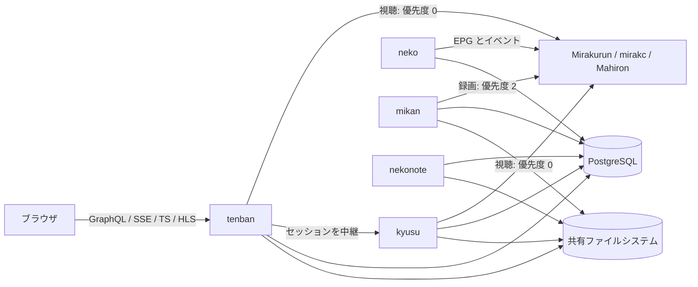
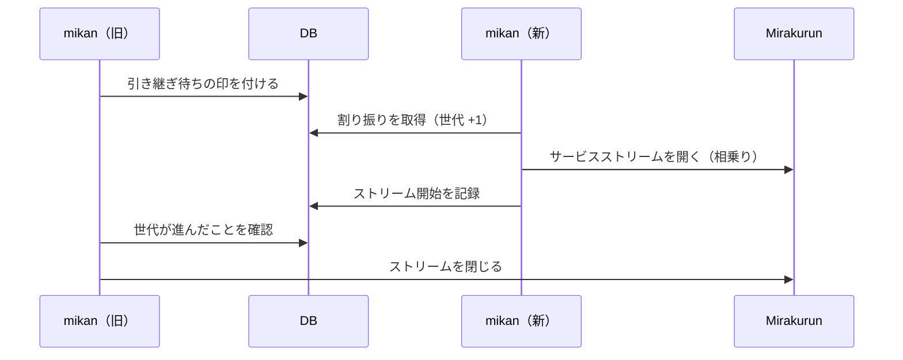
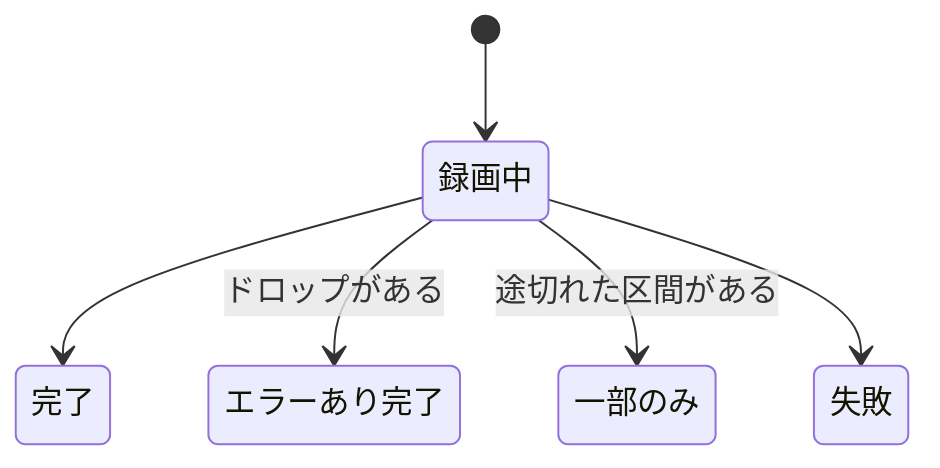

# Kotatsu 設計書 v1

| 項目 | 内容 |
|---|---|
| 状態 | ドラフト |
| 作成日 | 2026-10-09 |
| 対象 | Kotatsu v1 |
| ライセンス | Apache License 2.0 |

この文書は、Kotatsu v1の設計をまとめたものです。
各章の決定事項は、関連プロジェクトの調査と議論を経て合意したものです。
実装しながら確かめる必要がある事項は、[12章](#12-要検証事項)にまとめています。

## 目次

- [0. 概要](#0-概要)
- [1. 全体アーキテクチャ](#1-全体アーキテクチャ)
- [2. 技術選定](#2-技術選定)
- [3. チューナーサーバーと EPG の連携](#3-チューナーサーバーと-epg-の連携)
- [4. 予約エンジン](#4-予約エンジン)
- [5. 録画の実行とストレージ](#5-録画の実行とストレージ)
- [6. 後処理、通知、移行](#6-後処理通知移行)
- [7. ライブ視聴と録画の再生](#7-ライブ視聴と録画の再生)
- [8. データモデル](#8-データモデル)
- [9. API と認証](#9-api-と認証)
- [10. フロントエンドと UI/UX](#10-フロントエンドと-uiux)
- [11. 運用と開発](#11-運用と開発)
- [12. 要検証事項](#12-要検証事項)
- [付録 A. 既定値の一覧](#付録-a-既定値の一覧)
- [付録 B. ライセンスの境界](#付録-b-ライセンスの境界)
- [付録 C. 参考にしたプロジェクト](#付録-c-参考にしたプロジェクト)

## 0. 概要

### 0.1 Kotatsu とは

Kotatsuは、日本のテレビ放送を予約、録画、視聴するためのWebアプリケーションです。
チューナーサーバーにはMirakurun、mirakc、Mahironを使います。
l3tnun/EPGStationの後継として、録画予約から再生までを一つのアプリケーションで扱います。

名前は、こたつに入ってテレビや録画をゆったり楽しむ情景から取りました。
やわらかい角丸と暖色のアクセントを基調にした、居心地のよいホームサーバーを目指します。

### 0.2 背景

EPGStationは長く使われてきましたが、次の課題を抱えています。

- 技術スタックが古くなっています。v2系はNode.js 18とVue 2を前提にしており、新しいNode.jsでは録画が始まらない不具合の報告もあります。
- コンテナやKubernetesと相性がよくありません。録画のタイマー、プロセス内のロック、エンコードのキューをメモリ上にだけ持つので、複数のプロセスで処理を分け合えません。Kubernetesで動かす場合も、レプリカを1つに固定するしかありません。
- 開発が長く止まっていました。v2.10.0（2024-06）の後は更新がなく、2026-10にv3ブランチで大規模な更新が始まりました。ただしv3も、上に挙げたプロセス構成を引き継いでいます。
- 低スペックのマシンには重い構成です。エンコードや配信の子プロセスを含めると、コンテナのメモリ使用量が1 GiB近くに達した運用例があります。エンコードや配信のためのFFmpegのコマンドも、利用者が設定ファイルに書く必要があります。

関連するプロジェクトにも、Kotatsuが埋められる隙間があります。
tsukumijima/KonomiTVは先進的なプレイヤーを持ちますが、録画予約はEDCBをバックエンドにしたときだけ使えます。
Mirakurunやmirakcの上では、番組表を見られても予約はできません。
EDCBは予約エンジンの完成度が高い一方で、状態を単一のプロセスとテキストファイルで管理しており、HTTPのAPIも持ちません。

### 0.3 ゴール

- Mirakurun、mirakc、Mahironの上で、番組表、予約（ルール予約を含む）、録画、録画の再生、ライブ視聴を一つのアプリケーションで扱えるようにします。
- KonomiTVと同じ水準の視聴体験を提供します。対象は、ニコニコ実況のコメント、ARIB字幕、データ放送、mpeg2toh264によるブラウザ内での変換です。
- 低スペック機1台からKubernetesのマルチレプリカ構成まで、同じバイナリで動かせるようにします。
- 何も設定しなくても安全な状態で動くようにします。認証は必須で、第二要素も必須です。既定ではプライベートネットワークからしか接続できません。
- EPGStationから移行できるようにします。
- 暖色と角丸を基調にした、やさしいUIにします。

### 0.4 v1 の非ゴール

- 録画後の自動トランスコード（録画ファイルは .m2tsのまま保存し、再生時に変換します）
- EPGStationのAPIとの互換性
- EDCBをバックエンドとして使うこと
- オブジェクトストレージへの保存（録画は大容量なので、クラウドのオブジェクトストレージでは費用が見合いません）
- SQLiteなどのファイル型DBへの対応（v1はPostgreSQLだけに対応し、将来の対応に備えた構造にします）
- 信頼済みプロキシが付けるヘッダーによる認証
- APIトークンの発行と管理
- 誰でもできるユーザー登録
- iCalendarの配信、IPTV向けのM3UとXMLTV（MahironはIPTV向けのAPIを自前で持っています）
- BS4K（ISDB-S3）のブラウザでの再生（予約と録画には対応します）
- iPhoneでのmpeg2toh264による再生（iPhoneではサーバー側のトランスコードを使います）
- 日本語表記のパスワードフレーズ辞書
- TwitterやXとの連携、ニコニコ本家へのコメント投稿
- ネイティブのスマートフォンアプリ
- 同じ番組を2台のrecorderで同時に録る冗長録画
- EDCBにある、編集距離を使ったあいまい検索と、録画設定のプリセット
- HTTPS化の手順の案内（Secure Contextでしか使えない機能があることだけを注意書きとして示します）

### 0.5 コンポーネント名

コンポーネントには、こたつにちなんだ名前を付けます。
名前はCLIのサブコマンド、KubernetesのDeployment名、Goのパッケージ名まで統一して使います。
サブコマンドは役割名でも受け付けます（`kotatsu neko`と`kotatsu scheduler`は同じ意味です）。
`--help`とログには、`neko (scheduler)`のように役割名を必ず併記します。

| 名前 | 役割名 | 由来と役割 |
|---|---|---|
| kotatsu | アプリ全体 | アプリケーションと単一バイナリの名前です。 |
| tenban（天板） | server | みんなで囲み、物を置く場所です。API、画面、配信の窓口になります。 |
| neko（猫） | scheduler | 猫はこたつで丸くなります。こたつの中の猫は1匹だけで、アクティブなインスタンスが1つであることに対応します。普段は番組表を眺め、時間が来たら録画を割り振ります。 |
| mikan（みかん） | recorder | みかん狩りのように、放送から番組を摘み取ってかごに入れます。 |
| nekonote（猫の手） | worker | 「猫の手も借りたい」から取りました。録画後の雑用を手分けしてこなします。 |
| kyusu（急須） | transcoder | 1つの急須から複数の湯呑みにお茶を注ぎます。1つのエンコーダーの出力を複数の視聴者で共有することに対応します。 |
| kago（かご） | 保存先プール | みかんを入れておくかごです。 |
| yunomi（湯呑み） | プレイヤー | 注がれたものを受け取って味わいます。 |
| futon（布団） | UIのデザインシステム | やわらかく全体を包みます。 |

## 1. 全体アーキテクチャ

### 1.1 ロール

単一のバイナリ`kotatsu`のサブコマンドでロールを選びます。
`all`を指定した場合は、全ロールが1プロセスで動く構成です。
1台構成とDocker Composeでは`all`を既定にします。

| ロール | 台数 | 担当 | 共有ファイルシステム |
|---|---|---|---|
| tenban | N | GraphQL API、SPAの配信、ライブTSの中継、録画ファイルの配信、kyusuへの中継 | 読む |
| neko | アクティブは1 | EPGの同期、ルールの照合、チューナーの割り当て、録画の割り振り、番組のアーカイブ | 使わない |
| mikan | N | Mirakurunから受け取ったTSのファイルへの書き込みと、書き込み中の解析 | 書く |
| nekonote | N | Riverのジョブ（サムネイル、容量の管理、取り込んだ録画の解析、通知の配信） | 読み書き |
| kyusu | 0〜N | サーバー側でのその場トランスコード（任意。GPUノード向け） | 読む |

管理用のサブコマンドとして、`kotatsu migrate`、`kotatsu import epgstation`、`kotatsu admin setup-token`を持ちます。

ビルドのときに、版とコミットを`1.2.3+<コミット>`の形でバイナリに埋め込みます（リリースはタグの版、mainのイメージは`edge`）。
埋め込まないビルドは`dev`とし、コミットはGoが埋め込むVCSの情報から取ります。
版は`kotatsu --version`、起動時のログ、GraphQLの`version`（ログインしたユーザーだけ）で確かめられ、画面ではユーザーのメニューに出します。

### 1.2 構成図

### 1.3 ロールの境界

処理が何を必要とするかで、置くロールを決めます。

- **neko**：全体を見て結果を一つに決める処理を担います。2か所で同時に動くと結果が食い違うので、アクティブにするのは1台だけです。
- **nekonote**：独立していて、再試行でき、数秒から数分遅れても困らない処理を担います。これらの処理はRiverに載せます。
- **mikan**：開始時刻に厳密で、何時間も続き、落ちたら数秒で引き継ぐ必要がある処理を担います。

| 処理 | ロール |
|---|---|
| Mirakurunのイベント購読、EPGの差分反映、定期的な全量の突き合わせ | neko |
| 放送が終わった番組のアーカイブと、保持期間を過ぎた番組の削除 | neko |
| 放送が終わった予約の削除 | neko |
| ルールの照合（自動予約） | neko |
| チューナー割り当ての再計算 | neko |
| 録画の割り振り | neko |
| 録画の実行と引き継ぎ、ドロップの集計、シーク用の索引の作成 | mikan |
| サムネイルとシークバー用プレビュー画像の生成 | nekonote |
| 容量の管理と自動削除 | nekonote |
| EPGStationから取り込んだ録画の解析 | nekonote |
| 通知の配信 | nekonote |
| EPGStationからの移行 | `kotatsu import epgstation`（管理用のサブコマンド） |

EPGの同期をnekoに置く理由は2つあります。
Mirakurunのイベント購読は1本で足り、複数の場所で購読すると同じ更新を重複して処理することになります。
また、EPGの更新はルール照合とチューナー割り当ての起点なので、同じプロセスに置けば一貫した状態のデータで処理を進められます。

EPGStationからの移行をサブコマンドにするのは、移行元のDBへの接続や録画ファイルのパスの対応付けを、対話的に確かめながら1回だけ実行する処理だからです。
取り込んだ録画の解析のような重い後続の処理は、Riverのジョブとしてnekonoteに回します。

### 1.4 協調の仕組み

ロール間で共有する状態は、DBと共有ファイルシステムだけです。
Redisなどの追加の依存は持ちません。

- **nekoのリーダー選出**：DBのリーステーブルで行います。KubernetesのLeaseと違って、Docker Composeや1台構成でも同じ仕組みで動きます。リースには世代番号を持たせ、古いリーダーの書き込みを世代番号で拒否します。リーダーの書き込みのトランザクションはリースの行をロックするので、リースを取る、延ばす、手放すときは、ロックを待つ時間に上限（付録Aの既定値は2秒）を設けます。固まったトランザクションが残っても、待ち続けずにあきらめ、後でやり直します。リーダーの処理が失敗したとき（DBの瞬断など）は、プロセスを終えずにリースを手放し、次の延長の間隔で取り直します。全ロールを1つのプロセスで動かす構成で、一時的な失敗で録画中のmikanごと止まらないようにするためです。
- **DBの接続**：トランザクションの中で何もしない時間と、1つの問い合わせの時間に上限を設けます（付録A）。固まったトランザクションや問い合わせが、リースを取れないまま残らないようにするためです。マイグレーションは長くかかることがあるので、問い合わせの時間の上限は付けません。PgBouncerなどのトランザクションプーリングを経由するときは、接続の開始のパラメーターを渡せないので、プーラーの側で設定します。
- **ジョブ**：Riverを使います。
- **変更の通知**：PostgreSQLのLISTEN/NOTIFYを使います。PgBouncerなどのトランザクションプーリングを経由するとLISTENが使えないので、ポーリングも併用します。見張り始めるときの最初の問い合わせが失敗しても、間を空けてやり直します。tenbanは、何が変わったかをGraphQLのsubscriptionでブラウザに送ります。
- **インスタンスの登録簿**：各ロールのインスタンスは、自分のアドレスとハートビートをDBに書きます。tenbanは、この登録簿を引いてkyusuのセッションへリクエストを中継します。

ライブ視聴の中継（mpeg2toh264の経路）には協調が要りません。
同じチャンネルを見る視聴者が何人いても、Mirakurunが1本のチューナーで相乗りさせるので、どのtenbanが中継しても余分なチューナーを消費しないからです。
エンコーダーを視聴者間で共有する必要があるのは、kyusuの経路だけです。

### 1.5 録画の受け渡し

録画の開始には、Riverの予約ジョブを使いません。
Riverの予約ジョブは、リーダーが5秒ごとに実行可能な状態へ移すので、開始が最大5秒ほど遅れます。
この遅れは、開始の少し前にジョブを投入してジョブの中で待てば避けられます。
問題は録画中の障害の扱いです。
Riverは実行中のジョブのハートビートを持たず、ワーカーが落ちて止まったジョブを救出するのは`RescueStuckJobsAfter`（既定1時間で、ジョブのタイムアウトより長くする必要があります）を過ぎてからです。
数時間かかる録画では、引き継ぎが数時間後になってしまいます。

そこで、録画の受け渡しには専用の割り振りテーブル（`recording_assignments`）を使います。

1. nekoが、録画開始の数分前（既定は2分前）に割り振りの行を書きます。
2. mikanは`SELECT ... FOR UPDATE SKIP LOCKED`で行を取り、数秒ごとにリースを延長しながら録画します。
3. リースが切れたら、別のmikanが行を取り直し、続きを新しいファイルに書きます。
4. 行には世代番号を持たせます。古いmikanは、リースの延長に失敗した時点で書き込みをやめます。リースの期限は、mikanの時計ではなくDBの時刻で決めます。mikanを複数のマシンで動かすと時計がずれ、時計の進んだmikanが、ほかのmikanの録画中の行をリースが切れたとみなして取ってしまうためです。
5. 録画を終えたら、行を終わったことにします。録画を始めずに終えたとき（始める前に予約を無効にしたときなど）は、行を消します。残すと、予約を有効に戻しても、nekoが行を書き直せないためです。
6. 録画できない理由がそのmikanにあり、ほかにmikanが動いていれば、行をまだ取っていない状態に戻して手放し、しばらく（付録Aの既定値は1分）行を取りません。ほかのmikanが取って録画します。理由は、プールがマウントされていないとき（最初のセグメントを作るとき）と、まだ何も録っていないのにチューナーサーバーにつながらないまま30秒（付録A）が過ぎたときです。チューナーサーバーの再起動はすべてのmikanに同時に起きるので、一度つながらないだけでは手放しません。手放すときは、録画できなかった理由を録画の行に残し、ほかのmikanも録れなければ、nekoがその理由で録画を失敗にします（[5.5](#55-録画の状態)）。ほかにmikanがいなければ、手放さずに、これまでどおり自分で扱います。

割り振りを取ったmikanは、その時点ではまだチューナーを確保しません。
自分のタイマーで待ち、開始時刻からマージンとチューニングにかかる時間を引いた時刻にストリームを開きます（[5.1](#51-録画に使うストリーム)）。

### 1.6 チューナーの優先度

Mirakurunは、チューナーの利用者を「IP:ポート」で区別します。
そのため、Mirakurunから見ると、Kotatsuの各インスタンスはそれぞれ別の利用者です。
優先度の高い視聴のリクエストは、どのインスタンスから来ても、録画中のチューナーを奪えてしまいます。

これを防ぐため、全ロールが共通の優先度表に従います。

| 用途 | Mirakurunに渡すpriority |
|---|---|
| 録画 | 2 |
| 競合すると判定された録画（チューナーが空いていれば録る） | 1 |
| 視聴（ライブ視聴、kyusu） | 0 |

EPGの収集は、Mirakurunの内部でpriority -1として動きます。
v1では、これらの値を設定で変えられないようにします。mirakcで無条件にチューナーを奪う値128を、誤って使わないようにするためです。

## 2. 技術選定

### 2.1 バックエンド

| 項目 | 選定 | 理由 |
|---|---|---|
| 言語 | Go | メンテナーが習熟しており、コントリビューターも参入しやすいためです。Kotatsuの負荷はI/Oと外部プロセス（FFmpeg）とブラウザに集まるので、Rustとの性能差はほぼ出ません。`CGO_ENABLED=0`でarm64の静的バイナリも作れます。 |
| API | GraphQL（gqlgen） | スキーマ（SDL）をAPIの原本にします。subscriptionをSSEで配信できます。 |
| HTTP | 標準のnet/http | 映像の配信と認証の手続きは、GraphQLの外の素のHTTPで扱います。 |
| ジョブ | River（riverpgxv5） | PostgreSQLのトランザクションの中でジョブを投入できます。 |
| DB | PostgreSQL、pgx v5、sqlc | v1はPostgreSQLだけに対応します。DBへのアクセスはinterfaceの裏に置き、将来はsqlcのSQLiteエンジンで2系統目のクエリを足せるようにします。 |
| マイグレーション | `schema.sql`に宣言的に書き、Atlasで差分を生成します | 実行時は、Goに埋め込んだマイグレーションを`kotatsu migrate`が適用します。 |
| ログ | log/slog（JSON形式） | |
| 可観測性 | OpenTelemetryとPrometheus形式の`/metrics` | OTLPの送信先を設定したときだけトレースを送ります。 |
| 設定 | YAMLと環境変数 | 置き場所の基準は[11.2](#112-設定の置き場所)で定めます。 |
| 認証 | go-webauthn、pquerna/otp、coreos/go-oidc、x/crypto/argon2、webpush-go | |
| ARIBの処理 | tsreadexを子プロセスとして使います | GoにはARIBの文字符号を扱える成熟したライブラリがありません。番組情報はMirakurunがJSONで返し、字幕とデータ放送はブラウザで描画するので、Kotatsuの中でARIBの文字符号を解く必要はありません。 |

Kotatsuの中でTSを解析するのは、パケット単位の処理（ドロップの集計、PATとPMT、Iフレームの位置）だけです。
これらはARIBの知識を必要としないので、Goで直接書きます。

PostgreSQL以外のDBを使いたい利用者には、SupabaseなどのマネージドなPostgreSQLを勧めます。
マネージドDBがトランザクションプーリングの接続口を提供している場合、そこを経由するとLISTENが使えません。
直接接続を推奨としたうえで、プーラー経由でもポーリングだけで動くモードを用意します（Riverの`PollOnly`もこのためのものです）。

### 2.2 パスワード強度の判定

パスワードの強度はzxcvbn-ts（日本語辞書`@zxcvbn-ts/language-ja`を含む）で判定し、弱いパスワードを拒否します。
クライアントでの判定は入力中のフィードバックに使い、拒否するかどうかはサーバーで判定します。
APIを直接呼べばクライアントの判定は素通りできるからです。

Goに移植されたzxcvbnは、どれも更新が止まっています（trustelem/zxcvbnの最終更新は2024-04、nbutton23/zxcvbn-goはアーカイブ済みです）。
そこで、zxcvbn-tsそのものを、Pure GoのJavaScriptエンジンであるgojaの上で動かします。
クライアントとサーバーが同じバージョンの同じ辞書で判定するので、両者の結果は食い違いません。
バージョンはnpmのパッケージとしてRenovateで追跡します。

この方式は、使い捨ての実験コードで確かめました。

| 項目 | 結果 |
|---|---|
| 互換性 | 用意した27件のパスワードすべてで、Node.jsと結果が一致しました（スコア、推定試行回数、警告文、提案文）。ES2015、ES2017、ES2020のどのバンドルもgojaで動きました。 |
| 速度 | VMの生成と辞書の読み込みに約0.2秒、初回の判定に約0.13秒かかり、2回目以降は1件あたり約40 msでした。 |
| メモリ | VMを保持している間、ヒープが約37 MiB増えました。 |
| バイナリサイズ | gojaで約9 MB、gzipで圧縮した辞書バンドルで約0.9 MB増える見込みです（後述の対処で約1.8 MBになりました）。 |

この結果から、VMはパスワードの設定時と変更時にだけ作って捨てます。
入力の長さに上限を設け、`vm.Interrupt`でタイムアウトさせ、判定APIの呼び出し回数を制限します。

ただし、上の速度は短いパスワードでの値です。
数字や記号の多い長いパスワードでは、zxcvbn-tsのl33tの照合が遅くなります。
l33tの照合は、`4→a`のような読み替えの候補を最大100通り作り、候補ごとに辞書全体を引き直すからです。
64文字のパスワードの判定は、手元のgojaで約3.5秒、負荷の高い機材では12秒を超えました。

そこで、zxcvbn-tsに次のパッチを当て、判定の結果を変えずに速くします（`web/patches`）。

- l33tの候補では、読み替えた文字を含む部分だけを辞書で引き、引いた結果を候補の間で使い回します。読み替えた文字を含まない部分の一致は、もともと捨てられます。
- 順位を付け終えた辞書を受け取れるようにします。サーバーのバンドルには、ビルドのときに順位を付けた辞書をJSONの文字列で埋め込みます。gojaの`JSON.parse`はGoで動くので、辞書を展開して順位を付け直すより速いからです。
- 辞書の照合で、部分文字列を1文字ずつ伸ばしながら引くとき、辞書のどの語にも現れない2文字の組が出たら、その位置から伸ばすのをやめます。その組を含む部分は、どの語にも一致しないからです。語に現れる組は、ビルドのときに辞書から求めてバンドルに埋め込み、ユーザーの入力の語の組は判定のたびに加えます。

パッチを当てた後の判定は、元のzxcvbn-tsをNode.jsで動かした結果と、無作為な長いパスワードやl33tを含む626件すべてで一致しました。
VMの生成と辞書の読み込みは約0.4秒から約0.1秒に、128文字の記号入りの判定は手元のgojaで約1秒から約0.6秒になりました。
代わりに、埋め込む辞書のバンドルは、gzipで約0.9 MBから約1.8 MBに増えます。

日本語辞書の収録語はローマ字だけです。
かなや漢字のフレーズは総当たりの組み合わせ数で評価されるので、実際より強めに判定されます（実験コードでは「こたつでみかん」がスコア2、「猫はこたつで丸くなる」が3でした）。
そのため、NIST SP 800-63B-4に沿った長さの規定とブロックリストの照合を併用します（[9.3](#93-ローカルアカウント)）。

### 2.3 フロントエンド

ReactのSPAをVite+ でビルドし、Goのバイナリに埋め込みます。
本番環境でNode.jsを動かさないことが、低スペック機への配慮として最も効くからです。
Next.jsの利点はSSRとRSCですが、そのためには本番でNode.jsのプロセスを1つ増やす必要があります。
詳細は[10章](#10-フロントエンドと-uiux)で定めます。

### 2.4 コンテナイメージ

同じバイナリを載せたイメージを2種類用意します。

| イメージ | ベース | 用途 |
|---|---|---|
| `ghcr.io/slashnephy/kotatsu:<バージョン>` | `gcr.io/distroless/static-debian13:nonroot` | tenban、neko、mikan |
| `ghcr.io/slashnephy/kotatsu:<バージョン>-ffmpeg` | Debian 13のslimにDebianの`ffmpeg`パッケージとVAAPI・QSVのドライバを入れ、tsreadexをソースからビルドして同梱します | kyusu、nekonote、`all` |

FFmpeg（VAAPIやQSVのドライバを含む）とtsreadexは共有ライブラリを必要とするので、staticのイメージには入りません。
サムネイルの生成にFFmpegが要るので、全ロールを1プロセスで動かす`all`も`-ffmpeg`イメージを使います。
`-ffmpeg`イメージの実行ユーザーは、distrolessの`nonroot`と同じUID 65532にそろえます。
VAAPIとQSVのドライバには、Debianのmainコンポーネントのパッケージ（`mesa-va-drivers`、amd64では加えて`intel-media-va-driver`、`libvpl2`、`libmfx-gen1.2`）を使い、non-freeのパッケージは入れません。NVENCのライブラリは、NVIDIA Container Toolkitがホストから渡します。
どちらもamd64とarm64に対応します。

## 3. チューナーサーバーと EPG の連携

### 3.1 接続先

接続するチューナーサーバーは1台だけです。
設定するのはURLと、必要に応じてBASIC認証の資格情報です。
複数のチューナーサーバーを束ねる処理は、MirakurunのリモートチューナーやMahironのremotesといった、チューナーサーバー側の機能に任せます。

Mirakurun互換のAPIを基本にし、サーバーごとの追加機能は接続時と定期的に判定します。
起動時に一度だけ判定して使い続けることはしません。
EPGStationはMirakurunのAPI定義を起動時に取得してキャッシュし続けたため、古い定義のまま固まり、再起動しないと復帰しないことがありました。

| サーバー | 判別の方法 | 追加で使う機能 |
|---|---|---|
| Mirakurun | 既定 | `/api/events/stream` |
| mirakc | `/events`の有無 | `/events`（SSE）、`/api/onair` |
| Mahiron | `/api/version`の`server`が`mahiron` | `/api/events/stream`、データ放送のAPI |

mirakcの録画予約のAPI（`/api/recording/*`）は使いません。
mirakcは予約を自身のノード上のファイルに保存するので、Kotatsuのスケジューラと予約を二重に管理することになるからです。

チャンネル種別は列挙型にせず、チューナーサーバーが返す文字列をそのまま保持します。
Mahironは`BS4K`や`EXT1`のような任意の種別を返すことがあるからです。
GR、BS、CS、SKYには表示名と並び順の既定値を持たせ、それ以外の種別は文字列のまま表示します。
管理者は、種別ごとの表示名と並び順を画面から変えられます。

### 3.2 識別子

- 番組が同じかどうかは、(networkId, serviceId, eventId)と開始時刻の組で判定します。EIDは再利用されることがあるからです。Mirakurunの番組IDは属性として保持します。
  - 放送中とこれからの番組（`programs`）では、上流と同じく(サービス, eventId)で一意にし、放送時間が変わっても同じ番組として更新します。番組予約は、これで時間の変更に追従します（[4.6](#46-番組の変更への追従)）。開始時刻は、放送が終わった番組を`program_archives`に移すときに、再利用されたEIDと見分けるのに使います。
- サービスは、MirakurunのサービスID（networkId × 100000 + serviceId）で識別します。
- 予約、ルール、録画といったKotatsu自身のデータには、独自のIDを振ります（[8.1](#81-共通の約束)）。

### 3.3 EPG の同期

nekoは、次の手順でEPGを同期します。

1. 接続したときと定期的に、チャンネル、サービス、番組の全量を取得し、DBと差分で突き合わせます。上流にあってDBにない番組は追加し、内容が変わった番組は更新し、上流から消えた未来の番組は削除します。ただし、上流がサービスの番組を1つも返さなかったときは、そのサービスの番組を消しません。チューナーサーバーが一時的に空の一覧を返すと、未来の番組と、そこから作ったルール予約が全部消えてしまうためです。全件を削除して入れ直す方式は取りません。EPGStationでは、全件の削除と挿入を1つのトランザクションで行う処理が多重に起動してロックを奪い合い、そのまま回復しなくなることがありました。全件を入れ替えると、テーブルの統計情報も崩れます。
2. 全量の取得と次の取得の間は、イベントストリームを購読して差分を反映します。購読先は、MirakurunとMahironでは`/api/events/stream`、mirakcでは`/events`です。
3. Mirakurunのイベントストリームにはハートビートがなく、60分で切れます。番組の削除イベントも、時間の重なる番組に置き換えられたときにしか届きません。そのため、イベントは「変化があった」という合図として扱い、データの正しさは全量の突き合わせで保証します。
4. 全量の突き合わせは、既定では30分ごとと、再接続したときに行います。実行の間隔には下限を設け、再接続が続くときはバックオフします。
5. イベントは1〜2秒分をまとめ、1つのトランザクションで反映します。反映したら、変更のあったサービスと時間帯を添えて「EPGが変わった」と通知し、ルールの照合とチューナーの割り当てを走らせます。立て続けに来る変更は間引きます。

映像も音声も流さないサービス（データ放送、エンジニアリングサービスなど）は、視聴も録画もしないので取り込みません。種別はEPGStationの`isMediaService`と揃えます。取り込みをやめる前に入ったそのようなサービスと番組は消さずに残し、番組の検索とルールの照合では対象にしません。
アーカイブへ移す猶予を過ぎた番組は、上流が返しても突き合わせません。上流は放送の終わった番組をしばらく返し続けるので、足すと、移したそばから`programs`に戻ってしまいます。

MirakurunのイベントストリームはSSEでもNDJSONでもありません。
最初に`[`を送り、その後はイベントのJSONと`,`を改行で区切って送り続け、配列を閉じません。
このストリームを逐次に読む専用のパーサーを用意します。

### 3.4 過去の番組の保持

番組は2つのテーブルに分けて持ちます。

- **`programs`**：放送中の番組と、これから放送される番組です。
- **`program_archives`**：放送が終わった番組です。

nekoは、放送が終わってから一定の猶予（既定24時間）が過ぎた番組を、`programs`から`program_archives`へ移します。
猶予を置くのは、Mirakurunが放送の終わった番組をしばらく持ち続け、その間に更新が届くことがあるからです。
放送前に予定から消えた番組は、アーカイブせずに削除します。

アーカイブの保持期間は設定で指定します（既定は90日、0で無期限）。
GR、BS、CSをすべて受信する環境では、1日に数千件の番組が増える見込みです。
1年分だと百万件規模になり、低スペック機のディスクには重くなるので、既定値は短めにしています。
保持期間を過ぎたアーカイブは、nekoが少しずつ削除します。

過去の番組が検索の性能を落とさないように、次のように扱います。

- ルールの照合、番組表、通常の番組検索は`programs`だけを読みます。対象は、過去の番組をどれだけ残しても数万件のままです。
- 過去の番組の検索は、UIで「過去の放送も含める」を選んだときだけ行います。期間の指定は必須で、既定は直近30日です。期間で絞るインデックスを効かせたうえで、番組名を照合します。
- pg_trgmやPGroongaのような全文検索の拡張は前提にしません。日本語への対応がまちまちで、マネージドDBで使えるとも限らないからです。

### 3.5 検索と照合

番組名と説明には、NFKCで全角と半角をそろえた検索用の列を持たせます。
Mirakurunはサービス名を全角で返すので（例：`ＴＯＫＹＯ　ＭＸ１`）、正規化しないと半角で入力した語が一致しません。
詳細も、見出しの順に見出しと本文をつないで正規化した列を、EPGの同期のときに持たせます。
ルールの照合は番組の変わるたびに全番組を読むので、そのたびに正規化し直すと重いからです。
この列を足す前に書いた番組は、照合のときに正規化します。

期間、チャンネル、ジャンル、無料かどうかによる候補の絞り込みはSQLで行います。
正規表現でなく番組名と概要だけを見るキーワードも、正規化した列の部分一致でSQLで粗く絞り、照合する候補を減らします。
キーワードと正規表現の照合は、Goのregexp（RE2）で行います。
RE2は入力の長さに対して線形の時間で動くので、ユーザーが書いた正規表現で処理が止まる（ReDoS）ことはありません。
含めるキーワードは、すべてに一致する番組か、いずれかに一致する番組かを選べます（既定はすべてに一致）。除外するキーワードは、いずれか1つに一致すれば除外します。
ルールの照合（neko）と番組の検索（tenban）は同じ照合関数を使うので、両者の結果は一致します。
サブチャンネルがメインチャンネルと同じ番組を流している（イベント共有）ときは、ルールの照合と同じく、番組の検索でもサービスIDの最も小さい番組だけを返します。

### 3.6 チューナーの把握

チューナーの一覧と、各チューナーが受信できる種別は、イベントと定期的な取得で更新し続けます。
EPGStationのように起動時に固定することはしません。

1本のチューナーで複数の種別を受信できる機器（PX-MLTなど）も扱えるようにします。
同じチャンネルの予約どうしは、1本のチューナーを共有します。

Kotatsuを通さずにチューナーを使う利用者（TVTestなど）もいるので、Kotatsuの割り当てはあくまで予測です。
実際にチューナーを確保できなければ、mikanが予定の終わりまで再試行します。
それでも確保できなければ、失敗の理由を`tuner_unavailable`として記録します。nekoは、1分ごとの割り当ての計算し直しで、チューナーの状態を反映します。

### 3.7 時刻と縮退

時刻の基準はOSの時計（NTPで同期済みのもの）とします。
チューナーサーバーが返すHTTPのDateヘッダーと比べて大きくずれていたら、管理者に警告します。

チューナーサーバーに接続できない間は、UIに縮退中であることを表示し、バックオフしながら再接続を続けます。
再接続できたら、全量の突き合わせからやり直します。
チューナーサーバーの状態は、Kotatsuの起動やlivenessの判定には影響させません。

## 4. 予約エンジン

### 4.1 予約の種類

| 種類 | 指定する内容 | 番組の変更への追従 |
|---|---|---|
| 番組予約 | 番組（networkId, serviceId, eventId） | 放送時間の変更とイベントリレーに追従します |
| 時刻予約 | サービスと、開始と終了の時刻 | 追従しません |
| ルール予約 | ルールが自動で作ります | 番組予約と同じです |

どの予約も、番組情報のコピーを持ちます。
番組がEPGから消えても、予約の内容を表示できるようにするためです。
終了時刻が未定の番組から予約を作るとき（手動の番組予約とイベントリレーの引き継ぎ先）は、予約の終わりを始まりから1時間後にしておき、終了時刻が決まったら追従で直します。未定の長さを、Mahironは0、Mirakurunは1ミリ秒で返すので、そのまま写すと予約になりません。

1つの番組に対する予約は、常に1件だけです。
複数のルールに一致した場合も予約は1件にまとめ、一致したルールを関連として残します。
録画の設定には、一致したルールのうち最も古く作ったルールの上書きを使います。
番組の詳細では、ルール予約のもとになったルールを並べ、そのルールの画面へ移れるようにします。
手動で予約した番組では、手動の設定をルールの設定より優先します。

### 4.2 ルール

ルールには次の条件を指定できます。

- キーワードと除外キーワード。それぞれに「正規表現として扱う」「大文字と小文字を区別する」「照合の対象（番組名、概要、詳細）」を指定できます。キーワードを複数書いた場合は、すべてに一致する番組か、いずれかに一致する番組かを選べます（既定はすべてに一致）。除外キーワードは、いずれか1つに一致したら除外します。
- チャンネル種別の集合と、サービスの集合
- ジャンル（含めるものと除くもの）
- 曜日と時間帯の組（複数指定できます）
- 番組の長さの最短と最長
- 無料放送に限るかどうか
- ルール自体の有効期間
- 重複の回避（[4.4](#44-重複の回避)）

ルールは、名前、メモ、有効かどうか、録画設定の上書き、作成者を持ちます。
ルールの条件は、Goの型で定義して検証し、スキーマのバージョンを付けてJSONBに保存します（[8.3](#83-ルールの条件を-jsonb-に保存する理由)）。

### 4.3 ルールの照合

ルールの照合は、何度実行しても同じ結果になるように作ります。
EPGやルールが変わるたびに、nekoは全ルールについて「予約すべき番組の集合」を計算し、既存のルール予約と突き合わせます。

- 集合にあって予約がない番組には、予約を作ります。
- 予約はあるのに、どのルールにも一致しなくなった番組は、録画が始まっていなければ予約を削除します。ただし、次の予約は残します。
  - 番組がEPGから消えたか、終了時刻が未定になった予約。どちらも一時的なことがあり、消すと録り逃すからです。
  - ユーザーが無効にした予約。ルールがある間は残し、ルールを消したときに消します。
- ユーザーがルール予約を削除する操作をしたときは、予約を消さずに「無効」にします。消してしまうと、次の照合でまた作られてしまうからです。
- 終了時刻が未定の番組は、ルールの対象にしません。手動での予約はできます。
- 条件を読めないルール（ローリング更新の途中で、新しい版が足した条件を古い版が読むときなど）は、照合から外してログに残し、ほかのルールの照合を続けます。外したルールに結び付いた予約は、一致しなくなったとはみなさず、残します。

### 4.4 重複の回避

ルールには「同じ番組名を指定の日数以内に録画済みであれば、予約しない」という条件を付けられます。

- 録画履歴（`recording_history`）には、正常に終了し、ドロップが閾値未満だった録画だけを記録します。録画を削除しても、履歴は残します。
- 照合に使うキーは、番組名を正規化したものです。正規化では、NFKCで表記をそろえ、`[新]`、`[再]`、`[字]`のような記号を取り除きます。話数は残します。話数まで取り除くと、2話目以降がすべて「録画済み」と判定されてしまうからです。
- 同じイベントを複数のサービスで放送している場合（relatedItemsの`shared`）は、どれか1つだけを予約します。
- 録画履歴を（正規化した番組名, サービス）で引くインデックスを、最初からマイグレーションに含めます。EPGStationでは、このインデックスがないために重複回避の照合が番組表の全件を走査し、利用者が手でインデックスを足していました。

### 4.5 チューナーの割り当て

nekoは、予約の集合、チューナーの構成、現在時刻から、割り当てを毎回すべて計算し直します。

1. 各予約を、マージンを含めた時間区間に展開します。同じチャンネルで重なる区間は、1本のチューナーを共有する1つの需要にまとめます。
2. 需要を「優先度、開始時刻、予約ID」の順に並べます。並べ替えのキーが一意なので、同じ入力からは常に同じ結果が出ます。
3. 先頭から順に、その種別を受信できるチューナーへ割り当てます。候補が複数あるときは、削られる録画時間が最も少ないチューナーを選びます。
4. 同じチューナーで別のチャンネルの予約が隣り合い、マージンどうしが重なるときは、前の録画の終了マージンを先に削り、次に後の録画の開始マージンを削ります。番組の本編は削りません。
5. 録画がすでに始まっている予約は、チューナーを動かさず、録画の始まりから本編の終わりまでを削りません。終了マージンは、録画の前と同じく手順4で後の録画に譲ります。録画が始まったときに戻すと、後の録画の冒頭が欠けるためです。

各予約の割り当て結果は、次の3つの状態として保存し、UIに表示します。

| 状態 | 意味 |
|---|---|
| 正常 | 全編を録画できる見込みです |
| 一部のみ | 本編の一部が欠ける見込みです |
| 競合 | チューナーが足りません。録画は優先度1で試み、チューナーが空いていれば録ります |

競合した予約を優先度1で試みる方式は、EPGStationの`conflictPriority`にならったものです。
後から別の録画が優先度2で来ればチューナーを譲り、優先度0の視聴には奪われません。

割り当てを計算し直すきっかけは、予約の変更、予約中の番組に関わるEPGの変更、チューナー構成の変更です。
録画状態の変化は、1分ごとの計算し直しで反映します。
立て続けに起きた変更は間引きます。
新たに競合が生じたときは通知します（[6.2](#62-通知)）。

### 4.6 番組の変更への追従

- EPGで放送時間が変わったら、予約の番組情報と時間を更新し、割り当てを計算し直します。
- 予約の終わりが過ぎた後は、同じ放送の終わりが延びたときだけ追従します。番組が予約の終わりより後に始まるなら、eventIdが別の番組に再利用されたものとみなし、古い予約を書き換えません。終わりが過ぎてから届いた放送時間の変更も、同じく扱います。ルール予約は、照合で変更後の番組に作り直されます。
- 録画の予定の終わりと番組の終わりの遅いほうから猶予（付録Aの既定値は1時間）が過ぎ、録画も終わった予約は消します。番組の予約は（サービス, eventId）で1件なので、残すとeventIdが再利用されたときに新しい番組を予約できないためです。録画と録画履歴は残ります。消したことは監査ログに残します。録画の設定は予約から引けなくなるので、後からファイル名を付け直すときは全体の既定値を使います。
- イベントリレーで別のサービスに引き継がれる番組では、引き継ぎ先の予約を自動で作ります。この動作は予約ごとに設定でき、既定で有効です。引き継ぎ先の予約を作れなくても、ほかの予約の追従は続けます。
  - 引き継いだ予約をユーザーが削除する操作をしたときは、ルール予約と同じく、予約を消さずに「無効」にします。消してしまうと、引き継ぎ元がある限り、次の追従でまた作られてしまうからです。
- 録画中の延長への追従は、[5.1](#51-録画に使うストリーム)で定めます。

### 4.7 録画設定

録画設定は、全体の既定値の上に、ルールごとや予約ごとの上書きを重ねる2層で持ちます。
設定項目は、保存先プール、ファイル名のテンプレート、マージン、優先度、分かれた録画のファイルを1つにつなぐかどうか（[5.4](#54-引き継ぎと再起動)）です。
ファイル名のテンプレートは、Goのtext/templateで書きます。使える項目は`.StartAt`、`.EndAt`、`.ServiceName`、`.ChannelType`、`.Channel`、`.Name`、`.EventID`です。
関数として、曜日を漢字1文字にする`weekdayJa`と、全角の英数字と空白を半角にする`half`（画面の表示の半角化と同じ範囲）を使えます。
当てはめる時間と確保するメモリを際限なく延ばせないよう、使える書き方は、項目（メソッドの呼び出しを含む）、`if`と`with`、関数`half`と`weekdayJa`に限ります（`printf`などの組み込みの関数、繰り返し、変数、テンプレートの定義と呼び出しは使えません）。テンプレートは1024バイトまで、当てはめた結果は4096バイトまでにします。
Goを書かない利用者のために、テンプレートの入力欄（全体の設定とルールの画面）では、使える書き方を、見本の番組を当てはめた例とともに表にして示し、押すとカーソルの位置に差し込みます。
よく使うテンプレート（既定値と、EPGStationと同じ名前になるもの）も選べます。表の中身はサーバーが持ち、関数や項目を足したときに食い違わないようにします。
テンプレートに書いた`/`は、ディレクトリの区切りにします（例：`{{.ChannelType}}/{{.StartAt.Format "2006-01"}}/{{.Name}}`）。番組名などの値に入っている`/`と`\`は取り除くので、番組名でディレクトリを掘ることはありません。
ディレクトリの名前の1つずつも、ファイル名と同じく整え、整えて空になった要素（空の要素、`.`、`..`）は捨てます。深さは8段までで、それより深い分は捨てます。ディレクトリは、プールの中に限って作ります。
録画を消して空になったディレクトリは、プールの直下まで遡って消します。
ファイル名のテンプレートを変えても、既存の録画のファイルは元の名前のままです。管理者は、システムの状態の画面で、今の録画設定のテンプレートで付け直すと名前が変わる録画と、元の名前と新しい名前の一覧を確かめてから、付け直せます。
録画設定は、録画のときと同じく、全体の既定値にルールと予約の上書きを重ねて求め、分かれた録画の2つ目以降のセグメントには連番を付けます。
付け直しは同じプールの中だけで行い、付属ファイルのディレクトリも一緒に移して、記録のパスを書き換えます。移す先に同じ名前があれば連番を付けます。
録画中と、セグメントをつないでいる途中の録画は付け直しません。記録を書き換えられなければ、移したファイルを元に戻します。付け直したことは監査ログに残します。
画面からは100件ずつ送り、進み具合を示します。
入力が止まると、テンプレートに番組（見本の番組か、ルールの画面ならプレビューに出ている番組）を当てはめ、録画と同じ整え方をしたファイル名を示します。テンプレートの誤りもその場で示します。
前後のマージンは、ルールの画面と、予約ごとの録画の設定（番組の詳細と予約の一覧から開きます）で上書きできます。
入力欄を空にすると上書きをやめ、従う値（ルール予約ならルールの設定、なければ全体の既定値）を入力欄の説明に示します。

## 5. 録画の実行とストレージ

### 5.1 録画に使うストリーム

MirakurunからTSを受け取る方法は2通りあります。

| 方法 | 長所 | 短所 |
|---|---|---|
| 番組ストリーム（`/api/programs/{id}/stream`） | MirakurunがEIT[p/f]を見て、放送の開始から終了までを正確に出力します。延長にも自動で追従します。 | 開始前のマージンを取れません。eventIdが差し替わると、何も出力しないまま終わります。 |
| サービスストリーム（`/api/services/{id}/stream`） | マージンを自由に取れます。時刻予約と同じ仕組みで録れます。 | 終了時刻をKotatsu側で判断する必要があります。 |

Kotatsuはサービスストリーム（`decode=1`）で録画し、終了時刻を自分で判断します。

- mikanは、開始時刻からマージンとチューニングにかかる時間（既定5秒）を引いた時刻にストリームを開き、届いたデータをすべて書き込みます。
- 終了時刻は、最新のEPGから計算します。録画中のチャンネルのEIT[p/f]はMirakurunが解析し、番組の更新としてイベントで届くので、延長や繰り下げはこれで分かります。
- mirakcの`/api/programs`はEIT[schedule]から作られ、延長や繰り上げは番組表を取り直すまで反映されません。mirakcでは、`/api/onair`が返す放送中と次の番組（EIT[p/f]）を番組表に重ねて反映し、`onair.program-changed`のイベントでも同期し直します。
- 延長中で終了時刻が未定になったときは、5分ずつ録画を延ばします。延長には上限（既定3時間）を設けます。
  - 延ばした後に終了時刻が決まったら、決まった終わりに後ろのマージンを足した時刻まで録ります。予定の終わりは、過ぎると割り当てで計算し直さないので、番組の終わりから求めます。
- 番組がEPGから消えたときは（eventIdの差し替えなど）、予定の終了時刻とマージンまで録り続け、録画に「番組情報を見失った」と記録します。

延長や繰り下げがイベントとして届くまでの時間を、チューナーサーバーごとに測りました（[12章](#12-要検証事項)、#23）。
MirakurunとMahironでは、EIT[p/f]が変わってから2秒以内に届くので、サービスストリームだけで追従できます。
mirakcは、放送中の番組を1分ごとにしか調べないので、最大で1分ほど遅れます。
延長が番組の終わりの1分前より後に決まると、Kotatsuは延長を知る前に録画を止めることがあります。
mirakcを使うときは、終了後のマージンを1分以上にしてください。
番組ストリームを併用する方式には切り替えません。

EPGだけでは、予約した番組が実際に放送されているかは分かりません。
放送局の番組表（EIT[schedule]）に時間の重なった番組が入り、実際には放送されなかった番組を予約すると、その時間に流れていた別の番組を録画として残してしまいます（#331）。
そこで、mikanは、録画中のサービスストリームに流れる自局のEIT[p/f]（table_id 0x4E）を、録画しながら読みます。
EIT[p/f]の放送中の番組は1つだけなので、番組表に重なりがあっても、実際に放送されている番組が分かります。
番組予約とルール予約では、eventIdで次のように判断します（eventIdが同じなら、番組名が変わっても同じ番組として追います）。

- 放送中の番組が予約した番組になったら、実際の放送の開始の時刻を記録します。
- 放送中の番組が別の番組に切り替わったら、実際の放送の終了の時刻を記録し、終了後のマージンを録って止めます。予定より早く終わったときも、そこで止めます。
- 予定の終わりを過ぎても、予約した番組が放送中か、次の番組（繰り下げ）なら、5分ずつ延ばします。延ばすのは、延長と同じ上限までです。
- 予定の終わりまでに、放送中にも次の番組にも出てこなければ、放送されなかったとして、予定の終わりで止めます。録ったTSは残し、録画に「放送されなかった」ことと、その時間に放送されていた番組を記録して、完了の通知でも知らせます。
- EIT[p/f]を読めないTS（時刻予約、データの流れないサービスなど）では、今までどおりEPGだけで判断します。

録画の画面には、実際の放送の時刻と、放送されなかったことを出します。

### 5.2 ファイルへの書き込み

mikanが書き込む先は、最終的な保存場所です。
EPGStationは一時領域に書いてから移していましたが、直接書けば、どのtenbanからでも録画中のファイルを読めるので、追っかけ再生ができます。

1つの録画は、複数のファイル（セグメント）を持てます。
新しいセグメントを始めるのは、次のいずれかが起きたときです。

- ストリームが途中で切れて、再接続したとき
- 書き込みに失敗したとき（ディスクが一杯、I/Oエラー）。録画全体を失敗にせず、保存先を選び直して新しいセグメントに書きます。保存先を選べなければ、選べるようになるまで、予定の終わりまでやり直します
- 別のmikanが録画を引き継いだとき
- 再起動したプロセスが録画を再開したとき

途切れた区間は、録画の記録に残します。
録画を始めるのが予定の開始より30秒（付録A）を超えて遅れたときは、予定の開始から最初のセグメントまでの冒頭の欠けも、途切れた区間にします。
完了にすると録画履歴に載り、重複の回避で再放送も録らなくなるためです。
書き込みは数MiB単位でバッファし、セグメントを閉じるときにfsyncします。ビットレートが低くても1秒ごとにバッファを書き出し、録画ファイルの更新時刻を遅らせません。遅れると、落ちたmikanのものとみなして早すぎる時刻で閉じ、実際にはない途切れを記録してしまうためです。

### 5.3 書き込みながら行う解析

mikanは、書き込むTSを188バイトのパケット単位で流し読みし、次の処理をその場で行います。

- PIDごとに、ドロップ（continuity counterの不連続）、エラー（transport_error_indicator）、スクランブル（transport_scrambling_control）の数を数えます。
  - 引き継ぎで古いmikanと新しいmikanが同じ時間を重ねて録ったときは、新しいmikanのセグメントが始まった後の分を、古いmikanの集計から差し引きます。重なった区間は新しいmikanでも数えるので、差し引かないと二重に数えます。
- EIT[p/f]の、放送中の番組の音声コンポーネント記述子から、音声の構成を記録します。EPGから音声の構成を写せなかった録画（時刻予約など）で、音声のメニューに使います（[7.5](#75-その他のプレイヤー機能)）。
- シーク用の索引を作ります。Iフレームの位置（バイト単位のオフセット）と時刻の対応を、付属ファイルに追記していきます。2時間の録画でも数百KB程度の大きさなので、DBには入れません。

録画が終わってからファイル全体を読み直す必要はありません。
索引が録画と同時に伸びていくので、追っかけ再生中のシークもできます。

### 5.4 引き継ぎと再起動

終了のシグナル（SIGTERM）を受けたmikanは、担当している録画に「引き継ぎ待ち」の印を付けます。
自分のストリームを閉じるのは、別のmikanが録画を引き継いでストリームを開いたことを確かめてからです。
新旧が重なっている間も、Mirakurunが同じチャンネルを相乗りさせるので、チューナーは増えません。

重なった数秒分は、2つのセグメントに重複して入ります。
再生するときに、索引の時刻を使って重複を切り詰めます。

mikanが1台だけの構成（`all`を含む）では、引き継ぎ先がありません。
再起動の間だけ録画が途切れ、プロセスが起動したら新しいセグメントで録画を再開します。
途切れずに更新するにはmikanを2台以上にする必要があることを、ドキュメントに明記します。

#### 分かれたセグメントをつなぐ

引き継ぎや再起動で分かれたセグメントは、録画が終わったら1つのファイルにつなぎます。
つなぐかどうかは録画設定（[4.7](#47-録画設定)）で選べ、既定ではつなぎます。

新旧のmikanが重なって受け取ったパケットは、PATのcontinuity_counterのほかは、同じものが同じ順に並びます。
チューナーサーバーが同じチャンネルを相乗りさせ、PATだけをクライアントごとに作り直すからです。
地上波、BS、CSのそれぞれで、Mahironから時間をずらして2本受け取って確かめました。
重なった約25秒のパケットは、PATのcontinuity_counterを除いてすべて一致しました。

そこで、次のようにつなぎます。

1. 前のセグメントの末尾のパケットの並びを、次のセグメントの先頭から探します。PATのcontinuity_counterは比べません。
2. 重なり全体が一致することを確かめ、次のセグメントは重なりの後からつなぎます。
3. 次のセグメントのPATのcontinuity_counterを、前のセグメントの続きになるようにずらします。

こうしてつないだファイルは、1本のストリームを録り続けたものとバイト単位で同じになり、フレームの欠けや乱れは生じません。
重なりに違うパケットが1つでもあれば、つなぐと録画が壊れるので、分けたまま残してログに理由を残します。
再起動で間が空いたセグメントは、欠けた分を戻せないので、そのまま後ろにつなぎます。

つなぐ処理は、nekonoteが2つのジョブに分けて行います。

1. つないだものを一時ファイルに書き、DBのファイルの記録を置き換えます。後片付けのジョブも、同じトランザクションで投入します。
2. 後片付けのジョブは、一時ファイルを最初のセグメントの名前に置き換え、つないだ元のファイルを消します。そのあと、索引と集計、画像を作り直させます。

どちらで止まっても、ジョブをやり直せば同じ結果になります。

- 1のDBの記録を置き換えた時点で、つないだ結果は確定します。後片付けのジョブは、NFSなどが止まっていても諦めず、2週間ほどにわたってやり直します。プールがマウントされていなければ、取りやめずに、マウントされるのを待ちます。
- 1のコミットでエラーが返っても、DBを読み直して、確定していれば一時ファイルを残します。消すと、後片付けのジョブが元のファイルを消して、録画の後半を失うためです。
- つないでいる間に録画が消されたら、一時ファイルを消して取りやめます。つないだ後に消されたら、後片付けのジョブは置き換えずに、一時ファイルとつないだ元のファイルを消します。
- 同じ録画を二重につながないよう、つなぐ間は録画ごとのロック（PostgreSQLのadvisory lock）を持ちます。ロックが取れなければ、後でやり直します。実行中のジョブをほかのnekonoteに渡すまでの時間（Riverの救出）は、つなぐジョブの時間の上限（2時間）より長い3時間にします。
- つないでいる間は、全長分をもう1本使います。最初のセグメントのプールに、全長を書いても閾値を下回らない空きがなければ、つながずに分けたまま残します。

### 5.5 録画の状態

失敗の理由は、次の列挙型で記録します。

| 理由 | 意味 |
|---|---|
| `tuner_unavailable` | チューナーを確保できませんでした |
| `tuner_server_unreachable` | チューナーサーバーに接続できませんでした |
| `stream_interrupted` | ストリームが中断し、再接続もできませんでした |
| `storage_unavailable` | 保存先に書き込めませんでした |
| `storage_full` | 保存先の容量が足りませんでした。空き容量を調べられたプールが1つもないときは、`storage_unavailable`にします |
| `program_not_found` | 番組が見つかりませんでした。v1では記録しません。番組がEPGから消えたときは、予定の終わりまで録り続けて、番組情報を見失ったと記録します（[5.1](#51-録画に使うストリーム)） |
| `cancelled` | ユーザーが録画を取り消しました |
| `recorder_unavailable` | 録画を始める時刻に、割り振りを取るmikanがいませんでした。nekoが、取られないまま予定の終わりが過ぎた割り振りを消す前に、失敗として記録します |

録画を終えるのは、録画しているmikanです。
mikanがいなくなったか、予約を消して割り振りが消えると、録画を終える人がいなくなり、録画が「録画中」のまま残ります。
そこでnekoは、割り振りを見直すたびに、番組の終わりから10分が過ぎても「録画中」のままで、録画している割り振り（終わっていないもの）もない録画を、`stream_interrupted`で失敗にし、録画の失敗を通知します。録画できずに割り振りを手放したmikanが理由を残していれば、その理由で失敗にします。
録画した時間の終わりは、書いたセグメントの終わりにします。

mikanは、録画を始めるのを待つ間に予約を読めなくても、諦めずに読み直します。
諦めると割り振りが終わったことになり、録画されないためです。

### 5.6 保存先プール

**保存先プール**（kago）は、ディレクトリと、その設定の組です。
設定項目は、容量の閾値と、選ばれる優先順位です。

- ルールや予約で、使うプールを指定できます。
- 指定がないときは、推定サイズ（ビットレート × 時間）を書いても空き容量が閾値を下回らないプールのうち、優先順位が最も高いものを選びます。
  - どのプールも閾値を下回るときは、推定サイズが入るプールのうち、優先順位が最も高いものを選びます。閾値は録画を始めるかどうかの条件ではなく、容量の管理（[6.1](#61-後処理のジョブ)）が古い録画を消して保つ空き容量です。録画の間に、容量の管理が閾値まで空けます。
  - 推定サイズが入るプールもなければ、録画は`storage_full`で失敗します。録画の途中で新しいセグメントを作るときは、失敗にせず、選べるようになるまでやり直します（[5.2](#52-ファイルへの書き込み)）。
  - 推定サイズは、これから録る残りの時間から求めます。録画の途中で開き直すときに、番組の全長で選ぶと、終盤ほど選べるプールがなくなるためです。
  - 優先順位が同じプールは、設定（`KOTATSU_STORAGE_POOLS`か設定ファイルの`storage.pools`）に書いた順で、先のものを選びます。優先順位を設定していないプールは、どれも0なので、最初に書いたプールが既定の書き込み先になります。
- ファイルのパスは「プールID＋ プール内の相対パス」としてDBに保存します。ロールごとにマウント先のパスが違っていても動くようにするためです。プールIDとマウント先の対応は、各ロールの設定で指定します。
- ファイル名はGoのtext/templateで組み立てます。パス区切りや制御文字を取り除き、名前1つあたりの長さを255バイト以内に収めます。同じ名前のファイルがあれば、連番を付けます。
- 索引、サムネイル、シークバー用のプレビュー画像は、録画ファイルの横に作るディレクトリ（例：`番組名.m2ts.kotatsu/`）にまとめます。録画と一緒に移動や削除ができ、DBも大きくなりません。
- プールをクラウドと同期しているときなど、録画ファイルの横に生成物を置きたくなければ、設定（`storage.sidecar_dir`、`KOTATSU_STORAGE_SIDECAR_DIR`）で、付属ファイルをまとめて置くディレクトリを指定できます。新しい録画の付属ファイルは、その中の`プールID/録画ファイルのパス.kotatsu/`に置き、記録には`_sidecar`というプールのファイルとして残します。すでにある付属ファイルは移さず、録画ファイルの横にあれば、そこを使い続けます。付属ファイルを読み書きするロール（mikan、nekonote、tenban）で、同じディレクトリをマウントします。
- 録画のファイルをKotatsuを通さずに消すと、録画の一覧に残り続けます。管理者は、システムの状態の画面で、セグメントのファイルが見つからない録画を探し、確かめてからDBから消せます。調べるのは、そのインスタンスにマウントしたプールだけで、マウントしていないプールのファイルは見つからないとはみなしません。セグメントが1つも見つからなければ録画ごと消し、一部だけなら、見つからないセグメントと索引の記録だけを消します。保護した録画と録画中の録画は消さず、消したことは監査ログに残します。
  - サムネイルは`thumbnail.jpg`、プレビュー画像は`preview.jpg`です。どちらも、途切れた録画では最初のセグメントのディレクトリに置きます。
  - プレビュー画像のコマの大きさと並びは、`preview.json`に書きます。項目は、コマの幅と高さ（`width`、`height`）、1行のコマの数（`columns`）、各コマの録画の始まりからの秒数（`times`）です。
  - 録画のカードは、前回見た位置より前でいちばん近いコマを、代表画像の代わりに出します。コマの位置は、`preview.json`からtenbanが求めてGraphQLで返します（`Recording.watchFrame`）。

## 6. 後処理、通知、移行

### 6.1 後処理のジョブ

nekonoteは、次のジョブをRiverで実行します。

| ジョブ | 内容 |
|---|---|
| サムネイル | 索引からIフレームの位置を引き、FFmpegで代表画像を1枚作ります。あわせて、シークバーにカーソルを乗せたときのプレビュー画像（一定間隔の画像を1枚のタイル画像にまとめたもの）も作ります。低スペック機向けに、プレビュー画像の生成は設定で無効にできます。 |
| 容量の管理 | 定期ジョブで各プールの空き容量を調べます。閾値を下回ったら、保護されていない古い録画から削除して通知します。録画ファイルが1つも見つからない録画は、消しても空きが増えないので消さず、次に古い録画へ進みます。続けて50件見つからなければ、プールの実体がマウントされていないとみなし、その回はやめます。空のディレクトリを測っているときに、録画の記録を消し続けないようにするためです。録画を消しても空きが増えなければ（スナップショットや、ファイルを開いたままの視聴者があるとき）、その回は消すのをやめます。 |
| 取り込んだ録画の解析 | EPGStationから取り込んだ録画について、索引、ドロップの集計、音声の構成を後から作ります。 |
| 通知の配信 | [6.2](#62-通知)で定めます。 |

### 6.2 通知

通知するイベントは、録画の開始、完了、失敗、新たな競合の発生、空き容量の不足、チューナーサーバーへの接続不可です。

各ロールは、出来事をDBに書くトランザクションの中で、通知するイベントも記録します。
nekonoteは、配っていないイベントを定期ジョブで読み、受け取るユーザーごとの通知にします。
複数のnekonoteが動いていても、ロック中のイベントは飛ばすので、同じイベントを二度配ることはありません。
ユーザーは、イベントの種類ごとに、どの通知先で受け取るかを設定できます。設定していない種類は、どの通知先でも受け取ります。

予約にまつわる通知（録画の開始、完了、失敗と、競合）は、受け取るユーザーを予約で決めます。
手動の予約（番組予約と時刻予約）は、予約したユーザーにだけ届けます。
ルール予約は、一致したルールを作ったユーザーに届けます。
予約したユーザーやルールを作ったユーザーが分からない予約（取り込んだ予約や、ユーザーを消した後）は、全員に届けます。
ユーザーは、予約にまつわる通知の種類ごとに、ルール予約の分を受け取るかどうかも設定できます（既定は受け取る）。
通知の`payload`には、予約の種類（`reservationKind`）と、もとになったルール（`rules`、ルールを作った順）を載せ、Webhookでも受け取れます。

| 通知先 | 内容 |
|---|---|
| 画面内の通知一覧 | GraphQLのsubscriptionで届けます。既読はユーザーごとに管理します。一覧を開くと、その時点の通知をすべて既読にします。1件ずつ既読にする手間を省くためです。開いたときに未読だった通知は、その一覧の中では新着として示します。 |
| Web Push | PWAから購読します。VAPIDキーを使い、ユーザーごとに購読情報と、イベントごとの通知設定を持ちます。ブラウザのベンダーが運営するプッシュサービスを経由するので、外向きの通信が発生します。iOSでは、ホーム画面に追加したPWAからしか購読できません。 |
| Webhook | 管理者が設定します。汎用のJSON形式のほか、DiscordとSlackの形式を用意します。ペイロードにはHMACの署名を付けます。 |

Webhookは、nekonoteが、イベントを配るときにジョブとして送ります。
送れなかったときは、Riverの再試行に従い、間隔を空けて送り直す仕組みです。
Webhookを消すか無効にすると、送り直しを取りやめます。

汎用のJSON形式の本文は、イベントのID、種類、起きた日時と、画面に出す文の材料（`payload`）です。
DiscordとSlackの形式には、表示のタイムゾーンで書いた1行の文を送ります。

どの形式でも、次のヘッダーを付けます。

| ヘッダー | 内容 |
|---|---|
| `X-Kotatsu-Event-Id` | イベントのID。送り直しても変わらないので、受信側は重複を除けます |
| `X-Kotatsu-Event-Kind` | イベントの種類 |
| `X-Kotatsu-Signature` | `t=<UNIX時刻>,v1=<署名>`の形の署名 |

受信側は、次の手順で署名を確かめてください。

1. `X-Kotatsu-Signature`から、`t`と`v1`の値を取り出します。
2. Webhookを作ったときに受け取った署名用の秘密キーで、`<tの値>.<本文>`のHMAC-SHA256を計算し、16進数にします。
3. 計算した値と`v1`の値を、時間が一定の比較で比べます。一致しなければ、リクエストを捨ててください。
4. `t`の時刻が古すぎるリクエストは、再送の攻撃を避けるため捨ててください。

EPGStationの外部コマンドの仕組み（番組情報を環境変数で渡してコマンドを実行するもの）は引き継ぎません。
distrolessのイメージにはシェルがなく、マルチレプリカ構成ではどのインスタンスでコマンドを実行するかも決められないからです。
代わりに、同じ情報（番組情報、録画ID、プール内の相対パス）をWebhookのペイロードに載せます。

### 6.3 EPGStation からの移行

`kotatsu import epgstation`は、EPGStationのDB（MySQL、MariaDB、SQLite）に読み取り専用で接続し、データを取り込みます。

| 対象 | 扱い |
|---|---|
| ルール | チャンネル種別ごとの真偽値の列を、種別の集合に変換します。エンコードの設定は捨てます。 |
| 未来の手動予約 | 番組予約か時刻予約として取り込みます。ルール予約は、取り込んだルールからnekoが作り直します。 |
| 録画済みの番組とファイル | 録画の保存先ディレクトリとKotatsuのプールとの対応は、ユーザーに指定してもらいます。 |
| ドロップの集計 | 録画の記録に取り込みます。 |
| 録画履歴 | 重複の回避を移行後も続けるために取り込みます。 |
| タグ | 録画のタグとして取り込みます。 |

- 最初に、取り込みの計画だけを表示するdry runを行えます。
- 取り込み元のDBのパスワードは、環境変数`KOTATSU_IMPORT_SOURCE_PASSWORD`でも渡せます。URLに書くと、記号をエスケープする必要があり、プロセスの一覧にも見えるからです。
- 取り込み元のIDを記録しておくので、何度実行しても同じデータが二重に取り込まれることはありません。
- EPGStationにはユーザーの概念がないので、取り込んだデータの作成者は、指定したKotatsuのユーザーにします。
- エンコード済みのMP4のようなTS以外のファイルは、「その他のファイル」として登録します。ブラウザがそのコーデックに対応していれば、そのまま再生できます。
- 取り込みが終わったら、索引とサムネイルを作るジョブをnekonoteに投入します。

## 7. ライブ視聴と録画の再生

### 7.1 再生経路

| 経路 | 対象 | サーバーの負荷 | 帯域 |
|---|---|---|---|
| ブラウザ内での変換（mpeg2toh264） | MSEが使えるPCのブラウザ | 中継だけ | 13〜24 Mbps |
| サーバー側でのトランスコード（kyusu） | iPhone、スマートフォン、帯域の細い回線 | エンコードあり | 画質に応じて選べます |

yunomiは、端末の能力を判定して経路を自動で選びます。
ユーザーは、画質のメニューで「オリジナル（ブラウザで変換）」と「1080p」「720p」などを切り替えられます。
kyusuが動いていない環境で、ブラウザ内での変換を使えない端末からアクセスした場合は、再生できない理由を表示します。

### 7.2 ブラウザ内での変換

mpeg2toh264は、MPEG-2の映像を画素まで復号せずに、量子化係数や動きベクトルを書き換えてH.264のビットストリームに変換します。
変換した映像は、ブラウザ標準のH.264デコーダが復号します。
WebAssemblyのスレッドを使わないので、COOPとCOEPのヘッダーは要りません。

先行実装での実測値は次のとおりです。
測定に使ったのは1440x1080の地デジ1局で、ブラウザはGPUのないヘッドレスのChromiumと、GPUのある実機のChromeです。
この値は、設計の目安として扱います。放送全体に当てはまる定数とはみなしません。

| 項目 | 実測値 |
|---|---|
| 変換の速度 | 実時間の7〜8倍（変換ワーカー4つ） |
| CPU | 1080iのH.264はGPUのデコーダに載らず、ソフトウェアで復号されます。1ストリームあたり約1コアを前提にします。 |
| 帯域 | 13〜24 Mbpsを前提にします（地デジの低い局で約13.6 Mbps、BSでは最大24 Mbps程度）。 |

経路の動作は次のとおりです。

- ライブ視聴では、tenbanがMirakurunのサービスストリーム（`decode=1`、優先度0）を中継します。ストリームは`/api/services/{id}/stream`で取得します。`/api/channels/{type}/{channel}/services/{id}/stream`は、サーバーによって受け付けるIDの形式が違うので使いません。
- ブラウザが接続を切ったら、tenbanは上流の接続も閉じてチューナーを解放します。
- 録画の再生では、tenbanが索引を使って、指定された時刻をGOPの先頭のバイト位置に変換し、そこからファイルを流します。セグメントは連結し、重複している部分は切り詰めます。シークするときは、新しい開始時刻でリクエストし直します。
- 追っかけ再生では、録画中のファイルの末尾まで読んだあと、ファイルが伸びるのを待ちながら流し続けます。
- 1080iのインターレースはyadifで解除します。既定で有効にします。
- 録画のためにチューナーを奪われて視聴が切れたときは、その理由を表示します。切断後の再接続は、5、10、20、40、60秒と間隔を延ばしながら試みます。
- 画面の外に出たプレイヤーと、非表示のタブでも、再生は止めません。ほかのタブを見ながら音声だけを聞けるようにするためです。ライブ視聴では、その間もチューナーと帯域を使い続けます。見えていない間は、実況のコメントの描画と、データ放送の受信だけを止めます。

mpeg2toh264のプレイヤーはnpmに公開されていません。
commit SHAをRenovateで追跡できる形で固定し、Rustとwasm-bindgen-cli（miseで導入）でビルドして同梱します。
WebAssemblyのファイルは明示的なURLで配信します。
Viteがワーカーのチャンクにbase64で埋め込むと、ストリーミングコンパイルが効かなくなるからです。

### 7.3 kyusu によるトランスコード

- ライブ視聴と録画の再生のどちらも、HLS（MPEG-TSのセグメント）で配信し、すべてのブラウザでhls.jsを使います。FFmpegはfMP4のセグメントにID3 timed metadataを入れないので、字幕を運べるMPEG-TSにします。hls.jsは、MPEG-TSをブラウザが再生できる形に変換します。iOSのSafariでも、ManagedMediaSource経由でhls.jsが動きます。セグメント単位のリクエストは、ロードバランサーを挟んでも扱いやすい形です。
- 処理の流れは、tsreadexで入力を正規化し、FFmpegでエンコードする、というものです。エンコーダーはVAAPI、QSV、NVENC、ソフトウェアのx264から設定で選びます。tsreadexの`-d`オプションで、字幕をID3 timed metadataに変換して運びます。
- ライブ視聴のセッションは（サービス, 画質）の組ごとに1つ作り、視聴者で共有します。セグメントへのリクエストが一定時間（既定10秒）なければ、エンコーダーを止めます。
- 録画の再生には、仮想HLSを使います。索引から固定長のセグメントの一覧を先に作っておき、まだ生成していないセグメントが要求されたら、その時刻の直前のIフレームからエンコーダーを起動し直します。
- セグメントはkyusuのPod内の一時領域（emptyDir）に置きます。tenbanは、インスタンスの登録簿で担当のkyusuを引いて、リクエストを中継します。
- 画質のプリセットは、1080p、720p、540p、360pのH.264を基本にし、HEVCの選択肢も用意します。QSVEncCやNVEncCには、v1では対応しません。

### 7.4 字幕、データ放送、実況

- **字幕と文字スーパー**：aribb24.jsで描画します。ブラウザ内での変換では、プレイヤーがprivate PESをイベントとして渡すので、それを使います（private_stream_1が字幕、private_stream_2が文字スーパーです）。kyusuの経路では、hls.jsが取り出したID3のデータを使います。
- **データ放送**：ライブ視聴でだけ、web-bmlで表示します。tenbanは、チューナーサーバーから受け取ったTSから、データ放送に要るPID（PAT、PMT、NIT、SDT、EIT、TOT、BIT、データカルーセルのES、PCR）だけを残したTSを、データ放送用のエンドポイントで配信します。ブラウザは、Web Workerの中でweb-bmlの`decodeTS`にこのTSを渡し、出てきたメッセージを`BMLBrowser`に渡して描画します。この方法は、チューナーサーバーの種類と、再生の経路（ブラウザ内での変換かkyusuか）によらず同じように使え、外部のプログラムも要りません（[12章](#12-要検証事項)）。データ放送の文書のスクリプトはカルーセルで届くので、受け取り始めてからdボタンを受け取れるようになるまで、局によっては数秒かかります。そのため、ライブ視聴の画面では、一度データ放送を出したあとは、消しても裏で受け取り続け（地上波で約1.8Mbps）、次に出すときにすぐdボタンを押した状態で表示します。初めて出すときの待ちもなくしたい利用者は、端末ごとの設定（データ放送のプリロード、既定では切る）で、画面を開いた時点から受け取っておけます。データ放送を出すことは多くないので、既定では転送量を抑えます。web-bmlは、`<style>`要素と`style`属性でスタイルを書くので、そのままではCSP（[10.4](#104-content-security-policy)）に止められます。`<style>`要素にはCSPのnonceを付け、`style`属性はCSSOMで書くようにパッチを当てて使い、CSPは緩めません。
- **ニコニコ実況**：NX-Jikkyoを使います。ライブ視聴ではWebSocketでリアルタイムのコメントを受け取り、録画の再生では過去ログを取得して流します。コメントはniconicommentsで描画します。投稿はNX-Jikkyoへの投稿に限ります。ライブ視聴ではブラウザからNX-Jikkyoへ直接接続するので、設定で無効にもできるようにします。
- **実況の過去ログ**：過去ログは、tenbanが[ニコニコ実況 過去ログ API](https://jikkyo.tsukumijima.net/)から取得して中継します。このAPIは、NX-Jikkyoのスレッドとニコニコ生放送の実況の両方のコメントを、時間帯を指定して返します。tenbanは録画の時間帯を指定して取得し、描画に使う項目に絞って返します。ブラウザが接続する先を増やさずに済み、CSPを狭いまま保てます。
- **実況チャンネルの対応表**：NX-Jikkyoのチャンネル情報API（`/api/v1/channels`）は、実況チャンネルのID（`jk1`など）と名前しか返さず、ネットワークIDとサービスIDを持ちません。そのため、サービスと実況チャンネルの対応表をKotatsuに同梱します。対応表はKonomiTVの`jikkyo_channels.json`を元に作り、BSとCSはネットワークIDとサービスIDの組で、地上波はサービスIDで引きます。地上波のサブチャンネルは、サービスIDが1つ前か2つ前のメインチャンネルに寄せます。チャンネル情報APIはtenbanが取得してキャッシュし、対応表で見つかった実況チャンネルのうち、APIが返さないものは表示しません。対応表は、設定ファイルで上書きや追加をできるようにします。

### 7.5 その他のプレイヤー機能

- キャプチャ（字幕とコメントを焼き込むかどうかを選べます。ファイルへの保存と、クリップボードへのコピーができます）
- Document Picture-in-Picture（コメントと字幕を含む視聴画面を、そのまま別ウィンドウに出せます）
- キーボードショートカットと、Media Session APIによるOSのメディア操作への対応
- 再生速度の変更と、音声の切り替え（二か国語放送やデュアルモノ）
- 再生位置の保存と、続きからの再生（ユーザーごと）
- 録画の再生では、経過時間に並べて、再生位置の放送時刻を出します（シークバーのツールチップにも出します）。録画を始めた時刻に再生位置を足し、その位置より前の途切れた区間の長さも足します

音声のメニューは、ブラウザの中で変換する経路では、プレイヤーが読んだ番組の音声から作ります。
kyusuの経路では、EPGから読んだ番組の音声の構成から作り、第2音声がある番組でだけ出して、言語の名前も示します。
録画では、録画を始めたときの番組の構成を使います。構成が分からないときは、主音声と第2音声の2つを出します。

### 7.6 外部プレイヤー

VLCやmpvで開くためのURLを発行します。
URLには、録画1件やチャンネル1つに限った、短命の署名を付けます（[9.6](#96-映像の-url)）。
中身はTSをそのまま流します。
EPGStationをシングルサインオンの背後に置いた運用では、外部プレイヤーのために認証の異なる別ホストを立て、BASIC認証の資格情報をURLに埋め込むパッチを当てる必要がありました。
署名付きのURLなら、資格情報をURLに埋め込まずに済み、Ingressも1系統で足ります。

## 8. データモデル

### 8.1 共通の約束

- Kotatsu自身のデータのIDは、Goで生成するUUIDv7にします。時刻の順に並ぶので、B-treeのインデックスへの挿入が末尾に偏り、ランダムなUUIDより効率よく書き込めます。PostgreSQL 18の`uuidv7()`に頼らないのは、マネージドDBの古いバージョンでも動かすためです。
- 時刻は`timestamptz`で保存し、内部ではUTCで扱います。表示のタイムゾーンは設定で決めます（既定はAsia/Tokyo）。タイムゾーンのデータは`time/tzdata`でバイナリに埋め込みます。
- ユーザーが編集するデータには、`created_at`と`updated_at`を持たせます。誰が作ったかを画面に出すルールと予約には、`created_by`と`updated_by`も持たせます。ほかのデータを誰が変えたかは、監査ログ（[8.5](#85-監査ログ)）で追います。
- スキーマは`schema.sql`に宣言的に書き、Atlasで差分のマイグレーションファイルを生成します。実行時は、Goに埋め込んだマイグレーションを`kotatsu migrate`が適用します。コンテナイメージにAtlasのCLIは入れません。

### 8.2 テーブル

| 領域 | テーブル | 内容 |
|---|---|---|
| EPG | `channel_types` | 種別の文字列、表示名、並び順 |
| | `services` | MirakurunのサービスIDを主キーにします。非表示の印と、並び順の上書きを持ちます。 |
| | `programs`、`program_archives` | [3.4](#34-過去の番組の保持)で定めた2つのテーブルです。NFKCで正規化した検索用の列を持ちます。 |
| 予約 | `rules` | 条件（型付きのJSONB）、名前、メモ、有効かどうか、録画設定の上書き |
| | `reservations` | 種類、番組のキー、番組情報のコピー、有効か無効か、割り当ての結果（状態と、マージンを削った後の予定時刻）、イベントリレーへの追従、録画設定の上書き |
| | `reservation_rules` | 予約と、一致したルールの多対多の関係 |
| | `epg_changes` | EPGの変更の記録です。通知では版数だけを送り、受け取った側がこの表から変わった範囲を読みます（[3.3](#33-epg-の同期)）。 |
| 協調 | `leases` | nekoのリーダー選出に使います。世代番号を持ちます。 |
| | `recording_assignments` | mikanへの割り振りです。世代番号、担当のインスタンス、リースの期限、状態を持ちます。 |
| | `instances` | 各ロールのインスタンスの登録簿です。アドレスとハートビートを持ちます。 |
| | `change_versions` | 変更の通知に添える版数です。 |
| | `tuners`、`tuner_server_status` | チューナーの構成と、チューナーサーバーの状態（[3.6](#36-チューナーの把握)、[3.7](#37-時刻と縮退)） |
| 録画 | `storage_pools` | 保存先プールの設定（[5.6](#56-保存先プール)） |
| | `recordings` | 番組情報（放送後に確定したもの）、状態、失敗の理由、保護の印、ドロップの集計、途切れた区間、番組の音声の構成 |
| | `recording_files` | セグメントとその他のファイルです。プールID、相対パス、サイズ、時間範囲を持ちます。 |
| | `recording_history` | 重複の回避に使います。録画を削除しても残します。 |
| | `tags`、`recording_tags` | 録画のタグ |
| | `import_sources` | EPGStationから取り込んだ録画と、取り込み元のIDの対応（[6.3](#63-epgstation-からの移行)） |
| ユーザー | `users` | ロール、パスワードのハッシュ（OIDCだけで使うユーザーでは空）、無効化の印 |
| | `user_totps`、`user_passkeys`、`user_recovery_codes`、`user_oidc_identities` | 認証の要素 |
| | `login_challenges`、`totp_enrollments`、`oidc_logins`、`webauthn_ceremonies` | ログインと、認証の要素の登録の途中の状態 |
| | `sessions` | サーバー側で持つセッションです。全インスタンスで共有します。 |
| | `login_throttles` | ログインの試行回数を制限するための、アカウント単位とIP単位のカウンタ |
| | `setup_tokens` | 初回セットアップのトークンのハッシュ |
| 視聴 | `watch_progress` | ユーザーごと、録画ごとの再生位置 |
| | `user_settings`、`user_setting_versions` | 端末をまたいで同期するプレイヤーなどの設定です。変更はsubscriptionで配信するので、定期的なポーリングは要りません。 |
| | `guide_views` | ユーザーごとの番組表ビュー（[10.3](#103-画面の構成)） |
| 通知 | `notification_events` | 通知のもとになる出来事です。出来事を書くトランザクションの中で記録し、後から配ります（[6.2](#62-通知)）。 |
| | `notifications` | 画面内の通知です。ユーザーごとに既読を管理します。 |
| | `web_push_subscriptions`、`notification_preferences` | Web Pushの購読と、イベントごとの通知設定 |
| | `webhooks` | 形式、対象のイベント、署名用の秘密キー |
| システム | `system_settings` | 画面から変える設定（[11.2](#112-設定の置き場所)） |
| | `schema_compatibility` | 動いているバイナリが対応するスキーマの版（[11.4](#114-バックアップと更新)） |
| | `vapid_keys` | Web PushのVAPIDキー。秘密鍵はアプリの秘密キーで暗号化する（[8.4](#84-秘密情報)） |
| 監査 | `audit_events` | [8.5](#85-監査ログ)で定めます。 |

Riverは、自身のテーブルを同じデータベースに作ります。

### 8.3 ルールの条件を JSONB に保存する理由

EPGStationは、チャンネル種別ごとに真偽値の列を持っていたため、種別が増えるたびにスキーマを変える必要がありました。
Kotatsuでは、ルールの条件をGoの型で定義し、検証してからJSONBに保存します。
条件にはスキーマのバージョンを持たせ、型を変えるときは読み込み時に変換します。
照合はGoで行い、SQLから条件を検索することはないので、条件を列に分ける利点はありません。
EPGStationのJSONの列が扱いにくかったのは、検証のない文字列として保存していたからです。

### 8.4 秘密情報

TOTPの秘密キー、VAPIDの秘密キー、Webhookの署名キーは、アプリの秘密キーで暗号化してからDBに保存します。
アプリの秘密キーは、環境変数かファイルで渡します。
外部プレイヤー用のURLに付ける署名キーも、アプリの秘密キーから導出したものです。

### 8.5 監査ログ

`audit_events`には、次の項目を記録します。

- 日時
- 操作者（ユーザーか、システムのロールか）
- 操作の種類
- 対象の種類とID
- 変更の要約（JSONB）
- 送信元のIPアドレスとUser-Agent

記録する操作は、ルールと予約の作成、変更、削除、無効化、録画の削除と保護、ユーザーと認証要素の変更、ログインの成功と失敗、設定の変更です。
監査ログの保持期間は設定で決めます。

## 9. API と認証

### 9.1 GraphQL の範囲

- `POST /graphql`でqueryとmutationを受け付けます。subscriptionは、同じエンドポイントでSSEを使って配信します。
- GraphQLは、ログイン済みのセッションがなければ一切実行しません。未認証のリクエストは、GraphQLの処理に入る前に拒否します。
- ログインやWebAuthnの手続きのように、Cookieの発行やリダイレクトを伴うものは、素のHTTP（`/auth/*`）で扱います。GraphQLは、ログイン済みのユーザーがデータを扱う窓口に限定します。
- 一覧はRelay形式のカーソルでページングします。エラーは、`extensions`にエラーコードを入れて返します。
- subscriptionで配信するのは、データの変更、画面内の通知、ユーザー設定の変更の3種類です。何が変わったかだけを送るので、クライアントは、そのデータを読み直します。各tenbanは、[1.4](#14-協調の仕組み)の変更の通知を見張り、どのtenbanで起きた変更も、自分に接続している購読者に送ります。
- クエリの深さと複雑度に上限を設けます。N+1問題はdataloaderで防ぎます。スキーマの公開（introspection）は、ログイン済みのユーザーにだけ許可します。

素のHTTPで扱うエンドポイントは次のとおりです。

| パス | 用途 |
|---|---|
| `/auth/*` | ログイン、ログアウト、WebAuthn、OIDCのリダイレクト |
| `/setup` | 初回セットアップ |
| `/streams/*` | ライブTSの中継、録画ファイルの配信、kyusuのHLSの中継、外部プレイヤー用の署名付きURL |
| `/healthz`、`/readyz` | ヘルスチェック |
| `/metrics` | Prometheus形式のメトリクス（別の待ち受けアドレスで公開します） |

### 9.2 初回セットアップ

管理者が1人もいない間は、`/setup`で最初の管理者を作れます。
その際、セットアップトークンを要求します。
トークンがなければ、Kotatsuを公開した状態で第三者に先に管理者を作られてしまうからです。

- `all`の構成では、トークンを起動時にログへ出力します。
- マルチレプリカの構成では、`kotatsu admin setup-token`を`kubectl exec`で実行して発行します。
- DBにはトークンのハッシュだけを保存し、管理者を作った時点で無効にします。

### 9.3 ローカルアカウント

パスワードの扱いはNIST SP 800-63B-4に沿わせます。
次の規定は、パスワードを設定したローカルアカウントにだけ適用します。
パスキーだけで使うユーザーと、OIDCだけで使うユーザーは、パスワードを持ちません。

- 文字種の組み合わせ規則と、定期的な変更の強制は課しません。かえって推測しやすいパスワードを招くからです。
- 最小の長さは8文字です。パスワードでのログインには第二要素が必須なので、NISTが第二要素と組み合わせる場合に認める長さを採ります。最大の長さは64文字以上を許します。
- よく使われるパスワードと漏洩済みのパスワードの一覧に照らして、該当するものを拒否します。一覧はKotatsuに同梱します。Have I Been PwnedのAPIへの照会は外部への通信になるので、設定で有効にした場合だけ行います。
- zxcvbn-tsのスコアが閾値に満たないパスワードを拒否します（[2.2](#22-パスワード強度の判定)）。
- パスワードはArgon2idでハッシュ化して保存します。

対応する第二要素は、TOTP、パスキー、リカバリーコードの3つです。
パスワードでログインするときは、全ユーザーに第二要素を必ず求めます。
第二要素を1つも登録していないユーザー（初回セットアップで作った管理者や、第二要素を消したユーザー）は、パスワードを確かめた後に、その場でTOTPを登録してからログインします。
リカバリーコードはTOTPの予備で、TOTPを消すとあわせて消える仕組みです。
パスキーは単体でもログインに使えます。
端末を持っていることと、生体認証かPINの両方を確かめるので、パスキーだけで二要素の認証になるからです。

パスキーは、登録したときに接続していたホスト名でしか使えません。第二要素として確かめるときも、接続しているホスト名で登録したパスキーだけを候補にします。
パスワードを持たないユーザーの最後のパスキーは、ログインする手段がなくなるので消せません。

PWAのService Workerとパスキーは、Secure Context（HTTPSかlocalhost）でしか使えません。
パスキーは、IPアドレスで接続しているときも使えません。WebAuthnのRP IDは、ドメイン名でなければならないからです。
この制約は、ドキュメントに注意書きとして示します。
HTTPで接続している環境でも、TOTPによる第二要素は使えます。

### 9.4 OIDC

- 認可コードフローに、PKCE、state、nonceを組み合わせます。
- ユーザーは（issuer, subject）の組で特定します。
- OIDCで初めてログインしたユーザーを自動で作成するかどうかは、設定で選べます。自動作成を有効にする場合は、特定のclaim（IdPのグループなど）を持つユーザーに限り、ロールもグループから割り当てられるようにします。無効にした場合は、管理者があらかじめユーザーを作り、OIDCのIDと紐付けておく必要があります。
- OIDCでログインするユーザーの多要素認証は、IdPに任せます。
- 自動作成の条件は、グループのclaimのどれかが、管理者、メンバー、閲覧者のどれかのグループに当たることです。ロールは、当たる中で最も強いものにします。ロールは作るときだけ決め、後のログインではIdPのグループに合わせて変えません。
- 自動で作るユーザーの名前は、IdPのclaim（既定は`preferred_username`）から取ります。既存のユーザーと重なる場合は、乗っ取りを防ぐため、作らずにログインを拒否します。
- 紐付けたユーザーを無効にした場合は、IdPでログインできてもログインさせません。
- 事前の紐付けは、`kotatsu user link-oidc <ユーザー名> <subject>`で行います。issuerは、設定のIdPにします。
- ログイン中のユーザーは、設定の画面から、自分をIdPのユーザーと紐付けることもできます。IdPがsubjectを事前に知らせない場合（ハッシュにした値をsubjectにする場合など）に使います。ボタンは、OIDCが有効で、まだ紐付いていないときだけ出します。
  - 紐付けると、IdPのアカウントでこのユーザーとしてログインできるようになるので、重要な操作として、直近10分以内の再認証を求めます（[9.5](#95-セッションと防御)）。
  - IdPでログインして戻ってきたら、紐付けを始めたセッションのまま戻ってきたことを確かめてから、IdPで認証したユーザーと紐付けます。そのIdPのユーザーが、既にほかのユーザーと紐付いている場合は、紐付けを拒みます。
  - 紐付けを外す操作は設けません。パスワードもパスキーもないユーザーが紐付けを外すと、ログインできなくなるからです。

### 9.5 セッションと防御

- セッションはサーバー側のDBに持ちます。CookieにはHttpOnlyとSameSite=Laxを付け、HTTPSで接続されているときはSecureも付けます。
- 無操作の期限と、絶対的な期限の両方を設けます。ユーザーはログイン中のセッションの一覧を見て、個別に失効させられます。
- パスワードの変更、第二要素の変更、IdPとの紐付け、ユーザーの管理といった重要な操作の前には、直近10分以内の再認証を求めます。再認証は、ログイン中のセッションのまま、パスワードと第二要素（TOTPかリカバリーコード）か、パスキーだけで行います。再認証の失敗も、ログインと同じく試行回数を制限します。OIDCで紐付けたユーザーは、IdPでもう一度認証して再認証することもできます。このときは、IdPに認証し直させ、IDトークンの認証の日時（`auth_time`）が再認証を始めた後であることを確かめます。
- CSRFは、SameSiteに加えて、GraphQLでは`Content-Type: application/json`を必須にし、GETでのクエリの受け付けを無効にして防ぎます。`/auth/*`ではOriginを検査します。
- ログインの試行回数は、アカウント単位とIP単位で制限します。失敗が続いたら待ち時間を指数的に延ばしますが、永久にはロックしません。永久にロックすると、他人がわざと失敗を重ねるだけで正規のユーザーを締め出せてしまうからです。

接続元は、既定ではプライベートアドレスに限ります。
許可するのは、RFC 1918のアドレス、ループバック、IPv6のユニークローカルアドレスとリンクローカルアドレス、Tailscaleが使う100.64.0.0/10です。
インターネットからの接続は、設定で明示的に許可した場合だけ受け付けます。

リバースプロキシを経由する構成では、`X-Forwarded-For`から送信元を判定します。
このヘッダーを信頼するのは、設定で指定した信頼済みのプロキシから届いた場合だけです。
信頼していない送信元から`X-Forwarded-For`付きのリクエストが届いたら、設定方法を案内するエラーを返します。
Ingressを経由すると、送信元がIngressのプライベートアドレスに見えてしまい、接続元の制限をすり抜けるからです。

### 9.6 映像の URL

- ブラウザ内の再生は同じオリジンへのリクエストなので、セッションのCookieで認証します。
- 外部プレイヤー用のURLには、HMAC-SHA256の署名を付けます。署名の対象は、リソース、ユーザーID、有効期限です。有効期限の既定は6時間です。

### 9.7 ロールと権限

| 操作 | 管理者 | メンバー | 視聴者 |
|---|---|---|---|
| ライブ視聴、録画の再生、自分の設定と再生位置の変更 | ○ | ○ | ○ |
| ルールと予約の作成、変更、削除 | ○ | ○ | × |
| 録画の削除、保護、タグ付け | ○ | ○ | × |
| ユーザー、システム設定、Webhook、保存先プール、監査ログの管理 | ○ | × | × |

**視聴者**は、子どもや来客のように見るだけの人を想定したロールです。

ルール、予約、録画は、家族の共有物です。
メンバーは、誰が作ったルール、予約、録画でも変更や削除ができます。
家庭で使うサーバーなので、操作を止めるよりも、誰が何をしたかを監査ログに残すことを優先します。

## 10. フロントエンドと UI/UX

### 10.1 技術の構成

| 項目 | 選定 | 補足 |
|---|---|---|
| ビルド | Vite+（`vp`）、React 19、React Compiler | SPAとしてビルドし、Goのバイナリに埋め込みます。 |
| ルーティング | TanStack Router | 型安全な、ファイルベースのルーティングです。 |
| GraphQL | Relay、graphql-sse | subscriptionで届いた更新が正規化ストアに直接反映されるので、取得し直す処理の多くが要らなくなります。 |
| UI | Mantineに、Kotatsu用のテーマとラッパー部品（futon）を重ねます | 角丸の大きさと主色を、テーマで一括して決められます。 |
| 状態とフォーム | Reactの状態とRelayのストア | 画面をまたぐ状態はRelayのストアと`user_settings`に持たせ、状態管理のライブラリは使いません。フォームはMantineの部品で組み、検証はサーバーのGraphQLで行います。 |
| 番組表 | TanStack Virtual | 縦と横の両方を仮想化し、チャンネル数と番組数が多くても描画する要素を画面内に限ります。 |
| 再生 | mpeg2toh264、hls.js、aribb24.js、web-bml、niconicomments | |
| 認証 | @simplewebauthn/browser、zxcvbn-ts | |
| PWA | Service Workerでアプリの外枠だけをキャッシュし、Web Pushを受け取ります | 番組データと映像はキャッシュしません。Service Workerはvite-plugin-pwaの`injectManifest`で作ります。プリキャッシュの一覧はプラグインに注入させ、Web Pushの受信とナビゲーションの扱いは自前のService Workerに書きます。 |
| 文言 | i18next | v1は日本語だけですが、後から仕組みを入れ直さずに済むよう最初から導入します。 |
| 品質 | OxlintとOxfmt（`vp check`）、Vitest、Storybook、Playwright | Storybookはfutonの部品の確認に使います。 |

Vite+ はnpmのdevDependencyとして導入し、Node.jsのバージョンはmiseで固定します。
Vite+ にもNode.jsのバージョンを管理する機能（`vp env`）がありますが、miseと役割が重なるので使いません。

### 10.2 見た目の方針

- テーマは2つ用意します。既定ではOSの設定に従い、ユーザーが切り替えられます。ライトテーマは、生成り色の背景にみかん色のアクセントを合わせます。ダークテーマ（夜のこたつ）は、真っ黒の代わりに、温かみのある焦げ茶を基調にします。
- 角丸は大きめにします。
- 警告には琥珀色を使います。赤は、録画の失敗のように問題が起きたときだけ使います。
- 暖色を使いながらも、文字と背景のコントラスト比はWCAG 2.2のAAを満たすようにします。
- 本文と見出しには、丸ゴシック体（M PLUS Rounded 1c。SIL Open Font License）を使います。数字の幅が揃うので、日時の桁も揃います。フォントは外部のCDNを使わずに同梱します。
- 空の状態や処理中の状態を伝える文言は、やわらかい言い回しにします。たとえばEPGの取得中は「ねこが番組表を眺めています」と表示します。
- `prefers-reduced-motion`を尊重し、キーボードだけでも操作できるようにします。

### 10.3 画面の構成

| 画面 | 主な内容 |
|---|---|
| ホーム | 放送中の番組、最近の録画、これからの予約、競合と縮退の警告 |
| 番組表 | 日付と時間の移動、番組表ビューの切り替え |
| 番組検索と番組詳細 | 予約ボタンと、検索条件からルールを作るボタン |
| ルール | 一覧と編集。編集中に、条件に一致する番組をその場でプレビューできます。 |
| 予約 | 終わっていない予約の一覧。放送中の予約を先頭に、続けて日ごとに1行ずつ並べます。状態は、録画中、競合、一部のみ、無効のときだけ示し、競合と一部のみの予約がひと目で分かるようにします。終わった予約は出さず、録画の画面で見ます。 |
| 録画 | サムネイル付きのグリッド、タグと条件での絞り込み、詳細、再生 |
| ライブ | チャンネルの一覧と視聴 |
| 通知 | 画面内の通知の一覧 |
| 設定 | 個人の設定（第二要素、IdPとの紐付け、セッション、通知、プレイヤー）と、管理者向けの設定（ユーザー、保存先プール、Webhook、チャンネル種別の表示、監査ログ、システムの状態） |

**番組表ビュー**は、番組表に適用する条件をユーザーごとに保存したものです。
保存できる条件は、ジャンルの包含と除外、番組の最短の長さ、チャンネルの並び、番組のないチャンネルを隠すかどうかです。
アニメだけ、映画だけといった番組表を、コードを変えずに作れます。

幅の広い端末では、ナビゲーションをヘッダーに並べます。
画面の幅が狭い端末では、ヘッダーのボタンから開く引き出しに入れます。

### 10.4 Content Security Policy

Content Security Policyは厳しく設定します。
明示的に許可するのは、WebAssemblyの実行（`wasm-unsafe-eval`）と、NX-JikkyoへのWebSocketの接続です。
このほか、再生とキャプチャのために、同じオリジンの`blob:`（画像、映像、Worker）と、画像の`data:`を許可します。
インラインのスタイルは、レスポンスごとのnonceを付けたものだけを許可します。
実況の過去ログはtenbanが中継するので（[7.4](#74-字幕データ放送実況)）、過去ログ APIへの接続は許可しません。

## 11. 運用と開発

### 11.1 配布物

| 配布物 | 内容 |
|---|---|
| コンテナイメージ | [2.4](#24-コンテナイメージ)の2種類です。ビルドに使うtsreadexのバージョンは、Renovateで追跡できる形で固定します。 |
| バイナリ | GoReleaserでGitHub Releasesに置きます。SPAは埋め込み済みです。FFmpegとtsreadexは利用者が別途用意します。 |
| Helm Chart | GitHub PagesのHelmリポジトリ（`https://slashnephy.github.io/kotatsu`）で配布します。Chartの本体はリリースに添付します。 |
| Kubernetesのマニフェスト | Helm Chartから`helm template`で生成します。 |
| Docker Composeの例 | `-ffmpeg`イメージの`all`構成とPostgreSQLの組み合わせです。 |

Helm Chartは次の方針で作ります。

- `all`の構成とロールを分けた構成を、valuesで切り替えられるようにします。
- ロールごとに、台数、リソース、配置先（kyusuをGPUのあるノードに置く、など）を指定できるようにします。
- 接続先と秘密キーは、項目ごとに別のSecretから渡せるようにします。CloudNativePGが作るSecretを、そのまま使えるようにするためです。
- イメージはdigestでも固定でき、PodにはPriorityClassを付けられるようにします。
- mikanにはPodDisruptionBudgetと、引き継ぎに十分な`terminationGracePeriodSeconds`を設定します。
- securityContextの既定値を堅くします。`readOnlyRootFilesystem`、全capabilityの削除、非rootでの実行、seccompの`RuntimeDefault`を、そのまま使えるようにします。
- PostgreSQLはChartに含めず、外部のもの（CloudNativePGなど）を使う前提にします。

Kubernetesのマニフェストは、全ロールを1つのPodで動かす構成例と、ロールを分けた構成例の2つを生成します。
Chartから生成した結果とリポジトリ上のマニフェストの差分は、CIの検査対象です。

### 11.2 設定の置き場所

設定は、次の基準でYAMLとDBに分けます。

- **YAMLと環境変数**：起動に必要なもの、ロールごとに異なるもの、秘密情報です。待ち受けアドレス、接続を許可するネットワーク、信頼済みのプロキシ、DBの接続先（プーラーを経由するかどうかを含む）、チューナーサーバー、プールIDとマウント先の対応、OIDCの設定、アプリの秘密キーがこれに当たります。
  有効にするロールは、設定ではなく、起動するときのサブコマンドで選びます（[1.1](#11-ロール)）。
- **DB（画面から変更）**：家族が日常的に変えたいものです。録画設定の既定値、EPGの保持期間、チャンネル種別の表示、Webhook、通知の設定がこれに当たります。

環境変数の接頭辞は`KOTATSU_`にします。
秘密情報は、名前が`_FILE`で終わる環境変数でファイルのパスを指定しても渡せます（Dockerのsecretsと同じ流儀です）。
EPGStationのように、秘密情報を平文の設定ファイルに書く必要はありません。

### 11.3 監視

- `/healthz`はliveness用で、プロセスが動いていれば成功を返します。
- `/readyz`はreadiness用で、DBに接続できれば成功を返します。チューナーサーバーの状態は判定に含めません（[3.7](#37-時刻と縮退)）。
- `/healthz`と`/readyz`は、外部からの死活監視に使えるよう、認証なしで最小限の情報だけを返します。
- `/metrics`は、別の待ち受けアドレス（既定は`:9090`）で公開します。メトリクスのラベルには、番組名のように視聴の傾向が分かる情報を入れません。
- 主なメトリクスは、録画中の件数、失敗の件数、ドロップの数、チューナーの使用状況、EPGの同期の遅れ、nekoのリースを持っているインスタンス、Riverのキューの長さ、kyusuのセッション数です。名前は次のとおりです。

  | メトリクス | 内容 |
  |---|---|
  | `kotatsu_recordings{state}` | 状態ごとの録画の数 |
  | `kotatsu_recording_failures{reason}` | 失敗の理由ごとの録画の数 |
  | `kotatsu_recording_active_packets{kind}` | 録画中の録画の、ドロップ、エラー、スクランブルの数の合計 |
  | `kotatsu_recording_assignments{state}` | 状態ごとの録画の割り振りの数。`recording`が、録画に使っているチューナーの数です。 |
  | `kotatsu_tuners{state}` | 使える、使えない、故障の別のチューナーの数 |
  | `kotatsu_epg_last_full_sync_timestamp_seconds` | nekoのリーダーが最後にEPGの全量を突き合わせた時刻。今の時刻との差が、同期の遅れです。 |
  | `kotatsu_neko_leader` | このインスタンスがnekoのリースを持っていれば1 |
  | `kotatsu_river_jobs{queue,state}` | 待っているか動いているRiverのジョブの数 |
  | `kotatsu_kyusu_sessions{kind}` | このインスタンスのkyusuのセッションの数（`live`か`vod`） |

  録画、チューナー、ジョブのキューは、DBから読むので、どのインスタンスも同じ値を返します。集計するときは、インスタンスをまたいで足さずに、`max`などでまとめます。
- ログはslogのJSON形式で標準出力に書きます。

EPGStationの運用では、不調を避けるために毎日再起動している例があります。
Kotatsuは、定期的な再起動を前提にしない作りにします。

### 11.4 バックアップと更新

Kotatsuは、独自のバックアップ機能（EPGStationのDBToolsにあたるもの）を持ちません。
PostgreSQLの標準的な手段（pg_dumpやCloudNativePGのバックアップ）を使います。
ドキュメントには、バックアップが必要なものとして、DB、プール上の録画と付属ファイル、アプリの秘密キーの3つを明記します。
アプリの秘密キーをなくした場合は、TOTPとWeb Pushの設定し直しが必要です。

マイグレーションは、Helmのpre-upgradeフックのJobで`kotatsu migrate`を実行して適用します。
ローリング更新の間は新旧のバイナリが同時に動くので、マイグレーションは、列を追加し、新しい列を使うように切り替え、古い列を削除する、という段階を踏んで互換性を保ちます。
各ロールは起動時にスキーマのバージョンを確かめ、対応していないバージョンなら起動しません。
ルールの条件の形を広げる（新しい項目を足す）変更は、マイグレーションを伴わなくても、古いバイナリが読めない条件を書くので、動かしてよいバイナリの下限（`CompatibleSince`）を上げます。

### 11.5 リポジトリの構成

| パス | 内容 |
|---|---|
| `cmd/kotatsu/` | エントリポイント |
| `internal/cli/` | ロールの組み立てとサブコマンド |
| `internal/neko/`、`internal/kyusu/`、`internal/recording/`、`internal/stream/` | 各ロールの中心の処理（nekoのリーダー選出、kyusuのトランスコード、mikanの録画、tenbanの配信） |
| `internal/tuner/`、`internal/epg/`、`internal/reserve/`、`internal/rule/`、`internal/assign/`、`internal/kago/`、`internal/auth/`など | ドメインのロジック（`internal/kago/`は保存先プール） |
| `graph/` | GraphQLのスキーマとリゾルバ |
| `db/` | `schema.sql`、マイグレーション、sqlcのクエリ |
| `web/` | フロントエンド（futonとyunomiを含みます） |
| `charts/kotatsu/` | Helm Chart |
| `deploy/` | 生成したKubernetesのマニフェストと、Docker Composeの例 |
| `docs/` | ドキュメント |

ツールチェーンはmiseで固定し、依存関係はRenovateで追跡します。

### 11.6 テスト

テストの中心は、リポジトリに同梱する偽のチューナーサーバーです。
偽のチューナーサーバーはMirakurun互換のAPIを持ち、合成したEPGとイベントを返し、合成したTSを流します。
これを使えば、EPGの同期、チューナーの割り当て、録画、引き継ぎを、毎回同じ結果になる形でテストできます。

Kotatsuは公開リポジトリなので、実際の放送のTSをテスト用のデータに含めません。
テスト用のTSは、FFmpegで作ったテストパターンの映像（MPEG-2とAAC）に、TSDuckで合成したSIを載せて作ります。

- Goのテストはtable-drivenで書き、testifyで検証します。時刻はclockのinterfaceで差し替えます。
- チューナー割り当てのアルゴリズムには、性質ベースのテストも加えます（同じ入力から常に同じ結果が出ること、録画が始まった予約を動かさないこと、など）。
- DBを使うテストは、本物のPostgreSQLで実行します。
- CIはGitHub Actionsで回します。golangci-lintと`vp check`、Goのテスト、Vitest、Helmのlintと生成物の差分の検査、PlaywrightによるE2Eテストを実行します。

## 12. 要検証事項

次の事項は、実装の初期に検証してから設計を確定させます。

| 事項 | 確かめる内容 | 想定と異なった場合の方針 | 結果 |
|---|---|---|---|
| 延長の検知の遅れ | サービスストリームで録画している最中に、延長や繰り下げがMirakurun、mirakc、Mahironのそれぞれから、番組の更新イベントとして何秒以内に届くか | 番組ストリームを併用し、終了の判断をMirakurunに任せます。 | 確かめました。MirakurunとMahironは、EIT[p/f]が変わってから2秒以内にイベントが届きます。mirakcは、放送中の番組を1分ごとに調べるので、`onair.program-changed`と`/api/onair`への反映が最大で1分ほど遅れます。mirakcの`/api/programs`には反映されないので、`/api/onair`を重ねて使います。終了時刻が未定のとき、Mahironは長さを0で返します。延長と繰り下げは、EIT[p/f]を書き換える中継を挟んで起こしました。Mahironは書き換えられないので、終了時刻が未定から決まった実放送の事例で測りました（#23）。 |
| チューナーの解放 | ブラウザが接続を切ったときに、tenbanからMirakurunへの接続が閉じ、チューナーが解放されるか | 明示的なタイムアウトと切断の検知を足します。 | 想定どおりでした。Mahiron（実機）、Docker上のMirakurun 4.1.5とmirakc 3.4.89（録画したTSを流すチューナー）のどれでも、tenbanへの接続を切ってから0.2秒以内に`/api/tuners`から利用者が消えました（#52）。 |
| 長時間のストリームとタイムアウト | net/httpのタイムアウトの設定が、何時間も続くストリームを切らないか | ストリーム用のハンドラでだけ、書き込みのタイムアウトを外します。 | 想定どおりでした。tenbanのHTTPサーバーは`ReadHeaderTimeout`だけを設定し、書き込みのタイムアウトを設定していません。Docker上のmirakc 3.4.89（録画したTSを流すチューナー）からのライブ視聴のストリームを、tenban経由で3時間受け取り続けても切れませんでした（#53）。 |
| データ放送の渡し方 | web-bmlにデータを渡す方法として、ブラウザに届いたTSを使う方法、Mahironのデータ放送API、psisiarcのどれが使えるか | 使える方法をサーバーごとに選びます。どれも使えないサーバーでは、データ放送を表示しません。 | どれも使えますが、tenbanがTSからデータ放送に要るPIDだけを残して配信し、ブラウザでweb-bmlの`decodeTS`に渡す方法を、どのサーバーでも使います（#67）。実際の地上波の10秒のTSで比べると、PIDを絞ったTS（約1.8Mbps、元の約18%）から、元のTSと同じメッセージが出ました。ブラウザに届いたTSは、mpeg2toh264のプレイヤーが字幕と文字スーパーのPESしか外に出さないので、そのままでは使えません。MahironのAPIは、web-bmlの形に組み立て直す処理が重く、Mahironでしか使えません。psisiarcは帯域をさらに半分ほどにできますが、外部のプログラムが要るので使いません。web-bmlは`<style>`要素とstyle属性を書くので、今のCSPではそのままでは描画できません。この扱いは#68で決めます。 |
| デュアルモノ | mpeg2toh264のプレイヤーが、デュアルモノの音声を切り替えられるか | ブラウザ内での変換では主音声だけを再生し、切り替えはkyusuの経路で行います。 | 切り替えられました。プレイヤーは音声のフレームからデュアルモノを見分け、`selectDualMono`で副音声に切り替えます。実際の放送のデュアルモノの番組から取ったTSを再生し、切り替えの前は主音声と、後は副音声と、FFmpegで復号したものと波形が一致しました。切り替えは変換を終えたところから効くので、録画では最大で約8秒遅れて聞こえます（#69）。 |
| ハードウェアエンコード | Debianの`ffmpeg`とmainコンポーネントのドライバで、VAAPI、QSV、NVENCのH.264とHEVCのエンコードが動くか。IntelのGPUは、non-freeのドライバに頼りやすいGen11以前と、Gen12以降の両方で確かめます | 動かないエンコーダーやGPUの世代は、v1の対応から外します。 | 未検証 |

## 付録 A. 既定値の一覧

設計の議論で合意した値と、実装を始めるための初期値をまとめます。
初期値は、実装と運用を通じて調整します。

| 項目 | 既定値 | 区分 |
|---|---|---|
| EPGの全量の突き合わせの間隔 | 30分 | 合意 |
| 放送が終わった番組をアーカイブするまでの猶予 | 24時間 | 合意 |
| 録画の予定の終わりが過ぎてから、終わった予約を消すまでの猶予 | 1時間 | 初期値 |
| 番組の終わりが過ぎてから、録画している割り振りのない「録画中」の録画を失敗にするまでの猶予 | 10分 | 初期値 |
| 録画を始めるのが予定の開始より遅れても、冒頭が欠けたとはみなさない時間 | 30秒 | 初期値 |
| チューナーサーバーにつながらないまま、mikanが割り振りを手放すまでの時間 | 30秒 | 初期値 |
| 録画できずに割り振りを手放したmikanが、割り振りを取らずに待つ時間 | 1分 | 初期値 |
| 過去の番組の保持期間 | 90日（0で無期限） | 合意 |
| 過去の番組の検索の既定の期間 | 直近30日 | 合意 |
| 録画の割り振りを行う時刻 | 録画開始の2分前 | 初期値 |
| チューニングにかかる時間の見込み | 5秒 | 合意 |
| 延長中の録画の延長幅 | 5分 | 合意 |
| 延長の上限 | 3時間 | 合意 |
| 録画のストリームが切れたときに開き直すまでの間隔 | 2秒（開いてから2秒以上録れていれば、待たずに開き直す。予定の終わりまで開き直す） | 初期値 |
| Mirakurunに渡す優先度 | 録画2、競合した録画1、視聴0 | 合意 |
| kyusuのセッションを止めるまでの無リクエストの時間 | 10秒 | 合意 |
| 外部プレイヤー用URLの有効期限 | 6時間 | 合意 |
| 重要な操作の前に求める再認証の期限 | 10分 | 合意 |
| 録画の代表画像 | 480×270。録画の長さの1/4の位置にあるIフレーム | 初期値 |
| シークバー用のプレビュー画像 | 1コマ320×180を、1行10コマで並べる。間隔は10秒（コマが100を超える長い録画では、100に収まるよう広げる） | 初期値 |
| パスワードの最小の長さ | 8文字 | 合意 |
| パスワードの最大の長さ | 256文字 | 初期値 |
| パスワードの強度の閾値 | zxcvbn-tsのスコア2以上（試行回数を制限したオンラインの攻撃に耐える強さ。第二要素が必須なので、これで足ります） | 初期値 |
| zxcvbn-tsに渡すパスワードの長さの上限 | 128文字（これより長いパスワードは判定せずに十分強いとみなします） | 初期値 |
| zxcvbn-tsの1回の判定の時間の上限 | 5秒 | 初期値 |
| 番組の検索の1回の時間の上限 | 15秒（候補を最後まで照合するので、これで守ります。超えたら条件を絞ってもらいます） | 初期値 |
| ログインの試行回数の制限 | アカウント単位は5回、IP単位は20回の失敗までは待たせず、それを超えると1秒から倍々に延ばし、15分で頭打ちにします。最後の失敗から24時間で数え直します | 初期値 |
| パスワードの確認から第二要素の確認までに許す時間 | 5分 | 初期値 |
| TOTPの方式 | HMAC-SHA1、30秒、6桁（認証アプリの既定）。時計のずれは前後1ステップまで許し、一度使ったコードは受け付けません | 初期値 |
| TOTPの登録を始めてから確かめるまでに許す時間 | 10分 | 初期値 |
| リカバリーコード | 10個。どれもBase32の10文字（50ビット）で、1回だけ使えます | 初期値 |
| OIDCでのログインの途中の状態を保つ時間 | 10分（IdPへ送り出してから戻ってくるまで） | 初期値 |
| パスキーの方式 | 認証器に保存するパスキー（discoverable credential）を求め、生体認証かPINでの本人の確認（user verification）を、登録と、どちらのログインでも必須にします。attestationは求めません。RP IDは、接続したホスト名です | 初期値 |
| パスキーの手続きを始めてから応答を受け取るまでに許す時間 | 5分 | 初期値 |
| 1人が登録できるパスキーの数 | 20個 | 初期値 |
| アプリの秘密キーの長さ | 32バイト以上 | 初期値 |
| Argon2idのパラメーター | メモリ19 MiB、反復2回、並列1（OWASPのPassword Storage Cheat Sheetの最小の構成） | 初期値 |
| `/metrics`の待ち受けアドレス | `:9090` | 合意 |
| 録画の開始マージン | 15秒 | 初期値 |
| 録画の終了マージン | 15秒（mirakcでは1分以上を推奨。[5.1](#51-録画に使うストリーム)） | 初期値 |
| nekoのリースの有効期間と延長の間隔 | 15秒、5秒ごと | 初期値 |
| リースを取る、延ばす、手放すときに、行のロックを待つ時間の上限 | 2秒 | 初期値 |
| DBの接続で、トランザクションの中で何もしない時間の上限 | 1分 | 初期値 |
| DBの接続で、1つの問い合わせの時間の上限 | 5分（マイグレーションには付けません） | 初期値 |
| mikanのリースの有効期間と延長の間隔 | 10秒、3秒ごと | 初期値 |
| 止まるmikanが引き継ぎを待つ時間の上限 | 20秒（Kubernetesの既定の猶予30秒に収める） | 初期値 |
| セッションの無操作の期限 | 30日 | 初期値 |
| セッションの絶対的な期限 | 90日 | 初期値 |
| 監査ログの保持期間 | 365日 | 初期値 |
| 保存先プールの空き容量を調べる間隔 | 5分 | 初期値 |
| 保存先プールの容量の閾値 | 0（録画を消さない。プールごとに画面から設定する） | 初期値 |
| 通知するイベントを配る間隔 | 10秒 | 初期値 |
| Webhookの1回の送信の時間の上限 | 10秒 | 初期値 |
| Webhookを送る回数の上限 | 8回（間隔はRiverの既定の指数バックオフ） | 初期値 |
| 重複の回避で「録画済み」とみなすドロップの閾値 | 1件以下（EDCBと同じく2件未満） | 初期値 |

## 付録 B. ライセンスの境界

Kotatsu本体はApache License 2.0で公開します。
本体と異なるライセンスのソフトウェアは、次のように扱います。

| ソフトウェア | ライセンス | 扱い |
|---|---|---|
| @mpeg2toh264/yadif | LGPL-2.1-or-later（FFmpeg由来） | フロントエンドに同梱します。差し替えられる形（独立したモジュール）で配信し、ソースの入手先を示します。 |
| FFmpeg（Debianの`ffmpeg`パッケージ） | GPL-2.0-or-later（`--enable-gpl`の構成） | `-ffmpeg`イメージにだけ同梱し、子プロセスとして実行します。本体とはリンクしません。ライセンス文書とソースの入手先は、この表の後で示す方法でイメージに含めます。 |
| tsreadex | MIT | `-ffmpeg`イメージに同梱し、子プロセスとして実行します。 |
| mpeg2toh264、aribb24.js、web-bml、niconicomments、hls.js、Mantine、Relay | MITまたはApache-2.0 | フロントエンドに同梱します。 |
| 見出し用のフォント | SIL Open Font License | フロントエンドに同梱します。 |
| zxcvbn-ts（`@zxcvbn-ts/core`と言語の辞書） | MIT | フロントエンドに同梱し、gojaで動かすバンドルを本体にも埋め込みます。 |
| goja | MIT | 本体にリンクします。 |
| パスワードのブロックリスト（SecListsの`xato-net-10-million-passwords-100000.txt`から作成） | MIT | 本体に埋め込み、ライセンスと出典を`internal/password/`に残します。 |
| 実況チャンネルの対応表（KonomiTVの`jikkyo_channels.json`から作成） | MIT | 本体に同梱し、著作権表示を残します。 |
| mirakc-arib、aribb24（C実装） | GPL-2.0、LGPL-3.0 | v1では使いません。将来使う場合も、子プロセスとして実行し、本体とはリンクしません。 |
| jellyfin-ffmpeg | GPL-3.0-or-later（libfdk-aacをリンク） | 使いません。GPLと両立しないlibfdk-aacを、FFmpegのnonfreeの判定を外してリンクしているためです。 |

`-ffmpeg`イメージには、ライセンス文書とソースの入手先を次のように含めます。

- Debianのパッケージは、各パッケージの`/usr/share/doc/<パッケージ>/copyright`と`/usr/share/common-licenses/`を削らずに残します。
- tsreadexは、ライセンス文書を`/usr/share/doc/kotatsu/third-party/`に置きます。
- イメージのビルド時に、入れたDebianのパッケージとソースパッケージの名前と版の一覧を`/usr/share/doc/kotatsu/third-party/`に書き出します。ソースの入手先には、その版を固定して取得できるsnapshot.debian.orgを示します。tsreadexは、ビルドに使ったリポジトリとコミットを示します。
- 音声のエンコードにはFFmpeg標準の`aac`エンコーダーを使います。libfdk-aacは使いません。

## 付録 C. 参考にしたプロジェクト

| プロジェクト | 参考にした点 |
|---|---|
| [l3tnun/EPGStation](https://github.com/l3tnun/EPGStation) | 予約に番組情報のコピーを持たせる設計、録画履歴による重複の回避、優先度をMirakurunに渡す役割分担、空の変更通知でクライアントに取得し直させる方式。避けるべき設計（メモリ上だけにある状態、全件の入れ替え、チャンネル種別ごとの列）。v3ブランチの`.kiro/specs`（MIT）は、要件の洗い出しのチェックリストとして使えます。 |
| [tsukumijima/KonomiTV](https://github.com/tsukumijima/KonomiTV) | tsreadexによる入力の正規化とID3による字幕の運搬、仮想HLSとオンデマンドのエンコード、機能ごとに分けたプレイヤーの構成、Document Picture-in-Picture |
| [xtne6f/EDCB](https://github.com/xtne6f/EDCB) | 何度実行しても同じ結果になる自動予約の照合と無効化、毎回すべて計算し直すチューナー割り当て、一意な順序のキー、延長への追従と上限、失敗の理由の列挙 |
| [tsukumijima/TVRemotePlus](https://github.com/tsukumijima/TVRemotePlus) | ライブ視聴、ファイル再生、実況コメントを1つのWebアプリにまとめる構成 |
| [Chinachu/Mirakurun](https://github.com/Chinachu/Mirakurun) | チューナーサーバーのAPI、イベントストリーム、チューナーの選び方と優先度 |
| [mirakc/mirakc](https://github.com/mirakc/mirakc) | SSEのイベント、onairのAPI、ARIBの処理を外部コマンドに任せる構成 |
| [rokoucha/Mahiron](https://github.com/rokoucha/Mahiron) | 任意の文字列のチャンネル種別、データ放送のAPI |
| [otya128/mpeg2toh264](https://github.com/otya128/mpeg2toh264) | ブラウザ内でのMPEG-2からH.264への変換 |
| [tsukumijima/NX-Jikkyo](https://github.com/tsukumijima/NX-Jikkyo) | ニコニコ実況のコメントのWebSocket API |
| [tsukumijima/jikkyo-api](https://github.com/tsukumijima/jikkyo-api) | ニコニコ実況とNX-Jikkyoの過去ログのAPI |
